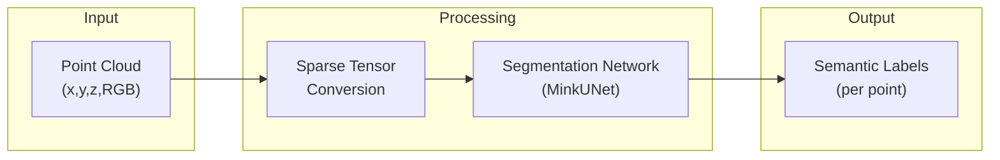
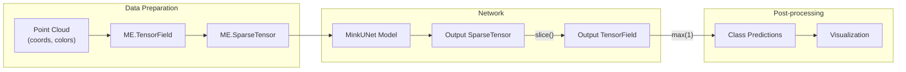
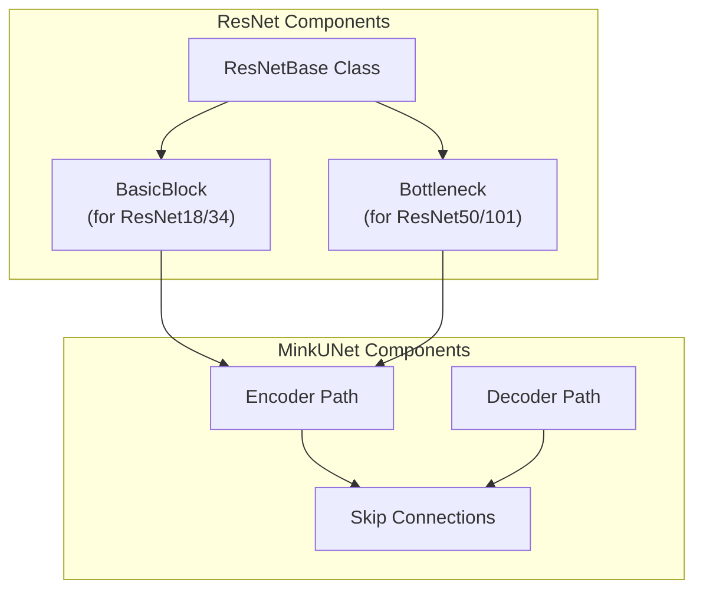

<!-- source: DeepWiki mcp.deepwiki.com · repo NVIDIA/MinkowskiEngine · page 6.2 Segmentation Networks · fetched 2026-10-26 -->

# Segmentation Networks

<details>
<summary>Relevant source files</summary>

The following files were used as context for generating this wiki page:

- [examples/indoor.py](examples/indoor.py)
- [examples/resnet.py](examples/resnet.py)

</details>


This document provides a detailed overview of segmentation networks implemented using MinkowskiEngine, focusing on semantic segmentation of 3D point clouds. Segmentation networks assign a class label to each point in a point cloud, making them essential for tasks like scene understanding, object identification, and spatial analysis. For information about classification networks, see [Classification Networks](#6.1).

## Introduction to 3D Semantic Segmentation

Semantic segmentation of 3D point clouds involves assigning a class label (e.g., wall, floor, chair) to each point in the cloud. Unlike classification that provides a single label for an entire point cloud, segmentation generates a dense point-wise classification. This task presents unique challenges due to the sparse and irregular nature of point cloud data, which MinkowskiEngine addresses efficiently through sparse convolutions.



Sources: [examples/indoor.py:135-153]()

## MinkUNet Architecture

MinkUNet is an adaptation of the U-Net architecture designed specifically for sparse tensors. It combines an encoder-decoder structure with skip connections, leveraging MinkowskiEngine's sparse convolution operations to efficiently process large point clouds while maintaining high resolution details.

```mermaid
graph TD
    subgraph "MinkUNet Architecture"
        Input["Input SparseTensor\n(coords + features)"]
        
        subgraph "Encoder"
            EB1["Encoder Block 1\nMinkowskiConv + BN + ReLU"]
            EB2["Encoder Block 2\nMinkowskiConv + BN + ReLU"]
            EB3["Encoder Block 3\nMinkowskiConv + BN + ReLU"]
            EB4["Encoder Block 4\nMinkowskiConv + BN + ReLU"]
        end
        
        Bottleneck["Bottleneck\nMinkowskiConv + BN + ReLU"]
        
        subgraph "Decoder"
            DB4["Decoder Block 4\nMinkowskiConvTranspose + BN + ReLU"]
            DB3["Decoder Block 3\nMinkowskiConvTranspose + BN + ReLU"]
            DB2["Decoder Block 2\nMinkowskiConvTranspose + BN + ReLU"]
            DB1["Decoder Block 1\nMinkowskiConvTranspose + BN + ReLU"]
        end
        
        Output["Output Layer\nMinkowskiConv"]
        Final["Final SparseTensor\n(per-point labels)"]
        
        Input --> EB1
        EB1 --> EB2
        EB2 --> EB3
        EB3 --> EB4
        EB4 --> Bottleneck
        
        Bottleneck --> DB4
        DB4 --> DB3
        DB3 --> DB2
        DB2 --> DB1
        DB1 --> Output
        Output --> Final
        
        %% Skip connections
        EB1 -.-> DB1
        EB2 -.-> DB2
        EB3 -.-> DB3
        EB4 -.-> DB4
    end
```



Sources: [examples/indoor.py:130-132]()

### Encoder

The encoder typically uses a series of sparse convolution blocks (similar to those in ResNet) to progressively downsample the feature maps while increasing the feature dimensionality. Each encoder block typically consists of:

1. `MinkowskiConvolution` layer
2. `MinkowskiBatchNorm` or `MinkowskiInstanceNorm` for normalization
3. `MinkowskiReLU` or other activation functions
4. Optional `MinkowskiPooling` for downsampling

The architecture leverages components from ResNet implementations, such as those defined in `examples/resnet.py`.

Sources: [examples/resnet.py:53-104]()

### Decoder

The decoder path upsamples the feature maps using transposed convolutions (`MinkowskiConvolutionTranspose`), gradually recovering spatial resolution while decreasing feature dimensionality. Skip connections from the encoder path are added to restore fine-grained spatial details.

### Skip Connections

The architecture implements skip connections that concatenate feature maps from the encoder path with corresponding feature maps in the decoder path. This helps preserve detailed spatial information that might be lost during downsampling operations.

## Implementation and Usage

MinkUNet can be instantiated with different depths and configurations. The example in `indoor.py` uses a variant called `MinkUNet34C` with 3 input channels (RGB) and 20 output classes for indoor scene segmentation:

```python
model = MinkUNet34C(3, 20).to(device)
```

### Inference Pipeline

The complete pipeline for inference involves:

1. Loading a point cloud
2. Converting coordinates and features to a `TensorField`
3. Converting to a sparse tensor
4. Forward pass through the network
5. Extracting and applying the resulting class predictions



Sources: [examples/indoor.py:135-164]()

## ScanNet Dataset and Class Labels

The example implementation is designed for indoor scene segmentation using 20 classes from the ScanNet dataset:

| Class ID | Label | Color |
|----------|-------|-------|
| 1 | wall | (174, 199, 232) |
| 2 | floor | (152, 223, 138) |
| 3 | cabinet | (31, 119, 180) |
| 4 | bed | (255, 187, 120) |
| 5 | chair | (188, 189, 34) |
| ... | ... | ... |
| 39 | otherfurniture | (82, 84, 163) |

The complete list of classes and their associated color mapping for visualization is defined in the `SCANNET_COLOR_MAP` dictionary in `indoor.py`.

Sources: [examples/indoor.py:51-100]()

## Example Usage

The `indoor.py` script provides a complete example of using MinkUNet for semantic segmentation:

1. Load a pre-trained model (`weights.pth`)
2. Load a point cloud (`1.ply`)
3. Process the point cloud with the model
4. Visualize the segmentation results using Open3D

```python
# Define model
model = MinkUNet34C(3, 20).to(device)
model.load_state_dict(torch.load(weights_path))
model.eval()

# Process point cloud
in_field = ME.TensorField(
    features=normalize_color(torch.from_numpy(colors)),
    coordinates=ME.utils.batched_coordinates([coords / voxel_size], dtype=torch.float32),
    quantization_mode=ME.SparseTensorQuantizationMode.UNWEIGHTED_AVERAGE,
    minkowski_algorithm=ME.MinkowskiAlgorithm.SPEED_OPTIMIZED,
    device=device,
)
sinput = in_field.sparse()
soutput = model(sinput)
out_field = soutput.slice(in_field)
```

Sources: [examples/indoor.py:125-164]()

## Customizing Segmentation Networks

To adapt segmentation networks for different applications, you can:

1. Change the number of input channels (based on available features)
2. Modify the number of output classes (based on target segmentation task)
3. Use different backbone architectures (such as ResNet variants from `resnet.py`)
4. Adjust the voxel size for quantization to balance resolution and memory requirements

### Relationship to ResNet Components

The MinkUNet architecture likely uses components from the ResNet implementations available in the MinkowskiEngine examples. ResNet blocks provide effective feature extraction capabilities that can be incorporated into the encoder portion of the U-Net architecture.



Sources: [examples/resnet.py:53-104](), [examples/resnet.py:159-182]()

## Conclusion

Segmentation networks implemented with MinkowskiEngine provide efficient and effective tools for semantic segmentation of 3D point clouds. The MinkUNet architecture, with its U-Net-inspired design adapted for sparse tensors, offers a powerful approach for tasks requiring dense point-wise classification in 3D space. By leveraging sparse convolutions, these networks can process large point clouds with high resolution while maintaining computational efficiency.

For information on developing custom network architectures with MinkowskiEngine, see [Custom Network Development](#6.3).

---

