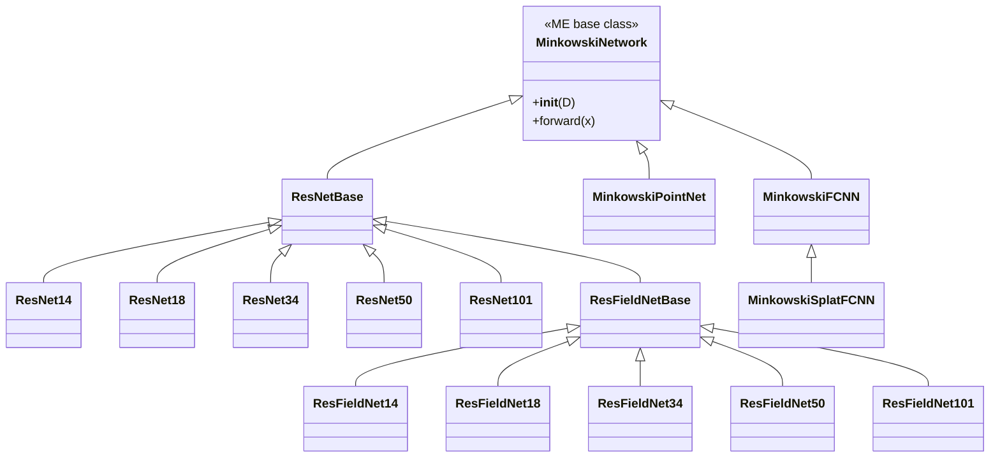
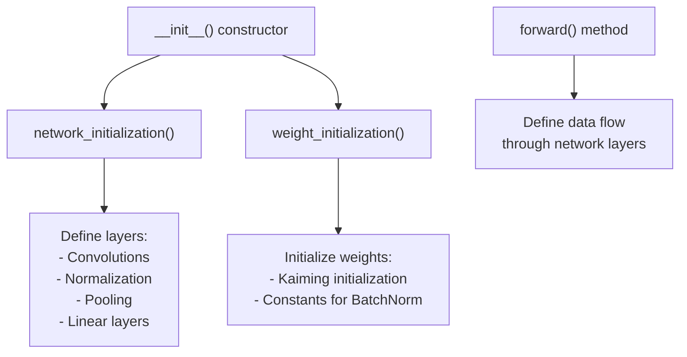
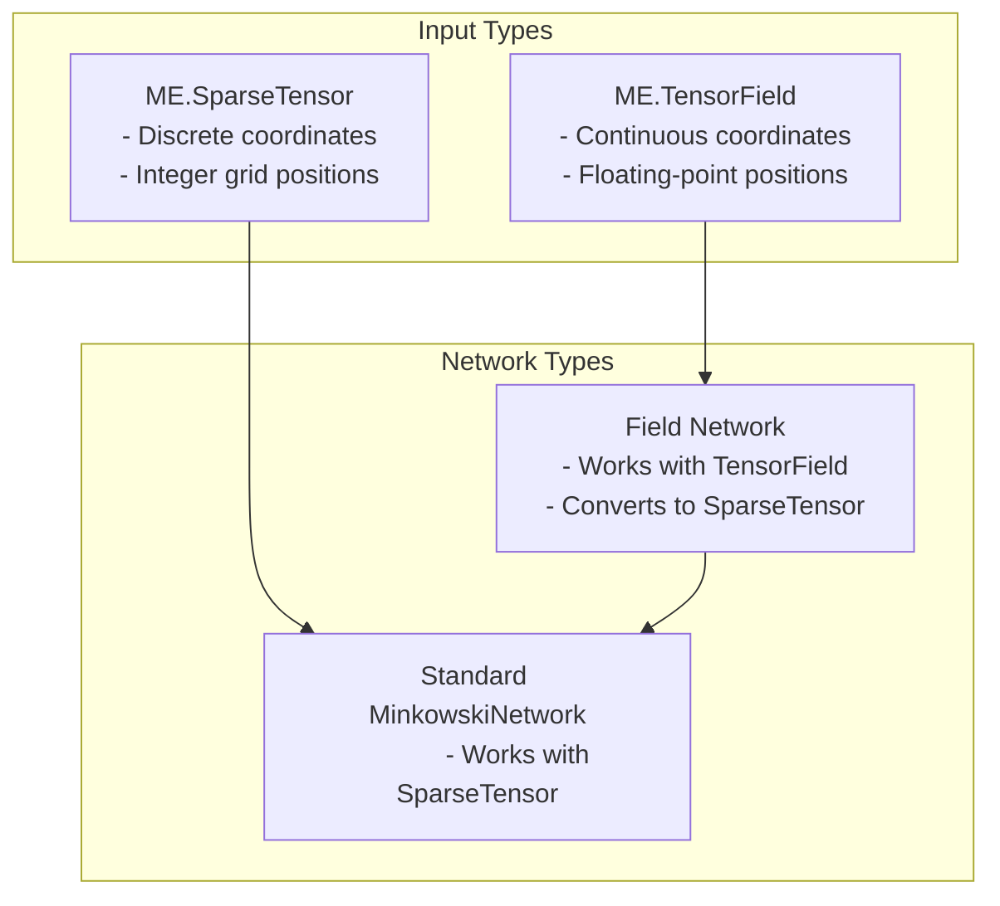
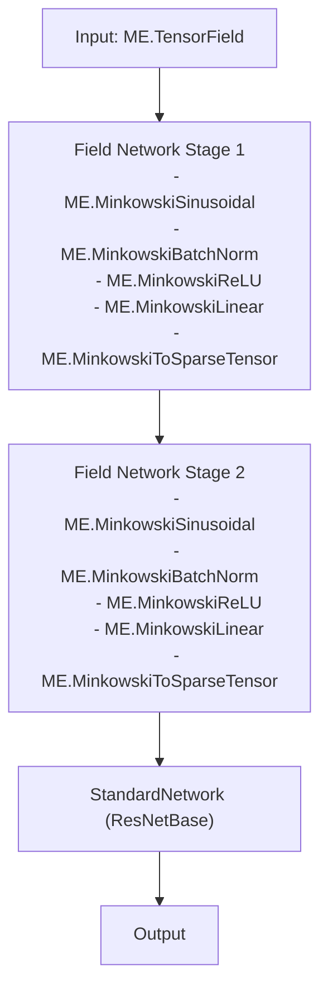
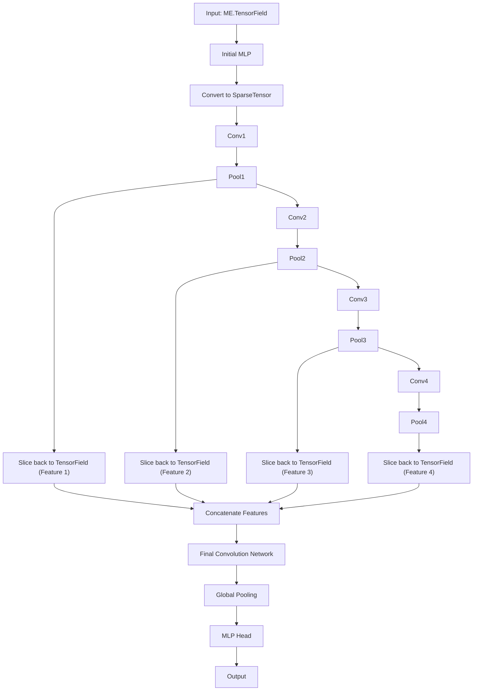
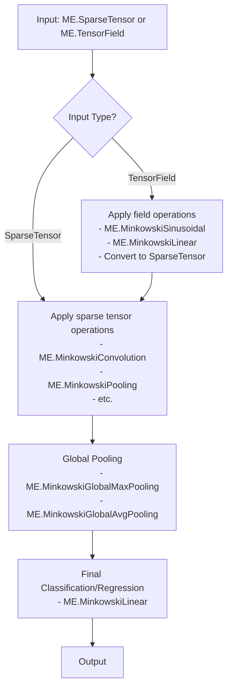
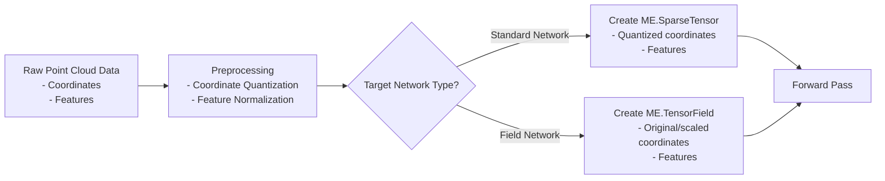

<!-- source: DeepWiki mcp.deepwiki.com · repo NVIDIA/MinkowskiEngine · page 6.3 Custom Network Development · fetched 2026-10-26 -->

# Custom Network Development

<details>
<summary>Relevant source files</summary>

The following files were used as context for generating this wiki page:

- [examples/README.md](examples/README.md)
- [examples/classification_modelnet40.py](examples/classification_modelnet40.py)
- [examples/common.py](examples/common.py)
- [examples/download_modelnet40.sh](examples/download_modelnet40.sh)
- [examples/indoor.py](examples/indoor.py)
- [examples/pointnet.py](examples/pointnet.py)
- [examples/resnet.py](examples/resnet.py)

</details>


## Purpose and Scope

This document provides guidance on developing custom neural network architectures using the MinkowskiEngine framework. It covers the fundamental patterns for creating networks that operate on sparse tensors, explains key components and design patterns, and demonstrates practical examples. For information about specific network implementations like classification or segmentation, see [Classification Networks](#6.1) and [Segmentation Networks](#6.2).

## Network Architecture Fundamentals

### Base Classes and Inheritance

When developing custom networks with MinkowskiEngine, you typically inherit from `ME.MinkowskiNetwork` or create a specialized base class that inherits from it. This provides the foundation for working with sparse tensors.



Sources: [examples/resnet.py:53-236](), [examples/pointnet.py:108-155](), [examples/classification_modelnet40.py:68-271]()

### Network Initialization Structure

A well-structured network initialization typically separates the main architecture setup from weight initialization:



Sources: [examples/resnet.py:59-66](), [examples/resnet.py:67-106](), [examples/classification_modelnet40.py:77-188]()

## Building Network Components

### Common Building Blocks

MinkowskiEngine provides sparse tensor equivalents for standard neural network operations. These can be combined into reusable blocks for your architecture.

#### Convolution Blocks

A typical convolution block in MinkowskiEngine includes a convolution operation followed by normalization and activation:


Example method for creating a convolution block:

```python
def get_conv_block(self, in_channel, out_channel, kernel_size, stride):
    return nn.Sequential(
        ME.MinkowskiConvolution(
            in_channel,
            out_channel,
            kernel_size=kernel_size,
            stride=stride,
            dimension=self.D,
        ),
        ME.MinkowskiBatchNorm(out_channel),
        ME.MinkowskiLeakyReLU(),
    )
```

Sources: [examples/classification_modelnet40.py:96-107]()

#### Dimensionality and Kernel Size

When building custom networks, you need to specify the dimensionality (D) of the input data (e.g., 3 for 3D point clouds) and appropriate kernel sizes for operations.

### Handling Different Input Types

MinkowskiEngine supports two main types of inputs:

1. **SparseTensor**: Discrete sparse tensors with integer coordinates
2. **TensorField**: Continuous fields with floating-point coordinates

Your network's architecture and forward method should be designed based on the input type.



Sources: [examples/resnet.py:148-156](), [examples/resnet.py:209-212](), [examples/pointnet.py:146-155]()

## Network Design Patterns

### Residual Networks (ResNet)

ResNet architectures in MinkowskiEngine follow a similar structure to their dense counterparts but operate on sparse tensors.

```mermaid
flowchart TB
    subgraph "ResNetBase"
        A["Input SparseTensor"] --> B["Initial Conv + InstanceNorm + ReLU"]
        B --> C["Layer 1 (BasicBlock/Bottleneck)"]
        C --> D["Layer 2 (BasicBlock/Bottleneck)"]
        D --> E["Layer 3 (BasicBlock/Bottleneck)"]
        E --> F["Layer 4 (BasicBlock/Bottleneck)"]
        F --> G["Conv5 (Dropout + Conv + InstanceNorm + GELU)"]
        G --> H["Global Pooling"]
        H --> I["Final Linear Layer"]
        I --> J["Output"]
    end
    
    subgraph "BasicBlock/Bottleneck"
        K["Input"] --> L["Conv1"]
        L --> M["Conv2"]
        K --> N["Downsample (optional)"]
        M --> O["Add"]
        N --> O
        O --> P["Output"]
    end
```



Sources: [examples/resnet.py:53-156](), [examples/resnet.py:114-146]()

### Field Networks

Field networks operate on `TensorField` inputs with continuous coordinates, often using sinusoidal encodings and multiple network stages.



Sources: [examples/resnet.py:184-212]()

### Feature Pyramid Networks

These networks extract features at multiple scales and combine them for multi-scale analysis:



Sources: [examples/classification_modelnet40.py:189-216]()

## Practical Implementation

### Network Forward Flow

The forward method defines how data flows through your network. It should account for the type of input tensor (SparseTensor or TensorField) and implement the appropriate operations.



Sources: [examples/resnet.py:148-156](), [examples/pointnet.py:146-155](), [examples/classification_modelnet40.py:189-216]()

### Input Data Preparation

Preparing input data correctly is crucial for MinkowskiEngine networks:



Sources: [examples/indoor.py:136-152](), [examples/classification_modelnet40.py:282-291]()

### Example: Building a Custom Network

Here's a step-by-step guide for building a custom network:

1. **Inherit from appropriate base class**:
   ```python
   class MyCustomNetwork(ME.MinkowskiNetwork):
       def __init__(self, in_channels, out_channels, D=3):
           ME.MinkowskiNetwork.__init__(self, D)
           # Initialize network
   ```

2. **Define network initialization**:
   ```python
   def network_initialization(self, in_channels, out_channels):
       # Define network layers
       self.conv1 = nn.Sequential(
           ME.MinkowskiConvolution(in_channels, 64, kernel_size=3, dimension=self.D),
           ME.MinkowskiBatchNorm(64),
           ME.MinkowskiReLU()
       )
       # ... more layers ...
       self.global_pool = ME.MinkowskiGlobalMaxPooling()
       self.final = ME.MinkowskiLinear(128, out_channels)
   ```

3. **Implement forward method**:
   ```python
   def forward(self, x):
       # Define data flow
       x = self.conv1(x)
       # ... more operations ...
       x = self.global_pool(x)
       return self.final(x)
   ```

4. **Create instance and use**:
   ```python
   # Create network
   net = MyCustomNetwork(in_channels=3, out_channels=10, D=3)
   
   # Prepare data
   coordinates = ME.utils.batched_coordinates([coords])
   features = torch.ones((len(coordinates), 3))
   
   # Create input tensor
   input = ME.SparseTensor(features, coordinates)
   
   # Forward pass
   output = net(input)
   ```

Sources: [examples/resnet.py:53-156](), [examples/pointnet.py:108-155](), [examples/classification_modelnet40.py:68-188]()

## Best Practices

### Network Architecture Design

1. **Modularity**: Create reusable blocks for common operations.
2. **Dimension Handling**: Always specify the dimension parameter (D) appropriately.
3. **Weight Initialization**: Implement proper weight initialization for stability.
4. **Residual Connections**: Consider using residual connections for deeper networks.
5. **Pooling Strategy**: Use appropriate pooling operations based on the task.

### Performance Optimization

1. **Batch Size**: Adjust batch size based on available memory.
2. **Quantization**: Choose appropriate voxel size/quantization for your data.
3. **Algorithm Selection**: Use `ME.MinkowskiAlgorithm.SPEED_OPTIMIZED` when performance is critical.
4. **Memory Management**: Use `torch.cuda.empty_cache()` when needed to free GPU memory.

### Saving and Loading Models

```python
# Saving model
torch.save(net.state_dict(), "model.pth")

# Loading model
net = MyCustomNetwork(in_channels=3, out_channels=10)
net.load_state_dict(torch.load("model.pth"))
```

Sources: [examples/resnet.py:280-282](), [examples/indoor.py:130-132]()

## Conclusion

Developing custom networks with MinkowskiEngine follows similar patterns to standard PyTorch development, with additional considerations for sparse tensor operations. By understanding the key components and design patterns presented in this guide, you can create efficient network architectures for processing sparse 3D data.

For more inspiration, refer to the example implementations in the MinkowskiEngine repository, including ResNet variants, PointNet adaptations, and specialized networks for tasks like classification and segmentation.