# Page: Overview

# Overview

<details>
<summary>Relevant source files</summary>

The following files were used as context for generating this wiki page:

- [CHANGELOG.md](CHANGELOG.md)
- [Makefile](Makefile)
- [MinkowskiEngine/__init__.py](MinkowskiEngine/__init__.py)
- [README.md](README.md)
- [docs/convolution.rst](docs/convolution.rst)
- [docs/index.rst](docs/index.rst)
- [docs/quick_start.md](docs/quick_start.md)
- [docs/utils.rst](docs/utils.rst)
- [setup.py](setup.py)
- [tests/python/dense.py](tests/python/dense.py)

</details>


The MinkowskiEngine is an auto-differentiation library for sparse tensors. It provides efficient neural network operations for spatially sparse data, particularly in 3D contexts like point clouds, voxel grids, and other high-dimensional representations. This page introduces the fundamental concepts, architecture, and capabilities of the MinkowskiEngine.

For detailed installation instructions, see [Installation and Setup](#1.1). For basic usage examples, see [Quick Start Guide](#1.3).

## Purpose and Scope

MinkowskiEngine was designed to address the challenge of processing sparse 3D data efficiently. Unlike traditional deep learning methods operating on dense tensors, MinkowskiEngine focuses on *spatially* sparse data where most voxels or grid points contain no information. This is particularly important for 3D perception, where point clouds contain information only at specific spatial locations, with most of the 3D space being empty.

The library provides:
- A comprehensive implementation of sparse tensor operations
- Neural network layers for spatially sparse inputs
- Support for both CPU and GPU computations with CUDA accelerations
- Integration with PyTorch for seamless auto-differentiation

Sources: [README.md:11-11](), [README.md:34-37]()

## Core Architecture

The MinkowskiEngine is built around a layered architecture that efficiently handles sparse data through specialized data structures and operations.

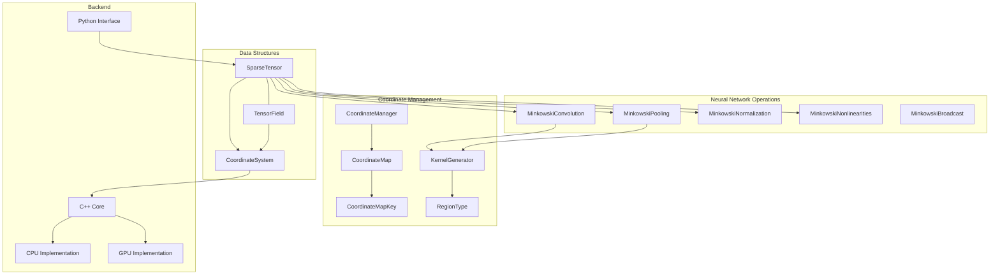

The architecture consists of these main components:

1. **Data Structures**: `SparseTensor` and `TensorField` represent spatially sparse data with coordinates and features
2. **Coordinate Management**: Handles efficient coordinate mapping and indexing for sparse operations
3. **Neural Network Operations**: Implements standard neural network layers for sparse tensors
4. **Backend**: Provides both CPU and GPU implementations for the operations

Sources: [README.md:47-57](), [MinkowskiEngine/__init__.py:74-87](), [MinkowskiEngine/__init__.py:93-98]()

## Sparse Tensor Networks

Traditional neural networks operate on dense tensors where computations are performed at all spatial locations. MinkowskiEngine introduces **sparse tensor networks** that operate only on specified coordinates where data is present.

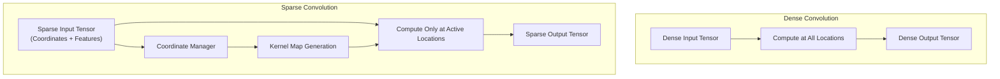

The key differences between sparse tensor networks and traditional networks:

1. **Computational Efficiency**: Operations only performed at non-zero locations
2. **Memory Efficiency**: Only non-zero values and their coordinates are stored
3. **Sparse Convolution**: Convolution kernels applied only at specified locations
4. **Dynamic Computation Graph**: Coordinates can change through the network

Sources: [README.md:33-43](), [setup.py:331-332]()

## Data Flow for Sparse Tensor Operations

The following diagram illustrates the typical data flow when processing point cloud data through MinkowskiEngine:

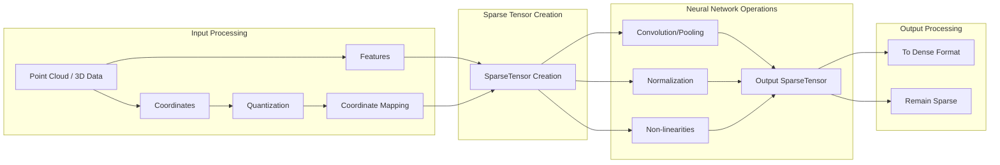

In this process:
1. Input 3D data is separated into coordinates and features
2. Coordinates are quantized to map continuous space to discrete voxel grid
3. A SparseTensor is created with the features and mapped coordinates
4. Neural network operations are applied to the SparseTensor
5. The resulting SparseTensor can be used for further processing or converted to other formats

Sources: [tests/python/dense.py:44-65](), [README.md:205-218]()

## Key Features

MinkowskiEngine provides a comprehensive set of features for working with sparse tensors:

| Feature | Description |
|---------|-------------|
| Unlimited Dimensions | Support for high-dimensional sparse tensors (beyond 3D) |
| Neural Network Layers | Convolution, pooling, normalization, broadcasting, etc. |
| Dynamic Computation | Coordinates can change throughout the network |
| Custom Kernel Shapes | Flexible definition of convolution kernel shapes |
| Multi-GPU Support | Efficient distributed training |
| Optimized Performance | Multi-threaded kernel mapping and GPU acceleration |

Sources: [README.md:47-57](), [README.md:83-89]()

## Implementation Details

MinkowskiEngine is implemented as a PyTorch extension with a Python front-end and a C++/CUDA back-end:

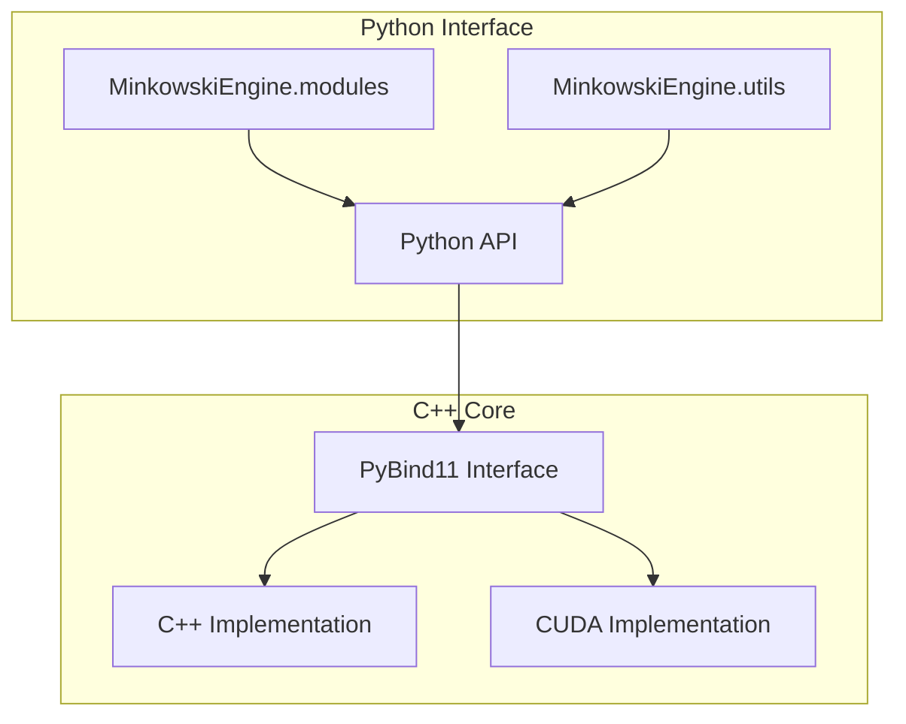

The implementation includes:
- Python interface for ease of use and PyTorch integration
- C++ core for CPU operations
- CUDA implementation for GPU acceleration
- PyBind11 for binding C++ to Python

The library is designed to be used with PyTorch's existing ecosystem, allowing for seamless integration with other PyTorch models and tools.

Sources: [setup.py:301-317](), [Makefile:222-270]()

## Common Use Cases

MinkowskiEngine is designed for applications involving spatially sparse data, including:

1. **3D Semantic Segmentation**: Assigning semantic labels to 3D points
2. **3D Object Classification**: Recognizing objects from 3D scans
3. **3D Object Detection**: Localizing and classifying 3D objects
4. **Point Cloud Registration**: Aligning multiple point cloud scans
5. **3D Reconstruction**: Generating complete 3D models from partial observations

These applications leverage the efficiency of sparse tensor operations for processing large-scale 3D data where traditional dense approaches would be computationally prohibitive.

Sources: [README.md:20-31](), [README.md:390-396]()

## System Requirements

To use MinkowskiEngine, you need:
- Ubuntu >= 14.04 (or other Linux distributions)
- Python >= 3.6
- PyTorch >= 1.7
- CUDA >= 10.1.243 (for GPU support, should match PyTorch's CUDA version)
- GCC >= 7.4.0
- OpenBLAS or other BLAS libraries

For installation instructions, please refer to [Installation and Setup](#1.1).

Sources: [README.md:59-67](), [README.md:69-78]()

## Conclusion

MinkowskiEngine provides an efficient framework for deep learning on sparse spatial data. By focusing only on non-empty voxels or points, it enables processing of large-scale 3D data that would be impossible with dense approaches. The library's integration with PyTorch makes it accessible to researchers and practitioners already familiar with deep learning tools, while its optimized backend ensures high performance for real-world applications.

For more detailed information on specific components, please refer to the other sections in this documentation.

---

# Page: Installation and Setup

# Installation and Setup

<details>
<summary>Relevant source files</summary>

The following files were used as context for generating this wiki page:

- [Makefile](Makefile)
- [README.md](README.md)
- [docs/_templates/layout.html](docs/_templates/layout.html)
- [docs/quick_start.md](docs/quick_start.md)
- [setup.py](setup.py)

</details>


This document provides detailed instructions for installing and configuring the MinkowskiEngine library on various platforms with different dependency requirements. MinkowskiEngine is a PyTorch-based library for sparse tensor operations that supports both CPU and GPU (CUDA) computation.

For information about the fundamental concepts and usage patterns, please refer to [Basic Concepts](#1.2). If you're looking for a quick introduction to get started, see [Quick Start Guide](#1.3).

## System Requirements

Before installing MinkowskiEngine, ensure that your system meets the following requirements:

| Requirement | Minimum Version | Notes |
|-------------|----------------|-------|
| Operating System | Ubuntu 14.04+ | Windows is not supported. macOS has limited support |
| CUDA | 10.1.243+ | Required for GPU acceleration only |
| PyTorch | 1.7+ | Must match the CUDA version used for MinkowskiEngine |
| Python | 3.6+ | |
| GCC | 7.4.0+ | For CUDA 10.2, must use GCC < 8 |
| ninja | Latest | Required for installation |
| BLAS library | openblas, mkl, atlas, or blas | |

Sources: [README.md:58-66](), [setup.py:44-54]()

## Installation Methods

MinkowskiEngine provides four main installation methods to accommodate different environments and requirements.

### Installation Workflow

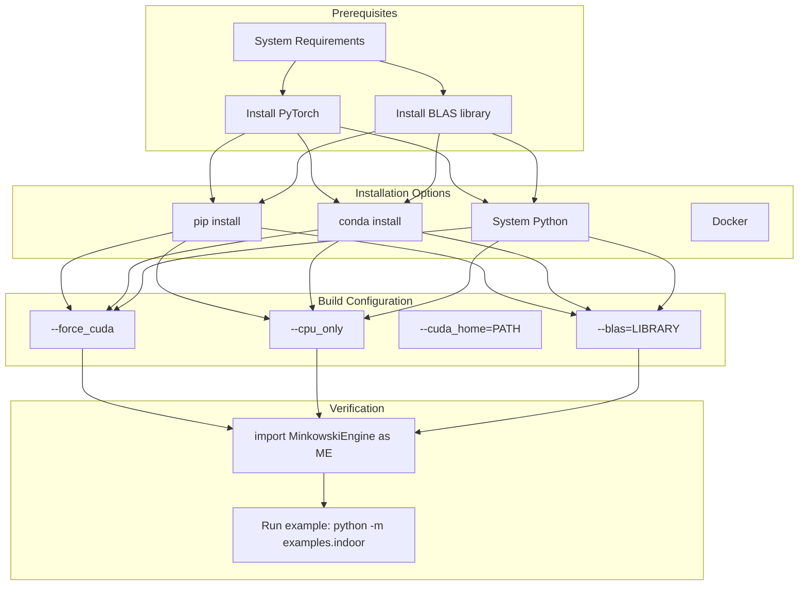

Sources: [README.md:68-72](), [setup.py:121-138]()

### 1. Pip Installation

The simplest method is to install via pip:

```bash
# Install system dependencies
sudo apt install build-essential python3-dev libopenblas-dev
pip install torch ninja

# Install MinkowskiEngine
pip install -U MinkowskiEngine --install-option="--blas=openblas" -v --no-deps

# For the latest development version
pip install -U git+https://github.com/NVIDIA/MinkowskiEngine --no-deps
```

You can customize the installation with additional options:

```bash
# Force CUDA installation even if torch.cuda.is_available() is False
pip install -U MinkowskiEngine --install-option="--force_cuda" --no-deps

# Force CPU-only build (no CUDA support)
pip install -U MinkowskiEngine --install-option="--cpu_only" --no-deps

# Specify a different BLAS library
pip install -U MinkowskiEngine --install-option="--blas=mkl" --no-deps
```

Sources: [README.md:80-107]()

### 2. Anaconda Installation

Anaconda installation is recommended for better dependency management, especially for different CUDA versions.

#### For CUDA 10.2:

```bash
sudo apt install g++-7  # For CUDA 10.2, must use GCC < 8
conda create -n py3-mink python=3.8
conda activate py3-mink

conda install openblas-devel -c anaconda
conda install pytorch=1.9.0 torchvision cudatoolkit=10.2 -c pytorch -c nvidia

# Install MinkowskiEngine
export CXX=g++-7
# Optionally specify CUDA home
# export CUDA_HOME=/usr/local/cuda-10.2
pip install -U git+https://github.com/NVIDIA/MinkowskiEngine -v --no-deps \
    --install-option="--blas_include_dirs=${CONDA_PREFIX}/include" \
    --install-option="--blas=openblas"
```

#### For CUDA 11.x:

```bash
conda create -n py3-mink python=3.8
conda activate py3-mink

conda install openblas-devel -c anaconda
conda install pytorch=1.9.0 torchvision cudatoolkit=11.1 -c pytorch -c nvidia

# Install MinkowskiEngine
# Optionally specify CUDA home
# export CUDA_HOME=/usr/local/cuda-11.1
pip install -U git+https://github.com/NVIDIA/MinkowskiEngine -v --no-deps \
    --install-option="--blas_include_dirs=${CONDA_PREFIX}/include" \
    --install-option="--blas=openblas"
```

Sources: [README.md:109-161]()

### 3. System Python Installation

```bash
# Install system requirements
sudo apt install build-essential python3-dev libopenblas-dev

# Install pip if not already installed
curl https://bootstrap.pypa.io/get-pip.py | python3

# Install Python requirements
python3 -m pip install torch numpy ninja

# Clone and install MinkowskiEngine
git clone https://github.com/NVIDIA/MinkowskiEngine.git
cd MinkowskiEngine
python setup.py install

# With custom options (example)
# export CXX=c++; export CUDA_HOME=/usr/local/cuda-11.1; python setup.py install --blas=openblas --force_cuda
```

Sources: [README.md:163-184]()

### 4. Docker Installation

```bash
git clone https://github.com/NVIDIA/MinkowskiEngine
cd MinkowskiEngine
docker build -t minkowski_engine docker

# Verify installation
docker run minkowski_engine python3 -c "import MinkowskiEngine; print(MinkowskiEngine.__version__)"
```

Sources: [README.md:186-198]()

## Build Configuration Options

MinkowskiEngine's build system provides various configuration options to adapt to different hardware and requirements.

### Build Configuration Components

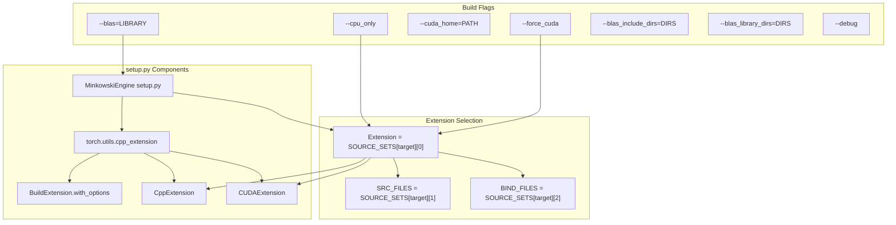

Sources: [setup.py:147-307]()

### 1. CPU-Only vs CUDA Build

MinkowskiEngine can be built with or without CUDA support:

```bash
# CPU-only build
python setup.py install --cpu_only

# Force CUDA build (even if torch.cuda.is_available() is False)
python setup.py install --force_cuda

# Specify CUDA home directory
python setup.py install --cuda_home=/usr/local/cuda-11.1
```

When `--cpu_only` is specified, the build uses the `CppExtension` from PyTorch and omits CUDA-specific source files. When CUDA is enabled, it uses `CUDAExtension` and includes additional GPU implementations.

Sources: [setup.py:124-138](), [setup.py:301-307]()

### 2. BLAS Configuration

MinkowskiEngine supports different BLAS libraries for CPU matrix operations:

```bash
# OpenBLAS (default)
python setup.py install --blas=openblas

# Intel Math Kernel Library (MKL)
conda install -c intel mkl mkl-include
python setup.py install --blas=mkl

# ATLAS
python setup.py install --blas=atlas

# System BLAS
python setup.py install --blas=blas
```

You can also specify include and library directories for BLAS:

```bash
python setup.py install --blas=openblas \
    --blas_include_dirs=/path/to/include \
    --blas_library_dirs=/path/to/lib
```

Sources: [setup.py:186-218](), [Makefile:90-111]()

### 3. Compiler and Optimization Options

```bash
# Specify C++ compiler
export CXX=g++-7
python setup.py install

# Enable debug build
python setup.py install --debug

# Specify CUDA architecture list
export TORCH_CUDA_ARCH_LIST="5.2 6.0 6.1 7.0 7.5 8.0 8.6+PTX"
python setup.py install --force_cuda
```

Sources: [setup.py:277-295](), [README.md:285-291]()

## Troubleshooting Common Installation Issues

### 1. CUDA Version Mismatch

**Problem**: The CUDA version used for PyTorch must match the CUDA version used for MinkowskiEngine.

**Solution**: Ensure you use the same CUDA version for both. For example, if using conda:

```bash
conda install pytorch=1.9.0 torchvision cudatoolkit=11.1 -c pytorch -c nvidia
export CUDA_HOME=/usr/local/cuda-11.1
```

Sources: [README.md:62-63]()

### 2. GCC Version Compatibility

**Problem**: CUDA versions have specific GCC compatibility requirements.

**Solution**:
- For CUDA 10.2: Use GCC < 8 (recommended: GCC 7.4.0)
- For CUDA 11.x: Newer GCC versions are supported

```bash
# For CUDA 10.2
sudo apt install g++-7
export CXX=g++-7
```

Sources: [README.md:118]()

### 3. Unhandled CUDA Out-Of-Memory Exception

**Problem**: Thrust exceptions in CUDA 10.

**Solution**: This is a known issue in thrust with CUDA 10. Consider upgrading to CUDA 11.x or periodically clearing the PyTorch CUDA cache:

```python
import torch
torch.cuda.empty_cache()
```

Sources: [README.md:293-296](), [README.md:300-309]()

### 4. Memory Issues on Multi-CPU Systems

**Problem**: Performance degradation on systems with many CPU cores.

**Solution**: Limit the number of OpenMP threads:

```bash
export OMP_NUM_THREADS=<number of threads to use>
python <your_program.py>
```

Recommended value is typically less than 24, regardless of how many actual CPU cores you have.

Sources: [README.md:320-327]()

## Verification

To verify your installation, run the following Python code:

```python
import torch
import MinkowskiEngine as ME
print(f"MinkowskiEngine version: {ME.__version__}")
print(f"CUDA available: {torch.cuda.is_available()}")
```

For a more comprehensive test, run one of the example networks:

```bash
git clone https://github.com/NVIDIA/MinkowskiEngine.git
cd MinkowskiEngine
python -m examples.indoor
```

This will download a pretrained model and run semantic segmentation on a 3D scene.

Sources: [README.md:205-211](), [README.md:20-31]()

---

# Page: Basic Concepts

# Basic Concepts

<details>
<summary>Relevant source files</summary>

The following files were used as context for generating this wiki page:

- [CHANGELOG.md](CHANGELOG.md)
- [Makefile](Makefile)
- [MinkowskiEngine/MinkowskiSparseTensor.py](MinkowskiEngine/MinkowskiSparseTensor.py)
- [MinkowskiEngine/MinkowskiTensor.py](MinkowskiEngine/MinkowskiTensor.py)
- [MinkowskiEngine/MinkowskiTensorField.py](MinkowskiEngine/MinkowskiTensorField.py)
- [MinkowskiEngine/__init__.py](MinkowskiEngine/__init__.py)
- [README.md](README.md)
- [docs/quick_start.md](docs/quick_start.md)
- [setup.py](setup.py)
- [tests/python/tensor_field.py](tests/python/tensor_field.py)

</details>


This page introduces the fundamental concepts of the MinkowskiEngine, focusing on sparse tensors, coordinate systems, and the architecture that powers this library. For detailed installation instructions, see [Installation and Setup](#1.1), and for specific examples of how to use the engine, refer to the [Quick Start Guide](#1.3).

## What is MinkowskiEngine?

MinkowskiEngine is an auto-differentiation library specifically designed for sparse tensors. Unlike traditional deep learning frameworks that work primarily with dense tensors, MinkowskiEngine provides specialized operations for spatially sparse data, such as 3D point clouds, high-dimensional statistical data, and other sparse inputs.

The library supports all standard neural network operations (convolution, pooling, broadcasting, etc.) but reimplements them to efficiently operate on sparse data structures.

Sources: [README.md:7-11](), [README.md:33-38]()

## Sparse Tensors vs. Dense Tensors

To understand MinkowskiEngine, it's important to first grasp the difference between dense and sparse tensors.

**Dense Tensors**: In traditional neural networks, data is represented in dense tensors where all positions in the tensor grid contain values, even if those values are zeros. This is memory-inefficient for spatially sparse data.

**Sparse Tensors**: Sparse tensors only store non-zero values and their corresponding coordinates. This significantly reduces memory usage and computation time when most of the tensor consists of zeros.

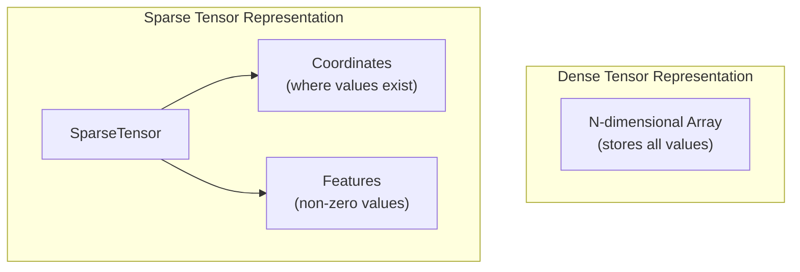

Sources: [README.md:41-43](), [MinkowskiSparseTensor.py:48-78]()

## COO Format and Sparse Tensor Representation

MinkowskiEngine uses the COOrdinate (COO) format to represent sparse tensors. This representation consists of two key components:

1. **Coordinates (C)**: A matrix containing the spatial positions of non-zero elements
2. **Features (F)**: The feature values associated with each coordinate

Mathematically, this is represented as:

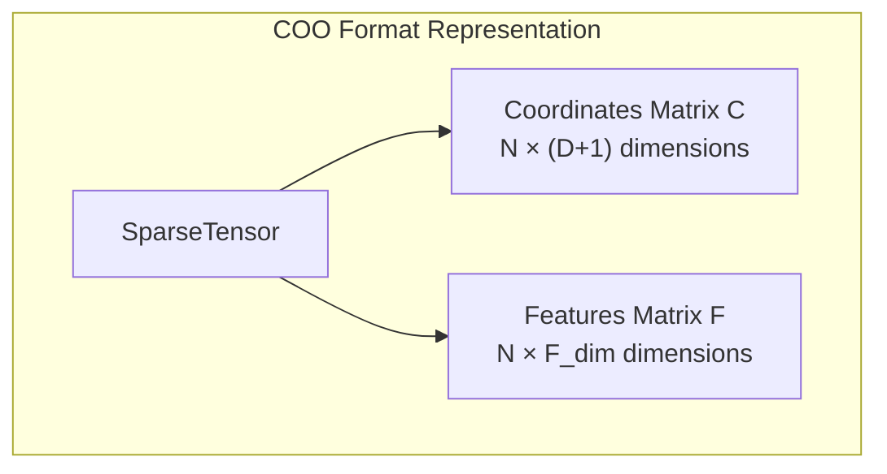

Where:
- N is the number of non-zero elements
- D is the spatial dimension (e.g., 3 for 3D space)
- The +1 in coordinates is for the batch index
- F_dim is the feature dimension

Example: For 3D point clouds, coordinates might be (x,y,z) positions, while features could be RGB colors, normals, or learned embeddings at those positions.

Sources: [MinkowskiSparseTensor.py:50-78](), [MinkowskiTensor.py:140-161]()

## Coordinate System

### Batch Representation

MinkowskiEngine handles batched data by treating the batch index as an additional spatial dimension. This allows for efficient processing of multiple samples simultaneously.

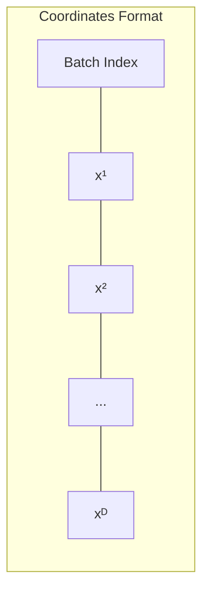

The first column of the coordinates matrix represents the batch index, followed by D spatial dimensions.

### Tensor Stride

Tensor stride defines the spacing between adjacent elements in a sparse tensor. It's similar to the concept of stride in convolution but applied to sparse tensors.

- A tensor stride of 1 means coordinates are at the base resolution
- Higher tensor strides indicate coarser resolutions (similar to downsampling in dense tensors)

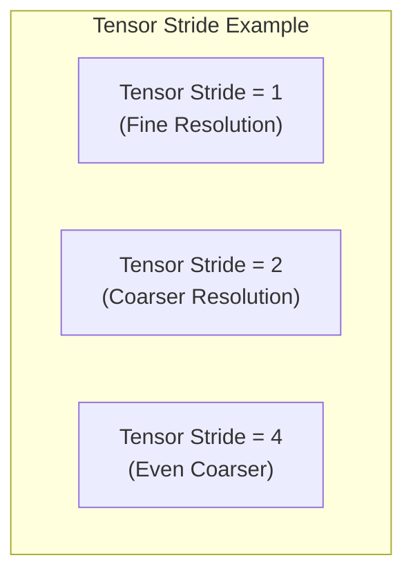

Tensor stride is an important property stored in the `CoordinateMapKey` which uniquely identifies a particular set of coordinates.

Sources: [MinkowskiSparseTensor.py:73-77](), [MinkowskiTensor.py:215-222](), [MinkowskiSparseTensor.py:196-218]()

## Core Data Structures

### SparseTensor

The `SparseTensor` class is the fundamental data structure in MinkowskiEngine. It represents spatially sparse data with discrete coordinates.

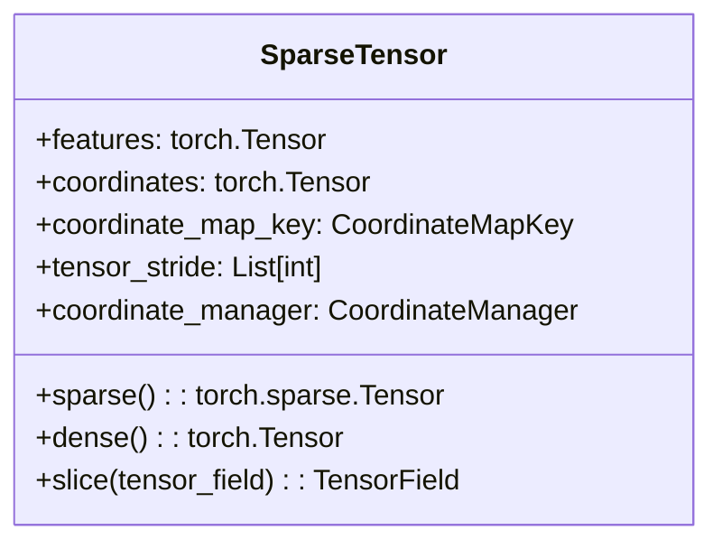

A `SparseTensor` is created by specifying:
- Features: The values at each non-zero position
- Coordinates: The positions of non-zero elements
- Tensor stride: The spacing between elements

Sources: [MinkowskiSparseTensor.py:122-189](), [MinkowskiSparseTensor.py:231-287]()

### TensorField

The `TensorField` class represents continuous (non-quantized) sparse data. It's useful for operations that require interpolation or when working with raw point cloud data.

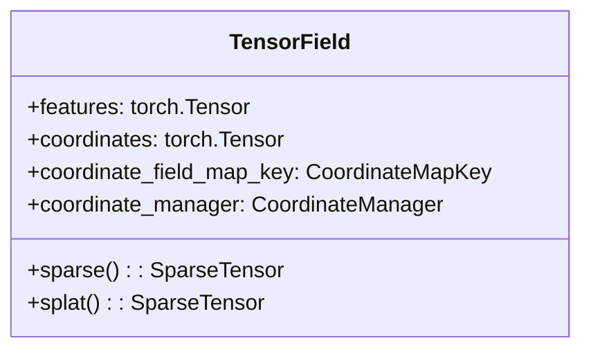

The key difference between `SparseTensor` and `TensorField` is that:
- `SparseTensor` uses discrete, quantized coordinates
- `TensorField` uses continuous, floating-point coordinates

`TensorField` can be converted to a `SparseTensor` using the `sparse()` method, which applies quantization.

Sources: [MinkowskiTensorField.py:76-146](), [MinkowskiTensorField.py:286-379]()

## Coordinate Management System

The coordinate management system is a critical component that enables efficient operations on sparse tensors.

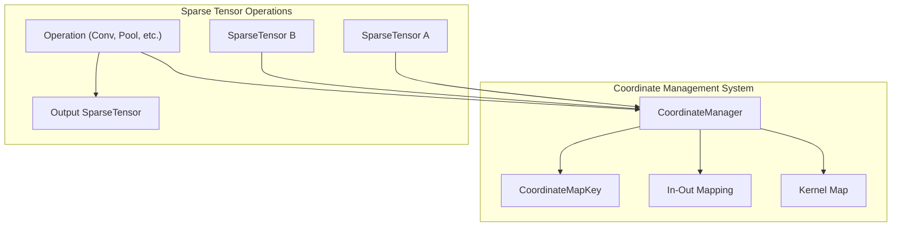

### CoordinateManager

The `CoordinateManager` handles:
- Storage of coordinate mapping
- Generation of kernel maps for convolution/pooling
- Efficient lookup of coordinates
- Coordinate union, intersection, and other set operations

### CoordinateMapKey

A `CoordinateMapKey` uniquely identifies a set of coordinates with specific tensor stride. It's used to retrieve coordinate information from the `CoordinateManager`.

Sources: [MinkowskiSparseTensor.py:213-258](), [MinkowskiTensor.py:211-214]()

## Quantization

Quantization is the process of converting continuous coordinates to discrete coordinates. This is especially important when working with point clouds or other continuous data.

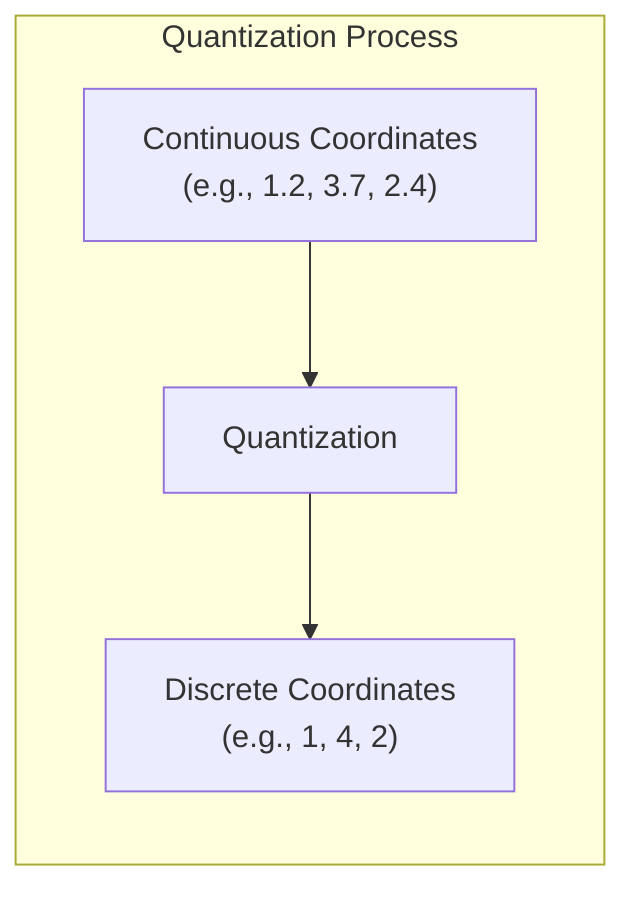

MinkowskiEngine provides several quantization modes through the `SparseTensorQuantizationMode` enum:

- `RANDOM_SUBSAMPLE`: Randomly selects one point per voxel
- `UNWEIGHTED_AVERAGE`: Averages all features within a voxel
- `UNWEIGHTED_SUM`: Sums all features within a voxel
- `MAX_POOL`: Takes the maximum feature value within a voxel
- `SPLAT_LINEAR_INTERPOLATION`: Distributes features to neighboring voxels with linear weights

Quantization is applied when:
1. Creating a `SparseTensor` directly from continuous coordinates
2. Converting a `TensorField` to a `SparseTensor` using the `sparse()` method

Sources: [MinkowskiTensor.py:47-61](), [MinkowskiSparseTensor.py:293-345](), [MinkowskiTensorField.py:292-378]()

## Operations on Sparse Tensors

MinkowskiEngine implements standard neural network operations for sparse tensors:

### Convolution

Sparse convolution applies convolutional filters only at locations where input features exist, significantly reducing computation compared to dense convolution.

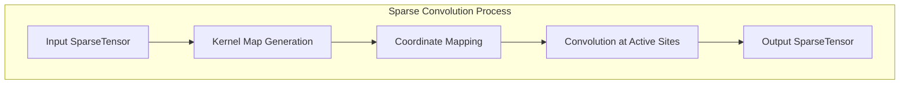

### Pooling

Similar to convolution, pooling operations (max, average, sum) are implemented to work only on non-zero elements.

### Other Operations

- Normalization (BatchNorm, InstanceNorm)
- Non-linearities (ReLU, Sigmoid, etc.)
- Broadcasting operations
- Global pooling

These operations are designed to maintain sparsity throughout the network, avoiding conversion to dense representations.

Sources: [README.md:48-56](), [MinkowskiEngine/__init__.py:100-107](), [MinkowskiEngine/__init__.py:111-125]()

## Processing Pipeline

The typical processing pipeline in MinkowskiEngine involves:

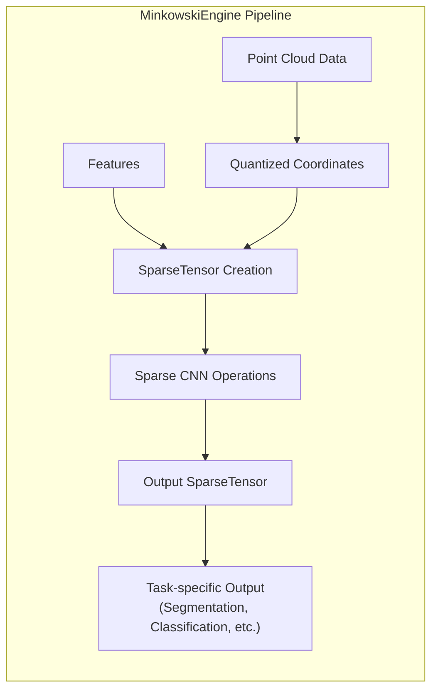

1. Input preparation: Converting raw data to coordinates and features
2. Quantization: Converting continuous coordinates to discrete grid points
3. SparseTensor creation: Combining quantized coordinates with features
4. Neural network operations: Applying convolutions, pooling, etc.
5. Task-specific outputs: Converting back to the desired output format

Sources: [README.md:20-31](), [README.md:205-211]()

## Memory Management

MinkowskiEngine offers options for memory management:

- GPU-accelerated coordinate management
- Multi-threaded kernel map generation
- Cache control for efficient memory usage

When using GPU operations, it's important to properly manage the cache to avoid memory leaks, especially during long-running training sessions.

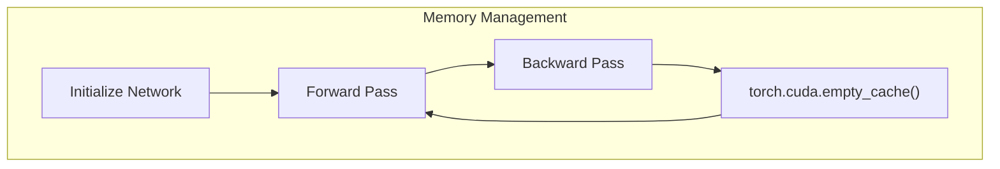

Sources: [README.md:298-308](), [README.md:320-323]()

## Conclusion

The MinkowskiEngine provides a comprehensive framework for working with sparse tensors, particularly for 3D point cloud processing tasks. By understanding the core concepts of sparse tensors, coordinate systems, and the operations available, you can effectively leverage this library for a wide range of applications.

For specific examples and use cases, refer to the [Quick Start Guide](#1.3) and [Examples and Use Cases](#6).

---

# Page: Quick Start Guide

# Quick Start Guide

<details>
<summary>Relevant source files</summary>

The following files were used as context for generating this wiki page:

- [Makefile](Makefile)
- [README.md](README.md)
- [docs/quick_start.md](docs/quick_start.md)
- [examples/README.md](examples/README.md)
- [examples/classification_modelnet40.py](examples/classification_modelnet40.py)
- [examples/common.py](examples/common.py)
- [examples/download_modelnet40.sh](examples/download_modelnet40.sh)
- [examples/indoor.py](examples/indoor.py)
- [examples/pointnet.py](examples/pointnet.py)
- [examples/resnet.py](examples/resnet.py)
- [setup.py](setup.py)

</details>


This guide provides a concise introduction to MinkowskiEngine, a powerful library for sparse tensor operations designed primarily for 3D point cloud processing. You'll learn the basics of setting up MinkowskiEngine, creating sparse tensors, building neural networks, and running simple examples. For in-depth concepts about sparse tensors and the coordinate management system, see [Basic Concepts](#1.2).

## Installation

MinkowskiEngine can be installed via pip, conda, or from source. The library requires:

- Ubuntu 14.04 or higher
- CUDA 10.1+ (for GPU acceleration)
- PyTorch 1.7+
- Python 3.6+
- GCC 7.4.0+

### Quick Installation

```bash
# Basic installation with pip
pip install -U MinkowskiEngine

# Or the latest version from GitHub
pip install -U git+https://github.com/NVIDIA/MinkowskiEngine --no-deps
```

For CPU-only installation:
```bash
python setup.py install --cpu_only
```

For CUDA-specific installation:
```bash
export CUDA_HOME=/usr/local/cuda-11.1
pip install -U MinkowskiEngine --install-option="--force_cuda" --no-deps
```

Sources: [README.md:81-106](), [setup.py:17-42]()

## Basic Usage

### Creating a Sparse Tensor

The fundamental data structure in MinkowskiEngine is `SparseTensor`. To use it, you need:

1. Coordinates (spatial locations)
2. Features (values at those locations)

```python
import torch
import MinkowskiEngine as ME

# Create coordinates and features
coords = torch.tensor([
    [0, 0, 0],  # batch_idx, x, y
    [0, 0, 1],
    [0, 1, 0],
    [0, 1, 1],
    [1, 0, 0],  # new batch
    [1, 0, 1]
], dtype=torch.int32)

feats = torch.tensor([
    [1.0],  # Feature for coordinate [0, 0, 0]
    [2.0],  # Feature for coordinate [0, 0, 1]
    [3.0],  # Feature for coordinate [0, 1, 0]
    [4.0],  # Feature for coordinate [0, 1, 1]
    [5.0],  # Feature for coordinate [1, 0, 0]
    [6.0],  # Feature for coordinate [1, 0, 1]
], dtype=torch.float32)

# Create a sparse tensor
sparse_tensor = ME.SparseTensor(features=feats, coordinates=coords)
```

Sources: [README.md:205-270]()

### From Point Cloud to Sparse Tensor

For 3D point cloud data, you typically need to quantize continuous coordinates into discrete voxel positions:

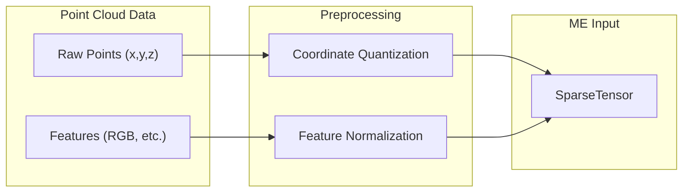

Example of processing a point cloud:

```python
import numpy as np
import torch
import MinkowskiEngine as ME
import open3d as o3d

# Load a point cloud
pcd = o3d.io.read_point_cloud("example.ply")
coords = np.array(pcd.points)
colors = np.array(pcd.colors)

# Quantize coordinates to voxel coordinates
voxel_size = 0.05  # 5cm voxel size
discrete_coords = np.floor(coords / voxel_size)

# Create batched coordinates
batched_coords = ME.utils.batched_coordinates([discrete_coords])

# Create a sparse tensor
input_tensor = ME.SparseTensor(
    features=torch.tensor(colors, dtype=torch.float32),
    coordinates=batched_coords
)
```

Sources: [README.md:205-270](), [examples/indoor.py:103-146]()

## Building Networks

MinkowskiEngine provides sparse versions of standard neural network layers such as convolution, pooling, and batch normalization. Here's how to create a simple network:


Here's an example of a simple classification network:

```python
import torch.nn as nn
import MinkowskiEngine as ME

class SimpleNetwork(ME.MinkowskiNetwork):
    def __init__(self, in_feat, out_feat, D=3):
        super(SimpleNetwork, self).__init__(D)
        
        self.conv1 = nn.Sequential(
            ME.MinkowskiConvolution(
                in_channels=in_feat,
                out_channels=64,
                kernel_size=3,
                stride=2,
                dimension=D),
            ME.MinkowskiBatchNorm(64),
            ME.MinkowskiReLU())
            
        self.conv2 = nn.Sequential(
            ME.MinkowskiConvolution(
                in_channels=64,
                out_channels=128,
                kernel_size=3,
                stride=2,
                dimension=D),
            ME.MinkowskiBatchNorm(128),
            ME.MinkowskiReLU())
            
        self.pooling = ME.MinkowskiGlobalPooling()
        self.linear = ME.MinkowskiLinear(128, out_feat)
        
    def forward(self, x):
        x = self.conv1(x)
        x = self.conv2(x)
        x = self.pooling(x)
        return self.linear(x)
```

Sources: [README.md:216-252](), [examples/resnet.py:53-102]()

## Training Loop

A basic training loop with MinkowskiEngine follows standard PyTorch practices:

```python
import torch.nn as nn
import torch.optim as optim

# Create network, loss function, and optimizer
model = SimpleNetwork(in_feat=3, out_feat=10, D=3)
criterion = nn.CrossEntropyLoss()
optimizer = optim.SGD(model.parameters(), lr=0.01)

# Training loop
for epoch in range(num_epochs):
    for data_dict in data_loader:
        # Get inputs
        coordinates = data_dict['coordinates']
        features = data_dict['features']
        labels = data_dict['labels']
        
        # Create sparse tensor input
        input_tensor = ME.SparseTensor(
            features=features,
            coordinates=coordinates
        )
        
        # Zero the parameter gradients
        optimizer.zero_grad()
        
        # Forward pass
        outputs = model(input_tensor)
        
        # Compute loss
        loss = criterion(outputs.F, labels)
        
        # Backward pass and optimize
        loss.backward()
        optimizer.step()
```

Sources: [examples/resnet.py:240-278](), [examples/classification_modelnet40.py:367-401]()

## Data Structure Relationships

The following diagram shows the relationship between key MinkowskiEngine data structures:

```mermaid
classDiagram
    class "SparseTensor" {
        +features: torch.Tensor
        +coordinate_map_key: CoordinateMapKey
        +coordinate_manager: CoordinateManager
    }
    
    class "TensorField" {
        +features: torch.Tensor
        +coordinate_manager: CoordinateManager
    }
    
    class "CoordinateManager" {
        +coordinate_maps: dict
        +get_coordinate_map()
        +insert_and_map()
    }
    
    class "CoordinateMapKey" {
        +get_key()
    }
    
    "SparseTensor" --> "CoordinateManager" : uses
    "SparseTensor" --> "CoordinateMapKey" : references
    "TensorField" --> "CoordinateManager" : uses
    "CoordinateManager" --> "CoordinateMapKey" : creates
```

Sources: [README.md:39-44]()

## Running Examples

MinkowskiEngine includes various examples to demonstrate its capabilities.

### Classification Example

Run a 3D classification example using the ModelNet40 dataset:

```bash
python -m examples.classification_modelnet40
```

This example trains a network to classify 3D objects into 40 categories.

### Segmentation Example

Run a semantic segmentation example on indoor scenes:

```bash
python -m examples.indoor
```

This example loads a pre-trained model and performs semantic segmentation on a 3D scene.

```mermaid
flowchart LR
    subgraph "Example Usage Workflow"
        A["Load Point Cloud"] --> B["Create ME.TensorField"]
        B --> C["Convert to ME.SparseTensor"]
        C --> D["Forward Pass Through Network"]
        D --> E["Extract Predictions"]
        E --> F["Visualize Results"]
    end
```

Sources: [examples/indoor.py:124-171](), [examples/README.md:1-21]()

## Common Operations

### Quantization and Coordinate Management

The coordinate management system is a key component of MinkowskiEngine:

```python
# Quantize coordinates (e.g., for a point cloud)
voxel_size = 0.02
discrete_coords = torch.floor(coords / voxel_size)

# You can also use the provided utility function
discrete_coords = ME.utils.sparse_quantize(
    coordinates=coords,
    features=feats,
    quantization_size=voxel_size
)
```

### Batching Multiple Point Clouds

When working with multiple point clouds in a batch:

```python
# For multiple point clouds
coords_list = [coords1, coords2, coords3]
feats_list = [feats1, feats2, feats3]

# Create batched coordinates
batched_coords = ME.utils.batched_coordinates(coords_list)

# Combine features
batched_feats = torch.cat(feats_list, dim=0)

# Create sparse tensor
sparse_tensor = ME.SparseTensor(
    features=batched_feats,
    coordinates=batched_coords
)
```

Sources: [examples/resnet.py:255-262](), [examples/pointnet.py:44-55]()

## Memory Management

MinkowskiEngine with PyTorch can sometimes experience memory issues during training. Clear the PyTorch CUDA cache regularly to avoid out-of-memory errors:

```python
# Clear GPU memory cache
torch.cuda.empty_cache()
```

Sources: [README.md:297-309]()

## Next Steps

After getting familiar with the basics:

1. Explore the different neural network layers in MinkowskiEngine
2. Try the examples in the repository
3. Adapt the examples to your own data
4. Learn more about [Coordinate Management System](#2.3) for advanced usage

This quick start guide should help you begin your journey with MinkowskiEngine. For more detailed information on specific components, refer to the other sections of the documentation.

---

# Page: Core Data Structures

# Core Data Structures

<details>
<summary>Relevant source files</summary>

The following files were used as context for generating this wiki page:

- [CHANGELOG.md](CHANGELOG.md)
- [MinkowskiEngine/MinkowskiSparseTensor.py](MinkowskiEngine/MinkowskiSparseTensor.py)
- [MinkowskiEngine/MinkowskiTensor.py](MinkowskiEngine/MinkowskiTensor.py)
- [MinkowskiEngine/MinkowskiTensorField.py](MinkowskiEngine/MinkowskiTensorField.py)
- [MinkowskiEngine/__init__.py](MinkowskiEngine/__init__.py)
- [tests/python/tensor_field.py](tests/python/tensor_field.py)

</details>


This page describes the primary data structures that form the foundation of MinkowskiEngine. These structures enable efficient processing of sparse 3D point cloud data through sparse tensor representations. For details on operations that can be performed on these data structures, see [Neural Network Operations](#3).

## Overview of Core Data Structures

MinkowskiEngine operates on sparse tensors to efficiently process 3D point cloud data. The core data structures work together to represent sparse data and manage coordinate systems.

```mermaid
graph TD
    subgraph "Core Data Structures"
        SparseTensor["SparseTensor"]
        TensorField["TensorField"]
        CoordManager["CoordinateManager"]
        CoordMapKey["CoordinateMapKey"]
    end

    TensorField -->|"sparse()"| SparseTensor
    SparseTensor -->|"slice()"| TensorField
    
    SparseTensor -->|"uses"| CoordManager
    TensorField -->|"uses"| CoordManager
    
    CoordManager -->|"generates"| CoordMapKey
    SparseTensor -->|"references"| CoordMapKey
    TensorField -->|"references"| CoordMapKey
```

Sources: [MinkowskiEngine/__init__.py:73-86](), [MinkowskiEngine/MinkowskiSparseTensor.py:48-121](), [MinkowskiEngine/MinkowskiTensorField.py:76-96]()

## SparseTensor

SparseTensor is the primary tensor class in MinkowskiEngine. It uses a COOrdinate (COO) format to represent sparse data by storing coordinates and their associated features.

### Structure and Components

```mermaid
classDiagram
    class SparseTensor {
        _F: torch.Tensor
        _C: torch.Tensor
        _D: int
        coordinate_map_key: CoordinateMapKey
        _manager: CoordinateManager
        quantization_mode: SparseTensorQuantizationMode
        inverse_mapping: torch.Tensor
        tensor_stride: List[int]
        
        +sparse()
        +dense()
        +slice()
        +coordinates_at(batch_index)
        +features_at(batch_index)
    }
```

A SparseTensor consists of:

1. **Features (`_F`)**: A dense tensor of shape `[N × C]` where:
   - `N`: Number of non-zero elements
   - `C`: Number of feature channels

2. **Coordinates (`_C`)**: A matrix of shape `[N × (D+1)]` where:
   - `N`: Number of non-zero elements
   - `D`: Spatial dimensions (e.g., 3 for 3D)
   - First column: Batch indices

3. **CoordinateMapKey**: Identifies the coordinate system and tensor stride

4. **CoordinateManager**: Manages coordinate mappings and operations

5. **Tensor Stride**: Defines the distance between adjacent elements

### Mathematical Representation

A SparseTensor can be represented mathematically as:

```
C = [b₁  x₁¹  x₁²  ... x₁ᴰ]
    [b₂  x₂¹  x₂²  ... x₂ᴰ]
    [...                  ]
    [bₙ  xₙ¹  xₙ²  ... xₙᴰ]

F = [f₁]
    [f₂]
    [..]
    [fₙ]
```

Where:
- `(b_i, x_i¹, x_i², ..., x_iᴰ)` is the coordinate of the i-th point
- `f_i` is the feature vector at that coordinate

### Creation and Initialization

A SparseTensor can be created in several ways:

```python
# From coordinates and features
sparse_tensor = ME.SparseTensor(features=feats, coordinates=coords)

# From an existing coordinate system
sparse_tensor = ME.SparseTensor(
    features=feats, 
    coordinate_map_key=existing_tensor.coordinate_map_key,
    coordinate_manager=existing_tensor.coordinate_manager
)

# With specific quantization mode
sparse_tensor = ME.SparseTensor(
    features=feats, 
    coordinates=coords,
    quantization_mode=ME.SparseTensorQuantizationMode.UNWEIGHTED_AVERAGE
)
```

### Key Methods

- **sparse()**: Convert to torch sparse tensor
- **dense()**: Convert to dense tensor
- **slice()**: Extract features at original continuous coordinates
- **coordinates_at(batch_index)**: Get coordinates for specific batch
- **features_at(batch_index)**: Get features for specific batch

Sources: [MinkowskiEngine/MinkowskiSparseTensor.py:48-751](), [MinkowskiEngine/MinkowskiTensor.py:139-604]()

## TensorField

TensorField represents features defined on continuous coordinates before quantization to a SparseTensor grid. It allows operations on continuous coordinate data and provides mechanisms to convert to and from SparseTensors.

### Structure and Components

```mermaid
classDiagram
    class TensorField {
        _F: torch.Tensor
        _C: torch.Tensor
        _D: int
        coordinate_field_map_key: CoordinateMapKey
        _manager: CoordinateManager
        quantization_mode: SparseTensorQuantizationMode
        _inverse_mapping: dict
        _splat: dict
        
        +sparse()
        +splat()
        +inverse_mapping()
    }
```

A TensorField consists of:

1. **Features (`_F`)**: Feature vectors for each continuous coordinate
2. **Coordinates (`_C`)**: Continuous coordinates in a matrix of shape `[N × (D+1)]`
3. **CoordinateFieldMapKey**: Identifies the continuous coordinate field
4. **InverseMapping**: Maps between continuous and discrete coordinates

### Conversion to SparseTensor

TensorField provides the `sparse()` method to convert continuous coordinates to discrete SparseTensors with various quantization modes:

1. **RANDOM_SUBSAMPLE**: Randomly selects one feature when multiple fall in same voxel
2. **UNWEIGHTED_AVERAGE**: Averages all features within the same voxel
3. **UNWEIGHTED_SUM**: Sums all features within the same voxel
4. **MAX_POOL**: Takes maximum feature value in each voxel

```mermaid
flowchart LR
    subgraph TensorField
        TF_Coords["Continuous Coordinates"]
        TF_Feats["Features"]
    end
    
    subgraph Quantization
        Q1["RANDOM_SUBSAMPLE"]
        Q2["UNWEIGHTED_AVERAGE"]
        Q3["UNWEIGHTED_SUM"]
        Q4["MAX_POOL"]
    end
    
    subgraph SparseTensor
        SP_Coords["Discrete Coordinates"]
        SP_Feats["Features"]
    end
    
    TF_Coords --> Quantization
    TF_Feats --> Quantization
    
    Quantization --> SP_Coords
    Quantization --> SP_Feats
```

### Splat and Interpolation

TensorField supports two unique operations:

1. **splat()**: Distributes features from continuous coordinates to neighboring discrete grid points using linear interpolation
2. **slice()**: Extracts features from a SparseTensor back to the original continuous coordinates 

Sources: [MinkowskiEngine/MinkowskiTensorField.py:76-506](), [tests/python/tensor_field.py:38-271]()

## Coordinate Management System

The coordinate management system is the backbone of MinkowskiEngine's sparse tensor operations. It efficiently maps between coordinates and manages operations like convolution and pooling.

### Key Components

```mermaid
graph TD
    subgraph "Coordinate Management System"
        CoordManager["CoordinateManager"]
        CoordMapKey["CoordinateMapKey"]
        CoordMap["CoordinateMap"]
    end
    
    CoordManager -->|"contains"| CoordMap
    CoordManager -->|"generates"| CoordMapKey
    CoordMapKey -->|"identifies"| CoordMap
    
    subgraph "Operations"
        KernelMap["Kernel Mapping"]
        Union["Union Mapping"]
        Stride["Stride Mapping"]
    end
    
    CoordManager -->|"performs"| KernelMap
    CoordManager -->|"performs"| Union
    CoordManager -->|"performs"| Stride
```

### CoordinateManager

The CoordinateManager is responsible for:

1. Managing coordinate maps and their relationships
2. Generating mappings for neural network operations
3. Handling coordinate quantization and transformations
4. Providing an efficient way to look up coordinates

### CoordinateMapKey

A CoordinateMapKey uniquely identifies a coordinate system with:

1. Tensor stride: Spacing between coordinates
2. Optional string identifier

### Coordinate Mapping Operations

The coordinate manager enables these key operations:

1. **insert_and_map**: Add new coordinates and map them to existing ones
2. **kernel_map**: Generate mappings for convolution kernels
3. **stride_map**: Create mappings for strided operations
4. **union_map**: Combine multiple coordinate maps

Sources: [MinkowskiEngine/__init__.py:93-98](), [MinkowskiEngine/MinkowskiTensor.py:33-62]()

## Quantization Modes

MinkowskiEngine provides several quantization modes to convert continuous coordinates to discrete grid points:

### SparseTensorQuantizationMode

```mermaid
graph TD
    Continuous["Continuous Coordinates"] --> Quantization
    
    subgraph Quantization
        RS["RANDOM_SUBSAMPLE<br>Random selection"]
        UA["UNWEIGHTED_AVERAGE<br>Average features"]
        US["UNWEIGHTED_SUM<br>Sum features"]
        MP["MAX_POOL<br>Maximum feature value"]
        SPLAT["SPLAT_LINEAR_INTERPOLATION<br>Linear interpolation to neighbors"]
    end
    
    Quantization --> Discrete["Discrete SparseTensor Grid"]
```

1. **RANDOM_SUBSAMPLE**: Randomly selects one point's features when multiple points map to the same voxel
2. **UNWEIGHTED_AVERAGE**: Averages all features within a voxel (default for TensorField to SparseTensor)
3. **UNWEIGHTED_SUM**: Sums all features within a voxel
4. **MAX_POOL**: Selects the maximum feature value in each voxel
5. **SPLAT_LINEAR_INTERPOLATION**: Distributes features to 2^D neighboring voxels using linear interpolation weights

The following example shows the different results of quantization modes on a small point cloud:

```python
# For coordinates: [[0, 1], [0, 1], [0, 2], [0, 2], [1, 0], [1, 0], [1, 1]]
# With features:   [[0], [1], [2], [3], [5], [6], [7]]

# UNWEIGHTED_AVERAGE results: {0.5, 2.5, 5.5, 7}
# MAX_POOL results:           {1, 3, 6, 7}
```

Sources: [MinkowskiEngine/MinkowskiTensor.py:47-61](), [tests/python/tensor_field.py:71-96]()

## Data Flow Between Core Structures

The following diagram illustrates how data flows between the core data structures in typical MinkowskiEngine operations:

```mermaid
flowchart LR
    subgraph "Input Data"
        Coords["Raw Coordinates<br>(continuous)"]
        Feats["Features"]
    end
    
    subgraph "TensorField"
        TFieldCoords["Continuous Coordinates"]
        TFieldFeats["Features"]
        TFieldKey["coordinate_field_map_key"]
    end
    
    subgraph "SparseTensor"
        STCoords["Discrete Coordinates"]
        STFeats["Features"]
        STKey["coordinate_map_key"]
    end
    
    subgraph "Coordinate Manager"
        CoordManager["CoordinateManager"]
    end
    
    Coords --> TFieldCoords
    Feats --> TFieldFeats
    
    TFieldCoords --> |"sparse()"| STCoords
    TFieldFeats --> |"sparse()"| STFeats
    
    STCoords --> |"slice()"| TFieldCoords
    STFeats --> |"slice()"| TFieldFeats
    
    TFieldCoords --> CoordManager
    STCoords --> CoordManager
    
    CoordManager --> TFieldKey
    CoordManager --> STKey
    
    TFieldKey --> TFieldCoords
    STKey --> STCoords
```

This bidirectional relationship between TensorField and SparseTensor enables a flexible workflow:

1. Start with continuous coordinates in a TensorField
2. Convert to discrete SparseTensor for efficient computation
3. Apply neural network operations on SparseTensors
4. Convert back to continuous coordinates with slice() when needed

Sources: [MinkowskiEngine/MinkowskiSparseTensor.py:559-632](), [MinkowskiEngine/MinkowskiTensorField.py:286-450]()

## Binary Operations on Sparse Tensors

SparseTensor and TensorField support binary operations (addition, subtraction, multiplication, division) that work both between sparse tensors and between a sparse tensor and a regular PyTorch tensor.

```mermaid
graph TD
    subgraph "SparseTensor Operations"
        Add["+: Addition"]
        Sub["-: Subtraction"]
        Mul["*: Multiplication"]
        Div["/: Division"]
    end
    
    A["SparseTensor A"] --> Add
    B["SparseTensor B"] --> Add
    A --> Sub
    B --> Sub
    A --> Mul
    B --> Mul
    A --> Div
    B --> Div
    
    Add --> C["SparseTensor C"]
    Sub --> D["SparseTensor D"]
    Mul --> E["SparseTensor E"]
    Div --> F["SparseTensor F"]
    
    PyTorch["PyTorch Tensor"] --> Add
    PyTorch --> Sub
    PyTorch --> Mul
    PyTorch --> Div
```

When operating between two sparse tensors with different coordinate systems, a coordinate union is automatically performed. For sparse tensors with the same coordinate system, operations are performed element-wise directly.

Sources: [MinkowskiEngine/MinkowskiTensor.py:490-585]()

## Memory Management Considerations

SparseTensor and TensorField objects can share the same coordinate manager through the global coordinate manager mechanism. This can be controlled with `set_sparse_tensor_operation_mode`:

```python
# Share coordinate manager globally between tensors
ME.set_sparse_tensor_operation_mode(ME.SparseTensorOperationMode.SHARE_COORDINATE_MANAGER)

# Use separate coordinate manager for each tensor (default)
ME.set_sparse_tensor_operation_mode(ME.SparseTensorOperationMode.SEPARATE_COORDINATE_MANAGER)
```

Using the shared mode can significantly reduce memory usage and computation time when working with multiple related sparse tensors, but requires explicit clearing of the global coordinate manager after use:

```python
# After operations are complete
ME.clear_global_coordinate_manager()
```

Sources: [MinkowskiEngine/MinkowskiTensor.py:63-136]()

---

# Page: SparseTensor

# SparseTensor

<details>
<summary>Relevant source files</summary>

The following files were used as context for generating this wiki page:

- [MinkowskiEngine/MinkowskiSparseTensor.py](MinkowskiEngine/MinkowskiSparseTensor.py)
- [MinkowskiEngine/MinkowskiTensor.py](MinkowskiEngine/MinkowskiTensor.py)
- [MinkowskiEngine/MinkowskiTensorField.py](MinkowskiEngine/MinkowskiTensorField.py)
- [src/coordinate_map_manager.cu](src/coordinate_map_manager.cu)
- [tests/python/sparse_tensor.py](tests/python/sparse_tensor.py)
- [tests/python/tensor_field.py](tests/python/tensor_field.py)

</details>


The `SparseTensor` class is the fundamental tensor data structure in MinkowskiEngine, designed for efficient representation and processing of sparse data like 3D point clouds. It represents data using only the non-zero elements and their corresponding spatial coordinates, making it memory-efficient for sparse data processing. This page explains how the `SparseTensor` works and how to use it effectively.

For information about the continuous coordinate version of SparseTensor, see [TensorField](#2.2).

## 1. Overview

`SparseTensor` is a sparse tensor representation using the COOrdinate (COO) format, which consists of:

1. A coordinate matrix `C` (size N×(D+1)) containing spatial positions and batch indices
2. A feature matrix `F` (size N×F) containing features for each coordinate
3. A coordinate management system to handle sparse operations efficiently

```mermaid
graph TD
    subgraph "SparseTensor Structure"
        C["Coordinate Matrix (C)"] --- F["Feature Matrix (F)"]
        C --> CMK["CoordinateMapKey"]
        C --> CM["CoordinateManager"]
        CM --- CMK
    end
```

Sources: [MinkowskiEngine/MinkowskiSparseTensor.py:47-52](). [MinkowskiEngine/MinkowskiTensor.py:139-145]()

## 2. Mathematical Representation

A `SparseTensor` is mathematically represented as:

$$
\mathbf{C} = \begin{bmatrix}
b_1    & x_1^1  & x_1^2  & \cdots & x_1^D  \\
\vdots & \vdots & \vdots & \ddots & \vdots \\
b_N    & x_N^1  & x_N^2  & \cdots & x_N^D
\end{bmatrix}, \; \mathbf{F} = \begin{bmatrix}
\mathbf{f}_1^T\\
\vdots\\
\mathbf{f}_N^T
\end{bmatrix}
$$

Where:
- $\mathbf{x}_i \in \mathcal{Z}^D$ is a D-dimensional coordinate
- $b_i \in \mathcal{Z}_+$ is the batch index
- $\mathbf{f}_i$ is the feature vector associated with coordinate $\mathbf{x}_i$
- N is the number of non-zero elements in the sparse tensor

Sources: [MinkowskiEngine/MinkowskiSparseTensor.py:52-76]()

## 3. Initialization

### 3.1 Constructor Parameters

```python
SparseTensor(
    features: torch.Tensor,               # Required: Features for non-zero elements
    coordinates: torch.Tensor = None,     # Coordinates for non-zero elements
    tensor_stride: StrideType = 1,        # Stride between tensor elements
    coordinate_map_key: CoordinateMapKey = None,  # Optional: Reuse existing coordinates
    coordinate_manager: CoordinateManager = None, # Optional: Coordinate manager
    quantization_mode: SparseTensorQuantizationMode = SparseTensorQuantizationMode.RANDOM_SUBSAMPLE,
    allocator_type: GPUMemoryAllocatorType = None,
    minkowski_algorithm: MinkowskiAlgorithm = None,
    requires_grad = None,                 # Gradient requirements
    device = None                         # Device placement
)
```

Sources: [MinkowskiEngine/MinkowskiSparseTensor.py:122-189]()

### 3.2 Creation Methods

There are several ways to create a `SparseTensor`:

```mermaid
flowchart LR
    subgraph "SparseTensor Creation"
        direction TB
        A["Direct Construction"] --> |"features, coordinates"| SP["SparseTensor"]
        B["From Existing Tensor"] --> |"features, coordinate_map_key, coordinate_manager"| SP
        C["From TensorField"] --> |"tensorfield.sparse()"| SP
    end
```

Sources: [MinkowskiEngine/MinkowskiSparseTensor.py:122-189](), [MinkowskiEngine/MinkowskiTensorField.py:286-378]()

### 3.3 Initialization Examples

```python
# 1. Basic initialization with coordinates and features
coords = torch.IntTensor([[0, 1, 2], [0, 3, 5], [0, 5, 6]]) # batch_idx, x, y
feats = torch.FloatTensor([[1.0], [2.0], [3.0]])
A = SparseTensor(features=feats, coordinates=coords)

# 2. Reusing coordinate system from another tensor
B = SparseTensor(features=new_feats, coordinate_map_key=A.coordinate_map_key, coordinate_manager=A.coordinate_manager)

# 3. With quantization mode for handling duplicate coordinates
C = SparseTensor(
    features=feats, 
    coordinates=coords, 
    quantization_mode=SparseTensorQuantizationMode.UNWEIGHTED_AVERAGE
)

# 4. With specific tensor stride
D = SparseTensor(features=feats, coordinates=coords, tensor_stride=2)
```

Sources: [MinkowskiEngine/MinkowskiSparseTensor.py:79-86](), [tests/python/sparse_tensor.py:43-66]()

## 4. Coordinate Management and Quantization

`SparseTensor` manages coordinates through the `CoordinateManager` which handles mappings between coordinate spaces. When creating a tensor, the coordinates are processed and a coordinate map is generated.

### 4.1 Coordinate System

```mermaid
graph TD
    subgraph "Coordinate System"
        COORDS["Input Coordinates"] --> QUANT["Quantization"]
        QUANT --> CMAP["CoordinateMap"]
        CMAP --> CMKEY["CoordinateMapKey"]
        CMAP --> UNIQUE["Unique Indices"]
        CMAP --> INV["Inverse Mapping"]
    end
```

Sources: [MinkowskiEngine/MinkowskiSparseTensor.py:293-345]()

### 4.2 Quantization Modes

`SparseTensor` provides several quantization modes to handle duplicate coordinates:

| Quantization Mode | Description |
|-------------------|-------------|
| `RANDOM_SUBSAMPLE` | Randomly select one coordinate per voxel (default) |
| `UNWEIGHTED_AVERAGE` | Average all features within a voxel |
| `UNWEIGHTED_SUM` | Sum all features within a voxel |
| `NO_QUANTIZATION` | No quantization applied (not for normal use) |
| `MAX_POOL` | Apply max pooling to features within a voxel |

Sources: [MinkowskiEngine/MinkowskiTensor.py:47-61]()

### 4.3 Coordinate Initialization Process

```mermaid
flowchart TD
    subgraph "Coordinate Initialization"
        A["Input Coordinates"] --> B["Coordinate Validation"]
        B --> C["Insertion into CoordinateManager"]
        C --> D["Get Unique Indices & Inverse Mapping"]
        D --> E["Apply Quantization"]
        E --> F["Update Tensor Properties"]
    end
```

Sources: [MinkowskiEngine/MinkowskiSparseTensor.py:293-345]()

## 5. Properties and Attributes

`SparseTensor` provides several properties to access its internal state:

| Property | Description |
|----------|-------------|
| `coordinates`, `C` | The coordinate matrix |
| `features`, `F` | The feature matrix |
| `coordinate_map_key` | The key identifying the tensor in the coordinate manager |
| `coordinate_manager` | The manager handling coordinate operations |
| `tensor_stride` | The stride between tensor elements |
| `dimension`, `D` | The spatial dimension of the tensor |
| `device` | The device on which the tensor is stored |
| `dtype` | The data type of the feature tensor |
| `shape` | The shape of the feature matrix |

Sources: [MinkowskiEngine/MinkowskiSparseTensor.py:228-248](), [MinkowskiEngine/MinkowskiTensor.py:210-474]()

## 6. Basic Operations

### 6.1 Mathematical Operations

`SparseTensor` supports standard mathematical operations:

```python
# Addition
C = A + B  # Add features at corresponding coordinates

# Subtraction
C = A - B  # Subtract features at corresponding coordinates

# Multiplication
C = A * B  # Multiply features at corresponding coordinates

# Division
C = A / B  # Divide features at corresponding coordinates
```

When operating on two sparse tensors with different coordinate systems, the operation creates a union of coordinates.

Sources: [MinkowskiEngine/MinkowskiTensor.py:490-585]()

### 6.2 Format Conversions

`SparseTensor` provides methods to convert to other tensor formats:

```mermaid
flowchart LR
    ST["SparseTensor"] -->|"sparse()"| TST["torch.sparse.Tensor"]
    ST -->|"dense()"| TD["torch.Tensor (Dense)"]
```

Sources: [MinkowskiEngine/MinkowskiSparseTensor.py:348-557]()

#### 6.2.1 To Sparse Tensor

Converts to a PyTorch sparse tensor:

```python
sparse_tensor, min_coords, tensor_stride = tensor.sparse(
    min_coords=None,     # Optional minimum coordinates
    max_coords=None,     # Optional maximum coordinates
    contract_coords=True # Divide coords by tensor_stride for contiguity
)
```

Sources: [MinkowskiEngine/MinkowskiSparseTensor.py:348-458]()

#### 6.2.2 To Dense Tensor

Converts to a dense PyTorch tensor:

```python
dense_tensor, min_coordinate, tensor_stride = tensor.dense(
    shape=None,           # Optional output shape
    min_coordinate=None,  # Optional minimum coordinate
    contract_stride=True  # Divide coords by tensor_stride for contiguity
)
```

Sources: [MinkowskiEngine/MinkowskiSparseTensor.py:460-557]()

## 7. Advanced Features

### 7.1 Batch-wise Operations

`SparseTensor` provides methods to access features and coordinates by batch:

```python
# Get coordinates at batch index 0
coords_batch0 = tensor.coordinates_at(batch_index=0)

# Get features at batch index 1
feats_batch1 = tensor.features_at(batch_index=1)

# Get both coordinates and features at batch index
coords, feats = tensor.coordinates_and_features_at(batch_index)

# Get lists of coordinates and features for all batches
all_coords, all_feats = tensor.decomposed_coordinates_and_features
```

Sources: [MinkowskiEngine/MinkowskiTensor.py:309-423]()

### 7.2 Feature Extraction at Coordinates

Extract features at specific continuous coordinates:

```python
# Extract features at query coordinates
query_coords = torch.FloatTensor([[0, 0.1], [0, 1.1]])
features = tensor.features_at_coordinates(query_coords)
```

Sources: [MinkowskiEngine/MinkowskiSparseTensor.py:690-718]()

### 7.3 Slicing and Interpolation

`SparseTensor` provides methods to interpolate and slice with `TensorField`:

```mermaid
flowchart LR
    SpT["SparseTensor"] -->|"interpolate(tensorfield)"| TField["TensorField"]
    SpT -->|"slice(tensorfield)"| TField2["TensorField"]
    SpT -->|"cat_slice(tensorfield)"| TField3["TensorField"]
```

Sources: [MinkowskiEngine/MinkowskiSparseTensor.py:559-688]()

#### Interpolation

```python
# Interpolate sparse tensor features onto continuous coordinates in a TensorField
interpolated_field = sparse_tensor.interpolate(tensor_field)
```

#### Slicing

```python
# Retrieve features from the sparse tensor corresponding to original coordinates
# in a TensorField (reverses quantization)
sliced_field = sparse_tensor.slice(tensor_field)

# Similar to slice but concatenates sparse tensor features with tensor field features
cat_sliced_field = sparse_tensor.cat_slice(tensor_field)
```

Sources: [MinkowskiEngine/MinkowskiSparseTensor.py:578-688]()

## 8. Implementation Details

### 8.1 Memory Management

`SparseTensor` uses a sophisticated coordinate management system to efficiently handle sparse data operations. The library provides options for different GPU memory allocators through the `allocator_type` parameter.

```mermaid
graph TD
    subgraph "Memory Management System"
        ST["SparseTensor"] --> CM["CoordinateManager"]
        CM --> CMT["CoordinateMapType"]
        CMT -->|"CPU"| CPUM["CPU CoordinateMap"]
        CMT -->|"GPU"| GPUM["GPU CoordinateMap"]
        GPUM --> ALLOC["GPU Memory Allocator"]
        ALLOC -->|"DEFAULT"| DEF["Default Allocator"]
        ALLOC -->|"C10"| C10["C10 Allocator"]
    end
```

Sources: [MinkowskiEngine/MinkowskiSparseTensor.py:230-258](), [src/coordinate_map_manager.cu:1-30]()

### 8.2 Operation Modes

`SparseTensor` can operate in different modes regarding coordinate manager sharing:

```python
# Set global operation mode to share coordinate managers
ME.set_sparse_tensor_operation_mode(ME.SparseTensorOperationMode.SHARE_COORDINATE_MANAGER)

# Create sparse tensors that share the same coordinate manager
a = ME.SparseTensor(...)
b = ME.SparseTensor(...)  # Uses the same coordinate manager as 'a'

# Clear the global coordinate manager when done
ME.clear_global_coordinate_manager()
```

Sources: [MinkowskiEngine/MinkowskiTensor.py:33-45](), [MinkowskiEngine/MinkowskiTensor.py:71-136]()

## 9. Best Practices and Considerations

1. **GPU Usage**: When using GPU, provide coordinates directly on the GPU to avoid unnecessary CPU-to-GPU transfers:
   ```python
   # Efficient: coordinates already on GPU
   SparseTensor(features.cuda(), coordinates.cuda())
   
   # Less efficient: coordinates will be processed on CPU first
   SparseTensor(features, coordinates).cuda()
   ```

2. **Batch Handling**: For batch processing, use `MinkowskiEngine.utils.batched_coordinates` or `MinkowskiEngine.utils.sparse_collate` to prepare batched coordinates.

3. **Memory Efficiency**: For large datasets, consider using `SparseTensorOperationMode.SHARE_COORDINATE_MANAGER` to reduce memory usage.

4. **Coordinate Manager Lifecycle**: When using shared coordinate managers, explicitly clear them with `clear_global_coordinate_manager()` after processing.

Sources: [MinkowskiEngine/MinkowskiSparseTensor.py:88-119](), [tests/python/sparse_tensor.py:288-334]()

## 10. Integration with Neural Networks

`SparseTensor` is designed to work seamlessly with neural network operations provided by MinkowskiEngine. Common operations include:

- MinkowskiConvolution
- MinkowskiPooling
- MinkowskiNormalization
- MinkowskiNonlinearities

```mermaid
flowchart LR
    subgraph "Neural Network Pipeline"
        Input["Input Data"] -->|"Quantize"| ST["SparseTensor"]
        ST --> CONV["MinkowskiConvolution"]
        CONV --> NORM["MinkowskiBatchNorm"]
        NORM --> RELU["MinkowskiReLU"]
        RELU --> POOL["MinkowskiPooling"]
        POOL --> Output["Output SparseTensor"]
    end
```

See [Neural Network Operations](#3) for more details on available operations.

Sources: [tests/python/tensor_field.py:116-147]()

---

# Page: TensorField

# TensorField

<details>
<summary>Relevant source files</summary>

The following files were used as context for generating this wiki page:

- [MinkowskiEngine/MinkowskiFunctional.py](MinkowskiEngine/MinkowskiFunctional.py)
- [MinkowskiEngine/MinkowskiNetwork.py](MinkowskiEngine/MinkowskiNetwork.py)
- [MinkowskiEngine/MinkowskiNonlinearity.py](MinkowskiEngine/MinkowskiNonlinearity.py)
- [MinkowskiEngine/MinkowskiNormalization.py](MinkowskiEngine/MinkowskiNormalization.py)
- [MinkowskiEngine/MinkowskiOps.py](MinkowskiEngine/MinkowskiOps.py)
- [MinkowskiEngine/MinkowskiSparseTensor.py](MinkowskiEngine/MinkowskiSparseTensor.py)
- [MinkowskiEngine/MinkowskiTensor.py](MinkowskiEngine/MinkowskiTensor.py)
- [MinkowskiEngine/MinkowskiTensorField.py](MinkowskiEngine/MinkowskiTensorField.py)
- [tests/python/tensor_field.py](tests/python/tensor_field.py)

</details>


This document provides a comprehensive explanation of the TensorField class in the MinkowskiEngine library, which is a key data structure for handling continuous coordinate data and features in sparse tensor networks. TensorField is particularly useful for representing and manipulating point cloud data before quantization. For discrete sparse representations, see [SparseTensor](#2.1).

## Purpose and Overview

TensorField represents a tensor with continuous coordinates in a sparse tensor network. Unlike SparseTensor which works with discrete, quantized coordinates, TensorField preserves the original continuous coordinate information while enabling various operations that can be applied directly to the continuous space before quantization.

The primary purposes of TensorField include:

1. Storing continuous coordinate data (e.g., raw point cloud coordinates) with associated features
2. Providing methods to convert continuous coordinates to discrete coordinates (quantization)
3. Maintaining mappings between continuous and quantized coordinates
4. Supporting neural network operations directly on continuous coordinate data
5. Enabling interpolation between continuous and discretized feature spaces

Sources: [MinkowskiEngine/MinkowskiTensorField.py:76-81](), [MinkowskiEngine/MinkowskiTensorField.py:76-506]()

## Relationship to SparseTensor

TensorField is closely related to SparseTensor but serves a distinct role in the processing pipeline:

```mermaid
flowchart LR
    subgraph "Continuous Coordinates"
        TField["TensorField"]
        ContCoords["Continuous Coordinates (x,y,z)"]
        ContCoords --> TField
        Features["Features"] --> TField
    end
    
    subgraph "Quantization Process"
        Quant["Quantization Modes:
        - RANDOM_SUBSAMPLE
        - UNWEIGHTED_AVERAGE 
        - UNWEIGHTED_SUM
        - MAX_POOL
        - SPLAT_LINEAR_INTERPOLATION"]
    end
    
    subgraph "Discrete Coordinates"
        SpTensor["SparseTensor"]
        DiscreteCoords["Discrete Coordinates"]
        SpTensor --> DiscreteCoords
    end
    
    TField -- "sparse()" --> Quant
    Quant --> SpTensor
    SpTensor -- "slice()/interpolate()" --> TField
```

Sources: [MinkowskiEngine/MinkowskiTensorField.py:286-373](), [MinkowskiEngine/MinkowskiSparseTensor.py:559-633]()

## Core Implementation

TensorField inherits from the base Tensor class, which provides common functionality for both TensorField and SparseTensor:

```mermaid
classDiagram
    class Tensor {
        +_F : Features
        +_C : Coordinates
        +_D : Dimension
        +_manager : CoordinateManager
        +F() : Features
        +C() : Coordinates
        +tensor_stride : Property
        +dimension : Property
    }
    
    class TensorField {
        +coordinate_field_map_key
        +_inverse_mapping{}
        +_splat{}
        +quantization_mode
        +sparse(tensor_stride, quantization_mode) : SparseTensor
        +splat() : SparseTensor
        +inverse_mapping(sparse_tensor_map_key)
    }
    
    class SparseTensor {
        +coordinate_map_key
        +unique_index
        +inverse_mapping
        +slice(X) : TensorField
        +interpolate(X) : TensorField
        +features_at_coordinates(query_coordinates)
    }
    
    Tensor <|-- TensorField
    Tensor <|-- SparseTensor
```

Sources: [MinkowskiEngine/MinkowskiTensorField.py:76-81](), [MinkowskiEngine/MinkowskiTensor.py:139-144]()

### Key Properties

TensorField contains several key properties:

| Property | Description |
|----------|-------------|
| `_F` | Features associated with the coordinates |
| `_C` | Continuous coordinates matrix (N × (D+1)) where N is the number of points and D is the dimension |
| `coordinate_field_map_key` | Key for the coordinate field mapping in the coordinate manager |
| `quantization_mode` | Defines how continuous coordinates will be quantized when converting to SparseTensor |
| `_inverse_mapping` | Dictionary storing mappings from sparse tensor keys to field indices |
| `_splat` | Dictionary storing splat operation results |

Sources: [MinkowskiEngine/MinkowskiTensorField.py:245-247](), [MinkowskiEngine/MinkowskiTensorField.py:496-506]()

## Initialization and Creation

### Constructor Parameters

TensorField can be initialized with the following parameters:

```python
TensorField(
    features: torch.Tensor,              # Features for each point (N × F)
    coordinates: torch.Tensor = None,    # Continuous coordinates (N × (D+1))
    tensor_stride: StrideType = 1,       # Tensor stride for the coordinate field
    coordinate_field_map_key = None,     # Optional existing coordinate field map key
    coordinate_manager = None,           # Optional coordinate manager
    quantization_mode = SparseTensorQuantizationMode.UNWEIGHTED_AVERAGE,  # Quantization mode
    allocator_type = None,               # GPU memory allocator type
    minkowski_algorithm = None,          # Algorithm mode (memory vs. speed)
    requires_grad = None,                # Whether features require gradients
    device = None                        # Device for the tensor
)
```

Sources: [MinkowskiEngine/MinkowskiTensorField.py:77-91](), [MinkowskiEngine/MinkowskiTensorField.py:92-143]()

### Quantization Modes

TensorField supports multiple quantization modes when converting to SparseTensor:

| Mode | Description |
|------|-------------|
| `RANDOM_SUBSAMPLE` | Randomly selects one point per discretized coordinate |
| `UNWEIGHTED_AVERAGE` | Averages all features within the same discretized coordinate |
| `UNWEIGHTED_SUM` | Sums all features within the same discretized coordinate |
| `MAX_POOL` | Takes the maximum feature value within each discretized coordinate |
| `SPLAT_LINEAR_INTERPOLATION` | Distributes features to neighboring grid points with linear weights |

Sources: [MinkowskiEngine/MinkowskiTensor.py:47-61](), [MinkowskiEngine/MinkowskiTensorField.py:286-373]()

## Key Methods and Operations

### Converting to SparseTensor

The `sparse()` method converts a TensorField to a SparseTensor by quantizing the continuous coordinates:

```python
def sparse(
    self,
    tensor_stride: Union[int, Sequence, np.array] = 1,
    coordinate_map_key: CoordinateMapKey = None,
    quantization_mode: SparseTensorQuantizationMode = None,
) -> SparseTensor
```

This method applies the specified quantization mode to convert continuous coordinates to discrete coordinates, creating a SparseTensor with the appropriate feature values.

Sources: [MinkowskiEngine/MinkowskiTensorField.py:286-373]()

### Creating Splat Coordinates

The `splat()` method creates a SparseTensor with coordinates generated through linear interpolation to neighboring grid points:

```python
def splat(self) -> SparseTensor
```

This implements a special quantization mode that uses N-dimensional linear interpolation to distribute feature values to 2^N neighboring grid points.

Sources: [MinkowskiEngine/MinkowskiTensorField.py:381-406](), [MinkowskiEngine/MinkowskiTensorField.py:53-73]()

### Inverse Mapping

The `inverse_mapping()` method retrieves the mapping from a sparse tensor coordinate key to the corresponding field coordinates:

```python
def inverse_mapping(self, sparse_tensor_map_key: CoordinateMapKey)
```

This is crucial for operations that need to map between continuous and discrete coordinates.

Sources: [MinkowskiEngine/MinkowskiTensorField.py:408-450]()

### Integration with Neural Networks

TensorField supports various neural network operations that can be applied directly to continuous coordinate data before quantization:

```mermaid
flowchart TD
    subgraph "Input"
        TField["TensorField(features, coordinates)"]
    end
    
    subgraph "Pre-Quantization Operations"
        Linear["MinkowskiLinear"]
        BatchNorm["MinkowskiBatchNorm"]
        ReLU["MinkowskiReLU"]
    end
    
    subgraph "Quantization"
        ToSparse["MinkowskiToSparseTensor"]
    end
    
    subgraph "Post-Quantization Operations"
        Conv["MinkowskiConvolution"]
        Pool["MinkowskiPooling"]
    end
    
    TField --> Linear
    Linear --> BatchNorm
    BatchNorm --> ReLU
    ReLU --> ToSparse
    ToSparse --> Conv
    Conv --> Pool
```

Sources: [tests/python/tensor_field.py:109-147](), [MinkowskiEngine/MinkowskiOps.py:40-67](), [MinkowskiEngine/MinkowskiNonlinearity.py:34-61]()

## Use Cases and Examples

### Point Cloud Processing Pipeline

A typical point cloud processing pipeline using TensorField would include:

1. Loading raw point cloud data (continuous coordinates)
2. Creating a TensorField with the continuous coordinates and associated features
3. Optionally applying pre-quantization operations (linear, normalization, activation)
4. Converting to a SparseTensor using an appropriate quantization mode
5. Processing with sparse convolution operations
6. If needed, slicing back to TensorField to recover features at the original continuous coordinates

```python
# Example pipeline (pseudocode)
coordinates = load_point_cloud()  # Continuous coordinates
features = get_features()  # Features for each point

# Create TensorField
tensor_field = TensorField(
    features=features,
    coordinates=coordinates,
    quantization_mode=SparseTensorQuantizationMode.UNWEIGHTED_AVERAGE
)

# Apply initial operations directly on continuous coordinates
tensor_field = linear_layer(tensor_field)
tensor_field = batch_norm(tensor_field)
tensor_field = relu(tensor_field)

# Convert to SparseTensor for sparse convolutions
sparse_tensor = tensor_field.sparse()
sparse_tensor = sparse_convolution(sparse_tensor)

# Get features back at original continuous coordinates
output_field = sparse_tensor.slice(tensor_field)
```

Sources: [tests/python/tensor_field.py:98-147](), [tests/python/tensor_field.py:149-176]()

### Special Interpolation Techniques

TensorField also supports more advanced interpolation techniques:

1. **Splat**: Distribute features from continuous points to surrounding grid points
2. **Slice**: Retrieve features from a SparseTensor back to the original continuous coordinates
3. **Interpolate**: Sample features at arbitrary continuous coordinates from a SparseTensor

Sources: [MinkowskiEngine/MinkowskiTensorField.py:381-406](), [MinkowskiEngine/MinkowskiSparseTensor.py:559-597]()

## Technical Considerations

### Device Support

TensorField works on both CPU and GPU, with coordinate management adapting to the device:

```python
# CPU TensorField
tensor_field_cpu = TensorField(features, coordinates)

# GPU TensorField
tensor_field_gpu = TensorField(features, coordinates, device="cuda")
```

Sources: [MinkowskiEngine/MinkowskiTensorField.py:177-183](), [tests/python/tensor_field.py:58-69]()

### Memory Management

When creating multiple TensorFields, the coordinate manager can be shared to reduce memory usage:

```python
# Shared coordinate manager mode
set_sparse_tensor_operation_mode(SparseTensorOperationMode.SHARE_COORDINATE_MANAGER)
tensor_field1 = TensorField(features1, coordinates1)
tensor_field2 = TensorField(features2, coordinates2)  # Uses the same coordinate manager
```

Sources: [MinkowskiEngine/MinkowskiTensorField.py:189-215](), [MinkowskiEngine/MinkowskiTensor.py:71-87]()

## Summary

TensorField is a powerful data structure for working with continuous coordinate data in sparse tensor networks. It provides the bridge between raw point cloud data and the discrete sparse tensors used for efficient computation. By supporting various quantization modes and maintaining mappings between continuous and discrete spaces, TensorField enables flexible processing of sparse spatial data with neural networks.

---

# Page: Coordinate Management System

# Coordinate Management System

<details>
<summary>Relevant source files</summary>

The following files were used as context for generating this wiki page:

- [MinkowskiEngine/MinkowskiCoordinateManager.py](MinkowskiEngine/MinkowskiCoordinateManager.py)
- [pybind/extern.hpp](pybind/extern.hpp)
- [src/coordinate_map_cpu.hpp](src/coordinate_map_cpu.hpp)
- [src/coordinate_map_gpu.cu](src/coordinate_map_gpu.cu)
- [src/coordinate_map_gpu.cuh](src/coordinate_map_gpu.cuh)
- [src/coordinate_map_manager.cpp](src/coordinate_map_manager.cpp)
- [src/coordinate_map_manager.hpp](src/coordinate_map_manager.hpp)

</details>


The Coordinate Management System is a foundational component of MinkowskiEngine that efficiently manages sparse coordinates and their mappings. It handles creation, storage, and transformation of coordinate maps, which are essential for all sparse tensor operations such as convolution, pooling, and interpolation. This system provides the infrastructure needed to track the positions of non-zero elements in sparse tensors and compute their relationships across different operations.

For information about data quantization that uses this system, see [Quantization](#2.4).

## Core Components

The coordinate management system consists of several interrelated components that work together to track spatial information throughout the network:

```mermaid
graph TD
    subgraph "Python Interface"
        CM["CoordinateManager"] --> CMKey["CoordinateMapKey"]
    end

    subgraph "C++ Backend"
        CMM["CoordinateMapManager<T>"] --> CMap["CoordinateMap<T>"]
        CMM --> CMKey2["CoordinateMapKey"]
        CMM -. CPU/GPU specific .-> KMap["KernelMap"]
        
        CMap --> MapCPU["CoordinateMapCPU<T>"]
        CMap --> MapGPU["CoordinateMapGPU<T>"]
        
        CMap --> FieldMap["CoordinateFieldMap<T>"]
        FieldMap --> FieldMapCPU["CoordinateFieldMapCPU<T>"]
        FieldMap --> FieldMapGPU["CoordinateFieldMapGPU<T>"]
    end

    CM -. C++ wrapper .-> CMM
```

Sources: [MinkowskiEngine/MinkowskiCoordinateManager.py](), [src/coordinate_map_manager.hpp](), [src/coordinate_map_cpu.hpp](), [src/coordinate_map_gpu.cuh]()

### Key Classes and Their Roles

| Class | Role |
|-------|------|
| `CoordinateManager` | Python interface that users interact with to manage coordinates |
| `CoordinateMapKey` | Uniquely identifies a coordinate map using tensor stride and string ID |
| `CoordinateMapManager` | C++ backend that manages multiple coordinate maps and their relationships |
| `CoordinateMap` | Base class for all coordinate map implementations |
| `CoordinateMapCPU/GPU` | CPU and GPU-specific implementations of coordinate maps |
| `CoordinateFieldMap` | Manages maps for floating-point coordinates (e.g., for continuous point clouds) |
| `KernelMap` | Defines input-output relationships for operations like convolution |

Sources: [src/coordinate_map_manager.hpp:87-564](), [MinkowskiEngine/MinkowskiCoordinateManager.py:107-498]()

## Coordinate Representation and Storage

### Coordinate Structure

Coordinates in MinkowskiEngine are represented as N-dimensional vectors, where:
- The first dimension is typically a batch index
- The remaining dimensions are spatial coordinates
- Integer coordinates (`coordinate_type`) are used for sparse tensors
- Floating-point coordinates (`coordinate_field_type`) can be used for continuous spaces

```mermaid
graph LR
    subgraph "Coordinate Structure"
        B["Batch Index"] --> X["X Coordinate"]
        X --> Y["Y Coordinate"]
        Y --> Z["Z Coordinate"]
        Z --> ...["..."]
    end
```

Sources: [src/coordinate_map_manager.hpp:83-109](), [src/coordinate_map_gpu.cuh:44-113]()

### Coordinate Maps

Coordinate maps provide the mapping between coordinate values and their corresponding indices in feature tensors. The system uses hash-based maps for efficient lookup:

```mermaid
flowchart TD
    subgraph "CPU Implementation"
        coordCPU["Coordinates"] --> hashCPU["robin_hood::unordered_flat_map"]
        hashCPU --> indexCPU["Feature Indices"]
    end
    
    subgraph "GPU Implementation"
        coordGPU["Coordinates"] --> hashGPU["concurrent_unordered_map"]
        hashGPU --> indexGPU["Feature Indices"]
    end
```

Sources: [src/coordinate_map_cpu.hpp:280-309](), [src/coordinate_map_gpu.cuh:65-70]()

### Tensor Stride

Each coordinate map has an associated tensor stride, which defines the spacing between coordinates in each dimension. The tensor stride affects how coordinates are quantized, strided, and mapped:

```mermaid
graph TD
    subgraph "Tensor Stride Example"
        Orig["Original Coordinates"] --> |"Stride = [1,1]"| Fine["Fine Resolution"]
        Orig --> |"Stride = [2,2]"| Coarse["Coarse Resolution"]
    end
```

Sources: [src/coordinate_map_manager.cpp:401-429]()

## Coordinate Management Operations

### Insertion and Mapping

The system provides two fundamental operations:
1. `insert` - Adds coordinates to a map without creating mappings
2. `insert_and_map` - Adds coordinates and creates mappings for duplicate removal

The mapping process returns:
- `unique_map` - Maps from input indices to unique coordinate indices
- `inverse_map` - Maps from unique coordinate indices back to input indices

```mermaid
flowchart LR
    subgraph "insert_and_map Operation"
        Input["Input Coordinates"] --> Process["Remove Duplicates"]
        Process --> UniqueCoords["Unique Coordinates"]
        Process --> Mapping["Mapping Tensors"]
        Mapping --> UniqueMap["unique_map"]
        Mapping --> InverseMap["inverse_map"]
    end
```

Sources: [src/coordinate_map_manager.cpp:193-266](), [src/coordinate_map_cpu.hpp:352-380](), [src/coordinate_map_gpu.cu:197-291]()

### Stride Operations

The stride operation creates a new coordinate map with modified tensor stride:

```mermaid
flowchart LR
    subgraph "Stride Operation"
        InMap["Input Map (stride=1)"] --> Stride["stride(2)"]
        Stride --> OutMap["Output Map (stride=2)"]
    end
```

Sources: [src/coordinate_map_manager.cpp:406-429](), [src/coordinate_map_cpu.hpp:418-437](), [src/coordinate_map_gpu.cu:410-483]()

### Field-to-Sparse Conversion

The system supports conversion between field (floating-point) coordinates and sparse (integer) coordinates:

```mermaid
flowchart LR
    subgraph "Field to Sparse Conversion"
        Field["Field Coordinates (float)"] --> Quantize["Quantize"]
        Quantize --> Sparse["Sparse Coordinates (int)"]
    end
```

Sources: [src/coordinate_map_manager.cpp:193-266](), [src/coordinate_map_gpu.cu:152-185]()

## Kernel Maps

Kernel maps define the relationships between input and output coordinates for operations like convolution and pooling. They're essential for implementing sparse neural network operations.

```mermaid
flowchart TD
    subgraph "Kernel Map Generation"
        InCoords["Input Coordinates"] --> KernelReg["Kernel Region"]
        KernelReg --> InOutMap["Input-Output Maps"]
        InOutMap --> InMap["in_maps"]
        InOutMap --> OutMap["out_maps"]
    end
```

A kernel map consists of:
- `in_maps` - Maps from input features to kernel locations
- `out_maps` - Maps from output features to kernel locations

For each kernel position, the system computes which input coordinates affect which output coordinates.

Sources: [src/coordinate_map_cpu.hpp:569-670](), [src/coordinate_map_gpu.cu:600-692]()

## CPU vs. GPU Implementations

The system provides both CPU and GPU implementations with different characteristics:

| Feature | CPU Implementation | GPU Implementation |
|---------|-------------------|-------------------|
| Hash Map | robin_hood::unordered_flat_map | concurrent_unordered_map |
| Parallelization | OpenMP | CUDA |
| Memory Management | Standard allocators | Custom allocators (PyTorch/CUDA) |
| Suitable for | Small/medium data, CPU-only setups | Large datasets, GPU acceleration |

Sources: [src/coordinate_map_cpu.hpp:280-309](), [src/coordinate_map_gpu.cuh:65-70](), [MinkowskiEngine/MinkowskiCoordinateManager.py:126-147]()

## System Workflow and Interaction

The following diagram illustrates how the coordinate management system interacts with the rest of MinkowskiEngine:

```mermaid
sequenceDiagram
    participant User as "User Code"
    participant SpTensor as "SparseTensor"
    participant CoordMgr as "CoordinateManager"
    participant CoordMapMgr as "CoordinateMapManager"
    participant Op as "Neural Network Operation"
    
    User->>SpTensor: Create sparse tensor with coordinates
    SpTensor->>CoordMgr: insert_and_map(coordinates)
    CoordMgr->>CoordMapMgr: insert_and_map()
    CoordMapMgr-->>CoordMgr: Return (key, mappings)
    CoordMgr-->>SpTensor: Store coordinate_map_key
    
    User->>Op: Apply operation (conv, pool, etc.)
    Op->>CoordMgr: kernel_map(in_key, out_key)
    CoordMgr->>CoordMapMgr: kernel_map()
    CoordMapMgr-->>CoordMgr: Return input-output mappings
    CoordMgr-->>Op: Use mappings for computation
    Op-->>User: Return result
```

Sources: [MinkowskiEngine/MinkowskiCoordinateManager.py:153-184](), [MinkowskiEngine/MinkowskiCoordinateManager.py:377-421]()

## Python Interface

The primary interface for users is the `CoordinateManager` class in Python, which wraps the C++ implementation:

```python
# Creating a coordinate manager
manager = CoordinateManager(D=3)  # For 3D spatial coordinates

# Inserting coordinates and getting mappings
key, (unique_map, inverse_map) = manager.insert_and_map(coordinates, tensor_stride=2)

# Getting kernel maps for convolution
kernel_maps = manager.kernel_map(
    in_key, out_key, 
    stride=2, kernel_size=3, dilation=1,
    region_type=RegionType.HYPER_CUBE
)
```

Sources: [MinkowskiEngine/MinkowskiCoordinateManager.py:107-147](), [MinkowskiEngine/MinkowskiCoordinateManager.py:153-184](), [MinkowskiEngine/MinkowskiCoordinateManager.py:377-421]()

## Implementation Details

### Memory Management

The system provides different memory allocation strategies for GPU operations:
- `GPUMemoryAllocatorType.PYTORCH` - Uses PyTorch's memory pool (default, better memory efficiency)
- `GPUMemoryAllocatorType.CUDA` - Uses raw CUDA calls (potentially faster but less memory efficient)

These can be configured using `set_gpu_allocator()` in the Python API.

Sources: [MinkowskiEngine/MinkowskiCoordinateManager.py:62-97]()

### Coordinate Map Key

The `CoordinateMapKey` uniquely identifies a coordinate map using:
- A tensor stride array specifying the resolution in each dimension
- An optional string ID to distinguish between maps with the same stride

```mermaid
graph TD
    subgraph "CoordinateMapKey Structure"
        Stride["Tensor Stride Array"] --> Key["CoordinateMapKey"]
        StringID["String Identifier"] --> Key
    end
```

Sources: [src/coordinate_map_key.hpp](), [pybind/extern.hpp:27-31]()

### Thread Management

The CPU implementation uses OpenMP for parallelization. The number of threads can be controlled:
- Default: Uses minimum of available CPU cores or 20
- Can be explicitly set through the constructor

Sources: [src/coordinate_map_manager.hpp:130-146](), [MinkowskiEngine/MinkowskiCoordinateManager.py:123-124]()

## Common Usage Patterns

### Creating a Sparse Tensor from Coordinates

```
1. Create a CoordinateManager
2. Call insert_and_map() with coordinates and tensor_stride
3. Use the returned key and mappings to create the SparseTensor
```

### Computing Convolution with Kernel Maps

```
1. Get input and output CoordinateMapKeys
2. Call kernel_map() with appropriate parameters
3. Use the returned maps to guide the convolution computation
```

### Striding a Sparse Tensor

```
1. Get the input CoordinateMapKey
2. Call stride() with the desired stride parameters
3. Use the returned key for the strided tensor
```

Sources: [MinkowskiEngine/MinkowskiCoordinateManager.py:153-184](), [MinkowskiEngine/MinkowskiCoordinateManager.py:254-268](), [MinkowskiEngine/MinkowskiCoordinateManager.py:377-421]()

---

# Page: Quantization

# Quantization

<details>
<summary>Relevant source files</summary>

The following files were used as context for generating this wiki page:

- [MinkowskiEngine/MinkowskiCommon.py](MinkowskiEngine/MinkowskiCommon.py)
- [MinkowskiEngine/MinkowskiKernelGenerator.py](MinkowskiEngine/MinkowskiKernelGenerator.py)
- [MinkowskiEngine/MinkowskiSparseTensor.py](MinkowskiEngine/MinkowskiSparseTensor.py)
- [MinkowskiEngine/MinkowskiTensor.py](MinkowskiEngine/MinkowskiTensor.py)
- [MinkowskiEngine/MinkowskiTensorField.py](MinkowskiEngine/MinkowskiTensorField.py)
- [MinkowskiEngine/utils/quantization.py](MinkowskiEngine/utils/quantization.py)
- [src/quantization.cpp](src/quantization.cpp)
- [tests/python/global.py](tests/python/global.py)
- [tests/python/quantization.py](tests/python/quantization.py)
- [tests/python/tensor_field.py](tests/python/tensor_field.py)

</details>


This page describes the quantization process in MinkowskiEngine, which is the mechanism for converting continuous coordinates (such as point cloud data) into discrete voxel positions. Quantization is a fundamental operation for creating sparse tensors from raw input data.

## Overview

Quantization is the process of discretizing continuous coordinates and managing collisions when multiple points map to the same discrete location. The process ensures that sparse tensors can efficiently represent sparse data by:

1. Converting continuous coordinates to discrete voxel positions
2. Handling feature aggregation when multiple points map to the same voxel
3. Creating mappings between original and quantized coordinates

```mermaid
flowchart LR
    subgraph "Input Data"
        Raw["Raw Point Cloud"]
        Coords["Continuous Coordinates"]
        Feats["Features"]
    end
    
    subgraph "Quantization Process"
        Discretize["Discretize Coordinates"]
        Collisions["Handle Collisions"]
        Mapping["Create Mappings"]
    end
    
    subgraph "Output"
        QCoords["Quantized Coordinates"]
        QFeats["Aggregated Features"]
        SpTensor["SparseTensor"]
    end
    
    Raw --> Coords
    Raw --> Feats
    Coords --> Discretize
    Discretize --> Collisions
    Feats --> Collisions
    Collisions --> Mapping
    Mapping --> QCoords
    Mapping --> QFeats
    QCoords --> SpTensor
    QFeats --> SpTensor
```

Sources: [MinkowskiEngine/utils/quantization.py:136-332](), [MinkowskiEngine/MinkowskiSparseTensor.py:293-345]()

## Quantization Modes

MinkowskiEngine provides several quantization modes to handle how features are aggregated when multiple points map to the same voxel location:

```mermaid
classDiagram
    class SparseTensorQuantizationMode {
        RANDOM_SUBSAMPLE
        UNWEIGHTED_AVERAGE
        UNWEIGHTED_SUM
        NO_QUANTIZATION
        MAX_POOL
        SPLAT_LINEAR_INTERPOLATION
    }
```

| Mode | Description | Implementation |
|------|-------------|----------------|
| RANDOM_SUBSAMPLE | Randomly selects one feature per voxel | [MinkowskiSparseTensor.py:339-340]() |
| UNWEIGHTED_AVERAGE | Averages all features within a voxel | [MinkowskiSparseTensor.py:329-338]() |
| UNWEIGHTED_SUM | Sums all features within a voxel | [MinkowskiSparseTensor.py:318-328]() |
| MAX_POOL | Selects the maximum feature value for each channel | [MinkowskiTensorField.py:359-368]() |
| NO_QUANTIZATION | No feature aggregation (not typically used) | - |
| SPLAT_LINEAR_INTERPOLATION | Uses N-dimensional linear interpolation | [MinkowskiTensorField.py:381-406]() |

Sources: [MinkowskiEngine/MinkowskiTensor.py:47-61](), [MinkowskiEngine/MinkowskiSparseTensor.py:318-345](), [MinkowskiEngine/MinkowskiTensorField.py:359-406]()

## Quantization Process

The quantization process involves several key steps that transform continuous coordinates into an efficient sparse representation:

```mermaid
flowchart TD
    A["Continuous Coordinates"] --> B["Discretize Coordinates (Floor or Scale)"]
    B --> C["Map to Discrete Voxels"]
    C --> D["Identify Duplicates"]
    A2["Features"] --> F["Aggregate Features"]
    D --> E["Create Unique Map & Inverse Map"]
    E --> F
    F --> G["SparseTensor"]
    
    subgraph "Input" 
        A
        A2
    end
    
    subgraph "CoordinateManager"
        C
        D
        E
    end
    
    subgraph "Output"
        G
    end
```

The process works as follows:

1. **Coordinate Discretization**: Continuous coordinates are discretized either by simple flooring or by dividing by a quantization size (voxel size)
2. **Duplicate Detection**: The system finds duplicate coordinates that map to the same voxel
3. **Mapping Creation**: Two maps are created:
   - **Unique Map**: Indices of unique coordinates in the original coordinates
   - **Inverse Mapping**: Mapping from original to unique coordinates
4. **Feature Aggregation**: Features associated with the same voxel are aggregated according to the specified quantization mode

Sources: [MinkowskiEngine/utils/quantization.py:136-332](), [MinkowskiEngine/MinkowskiSparseTensor.py:293-345](), [src/quantization.cpp:57-294]()

## Relationship with Coordinate System

Quantization is tightly integrated with MinkowskiEngine's coordinate management system:

```mermaid
flowchart TB
    subgraph "Quantization System"
        Quant["Quantization Functions"]
        Modes["Quantization Modes"]
    end
    
    subgraph "Coordinate System"
        CoordMap["CoordinateMap"]
        CoordManager["CoordinateManager"]
        MapKey["CoordinateMapKey"]
    end
    
    subgraph "Tensor Types"
        SparseTensor["SparseTensor"]
        TensorField["TensorField"]
    end
    
    Quant --> CoordMap
    Quant --> CoordManager
    Modes --> SparseTensor
    Modes --> TensorField
    CoordMap --> SparseTensor
    CoordManager --> SparseTensor
    MapKey --> SparseTensor
    CoordMap --> TensorField
    CoordManager --> TensorField
    MapKey --> TensorField
```

The coordinate management system and quantization process work together to:

1. Store unique coordinates efficiently
2. Map between original and quantized coordinates
3. Provide a unified interface for operations on sparse tensors

Sources: [MinkowskiEngine/MinkowskiSparseTensor.py:227-287](), [MinkowskiEngine/MinkowskiTensorField.py:180-250]()

## API Reference

### SparseTensor Initialization with Quantization

```python
SparseTensor(
    features,                       # Feature tensor
    coordinates,                    # Coordinate tensor
    tensor_stride=1,                # Tensor stride
    coordinate_map_key=None,        # Optional coordinate map key
    coordinate_manager=None,        # Optional coordinate manager
    quantization_mode=SparseTensorQuantizationMode.RANDOM_SUBSAMPLE, # Quantization mode
    ... # Other parameters
)
```

The `SparseTensor` initialization processes coordinates through quantization if both `coordinates` and `features` are provided.

### TensorField to SparseTensor Conversion

```python
# Create a TensorField
tensor_field = TensorField(features, coordinates)

# Convert to SparseTensor with specific quantization mode
sparse_tensor = tensor_field.sparse(
    quantization_mode=SparseTensorQuantizationMode.UNWEIGHTED_AVERAGE
)
```

### Utility Functions

#### sparse_quantize

```python
sparse_quantize(
    coordinates,                    # Coordinates to quantize
    features=None,                  # Optional features
    labels=None,                    # Optional labels
    ignore_label=-100,              # Label to use for collisions
    return_index=False,             # Return unique indices
    return_inverse=False,           # Return inverse mapping
    quantization_size=None,         # Size of quantization grid
    device="cpu"                    # Device to use
)
```

This utility function handles the quantization process and returns quantized coordinates and optionally features/labels.

Sources: [MinkowskiEngine/utils/quantization.py:136-332](), [MinkowskiEngine/MinkowskiSparseTensor.py:122-189](), [MinkowskiEngine/MinkowskiTensorField.py:77-145]()

## Visualization of Quantization Process

```mermaid
flowchart LR
    subgraph "3D Space"
        PC["Point Cloud"] --> P1["Point (0.1, 0.2, 0.3)"]
        PC --> P2["Point (0.9, 0.8, 0.7)"]
        PC --> P3["Point (0.95, 0.85, 0.75)"]
    end
    
    subgraph "Quantization with voxel_size=1.0"
        Q1["Voxel (0,0,0)"]
        Q2["Voxel (0,0,0)"]
        Q3["Voxel (0,0,0)"]
    end
    
    subgraph "Quantization with voxel_size=0.5"
        R1["Voxel (0,0,0)"]
        R2["Voxel (1,1,1)"]
        R3["Voxel (1,1,1)"]
    end
    
    P1 --> Q1
    P2 --> Q2
    P3 --> Q3
    
    P1 --> R1
    P2 --> R2
    P3 --> R3
    
    Q1 -- "Features Aggregated" --> QF1["Single Feature"]
    Q2 -.-> QF1
    Q3 -.-> QF1
    
    R1 -- "Features Preserved" --> RF1["Feature 1"]
    R2 -- "Features Aggregated" --> RF2["Feature 2+3"]
    R3 -.-> RF2
```

This diagram illustrates how changing the voxel size affects quantization. With a larger voxel size, more points are aggregated into the same voxel, while smaller voxel sizes preserve more spatial details.

Sources: [MinkowskiEngine/utils/quantization.py:136-332]()

## Examples and Use Cases

### Basic Quantization

```python
# Raw point cloud data
coords = torch.tensor([[0, 0.1], [0, 0.2], [0, 0.3], [0, 1.1], [0, 1.2]])
feats = torch.tensor([[1.0], [2.0], [3.0], [4.0], [5.0]])

# Option 1: Use sparse_quantize directly
quantized_coords, quantized_feats = ME.utils.sparse_quantize(
    coords, feats, quantization_size=0.5
)

# Option 2: Create a SparseTensor directly (internal quantization)
sparse_tensor = ME.SparseTensor(
    features=feats,
    coordinates=coords,
    quantization_mode=ME.SparseTensorQuantizationMode.UNWEIGHTED_AVERAGE
)

# Option 3: Create a TensorField and convert to SparseTensor
tensor_field = ME.TensorField(features=feats, coordinates=coords)
sparse_tensor = tensor_field.sparse(
    quantization_mode=ME.SparseTensorQuantizationMode.MAX_POOL
)
```

### 3D Semantic Segmentation

For 3D semantic segmentation, quantization can handle both coordinates and labels:

```python
# Point cloud with labels
coords = load_point_cloud_coordinates()  # [N, 3]
feats = load_point_cloud_features()      # [N, C]
labels = load_point_cloud_labels()       # [N]

# Quantize with label handling
quantized_coords, quantized_feats, quantized_labels = ME.utils.sparse_quantize(
    coords, feats, labels=labels, ignore_label=-100, quantization_size=0.02
)

# Create sparse tensor
input_tensor = ME.SparseTensor(quantized_feats, quantized_coords)
```

In this example, when multiple points with different labels map to the same voxel, the label is set to an ignore value (-100) to handle ambiguity.

Sources: [MinkowskiEngine/utils/quantization.py:136-332](), [tests/python/quantization.py:33-121](), [tests/python/tensor_field.py:38-71]()

## Implementation Details

### Backend Implementation

MinkowskiEngine implements quantization using both Python and C++ code:

1. High-level API in Python for user interaction
2. Performance-critical operations in C++ for efficiency
3. CUDA implementation for GPU acceleration when available

The C++ backend uses efficient hash maps to detect duplicates and create mapping indices.

Sources: [src/quantization.cpp:57-294](), [MinkowskiEngine/utils/quantization.py:136-332]()

### Performance Considerations

- Quantization is a preprocessing step that significantly reduces the memory footprint and computational requirements
- The choice of quantization mode affects both accuracy and performance
- GPU implementation can offer significant speedups for large point clouds
- Quantization size (voxel size) is a critical parameter that balances detail preservation and computational efficiency

---

# Page: Neural Network Operations

# Neural Network Operations

<details>
<summary>Relevant source files</summary>

The following files were used as context for generating this wiki page:

- [CHANGELOG.md](CHANGELOG.md)
- [MinkowskiEngine/MinkowskiFunctional.py](MinkowskiEngine/MinkowskiFunctional.py)
- [MinkowskiEngine/MinkowskiNetwork.py](MinkowskiEngine/MinkowskiNetwork.py)
- [MinkowskiEngine/MinkowskiNonlinearity.py](MinkowskiEngine/MinkowskiNonlinearity.py)
- [MinkowskiEngine/MinkowskiNormalization.py](MinkowskiEngine/MinkowskiNormalization.py)
- [MinkowskiEngine/MinkowskiOps.py](MinkowskiEngine/MinkowskiOps.py)
- [MinkowskiEngine/__init__.py](MinkowskiEngine/__init__.py)

</details>


This page documents the core operations available for building neural networks with sparse tensors in MinkowskiEngine. These operations enable the application of common neural network components (convolutions, pooling, normalization, activation functions) to sparse data like 3D point clouds.

For information about the underlying data structures these operations work on, see [Core Data Structures](#2). For details about the specific implementation in CPU and GPU, see [Implementation Details](#4).

## Overview of Neural Network Operations

MinkowskiEngine provides a comprehensive set of operations that mirror standard PyTorch neural network modules but are designed to work with sparse tensors. These operations can be composed to create complex neural network architectures for processing sparse data.

```mermaid
flowchart TB
    SpTensor["SparseTensor / TensorField"] --> Ops

    subgraph Ops["Neural Network Operations"]
        Conv["Convolution Operations"] 
        Pool["Pooling Operations"]
        Norm["Normalization Operations"]
        NonLin["Nonlinear Activations"]
        Other["Other Operations"]
    end

    Conv --> NeuralNetwork["Sparse Neural Network"]
    Pool --> NeuralNetwork
    Norm --> NeuralNetwork
    NonLin --> NeuralNetwork
    Other --> NeuralNetwork
```

Sources: [MinkowskiEngine/__init__.py:100-124](), [MinkowskiEngine/__init__.py:134-164](), [MinkowskiEngine/__init__.py:166-172]()

## Operations Architecture

The operations in MinkowskiEngine maintain a consistent architecture pattern. Each operation takes a `SparseTensor` or `TensorField` as input and outputs a new `SparseTensor` or `TensorField`. Operations handle both the feature transformation and coordinate management internally.

```mermaid
flowchart LR
    subgraph Input
        SpTensor["SparseTensor"] -- "Features (F)" --> Op
        SpTensor -- "Coordinate Map Key" --> Op
    end

    subgraph Op["MinkowskiOperation"]
        OpCore["Operation Core"]
        CoordManagement["Coordinate Management"]
        OpCore --> OutputF["Output Features"]
        CoordManagement --> OutputCMK["Output Coordinate Map Key"]
    end
    
    OutputF --> OutputTensor["Output SparseTensor"]
    OutputCMK --> OutputTensor
```

Sources: [MinkowskiEngine/MinkowskiOps.py:40-67](), [MinkowskiEngine/MinkowskiNormalization.py:51-98](), [MinkowskiEngine/MinkowskiNonlinearity.py:34-58]()

## Convolution Operations

MinkowskiEngine provides sparse convolution operations that apply kernels to sparse data. These operations create output features based on the input features within each kernel's receptive field.

Key convolution operations include:

- `MinkowskiConvolution`: Standard sparse convolution
- `MinkowskiConvolutionTranspose`: Transposed sparse convolution
- `MinkowskiChannelwiseConvolution`: Channel-wise sparse convolution
- `MinkowskiGenerativeConvolutionTranspose`: Transpose convolution for generative models

The convolution operations handle the kernel mapping and sparse computation automatically.

Sources: [MinkowskiEngine/__init__.py:100-106]()

## Pooling Operations

Pooling operations reduce the spatial resolution of features by aggregating information within defined regions. MinkowskiEngine provides several pooling operations:

- Local pooling: `MinkowskiSumPooling`, `MinkowskiAvgPooling`, `MinkowskiMaxPooling`
- Global pooling: `MinkowskiGlobalSumPooling`, `MinkowskiGlobalAvgPooling`, `MinkowskiGlobalMaxPooling`
- Transpose pooling: `MinkowskiPoolingTranspose`
- Direct pooling: `MinkowskiDirectMaxPoolingFunction`

These operations manage both the feature transformation and the resulting change in coordinate structure.

Sources: [MinkowskiEngine/__init__.py:111-124]()

## Normalization Operations

Normalization operations standardize the distribution of features, improving model training stability. Key normalization operations include:

### Batch Normalization

`MinkowskiBatchNorm` normalizes features across the batch dimension, similar to PyTorch's `BatchNorm1d`.

```python
MinkowskiBatchNorm(num_features, eps=1e-5, momentum=0.1, affine=True, track_running_stats=True)
```

For distributed training, `MinkowskiSyncBatchNorm` provides synchronized batch normalization across multiple GPUs.

### Instance Normalization

`MinkowskiInstanceNorm` normalizes features within each instance independently:

```python
MinkowskiInstanceNorm(num_features)
```

A stable variant, `MinkowskiStableInstanceNorm`, is also available for improved training stability.

Sources: [MinkowskiEngine/MinkowskiNormalization.py:51-98](), [MinkowskiEngine/MinkowskiNormalization.py:101-191](), [MinkowskiEngine/MinkowskiNormalization.py:313-399]()

## Nonlinear Activations

Nonlinear activation functions introduce non-linearity into the network. MinkowskiEngine provides a comprehensive set of activation functions that mirror PyTorch's offerings:

| Category | Activation Functions |
|----------|----------------------|
| ReLU-based | `MinkowskiReLU`, `MinkowskiReLU6`, `MinkowskiLeakyReLU`, `MinkowskiPReLU`, `MinkowskiRReLU` |
| Sigmoid-based | `MinkowskiSigmoid`, `MinkowskiLogSigmoid`, `MinkowskiHardsigmoid` |
| Tanh-based | `MinkowskiTanh`, `MinkowskiTanhshrink` |
| Other | `MinkowskiELU`, `MinkowskiSELU`, `MinkowskiCELU`, `MinkowskiGELU`, `MinkowskiSiLU`, `MinkowskiSoftplus`, `MinkowskiSoftsign` |
| Advanced | `MinkowskiSoftmin`, `MinkowskiSoftmax`, `MinkowskiLogSoftmax` |
| Regularization | `MinkowskiDropout`, `MinkowskiAlphaDropout` |

All these operations maintain the sparse structure of the input tensor while applying the activation function only to the features.

Sources: [MinkowskiEngine/MinkowskiNonlinearity.py:34-200](), [MinkowskiEngine/__init__.py:134-164]()

## Functional Interface

MinkowskiEngine also provides a functional interface for operations, similar to PyTorch's `torch.nn.functional`. This allows for more flexibility in applying operations.

The functional interface includes:

- Activation functions (`relu`, `sigmoid`, `tanh`, etc.)
- Normalization (`batch_norm`, `normalize`)
- Linear operations (`linear`)
- Dropouts (`dropout`, `alpha_dropout`)
- Loss functions (`binary_cross_entropy`, `mse_loss`, etc.)

Example usage:

```python
import MinkowskiEngine.MinkowskiFunctional as MF

output = MF.relu(input_sparse_tensor)
```

Sources: [MinkowskiEngine/MinkowskiFunctional.py:30-232]()

## Other Operations

### Linear Operations

`MinkowskiLinear` applies a linear transformation to the features of a sparse tensor while preserving the coordinate structure:

```python
MinkowskiLinear(in_features, out_features, bias=True)
```

### Tensor Operations

MinkowskiEngine provides operations for manipulating sparse tensors:

- `cat`: Concatenates sparse tensors along the feature dimension
- `sum`: Sums feature values of sparse tensors
- `mean`: Computes the mean of feature values
- `var`: Computes the variance of feature values

### Conversion Operations

These operations convert between different tensor formats:

- `MinkowskiToSparseTensor`: Converts dense tensors or tensor fields to sparse tensors
- `MinkowskiToDenseTensor`: Converts sparse tensors to dense tensors
- `MinkowskiToFeature`: Extracts features from a sparse tensor

### Broadcasting Operations

Broadcasting operations apply operations between sparse tensors and globally pooled features:

- `MinkowskiBroadcastAddition`: Adds broadcast features to a sparse tensor
- `MinkowskiBroadcastMultiplication`: Multiplies sparse tensor features by broadcast features
- `MinkowskiBroadcastConcatenation`: Concatenates broadcast features with sparse tensor features

Sources: [MinkowskiEngine/MinkowskiOps.py:40-67](), [MinkowskiEngine/MinkowskiOps.py:141-243](), [MinkowskiEngine/MinkowskiOps.py:279-457](), [MinkowskiEngine/__init__.py:126-132]()

## Building Neural Networks

The operations can be composed to build complex neural networks for sparse data processing. MinkowskiEngine provides a base class, `MinkowskiNetwork`, for building sparse convolutional networks:

```python
class MyNetwork(MinkowskiNetwork):
    def __init__(self, in_channels, out_channels, D):
        super(MyNetwork, self).__init__(D)
        self.conv1 = MinkowskiConvolution(in_channels, 64, kernel_size=3, stride=2, dimension=D)
        self.bn1 = MinkowskiBatchNorm(64)
        self.conv2 = MinkowskiConvolution(64, 128, kernel_size=3, stride=2, dimension=D)
        self.bn2 = MinkowskiBatchNorm(128)
        self.relu = MinkowskiReLU()
        self.global_pool = MinkowskiGlobalAvgPooling()
        self.linear = MinkowskiLinear(128, out_channels)

    def forward(self, x):
        x = self.relu(self.bn1(self.conv1(x)))
        x = self.relu(self.bn2(self.conv2(x)))
        x = self.global_pool(x)
        return self.linear(x)
```

This architecture pattern allows for the creation of various network architectures like U-Nets, ResNets, etc., for tasks such as segmentation, classification, and generation on sparse data.

Sources: [MinkowskiEngine/MinkowskiNetwork.py:31-57]()

## Operation Data Flow

The following diagram illustrates the data flow through a typical neural network operation in MinkowskiEngine:

```mermaid
flowchart TD
    subgraph Input
        InF["Input Features"]
        InCMK["Input Coordinate Map Key"]
    end

    subgraph "MinkowskiOperation (e.g., MinkowskiConvolution)"
        KernelMap["Kernel Map Generation"]
        FeatureTransform["Feature Transformation"]
    end

    subgraph Output
        OutF["Output Features"]
        OutCMK["Output Coordinate Map Key"]
    end

    InF --> FeatureTransform
    InCMK --> KernelMap
    KernelMap --> FeatureTransform
    KernelMap --> OutCMK
    FeatureTransform --> OutF
```

This pattern is consistent across different types of operations, with the specifics of the feature transformation and coordinate management varying based on the operation type.

Sources: [MinkowskiEngine/MinkowskiNormalization.py:51-98](), [MinkowskiEngine/MinkowskiNonlinearity.py:34-58](), [MinkowskiEngine/MinkowskiOps.py:40-67]()

---

# Page: Convolution Operations

# Convolution Operations

<details>
<summary>Relevant source files</summary>

The following files were used as context for generating this wiki page:

- [MinkowskiEngine/MinkowskiConvolution.py](MinkowskiEngine/MinkowskiConvolution.py)
- [src/convolution_transpose_cpu.cpp](src/convolution_transpose_cpu.cpp)
- [src/convolution_transpose_gpu.cu](src/convolution_transpose_gpu.cu)
- [src/kernel_map.cuh](src/kernel_map.cuh)
- [src/local_pooling_cpu.cpp](src/local_pooling_cpu.cpp)
- [src/local_pooling_gpu.cu](src/local_pooling_gpu.cu)
- [src/pooling_avg_kernel.hpp](src/pooling_avg_kernel.hpp)
- [src/pooling_max_kernel.cu](src/pooling_max_kernel.cu)
- [src/pooling_max_kernel.cuh](src/pooling_max_kernel.cuh)
- [src/pooling_max_kernel.hpp](src/pooling_max_kernel.hpp)
- [src/storage.cuh](src/storage.cuh)
- [tests/python/convolution.py](tests/python/convolution.py)

</details>


This page documents the sparse convolution operations in MinkowskiEngine, which form the core of its neural network capabilities. Unlike traditional dense convolutions in CNNs, these operations are specifically designed for sparse data representations, making them highly efficient for processing 3D point clouds and other sparse inputs.

For information about related operations that often accompany convolutions, see [Pooling Operations](#3.2) and [Normalization and Nonlinearities](#3.3).

## Convolution Types

MinkowskiEngine implements three primary convolution types:

| Type | Class | Description |
|------|-------|-------------|
| Standard Convolution | `MinkowskiConvolution` | Forward convolution on sparse tensors; downsamples or maintains resolution |
| Transposed Convolution | `MinkowskiConvolutionTranspose` | Transposed convolution for upsampling sparse data |
| Generative Transposed Convolution | `MinkowskiGenerativeConvolutionTranspose` | Specialized transposed convolution that generates new coordinates |

Sources: [MinkowskiEngine/MinkowskiConvolution.py:360-634]()

## Architecture and Implementation

### Class Hierarchy

```mermaid
graph TD
    MMB["MinkowskiModuleBase"] --> MCB["MinkowskiConvolutionBase"]
    MCB --> MC["MinkowskiConvolution"]
    MCB --> MCT["MinkowskiConvolutionTranspose"]
    MCB --> MGCT["MinkowskiGenerativeConvolutionTranspose"]
    
    MCF["MinkowskiConvolutionFunction"] -.- MC
    MCTF["MinkowskiConvolutionTransposeFunction"] -.- MCT
    MCTF -.- MGCT
    
    KG["KernelGenerator"] --> MCB
```

Sources: [MinkowskiEngine/MinkowskiConvolution.py:42-201](), [MinkowskiEngine/MinkowskiConvolution.py:204-358]()

### Convolution Operation Flow

The sparse convolution process follows these key steps:

```mermaid
flowchart LR
    subgraph "Input Processing"
        Input["SparseTensor"] --> GetCoords["Extract Coordinates"]
        Input --> GetFeats["Extract Features"]
    end
    
    subgraph "Coordinate Mapping"
        GetCoords --> KG["KernelGenerator"]
        KG --> KMap["Kernel Map"]
    end
    
    subgraph "Computation"
        KMap --> Conv["Convolution Operation"]
        GetFeats --> Conv
        Weights["Kernel Weights"] --> Conv
    end
    
    Conv --> OutFeats["Output Features"]
    KMap --> OutCoords["Output Coordinates"]
    OutFeats --> Output["Output SparseTensor"]
    OutCoords --> Output
```

Sources: [MinkowskiEngine/MinkowskiConvolution.py:287-330](), [src/convolution_transpose_gpu.cu:47-156]()

## Key Components

### MinkowskiConvolutionBase

The abstract base class for all convolution operations:

```mermaid
graph TD
    MCB["MinkowskiConvolutionBase"] --> Params["Parameters"]
    Params --> IC["in_channels"]
    Params --> OC["out_channels"]
    Params --> KG["kernel_generator"]
    Params --> K["kernel (weights)"]
    Params --> B["bias (optional)"]
    Params --> CM["convolution_mode"]
    
    MCB --> Methods["Methods"]
    Methods --> Forward["forward()"]
    Methods --> Reset["reset_parameters()"]
```

Sources: [MinkowskiEngine/MinkowskiConvolution.py:204-358]()

The base class defines:
- Storage for kernel parameters and weights
- Forward pass logic for all convolution types
- Parameter initialization methods

### KernelGenerator

Defines the convolution kernel's properties and how it's applied:

```mermaid
graph TD
    KG["KernelGenerator"] --> KS["kernel_size"]
    KG --> KStr["kernel_stride"]
    KG --> KDil["kernel_dilation"]
    KG --> RT["region_type"]
    KG --> RO["region_offsets"]
    KG --> EC["expand_coordinates"]
    KG --> D["dimension"]
    KG --> KV["kernel_volume"]
```

The `KernelGenerator` determines:
- How input coordinates map to output coordinates
- Which input features contribute to each output feature
- The receptive field of the convolution

Sources: [MinkowskiEngine/MinkowskiConvolution.py:241-255]()

### Convolution Function Classes

The actual computation is performed by specialized function classes:

1. `MinkowskiConvolutionFunction`: Handles forward/backward for standard convolution
2. `MinkowskiConvolutionTransposeFunction`: Handles forward/backward for transposed convolution

These classes are responsible for:
- Building the kernel map
- Executing the convolution operation
- Computing gradients during backpropagation

Sources: [MinkowskiEngine/MinkowskiConvolution.py:42-121](), [MinkowskiEngine/MinkowskiConvolution.py:124-201]()

## Kernel Mapping Process

The kernel mapping is a crucial aspect of sparse convolution:

```mermaid
flowchart TD
    subgraph "Kernel Map Creation"
        InCoords["Input Coordinates"] --> DefineRegion["Define Kernel Region"]
        DefineRegion --> GenPairs["Generate Input-Output Pairs"]
        GenPairs --> CreateMap["Create gpu_kernel_map"]
        CreateMap --> InMaps["in_maps"]
        CreateMap --> OutMaps["out_maps"]
    end
    
    subgraph "Convolution Execution"
        InMaps --> MapFeatures["Map Input Features"]
        OutMaps --> MapOutputs["Map to Output Locations"]
        MapFeatures --> ApplyWeights["Apply Convolution Weights"]
        ApplyWeights --> Accumulate["Accumulate at Output Locations"]
        MapOutputs --> Accumulate
    end
```

The kernel map contains:
- `in_maps`: Maps from kernel positions to input feature indices
- `out_maps`: Maps from kernel positions to output feature indices

Sources: [src/kernel_map.cuh:48-429]()

## Convolution Modes

MinkowskiEngine supports different convolution implementation modes:

| Mode | Description |
|------|-------------|
| `ConvolutionMode.DEFAULT` | Default mode selected based on input size |
| `ConvolutionMode.DIRECT_GEMM` | Direct generalized matrix multiplication |
| `ConvolutionMode.COPY_GEMM` | Copy data then perform matrix multiplication |

Sources: [tests/python/convolution.py:248-298]()

## Mathematical Definition

### Standard Convolution

For an input sparse tensor with features at coordinates C_in, the output at coordinate u ∈ C_out is:

```
x_out(u) = ∑_{i ∈ N(u, K, C_in)} W_i · x_in(i + u)
```

Where:
- N(u, K, C_in) is the set of offsets within kernel K
- W_i are the kernel weights
- x_in(i + u) are input features at corresponding coordinates

Sources: [MinkowskiEngine/MinkowskiConvolution.py:361-375]()

### Transposed Convolution

The transposed convolution reverses the spatial transformation of a standard convolution, effectively upsampling the input tensor based on the stride and kernel parameters.

Sources: [MinkowskiEngine/MinkowskiConvolution.py:455-457]()

## Forward and Backward Pass

### Forward Pass

```mermaid
flowchart LR
    subgraph "Forward Pass"
        Input["Input SparseTensor"] --> CoordKey["Get Coordinate Map Key"]
        CoordKey --> KernelMap["Generate Kernel Map"]
        KernelMap --> GetImpl["Get Implementation\n(CPU/GPU)"]
        GetImpl --> Apply["Apply Convolution"]
        Input --> ExtractF["Extract Features"]
        ExtractF --> Apply
        Kernel["Kernel Weights"] --> Apply
        Apply --> OutFeats["Output Features"]
        KernelMap --> OutCoords["Output Coordinates"]
        OutFeats --> Output["Output SparseTensor"]
        OutCoords --> Output
    end
```

Sources: [MinkowskiEngine/MinkowskiConvolution.py:44-85](), [src/convolution_transpose_gpu.cu:47-156]()

### Backward Pass

The backward pass computes:
1. Gradients for input features (for backpropagation)
2. Gradients for kernel weights (for optimization)

Sources: [MinkowskiEngine/MinkowskiConvolution.py:87-121](), [src/convolution_transpose_gpu.cu:158-239]()

## GPU Implementation

MinkowskiEngine's GPU implementation leverages CUDA for high-performance sparse convolution:

```mermaid
graph TD
    Input["Input Tensor\n(GPU Memory)"] --> KMap["Build gpu_kernel_map"]
    KMap --> Conv["CUDA Convolution Kernel"]
    Input --> Conv
    Weights["Kernel Weights\n(GPU Memory)"] --> Conv
    Conv --> GEMM["Matrix Multiplication\n(cuBLAS)"]
    GEMM --> Output["Output Tensor\n(GPU Memory)"]
```

The GPU implementation uses:
- Custom CUDA kernels for coordinate mapping
- Optimized memory access patterns for sparse data
- cuBLAS for efficient matrix multiplication

Sources: [src/convolution_transpose_gpu.cu:133-154](), [src/kernel_map.cuh:48-429]()

## Usage Examples

Basic usage of `MinkowskiConvolution`:

```python
import torch
import MinkowskiEngine as ME

# Create a sparse tensor
coords = torch.IntTensor([[0, 0, 0], [0, 1, 1], [0, 2, 2]])
feats = torch.FloatTensor([[1.0, 2.0], [3.0, 4.0], [5.0, 6.0]])
input = ME.SparseTensor(feats, coordinates=coords)

# Create a convolution layer
conv = ME.MinkowskiConvolution(
    in_channels=2,
    out_channels=3,
    kernel_size=3,
    stride=2,
    dimension=2
)

# Apply convolution
output = conv(input)
```

Example using transposed convolution:

```python
# Create a transposed convolution layer
conv_tr = ME.MinkowskiConvolutionTranspose(
    in_channels=3,
    out_channels=2,
    kernel_size=3,
    stride=2,
    dimension=2
)

# Apply transposed convolution
output_tr = conv_tr(output)
```

Sources: [tests/python/convolution.py:226-246](), [tests/python/convolution.py:361-382]()

---

# Page: Pooling Operations

# Pooling Operations

<details>
<summary>Relevant source files</summary>

The following files were used as context for generating this wiki page:

- [MinkowskiEngine/MinkowskiPooling.py](MinkowskiEngine/MinkowskiPooling.py)
- [src/global_pooling_cpu.cpp](src/global_pooling_cpu.cpp)
- [src/global_pooling_gpu.cu](src/global_pooling_gpu.cu)
- [src/kernel_map.cuh](src/kernel_map.cuh)
- [src/local_pooling_cpu.cpp](src/local_pooling_cpu.cpp)
- [src/local_pooling_gpu.cu](src/local_pooling_gpu.cu)
- [src/pooling_avg_kernel.hpp](src/pooling_avg_kernel.hpp)
- [src/pooling_max_kernel.cu](src/pooling_max_kernel.cu)
- [src/pooling_max_kernel.cuh](src/pooling_max_kernel.cuh)
- [src/pooling_max_kernel.hpp](src/pooling_max_kernel.hpp)
- [src/storage.cuh](src/storage.cuh)
- [tests/python/pool.py](tests/python/pool.py)

</details>


This document explains the pooling operations available in MinkowskiEngine for sparse tensors. Pooling operations are essential for dimensionality reduction and feature aggregation in sparse convolutional neural networks. They allow networks to achieve spatial invariance and reduce computational complexity by downsampling feature maps.

For information about convolution operations, see [Convolution Operations](3.1).
For information about the coordinate management system that underlies all operations, see [Coordinate Management System](2.3).

## Pooling Types Overview

MinkowskiEngine implements two main categories of pooling operations:

1. **Local Pooling Operations**: These operate on local regions defined by a kernel, similar to standard convolution pooling but adapted for sparse data.
2. **Global Pooling Operations**: These aggregate all features across the entire spatial domain, typically resulting in one feature vector per batch element.

### Pooling Class Hierarchy

```mermaid
graph TD
    subgraph "Base Classes"
        MMBase["MinkowskiModuleBase"]
        MPoolBase["MinkowskiPoolingBase"]
        MGPool["MinkowskiGlobalPooling"]
    end
    
    subgraph "Local Pooling"
        MAvgPool["MinkowskiAvgPooling"]
        MSumPool["MinkowskiSumPooling"]
        MMaxPool["MinkowskiMaxPooling"]
        MPoolTranspose["MinkowskiPoolingTranspose"]
    end
    
    subgraph "Global Pooling"
        MGAvgPool["MinkowskiGlobalAvgPooling"]
        MGSumPool["MinkowskiGlobalSumPooling"]
        MGMaxPool["MinkowskiGlobalMaxPooling"]
    end
    
    subgraph "Torch Functions"
        LocalPoolFunc["MinkowskiLocalPoolingFunction"]
        LocalPoolTransFunc["MinkowskiLocalPoolingTransposeFunction"]
        GlobalPoolFunc["MinkowskiGlobalPoolingFunction"]
    end
    
    MMBase --> MPoolBase
    MMBase --> MGPool
    
    MPoolBase --> MAvgPool
    MPoolBase --> MSumPool
    MPoolBase --> MMaxPool
    MPoolBase --> MPoolTranspose
    
    MGPool --> MGAvgPool
    MGPool --> MGSumPool
    MGPool --> MGMaxPool
    
    MPoolBase -.-> LocalPoolFunc
    MPoolTranspose -.-> LocalPoolTransFunc
    MGPool -.-> GlobalPoolFunc
```

Sources: [MinkowskiEngine/MinkowskiPooling.py:113-192](), [MinkowskiEngine/MinkowskiPooling.py:632-649]()

## Local Pooling Operations

Local pooling operations reduce feature dimensions by applying a specific operation (average, sum, max) over features within a kernel window.

### Local Pooling Execution Flow

```mermaid
flowchart TD
    subgraph "Input Processing"
        input["SparseTensor"] --> forward["MinkowskiPoolingBase.forward()"]
        kernelConfig["Kernel Configuration
        - kernel_size
        - stride
        - dilation
        - dimension"] --> kernelGen["KernelGenerator"]
        kernelGen --> forward
    end
    
    subgraph "Function Application"
        forward --> localPoolFunc["MinkowskiLocalPoolingFunction.apply()"]
        poolMode["PoolingMode (AVG/SUM/MAX)"] --> localPoolFunc
    end
    
    subgraph "Backend Processing"
        localPoolFunc --> backendFunc["Get appropriate backend function
        (CPU or CUDA)"]
        backendFunc --> kernelMap["Generate kernel map
        in_maps, out_maps"]
        kernelMap --> computePool["Compute pooling
        based on pooling mode"]
    end
    
    subgraph "Output Generation"
        computePool --> outFeatures["Output Features"]
        computePool --> metadata["Metadata
        (num_nonzero or max_indices)"]
        outFeatures --> sparseTensor["Create SparseTensor
        with new coordinates"]
        metadata --> backwardInfo["Store for backward pass"]
    end
```

Sources: [MinkowskiEngine/MinkowskiPooling.py:152-184](), [src/local_pooling_gpu.cu:48-137]()

### MinkowskiAvgPooling

Averages input features within a kernel window:

```
y_u = (1/|N|) * ∑ x_(u+i) for all i in the neighborhood of u
```

Where:
- `y_u` is the output feature at coordinate `u`
- `|N|` is the number of active inputs in the neighborhood
- `x_(u+i)` are the input features in the neighborhood

**Important Note**: Unlike dense tensors, sparse average pooling divides by the actual number of features present in each kernel window, which can vary between windows.

Sources: [MinkowskiEngine/MinkowskiPooling.py:195-281]()

### MinkowskiSumPooling

Sums all input features within a kernel window without dividing by the number of inputs:

```
y_u = ∑ x_(u+i) for all i in the neighborhood of u
```

This operation is equivalent to standard average pooling for dense tensors but without the division by kernel size.

Sources: [MinkowskiEngine/MinkowskiPooling.py:284-366]()

### MinkowskiMaxPooling

Selects the maximum value of input features within a kernel window:

```
y_u^c = max(x_(u+i)^c) for all i in the neighborhood of u
```

Where `c` denotes the channel dimension.

Sources: [MinkowskiEngine/MinkowskiPooling.py:369-438]()

### MinkowskiPoolingTranspose

Performs unpooling operation, which is the approximate inverse of pooling. It distributes features from a low-resolution tensor to a higher-resolution tensor:

```python
# Example usage
unpool = MinkowskiPoolingTranspose(kernel_size=2, stride=2, dimension=3)
output = unpool(input)
```

Sources: [MinkowskiEngine/MinkowskiPooling.py:513-581]()

## Global Pooling Operations

Global pooling operations reduce all spatial dimensions to a single point, aggregating features over the entire spatial domain for each batch element.

### Global Pooling Execution Flow

```mermaid
flowchart TD
    subgraph "Input Processing"
        input["SparseTensor"] --> forward["MinkowskiGlobalPooling.forward()"]
    end
    
    subgraph "Function Application"
        forward --> globalPoolFunc["MinkowskiGlobalPoolingFunction.apply()"]
        poolMode["PoolingMode
        (GLOBAL_AVG/SUM/MAX)"] --> globalPoolFunc
    end
    
    subgraph "Backend Processing"
        globalPoolFunc --> backendFunc["Get appropriate backend function
        (CPU or CUDA)"]
        backendFunc --> batchProcess["Process input by batch index"]
        batchProcess --> computePool["Compute reduction
        based on pooling mode"]
    end
    
    subgraph "Output Generation"
        computePool --> outFeatures["Output Features
        (One per batch)"]
        computePool --> metadata["Metadata
        (num_nonzero or max_indices)"]
        outFeatures --> sparseTensor["Create SparseTensor
        at origin coordinates"]
        metadata --> backwardInfo["Store for backward pass"]
    end
```

Sources: [MinkowskiEngine/MinkowskiPooling.py:583-629](), [src/global_pooling_gpu.cu:46-225]()

### MinkowskiGlobalAvgPooling

Computes the average of all features for each batch element:

```python
global_avg_pool = MinkowskiGlobalAvgPooling()
output = global_avg_pool(input)  # Results in one feature vector per batch
```

The output contains batch_size number of points at the origin, each representing the average of all features for that batch.

Sources: [MinkowskiEngine/MinkowskiPooling.py:693-702]()

### MinkowskiGlobalSumPooling

Computes the sum of all features for each batch element:

```python
global_sum_pool = MinkowskiGlobalSumPooling()
output = global_sum_pool(input)  # Results in one feature vector per batch
```

Sources: [MinkowskiEngine/MinkowskiPooling.py:682-691]()

### MinkowskiGlobalMaxPooling

Selects the maximum value of all features for each batch element:

```python
global_max_pool = MinkowskiGlobalMaxPooling()
output = global_max_pool(input)  # Results in one feature vector per batch
```

Sources: [MinkowskiEngine/MinkowskiPooling.py:704-749]()

## Implementation Details

### Pooling Modes

The pooling operations use different modes defined in the `PoolingMode` enum:

| Pooling Mode | Description |
| --- | --- |
| `LOCAL_AVG_POOLING` | Local average pooling |
| `LOCAL_SUM_POOLING` | Local sum pooling |
| `LOCAL_MAX_POOLING` | Local max pooling |
| `GLOBAL_AVG_POOLING_PYTORCH_INDEX` | PyTorch index-based global average pooling |
| `GLOBAL_SUM_POOLING_PYTORCH_INDEX` | PyTorch index-based global sum pooling |
| `GLOBAL_MAX_POOLING_PYTORCH_INDEX` | PyTorch index-based global max pooling |
| `GLOBAL_AVG_POOLING_KERNEL` | Kernel-based global average pooling |
| `GLOBAL_SUM_POOLING_KERNEL` | Kernel-based global sum pooling |
| `GLOBAL_MAX_POOLING_KERNEL` | Kernel-based global max pooling |

Sources: [MinkowskiEngine/MinkowskiPooling.py:31]()

### CPU vs GPU Implementation

MinkowskiEngine supports both CPU and GPU implementations for pooling operations:

#### CPU Implementation
- Implemented in `local_pooling_cpu.cpp` and `global_pooling_cpu.cpp`
- Uses direct loops and standard data structures
- Handles both local and global pooling operations

#### GPU Implementation
- Implemented in `local_pooling_gpu.cu`, `global_pooling_gpu.cu`, and specialized kernel files
- Uses CUDA for parallel processing
- Employs specialized data structures like `gpu_kernel_map` for efficiency
- Utilizes thrust library operations for parallel reductions

For max pooling specifically, the implementation:
1. Generates the kernel map (input and output mappings)
2. Finds the maximum values and stores their indices
3. Uses these indices in the backward pass to route gradients correctly

Sources: [src/local_pooling_gpu.cu:48-137](), [src/pooling_max_kernel.cu:129-234](), [src/global_pooling_gpu.cu:46-225]()

### Forward and Backward Operations

#### Forward Pass
1. The input `SparseTensor` is passed to the pooling operation
2. A kernel map is generated based on the specified kernel size, stride, and dilation
3. The appropriate pooling function is applied based on the mode
4. The result is wrapped in a new `SparseTensor` with the appropriate coordinates

#### Backward Pass
1. For max pooling: gradients are routed only to the input features that contributed the maximum values
2. For avg/sum pooling: gradients are distributed to all input features that contributed, possibly scaled by the number of contributions
3. The backward function computes gradients with respect to input features

Sources: [MinkowskiEngine/MinkowskiPooling.py:85-110](), [src/pooling_max_kernel.cu:312-327]()

## Usage Guidelines

### Kernel Size and Stride Relationship

For optimal performance, set the kernel size equal to the stride:

```python
# Efficient configuration
pool = MinkowskiMaxPooling(kernel_size=2, stride=2, dimension=3)
```

The engine generates in-out mappings faster in this case.

Sources: [MinkowskiEngine/MinkowskiPooling.py:223-228]()

### U-Net Architecture Considerations

For U-Net architectures, pair pooling operations with corresponding unpooling operations:

```python
# Downsampling
pool = MinkowskiSumPooling(kernel_size=2, stride=2, dimension=3)
# Upsampling
unpool = MinkowskiPoolingTranspose(kernel_size=2, stride=2, dimension=3)
```

Sources: [MinkowskiEngine/MinkowskiPooling.py:226-229]()

### Performance Considerations

1. **Memory Usage**: Global pooling operations require additional memory for reducing all spatial locations to one output
2. **Computation Efficiency**: Local pooling with equal kernel size and stride is most efficient
3. **Batch Processing**: Global pooling efficiency scales with batch size due to parallel batch processing

## Example Usage

### Basic Local Pooling

```python
import torch
import MinkowskiEngine as ME

# Create input sparse tensor
coords = torch.IntTensor([[0, 0, 0], [0, 0, 1], [0, 1, 0], [0, 1, 1], [1, 0, 0]])
feats = torch.FloatTensor([[1.0], [2.0], [3.0], [4.0], [5.0]])
input = ME.SparseTensor(feats, coordinates=coords)

# Create different pooling operators
avg_pool = ME.MinkowskiAvgPooling(kernel_size=2, stride=2, dimension=3)
sum_pool = ME.MinkowskiSumPooling(kernel_size=2, stride=2, dimension=3)
max_pool = ME.MinkowskiMaxPooling(kernel_size=2, stride=2, dimension=3)

# Apply pooling
output_avg = avg_pool(input)
output_sum = sum_pool(input)
output_max = max_pool(input)
```

### Global Pooling Example

```python
import torch
import MinkowskiEngine as ME

# Create multi-batch input
coords = torch.IntTensor([
    [0, 0, 0, 0], [0, 0, 1, 0], [0, 1, 0, 0],  # Batch 0
    [0, 0, 0, 1], [0, 1, 1, 1], [0, 2, 0, 1]   # Batch 1
])
feats = torch.FloatTensor([
    [1.0], [2.0], [3.0],  # Batch 0 features
    [4.0], [5.0], [6.0]   # Batch 1 features
])
input = ME.SparseTensor(feats, coordinates=coords)

# Create global pooling operations
global_avg_pool = ME.MinkowskiGlobalAvgPooling()
global_sum_pool = ME.MinkowskiGlobalSumPooling()
global_max_pool = ME.MinkowskiGlobalMaxPooling()

# Apply global pooling - each will return a sparse tensor with 2 points (one per batch)
output_avg = global_avg_pool(input)
output_sum = global_sum_pool(input)
output_max = global_max_pool(input)
```

### Network Integration Example

```python
import torch
import MinkowskiEngine as ME

class SimpleNet(ME.MinkowskiNetwork):
    def __init__(self, in_channels, out_channels, dimension):
        super(SimpleNet, self).__init__(dimension)
        self.conv1 = ME.MinkowskiConvolution(
            in_channels, 16, kernel_size=3, stride=1, dimension=dimension)
        self.pool1 = ME.MinkowskiMaxPooling(kernel_size=2, stride=2, dimension=dimension)
        self.conv2 = ME.MinkowskiConvolution(
            16, 32, kernel_size=3, stride=1, dimension=dimension)
        self.global_pool = ME.MinkowskiGlobalMaxPooling()
        self.linear = torch.nn.Linear(32, out_channels)
        
    def forward(self, x):
        x = self.conv1(x)
        x = ME.MinkowskiReLU()(x)
        x = self.pool1(x)
        x = self.conv2(x)
        x = ME.MinkowskiReLU()(x)
        x = self.global_pool(x)
        return self.linear(x.F)
```

Sources: [tests/python/pool.py:50-110](), [tests/python/pool.py:353-386]()

---

# Page: Normalization and Nonlinearities

# Normalization and Nonlinearities

<details>
<summary>Relevant source files</summary>

The following files were used as context for generating this wiki page:

- [CHANGELOG.md](CHANGELOG.md)
- [MinkowskiEngine/MinkowskiFunctional.py](MinkowskiEngine/MinkowskiFunctional.py)
- [MinkowskiEngine/MinkowskiNetwork.py](MinkowskiEngine/MinkowskiNetwork.py)
- [MinkowskiEngine/MinkowskiNonlinearity.py](MinkowskiEngine/MinkowskiNonlinearity.py)
- [MinkowskiEngine/MinkowskiNormalization.py](MinkowskiEngine/MinkowskiNormalization.py)
- [MinkowskiEngine/MinkowskiOps.py](MinkowskiEngine/MinkowskiOps.py)
- [MinkowskiEngine/__init__.py](MinkowskiEngine/__init__.py)

</details>


## Purpose

This document explains the normalization layers and activation functions (nonlinearities) available in MinkowskiEngine for sparse tensors. These components are essential building blocks for constructing neural networks that operate on sparse data such as 3D point clouds.

## Normalization Layers

MinkowskiEngine provides several normalization layers that are specifically designed to work with sparse tensors. These layers normalize feature values while preserving the sparsity pattern of the input tensor.

### Batch Normalization

`MinkowskiBatchNorm` is a batch normalization layer for sparse tensors. It normalizes features across the batch dimension, similar to PyTorch's `BatchNorm1d`.

```python
# Example usage
import MinkowskiEngine as ME

# Create a batch normalization layer with 64 features
bn = ME.MinkowskiBatchNorm(64)

# Apply to a sparse tensor
out_tensor = bn(in_tensor)
```

Under the hood, `MinkowskiBatchNorm` wraps PyTorch's `BatchNorm1d` but handles the sparse tensor structure appropriately.

Sources: [MinkowskiEngine/MinkowskiNormalization.py:51-98]()

### Synchronized Batch Normalization

`MinkowskiSyncBatchNorm` is designed for multi-GPU training scenarios. It ensures that batch statistics are synchronized across GPUs, which is critical for consistent normalization when the batch is split across multiple devices.

```python
# Convert a network to use synchronized batch normalization
sync_net = ME.MinkowskiSyncBatchNorm.convert_sync_batchnorm(net)
```

Sources: [MinkowskiEngine/MinkowskiNormalization.py:101-191]()

### Instance Normalization

MinkowskiEngine provides two implementations of instance normalization:

1. `MinkowskiInstanceNorm`: Normalizes features independently for each instance in the batch.
2. `MinkowskiStableInstanceNorm`: A more numerically stable implementation of instance normalization.

Instance normalization is particularly useful for tasks where batch size might be small or when the distribution of features varies significantly between instances.

Sources: [MinkowskiEngine/MinkowskiNormalization.py:193-399]()

### Implementation Details

The normalization layers in MinkowskiEngine operate differently from their dense counterparts due to the sparse nature of the data. For instance, batch statistics are computed only on non-zero elements, and care is taken to preserve the coordinate mapping through the normalization process.

```mermaid
flowchart TD
  subgraph "MinkowskiNormalization Flow"
    input["Input SparseTensor/TensorField"]
    extract["Extract Features (F)"]
    normalize["Apply Normalization to Features"]
    wrap["Wrap Result in SparseTensor/TensorField"]
    output["Output with Same Coordinates but Normalized Features"]
    
    input --> extract
    extract --> normalize
    normalize --> wrap
    wrap --> output
  end
```

## Nonlinearity Layers

MinkowskiEngine provides a comprehensive set of nonlinearity (activation) functions that work seamlessly with sparse tensors.

### Base Class and Architecture

All nonlinearity layers in MinkowskiEngine inherit from `MinkowskiNonlinearityBase`, which provides the common functionality for handling sparse tensors. Each specific activation then wraps the corresponding PyTorch function.

```mermaid
graph TD
    subgraph "Nonlinearity Architecture"
        Base["MinkowskiNonlinearityBase"]
        PyTorch["torch.nn Activation"]
        
        ReLU["MinkowskiReLU"]
        Sigmoid["MinkowskiSigmoid"]
        Tanh["MinkowskiTanh"]
        ELU["MinkowskiELU"]
        GELU["MinkowskiGELU"]
        Softmax["MinkowskiSoftmax"]
        Dropout["MinkowskiDropout"]
        
        Base -->|wraps| PyTorch
        
        ReLU -->|inherits| Base
        Sigmoid -->|inherits| Base
        Tanh -->|inherits| Base
        ELU -->|inherits| Base
        GELU -->|inherits| Base
        Softmax -->|inherits| Base
        Dropout -->|inherits| Base
    end
```

Sources: [MinkowskiEngine/MinkowskiNonlinearity.py:34-59]()

### Available Activation Functions

MinkowskiEngine includes a wide range of activation functions:

| Category | Activation Functions |
|----------|---------------------|
| ReLU Family | `MinkowskiReLU`, `MinkowskiLeakyReLU`, `MinkowskiPReLU`, `MinkowskiRReLU`, `MinkowskiReLU6` |
| Sigmoid Family | `MinkowskiSigmoid`, `MinkowskiLogSigmoid`, `MinkowskiHardsigmoid` |
| Tanh Family | `MinkowskiTanh`, `MinkowskiTanhshrink` |
| ELU Family | `MinkowskiELU`, `MinkowskiCELU`, `MinkowskiSELU`, `MinkowskiGELU` |
| Softmax Family | `MinkowskiSoftmax`, `MinkowskiLogSoftmax`, `MinkowskiSoftmin` |
| Other | `MinkowskiHardtanh`, `MinkowskiHardswish`, `MinkowskiSoftplus`, `MinkowskiSoftshrink`, `MinkowskiSoftsign`, `MinkowskiThreshold`, `MinkowskiSiLU` |
| Dropout | `MinkowskiDropout`, `MinkowskiAlphaDropout` |

Sources: [MinkowskiEngine/MinkowskiNonlinearity.py:61-173](), [MinkowskiEngine/__init__.py:134-163]()

### Custom Sinusoidal Activation

MinkowskiEngine also provides a custom sinusoidal activation function (`MinkowskiSinusoidal`) which can be useful for specific types of tasks that require periodic activation behavior.

Sources: [MinkowskiEngine/MinkowskiNonlinearity.py:175-200]()

## Functional Interface

In addition to the class-based interface, MinkowskiEngine provides a functional interface for applying normalizations and nonlinearities through the `MinkowskiFunctional` module.

```python
# Example usage of functional interface
import MinkowskiEngine.MinkowskiFunctional as MF

# Apply ReLU activation
out_tensor = MF.relu(in_tensor)

# Apply normalization
out_tensor = MF.normalize(in_tensor)
```

The functional interface wraps PyTorch's functional operations to work with sparse tensors. This is particularly useful when you need more fine-grained control over the activation process or when integrating with other custom operations.

```mermaid
flowchart LR
    subgraph "Functional Interface Flow"
        input["SparseTensor/TensorField"] 
        extract["Extract Features (F)"]
        apply["Apply PyTorch Functional Operation"]
        wrap["Wrap with _wrap_tensor"]
        output["New SparseTensor/TensorField"]
        
        input --> extract
        extract --> apply
        apply --> wrap
        wrap --> output
    end
```

Sources: [MinkowskiEngine/MinkowskiFunctional.py:30-232]()

## Integration with Data Structures

Normalization and nonlinearity layers in MinkowskiEngine work with both `SparseTensor` and `TensorField` data structures. When an operation is applied to either data structure, it:

1. Extracts the feature tensor (`F` attribute)
2. Applies the operation to the features
3. Creates a new sparse tensor or tensor field with the processed features and the original coordinate information

This ensures that the spatial structure is preserved while only the feature values are modified.

```python
def forward(self, input):
    output = self.module(input.F)  # Apply operation only to features
    if isinstance(input, TensorField):
        return TensorField(
            output,
            coordinate_field_map_key=input.coordinate_field_map_key,
            coordinate_manager=input.coordinate_manager,
            quantization_mode=input.quantization_mode,
        )
    else:
        return SparseTensor(
            output,
            coordinate_map_key=input.coordinate_map_key,
            coordinate_manager=input.coordinate_manager,
        )
```

Sources: [MinkowskiEngine/MinkowskiNonlinearity.py:41-55](), [MinkowskiEngine/MinkowskiNormalization.py:74-88]()

## Usage in Neural Networks

Normalization and nonlinearity layers are typically used in combination with convolution and pooling operations to build sparse neural networks. The common pattern is:

```python
import MinkowskiEngine as ME

# Define a simple network with normalization and nonlinearity
network = nn.Sequential(
    ME.MinkowskiConvolution(in_channels, out_channels, kernel_size=3, stride=1, dimension=3),
    ME.MinkowskiBatchNorm(out_channels),
    ME.MinkowskiReLU(),
    ME.MinkowskiMaxPooling(kernel_size=2, stride=2, dimension=3)
)

# Process a sparse tensor
output = network(input_tensor)
```

This sequential pattern mirrors how layers are typically arranged in standard dense neural networks, but with sparse tensor operations under the hood.

## Best Practices

- **Layer Order**: The typical order is convolution → normalization → nonlinearity.
- **Multi-GPU Training**: Use `MinkowskiSyncBatchNorm` for synchronized batch normalization across multiple GPUs.
- **Performance**: These operations are memory-efficient as they operate directly on sparse tensors without materializing dense representations.
- **TensorField Support**: All normalization and nonlinearity layers support both `SparseTensor` and `TensorField` data structures.

## System Architecture Context

```mermaid
graph TD
    subgraph "MinkowskiEngine Core Architecture"
        SparseTensor["SparseTensor"] 
        TensorField["TensorField"]
        
        subgraph "Operations"
            Conv["MinkowskiConvolution"]
            Pool["MinkowskiPooling"]
            Norm["Normalization Layers"]
            Nonlin["Nonlinearity Layers"]
        end
        
        SparseTensor --> Conv
        SparseTensor --> Pool
        SparseTensor --> Norm
        SparseTensor --> Nonlin
        
        TensorField --> Conv
        TensorField --> Pool
        TensorField --> Norm
        TensorField --> Nonlin
        
        Conv --> SparseTensor
        Pool --> SparseTensor
        Norm --> SparseTensor
        Nonlin --> SparseTensor
        
        Conv --> TensorField
        Pool --> TensorField
        Norm --> TensorField
        Nonlin --> TensorField
    end
```

Sources: [MinkowskiEngine/__init__.py:166-172](), [MinkowskiEngine/__init__.py:134-163]()

This wiki page provides an overview of the normalization and nonlinearity components in MinkowskiEngine. For information about other operations like convolution and pooling, see [Convolution Operations](#3.1) and [Pooling Operations](#3.2) respectively.

---

# Page: Other Operations

# Other Operations

<details>
<summary>Relevant source files</summary>

The following files were used as context for generating this wiki page:

- [MinkowskiEngine/MinkowskiFunctional.py](MinkowskiEngine/MinkowskiFunctional.py)
- [MinkowskiEngine/MinkowskiNetwork.py](MinkowskiEngine/MinkowskiNetwork.py)
- [MinkowskiEngine/MinkowskiNonlinearity.py](MinkowskiEngine/MinkowskiNonlinearity.py)
- [MinkowskiEngine/MinkowskiNormalization.py](MinkowskiEngine/MinkowskiNormalization.py)
- [MinkowskiEngine/MinkowskiOps.py](MinkowskiEngine/MinkowskiOps.py)
- [MinkowskiEngine/sparse_matrix_functions.py](MinkowskiEngine/sparse_matrix_functions.py)
- [src/broadcast_kernel.cu](src/broadcast_kernel.cu)
- [src/interpolation_gpu.cu](src/interpolation_gpu.cu)
- [src/pooling_avg_kernel.cu](src/pooling_avg_kernel.cu)
- [src/spmm.cu](src/spmm.cu)
- [src/spmm.cuh](src/spmm.cuh)
- [tests/python/spmm.py](tests/python/spmm.py)

</details>


This page documents additional operations available in MinkowskiEngine beyond the core convolutional, pooling, and normalization operations covered in previous sections. These operations include broadcasting, sparse matrix multiplication (SPMM), tensor format conversions, interpolation, and utility functions for manipulating sparse tensors.

## Broadcasting Operations

Broadcasting operations apply element-wise operations between a sparse tensor and a globally pooled tensor. These operations are useful for implementing attention mechanisms, feature normalization, and other tasks requiring global context.

MinkowskiEngine supports two primary broadcasting modes:

1. **Element-wise Addition**: Adds the global feature to each feature of the sparse tensor
2. **Element-wise Multiplication**: Multiplies each feature of the sparse tensor by the global feature

### Broadcasting Architecture

```mermaid
graph TD
    subgraph "Code Implementation"
        BroadcastForward["BroadcastForwardKernelGPU"]
        BroadcastBackward["BroadcastBackwardKernelGPU"]
        ChannelAdd["channelwise_addition"]
        ChannelMul["channelwise_multiplication"]
        
        BroadcastForward --> ChannelAdd
        BroadcastForward --> ChannelMul
        BroadcastBackward --> CUSPARSE["cuSPARSE SPMM"]
    end
    
    subgraph "Python Interface"
        MBroadcast["MinkowskiBroadcastFunction"]
        MBroadcastAdd["MinkowskiBroadcastAddition"]
        MBroadcastMul["MinkowskiBroadcastMultiplication"]
        
        MBroadcast --> MBroadcastAdd
        MBroadcast --> MBroadcastMul
        
        MBroadcastAdd --> BroadcastForward
        MBroadcastMul --> BroadcastForward
    end
```

The broadcasting operations use `BroadcastMode` enumeration to specify the operation type:
- `BroadcastMode.ELEMENTWISE_ADDITON`
- `BroadcastMode.ELEMENTWISE_MULTIPLICATION`

Sources: [src/broadcast_kernel.cu:90-133](), [src/broadcast_kernel.cu:167-451]()

## Sparse Matrix Multiplication (SPMM)

Sparse Matrix Multiplication (SPMM) is a fundamental operation for efficient processing of sparse data. MinkowskiEngine provides CUDA-accelerated SPMM operations through the cuSPARSE library.

### SPMM Operations

```mermaid
graph TD
    subgraph "SPMM Core Functions"
        coo_spmm["coo_spmm()"]
        coo_spmm_avg["coo_spmm_average()"]
        
        coo_spmm --> cusparseSpMM["cusparseSpMM"]
        coo_spmm_avg --> cusparseSpMM
        coo_spmm_avg --> ReduceByKey["thrust::reduce_by_key"]
    end
    
    subgraph "Python Interface"
        spmm_func["spmm()"]
        spmm_avg_func["spmm_average()"]
        MinkowskiSPMMFunc["MinkowskiSPMMFunction"]
        MinkowskiSPMMAverageFunc["MinkowskiSPMMAverageFunction"]
        
        spmm_func --> coo_spmm
        spmm_avg_func --> coo_spmm_avg
        MinkowskiSPMMFunc --> spmm_func
        MinkowskiSPMMAverageFunc --> spmm_avg_func
    end
```

SPMM operations in MinkowskiEngine:

1. **Regular SPMM** (`coo_spmm`): Performs sparse-dense matrix multiplication
2. **Average SPMM** (`coo_spmm_average`): Performs sparse-dense matrix multiplication with averaging

The implementation supports different algorithms based on the CUDA version:
- CUDA 10.1-11.0: `CUSPARSE_COOMM_ALG1/2/3`
- CUDA 11.0+: `CUSPARSE_SPMM_COO_ALG1/2/3/4`

Sources: [src/spmm.cu:79-333](), [src/spmm.cu:341-590](), [MinkowskiEngine/sparse_matrix_functions.py:32-122](), [MinkowskiEngine/sparse_matrix_functions.py:123-213]()

## Tensor Conversion Operations

MinkowskiEngine provides operations for converting between dense and sparse tensor formats, enabling interoperability with standard PyTorch operations.

### Tensor Conversion Flow

```mermaid
graph TD
    subgraph "Dense to Sparse"
        to_sparse["to_sparse()"]
        to_sparse_all["to_sparse_all()"]
        dense_coordinates["dense_coordinates()"]
        
        Dense["Dense Tensor"] --> to_sparse
        Dense --> to_sparse_all
        Dense --shape--> dense_coordinates
        dense_coordinates --> to_sparse_all
    end
    
    subgraph "Sparse to Dense"
        SparseTensor["SparseTensor"] --> SparseTensorDense["SparseTensor.dense()"]
        SparseTensorDense --> DenseOutput["Dense Tensor"]
    end
    
    subgraph "Module Wrappers"
        MinkowskiToSparseTensor["MinkowskiToSparseTensor"]
        MinkowskiToDenseTensor["MinkowskiToDenseTensor"]
        MinkowskiToFeature["MinkowskiToFeature"]
        
        MinkowskiToSparseTensor --> to_sparse
        MinkowskiToSparseTensor --> to_sparse_all
        MinkowskiToDenseTensor --> SparseTensorDense
    end
```

Key conversion functions:

- `to_sparse()`: Converts a dense tensor to a sparse tensor, keeping only non-zero values
- `to_sparse_all()`: Converts a dense tensor to a sparse tensor with all coordinates
- `dense_coordinates()`: Generates coordinates for dense tensors (useful for caching coordinates)
- `SparseTensor.dense()`: Converts a sparse tensor back to a dense tensor
- `MinkowskiToFeature`: Extracts feature tensors from sparse tensors

Sources: [MinkowskiEngine/MinkowskiOps.py:246-276](), [MinkowskiEngine/MinkowskiOps.py:279-348](), [MinkowskiEngine/MinkowskiOps.py:351-412](), [MinkowskiEngine/MinkowskiOps.py:414-457](), [MinkowskiEngine/MinkowskiOps.py:460-477]()

## Interpolation

Interpolation operations map features from one coordinate space to another, useful for tasks like feature mapping between different resolutions or for operations like trilinear interpolation in 3D sparse tensors.

### Interpolation Implementation

```mermaid
graph LR
    subgraph "Interpolation Process"
        in_feat["in_feat"] --> InterpolationForwardGPU["InterpolationForwardGPU"]
        tfield["tfield"] --> InterpolationForwardGPU
        InterpolationForwardGPU --> coo_spmm["coo_spmm"]
        coo_spmm --> out_feat["out_feat"]
        
        grad_out_feat["grad_out_feat"] --> InterpolationBackwardGPU["InterpolationBackwardGPU"]
        InterpolationBackwardGPU --> coo_spmm2["coo_spmm"]
        coo_spmm2 --> grad_in_feat["grad_in_feat"]
    end
```

The interpolation implementation:
1. Computes a mapping between input and output coordinates using the transformation field
2. Calculates interpolation weights
3. Uses SPMM to apply the weights and perform interpolation
4. Supports both forward and backward passes for end-to-end training

Sources: [src/interpolation_gpu.cu:43-84](), [src/interpolation_gpu.cu:87-149]()

## Utility Operations

MinkowskiEngine provides several utility operations for manipulating sparse tensors with the same coordinate structure:

### Utility Functions

```mermaid
graph TD
    subgraph "Core Implementation"
        _tuple_operator["_tuple_operator()"]
        _tuple_operator --> cat["cat()"]
        _tuple_operator --> _sum["_sum()"]
        _tuple_operator --> mean["mean()"]
        _tuple_operator --> var["var()"]
    end
    
    subgraph "Module Wrappers"
        MinkowskiStackCat["MinkowskiStackCat"]
        MinkowskiStackSum["MinkowskiStackSum"]
        MinkowskiStackMean["MinkowskiStackMean"]
        MinkowskiStackVar["MinkowskiStackVar"]
        
        cat --> MinkowskiStackCat
        _sum --> MinkowskiStackSum
        mean --> MinkowskiStackMean
        var --> MinkowskiStackVar
    end
```

Utility operations:

1. `cat`: Concatenates features of sparse tensors along the feature dimension
2. `_sum`: Computes element-wise sum of sparse tensor features
3. `mean`: Computes element-wise average of sparse tensor features
4. `var`: Computes element-wise variance of sparse tensor features

These operations require that all input sparse tensors have the same coordinate map key (same coordinates).

Sources: [MinkowskiEngine/MinkowskiOps.py:70-138](), [MinkowskiEngine/MinkowskiOps.py:141-158](), [MinkowskiEngine/MinkowskiOps.py:161-185](), [MinkowskiEngine/MinkowskiOps.py:188-212](), [MinkowskiEngine/MinkowskiOps.py:215-243]()

## Linear Operations

MinkowskiEngine provides standard linear operations adapted for sparse tensors.

### MinkowskiLinear

```mermaid
graph LR
    subgraph "MinkowskiLinear Implementation"
        input["input (SparseTensor/TensorField)"] --> Linear["torch.nn.Linear"]
        Linear --> F["output features"]
        F --> OutputConstruction["Construct output tensor"]
        OutputConstruction --> output["output (SparseTensor/TensorField)"]
    end
```

`MinkowskiLinear` is equivalent to PyTorch's `nn.Linear` but operates on the features of sparse tensors while preserving the sparse coordinate structure.

Sources: [MinkowskiEngine/MinkowskiOps.py:40-67]()

## Nonlinearity Operations

MinkowskiEngine provides a comprehensive set of nonlinear activation functions that can be applied to sparse tensors.

### Activation Function Structure

```mermaid
graph TD
    subgraph "Implementation Pattern"
        MinkowskiNonlinearityBase["MinkowskiNonlinearityBase"]
        TorchModule["torch.nn Module"]
        MinkowskiNonlinearityBase --> TorchModule
        MinkowskiNonlinearityBase --> Forward["forward(input)"]
        Forward --> F["Apply to input.F"]
        F --> ReturnTensor["Return SparseTensor/TensorField"]
    end
    
    subgraph "Available Functions"
        MinkowskiReLU["MinkowskiReLU"]
        MinkowskiSigmoid["MinkowskiSigmoid"]
        MinkowskiTanh["MinkowskiTanh"]
        OtherFunctions["...20+ other functions"]
        
        MinkowskiNonlinearityBase --> MinkowskiReLU
        MinkowskiNonlinearityBase --> MinkowskiSigmoid
        MinkowskiNonlinearityBase --> MinkowskiTanh
        MinkowskiNonlinearityBase --> OtherFunctions
    end
```

MinkowskiEngine provides wrapper classes for all standard PyTorch activation functions, enabling them to work seamlessly with sparse tensors.

Sources: [MinkowskiEngine/MinkowskiNonlinearity.py:34-56](), [MinkowskiEngine/MinkowskiNonlinearity.py:61-164](), [MinkowskiEngine/MinkowskiFunctional.py:30-152]()

## Functional API

In addition to the module-based API, MinkowskiEngine provides a functional API for operations on sparse tensors, similar to `torch.nn.functional`.

### MinkowskiFunctional

```mermaid
graph TD
    subgraph "Functional Implementation"
        _wrap_tensor["_wrap_tensor()"]
        _wrap_tensor --> Activations["relu, sigmoid, tanh, etc."]
        _wrap_tensor --> Normalization["batch_norm, normalize"]
        _wrap_tensor --> Linear["linear"]
        _wrap_tensor --> Dropouts["dropout, alpha_dropout"]
    end
    
    subgraph "Loss Functions"
        LossFunctions["mse_loss, l1_loss, cross_entropy, etc."]
    end
```

The functional API provides a more flexible way to apply operations to sparse tensors without creating module instances.

Sources: [MinkowskiEngine/MinkowskiFunctional.py:30-65](), [MinkowskiEngine/MinkowskiFunctional.py:155-233]()

## Pooling and Average Operations

MinkowskiEngine offers specialized pooling operations, including average pooling which can be used independently or as part of other operations.

### Average Pooling Implementation

```mermaid
graph TD
    subgraph "CPU/GPU Implementation"
        NonzeroAvgPoolingForwardKernelGPU["NonzeroAvgPoolingForwardKernelGPU"]
        NonzeroAvgPoolingBackwardKernelGPU["NonzeroAvgPoolingBackwardKernelGPU"]
        
        NonzeroAvgPoolingForwardKernelGPU --> cusparseSpMM["cusparseSpMM"]
        NonzeroAvgPoolingForwardKernelGPU --> ThrustReduceByKey["thrust::reduce_by_key"]
    end
```

Average pooling is implemented using sparse matrix multiplication and reduction operations, with optimizations for both CPU and GPU execution.

Sources: [src/pooling_avg_kernel.cu:127-349](), [src/pooling_avg_kernel.cu:410-488]()

## Summary

MinkowskiEngine provides a comprehensive set of operations beyond the core convolution and pooling operations, enabling efficient processing of sparse data for various tasks in 3D computer vision, robotics, and other domains. These operations maintain the sparse structure of the data throughout the computation graph, enabling end-to-end training and inference with sparse tensors.

---

# Page: Implementation Details

# Implementation Details

<details>
<summary>Relevant source files</summary>

The following files were used as context for generating this wiki page:

- [MinkowskiEngine/MinkowskiCoordinateManager.py](MinkowskiEngine/MinkowskiCoordinateManager.py)
- [pybind/extern.hpp](pybind/extern.hpp)
- [src/coordinate_map.hpp](src/coordinate_map.hpp)
- [src/coordinate_map_manager.cpp](src/coordinate_map_manager.cpp)
- [src/coordinate_map_manager.hpp](src/coordinate_map_manager.hpp)
- [src/kernel_region.hpp](src/kernel_region.hpp)
- [src/types.hpp](src/types.hpp)

</details>


This document provides a technical overview of the core architecture and implementation details of MinkowskiEngine. It focuses on the internal design decisions, memory management strategies, and how the Python and C++ layers interact. For information about specific operations like convolutions and pooling, see [Neural Network Operations](#3).

## Architecture Overview

MinkowskiEngine uses a hybrid architecture that combines Python and C++ code to achieve both flexibility and performance. The high-level Python interface provides user-friendly APIs, while the performance-critical operations are implemented in C++ with both CPU and GPU (CUDA) backends.

```mermaid
flowchart TD
    subgraph "Python Layer"
        PythonAPI["Python API Classes"]
        PyMgr["MinkowskiCoordinateManager.py"]
    end
    
    subgraph "Python/C++ Binding"
        Pybind["pybind11 Binding Layer"]
    end
    
    subgraph "C++ Implementation"
        CPPCore["C++ Core Implementation"]
        subgraph "Backend Implementation"
            CPUImpl["CPU Backend"]
            GPUImpl["GPU/CUDA Backend"]
        end
        CoordMgr["CoordinateMapManager"]
        CoordMap["CoordinateMap"]
    end
    
    PythonAPI --> PyMgr
    PyMgr --> Pybind
    Pybind --> CPPCore
    CPPCore --> CoordMgr
    CoordMgr --> CoordMap
    CoordMap --> CPUImpl
    CoordMap --> GPUImpl
```

Sources: [pybind/extern.hpp:1-515](). [MinkowskiEngine/MinkowskiCoordinateManager.py:1-100]().

## Python-C++ Interface Architecture

The Python-C++ interface is implemented using pybind11, which allows for seamless integration between the two languages. The binding code is primarily located in `pybind/extern.hpp`, which defines the functions exposed to Python.

```mermaid
flowchart LR
    subgraph "Python Side"
        PyClass["SparseTensor/TensorField Classes"]
        PyOps["MinkowskiOps Functions"]
        PyMgr["CoordinateManager Class"]
    end
    
    subgraph "Binding Layer"
        PYBIND["PYBIND11_MODULE"]
        PyTypes["Python Type Converters"]
        TemplateInst["Template Instantiation"]
    end
    
    subgraph "C++ Side"
        CPPFuncs["C++ Implementation Functions"]
        CPPClasses["C++ Core Classes"]
        KeyTypes["Coordinate Map Keys & Types"]
    end
    
    PyClass --> PYBIND
    PyOps --> PYBIND
    PyMgr --> PYBIND
    
    PYBIND --> PyTypes
    PYBIND --> TemplateInst
    
    PyTypes --> CPPFuncs
    TemplateInst --> CPPFuncs
    TemplateInst --> CPPClasses
    CPPClasses --> KeyTypes
```

The interface follows a template-based approach to support different coordinate data types (e.g., `int32_t` for sparse tensors) and coordinate field types (e.g., `float` for continuous coordinates).

Key components in the binding layer:

1. **Type Definitions**: Various type definitions (in `types.hpp`) enable consistent data handling across the Python-C++ boundary.
2. **Template Instantiation**: Functions like `instantiate_cpu_func()` and `instantiate_gpu_func()` create the necessary template instances for different coordinate types.
3. **Exposed Classes**: Core classes like `CoordinateMapKey` and `CoordinateMapManager` are exposed directly to Python.

Sources: [pybind/extern.hpp:49-515](). [pybind/extern.hpp:513-668](). [src/types.hpp:37-106]().

## Coordinate System Implementation

The coordinate system is the foundation of MinkowskiEngine, managing sparse tensor coordinates efficiently.

```mermaid
flowchart TD
    subgraph "Coordinate System Components"
        CoordKey["CoordinateMapKey"]
        CoordMap["CoordinateMap"]
        CoordMgr["CoordinateMapManager"]
        KernelRegion["KernelRegion"]
    end
    
    subgraph "Map Types"
        CPUMap["CoordinateMapCPU"]
        GPUMap["CoordinateMapGPU"]
        FieldMap["CoordinateFieldMap"]
    end
    
    subgraph "Operations"
        Insert["Insert/Map Operations"]
        Stride["Stride Operations"]
        KernelMapOp["Kernel Map Operations"]
        Pruning["Pruning Operations"]
    end
    
    CoordKey --> CoordMap
    CoordMap --> CPUMap
    CoordMap --> GPUMap
    CoordMap --> FieldMap
    
    CoordMgr --> CoordKey
    CoordMgr --> CoordMap
    CoordMgr --> KernelRegion
    
    CoordMgr --> Insert
    CoordMgr --> Stride
    CoordMgr --> KernelMapOp
    CoordMgr --> Pruning
    
    KernelRegion --> KernelMapOp
```

### Core Coordinate Components

1. **CoordinateMapKey**: Uniquely identifies a coordinate system with tensor stride and string ID
   ```cpp
   using coordinate_map_key_type = std::pair<default_types::stride_type, std::string>;
   ```

2. **CoordinateMap**: Base template class for different coordinate map implementations
   - Maps coordinates to their indices in the feature tensor
   - Handles coordinate insertion, lookup, and transformation

3. **CoordinateMapManager**: Manages multiple coordinate maps 
   - Handles creation, transformation, and operations between coordinate maps
   - Stores mappings between different coordinate systems

4. **KernelRegion**: Defines regions of coordinates for convolution and pooling operations
   - Implements different region types (HYPER_CUBE, HYPER_CROSS, CUSTOM)
   - Provides efficient iteration through kernel offsets

Sources: [src/coordinate_map_manager.hpp:87-149](). [src/coordinate_map.hpp:106-132](). [src/types.hpp:77-101](). [src/kernel_region.hpp:47-172]().

## CPU and GPU Implementation

MinkowskiEngine provides both CPU and GPU (CUDA) implementations for all operations. The code is structured to allow seamless switching between the two backends.

```mermaid
flowchart LR
    subgraph "Core Operations"
        Conv["Convolution"]
        Pool["Pooling"]
        Prune["Pruning"]
        Interp["Interpolation"]
        Broadcast["Broadcasting"]
    end
    
    subgraph "CPU Implementation"
        CPUConv["ConvolutionForwardCPU"]
        CPUPool["LocalPoolingForwardCPU"]
        CPUPrune["PruningForwardCPU"]
        CPUMap["CoordinateMapCPU"]
    end
    
    subgraph "GPU Implementation"
        GPUConv["ConvolutionForwardGPU"]
        GPUPool["LocalPoolingForwardGPU"]
        GPUPrune["PruningForwardGPU"]
        GPUMap["CoordinateMapGPU"]
        CUDAKernels["CUDA Kernels"]
    end
    
    Conv --> CPUConv
    Conv --> GPUConv
    Pool --> CPUPool
    Pool --> GPUPool
    Prune --> CPUPrune
    Prune --> GPUPrune
    
    CPUConv --> CPUMap
    CPUPool --> CPUMap
    CPUPrune --> CPUMap
    
    GPUConv --> GPUMap
    GPUPool --> GPUMap
    GPUPrune --> GPUMap
    GPUMap --> CUDAKernels
```

### CPU Implementation

- Implemented in standard C++ with OpenMP parallelization for multi-threading
- CPU functions are defined with templates like `ConvolutionForwardCPU<coordinate_type>` in `extern.hpp`
- Exposed to Python through `instantiate_cpu_func` function

### GPU Implementation

- Built on CUDA for GPU acceleration
- Uses template metaprogramming for memory management
- Supports two memory allocation strategies:
  1. PyTorch memory allocator (default)
  2. Direct CUDA memory allocation (can be faster but less memory-efficient)
- GPU functions are defined with templates like `ConvolutionForwardGPU<coordinate_type, TemplatedAllocator>`
- Conditional compilation with `#ifndef CPU_ONLY` to enable CPU-only builds

Sources: [pybind/extern.hpp:53-115](). [pybind/extern.hpp:150-182](). [pybind/extern.hpp:213-245](). [pybind/extern.hpp:580-646]().

## Memory Management

MinkowskiEngine implements sophisticated memory management strategies, particularly for GPU operations.

```mermaid
flowchart TD
    subgraph "Memory Management Strategies"
        PyTorch["PyTorch Memory Pool"]
        DirectCUDA["Direct CUDA Allocation"]
        Modes["Algorithm Modes"]
    end
    
    subgraph "Allocator Types"
        C10["c10_allocator (PyTorch)"]
        DefaultAlloc["default_allocator (CUDA)"]
    end
    
    subgraph "Algorithm Modes"
        Default["DEFAULT Mode"]
        MemEff["MEMORY_EFFICIENT Mode"]
        SpeedOpt["SPEED_OPTIMIZED Mode"]
    end
    
    PyTorch --> C10
    DirectCUDA --> DefaultAlloc
    Modes --> Default
    Modes --> MemEff
    Modes --> SpeedOpt
    
    Default --> KernelMap["CUDA Kernel Map Mode"]
    MemEff --> KernelMap
    SpeedOpt --> KernelMap
```

### Memory Allocator Types

1. **PyTorch Allocator** (`GPUMemoryAllocatorType.PYTORCH`):
   - Uses PyTorch's memory pool for GPU allocations
   - Enables shared memory management with PyTorch tensors
   - Better memory efficiency for large batch sizes

2. **CUDA Allocator** (`GPUMemoryAllocatorType.CUDA`):
   - Uses direct CUDA calls for memory allocation
   - Can be faster but less memory-efficient
   - Useful for performance-critical applications

### Algorithm Modes

The `MinkowskiAlgorithm` enum defines different optimization strategies:

1. **DEFAULT**: Balanced between memory and speed (default)
2. **MEMORY_EFFICIENT**: Prioritizes memory efficiency
3. **SPEED_OPTIMIZED**: Prioritizes execution speed

These modes affect:
- CUDA kernel map generation strategy
- GPU memory usage patterns
- Default GPU occupancy levels

Sources: [src/types.hpp:115-130](). [src/coordinate_map_manager.hpp:128-156](). [MinkowskiEngine/MinkowskiCoordinateManager.py:46-97]().

## Coordinate Management System

The coordinate management system is responsible for tracking, transforming, and mapping coordinates between different tensor strides and operations.

```mermaid
flowchart TD
    subgraph "Coordinate Management"
        InsertMap["insert_and_map()"]
        FieldMap["insert_field()"]
        Stride["stride()"]
        KMap["kernel_map()"]
    end
    
    subgraph "Key Storage"
        Maps["m_coordinate_maps"]
        FieldMaps["m_field_coordinates"]
        KernelMaps["m_kernel_maps"]
        Field2Sparse["m_field_to_sparse_maps"]
    end
    
    subgraph "Map Generation"
        MapCoord["Maps Sparse Coordinates"]
        FieldCoord["Maps Field Coordinates"]
        F2S["Field to Sparse Conversion"]
    end
    
    InsertMap --> MapCoord
    InsertMap --> Maps
    
    FieldMap --> FieldCoord
    FieldMap --> FieldMaps
    
    F2S --> Field2Sparse
    
    Stride --> Maps
    KMap --> KernelMaps
    
    MapCoord --> KMap
    FieldCoord --> F2S
```

### Core Functions

1. **`insert_and_map`**: Inserts coordinates and returns mappings
   - Takes integer coordinates and tensor stride
   - Returns a key and mapping tensors (unique_map, inverse_map)

2. **`insert_field`**: Inserts continuous coordinates
   - Takes floating-point coordinates
   - Used for TensorField operations

3. **`field_to_sparse_map`**: Converts field coordinates to sparse coordinates
   - Quantizes continuous coordinates to discrete grid
   - Creates mappings between field and sparse representations

4. **`kernel_map`**: Creates mappings for convolution/pooling kernels
   - Maps input and output coordinates for sparse convolution
   - Supports different region types and kernel configurations

5. **`stride`**: Creates strided coordinate maps
   - Generates new coordinates at different tensor strides
   - Used for hierarchical operations (e.g., pooling)

Sources: [src/coordinate_map_manager.cpp:139-186](). [src/coordinate_map_manager.cpp:193-266](). [src/coordinate_map_manager.cpp:353-399](). [src/coordinate_map_manager.cpp:632-662]().

## Operation Implementation

MinkowskiEngine implements various neural network operations for sparse tensors. Here's how the key operations are implemented:

### Convolution Operations

```mermaid
flowchart LR
    subgraph "Python Interface"
        PyConv["MinkowskiConvolution"]
    end
    
    subgraph "C++ Implementation"
        ConvFwd["ConvolutionForward"]
        ConvBwd["ConvolutionBackward"]
    end
    
    subgraph "Backend Specialization"
        CPUConv["ConvolutionForwardCPU"]
        GPUConv["ConvolutionForwardGPU"]
        CPUBwd["ConvolutionBackwardCPU"]
        GPUBwd["ConvolutionBackwardGPU"]
    end
    
    PyConv --> ConvFwd
    PyConv --> ConvBwd
    
    ConvFwd --> CPUConv
    ConvFwd --> GPUConv
    ConvBwd --> CPUBwd
    ConvBwd --> GPUBwd
    
    CPUConv --> KernelMap["Kernel Map Generation"]
    GPUConv --> KernelMap
    KernelMap --> MatMul["Matrix Multiplication"]
```

Convolution operations involve:
1. Generating a kernel map between input and output coordinates
2. Using the kernel map to perform sparse tensor operations
3. Executing optimized matrix multiplications for the actual convolution

### Pooling Operations

Pooling operations follow a similar pattern to convolutions, with specialized implementations for different pooling types:

- **Local Pooling**: Pooling within a kernel region
- **Global Pooling**: Pooling across the entire spatial dimension
- **Pooling Transpose**: Unpooling operations

### Other Operations

- **Broadcasting**: Operations that combine sparse and dense tensors
- **Pruning**: Removing coordinates based on specified criteria
- **Interpolation**: Sampling between sparse coordinate points

Sources: [pybind/extern.hpp:53-115](). [pybind/extern.hpp:187-245](). [pybind/extern.hpp:356-467]().

## Memory and Performance Optimization

MinkowskiEngine implements several strategies to optimize memory usage and computational performance:

1. **Custom Memory Allocators**:
   - Template-based allocators for different scenarios
   - Special handling for CUDA memory allocation

2. **Algorithm Mode Selection**:
   - Different modes prioritize memory efficiency vs. speed
   - Configurable at runtime through Python API

3. **Kernel Map Generation**:
   - Two modes for kernel map generation:
     - MEMORY_EFFICIENT: Uses less memory but might be slower
     - SPEED_OPTIMIZED: Faster but uses more memory

4. **Sparse Tensor Operations**:
   - Optimized sparse matrix multiplication algorithms
   - Efficient implementation of sparse convolution

Sources: [src/coordinate_map_manager.hpp:128-156](). [src/types.hpp:115-130](). [pybind/extern.hpp:671-691]().

## Python API Integration

The Python interface is designed to be intuitive while providing efficient access to the C++ implementation. The `CoordinateManager` class serves as the primary interface for coordinate management.

```mermaid
flowchart TD
    subgraph "Python API Classes"
        SparseTensor["SparseTensor"]
        TensorField["TensorField"]
        CoordManager["CoordinateManager"]
    end
    
    subgraph "Implementation Details"
        PyCoordMgr["MinkowskiCoordinateManager.py"]
        CoordMapKey["CoordinateMapKey"]
        RegionType["RegionType"]
        PoolingMode["PoolingMode"]
    end
    
    subgraph "C++ Interface"
        CPPMgr["CoordinateMapManager"]
        Algorithms["MinkowskiAlgorithm"]
        MemTypes["GPUMemoryAllocatorType"]
    end
    
    SparseTensor --> CoordManager
    TensorField --> CoordManager
    
    CoordManager --> PyCoordMgr
    PyCoordMgr --> CoordMapKey
    PyCoordMgr --> RegionType
    PyCoordMgr --> PoolingMode
    
    PyCoordMgr --> CPPMgr
    PyCoordMgr --> Algorithms
    PyCoordMgr --> MemTypes
```

Key implementation details:

1. **Configuration Options**:
   - GPU memory allocator selection
   - Algorithm mode selection
   - Coordinate map type (CPU or CUDA)

2. **Core Python Methods**:
   - `insert_and_map`: Creates coordinate mappings
   - `kernel_map`: Generates kernel mappings for operations
   - `stride`: Creates strided coordinate maps

3. **C++ Integration**:
   - Uses dynamic dispatch to select appropriate C++ implementation
   - Handles tensor format conversion between PyTorch and C++

Sources: [MinkowskiEngine/MinkowskiCoordinateManager.py:107-144](). [MinkowskiEngine/MinkowskiCoordinateManager.py:153-186](). [MinkowskiEngine/MinkowskiCoordinateManager.py:377-421]().

## Conclusion

The implementation of MinkowskiEngine combines Python for ease of use with C++ for performance, leveraging both CPU and GPU computing capabilities. The core design centers around efficient coordinate management and sparse tensor operations, with specialized implementations for different backends and optimization strategies. This architecture enables high-performance processing of sparse 3D data while maintaining a user-friendly interface.

---

# Page: Python/C++ Interface

# Python/C++ Interface

<details>
<summary>Relevant source files</summary>

The following files were used as context for generating this wiki page:

- [MinkowskiEngine/MinkowskiCoordinateManager.py](MinkowskiEngine/MinkowskiCoordinateManager.py)
- [pybind/extern.hpp](pybind/extern.hpp)
- [src/coordinate_map_manager.cpp](src/coordinate_map_manager.cpp)
- [src/coordinate_map_manager.hpp](src/coordinate_map_manager.hpp)

</details>


This document describes the interface between the Python API and the C++ backend in MinkowskiEngine. The Python/C++ interface is the critical bridge that allows Python users to access the high-performance C++ implementations of sparse tensor operations. For details about the specific CPU or GPU implementations, see [CPU Implementation](#4.2) and [GPU Implementation](#4.3).

## Interface Architecture Overview

MinkowskiEngine follows a layered architecture where Python code provides a user-friendly API that internally calls optimized C++ code through bindings. This design allows the library to offer both ease of use and high performance.

```mermaid
flowchart TD
    subgraph "Python Layer"
        PyCoordManager["CoordinateManager"]
        PySparseTensor["MinkowskiSparseTensor"]
        PyOps["Neural Network Operations"]
        PyConfig["Configuration Functions"]
    end

    subgraph "Binding Layer"
        PyBind11["PyBind11 Bindings"]
        CoordMapKey["CoordinateMapKey"]
        TorchExt["Torch Extension"]
    end

    subgraph "C++ Backend"
        CPUImpl["CPU Implementation"]
        GPUImpl["GPU Implementation"]
        CoordManager["CoordinateMapManager"]
        KernelMap["Kernel Map"]
    end

    PyCoordManager --> PyBind11
    PySparseTensor --> PyBind11
    PyOps --> PyBind11
    PyConfig --> PyBind11

    PyBind11 --> CoordManager
    PyBind11 --> CPUImpl
    PyBind11 --> GPUImpl
    PyBind11 --> KernelMap
```

Sources: [pybind/extern.hpp:41-48](), [MinkowskiEngine/MinkowskiCoordinateManager.py:107-146]()

## Core Components

The Python/C++ interface consists of several key components that work together to enable seamless operation:

### CoordinateMapKey

`CoordinateMapKey` is a class used in both Python and C++ to uniquely identify coordinate maps. It's a crucial component that bridges the Python and C++ worlds by providing a consistent way to reference coordinate systems.

```mermaid
classDiagram
    class CoordinateMapKey {
        +tensor_stride
        +string_id
        +get_key()
        +set_key()
        +get_tensor_stride()
        +get_coordinate_size()
        +is_key_set()
    }
```

Sources: [pybind/extern.hpp:744-764](), [MinkowskiEngine/MinkowskiCoordinateManager.py:34-40]()

### CoordinateManager

The `CoordinateManager` class is the Python wrapper for the C++ `CoordinateMapManager`. It provides methods to manage sparse tensor coordinates, creating and manipulating coordinate systems, and generating mappings between them.

### Function Templates and Type Handling

MinkowskiEngine uses templated functions in C++ to handle different data types and implementations (CPU/GPU). These templates are instantiated and exposed to Python through PyBind11.

```mermaid
flowchart TD
    subgraph "Template Functions in C++"
        ConvFwd["ConvolutionForward"]
        ConvBwd["ConvolutionBackward"]
        PoolFwd["PoolingForward"]
        PoolBwd["PoolingBackward"]
    end

    subgraph "Template Instantiation"
        InstCPU["instantiate_cpu_func"]
        InstGPU["instantiate_gpu_func"]
    end

    subgraph "Python Binding"
        PYBIND["PYBIND11_MODULE"]
    end

    ConvFwd --> InstCPU
    ConvBwd --> InstCPU
    PoolFwd --> InstCPU
    PoolBwd --> InstCPU

    ConvFwd --> InstGPU
    ConvBwd --> InstGPU
    PoolFwd --> InstGPU
    PoolBwd --> InstGPU

    InstCPU --> PYBIND
    InstGPU --> PYBIND
```

Sources: [pybind/extern.hpp:515-574](), [pybind/extern.hpp:576-646]()

## Interface Binding Mechanism

The interface between Python and C++ is created using PyBind11, which provides seamless integration between the two languages. The binding process exposes C++ classes and functions to Python by creating Python modules that map to C++ entities.

### PyBind11 Class Binding

C++ classes are exposed to Python using PyBind11's class_ template. Methods, constructors, and properties are bound to make them accessible from Python.

| C++ Entity | Python Equivalent | Description |
|------------|-------------------|-------------|
| `CoordinateMapKey` | `CoordinateMapKey` | Class for uniquely identifying coordinate maps |
| `CoordinateMapManager<type>` | `CoordinateMapManager{CPU/GPU}` | Template class instantiated for different backends |
| Enum types (RegionType, etc.) | Enum types | Exposed as Python enum objects |

Sources: [pybind/extern.hpp:669-765](), [pybind/extern.hpp:767-806]()

### Function Binding

C++ functions are exposed to Python by registering them with PyBind11's module object. Template functions are instantiated for specific types before binding.

```mermaid
flowchart LR
    subgraph "Python Function Call"
        PyFunc["Python Function"]
    end

    subgraph "PyBind11 Binding"
        BindFunc["Bound C++ Function"]
        GILRelease["GIL Release"]
    end

    subgraph "C++ Implementation"
        CPPFunc["C++ Function"]
        Computation["Heavy Computation"]
    end

    PyFunc --> BindFunc
    BindFunc --> GILRelease
    GILRelease --> CPPFunc
    CPPFunc --> Computation
```

Sources: [pybind/extern.hpp:515-574](), [pybind/extern.hpp:649-658]()

## Data Flow Between Python and C++

The interface handles data transfer between Python and C++ efficiently, using PyTorch tensors as the primary data structure for exchanging information.

### Tensor Passing

PyTorch tensors are passed directly between Python and C++ without copying the underlying data. This is possible because PyTorch's C++ API provides access to the tensor's memory.

```mermaid
flowchart LR
    subgraph "Python"
        PyTensor["PyTorch Tensor"]
        PyFunc["Python Function"]
    end
    
    subgraph "C++"
        CTensor["at::Tensor"]
        CFunc["C++ Function"]
        DataPtr["Data Pointer"]
    end
    
    PyFunc --> PyTensor
    PyTensor --> CTensor
    CTensor --> DataPtr
    DataPtr --> CFunc
```

Sources: [pybind/extern.hpp:54-66](), [pybind/extern.hpp:187-190]()

### Memory Management

MinkowskiEngine supports different memory allocation strategies for GPU operations, configurable through the Python API.

| Allocator Type | Description |
|----------------|-------------|
| `GPUMemoryAllocatorType.PYTORCH` | Uses PyTorch's memory pool (default) |
| `GPUMemoryAllocatorType.CUDA` | Uses direct CUDA calls for memory allocation |

Sources: [MinkowskiEngine/MinkowskiCoordinateManager.py:46-51](), [MinkowskiEngine/MinkowskiCoordinateManager.py:63-89]()

## CPU vs GPU Interface Specifics

The interface provides separate implementations for CPU and GPU operations, conditionally compiled based on the availability of CUDA.

### Implementation Selection

The interface dynamically selects the appropriate implementation based on the device type and available hardware:

```mermaid
flowchart TD
    Start["Interface Call"] --> CheckCUDA{"CUDA Available?"}
    CheckCUDA -->|"Yes"| CheckDevice{"Tensor on GPU?"}
    CheckCUDA -->|"No"| CPUImpl["Use CPU Implementation"]
    
    CheckDevice -->|"Yes"| GPUImpl["Use GPU Implementation"]
    CheckDevice -->|"No"| CPUImpl
    
    GPUImpl --> AllocCheck{"Allocator Type?"}
    AllocCheck -->|"PYTORCH"| PyTorchAlloc["PyTorch Allocator"]
    AllocCheck -->|"CUDA"| CUDAAlloc["CUDA Allocator"]
```

Sources: [pybind/extern.hpp:83-115](), [MinkowskiEngine/MinkowskiCoordinateManager.py:132-147]()

### Conditional Compilation

The interface uses preprocessor directives to conditionally include GPU code based on the `CPU_ONLY` flag:

```cpp
#ifndef CPU_ONLY
// GPU-specific code
#endif
```

This ensures that the library can be built for systems without GPU support.

Sources: [pybind/extern.hpp:35-39](), [pybind/extern.hpp:150-182]()

## Key Operations

The interface exposes various operations from C++ to Python. Here are some of the most important ones:

### Coordinate Management Operations

| Operation | Description |
|-----------|-------------|
| `insert_and_map` | Creates a new coordinate map and returns mapping information |
| `kernel_map` | Generates mapping between input and output coordinates for convolution kernels |
| `stride` | Creates a strided coordinate map from an existing one |

Sources: [MinkowskiEngine/MinkowskiCoordinateManager.py:153-179](), [MinkowskiEngine/MinkowskiCoordinateManager.py:377-421]()

### Neural Network Operations

| Operation Type | CPU Variant | GPU Variant |
|----------------|-------------|-------------|
| Convolution | `ConvolutionForwardCPU` | `ConvolutionForwardGPU` |
| Pooling | `LocalPoolingForwardCPU` | `LocalPoolingForwardGPU` |
| Global Pooling | `GlobalPoolingForwardCPU` | `GlobalPoolingForwardGPU` |
| Broadcast | `BroadcastForwardCPU` | `BroadcastForwardGPU` |

Sources: [pybind/extern.hpp:53-115](), [pybind/extern.hpp:187-246]()

## Performance Considerations

The Python/C++ interface is designed with performance in mind, implementing several optimizations:

### GIL Release

To enable multi-threading, the interface releases the Python Global Interpreter Lock (GIL) during C++ function calls using PyBind11's `py::call_guard<py::gil_scoped_release>()`.

Sources: [pybind/extern.hpp:519](), [pybind/extern.hpp:582]()

### Custom Memory Allocators

For GPU operations, the interface offers different memory allocation strategies that can be selected based on the specific use case:

```mermaid
flowchart TD
    subgraph "Python API"
        SetAllocator["set_gpu_allocator()"]
    end
    
    subgraph "Memory Allocators"
        PyTorchAlloc["PyTorch Memory Pool"]
        CUDAAlloc["Direct CUDA Allocation"]
    end
    
    subgraph "Implementation Effect"
        MemEfficient["Memory Efficient"]
        SpeedOptimized["Speed Optimized"]
    end
    
    SetAllocator --> PyTorchAlloc
    SetAllocator --> CUDAAlloc
    
    PyTorchAlloc --> MemEfficient
    CUDAAlloc --> SpeedOptimized
```

Sources: [MinkowskiEngine/MinkowskiCoordinateManager.py:63-98](), [pybind/extern.hpp:671-682]()

### Algorithm Selection

The interface supports different algorithm modes that trade-off between memory efficiency and speed:

| Algorithm Mode | Description |
|----------------|-------------|
| `DEFAULT` | Default balance between memory and speed |
| `MEMORY_EFFICIENT` | Prioritizes memory efficiency |
| `SPEED_OPTIMIZED` | Prioritizes execution speed |

Sources: [pybind/extern.hpp:684-690](), [MinkowskiEngine/MinkowskiCoordinateManager.py:138-155]()

## Common Usage Patterns

The Python/C++ interface is typically used in the following ways:

1. **Creating Coordinate Systems**:
   ```python
   manager = CoordinateManager(D=3)  # 3D coordinate system
   coords = torch.IntTensor(coordinates)
   key, (unique_map, inverse_map) = manager.insert_and_map(coords, tensor_stride=2)
   ```

2. **Generating Kernel Maps for Convolutions**:
   ```python
   kernel_map = manager.kernel_map(
       in_key, out_key, 
       kernel_size=3, stride=2, dilation=1,
       region_type=RegionType.HYPER_CUBE
   )
   ```

3. **Coordinate Manipulation**:
   ```python
   strided_key = manager.stride(key, stride=2)
   ```

Sources: [MinkowskiEngine/MinkowskiCoordinateManager.py:153-179](), [MinkowskiEngine/MinkowskiCoordinateManager.py:377-421]()

## Extension Points

The Python/C++ interface can be extended in several ways:

1. Adding new operations by implementing them in C++ and exposing them to Python
2. Supporting new data types by instantiating templates with those types
3. Implementing custom memory allocators for specialized hardware

Sources: [pybind/extern.hpp:649-667](), [pybind/extern.hpp:576-646]()

---

# Page: CPU Implementation

# CPU Implementation

<details>
<summary>Relevant source files</summary>

The following files were used as context for generating this wiki page:

- [src/coordinate_map_cpu.hpp](src/coordinate_map_cpu.hpp)
- [src/coordinate_map_gpu.cu](src/coordinate_map_gpu.cu)
- [src/coordinate_map_gpu.cuh](src/coordinate_map_gpu.cuh)

</details>


This document describes the CPU implementation of operations in MinkowskiEngine. The CPU implementation provides an alternative to the [GPU Implementation](#4.3) for systems without compatible GPUs or for debugging purposes. This page covers the core data structures and algorithms used for CPU-based sparse tensor operations.

## Overview

The CPU implementation in MinkowskiEngine centers around two main classes that handle coordinate management and operations for sparse tensors:

1. `CoordinateMapCPU` - Manages discrete sparse coordinates
2. `CoordinateFieldMapCPU` - Manages continuous coordinate fields

Both classes provide efficient CPU-based implementations of operations such as coordinate insertion, finding, striding, pruning, and kernel map generation, with parallelization through OpenMP.

```mermaid
graph TD
    subgraph "CoordinateMapCPU Core Components"
        CMC["CoordinateMapCPU"]
        RHMap["robin_hood::unordered_flat_map"]
        BT["base_type (CoordinateMap)"]
        CMC --> BT
        CMC --> RHMap
        
        subgraph "Key Types"
            KT["key_type (coordinate<coordinate_type>)"]
            MT["mapped_type (index_type)"]
            VT["value_type (map_type::value_type)"]
        end
    end
    
    subgraph "CoordinateFieldMapCPU"
        CFMC["CoordinateFieldMapCPU"]
        CMBT["base_type (CoordinateMap)"]
        CFMC --> CMBT
    end
```

Sources: [src/coordinate_map_cpu.hpp:280-941](src/coordinate_map_cpu.hpp:280-941)

## Core Data Structures

### CoordinateMapCPU

`CoordinateMapCPU` is the main class responsible for managing discrete sparse coordinates on the CPU. It inherits from the base `CoordinateMap` class and implements CPU-specific operations.

#### Key Components

1. **Hash Map Implementation**: Uses `robin_hood::unordered_flat_map` for efficient hash-based storage and retrieval of coordinate-to-index mappings
2. **Coordinate Storage**: Maintains coordinates in a contiguous memory layout
3. **Tensor Stride**: Stores the stride information for each dimension

```mermaid
classDiagram
    class CoordinateMap {
        +coordinate_type* m_coordinates
        +size_type m_coordinate_size
        +stride_type m_tensor_stride
        +byte_allocator_type m_byte_allocator
    }
    
    class CoordinateMapCPU {
        +map_type m_map
        +insert(key_type, mapped_type)
        +find(key_type)
        +stride(stride_type)
        +stride_region(kernel_region, tensor_stride)
        +origin()
        +prune(keep_begin, keep_end)
        +merge(maps)
        +kernel_map(out_map, kernel)
    }
    
    CoordinateMap <|-- CoordinateMapCPU
```

Sources: [src/coordinate_map_cpu.hpp:280-323](src/coordinate_map_cpu.hpp:280-323)

### CoordinateFieldMapCPU

`CoordinateFieldMapCPU` handles continuous coordinate fields (floating-point coordinates) with CPU-based implementations. It provides operations for quantizing continuous coordinates into discrete ones.

```mermaid
classDiagram
    class CoordinateMap {
        +coordinate_type* m_coordinates
        +size_type m_coordinate_size
        +stride_type m_tensor_stride
        +byte_allocator_type m_byte_allocator
    }
    
    class CoordinateFieldMapCPU {
        +size_type m_size
        +insert(coordinate_field_type*, coordinate_field_type*)
        +quantize_coordinates(coordinate_int_type*, stride_type)
        +origin()
        +origin_map(origin_coordinate_map)
    }
    
    CoordinateMap <|-- CoordinateFieldMapCPU
```

Sources: [src/coordinate_map_cpu.hpp:942-1066](src/coordinate_map_cpu.hpp:942-1066)

## Key Operations

### Coordinate Insertion and Mapping

The `CoordinateMapCPU` class provides methods for inserting coordinates and mapping them to indices. The main operations include:

1. **insert**: Inserts coordinates into the map
2. **insert_and_map**: Inserts coordinates and returns mapping vectors for unique coordinates and inverse mapping

```cpp
template <bool remap>
std::pair<std::vector<int64_t>, std::vector<int64_t>>
insert_and_map(coordinate_type const *coordinate_begin,
               coordinate_type const *coordinate_end);
```

This operation returns a pair of vectors:
- The first vector contains the indices of unique coordinates
- The second vector contains indices that can reconstruct the original coordinates

Sources: [src/coordinate_map_cpu.hpp:353-380](src/coordinate_map_cpu.hpp:353-380)

### Coordinate Finding

The `find` operation allows searching for coordinates in the map:

```cpp
template <typename key_iterator>
std::pair<index_vector_type, index_vector_type> 
find(key_iterator key_first, key_iterator key_last);
```

This returns a pair of vectors:
- Valid query indices
- Query results (corresponding indices in the map)

Sources: [src/coordinate_map_cpu.hpp:388-411](src/coordinate_map_cpu.hpp:388-411)

### Stride, Prune, and Origin Operations

#### Stride

The `stride` operation creates a new coordinate map with strided coordinates:

```cpp
self_type stride(stride_type const &stride) const;
```

#### Stride Region

The `stride_region` operation generates coordinates in a region around each existing coordinate, applying a stride:

```cpp
self_type stride_region(cpu_kernel_region<coordinate_type> const &kernel,
                        stride_type const &out_tensor_stride) const;
```

#### Origin

The `origin` operation creates a map containing only the batch indices (first coordinate value):

```cpp
self_type origin() const;
```

#### Prune

The `prune` operation creates a new map containing only coordinates that have been marked to keep:

```cpp
self_type prune(bool const *keep_begin, bool const *keep_end) const;
```

Sources: [src/coordinate_map_cpu.hpp:417-564](src/coordinate_map_cpu.hpp:417-564)

### Kernel Map Generation

The CPU implementation provides various methods for generating kernel maps, which define the relationships between input and output coordinates in neural network operations:

1. **kernel_map**: Creates a mapping between input and output coordinates for convolution operations
2. **stride_map**: Creates a mapping for strided operations
3. **origin_map**: Creates a mapping for operations involving only batch indices

```cpp
cpu_kernel_map kernel_map(self_type const &out_coordinate_map,
                         cpu_kernel_region<coordinate_type> const &kernel) const;
```

Sources: [src/coordinate_map_cpu.hpp:567-784](src/coordinate_map_cpu.hpp:567-784)

## Parallelization with OpenMP

A key feature of the CPU implementation is its use of OpenMP for parallel execution on multiple CPU cores. This is particularly important for operations that are computationally intensive.

```mermaid
graph TD
    subgraph "OpenMP Parallelization"
        TP["Thread Pool"]
        CT1["Chunk 1"]
        CT2["Chunk 2"]
        CTN["Chunk N"]
        TP --> CT1
        TP --> CT2
        TP --> CTN
    end
    
    subgraph "Job Division Strategy"
        DS["Data Size Calculation"]
        CS["Chunk Size Determination"]
        TS["Thread Scheduling"]
        DS --> CS --> TS
    end
```

The CPU implementation uses a job division strategy that:
1. Calculates total data size
2. Determines optimal chunk size based on thread count
3. Distributes chunks to threads

For example, in the `kernel_map` method:

```cpp
size_t N = 2 * omp_get_max_threads();
const size_t stride = (out_map_num_elements + N - 1) / N;
N = (out_map_num_elements + stride - 1) / stride;
```

This optimizes the workload distribution among threads, balancing thread initialization overhead with job sizes.

Sources: [src/coordinate_map_cpu.hpp:597-598](src/coordinate_map_cpu.hpp:597-598), [src/coordinate_map_cpu.hpp:618-660](src/coordinate_map_cpu.hpp:618-660)

## Field Operations

The `CoordinateFieldMapCPU` class provides methods for handling continuous coordinate fields:

### Quantization

The `quantize_coordinates` method converts continuous coordinates to discrete ones based on a tensor stride:

```cpp
void quantize_coordinates(coordinate_int_type *p_dst_coordinates,
                          stride_type const &tensor_stride) const;
```

For example, with a tensor stride of 2, coordinates (0.1, 1.3, 3.7) would be quantized to (0, 0, 2).

### Interpolation

For operations requiring interpolation between discrete points, the CPU implementation provides:

```cpp
std::vector<at::Tensor> interpolation_map_weight(at::Tensor const &tfield) const;
```

This calculates interpolation weights for a given continuous coordinate field.

Sources: [src/coordinate_map_cpu.hpp:994-1039](src/coordinate_map_cpu.hpp:994-1039), [src/coordinate_map_cpu.hpp:793-821](src/coordinate_map_cpu.hpp:793-821)

## Performance Considerations

When using the CPU implementation, consider the following performance factors:

1. **Number of CPU Cores**: Performance scales with the number of available CPU cores due to OpenMP parallelization.
2. **Memory Locality**: The CPU implementation is optimized for memory locality to improve cache efficiency.
3. **Thread Balancing**: The implementation carefully balances thread workloads to minimize idle threads.
4. **Hash Map Efficiency**: Uses `robin_hood::unordered_flat_map`, which provides good performance for coordinate lookup operations.

## Comparison with GPU Implementation

The CPU implementation differs from the GPU implementation in several ways:

| Aspect | CPU Implementation | GPU Implementation |
|--------|-------------------|-------------------|
| Container | `robin_hood::unordered_flat_map` | `concurrent_unordered_map` |
| Parallelization | OpenMP | CUDA Kernels |
| Memory | Host memory | Device (GPU) memory |
| Ideal Use Case | Smaller datasets, debugging | Large datasets requiring acceleration |
| Insert Implementation | Sequential or OpenMP parallel | GPU Parallel with `insert_and_map_kernel` |
| Find Implementation | Sequential or OpenMP parallel | GPU Parallel with atomics |

```mermaid
graph LR
    subgraph "CPU vs GPU Implementation"
        subgraph "CPU"
            CMCPU["CoordinateMapCPU"]
            RHMAP["robin_hood::unordered_flat_map"]
            OMP["OpenMP Parallelization"]
            CMCPU --> RHMAP
            CMCPU --> OMP
        end
        
        subgraph "GPU"
            CMGPU["CoordinateMapGPU"]
            CUMAP["concurrent_unordered_map"]
            CUDA["CUDA Kernels"]
            CMGPU --> CUMAP
            CMGPU --> CUDA
        end
    end
```

Sources: [src/coordinate_map_cpu.hpp:280-323](src/coordinate_map_cpu.hpp:280-323), [src/coordinate_map_gpu.cuh:37-223](src/coordinate_map_gpu.cuh:37-223)

## Implementation Details

### CoordinateMapCPU Methods

The `CoordinateMapCPU` class implements several key methods:

1. **Constructor**: Initializes the map with a specified capacity and coordinate size:
   ```cpp
   CoordinateMapCPU(size_type const number_of_coordinates,
                   size_type const coordinate_size,
                   stride_type const &stride = {1},
                   byte_allocator_type alloc = byte_allocator_type())
   ```

2. **Insert**: Adds coordinates to the map:
   ```cpp
   std::pair<iterator, bool> insert(key_type const &key, mapped_type const &val)
   ```

3. **Find**: Locates coordinates in the map:
   ```cpp
   const_iterator find(key_type const &key) const
   ```

Sources: [src/coordinate_map_cpu.hpp:310-323](src/coordinate_map_cpu.hpp:310-323), [src/coordinate_map_cpu.hpp:922-934](src/coordinate_map_cpu.hpp:922-934)

### CoordinateFieldMapCPU Methods

The `CoordinateFieldMapCPU` class implements methods for handling continuous coordinate fields:

1. **Constructor**: Initializes the field map:
   ```cpp
   CoordinateFieldMapCPU(size_type const number_of_coordinates,
                        size_type const coordinate_size,
                        stride_type const &stride = {1},
                        byte_allocator_type alloc = byte_allocator_type())
   ```

2. **Insert**: Adds continuous coordinates to the map:
   ```cpp
   void insert(coordinate_field_type const *coordinate_begin,
              coordinate_field_type const *coordinate_end)
   ```

Sources: [src/coordinate_map_cpu.hpp:961-970](src/coordinate_map_cpu.hpp:961-970), [src/coordinate_map_cpu.hpp:977-984](src/coordinate_map_cpu.hpp:977-984)

## Summary

The CPU implementation in MinkowskiEngine provides a complete set of operations for sparse tensor processing on CPU hardware. It uses efficient data structures and OpenMP parallelization to achieve good performance, making it suitable for systems without compatible GPUs or for debugging purposes. The implementation follows the same interface as the GPU implementation, allowing for seamless switching between the two backends.

Sources: [src/coordinate_map_cpu.hpp](src/coordinate_map_cpu.hpp)

---

# Page: GPU Implementation

# GPU Implementation

<details>
<summary>Relevant source files</summary>

The following files were used as context for generating this wiki page:

- [src/coordinate_map_cpu.hpp](src/coordinate_map_cpu.hpp)
- [src/coordinate_map_gpu.cu](src/coordinate_map_gpu.cu)
- [src/coordinate_map_gpu.cuh](src/coordinate_map_gpu.cuh)
- [src/gpu.cu](src/gpu.cu)
- [src/gpu.cuh](src/gpu.cuh)
- [src/kernel_map.cuh](src/kernel_map.cuh)
- [src/local_pooling_cpu.cpp](src/local_pooling_cpu.cpp)
- [src/local_pooling_gpu.cu](src/local_pooling_gpu.cu)
- [src/pooling_avg_kernel.hpp](src/pooling_avg_kernel.hpp)
- [src/pooling_max_kernel.cu](src/pooling_max_kernel.cu)
- [src/pooling_max_kernel.cuh](src/pooling_max_kernel.cuh)
- [src/pooling_max_kernel.hpp](src/pooling_max_kernel.hpp)
- [src/storage.cuh](src/storage.cuh)

</details>


This document details the GPU acceleration capabilities of MinkowskiEngine, explaining how sparse tensor operations are efficiently implemented using CUDA. It covers the key components, memory management strategies, and specialized kernels that enable high-performance processing of sparse data like 3D point clouds on NVIDIA GPUs.

For CPU-based implementation details, see [CPU Implementation](#4.2).

## Architecture Overview

MinkowskiEngine's GPU implementation combines multiple specialized components to accelerate sparse tensor operations. The following diagram illustrates the high-level architecture:

```mermaid
graph TB
    subgraph "GPU Implementation Components"
        CoordMapGPU["CoordinateMapGPU"] --> GpuStorage["gpu_storage"]
        CoordMapGPU --> GpuKernelMap["gpu_kernel_map"]
        CoordMapGPU --> ConcurrentMap["concurrent_unordered_map"]
        
        CoordFieldMapGPU["CoordinateFieldMapGPU"] --> GpuStorage
        
        GpuKernelMap --> GpuStorage
        
        PoolingOps["Pooling Operations"] --> MaxPoolingGPU["MaxPoolingForwardKernelGPU"]
        PoolingOps --> AvgPoolingGPU["NonzeroAvgPoolingForwardKernelGPU"]
        
        MaxPoolingGPU --> GpuKernelMap
        AvgPoolingGPU --> GpuKernelMap
        
        UtilsGPU["GPU Utilities"] --> CudaCheck["CUDA_CHECK macros"]
        UtilsGPU --> ThrustWrappers["Thrust Wrappers"]
    end
```

Sources: [src/coordinate_map_gpu.cuh:37-223](), [src/gpu.cuh:25-187](), [src/kernel_map.cuh:27-433](), [src/storage.cuh:26-200]()

## GPU Memory Management

MinkowskiEngine employs a specialized memory management approach for efficient GPU operations on sparse data. Two key classes handle memory:

1. `gpu_storage`: A wrapper class that manages GPU memory allocation, deallocation, and data transfers for storage of coordinates, features, and indices.

2. `ByteAllocator`: Template allocator for CUDA memory with two implementations:
   - `default_allocator`: Uses standard CUDA memory allocation
   - `c10_allocator`: Uses PyTorch's caching allocator for better memory reuse

```mermaid
classDiagram
    class gpu_storage {
        +data_type* data()
        +data_type* allocate(uint64_t num_elements)
        +void deallocate()
        +void resize(uint64_t new_num_elements)
        +uint64_t size()
        +from_vector(std::vector<Dtype>)
        +to_vector()
    }
    
    class byte_allocator_type {
        <<interface>>
        +char* allocate(size_t)
        +void deallocate(char*, size_t)
    }
    
    gpu_storage --> byte_allocator_type: uses
```

This memory management system enables:
- Efficient allocation of large sparse tensors
- Fast data transfer between host and device
- Coordinate and feature storage with minimal memory overhead
- Proper cleanup to prevent memory leaks

Sources: [src/storage.cuh:35-175](), [src/coordinate_map_gpu.cuh:57-59]()

## Coordinate Mapping System

The coordinate mapping system is central to MinkowskiEngine's sparse tensor operations. On the GPU, this is implemented through the `CoordinateMapGPU` class, which provides a concurrent hash map for fast coordinate lookups.

### Key Components

1. **CoordinateMapGPU**: Main class for managing sparse coordinates on GPU
2. **concurrent_unordered_map**: GPU hash table for O(1) coordinate lookups
3. **CoordinateFieldMapGPU**: Manages continuous coordinates (e.g. for interpolation)

### Core Operations

```mermaid
flowchart LR
    subgraph "GPU Coordinate Operations"
        Insert["insert<remap>"] --> HashInsert["GPU Hash Table\nInsertion"]
        Find["find"] --> HashFind["GPU Hash Table\nLookup"]
        Stride["stride"] --> StridedCoords["Strided Coordinate\nGeneration"]
        StrideRegion["stride_region"] --> RegionCoords["Region Coordinate\nGeneration"]
        Origin["origin"] --> OriginCoords["Origin Coordinate\nGeneration"]
    end
```

The GPU coordinate mapping provides high-performance operations through:

1. **Concurrent Hash Operations**: Efficient parallel insertion and lookup using GPU-optimized hash tables
2. **Batch Processing**: Operations are implemented to process thousands of coordinates in parallel
3. **Memory Coalescing**: Coordinate data is organized to maximize GPU memory throughput
4. **Custom CUDA Kernels**: Specialized kernels for operations like coordinate quantization and mapping

Sources: [src/coordinate_map_gpu.cu:40-885](), [src/coordinate_map_gpu.cuh:44-223]()

## GPU Kernel Map Implementation

The `kernel_map` is a critical data structure that manages the many-to-many relationships between input and output coordinates during sparse convolution, pooling, and other operations. On the GPU, this is implemented by the `gpu_kernel_map` class.

### Structure and Memory Layout

```mermaid
classDiagram
    class gpu_kernel_map {
        +contiguous_memory kernels
        +contiguous_memory in_maps
        +contiguous_memory out_maps
        +decompose()
        +swap()
        +size()
        +volume()
    }
    
    class contiguous_memory {
        +index_type* data()
        +index_type* begin()
        +index_type* end()
        +size_type size(index_type kernel_index)
    }
    
    gpu_kernel_map *-- contiguous_memory
```

The GPU kernel map maintains three parallel arrays:
- `kernels`: Identifies which kernel each map entry belongs to
- `in_maps`: Maps to input feature indices
- `out_maps`: Maps to output feature indices

This structure enables efficient parallel processing of sparse convolution and pooling operations by organizing the computation as a series of map lookups.

Sources: [src/kernel_map.cuh:48-429]()

## Sparse Operations on GPU

MinkowskiEngine implements various sparse tensor operations with GPU acceleration. The following sections outline the key implementations.

### Pooling Operations

Pooling operations are essential for feature aggregation in neural networks. MinkowskiEngine implements these operations efficiently on GPU:

1. **Max Pooling**: 
   - Implemented in `MaxPoolingForwardKernelGPU` and `MaxPoolingBackwardKernelGPU`
   - Uses CUDA kernels to find the maximum feature in each pooling region
   - Tracks indices for efficient backpropagation

2. **Average Pooling**:
   - Implemented in `NonzeroAvgPoolingForwardKernelGPU` and `NonzeroAvgPoolingBackwardKernelGPU`
   - Computes averages only over active (non-zero) sites in the sparse tensor
   - Uses atomic operations for accumulation

The pooling implementation employs an efficient reduction strategy:

```mermaid
flowchart TD
    subgraph "GPU Max Pooling Implementation"
        Input["Input Features"] --> SortByKey["Sort by Output Key"]
        SortByKey --> ReduceByKey["Reduce by Key\n(Parallel Aggregation)"]
        ReduceByKey --> MaxKernel["max_pool_reduced_pointer_kernel_gpu"]
        MaxKernel --> OutputFeatures["Output Features"]
        MaxKernel --> MaxIndices["Max Indices\n(for Backpropagation)"]
    end
```

This architecture allows for efficient parallel processing of sparse data without requiring the allocation of dense tensors.

Sources: [src/pooling_max_kernel.cu:44-419](), [src/local_pooling_gpu.cu:48-207]()

### CUDA Kernel Optimization

The MinkowskiEngine GPU implementation employs several optimization techniques for CUDA kernels:

1. **Shared Memory Usage**: Critical data for computations is loaded into shared memory to minimize global memory access
2. **Memory Coalescing**: Data structures are designed to ensure coalesced memory access patterns
3. **Dynamic Parallelism**: Work is distributed across threads and blocks based on the input size
4. **Thrust Library Integration**: Uses Thrust for efficient sorting, reduction, and other parallel primitives

Example configuration for kernel launches:

```
Block Size: CUDA_NUM_THREADS (128 threads per block)
Grid Size: Dynamically calculated with GET_BLOCKS macro
Shared Memory: Allocated based on operation requirements
```

Sources: [src/gpu.cuh:173-181](), [src/coordinate_map_gpu.cu:513-543]()

## CUDA Utilities

MinkowskiEngine provides several utilities to simplify CUDA programming and error handling.

### Error Handling

The `CUDA_CHECK` macro family is used throughout the codebase to verify CUDA operations:

```cpp
CUDA_CHECK(condition)             // Basic error checking
CUDA_CHECK_DEBUG(condition)       // Error checking only in debug builds
CUDA_CHECK_ARGS(condition, ...)   // Error checking with custom message
```

These macros help catch and report issues during CUDA operations with detailed error messages.

### Memory Management

The GPU implementation includes utilities for memory information and management:

```cpp
get_memory_info()    // Returns pair of (total_memory, free_memory)
```

This function is useful for monitoring GPU memory usage during operation.

### CUDA Library Wrappers

The implementation provides error string utilities for CUDA libraries:

```cpp
cublasGetErrorString()     // Get readable error message for cuBLAS errors
cusparseGetErrorString()   // Get readable error message for cuSPARSE errors
```

These functions convert numeric error codes into human-readable error messages.

Sources: [src/gpu.cuh:62-146](), [src/gpu.cu:35-130]()

## Communication with CPU Code

The GPU implementation communicates with the CPU code through a well-defined interface. Data transfer between CPU and GPU is handled by specific methods:

```mermaid
sequenceDiagram
    participant Python as "Python Interface"
    participant CPU as "C++ CPU Code"
    participant GPU as "CUDA GPU Implementation"
    
    Python->>CPU: Call operation (e.g., LocalPoolingForwardGPU)
    CPU->>GPU: Transfer input tensors to GPU
    CPU->>GPU: Set up kernel configuration
    GPU->>GPU: Execute CUDA kernels
    GPU->>CPU: Transfer results back to CPU
    CPU->>Python: Return output tensors
```

Key functions for this interface include:

1. `LocalPoolingForwardGPU`: Interfaces between CPU code and GPU pooling implementation
2. `from_vector` and `to_vector` methods: Handle data transfer between CPU and GPU
3. `CUDA_CHECK` macros: Ensure error-free data transfer

Sources: [src/local_pooling_gpu.cu:48-137](), [src/storage.cuh:89-131]()

## Performance Considerations

To achieve optimal performance with MinkowskiEngine's GPU implementation, consider the following:

1. **Memory Management**:
   - Use the PyTorch allocator (`detail::c10_allocator`) when working with PyTorch
   - Monitor GPU memory usage for large sparse tensors
   - Consider memory vs. computation tradeoffs for very large datasets

2. **Coordinate Structure**:
   - More structured coordinates generally lead to better performance
   - Highly sparse, randomly distributed coordinates can reduce efficiency

3. **Batch Size**:
   - GPU implementation benefits significantly from batching
   - Larger batch sizes often result in better GPU utilization

4. **Data Transfers**:
   - Minimize host-device transfers by keeping data on the GPU
   - Use asynchronous operations when possible for better overlap of computation and communication

5. **Kernel Size**:
   - Larger kernel sizes increase computational complexity
   - Consider using separable kernels for large kernel sizes to reduce computation

Sources: [src/coordinate_map_gpu.cu:154-184](), [src/pooling_max_kernel.cu:129-234]()

## Limitations and Future Work

While the GPU implementation significantly accelerates sparse tensor operations, there are some limitations and areas for future improvement:

1. **Memory Constraints**: Very large sparse tensors can exceed GPU memory
2. **Dynamic Parallelism**: Some operations could benefit from more advanced dynamic parallelism
3. **Warp-Level Operations**: Some operations could be further optimized using warp-level primitives
4. **Multi-GPU Support**: Current implementation focuses on single GPU acceleration

Future work may address these limitations by implementing more advanced memory management techniques, exploring additional CUDA optimization strategies, and extending to multi-GPU scenarios.

Sources: [src/coordinate_map_gpu.cu:240-278](), [src/gpu.cuh:173-181]()

---

# Page: CUDA Optimizations

# CUDA Optimizations

<details>
<summary>Relevant source files</summary>

The following files were used as context for generating this wiki page:

- [MinkowskiEngine/sparse_matrix_functions.py](MinkowskiEngine/sparse_matrix_functions.py)
- [src/broadcast_kernel.cu](src/broadcast_kernel.cu)
- [src/coordinate_map_manager.cu](src/coordinate_map_manager.cu)
- [src/gpu.cu](src/gpu.cu)
- [src/gpu.cuh](src/gpu.cuh)
- [src/interpolation_gpu.cu](src/interpolation_gpu.cu)
- [src/pooling_avg_kernel.cu](src/pooling_avg_kernel.cu)
- [src/spmm.cu](src/spmm.cu)
- [src/spmm.cuh](src/spmm.cuh)
- [tests/python/sparse_tensor.py](tests/python/sparse_tensor.py)
- [tests/python/spmm.py](tests/python/spmm.py)

</details>


This documentation page describes the CUDA optimizations implemented in MinkowskiEngine to accelerate sparse tensor operations on NVIDIA GPUs. It explains the key optimization techniques, memory management strategies, and custom CUDA kernels used for efficient sparse convolution operations. For general information about GPU implementation, see [GPU Implementation](#4.3).

## Overview of CUDA Optimizations

MinkowskiEngine employs several CUDA optimization strategies to efficiently handle sparse data in deep learning applications. These optimizations focus on sparse matrix operations, custom kernels for specific tasks, efficient memory management, and thread/block configurations.

```mermaid
flowchart TD
    subgraph "MinkowskiEngine CUDA Optimizations"
        cuSPARSE["cuSPARSE Integration"]
        SPMMAalgs["SpMM Algorithms"]
        CustomKernels["Custom CUDA Kernels"]
        MemOptimization["Memory Management"]
        ThreadOptimization["Thread/Block Optimization"]
        
        cuSPARSE --> SPMMAalgs
        CustomKernels --> Pooling["Pooling Kernels"]
        CustomKernels --> Broadcast["Broadcast Kernels"]
        CustomKernels --> Interp["Interpolation Kernels"]
        ThreadOptimization --> BlockSize["Block Size Tuning"]
        ThreadOptimization --> ThreadCooperation["Thread Cooperation"]
        MemOptimization --> AllocStrat["Allocation Strategies"]
        MemOptimization --> MemReuse["Memory Reuse"]
    end
```

Sources: [src/spmm.cu:1-604](), [src/gpu.cuh:1-187]()

## Sparse Matrix Multiplication (SpMM)

The most significant CUDA optimization in MinkowskiEngine is the efficient implementation of sparse matrix multiplication using NVIDIA's cuSPARSE library. SpMM operations are fundamental to sparse convolution networks and are critical for performance.

### cuSPARSE Integration

MinkowskiEngine leverages the cuSPARSE library to accelerate sparse matrix operations. The implementation supports both COO (Coordinate) format and conditional support for CSR (Compressed Sparse Row) format depending on the CUDA version.

```mermaid
sequenceDiagram
    participant Python as "Python API"
    participant SpMM as "MinkowskiSPMMFunction"
    participant CUDA as "CUDA SpMM Implementation"
    participant cuSPARSE as "cuSPARSE Library"
    
    Python->>SpMM: Call spmm with sparse matrix
    SpMM->>CUDA: Forward inputs to CUDA implementation
    CUDA->>cuSPARSE: Set up sparse matrix descriptors
    CUDA->>cuSPARSE: Configure SpMM algorithm
    cuSPARSE-->>CUDA: Perform optimized sparse multiplication
    CUDA-->>SpMM: Return result tensor
    SpMM-->>Python: Return output to Python
```

The implementation selects different cuSPARSE algorithms based on the CUDA version and user-specified algorithm ID:

```
For CUDA 10.1 to 10.x:
- CUSPARSE_COOMM_ALG1, CUSPARSE_COOMM_ALG2, CUSPARSE_COOMM_ALG3

For CUDA 11.0+:
- CUSPARSE_SPMM_COO_ALG1, CUSPARSE_SPMM_COO_ALG2, CUSPARSE_SPMM_COO_ALG3, CUSPARSE_SPMM_COO_ALG4
```

Sources: [src/spmm.cu:95-132](), [MinkowskiEngine/sparse_matrix_functions.py:32-77]()

### Memory Management in SpMM

The SpMM implementation includes careful memory management strategies to optimize performance:

1. **Dynamic Workspace Allocation**: The implementation dynamically allocates workspace memory based on the requirements of the cuSPARSE algorithm.

2. **Sorting Optimization**: For algorithms that require sorted COO format, the implementation includes efficient CUDA-accelerated sorting.

3. **Temporary Buffer Management**: Temporary buffers are allocated and deallocated as needed to minimize memory usage.

Sources: [src/spmm.cu:280-323](), [src/spmm.cu:557-580]()

## Custom CUDA Kernels

MinkowskiEngine includes several custom CUDA kernels optimized for specific sparse tensor operations.

### Pooling Kernels

The average pooling operation is optimized with custom CUDA kernels that efficiently handle sparse data.

```mermaid
flowchart LR
    subgraph "Nonzero Average Pooling Forward"
        Input["Input Features<br>d_in_feat"]
        KernelMap["GPU Kernel Map"]
        SortCOO["Sort COO Indices"]
        SpMM["cuSPARSE SpMM"]
        Output["Output Features<br>d_out_feat"]
        
        Input --> SortCOO
        KernelMap --> SortCOO
        SortCOO --> SpMM
        SpMM --> ReduceByKey["Reduce By Key (Average)"]
        ReduceByKey --> Output
    end
```

The pooling implementation uses cuSPARSE for efficient matrix operations and includes specialized CUDA kernels for:
- Column-to-row major conversion with division for averaging
- Unique row counting for nonzero elements
- Gradient computation for backward pass

Sources: [src/pooling_avg_kernel.cu:64-79](), [src/pooling_avg_kernel.cu:112-125](), [src/pooling_avg_kernel.cu:126-351]()

### Broadcast Kernels

The broadcast operations are optimized with specialized CUDA kernels for element-wise addition and multiplication of sparse tensors.

```mermaid
flowchart TD
    subgraph "Broadcast Operations"
        Input1["Input Features<br>d_in_feat"]
        Input2["Global Features<br>d_in_feat_global"]
        KMap["Kernel Map"]
        OpSelect["Operation Selection"]
        OpSelect -->|Addition| AddKernel["Channel-wise Addition Kernel"]
        OpSelect -->|Multiplication| MulKernel["Channel-wise Multiplication Kernel"]
        Output["Output Features<br>d_out_feat"]
        
        Input1 --> CopyToOut["Copy to Output"]
        CopyToOut --> OpSelect
        Input2 --> OpSelect
        KMap --> OpSelect
        AddKernel --> Output
        MulKernel --> Output
    end
```

The broadcast operations leverage atomic operations for thread-safe updates in the CUDA kernels:
- `atomic_addition_n` for element-wise addition
- `multiplication_n` for element-wise multiplication

Sources: [src/broadcast_kernel.cu:42-57](), [src/broadcast_kernel.cu:59-80](), [src/broadcast_kernel.cu:111-129]()

### Interpolation Kernels

Interpolation operations use SpMM as the underlying mechanism for efficient computation on CUDA:

```mermaid
flowchart LR
    subgraph "Interpolation Forward"
        Input["Input Features"]
        TField["Tensor Field"]
        MapWeight["Map Weight Generation"]
        SpMM["COO SpMM"]
        Output["Output Features"]
        
        Input --> MapWeight
        TField --> MapWeight
        MapWeight -->|"in_maps, out_maps, weights"| SpMM
        Input --> SpMM
        SpMM --> Output
    end
```

Sources: [src/interpolation_gpu.cu:44-84](), [src/interpolation_gpu.cu:88-109]()

## Thread and Block Optimization

MinkowskiEngine employs several thread and block optimization strategies for CUDA kernels:

### Block Size Configuration

The library uses predefined constants for block sizes to optimize the execution:

- `CUDA_NUM_THREADS`: Set to 128 threads per block as a default
- `SHARED_BLOCK_SIZE`: Set to 32, matching CUDA warp size
- `MAX_GRID`: Maximum grid size of 65535

Sources: [src/gpu.cuh:173-177]()

### Dynamic Grid Size Calculation

Grid sizes are calculated dynamically based on the number of elements and desired thread count:

```cpp
inline int GET_BLOCKS(const uint32_t N, const uint32_t THREADS) {
  return std::max((N + THREADS - 1) / THREADS, uint32_t(1));
}
```

This function ensures efficient use of GPU resources by calculating the minimum number of blocks needed to process N elements with THREADS threads per block.

Sources: [src/gpu.cuh:179-181]()

### Kernel Loop Pattern

The library uses a common CUDA pattern for handling large datasets with a limited number of threads:

```cpp
#define CUDA_KERNEL_LOOP(i, n)                                                 \
  for (int i = blockIdx.x * blockDim.x + threadIdx.x; i < (n);                 \
       i += blockDim.x * gridDim.x)
```

This pattern allows each thread to process multiple elements in a strided fashion, improving thread utilization.

Sources: [src/gpu.cuh:134-136]()

## Memory Management

### CUDA Allocators

MinkowskiEngine provides two types of allocators for GPU memory:

1. **Default Allocator**: Uses direct CUDA memory allocation functions
2. **C10 Allocator**: Leverages PyTorch's memory management system

The allocators are templated to handle different data types and ensure memory is properly managed throughout operations.

Sources: [src/coordinate_map_manager.cu:43-114]()

### Error Handling and Debugging

Comprehensive error handling and debugging macros are used throughout the CUDA code:

- `CUDA_CHECK`: Verifies CUDA function calls and throws detailed error messages
- `CUSPARSE_CHECK`: Validates cuSPARSE function calls
- `THRUST_CHECK`: Handles errors in thrust operations
- `CUDA_POST_KERNEL_CHECK`: Validates kernel execution

Debug-specific macros are also included for detailed debugging when needed.

Sources: [src/gpu.cuh:62-163]()

## CUDA Version-Specific Optimizations

MinkowskiEngine includes version-specific optimizations to leverage features available in different CUDA versions:

```mermaid
flowchart TD
    subgraph "CUDA Version Optimizations"
        CheckVer["Check CUDA Version"]
        CheckVer -->|"< 10.1"| LegacyError["Error: Requires CUDA 10.1+"]
        CheckVer -->|"10.1 - 10.x"| CUDA10["Use CUSPARSE_COOMM_ALG"]
        CheckVer -->|"11.0+"| CUDA11["Use CUSPARSE_SPMM_COO_ALG"]
        
        CUDA10 --> Int32Only["Int32 indices only"]
        CUDA11 --> Int32Int64["Support for Int32/Int64"]
        
        CUDA10 --> AlgSet1["Algorithms 1-3"]
        CUDA11 --> AlgSet2["Algorithms 1-4"]
    end
```

The code adapts the sparse matrix multiplication approach based on CUDA version:

- For CUDA 10.1 to 10.x: Uses older COO multiplication algorithms with int32 indices only
- For CUDA 11.0+: Uses newer SPMM algorithms with expanded functionality

Sources: [src/spmm.cu:94-136](), [src/spmm.cu:357-397]()

## Atomic Operations

For operations requiring thread-safe updates to memory, MinkowskiEngine implements specialized atomic operations:

1. **Double Precision Atomics**: Custom implementation for CUDA architectures below 6.0:

```cpp
#if !defined(__CUDA_ARCH__) || __CUDA_ARCH__ >= 600
#else
__device__ double atomicAdd(double *address, double val) {
  unsigned long long int *address_as_ull = (unsigned long long int *)address;
  unsigned long long int old = *address_as_ull, assumed;
  do {
    assumed = old;
    old = atomicCAS(address_as_ull, assumed,
                    __double_as_longlong(val + __longlong_as_double(assumed)));
  } while (assumed != old);
  return __longlong_as_double(old);
}
#endif
```

2. **Specialized Atomic Functions**: Custom atomic operations for specific kernel needs:

- `atomic_addition_n`: Adds multiple elements atomically
- `set_gradient_nonzero_avg`: Updates gradients with division for averaging

Sources: [src/gpu.cuh:42-54](), [src/pooling_avg_kernel.cu:112-125](), [src/broadcast_kernel.cu:42-48]()

## Performance Benchmarking and Memory Monitoring

The library includes utilities for performance monitoring:

- Memory usage tracking with `get_memory_info()`
- Formatted memory size reporting

This allows users to monitor GPU memory consumption during operations.

Sources: [src/gpu.cu:123-128]()

## Summary

MinkowskiEngine's CUDA optimizations provide substantial performance improvements for sparse tensor operations through:

1. Efficient sparse matrix multiplication using cuSPARSE
2. Custom CUDA kernels for specific operations
3. Optimized thread and block configurations
4. Careful memory management
5. Version-specific adaptations for different CUDA versions
6. Specialized atomic operations for thread-safe updates

These optimizations collectively enable high-performance sparse convolution neural networks, particularly for 3D point cloud processing applications.

---

# Page: Utilities

# Utilities

<details>
<summary>Relevant source files</summary>

The following files were used as context for generating this wiki page:

- [MinkowskiEngine/MinkowskiCommon.py](MinkowskiEngine/MinkowskiCommon.py)
- [MinkowskiEngine/MinkowskiKernelGenerator.py](MinkowskiEngine/MinkowskiKernelGenerator.py)
- [MinkowskiEngine/utils/quantization.py](MinkowskiEngine/utils/quantization.py)
- [src/quantization.cpp](src/quantization.cpp)
- [src/utils.hpp](src/utils.hpp)
- [tests/cpp/coordinate_map_cpu_test.cpp](tests/cpp/coordinate_map_cpu_test.cpp)
- [tests/cpp/coordinate_map_cpu_test.py](tests/cpp/coordinate_map_cpu_test.py)
- [tests/cpp/coordinate_map_gpu_test.cu](tests/cpp/coordinate_map_gpu_test.cu)
- [tests/cpp/coordinate_map_gpu_test.py](tests/cpp/coordinate_map_gpu_test.py)
- [tests/cpp/setup.py](tests/cpp/setup.py)
- [tests/python/global.py](tests/python/global.py)
- [tests/python/quantization.py](tests/python/quantization.py)

</details>


This page provides documentation for the utility functions and classes in MinkowskiEngine that support the core functionality of the library. These utilities primarily focus on coordinate quantization, kernel generation, and common helper functions that are essential for working with sparse tensors.

For information about the core data structures, see [Core Data Structures](#2). For details on neural network operations, see [Neural Network Operations](#3).

## Overview of Utility Components

MinkowskiEngine provides several utility components that serve as the backbone for efficient sparse tensor operations:

```mermaid
flowchart TD
    subgraph "MinkowskiEngine Utilities"
        Q["Quantization Utilities"] -->|Converts| CoordSys["Coordinate Systems"]
        K["Kernel Generation"] -->|Defines| ConvKernels["Convolution Kernels"]
        H["Helper Functions"] -->|Supports| CoreOps["Core Operations"]
        
        Q --> SparseTensor["SparseTensor Creation"]
        K --> RegionTypes["Region Types"]
        H --> TypeConv["Type Conversion"]
        H --> ArgPrep["Argument Preparation"]
    end
    
    CoordSys -->|Used by| SparseTensor
    ConvKernels -->|Used by| NeuralOps["Neural Network Operations"]
    CoreOps -->|Enables| Functionality["Library Functionality"]
```

Sources: [MinkowskiEngine/utils/quantization.py:32-333](), [MinkowskiEngine/MinkowskiKernelGenerator.py:38-396](), [MinkowskiEngine/MinkowskiCommon.py:32-120]()

## Quantization Utilities

Quantization is a fundamental process in MinkowskiEngine that converts continuous coordinates (such as points in a 3D point cloud) into discrete voxel positions. This process is essential for creating sparse tensors and efficiently processing sparse data.

### Key Quantization Functions

| Function | Purpose | Python API | C++ Implementation |
|----------|---------|------------|-------------------|
| `quantize` | Creates unique indices and inverse mappings for coordinates | [quantization.py:68-104]() | [quantization.cpp:57-139]() |
| `quantize_label` | Similar to `quantize` but also handles labels | [quantization.py:106-122]() | [quantization.cpp:141-294]() |
| `sparse_quantize` | Generates quantized coordinates with optional features and labels | [quantization.py:136-332]() | - |
| `unique_coordinate_map` | Returns unique indices and inverse indices of coordinates | [quantization.py:335-363]() | - |

### Quantization Process Diagram

```mermaid
flowchart LR
    subgraph "Input"
        Coords["Continuous Coordinates"] -->|"Discretize"| DiscCoords["Discrete Coordinates"]
        Features["Feature Values"]
        Labels["Optional Labels"]
    end
    
    subgraph "Quantization Process"
        DiscCoords -->|"Hash & Map"| UniqueCoords["Unique Coordinates"]
        UniqueCoords -->|"Generate Maps"| Maps["Mapping & Inverse Mapping"]
        Features -->|"Select"| UniqueFeats["Unique Features"]
        Labels -->|"Resolve Collisions"| UniqueLabs["Unique Labels"]
    end
    
    subgraph "Output"
        Maps
        UniqueCoords -->|"Create"| SpTensor["SparseTensor"]
        UniqueFeats -->|"Features"| SpTensor
    end
```

Sources: [MinkowskiEngine/utils/quantization.py:136-332]()

### Hash Functions

MinkowskiEngine uses two hash functions for efficient coordinate mapping:

1. **FNV Hash** (`fnv_hash_vec`): Implements the FNV64-1A non-cryptographic hash function
2. **Ravel Hash** (`ravel_hash_vec`): Performs a ravel operation to map multi-dimensional coordinates to a 1D space

These hash functions are used internally for coordinate mapping and collision detection during quantization.

Sources: [MinkowskiEngine/utils/quantization.py:32-65]()

### Quantization Example

The `sparse_quantize` function is the primary API for quantization tasks. It can be used in several ways:

1. **Basic quantization** - convert coordinates to voxels:
```python
quantized_coords = sparse_quantize(coordinates)
```

2. **Quantization with features** - for keeping feature values associated with coordinates:
```python
quantized_coords, quantized_feats = sparse_quantize(coordinates, features)
```

3. **Segmentation with labels** - for tasks where coordinates have labels:
```python
quantized_coords, quantized_feats, quantized_labels = sparse_quantize(
    coordinates, features, labels, ignore_label=-100)
```

4. **Custom quantization size** - for different voxel resolutions:
```python
quantized_coords, quantized_feats = sparse_quantize(
    coordinates, features, quantization_size=0.1)
```

The function supports both CPU and CUDA implementations, controlled by the `device` parameter.

Sources: [MinkowskiEngine/utils/quantization.py:136-332](), [tests/python/quantization.py:32-125]()

## Kernel Generation Utilities

Kernel generation utilities are responsible for creating different types of convolution kernels for sparse tensor operations. These utilities define the shape and behavior of convolution operations.

### KernelGenerator

The `KernelGenerator` class manages the creation and caching of kernels based on region type, kernel size, stride, and dilation:

```mermaid
classDiagram
    class KernelGenerator {
        +cache
        +kernel_size
        +kernel_stride
        +kernel_dilation
        +region_type
        +region_offsets
        +axis_types
        +dimension
        +kernel_volume
        +__init__(kernel_size, stride, dilation, is_transpose, region_type, region_offsets, expand_coordinates, axis_types, dimension)
        +get_kernel(tensor_stride, is_transpose)
    }
    
    class KernelRegion {
        +kernel_size
        +kernel_stride
        +kernel_dilation
        +region_type
        +offset
        +D
        +__init__(kernel_size, kernel_stride, kernel_dilation, region_type, offset, dimension)
    }
    
    KernelGenerator -- KernelRegion : uses
```

Sources: [MinkowskiEngine/MinkowskiKernelGenerator.py:245-344](), [MinkowskiEngine/MinkowskiKernelGenerator.py:347-381]()

### Region Types

MinkowskiEngine supports different region types for convolution kernels, which define the shape of the kernel:

| Region Type | Description | Example Use Case |
|-------------|-------------|-----------------|
| `HYPER_CUBE` | Cube-shaped kernel region | Standard 3D convolution |
| `HYPER_CROSS` | Cross-shaped kernel region | Separable convolution |
| `CUSTOM` | User-defined kernel region | Specialized operations |
| `HYBRID` | Combination of different region types | Mixed operations |

The choice of region type affects the computational efficiency and the receptive field of the convolution operation.

### Kernel Volume Calculation

The `get_kernel_volume` function calculates the volume (number of elements) in a kernel based on its region type, size, and other parameters:

```mermaid
flowchart TD
    Start["get_kernel_volume()"] --> RT{"Check Region Type"}
    RT -->|"HYPER_CUBE"| HC["Volume = Product of kernel_size dimensions"]
    RT -->|"HYPER_CROSS"| HCR["Volume = Sum of (kernel_size-1 for each dim) + 1"]
    RT -->|"CUSTOM"| CU["Volume = Number of offsets in region_offset"]
    HC --> Return["Return kernel_volume"]
    HCR --> Return
    CU --> Return
```

Sources: [MinkowskiEngine/MinkowskiKernelGenerator.py:38-102]()

### Region Type Conversion

The `convert_region_type` function handles the conversion between different region types and computes the corresponding region offsets:

```mermaid
flowchart TD
    Start["convert_region_type()"] --> RT{"Input Region Type"}
    RT -->|"HYPER_CUBE"| HC["Generate cube offsets"]
    RT -->|"HYPER_CROSS"| HCR["Generate cross offsets"]
    RT -->|"HYBRID"| HB["Generate combined offsets"]
    RT -->|"CUSTOM"| CU["Use provided offsets"]
    HC --> Return["Return region_type, region_offset, kernel_volume"]
    HCR --> Return
    HB --> CU
    CU --> Return
```

Sources: [MinkowskiEngine/MinkowskiKernelGenerator.py:105-242]()

## Helper Utilities

MinkowskiEngine provides various helper utilities that support the core functionality of the library.

### Type Conversion Functions

These functions handle conversion between different data formats:

| Function | Purpose |
|----------|---------|
| `convert_to_int_list` | Converts various input types to an integer list |
| `convert_to_int_tensor` | Converts various input types to an integer tensor |
| `get_postfix` | Returns "GPU" or "CPU" based on tensor device |
| `get_minkowski_function` | Gets the appropriate function based on tensor device |

Sources: [MinkowskiEngine/MinkowskiCommon.py:39-120]()

### Argument Preparation

The `prep_args` function prepares arguments for network operations by converting them to the appropriate formats and validating their values:

```mermaid
flowchart LR
    Inputs["Input Parameters"] -->|"Convert"| prep_args["prep_args()"]
    prep_args -->|"Validate"| Validate["Validate Values"]
    Validate -->|"Convert Types"| Convert["Convert to Tensors"]
    Convert --> Return["Return Prepared Arguments"]
```

Sources: [MinkowskiEngine/MinkowskiCommon.py:75-98]()

### C++ Utilities

MinkowskiEngine includes several C++ utility functions for timing, debugging, and error handling:

| Utility | Purpose | File |
|---------|---------|------|
| `timer` | Structure for timing operations | [src/utils.hpp:40-51]() |
| `ASSERT` | Macro for assertion checking | [src/utils.hpp:141-150]() |
| `WARNING` | Macro for warning messages | [src/utils.hpp:152-161]() |
| `Formatter` | Class for string formatting | [src/utils.hpp:98-128]() |
| `simple_range` | Iterator range utility | [src/utils.hpp:201-257]() |

Sources: [src/utils.hpp:38-257]()

## Integration with Core Components

The utilities in MinkowskiEngine are tightly integrated with the core components of the library. The following diagram illustrates how these utilities fit into the overall architecture:

```mermaid
flowchart TD
    subgraph "Data Processing Flow"
        Input["Input Point Cloud"] -->|"Quantization"| Quant["sparse_quantize()"]
        Quant -->|"Create"| SpTensor["SparseTensor"]
        SpTensor -->|"Neural Network"| Ops["ME Operations"]
        Ops -->|"Uses"| Kernel["KernelGenerator"]
        Ops --> Output["Output SparseTensor"]
    end

    subgraph "Utility Components"
        Quant -.-> QuantUtils["Quantization Utilities"]
        Kernel -.-> KernelUtils["Kernel Generation Utilities"]
        SpTensor -.-> TypeConv["Type Conversion Utilities"]
        Ops -.-> PrepArgs["Argument Preparation"]
    end
```

Sources: [MinkowskiEngine/utils/quantization.py:136-332](), [MinkowskiEngine/MinkowskiKernelGenerator.py:245-344](), [MinkowskiEngine/MinkowskiCommon.py:39-120]()

## Usage Examples

### Quantizing a Point Cloud for Neural Network Input

```python
import torch
import numpy as np
import MinkowskiEngine as ME

# 1. Load point cloud data
points = np.random.rand(1000, 3)  # Random 3D points
features = np.random.rand(1000, 4)  # Random features for each point

# 2. Quantize the point cloud
voxel_size = 0.05  # 5cm voxel size
discrete_coords = np.floor(points / voxel_size)
quantized_coords, quantized_feats = ME.utils.sparse_quantize(
    discrete_coords, features)

# 3. Create a sparse tensor
coords = torch.from_numpy(quantized_coords)
feats = torch.from_numpy(quantized_feats)
sparse_tensor = ME.SparseTensor(feats, coordinates=coords)

# 4. Use in a neural network
# sparse_tensor is now ready for use in MinkowskiEngine neural networks
```

Sources: [MinkowskiEngine/utils/quantization.py:136-332](), [tests/python/quantization.py:32-125]()

### Creating Custom Convolution Kernels

```python
import MinkowskiEngine as ME
from MinkowskiEngine import MinkowskiConvolution
from MinkowskiEngineBackend._C import RegionType

# Create a standard 3x3x3 cubic kernel convolution
conv_standard = MinkowskiConvolution(
    in_channels=16,
    out_channels=32,
    kernel_size=3,
    stride=1,
    dimension=3
)  # Uses HYPER_CUBE region type by default

# Create a custom kernel with cross-shaped receptive field
conv_cross = MinkowskiConvolution(
    in_channels=16,
    out_channels=32,
    kernel_size=3,
    stride=1,
    dimension=3,
    region_type=RegionType.HYPER_CROSS
)

# Use with sparse tensors in a neural network
# out_tensor = conv_standard(input_tensor)
```

Sources: [MinkowskiEngine/MinkowskiKernelGenerator.py:245-344]()

## Performance Considerations

When using the utility functions, especially for large point clouds, consider the following performance tips:

1. **Quantization Size**: The `quantization_size` parameter in `sparse_quantize` directly affects the granularity of voxelization and memory usage.

2. **Device Selection**: Use the `device` parameter in `sparse_quantize` to control whether quantization happens on CPU or GPU. For very large point clouds, CPU may be more memory-efficient, while GPU is typically faster.

3. **Kernel Types**: Different region types (`HYPER_CUBE`, `HYPER_CROSS`, etc.) have different computational complexity. Cross-shaped kernels typically use fewer parameters than cube-shaped ones.

4. **Caching**: The `KernelGenerator` class caches kernels to avoid redundant computations. Reusing kernel generators when possible can improve performance.

Sources: [MinkowskiEngine/utils/quantization.py:268-273](), [MinkowskiEngine/MinkowskiKernelGenerator.py:296-313]()

---

# Page: Data Loading and Collation

# Data Loading and Collation

<details>
<summary>Relevant source files</summary>

The following files were used as context for generating this wiki page:

- [MinkowskiEngine/MinkowskiCommon.py](MinkowskiEngine/MinkowskiCommon.py)
- [MinkowskiEngine/MinkowskiKernelGenerator.py](MinkowskiEngine/MinkowskiKernelGenerator.py)
- [MinkowskiEngine/utils/__init__.py](MinkowskiEngine/utils/__init__.py)
- [MinkowskiEngine/utils/collation.py](MinkowskiEngine/utils/collation.py)
- [MinkowskiEngine/utils/quantization.py](MinkowskiEngine/utils/quantization.py)
- [MinkowskiEngine/utils/summary.py](MinkowskiEngine/utils/summary.py)
- [src/quantization.cpp](src/quantization.cpp)
- [tests/python/global.py](tests/python/global.py)
- [tests/python/quantization.py](tests/python/quantization.py)
- [tests/python/summary.py](tests/python/summary.py)

</details>


This page documents the utilities provided by MinkowskiEngine for loading, preprocessing, and collating sparse data for use in sparse convolutional neural networks. These utilities are essential for converting raw point cloud data or other sparse inputs into a format suitable for processing with the MinkowskiEngine.

For information about core data structures like SparseTensor, see [Core Data Structures](#2), and for coordinate systems, see [Coordinate Management System](#2.3).

## 1. Overview of Data Processing Pipeline

MinkowskiEngine provides a comprehensive workflow for preparing sparse data:

```mermaid
flowchart LR
    subgraph Raw Data
        coords["Raw Coordinates"]
        feats["Features"]
    end

    subgraph Preprocessing
        quant["Quantization"]
        hash["Coordinate Hashing"]
        unique["Unique Coordinate Mapping"]
    end
    
    subgraph Collation
        batch["Batching"]
        collate["Sparse Collation"]
    end
    
    subgraph Output
        stensor["SparseTensor"]
    end
    
    coords --> quant
    feats --> unique
    quant --> hash --> unique
    unique --> batch
    batch --> collate
    collate --> stensor
```

Sources: [MinkowskiEngine/utils/quantization.py:136-332](), [MinkowskiEngine/utils/collation.py:30-93]()

## 2. Coordinate Quantization

Quantization is the process of converting continuous coordinates (like points in a point cloud) into discrete voxel positions for sparse tensors.

### 2.1 Basic Quantization

The core quantization function, `sparse_quantize`, voxelizes continuous coordinates and handles duplicate points that fall into the same voxel.

```mermaid
flowchart TB
    input["Input Coordinates & Features"] --> discretize["Discretize Coordinates"]
    discretize --> duplicate["Handle Duplicates"]
    duplicate --> unique["Return Unique Coordinates"]
    duplicate --> index["Return Mapping Indices (optional)"]
    duplicate --> feats["Return Processed Features (optional)"]
```

Sources: [MinkowskiEngine/utils/quantization.py:136-332]()

#### Key Parameters:

| Parameter | Type | Description |
|-----------|------|-------------|
| coordinates | numpy.ndarray/torch.Tensor | Raw coordinates to be quantized |
| features | numpy.ndarray/torch.Tensor | Features associated with each coordinate |
| labels | numpy.ndarray/torch.Tensor | Optional labels for semantic tasks |
| quantization_size | float/list | Size of each voxel for discretization |
| return_index | bool | Whether to return indices of unique coords |
| return_inverse | bool | Whether to return inverse mapping |
| device | str | 'cpu' or 'cuda' for computation |

Sources: [MinkowskiEngine/utils/quantization.py:136-186]()

### 2.2 Hashing Methods

Two principal hashing functions for efficient coordinate handling:

1. **FNV Hash** - A non-reversible hash function for coordinate hashing
2. **Ravel Hash** - A reversible hash function that treats coordinates as array indices

```mermaid
flowchart LR
    subgraph "fnv_hash_vec"
        fnv_input["Array of Coordinates"] --> fnv_convert["Convert to uint64"]
        fnv_convert --> fnv_hash["Apply FNV-1A Hash"]
        fnv_hash --> fnv_output["Hashed Values"]
    end
    
    subgraph "ravel_hash_vec"
        ravel_input["Array of Coordinates"] --> ravel_normalize["Normalize by Min Coords"]
        ravel_normalize --> ravel_compute["Compute Raveled Indices"]
        ravel_compute --> ravel_output["Unique Hash Keys"]
    end
```

Sources: [MinkowskiEngine/utils/quantization.py:32-65]()

### 2.3 Quantizing with Labels

For semantic segmentation tasks, `sparse_quantize` can merge features and resolve label conflicts when multiple points fall into the same voxel cell.

When points with different labels fall into the same voxel, the function can mark those positions with an ignore label, ensuring that ambiguous positions don't contribute to the loss function.

Sources: [MinkowskiEngine/utils/quantization.py:106-122](), [src/quantization.cpp:141-199]()

## 3. Collation for Sparse Tensors

Collation combines multiple sparse tensor inputs into a single batched input, adding a batch dimension to the coordinates.

### 3.1 Creating Batched Coordinates

The `batched_coordinates` function prepends a batch index to each coordinate set:

```mermaid
flowchart TB
    input["List of Coordinate Sets"] --> verify["Verify Dimensions"]
    verify --> create["Create Batched Tensor"]
    create --> loop["For Each Coordinate Set:"]
    loop --> prepend["Prepend Batch Index"]
    prepend --> output["Batched Coordinates"]
```

Sources: [MinkowskiEngine/utils/collation.py:30-93]()

### 3.2 Sparse Collation Function

The `sparse_collate` function combines coordinates, features, and optionally labels:

```mermaid
flowchart LR
    coords["List of Coordinates"] --> batch_coords["Create Batched Coordinates"]
    feats["List of Features"] --> cat_feats["Concatenate Features"]
    labels["List of Labels (Optional)"] --> cat_labels["Concatenate Labels"]
    
    batch_coords --> output["(batched_coords, batched_feats, batched_labels)"]
    cat_feats --> output
    cat_labels --> output
```

Sources: [MinkowskiEngine/utils/collation.py:96-188]()

### 3.3 Integration with PyTorch DataLoader

MinkowskiEngine provides two ways to integrate with PyTorch's DataLoader:

1. **batch_sparse_collate** - A collation function to use with DataLoader's `collate_fn` parameter
2. **SparseCollation class** - A more flexible collation class with additional features:

```python
data_loader = torch.utils.data.DataLoader(
    dataset,
    batch_size=4,
    collate_fn=SparseCollation(limit_numpoints=1000000)
)
```

The `SparseCollation` class can limit the number of points per batch to prevent memory overflow.

Sources: [MinkowskiEngine/utils/collation.py:191-263]()

## 4. Complete Data Processing Example

A typical workflow involves:

1. Loading raw point cloud data
2. Quantizing coordinates to create voxel grid
3. Collating multiple examples into a batch
4. Creating a SparseTensor

```mermaid
flowchart TB
    subgraph "Data Preparation"
        load["Load Point Cloud"] --> coords["Raw Coordinates"]
        load --> features["Features (e.g., colors)"]
        coords --> quantize["sparse_quantize()"]
        features --> quantize
        quantize --> unique_coords["Unique Coordinates"]
        quantize --> unique_feats["Unique Features"]
    end
    
    subgraph "Batch Creation"
        unique_coords --> collate["sparse_collate()"]
        unique_feats --> collate
        collate --> batch_coords["Batched Coordinates"]
        collate --> batch_feats["Batched Features"]
    end
    
    subgraph "Network Input"
        batch_coords --> stensor["SparseTensor()"]
        batch_feats --> stensor
        stensor --> network["Forward Pass to Network"]
    end
```

Sources: [tests/python/global.py:49-68](), [tests/python/summary.py:104-112]()

### 4.1 Example Code Structure

```python
# 1. Load point cloud
coords = np.array(point_cloud.points)
feats = np.array(point_cloud.colors)

# 2. Quantize
quantized_coords, quantized_feats = ME.utils.sparse_quantize(
    coords, feats, quantization_size=0.1
)

# 3. Create batch (for multiple point clouds)
batch_coords, batch_feats = ME.utils.sparse_collate(
    [quantized_coords], [quantized_feats]
)

# 4. Create SparseTensor and feed to network
sinput = ME.SparseTensor(batch_feats, coordinates=batch_coords)
output = network(sinput)
```

## 5. Best Practices and Considerations

### 5.1 Memory Management

- Use appropriate quantization size to control the sparsity of your tensor
- Consider using `SparseCollation` with `limit_numpoints` for large point clouds
- Quantizing on GPU may be faster but requires moving data to GPU first

### 5.2 Working with Different Data Types

MinkowskiEngine supports:
- Numpy arrays and PyTorch tensors for input data
- Int32 and Float32 data types for coordinates
- Automatic type conversion when needed

Sources: [MinkowskiEngine/utils/quantization.py:217-230](), [MinkowskiEngine/utils/collation.py:64-67]()

### 5.3 Common Pitfalls

- Ensure coordinates have the same dimension across a batch
- Be mindful of coordinate order - batch dimension is prepended
- For classification models, don't feed labels to `sparse_quantize` unless doing segmentation
- Ensure quantization size is appropriate for your data scale and task

Sources: [MinkowskiEngine/utils/quantization.py:199-215]()

---

# Page: Sparse Matrix Operations

# Sparse Matrix Operations

<details>
<summary>Relevant source files</summary>

The following files were used as context for generating this wiki page:

- [MinkowskiEngine/MinkowskiFunctional.py](MinkowskiEngine/MinkowskiFunctional.py)
- [MinkowskiEngine/MinkowskiNetwork.py](MinkowskiEngine/MinkowskiNetwork.py)
- [MinkowskiEngine/MinkowskiNonlinearity.py](MinkowskiEngine/MinkowskiNonlinearity.py)
- [MinkowskiEngine/MinkowskiNormalization.py](MinkowskiEngine/MinkowskiNormalization.py)
- [MinkowskiEngine/MinkowskiOps.py](MinkowskiEngine/MinkowskiOps.py)
- [MinkowskiEngine/sparse_matrix_functions.py](MinkowskiEngine/sparse_matrix_functions.py)
- [src/broadcast_kernel.cu](src/broadcast_kernel.cu)
- [src/interpolation_gpu.cu](src/interpolation_gpu.cu)
- [src/pooling_avg_kernel.cu](src/pooling_avg_kernel.cu)
- [src/spmm.cu](src/spmm.cu)
- [src/spmm.cuh](src/spmm.cuh)
- [tests/python/spmm.py](tests/python/spmm.py)

</details>


This page documents the sparse matrix operations in MinkowskiEngine, which are essential for efficient computation with sparse tensors. These operations enable efficient multiplication between sparse and dense matrices (SpMM), which serves as a foundation for many higher-level operations in the engine, including convolutions, pooling, and interpolation.

For general information about core data structures like SparseTensor, refer to [Core Data Structures](#2).

## Overview

Sparse matrix operations in MinkowskiEngine focus on efficiently handling computations between sparse and dense representations. The most critical operation is sparse-dense matrix multiplication (SpMM), implemented in both standard and averaging variants.

```mermaid
graph TD
    subgraph "Sparse Matrix Operations"
        SpMM["Sparse Matrix Multiplication (SpMM)"]
        SpMM_Avg["SpMM with Averaging"]
        COO_Format["COO Format Representation"]
        Autograd["Autograd Functions"]
    end
    
    SpMM --> CUDA_Impl["CUDA Implementation"]
    SpMM_Avg --> CUDA_Impl
    COO_Format --> SpMM
    
    Autograd --> MinkowskiSPMMFunction["MinkowskiSPMMFunction"]
    Autograd --> MinkowskiSPMMAverageFunction["MinkowskiSPMMAverageFunction"]
    
    MinkowskiSPMMFunction --> SpMM
    MinkowskiSPMMAverageFunction --> SpMM_Avg
    
    subgraph "Consumers"
        Pooling["Pooling Operations"]
        Broadcast["Broadcasting"]
        Interp["Interpolation"]
    end
    
    SpMM --> Pooling
    SpMM --> Broadcast
    SpMM --> Interp
```

Sources: [MinkowskiEngine/sparse_matrix_functions.py:32-77](), [src/spmm.cu:79-333]()

## COO Sparse Format

MinkowskiEngine uses the COO (COOrdinate) format for sparse matrix representation, consisting of:

1. **Row indices** - Indices of non-zero element rows
2. **Column indices** - Indices of non-zero element columns
3. **Values** - The values at those coordinates

```mermaid
graph LR
    subgraph "COO Sparse Matrix"
        rows["Row Indices"]
        cols["Column Indices"]
        vals["Values"]
    end
    
    subgraph "Dense Tensor"
        dense["Dense Matrix"]
    end
    
    subgraph "SpMM Operation"
        spmm["coo_spmm()"]
    end
    
    rows --> spmm
    cols --> spmm
    vals --> spmm
    dense --> spmm
    
    spmm --> result["Result Tensor"]
```

Sources: [src/spmm.cu:79-90](), [MinkowskiEngine/sparse_matrix_functions.py:32-41]()

## Core Operations

### Standard SpMM (Sparse-Dense Matrix Multiplication)

The standard SpMM operation multiplies a sparse matrix in COO format with a dense matrix.

```python
# Python API
result = spmm(rows, cols, vals, size, mat, is_sorted=False, cuda_spmm_alg=1)
```

Parameters:
- `rows`, `cols`: Tensors containing the row and column indices
- `vals`: Tensor containing the values at specified coordinates
- `size`: Tuple specifying the dimensions of the sparse matrix [dim_i, dim_j]
- `mat`: Dense matrix to multiply with
- `is_sorted`: Whether the input coordinates are already sorted (optimization)
- `cuda_spmm_alg`: CUDA algorithm selection for cuSPARSE

Returns:
- A dense tensor containing the result of the multiplication

Sources: [MinkowskiEngine/sparse_matrix_functions.py:32-77](), [src/spmm.cu:79-333]()

### SpMM with Averaging

This variant performs sparse-dense matrix multiplication where values associated with the same row are averaged.

```python
# Python API
result, sorted_rows_cols, sorted_vals = spmm_average(rows, cols, size, mat, cuda_spmm_alg=1)
```

Additional returns:
- `sorted_rows_cols`: Sorted row and column indices
- `sorted_vals`: Values that represent the reciprocal of counts per row

This operation is crucial for operations like average pooling where multiple values need to be combined with averaging.

Sources: [MinkowskiEngine/sparse_matrix_functions.py:80-121](), [src/spmm.cu:341-590]()

## Implementation Details

### CUDA Implementation

The sparse matrix operations are implemented using NVIDIA's cuSPARSE library for efficient GPU acceleration. The CUDA implementation involves several key steps:

1. **Input validation and preparation**
2. **Coordinate sorting** (if not already sorted)
3. **Creating cuSPARSE descriptors** for matrices
4. **Executing the multiplication** using cuSPARSE
5. **Transposing the result** (cuSPARSE returns column-major result)

```mermaid
flowchart TD
    subgraph "SpMM CUDA Implementation"
        A["Input Validation"] --> B["Sort Coordinates\n(if needed)"]
        B --> C["Prepare cuSPARSE\nDescriptors"]
        C --> D["Buffer Allocation"]
        D --> E["Execute cuSPARSE SpMM"]
        E --> F["Transpose Result"]
    end
    
    subgraph "cuSPARSE Components"
        spMatDescr["cusparseSpMatDescr_t\nSparse Matrix Descriptor"]
        dnMatDescr1["cusparseDnMatDescr_t\nDense Input Matrix"]
        dnMatDescr2["cusparseDnMatDescr_t\nDense Output Matrix"]
        spMM["cusparseSpMM()\nSparse Matrix Multiplication"]
    end
    
    C --> spMatDescr
    C --> dnMatDescr1
    C --> dnMatDescr2
    spMatDescr --> E
    dnMatDescr1 --> E
    dnMatDescr2 --> E
    spMM --> E
```

Sources: [src/spmm.cu:156-332]()

### Algorithm Selection

The implementation supports different SpMM algorithms through the `spmm_algorithm_id` parameter:

| Algorithm ID | CUDA Version | cuSPARSE Algorithm |
|--------------|--------------|-------------------|
| 1 | CUDA 10.1-10.x | CUSPARSE_COOMM_ALG1 or CUSPARSE_SPMM_COO_ALG1 (CUDA 11+) |
| 2 | CUDA 10.1+ | CUSPARSE_COOMM_ALG2 or CUSPARSE_SPMM_COO_ALG2 (CUDA 11+) |
| 3 | CUDA 10.1+ | CUSPARSE_COOMM_ALG3 or CUSPARSE_SPMM_COO_ALG3 (CUDA 11+) |
| 4 | CUDA 11+ | CUSPARSE_SPMM_COO_ALG4 |

The choice of algorithm can affect performance depending on the sparsity pattern and hardware.

Sources: [src/spmm.cu:96-136]()

### Memory Management

The implementation carefully manages GPU memory using CUDA's memory allocation functions:

1. **Temporary storage** for sorted coordinates
2. **Workspace buffers** required by cuSPARSE
3. **Result matrix** allocation

For average operations, additional memory is allocated to store and process the counts for averaging.

Sources: [src/spmm.cu:215-322](), [src/spmm.cu:494-580]()

## Autograd Support

MinkowskiEngine provides automatic differentiation support through custom PyTorch autograd functions:

1. **MinkowskiSPMMFunction** - For standard SpMM operations
2. **MinkowskiSPMMAverageFunction** - For SpMM with averaging

These classes implement the forward and backward passes required for gradient computation in neural networks.

```python
# Using the autograd function
result = MinkowskiSPMMFunction.apply(rows, cols, vals, size, mat, cuda_spmm_alg)
```

The backward pass computes gradients for the dense input matrix by performing an appropriate transposed SpMM operation.

Sources: [MinkowskiEngine/sparse_matrix_functions.py:124-213]()

## Integration with Other Components

Sparse matrix operations serve as fundamental building blocks for higher-level operations in MinkowskiEngine:

### Average Pooling

Average pooling uses `spmm_average` to efficiently compute averages of features within pooling regions.

```mermaid
flowchart LR
    subgraph "Average Pooling"
        kernel_map["Kernel Map\n(in_maps, out_maps)"]
        features["Input Features"]
    end
    
    kernel_map --> NonzeroAvgPoolingForwardKernelGPU["NonzeroAvgPoolingForwardKernelGPU"]
    features --> NonzeroAvgPoolingForwardKernelGPU
    
    NonzeroAvgPoolingForwardKernelGPU --> spmm["coo_spmm/cusparseSpMM"]
    
    spmm --> pooled_features["Pooled Features"]
```

Sources: [src/pooling_avg_kernel.cu:127-348]()

### Interpolation

Interpolation operations use SpMM to efficiently compute weighted combinations of features.

```python
# Interpolation forward pass using spmm
out_feat = coo_spmm<int>(out_maps, in_maps, weights, tfield.size(0), in_feat.size(0), in_feat, 1, false);
```

Sources: [src/interpolation_gpu.cu:76-83](), [src/interpolation_gpu.cu:107-108]()

### Broadcasting

Broadcasting operations use sparse matrix operations to efficiently distribute values across sparse tensors.

Sources: [src/broadcast_kernel.cu:90-166](), [src/broadcast_kernel.cu:169-451]()

## Performance Considerations

To achieve optimal performance with sparse matrix operations:

1. **Provide sorted inputs** when possible by setting `is_sorted=True` to avoid sorting overhead
2. **Choose appropriate algorithm** based on your hardware and data patterns
3. **Batch operations** when processing multiple matrices with the same sparsity pattern
4. **Monitor memory usage** as sparse operations may require significant temporary storage

For very large sparse matrices, the CPU implementation may be more memory-efficient, while the GPU implementation offers significantly faster computation for matrices that fit in GPU memory.

Sources: [src/spmm.cu:96-136](), [src/spmm.cu:215-322]()

## Usage Examples

### Basic SpMM Operation

```python
import torch
from MinkowskiEngine import spmm

# Define sparse matrix in COO format
rows = torch.tensor([0, 0, 1, 1], dtype=torch.int32)
cols = torch.tensor([0, 1, 2, 3], dtype=torch.int32)
vals = torch.ones(4, dtype=torch.float32)
size = [2, 4]  # 2x4 sparse matrix

# Dense matrix to multiply with
mat = torch.randn(4, 3, dtype=torch.float32)

# Perform SpMM
result = spmm(rows, cols, vals, size, mat)
```

### SpMM with Gradients

```python
import torch
from MinkowskiEngine import MinkowskiSPMMFunction

# Define inputs
rows = torch.tensor([0, 0, 1, 1], dtype=torch.int32)
cols = torch.tensor([0, 1, 2, 3], dtype=torch.int32)
vals = torch.ones(4, dtype=torch.float32)
size = [2, 4]
mat = torch.randn(4, 3, dtype=torch.float32, requires_grad=True)

# Perform differentiable SpMM
result = MinkowskiSPMMFunction.apply(rows, cols, vals, size, mat)

# Compute gradients
loss = result.sum()
loss.backward()
```

Sources: [tests/python/spmm.py:33-144]()

---

# Page: Auxiliary Functions

# Auxiliary Functions

<details>
<summary>Relevant source files</summary>

The following files were used as context for generating this wiki page:

- [MinkowskiEngine/MinkowskiFunctional.py](MinkowskiEngine/MinkowskiFunctional.py)
- [MinkowskiEngine/MinkowskiNetwork.py](MinkowskiEngine/MinkowskiNetwork.py)
- [MinkowskiEngine/MinkowskiNonlinearity.py](MinkowskiEngine/MinkowskiNonlinearity.py)
- [MinkowskiEngine/MinkowskiNormalization.py](MinkowskiEngine/MinkowskiNormalization.py)
- [MinkowskiEngine/MinkowskiOps.py](MinkowskiEngine/MinkowskiOps.py)
- [src/utils.hpp](src/utils.hpp)
- [tests/cpp/coordinate_map_cpu_test.cpp](tests/cpp/coordinate_map_cpu_test.cpp)
- [tests/cpp/coordinate_map_cpu_test.py](tests/cpp/coordinate_map_cpu_test.py)
- [tests/cpp/coordinate_map_gpu_test.cu](tests/cpp/coordinate_map_gpu_test.cu)
- [tests/cpp/coordinate_map_gpu_test.py](tests/cpp/coordinate_map_gpu_test.py)
- [tests/cpp/setup.py](tests/cpp/setup.py)

</details>


This page documents the utility functions and helper modules provided by MinkowskiEngine that facilitate various common operations on sparse tensors. These functions complement the core sparse tensor operations by providing convenient methods for tensor manipulation, non-linear operations, and development utilities.

For sparse matrix operations, see [Sparse Matrix Operations](#5.2).

## 1. Tensor Manipulation Functions

MinkowskiEngine provides several utility functions for manipulating sparse tensors, including conversions between sparse and dense representations, and operations that combine multiple sparse tensors.

### 1.1 Sparse-Dense Conversions

These functions allow conversion between sparse tensors and regular PyTorch dense tensors.

```mermaid
flowchart LR
    subgraph "Conversion Functions"
        to_sparse["to_sparse()"] -- "Remove zeros" --> SpTensor["SparseTensor"]
        to_sparse_all["to_sparse_all()"] -- "Keep all coords" --> SpTensor
        
        SpTensor -- "dense()" --> DenseTensor["Dense Tensor"]
        
        dense_coordinates["dense_coordinates()"] -- "Generate coordinates" --> Coords["Coordinates Matrix"]
    end
    
    subgraph "Conversion Modules"
        MinkowskiToSparseTensor["MinkowskiToSparseTensor"] --> to_sparse
        MinkowskiToSparseTensor --> to_sparse_all
        
        MinkowskiToDenseTensor["MinkowskiToDenseTensor"] --> SpTensor.dense
    end
```

#### `to_sparse`

Converts a dense batched tensor to a `SparseTensor`, keeping only the non-zero values:

```python
sparse_tensor = to_sparse(dense_tensor, format="BCX", device=None)
```

- `format`: String indicating tensor dimensions. Must include 'B' (batch) and 'C' (channel).
- `device`: Target device for the resulting sparse tensor.

#### `to_sparse_all`

Converts a dense tensor to a `SparseTensor`, keeping all coordinates regardless of value:

```python
sparse_tensor = to_sparse_all(dense_tensor, coordinates=None)
```

- `coordinates`: Optional pre-computed coordinates tensor.

#### `dense_coordinates`

Generates coordinates for a dense tensor in a format suitable for sparse tensor creation:

```python
coordinates = dense_coordinates(tensor.shape)
```

#### Conversion Modules

- `MinkowskiToSparseTensor`: Module wrapper for sparse tensor conversion
- `MinkowskiToDenseTensor`: Module that converts a sparse tensor to dense format
- `MinkowskiToFeature`: Module that extracts features from a sparse tensor

Sources: [MinkowskiEngine/MinkowskiOps.py:246-456]()

### 1.2 Sparse Tensor Operations

These functions perform operations on multiple sparse tensors with the same coordinates.

```mermaid
flowchart LR
    subgraph "Input SparseTensors"
        SpTensor1["SparseTensor 1"]
        SpTensor2["SparseTensor 2"]
        SpTensorN["SparseTensor N"]
    end
    
    subgraph "Operation Functions"
        cat["cat()"] --> ConcatTensor["Concatenated SparseTensor"]
        mean["mean()"] --> MeanTensor["Averaged SparseTensor"] 
        _sum["_sum()"] --> SumTensor["Summed SparseTensor"]
        var["var()"] --> VarTensor["Variance SparseTensor"]
    end
    
    SpTensor1 --> cat & mean & _sum & var
    SpTensor2 --> cat & mean & _sum & var
    SpTensorN --> cat & mean & _sum & var
    
    subgraph "Stack Modules"
        MinkowskiStackCat["MinkowskiStackCat"]
        MinkowskiStackMean["MinkowskiStackMean"]
        MinkowskiStackSum["MinkowskiStackSum"]
        MinkowskiStackVar["MinkowskiStackVar"]
    end
    
    MinkowskiStackCat --> cat
    MinkowskiStackMean --> mean
    MinkowskiStackSum --> _sum
    MinkowskiStackVar --> var
```

#### `cat`

Concatenates features from multiple sparse tensors:

```python
result = cat(tensor1, tensor2, tensor3)  # or cat([tensor1, tensor2, tensor3])
```

#### `mean`, `_sum`, `var`

Compute the mean, sum, or variance of features from multiple sparse tensors:

```python
mean_tensor = mean(tensor1, tensor2)
sum_tensor = _sum(tensor1, tensor2)
var_tensor = var(tensor1, tensor2) 
```

#### Stack Modules

- `MinkowskiStackCat`: Module that applies multiple operations and concatenates results
- `MinkowskiStackSum`: Module that applies multiple operations and sums results
- `MinkowskiStackMean`: Module that applies multiple operations and averages results
- `MinkowskiStackVar`: Module that applies multiple operations and computes variance

Sources: [MinkowskiEngine/MinkowskiOps.py:70-243](), [MinkowskiEngine/MinkowskiOps.py:480-497]()

### 1.3 Linear Operations

```mermaid
flowchart LR
    subgraph "Linear Modules"
        MinkowskiLinear["MinkowskiLinear"] -- "Applies linear transformation" --> OutputTensor["SparseTensor/TensorField"]
    end
    
    InputTensor["SparseTensor/TensorField"] --> MinkowskiLinear
```

#### `MinkowskiLinear`

Applies a linear transformation to the features of a sparse tensor:

```python
layer = MinkowskiLinear(in_features, out_features, bias=True)
output = layer(input_tensor)
```

Similar to PyTorch's `nn.Linear` but designed to work with `SparseTensor` or `TensorField`.

Sources: [MinkowskiEngine/MinkowskiOps.py:40-67]()

## 2. Non-linear Operations

MinkowskiEngine provides a variety of non-linear operations adapted for sparse tensors, including activation functions, normalization, and dropout.

### 2.1 Activation Functions

```mermaid
flowchart LR
    subgraph "Sparse Tensor"
        InputST["Input SparseTensor"]
    end
    
    subgraph "Activation Modules"
        direction TB
        MinkowskiReLU["MinkowskiReLU"]
        MinkowskiLeakyReLU["MinkowskiLeakyReLU"]
        MinkowskiSigmoid["MinkowskiSigmoid"]
        MinkowskiELU["MinkowskiELU"]
        OtherActivations["...and many others"]
    end
    
    subgraph "Functional API"
        direction TB
        relu["relu()"]
        leaky_relu["leaky_relu()"]
        sigmoid["sigmoid()"]
        elu["elu()"]
        OtherFunctions["...and many others"]
    end
    
    InputST --> MinkowskiReLU & MinkowskiLeakyReLU & MinkowskiSigmoid & MinkowskiELU & OtherActivations
    InputST --> relu & leaky_relu & sigmoid & elu & OtherFunctions
    
    MinkowskiReLU & MinkowskiLeakyReLU & MinkowskiSigmoid & MinkowskiELU & OtherActivations --> OutputST["Output SparseTensor"]
    relu & leaky_relu & sigmoid & elu & OtherFunctions --> OutputST
```

MinkowskiEngine provides two ways to apply activation functions:

1. **Module-based approach**: Classes like `MinkowskiReLU`, `MinkowskiLeakyReLU`, etc.
2. **Functional approach**: Functions like `relu()`, `leaky_relu()`, etc.

#### Available Activation Functions

| Module Class | Functional API | Description |
|--------------|----------------|-------------|
| `MinkowskiReLU` | `relu()` | Rectified Linear Unit |
| `MinkowskiLeakyReLU` | `leaky_relu()` | Leaky ReLU |
| `MinkowskiELU` | `elu()` | Exponential Linear Unit |
| `MinkowskiSELU` | `selu()` | Scaled Exponential Linear Unit |
| `MinkowskiSigmoid` | `sigmoid()` | Sigmoid activation |
| `MinkowskiTanh` | `tanh()` | Hyperbolic tangent |
| `MinkowskiSoftmax` | `softmax()` | Softmax function |
| `MinkowskiLogSoftmax` | `log_softmax()` | Log softmax function |
| And many others | | |

Sources: [MinkowskiEngine/MinkowskiNonlinearity.py:34-200](), [MinkowskiEngine/MinkowskiFunctional.py:47-152]()

### 2.2 Normalization Layers

```mermaid
flowchart LR
    subgraph "Normalization Modules"
        MinkowskiBatchNorm["MinkowskiBatchNorm"] -- "Normalizes features" --> OutputTensor
        MinkowskiSyncBatchNorm["MinkowskiSyncBatchNorm"] -- "Multi-GPU synchronized" --> OutputTensor
        MinkowskiInstanceNorm["MinkowskiInstanceNorm"] -- "Instance normalization" --> OutputTensor
    end
    
    InputTensor["SparseTensor"] --> MinkowskiBatchNorm & MinkowskiSyncBatchNorm & MinkowskiInstanceNorm
    OutputTensor["Normalized SparseTensor"]
    
    subgraph "Functional API"
        batch_norm["batch_norm()"]
        normalize["normalize()"]
    end
    
    InputTensor --> batch_norm & normalize
    batch_norm & normalize --> OutputTensor
```

#### `MinkowskiBatchNorm`

Applies batch normalization to a sparse tensor:

```python
bn = MinkowskiBatchNorm(num_features, eps=1e-5, momentum=0.1)
output = bn(input_tensor)
```

#### `MinkowskiSyncBatchNorm`

Synchronized batch normalization for multi-GPU training:

```python
sync_bn = MinkowskiSyncBatchNorm(num_features, process_group=None)
output = sync_bn(input_tensor)
```

#### `MinkowskiInstanceNorm`

Applies instance normalization to a sparse tensor:

```python
in_norm = MinkowskiInstanceNorm(num_features)
output = in_norm(input_tensor)
```

Sources: [MinkowskiEngine/MinkowskiNormalization.py:51-399](), [MinkowskiEngine/MinkowskiFunctional.py:156-161]()

### 2.3 Dropout Layers

```mermaid
flowchart LR
    subgraph "Dropout Modules"
        MinkowskiDropout["MinkowskiDropout"] -- "Regular dropout" --> OutputTensor
        MinkowskiAlphaDropout["MinkowskiAlphaDropout"] -- "Alpha dropout" --> OutputTensor
    end
    
    InputTensor["SparseTensor"] --> MinkowskiDropout & MinkowskiAlphaDropout
    OutputTensor["SparseTensor with dropout"]
    
    subgraph "Functional API"
        dropout["dropout()"]
        alpha_dropout["alpha_dropout()"]
    end
    
    InputTensor --> dropout & alpha_dropout
    dropout & alpha_dropout --> OutputTensor
```

#### `MinkowskiDropout` and `dropout()`

Apply dropout to a sparse tensor:

```python
dropout_layer = MinkowskiDropout(p=0.5)
output = dropout_layer(input_tensor)

# Or using functional API
output = dropout(input_tensor, p=0.5)
```

#### `MinkowskiAlphaDropout` and `alpha_dropout()`

Apply alpha dropout to a sparse tensor (preserves mean and variance):

```python
alpha_dropout = MinkowskiAlphaDropout(p=0.5)
output = alpha_dropout(input_tensor)

# Or using functional API
output = alpha_dropout(input_tensor, p=0.5)
```

Sources: [MinkowskiEngine/MinkowskiNonlinearity.py:167-172](), [MinkowskiEngine/MinkowskiFunctional.py:170-175]()

### 2.4 Loss Functions

MinkowskiEngine's functional API provides loss functions that work directly with sparse tensors:

```python
# Cross-entropy loss
loss = cross_entropy(input_sparse_tensor, target_tensor)

# Mean squared error
loss = mse_loss(input_sparse_tensor, target_tensor)

# L1 loss
loss = l1_loss(input_sparse_tensor, target_tensor)
```

Other available loss functions include:
- `binary_cross_entropy`
- `binary_cross_entropy_with_logits`
- `nll_loss`
- `kl_div`
- `smooth_l1_loss`
- And others

Sources: [MinkowskiEngine/MinkowskiFunctional.py:179-232]()

## 3. Development Utilities

MinkowskiEngine includes several utilities that are helpful for development, testing, and debugging.

### 3.1 Timing and Assertion Utilities

```mermaid
flowchart LR
    subgraph "Timing Utilities"
        timer["timer class"] -- "tic()/toc()" --> ElapsedTime["Elapsed Time"]
    end
    
    subgraph "Assertion Macros"
        ASSERT["ASSERT macro"] -- "Runtime checks" --> Exception["Exception on failure"]
        OVERFLOW_IF["OVERFLOW_IF macro"] -- "Overflow checks" --> OverflowEx["Overflow Exception"]
        WARNING["WARNING macro"] -- "Warning output" --> Console["Console Warning"]
    end
```

#### `timer` Class

A simple timer class for benchmarking:

```cpp
timer t;
t.tic();  // Start timing
// ... operations to time
double elapsed = t.toc();  // Get elapsed time in seconds
```

#### Assertion Macros

- `ASSERT(condition, message, ...)`: Throws a `runtime_error` if the condition fails
- `OVERFLOW_IF(condition, message, ...)`: Throws an `overflow_error` if the condition is true
- `WARNING(condition, message, ...)`: Prints a warning to `std::cerr` if the condition is true

#### Debug Logging

- `LOG_DEBUG(...)`: Outputs debug information when compiled with DEBUG defined
- `LOG_WARN(...)`: Outputs warnings

Sources: [src/utils.hpp:40-199]()

### 3.2 String Formatting Utilities

```mermaid
flowchart LR
    subgraph "String Utilities"
        print_vector["print_vector()"] -- "Vector to string" --> Console["Console output"]
        ArrToString["ArrToString()"] -- "Array to string" --> StringOut["String output"]
        PtrToString["PtrToString()"] -- "Pointer array to string" --> StringOut
        Formatter["Formatter class"] -- "Stream-like formatting" --> StringOut
    end
```

#### `print_vector` Template Function

Outputs a vector to a stream in a readable format:

```cpp
std::vector<int> v = {1, 2, 3};
std::cout << v;  // Outputs [1, 2, 3]
```

#### `ArrToString` and `PtrToString`

Convert arrays and pointer arrays to string representation:

```cpp
std::vector<int> arr = {1, 2, 3};
std::string s = ArrToString(arr);  // "[1, 2, 3]"

int ptr_arr[3] = {1, 2, 3};
std::string s2 = PtrToString(ptr_arr, 3);  // "[1, 2, 3]"
```

#### `Formatter` Class

A stream-like string formatter with support for variadic arguments:

```cpp
Formatter fmt;
fmt << "Value: " << 42;
std::string s = fmt.str();  // "Value: 42"

// Or with variadic arguments
fmt.append("Values:", 1, 2, 3);  // "Values: 1 2 3"
```

Sources: [src/utils.hpp:53-128]()

### 3.3 C++ Iterator Utilities

```mermaid
flowchart LR
    subgraph "Iterator Utilities"
        simple_range["simple_range class"] -- "Range-based iteration" --> ForLoop["for-loop iteration"]
    end
    
    simple_range --> iterator["iterator"]
    iterator --> ForLoop
```

#### `simple_range` Class

A simple range iterator to enable range-based for loops over integer ranges:

```cpp
// Iterate from 0 to 9
for (auto i : simple_range(10)) {
    // i takes values 0, 1, 2, ..., 9
}

// Iterate from 5 to 9
for (auto i : simple_range(5, 10)) {
    // i takes values 5, 6, 7, 8, 9
}
```

Sources: [src/utils.hpp:201-257]()

## Summary

MinkowskiEngine provides a rich set of auxiliary functions to support sparse tensor operations. These functions can be broadly categorized into:

1. **Tensor Manipulation**: Converting between sparse and dense formats, combining multiple sparse tensors
2. **Non-linear Operations**: Activation functions, normalization, dropout, and loss functions
3. **Development Utilities**: Timing, assertions, string formatting, and iteration helpers

These utilities make working with sparse tensors more convenient and follow similar patterns to PyTorch's standard functions, making the library more accessible to PyTorch users.

---

# Page: Examples and Use Cases

# Examples and Use Cases

<details>
<summary>Relevant source files</summary>

The following files were used as context for generating this wiki page:

- [examples/README.md](examples/README.md)
- [examples/classification_modelnet40.py](examples/classification_modelnet40.py)
- [examples/common.py](examples/common.py)
- [examples/download_modelnet40.sh](examples/download_modelnet40.sh)
- [examples/indoor.py](examples/indoor.py)
- [examples/pointnet.py](examples/pointnet.py)
- [examples/resnet.py](examples/resnet.py)

</details>


This page provides an overview of example applications and network architectures implemented using MinkowskiEngine. It covers ready-to-use examples for common tasks such as 3D object classification and semantic segmentation, as well as guidelines for developing custom networks. For information about basic concepts and data structures, see [Basic Concepts](#1.2); for details about specific neural network operations, see [Neural Network Operations](#3).

## Classification Networks

MinkowskiEngine offers several implementations of standard classification networks adapted for sparse tensor operations. These examples demonstrate how to process 3D point clouds for object classification tasks.

### ResNet Architectures

The MinkowskiEngine implementation of ResNet adapts the standard 2D architecture for sparse 3D data. The examples include ResNet variants with different depths (ResNet14, ResNet18, ResNet34, ResNet50, ResNet101).

```mermaid
flowchart TD
    subgraph "ResNetBase Architecture"
        Input["SparseTensor<br>(coordinates, features)"] --> Conv1["Conv1 Layer<br>MinkowskiConvolution"]
        Conv1 --> Layer1["Layer 1<br>(BasicBlock/Bottleneck)"]
        Layer1 --> Layer2["Layer 2<br>(BasicBlock/Bottleneck)"]
        Layer2 --> Layer3["Layer 3<br>(BasicBlock/Bottleneck)"]
        Layer3 --> Layer4["Layer 4<br>(BasicBlock/Bottleneck)"]
        Layer4 --> Conv5["Conv5 Layer<br>MinkowskiDropout + Conv"]
        Conv5 --> GlobalPool["Global Max Pooling"]
        GlobalPool --> Final["MinkowskiLinear<br>Classification Output"]
    end
```

The implementation in `resnet.py` follows a modular structure with `ResNetBase` as the base class and specific variants inheriting from it:

- **ResNet14, ResNet18, ResNet34**: Use `BasicBlock` with different numbers of layers
- **ResNet50, ResNet101**: Use `Bottleneck` block with different numbers of layers

Each network can be initialized with a specified number of input channels, output channels (for classification), and dimensionality.

Usage example:

```python
# Create a ResNet14 model for 3D data with 3 input channels and 10 output classes
net = ResNet14(in_channels=3, out_channels=10, D=3)
```

Sources: [examples/resnet.py:52-182](), [examples/resnet.py:240-282]()

### PointNet Implementation

MinkowskiEngine includes both a standard PyTorch implementation of PointNet and a MinkowskiEngine-specific implementation that leverages sparse tensors.

```mermaid
flowchart TD
    subgraph "Standard PointNet"
        Input1["Input Tensor<br>(B×3×N)"] --> Conv1_1["Conv1D + BatchNorm + ReLU"]
        Conv1_1 --> Conv2_1["Conv1D + BatchNorm + ReLU"]
        Conv2_1 --> Conv3_1["Conv1D + BatchNorm + ReLU"]
        Conv3_1 --> Conv4_1["Conv1D + BatchNorm + ReLU"]
        Conv4_1 --> Conv5_1["Conv1D + BatchNorm + ReLU"]
        Conv5_1 --> MaxPool["Adaptive Max Pool"]
        MaxPool --> FC1_1["Linear + BatchNorm + ReLU"]
        FC1_1 --> Dropout1["Dropout"]
        Dropout1 --> FC2_1["Linear (Output)"]
    end

    subgraph "MinkowskiPointNet"
        Input2["TensorField"] --> MinkConv1["MinkowskiLinear + BatchNorm + ReLU"]
        MinkConv1 --> MinkConv2["MinkowskiLinear + BatchNorm + ReLU"]
        MinkConv2 --> MinkConv3["MinkowskiLinear + BatchNorm + ReLU"]
        MinkConv3 --> MinkConv4["MinkowskiLinear + BatchNorm + ReLU"]
        MinkConv4 --> MinkConv5["MinkowskiLinear + BatchNorm + ReLU"]
        MinkConv5 --> MinkPool["MinkowskiGlobalMaxPooling"]
        MinkPool --> MinkFC1["MinkowskiLinear + BatchNorm + ReLU"]
        MinkFC1 --> MinkDropout["MinkowskiDropout"]
        MinkDropout --> MinkFC2["MinkowskiLinear (Output)"]
    end
```

Key differences between the standard PointNet and MinkowskiPointNet implementation:

1. **Input format**: 
   - Standard PointNet: Fixed-size tensor (batch_size × channels × num_points)
   - MinkowskiPointNet: `TensorField` allowing variable number of points per example

2. **Operations**:
   - Standard PointNet: Uses PyTorch's Conv1D layers
   - MinkowskiPointNet: Uses MinkowskiEngine's sparse operations (`MinkowskiLinear`, etc.)

3. **Flexibility**:
   - MinkowskiPointNet allows arbitrary number of points per point cloud in a batch

Sources: [examples/pointnet.py:72-100](), [examples/pointnet.py:108-155](), [examples/pointnet.py:248-282]()

### ModelNet40 Classification Example

The repository includes a complete training and evaluation pipeline for 3D object classification on the ModelNet40 dataset, supporting multiple network architectures.

```mermaid
flowchart LR
    subgraph "ModelNet40 Classification Pipeline"
        Dataset["ModelNet40H5<br>Dataset"] --> Loader["DataLoader"]
        Loader --> InputPrep["create_input_batch()"]
        
        InputPrep --> Network

        subgraph "Network Options"
            PointNet["PointNet"]
            MinkPointNet["MinkowskiPointNet"]
            MinkFCNN["MinkowskiFCNN"]
            MinkSplatFCNN["MinkowskiSplatFCNN"]
        end

        Network --> Loss["Cross Entropy Loss<br>with Label Smoothing"]
        Loss --> Optimizer["SGD + Cosine Annealing"]
        Optimizer --> Evaluation["Accuracy Evaluation"]
    end
```

The `classification_modelnet40.py` example demonstrates:

1. **Data loading and preprocessing** with the ModelNet40 dataset
2. **Multiple network architectures**:
   - Standard PointNet
   - MinkowskiPointNet (sparse tensor version of PointNet)
   - MinkowskiFCNN (fully convolutional network with skip connections)
   - MinkowskiSplatFCNN (variant using splatting for sparse-to-dense conversion)
3. **Training pipeline** with cosine annealing learning rate scheduler
4. **Evaluation metrics** for model performance

Usage example:
```bash
# Train using MinkowskiFCNN architecture
python -m examples.classification_modelnet40 --network minkfcnn
```

Sources: [examples/classification_modelnet40.py:67-271](), [examples/classification_modelnet40.py:422-441](), [examples/README.md:4-15]()

## Segmentation Networks

MinkowskiEngine is particularly well-suited for semantic segmentation of 3D point clouds due to its efficient sparse tensor operations.

### MinkUNet for Indoor Scene Segmentation

The repository includes a complete example for semantic segmentation of indoor scenes using MinkUNet34C, a 3D U-Net architecture implemented with MinkowskiEngine.

```mermaid
flowchart TD
    subgraph "Indoor Segmentation Pipeline"
        Input["Point Cloud<br>(coords, colors)"] --> NormalizeColor["normalize_color()"]
        NormalizeColor --> TensorField["ME.TensorField<br>(coordinates, features)"]
        TensorField --> SparseTensor["sparse()<br>Convert to SparseTensor"]
        SparseTensor --> MinkUNet["MinkUNet34C<br>(Segmentation Network)"]
        MinkUNet --> Output["Output SparseTensor"]
        Output --> Slice["slice()<br>Get predictions on input points"]
        Slice --> Visualization["Open3D Visualization<br>of Semantic Labels"]
    end
```

The indoor segmentation example demonstrates:

1. **Loading and preprocessing** 3D point cloud data
2. **Creating a TensorField** from point coordinates and colors
3. **Converting to SparseTensor** for efficient network processing
4. **Applying MinkUNet34C** for semantic segmentation
5. **Extracting per-point predictions** using the `slice()` operation
6. **Visualization** of the segmentation results with Open3D

The segmentation network handles 20 semantic classes from the ScanNet dataset, including walls, floors, furniture, and other indoor objects.

Usage example:
```bash
# Run indoor segmentation on a demo point cloud
python -m examples.indoor
```

Sources: [examples/indoor.py:100-171](), [examples/README.md:16-20]()

## Custom Network Development

MinkowskiEngine provides flexible building blocks for creating custom network architectures for specialized tasks.

### ResFieldNet: Working with TensorFields

`ResFieldNet` is an extension of `ResNet` that works with `TensorField` inputs instead of `SparseTensor`. This demonstrates how to build networks that can directly process continuous coordinates.

```mermaid
flowchart LR
    subgraph "ResFieldNetBase Architecture"
        Input["TensorField"] --> FieldNetwork["Field Network<br>MinkowskiSinusoidal Layers"]
        FieldNetwork --> SparseTensor["ToSparseTensor"]
        SparseTensor --> FieldNetwork2["Field Network 2<br>More Sinusoidal Layers"]
        FieldNetwork2 --> ResNetBase["ResNetBase Forward<br>(Standard ResNet)"]
        ResNetBase --> Output["Classification Output"]
    end
```

The `ResFieldNet` example demonstrates:

1. Using `MinkowskiSinusoidal` layers to process continuous coordinates
2. Converting between `TensorField` and `SparseTensor` formats
3. Extending existing architectures to work with different input types

Sources: [examples/resnet.py:184-237]()

### MinkowskiFCNN: Advanced Feature Aggregation

`MinkowskiFCNN` implements a fully convolutional neural network with skip connections and pooling for hierarchical feature extraction.

```mermaid
flowchart TD
    subgraph "MinkowskiFCNN Architecture"
        Input["TensorField"] --> MLP["Initial MLP"]
        MLP --> SparseTensor["sparse()<br>Convert to SparseTensor"]
        
        SparseTensor --> Conv1["Conv Block 1"]
        Conv1 --> Pool1["MaxPooling 1"] 
        Pool1 --> Conv2["Conv Block 2"]
        Conv2 --> Pool2["MaxPooling 2"]
        Pool2 --> Conv3["Conv Block 3"]
        Conv3 --> Pool3["MaxPooling 3"]
        Pool3 --> Conv4["Conv Block 4"]
        Conv4 --> Pool4["MaxPooling 4"]
        
        Pool1 --> Slice1["slice() to TensorField"]
        Pool2 --> Slice2["slice() to TensorField"]
        Pool3 --> Slice3["slice() to TensorField"]
        Pool4 --> Slice4["slice() to TensorField"]
        
        Slice1 --> Concat["cat() Concatenate Features"]
        Slice2 --> Concat
        Slice3 --> Concat
        Slice4 --> Concat
        
        Concat --> FinalConv["Final Conv Blocks"]
        FinalConv --> GlobalPooling["Global Max+Avg Pooling"]
        GlobalPooling --> MLP_Final["Final MLP Layers"]
        MLP_Final --> Output["Classification Output"]
    end
```

The `MinkowskiFCNN` architecture showcases:

1. **Multi-scale feature extraction** with hierarchical convolutions
2. **Feature slicing and concatenation** to preserve spatial information
3. **Dual global pooling** (max and average) for better feature aggregation
4. **Skip connections** for gradient flow and feature reuse

Sources: [examples/classification_modelnet40.py:68-216]()

## Common Patterns and Best Practices

From the example implementations, we can identify several common patterns and best practices for using MinkowskiEngine:

### Data Loading and Preprocessing

```mermaid
flowchart LR
    subgraph "Data Processing Pipeline"
        RawData["Raw Point Cloud Data"] --> Coordinates["Extract Coordinates"]
        RawData --> Features["Extract Features<br>(colors, normals, etc.)"]
        
        Coordinates --> Quantize["Quantize Coordinates<br>(voxel_size)"]
        Quantize --> BatchedCoords["ME.utils.batched_coordinates()"]
        
        Features --> NormalizeFeatures["Normalize Features"]
        
        BatchedCoords --> CreateInput["Create Input Format"]
        NormalizeFeatures --> CreateInput
        
        CreateInput --> SparseTensor["ME.SparseTensor"]
        CreateInput --> TensorField["ME.TensorField"]
    end
```

Key patterns for data preparation:

1. **Coordinate quantization**: Divide coordinates by voxel size to create discrete voxel positions
2. **Batched coordinates**: Use `ME.utils.batched_coordinates()` to combine multiple point clouds
3. **Feature normalization**: Normalize features like colors to the range [-0.5, 0.5]
4. **Input format selection**: Choose between `SparseTensor` (discrete voxels) and `TensorField` (continuous coordinates)

Sources: [examples/resnet.py:46-50](), [examples/indoor.py:103-152](), [examples/classification_modelnet40.py:282-291]()

### Network Building Blocks

Common building blocks used across the example networks:

| Building Block | Description | Example Usage |
|----------------|-------------|---------------|
| `ME.MinkowskiConvolution` | Sparse convolution operation | Base convolution in all networks |
| `ME.MinkowskiLinear` | Linear layer for sparse tensors | Feature transformation, final classification |
| `ME.MinkowskiPooling` | Various pooling operations | Feature downsampling |
| `ME.MinkowskiGlobalPooling` | Global feature aggregation | Creating global descriptors |
| `ME.MinkowskiBatchNorm` | Batch normalization | Normalizing features after convolutions |
| `ME.MinkowskiReLU` | Activation function | Non-linearity after convolutions |
| `ME.MinkowskiDropout` | Regularization | Preventing overfitting |

Sources: [examples/resnet.py:69-103](), [examples/pointnet.py:111-144](), [examples/classification_modelnet40.py:89-107]()

### TensorField Operations

When working with continuous coordinates via `TensorField`:

1. **Creation**: Create a `TensorField` from coordinates and features
2. **Conversion**: Convert to `SparseTensor` using `sparse()` for discrete operations
3. **Interpolation**: Use `slice()` to get predictions back at original coordinates
4. **Quantization mode**: Specify how features are aggregated when multiple points map to same voxel

Sources: [examples/indoor.py:140-152](), [examples/classification_modelnet40.py:282-291]()

---

# Page: Classification Networks

# Classification Networks

<details>
<summary>Relevant source files</summary>

The following files were used as context for generating this wiki page:

- [examples/README.md](examples/README.md)
- [examples/classification_modelnet40.py](examples/classification_modelnet40.py)
- [examples/common.py](examples/common.py)
- [examples/download_modelnet40.sh](examples/download_modelnet40.sh)
- [examples/indoor.py](examples/indoor.py)
- [examples/pointnet.py](examples/pointnet.py)
- [examples/resnet.py](examples/resnet.py)

</details>


## Purpose and Scope

This page documents the classification network architectures available in MinkowskiEngine for 3D point cloud classification tasks. MinkowskiEngine provides implementations of popular networks such as ResNet and PointNet adapted for sparse 3D data, as well as custom architectures designed specifically for sparse tensor operations. For segmentation network architectures, see [Segmentation Networks](#6.2).

## Overview of Classification Networks

MinkowskiEngine provides several classification network architectures, each designed to process sparse 3D data efficiently. These networks leverage the sparse tensor operations provided by MinkowskiEngine to handle the unique characteristics of point cloud data.

```mermaid
flowchart TD
    subgraph "MinkowskiEngine Classification Networks"
        ResNet["ResNet Family"] --> ResNetBase["ResNetBase"]
        ResNetBase --> ResNet14["ResNet14"]
        ResNetBase --> ResNet18["ResNet18"]
        ResNetBase --> ResNet34["ResNet34"]
        ResNetBase --> ResNet50["ResNet50"]
        ResNetBase --> ResNet101["ResNet101"]
        
        FieldNet["Field Networks"] --> ResFieldNetBase["ResFieldNetBase"]
        ResFieldNetBase --> ResFieldNet14["ResFieldNet14"]
        ResFieldNetBase --> ResFieldNet18["ResFieldNet18"]
        ResFieldNetBase --> ResFieldNet34["ResFieldNet34"]
        ResFieldNetBase --> ResFieldNet50["ResFieldNet50"]
        ResFieldNetBase --> ResFieldNet101["ResFieldNet101"]
        
        PointNet["PointNet Family"] --> PointNetStd["PointNet (Standard)"]
        PointNet --> MinkPointNet["MinkowskiPointNet"]
        
        FCNN["FCNN Family"] --> MinkFCNN["MinkowskiFCNN"]
        FCNN --> MinkSplatFCNN["MinkowskiSplatFCNN"]
    end
```

Sources: [examples/resnet.py](), [examples/pointnet.py](), [examples/classification_modelnet40.py]()

## ResNet Classification Networks

The ResNet classification networks in MinkowskiEngine are adaptations of the standard ResNet architecture for sparse 3D data. These networks use sparse convolutions and residual connections to process point cloud data efficiently.

### ResNetBase Architecture

`ResNetBase` is the foundation class for all ResNet variants in MinkowskiEngine. It implements the common structure shared by all ResNet models, with specific variants differing in the number and type of blocks.

```mermaid
flowchart TD
    subgraph "ResNetBase Forward Pipeline"
        Input["Input SparseTensor"] --> Conv1["Initial Conv + Pool"]
        Conv1 --> Layer1["Layer 1"]
        Layer1 --> Layer2["Layer 2"]
        Layer2 --> Layer3["Layer 3"]
        Layer3 --> Layer4["Layer 4"]
        Layer4 --> Conv5["Conv5 + Dropout"]
        Conv5 --> GlobalPool["Global Max Pooling"]
        GlobalPool --> Final["Final Linear Layer"]
        Final --> Output["Output Classification"]
    end
```

Sources: [examples/resnet.py:53-156]()

The `ResNetBase` class implements:

1. Network initialization with configurable dimensions (2D, 3D, 4D)
2. Initial convolution and pooling layers
3. Four ResNet layers with configurable blocks and strides
4. A final convolution with dropout
5. Global pooling
6. Classification head

Key components of the implementation include:

- **Block Types**: `BasicBlock` or `Bottleneck` (imported from MinkowskiEngine.modules.resnet_block)
- **Layers Configuration**: Different ResNet variants use different layer configurations
- **Dimensions**: Supports any number of dimensions (typically 3D for point clouds)

### ResNet Variants

MinkowskiEngine provides several ResNet variants with different depths:

| Variant | Block Type | Layer Configuration | Parameters |
|---------|------------|---------------------|------------|
| ResNet14 | BasicBlock | [1, 1, 1, 1] | Lightest variant |
| ResNet18 | BasicBlock | [2, 2, 2, 2] | Standard lightweight model |
| ResNet34 | BasicBlock | [3, 4, 6, 3] | Medium depth model |
| ResNet50 | Bottleneck | [3, 4, 6, 3] | Deep model with bottleneck blocks |
| ResNet101 | Bottleneck | [3, 4, 23, 3] | Very deep model |

Sources: [examples/resnet.py:159-181]()

### ResFieldNet Variants

MinkowskiEngine also provides `ResFieldNet` variants which extend `ResNetBase` to work with `TensorField` inputs instead of `SparseTensor`. These networks add field processing networks before the standard ResNet backbone.

```mermaid
flowchart LR
    subgraph "ResFieldNet Architecture"
        Input["TensorField Input"] --> FieldNet1["Field Network 1"]
        FieldNet1 --> FieldNet2["Field Network 2"]
        FieldNet2 --> ResNetBackbone["ResNet Backbone"]
        ResNetBackbone --> Output["Classification Output"]
    end
```

Sources: [examples/resnet.py:184-237]()

The `ResFieldNetBase` class:
- Adds two field processing networks using `MinkowskiSinusoidal` layers
- Converts the field features to a `SparseTensor`
- Passes the processed features to the standard ResNet backbone

## PointNet Classification Networks

MinkowskiEngine provides two implementations of PointNet:

1. A standard PointNet implementation using PyTorch operations
2. A MinkowskiEngine-specific implementation using sparse tensor operations

### Standard PointNet

The standard PointNet implementation follows the original architecture but uses PyTorch operations. It processes point clouds as dense tensors.

```mermaid
flowchart LR
    subgraph "Standard PointNet"
        Input["Input Points [B,3,N]"] --> Conv1["Conv1D Layers"]
        Conv1 --> MaxPool["Global Max Pooling"]
        MaxPool --> FC["Fully Connected Layers"]
        FC --> Output["Classification Output"]
    end
```

Sources: [examples/pointnet.py:72-100]()

The standard `PointNet` class:
- Uses 1D convolutions to process point features
- Applies batch normalization and ReLU activations
- Uses global max pooling to aggregate features
- Applies fully connected layers for classification

### MinkowskiPointNet

`MinkowskiPointNet` is an adaptation of PointNet using MinkowskiEngine operations. It processes point clouds as sparse tensors, allowing for more efficient computation and handling of varying point cloud densities.

```mermaid
flowchart LR
    subgraph "MinkowskiPointNet"
        Input["TensorField Input"] --> Linear1["MinkowskiLinear Layers"]
        Linear1 --> GlobalMaxPool["MinkowskiGlobalMaxPooling"]
        GlobalMaxPool --> Linear2["MinkowskiLinear Layers"]
        Linear2 --> Output["Classification Output"]
    end
```

Sources: [examples/pointnet.py:108-155]()

The `MinkowskiPointNet` class:
- Inherits from `ME.MinkowskiNetwork`
- Uses `MinkowskiLinear` layers instead of 1D convolutions
- Applies `MinkowskiBatchNorm` and `MinkowskiReLU`
- Uses `MinkowskiGlobalMaxPooling` for feature aggregation
- Can handle varying numbers of points per batch item

The key advantage of `MinkowskiPointNet` over the standard `PointNet` is the ability to handle varying point densities within a batch, as noted in the comment: "Unlike pointnet, number of points for each point cloud do not need to be the same."

## Additional Classification Networks

MinkowskiEngine provides additional classification network architectures designed specifically for sparse tensor operations.

### MinkowskiFCNN

`MinkowskiFCNN` is a fully convolutional neural network designed for efficient processing of sparse data. It combines convolutional layers with global pooling operations.

```mermaid
flowchart TD
    subgraph "MinkowskiFCNN Architecture"
        Input["TensorField Input"] --> MLP1["MLP1"]
        MLP1 --> Sparse["Sparse Conversion"]
        Sparse --> Conv1["Conv1"]
        Conv1 --> Pool1["Pool1"]
        Pool1 --> Conv2["Conv2"]
        Conv2 --> Pool2["Pool2"]
        Pool2 --> Conv3["Conv3"]
        Conv3 --> Pool3["Pool3"]
        Pool3 --> Conv4["Conv4"]
        Conv4 --> Pool4["Pool4"]
        
        Pool1 --> Slice1["Slice to Input"]
        Pool2 --> Slice2["Slice to Input"]
        Pool3 --> Slice3["Slice to Input"]
        Pool4 --> Slice4["Slice to Input"]
        
        Slice1 --> Cat["Concatenate Features"]
        Slice2 --> Cat
        Slice3 --> Cat
        Slice4 --> Cat
        
        Cat --> Conv5["Conv5"]
        Conv5 --> GlobalPool["Global Max/Avg Pool"]
        GlobalPool --> Final["Final MLP Layers"]
        Final --> Output["Classification Output"]
    end
```

Sources: [examples/classification_modelnet40.py:68-216]()

Key features of `MinkowskiFCNN`:
- Uses a combination of MLP and convolutional blocks
- Extracts multi-scale features through pooling and slicing
- Combines features from different scales
- Uses both global max and average pooling
- Includes dropout for regularization

### MinkowskiSplatFCNN

`MinkowskiSplatFCNN` is a variant of `MinkowskiFCNN` that uses the splatting operation instead of slicing for propagating features across scales.

```mermaid
flowchart TD
    subgraph "MinkowskiSplatFCNN Architecture"
        Input["TensorField Input"] --> MLP1["MLP1"]
        MLP1 --> Splat["Splat Operation"]
        Splat --> Conv1["Conv1"]
        Conv1 --> Pool1["Pool1"]
        Pool1 --> Conv2["Conv2"]
        Pool2 --> Conv3["Conv3"]
        Conv2 --> Pool2["Pool2"]
        Conv3 --> Pool3["Pool3"]
        Pool3 --> Conv4["Conv4"]
        Conv4 --> Pool4["Pool4"]
        
        Pool1 --> Interp1["Interpolate to Input"]
        Pool2 --> Interp2["Interpolate to Input"]
        Pool3 --> Interp3["Interpolate to Input"]
        Pool4 --> Interp4["Interpolate to Input"]
        
        Interp1 --> Cat["Concatenate Features"]
        Interp2 --> Cat
        Interp3 --> Cat
        Interp4 --> Cat
        
        Cat --> Conv5["Conv5"]
        Conv5 --> GlobalPool["Global Max/Avg Pool"]
        GlobalPool --> Final["Final MLP Layers"]
        Final --> Output["Classification Output"]
    end
```

Sources: [examples/classification_modelnet40.py:231-271]()

The main difference between `MinkowskiSplatFCNN` and `MinkowskiFCNN` is:
- `MinkowskiFCNN` uses `.sparse()` and `.slice()` operations
- `MinkowskiSplatFCNN` uses `.splat()` and `.interpolate()` operations

## Working with Classification Networks

### Data Preparation

MinkowskiEngine provides utilities for preparing point cloud data for classification tasks:

1. **Data Loading**: The `ModelNet40H5` dataset class loads point clouds from HDF5 files.
2. **Coordinate Transformation**: The `CoordinateTransformation` class applies random transformations (scaling, translation, jittering) for data augmentation.
3. **Collation Functions**: `minkowski_collate_fn` and `stack_collate_fn` prepare batches for MinkowskiEngine and standard networks respectively.

```mermaid
flowchart LR
    subgraph "Data Processing Pipeline"
        Dataset["ModelNet40H5 Dataset"] --> Transform["Coordinate Transformation"]
        Transform --> DataLoader["DataLoader"]
        DataLoader --> CollateFn["Collation Function"]
        CollateFn --> CreateInput["Create Input Batch"]
        CreateInput --> Network["Classification Network"]
    end
```

Sources: [examples/pointnet.py:197-247](), [examples/classification_modelnet40.py:282-320]()

### Training and Evaluation

The training and evaluation process for classification networks follows these steps:

1. **Network Initialization**: Create and initialize the network with appropriate parameters.
2. **Optimizer Setup**: Configure an optimizer (typically SGD) and learning rate scheduler.
3. **Training Loop**: Iterate through batches, compute loss, and update network parameters.
4. **Evaluation**: Periodically evaluate the network on validation data.
5. **Testing**: Evaluate the final network on test data.

```mermaid
flowchart TD
    subgraph "Training and Evaluation Process"
        Init["Initialize Network"] --> Optimizer["Setup Optimizer"]
        Optimizer --> TrainLoop["Training Loop"]
        TrainLoop --> Forward["Forward Pass"]
        Forward --> Loss["Compute Loss"]
        Loss --> Backward["Backward Pass"]
        Backward --> Update["Update Parameters"]
        Update --> NextBatch["Next Batch"]
        NextBatch --> Forward
        
        TrainLoop -- "Periodic Evaluation" --> Eval["Evaluation Loop"]
        Eval --> SaveModel["Save Best Model"]
        SaveModel --> TrainLoop
        
        TrainLoop -- "Training Complete" --> Test["Test Evaluation"]
        Test --> FinalMetrics["Report Final Metrics"]
    end
```

Sources: [examples/classification_modelnet40.py:323-441]()

### Example Usage

Here's an example of how to use a ResNet classification network:

1. **Initialize the Network**:
   ```python
   # Create a ResNet14 model for 3D data with 3 input channels and 10 output classes
   net = ResNet14(in_channels=3, out_channels=10, D=3)
   ```

2. **Create Input Data**:
   ```python
   # Create a sparse tensor from coordinates and features
   input = ME.SparseTensor(features, coordinates, device=device)
   ```

3. **Forward Pass**:
   ```python
   # Perform forward pass
   output = net(input)
   ```

4. **Compute Loss and Backpropagate**:
   ```python
   # Compute loss
   loss = criterion(output.F, labels)
   # Backpropagate
   loss.backward()
   optimizer.step()
   ```

Sources: [examples/resnet.py:240-282]()

## Benchmark Results

The classification networks in MinkowskiEngine are evaluated on the ModelNet40 dataset, a standard benchmark for 3D point cloud classification.

| Network | Accuracy | Training Time | Notes |
|---------|----------|---------------|-------|
| PointNet | ~89% | Baseline | Requires fixed point cloud size |
| MinkowskiPointNet | ~89% | Similar to PointNet | Supports variable point cloud size |
| MinkowskiFCNN | ~92% | Longer than PointNet | Better performance |
| MinkowskiSplatFCNN | ~92% | Similar to MinkowskiFCNN | Alternative feature propagation |

Sources: [examples/README.md:1-21]()

## Summary

MinkowskiEngine provides a variety of classification network architectures for processing 3D point cloud data. These networks leverage sparse tensor operations to efficiently handle the sparse nature of point cloud data. The key advantages of these networks include:

1. **Efficiency**: Sparse tensor operations reduce memory usage and computational requirements.
2. **Flexibility**: Support for varying point cloud densities and dimensions.
3. **Performance**: Competitive accuracy on standard benchmarks.

By using these classification networks, you can build applications that efficiently analyze and classify 3D point cloud data.

---

# Page: Segmentation Networks

# Segmentation Networks

<details>
<summary>Relevant source files</summary>

The following files were used as context for generating this wiki page:

- [examples/indoor.py](examples/indoor.py)
- [examples/resnet.py](examples/resnet.py)

</details>


This document provides a detailed overview of segmentation networks implemented using MinkowskiEngine, focusing on semantic segmentation of 3D point clouds. Segmentation networks assign a class label to each point in a point cloud, making them essential for tasks like scene understanding, object identification, and spatial analysis. For information about classification networks, see [Classification Networks](#6.1).

## Introduction to 3D Semantic Segmentation

Semantic segmentation of 3D point clouds involves assigning a class label (e.g., wall, floor, chair) to each point in the cloud. Unlike classification that provides a single label for an entire point cloud, segmentation generates a dense point-wise classification. This task presents unique challenges due to the sparse and irregular nature of point cloud data, which MinkowskiEngine addresses efficiently through sparse convolutions.

```mermaid
flowchart LR
    subgraph "Input"
        PC["Point Cloud\n(x,y,z,RGB)"]
    end
    
    subgraph "Processing"
        SP["Sparse Tensor\nConversion"]
        SU["Segmentation Network\n(MinkUNet)"]
    end
    
    subgraph "Output"
        SM["Semantic Labels\n(per point)"]
    end
    
    PC --> SP
    SP --> SU
    SU --> SM
```

Sources: [examples/indoor.py:135-153]()

## MinkUNet Architecture

MinkUNet is an adaptation of the U-Net architecture designed specifically for sparse tensors. It combines an encoder-decoder structure with skip connections, leveraging MinkowskiEngine's sparse convolution operations to efficiently process large point clouds while maintaining high resolution details.

```mermaid
graph TD
    subgraph "MinkUNet Architecture"
        Input["Input SparseTensor\n(coords + features)"]
        
        subgraph "Encoder"
            EB1["Encoder Block 1\nMinkowskiConv + BN + ReLU"]
            EB2["Encoder Block 2\nMinkowskiConv + BN + ReLU"]
            EB3["Encoder Block 3\nMinkowskiConv + BN + ReLU"]
            EB4["Encoder Block 4\nMinkowskiConv + BN + ReLU"]
        end
        
        Bottleneck["Bottleneck\nMinkowskiConv + BN + ReLU"]
        
        subgraph "Decoder"
            DB4["Decoder Block 4\nMinkowskiConvTranspose + BN + ReLU"]
            DB3["Decoder Block 3\nMinkowskiConvTranspose + BN + ReLU"]
            DB2["Decoder Block 2\nMinkowskiConvTranspose + BN + ReLU"]
            DB1["Decoder Block 1\nMinkowskiConvTranspose + BN + ReLU"]
        end
        
        Output["Output Layer\nMinkowskiConv"]
        Final["Final SparseTensor\n(per-point labels)"]
        
        Input --> EB1
        EB1 --> EB2
        EB2 --> EB3
        EB3 --> EB4
        EB4 --> Bottleneck
        
        Bottleneck --> DB4
        DB4 --> DB3
        DB3 --> DB2
        DB2 --> DB1
        DB1 --> Output
        Output --> Final
        
        %% Skip connections
        EB1 -.-> DB1
        EB2 -.-> DB2
        EB3 -.-> DB3
        EB4 -.-> DB4
    end
```

Sources: [examples/indoor.py:130-132]()

### Encoder

The encoder typically uses a series of sparse convolution blocks (similar to those in ResNet) to progressively downsample the feature maps while increasing the feature dimensionality. Each encoder block typically consists of:

1. `MinkowskiConvolution` layer
2. `MinkowskiBatchNorm` or `MinkowskiInstanceNorm` for normalization
3. `MinkowskiReLU` or other activation functions
4. Optional `MinkowskiPooling` for downsampling

The architecture leverages components from ResNet implementations, such as those defined in `examples/resnet.py`.

Sources: [examples/resnet.py:53-104]()

### Decoder

The decoder path upsamples the feature maps using transposed convolutions (`MinkowskiConvolutionTranspose`), gradually recovering spatial resolution while decreasing feature dimensionality. Skip connections from the encoder path are added to restore fine-grained spatial details.

### Skip Connections

The architecture implements skip connections that concatenate feature maps from the encoder path with corresponding feature maps in the decoder path. This helps preserve detailed spatial information that might be lost during downsampling operations.

## Implementation and Usage

MinkUNet can be instantiated with different depths and configurations. The example in `indoor.py` uses a variant called `MinkUNet34C` with 3 input channels (RGB) and 20 output classes for indoor scene segmentation:

```python
model = MinkUNet34C(3, 20).to(device)
```

### Inference Pipeline

The complete pipeline for inference involves:

1. Loading a point cloud
2. Converting coordinates and features to a `TensorField`
3. Converting to a sparse tensor
4. Forward pass through the network
5. Extracting and applying the resulting class predictions

```mermaid
flowchart LR
    subgraph "Data Preparation"
        PC["Point Cloud\n(coords, colors)"]
        TF["ME.TensorField"]
        ST["ME.SparseTensor"]
    end
    
    subgraph "Network"
        M["MinkUNet Model"]
        O["Output SparseTensor"]
        OF["Output TensorField"]
    end
    
    subgraph "Post-processing"
        P["Class Predictions"]
        V["Visualization"]
    end
    
    PC --> TF
    TF --> ST
    ST --> M
    M --> O
    O -- "slice()" --> OF
    OF -- "max(1)" --> P
    P --> V
```

Sources: [examples/indoor.py:135-164]()

## ScanNet Dataset and Class Labels

The example implementation is designed for indoor scene segmentation using 20 classes from the ScanNet dataset:

| Class ID | Label | Color |
|----------|-------|-------|
| 1 | wall | (174, 199, 232) |
| 2 | floor | (152, 223, 138) |
| 3 | cabinet | (31, 119, 180) |
| 4 | bed | (255, 187, 120) |
| 5 | chair | (188, 189, 34) |
| ... | ... | ... |
| 39 | otherfurniture | (82, 84, 163) |

The complete list of classes and their associated color mapping for visualization is defined in the `SCANNET_COLOR_MAP` dictionary in `indoor.py`.

Sources: [examples/indoor.py:51-100]()

## Example Usage

The `indoor.py` script provides a complete example of using MinkUNet for semantic segmentation:

1. Load a pre-trained model (`weights.pth`)
2. Load a point cloud (`1.ply`)
3. Process the point cloud with the model
4. Visualize the segmentation results using Open3D

```python
# Define model
model = MinkUNet34C(3, 20).to(device)
model.load_state_dict(torch.load(weights_path))
model.eval()

# Process point cloud
in_field = ME.TensorField(
    features=normalize_color(torch.from_numpy(colors)),
    coordinates=ME.utils.batched_coordinates([coords / voxel_size], dtype=torch.float32),
    quantization_mode=ME.SparseTensorQuantizationMode.UNWEIGHTED_AVERAGE,
    minkowski_algorithm=ME.MinkowskiAlgorithm.SPEED_OPTIMIZED,
    device=device,
)
sinput = in_field.sparse()
soutput = model(sinput)
out_field = soutput.slice(in_field)
```

Sources: [examples/indoor.py:125-164]()

## Customizing Segmentation Networks

To adapt segmentation networks for different applications, you can:

1. Change the number of input channels (based on available features)
2. Modify the number of output classes (based on target segmentation task)
3. Use different backbone architectures (such as ResNet variants from `resnet.py`)
4. Adjust the voxel size for quantization to balance resolution and memory requirements

### Relationship to ResNet Components

The MinkUNet architecture likely uses components from the ResNet implementations available in the MinkowskiEngine examples. ResNet blocks provide effective feature extraction capabilities that can be incorporated into the encoder portion of the U-Net architecture.

```mermaid
graph TD
    subgraph "ResNet Components"
        Basic["BasicBlock\n(for ResNet18/34)"]
        Bottle["Bottleneck\n(for ResNet50/101)"]
        ResNetBase["ResNetBase Class"]
    end
    
    subgraph "MinkUNet Components"
        Encoder["Encoder Path"]
        Decoder["Decoder Path"]
        Skip["Skip Connections"]
    end
    
    ResNetBase --> Basic
    ResNetBase --> Bottle
    Basic --> Encoder
    Bottle --> Encoder
    Encoder --> Skip
    Decoder --> Skip
```

Sources: [examples/resnet.py:53-104](), [examples/resnet.py:159-182]()

## Conclusion

Segmentation networks implemented with MinkowskiEngine provide efficient and effective tools for semantic segmentation of 3D point clouds. The MinkUNet architecture, with its U-Net-inspired design adapted for sparse tensors, offers a powerful approach for tasks requiring dense point-wise classification in 3D space. By leveraging sparse convolutions, these networks can process large point clouds with high resolution while maintaining computational efficiency.

For information on developing custom network architectures with MinkowskiEngine, see [Custom Network Development](#6.3).

---

# Page: Custom Network Development

# Custom Network Development

<details>
<summary>Relevant source files</summary>

The following files were used as context for generating this wiki page:

- [examples/README.md](examples/README.md)
- [examples/classification_modelnet40.py](examples/classification_modelnet40.py)
- [examples/common.py](examples/common.py)
- [examples/download_modelnet40.sh](examples/download_modelnet40.sh)
- [examples/indoor.py](examples/indoor.py)
- [examples/pointnet.py](examples/pointnet.py)
- [examples/resnet.py](examples/resnet.py)

</details>


## Purpose and Scope

This document provides guidance on developing custom neural network architectures using the MinkowskiEngine framework. It covers the fundamental patterns for creating networks that operate on sparse tensors, explains key components and design patterns, and demonstrates practical examples. For information about specific network implementations like classification or segmentation, see [Classification Networks](#6.1) and [Segmentation Networks](#6.2).

## Network Architecture Fundamentals

### Base Classes and Inheritance

When developing custom networks with MinkowskiEngine, you typically inherit from `ME.MinkowskiNetwork` or create a specialized base class that inherits from it. This provides the foundation for working with sparse tensors.

```mermaid
classDiagram
    class MinkowskiNetwork {
        <<ME base class>>
        +__init__(D)
        +forward(x)
    }
    
    MinkowskiNetwork <|-- ResNetBase
    MinkowskiNetwork <|-- MinkowskiPointNet
    MinkowskiNetwork <|-- MinkowskiFCNN
    
    ResNetBase <|-- ResNet14
    ResNetBase <|-- ResNet18
    ResNetBase <|-- ResNet34
    ResNetBase <|-- ResNet50
    ResNetBase <|-- ResNet101
    
    ResNetBase <|-- ResFieldNetBase
    
    ResFieldNetBase <|-- ResFieldNet14
    ResFieldNetBase <|-- ResFieldNet18
    ResFieldNetBase <|-- ResFieldNet34
    ResFieldNetBase <|-- ResFieldNet50
    ResFieldNetBase <|-- ResFieldNet101
    
    MinkowskiFCNN <|-- MinkowskiSplatFCNN
```

Sources: [examples/resnet.py:53-236](), [examples/pointnet.py:108-155](), [examples/classification_modelnet40.py:68-271]()

### Network Initialization Structure

A well-structured network initialization typically separates the main architecture setup from weight initialization:

```mermaid
flowchart TD
    A["__init__() constructor"] --> B["network_initialization()"]
    A --> C["weight_initialization()"]
    
    B --> D["Define layers:
        - Convolutions
        - Normalization
        - Pooling
        - Linear layers"]
    
    C --> E["Initialize weights:
        - Kaiming initialization
        - Constants for BatchNorm"]
    
    F["forward() method"] --> G["Define data flow
        through network layers"]
```

Sources: [examples/resnet.py:59-66](), [examples/resnet.py:67-106](), [examples/classification_modelnet40.py:77-188]()

## Building Network Components

### Common Building Blocks

MinkowskiEngine provides sparse tensor equivalents for standard neural network operations. These can be combined into reusable blocks for your architecture.

#### Convolution Blocks

A typical convolution block in MinkowskiEngine includes a convolution operation followed by normalization and activation:

```mermaid
flowchart LR
    A["ME.MinkowskiConvolution"] --> B["ME.MinkowskiBatchNorm/InstanceNorm"]
    B --> C["ME.MinkowskiReLU/LeakyReLU/GELU"]
```

Example method for creating a convolution block:

```python
def get_conv_block(self, in_channel, out_channel, kernel_size, stride):
    return nn.Sequential(
        ME.MinkowskiConvolution(
            in_channel,
            out_channel,
            kernel_size=kernel_size,
            stride=stride,
            dimension=self.D,
        ),
        ME.MinkowskiBatchNorm(out_channel),
        ME.MinkowskiLeakyReLU(),
    )
```

Sources: [examples/classification_modelnet40.py:96-107]()

#### Dimensionality and Kernel Size

When building custom networks, you need to specify the dimensionality (D) of the input data (e.g., 3 for 3D point clouds) and appropriate kernel sizes for operations.

### Handling Different Input Types

MinkowskiEngine supports two main types of inputs:

1. **SparseTensor**: Discrete sparse tensors with integer coordinates
2. **TensorField**: Continuous fields with floating-point coordinates

Your network's architecture and forward method should be designed based on the input type.

```mermaid
flowchart TD
    subgraph "Input Types"
        A["ME.SparseTensor
            - Discrete coordinates
            - Integer grid positions"]
        B["ME.TensorField
            - Continuous coordinates
            - Floating-point positions"]
    end
    
    subgraph "Network Types"
        C["Standard MinkowskiNetwork
            - Works with SparseTensor"]
        D["Field Network
            - Works with TensorField
            - Converts to SparseTensor"]
    end
    
    A --> C
    B --> D
    D --> C
```

Sources: [examples/resnet.py:148-156](), [examples/resnet.py:209-212](), [examples/pointnet.py:146-155]()

## Network Design Patterns

### Residual Networks (ResNet)

ResNet architectures in MinkowskiEngine follow a similar structure to their dense counterparts but operate on sparse tensors.

```mermaid
flowchart TB
    subgraph "ResNetBase"
        A["Input SparseTensor"] --> B["Initial Conv + InstanceNorm + ReLU"]
        B --> C["Layer 1 (BasicBlock/Bottleneck)"]
        C --> D["Layer 2 (BasicBlock/Bottleneck)"]
        D --> E["Layer 3 (BasicBlock/Bottleneck)"]
        E --> F["Layer 4 (BasicBlock/Bottleneck)"]
        F --> G["Conv5 (Dropout + Conv + InstanceNorm + GELU)"]
        G --> H["Global Pooling"]
        H --> I["Final Linear Layer"]
        I --> J["Output"]
    end
    
    subgraph "BasicBlock/Bottleneck"
        K["Input"] --> L["Conv1"]
        L --> M["Conv2"]
        K --> N["Downsample (optional)"]
        M --> O["Add"]
        N --> O
        O --> P["Output"]
    end
```

Sources: [examples/resnet.py:53-156](), [examples/resnet.py:114-146]()

### Field Networks

Field networks operate on `TensorField` inputs with continuous coordinates, often using sinusoidal encodings and multiple network stages.

```mermaid
flowchart TB
    A["Input: ME.TensorField"] --> B["Field Network Stage 1
        - ME.MinkowskiSinusoidal
        - ME.MinkowskiBatchNorm
        - ME.MinkowskiReLU
        - ME.MinkowskiLinear
        - ME.MinkowskiToSparseTensor"]
    
    B --> C["Field Network Stage 2
        - ME.MinkowskiSinusoidal
        - ME.MinkowskiBatchNorm
        - ME.MinkowskiReLU
        - ME.MinkowskiLinear
        - ME.MinkowskiToSparseTensor"]
    
    C --> D["StandardNetwork (ResNetBase)"]
    D --> E["Output"]
```

Sources: [examples/resnet.py:184-212]()

### Feature Pyramid Networks

These networks extract features at multiple scales and combine them for multi-scale analysis:

```mermaid
flowchart TB
    A["Input: ME.TensorField"] --> B["Initial MLP"]
    B --> C["Convert to SparseTensor"]
    
    C --> D["Conv1"]
    D --> E["Pool1"]
    
    E --> F["Conv2"]
    F --> G["Pool2"]
    
    G --> H["Conv3"]
    H --> I["Pool3"]
    
    I --> J["Conv4"]
    J --> K["Pool4"]
    
    E --> L["Slice back to TensorField (Feature 1)"]
    G --> M["Slice back to TensorField (Feature 2)"]
    I --> N["Slice back to TensorField (Feature 3)"]
    K --> O["Slice back to TensorField (Feature 4)"]
    
    L & M & N & O --> P["Concatenate Features"]
    P --> Q["Final Convolution Network"]
    Q --> R["Global Pooling"]
    R --> S["MLP Head"]
    S --> T["Output"]
```

Sources: [examples/classification_modelnet40.py:189-216]()

## Practical Implementation

### Network Forward Flow

The forward method defines how data flows through your network. It should account for the type of input tensor (SparseTensor or TensorField) and implement the appropriate operations.

```mermaid
flowchart TD
    A["Input: ME.SparseTensor or ME.TensorField"] --> B{"Input Type?"}
    
    B -->|"SparseTensor"| C["Apply sparse tensor operations
        - ME.MinkowskiConvolution
        - ME.MinkowskiPooling
        - etc."]
    
    B -->|"TensorField"| D["Apply field operations
        - ME.MinkowskiSinusoidal
        - ME.MinkowskiLinear
        - Convert to SparseTensor"]
    
    D --> C
    
    C --> E["Global Pooling
        - ME.MinkowskiGlobalMaxPooling
        - ME.MinkowskiGlobalAvgPooling"]
    
    E --> F["Final Classification/Regression
        - ME.MinkowskiLinear"]
    
    F --> G["Output"]
```

Sources: [examples/resnet.py:148-156](), [examples/pointnet.py:146-155](), [examples/classification_modelnet40.py:189-216]()

### Input Data Preparation

Preparing input data correctly is crucial for MinkowskiEngine networks:

```mermaid
flowchart LR
    A["Raw Point Cloud Data
        - Coordinates
        - Features"] --> B["Preprocessing
        - Coordinate Quantization
        - Feature Normalization"]
    
    B --> C{"Target Network Type?"}
    
    C -->|"Standard Network"| D["Create ME.SparseTensor
        - Quantized coordinates
        - Features"]
    
    C -->|"Field Network"| E["Create ME.TensorField
        - Original/scaled coordinates
        - Features"]
    
    D & E --> F["Forward Pass"]
```

Sources: [examples/indoor.py:136-152](), [examples/classification_modelnet40.py:282-291]()

### Example: Building a Custom Network

Here's a step-by-step guide for building a custom network:

1. **Inherit from appropriate base class**:
   ```python
   class MyCustomNetwork(ME.MinkowskiNetwork):
       def __init__(self, in_channels, out_channels, D=3):
           ME.MinkowskiNetwork.__init__(self, D)
           # Initialize network
   ```

2. **Define network initialization**:
   ```python
   def network_initialization(self, in_channels, out_channels):
       # Define network layers
       self.conv1 = nn.Sequential(
           ME.MinkowskiConvolution(in_channels, 64, kernel_size=3, dimension=self.D),
           ME.MinkowskiBatchNorm(64),
           ME.MinkowskiReLU()
       )
       # ... more layers ...
       self.global_pool = ME.MinkowskiGlobalMaxPooling()
       self.final = ME.MinkowskiLinear(128, out_channels)
   ```

3. **Implement forward method**:
   ```python
   def forward(self, x):
       # Define data flow
       x = self.conv1(x)
       # ... more operations ...
       x = self.global_pool(x)
       return self.final(x)
   ```

4. **Create instance and use**:
   ```python
   # Create network
   net = MyCustomNetwork(in_channels=3, out_channels=10, D=3)
   
   # Prepare data
   coordinates = ME.utils.batched_coordinates([coords])
   features = torch.ones((len(coordinates), 3))
   
   # Create input tensor
   input = ME.SparseTensor(features, coordinates)
   
   # Forward pass
   output = net(input)
   ```

Sources: [examples/resnet.py:53-156](), [examples/pointnet.py:108-155](), [examples/classification_modelnet40.py:68-188]()

## Best Practices

### Network Architecture Design

1. **Modularity**: Create reusable blocks for common operations.
2. **Dimension Handling**: Always specify the dimension parameter (D) appropriately.
3. **Weight Initialization**: Implement proper weight initialization for stability.
4. **Residual Connections**: Consider using residual connections for deeper networks.
5. **Pooling Strategy**: Use appropriate pooling operations based on the task.

### Performance Optimization

1. **Batch Size**: Adjust batch size based on available memory.
2. **Quantization**: Choose appropriate voxel size/quantization for your data.
3. **Algorithm Selection**: Use `ME.MinkowskiAlgorithm.SPEED_OPTIMIZED` when performance is critical.
4. **Memory Management**: Use `torch.cuda.empty_cache()` when needed to free GPU memory.

### Saving and Loading Models

```python
# Saving model
torch.save(net.state_dict(), "model.pth")

# Loading model
net = MyCustomNetwork(in_channels=3, out_channels=10)
net.load_state_dict(torch.load("model.pth"))
```

Sources: [examples/resnet.py:280-282](), [examples/indoor.py:130-132]()

## Conclusion

Developing custom networks with MinkowskiEngine follows similar patterns to standard PyTorch development, with additional considerations for sparse tensor operations. By understanding the key components and design patterns presented in this guide, you can create efficient network architectures for processing sparse 3D data.

For more inspiration, refer to the example implementations in the MinkowskiEngine repository, including ResNet variants, PointNet adaptations, and specialized networks for tasks like classification and segmentation.