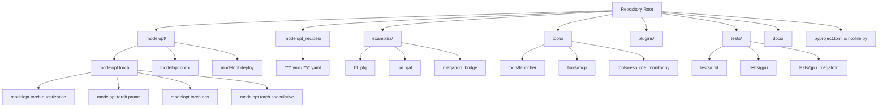
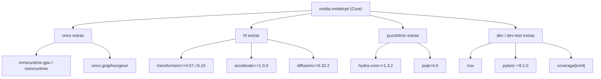

<!-- source: DeepWiki mcp.deepwiki.com · repo NVIDIA/Model-Optimizer · page 1.2 Repository Layout and Packaging · fetched 2026-10-26 -->

# Repository Layout and Packaging

Relevant source files

The following files were used as context for generating this wiki page:

- [.agents/review-guidelines/technical-blog.md](.agents/review-guidelines/technical-blog.md)
- [.github/CODEOWNERS](.github/CODEOWNERS)
- [.github/actions/cache-extensions/action.yml](.github/actions/cache-extensions/action.yml)
- [.github/codecov.yml](.github/codecov.yml)
- [.github/workflows/_example_tests_runner.yml](.github/workflows/_example_tests_runner.yml)
- [.github/workflows/_pr_gate.yml](.github/workflows/_pr_gate.yml)
- [.github/workflows/bump_uv_lock.yml](.github/workflows/bump_uv_lock.yml)
- [.github/workflows/code_quality.yml](.github/workflows/code_quality.yml)
- [.github/workflows/example_tests.yml](.github/workflows/example_tests.yml)
- [.github/workflows/gpu_tests.yml](.github/workflows/gpu_tests.yml)
- [.github/workflows/pages.yml](.github/workflows/pages.yml)
- [.github/workflows/regression_tests.yml](.github/workflows/regression_tests.yml)
- [.github/workflows/release.yml](.github/workflows/release.yml)
- [.github/workflows/unit_tests.yml](.github/workflows/unit_tests.yml)
- [docs/source/_ext/modelopt_autodoc_pydantic.py](docs/source/_ext/modelopt_autodoc_pydantic.py)
- [docs/source/_static/announcements.css](docs/source/_static/announcements.css)
- [docs/source/_static/announcements.js](docs/source/_static/announcements.js)
- [docs/source/_static/custom.css](docs/source/_static/custom.css)
- [docs/source/announcements/assets/autoquantize-qwen35-mmlu-effective-bits.png](docs/source/announcements/assets/autoquantize-qwen35-mmlu-effective-bits.png)
- [docs/source/announcements/autoquantize.rst](docs/source/announcements/autoquantize.rst)
- [docs/source/announcements/dspark-vs-domino.rst](docs/source/announcements/dspark-vs-domino.rst)
- [docs/source/announcements/github-pages-announcements.rst](docs/source/announcements/github-pages-announcements.rst)
- [docs/source/conf.py](docs/source/conf.py)
- [docs/source/getting_started/2_installation.rst](docs/source/getting_started/2_installation.rst)
- [docs/source/index.rst](docs/source/index.rst)
- [examples/gpt-oss/requirements.txt](examples/gpt-oss/requirements.txt)
- [modelopt/onnx/quantization/extensions.py](modelopt/onnx/quantization/extensions.py)
- [modelopt/torch/__init__.py](modelopt/torch/__init__.py)
- [noxfile.py](noxfile.py)
- [pyproject.toml](pyproject.toml)
- [uv.lock](uv.lock)

## Purpose and Scope

This page provides a comprehensive technical reference for the repository layout, directory organization, packaging configuration, and dependency management architecture of the NVIDIA Model Optimizer (`nvidia-modelopt`) library. It details how source files, recipes, examples, tools, tests, and documentation are structured within the codebase, as well as how Python packaging (`pyproject.toml`) [pyproject.toml:1-163](), dependency locking (`uv.lock`) [uv.lock:1-40](), and task automation (`noxfile.py`) [noxfile.py:15-158]() operate.

---

## Top-Level Directory Layout

The Model Optimizer repository is structured around a core library package, configuration recipe sets, execution examples, internal tooling, and comprehensive test suites. 

The following diagram maps the natural language names of the repository's major top-level components to their corresponding code entities and directory paths:

*Figure 1: Top-level repository layout mapped to code subpackages and modules.*

Sources: `pyproject.toml`, `modelopt/torch/__init__.py`, `noxfile.py`

### Subdirectory Descriptions

- **`modelopt/`**: The core library source tree. It contains framework-specific optimization backends, notably `modelopt.torch` for PyTorch models [modelopt/torch/__init__.py:16-40]() and `modelopt.onnx` for ONNX graph transformations, along with shared deployment utilities (`modelopt.deploy`).
- **`modelopt_recipes/`**: Houses declarative YAML-based quantization and optimization recipes (such as FP8 and NVFP4 configurations) [pyproject.toml:147](). These are dynamically loaded by the configuration and recipe loader systems.
- **`examples/`**: Contains end-to-end reference implementations demonstrating optimization workflows. Key directories include `hf_ptq`, `llm_qat`, `llm_distill`, `diffusers`, `megatron_bridge`, `speculative_decoding`, and `vllm_serve` [.github/workflows/example_tests.yml:64-77]().
- **`tools/`**: Operational utility scripts and specialized agent services, including the Slurm/Docker job submission utility (`tools/launcher`), the Model Context Protocol server (`tools/mcp`), and system resource tracking (`tools/resource_monitor.py`) [.github/workflows/unit_tests.yml:14-16]().
- **`plugins/`**: Integrations for external agent environments, including Claude AI agent skills and optimization assistant plugins [.github/workflows/unit_tests.yml:17-18]().
- **`experimental/`**: Sandbox space for bleeding-edge optimization research (such as Dynamic Memory Sparsification and implicit GEMM convolutions) that have not yet stabilized into the public API.
- **`tests/`**: Comprehensive testing suites categorized into CPU unit tests (`tests/unit`), GPU-accelerated functional tests (`tests/gpu`, `tests/gpu_megatron`, `tests/gpu_trtllm`, `tests/gpu_vllm`), shared testing utilities (`tests/_test_utils`), and example integration tests (`tests/examples`) [.github/workflows/example_tests.yml:59-77](), [.github/workflows/gpu_tests.yml:32-37]().
- **`docs/`**: Sphinx documentation source files, configuration (`conf.py`), and announcement assets [.github/workflows/pages.yml:52]().

---

## Packaging and Dependency Configuration

The library uses a modern, standards-compliant packaging configuration centered around `pyproject.toml` and built via `setuptools` with `setuptools-scm` for dynamic versioning [pyproject.toml:4-10]().

### Project Metadata and Core Dependencies

The package is published under the distribution name `nvidia-modelopt` [pyproject.toml:16](). It declares a strict Python requirement of `>=3.10,<3.15` [pyproject.toml:22]() and classifies support for CPython 3.10 through 3.13 [pyproject.toml:25-29](). 

Core runtime dependencies required for basic execution and PyTorch integration include fundamental numeric libraries, NVIDIA management bindings, and configuration parsers [pyproject.toml:34-52]():
- `ninja`: Speeds up compilation of custom C++/CUDA extensions [pyproject.toml:36]().
- `torch>=2.8`: Primary deep learning framework dependency [pyproject.toml:41]().
- `PyYAML>=6.0` and `omegaconf>=2.3.0`: Configuration file loading for recipes [pyproject.toml:44-45]().
- `pulp<4.0`: Linear programming solver backend utilized in neural architecture search and pruning algorithms [pyproject.toml:46]().
- `pydantic>=2.0`: Data validation for configuration schemas [pyproject.toml:47]().
- `safetensors`: Fast weight loading and serialization format [pyproject.toml:50]().

### Optional Feature Extras

To keep the core installation lightweight, specialized domain dependencies are isolated into optional feature extras defined in `pyproject.toml` [pyproject.toml:54-138]():

*Figure 2: Optional dependency graph showing feature extras and associated third-party libraries.*

Sources: `pyproject.toml`

- **`onnx`**: Enables ONNX optimization, graph surgery, and AutoQDQ tools by pulling in `onnx~=1.21.0`, `onnx-graphsurgeon>=0.6.1`, `polygraphy>=0.53.4`, and platform-conditional `onnxruntime-gpu` packages [pyproject.toml:55-74]().
- **`hf`**: Integrates Hugging Face ecosystem components including `transformers>=4.57,<5.15`, `accelerate>=1.0.0`, `diffusers>=0.32.2`, `datasets`, and `peft` [pyproject.toml:75-87]().
- **`puzzletron`**: Installs requirements for the local neural architecture search subpackage, including `hydra-core==1.3.2`, `fire`, and `pandas` [pyproject.toml:89-96]().
- **`dev-test`**: Test execution dependencies including `pytest~=9.1.0`, `pytest-cov`, `nox`, and `uv` [pyproject.toml:114-128]().
- **`all`**: Compound extra that aggregates `onnx`, `hf`, and `puzzletron` [pyproject.toml:136]().
- **`dev`**: Full development environment including `all`, `mlflow`, `dev-docs`, `dev-lint`, and `dev-test` [pyproject.toml:137]().

---

## Nox Automation and Test Orchestration

Task automation, virtual environment management, and test execution across multiple Python runtimes and framework versions are orchestrated using `noxfile.py` [noxfile.py:15-24](). Nox uses `uv` as its default virtual environment backend when available for rapid dependency resolution [noxfile.py:32]().

### Key Nox Sessions

- **`unit`**: Parametrized over Python versions (`3.10` through `3.14`), PyTorch versions (via `TORCH_VERSIONS`), and Transformers versions (via `TRANSFORMERS_VERSIONS`). It installs the package with `.[all,dev-test]` and executes CPU-isolated unit tests [noxfile.py:67-76]().
- **`partial_unit`**: Runs focused test subsets (`onnx`, `torch`, or `torch_deploy`) with restricted optional dependencies to verify modular installation boundaries [noxfile.py:79-100]().
- **`gpu`, `gpu_megatron`, `gpu_trtllm`, `gpu_vllm`**: Container-targeted sessions that bypass virtual environment creation (`venv_backend="none"`) to execute tests directly within pre-built NVIDIA container environments (`pytorch`, `nemo`, `tensorrt-llm`, and `vllm-openai`) [noxfile.py:102-158]().

Sources: `noxfile.py`

---

## CI/CD Pipeline Integration

Continuous Integration workflows defined under `.github/workflows/` automate repository verification, test matrix execution, code quality checks, and documentation generation:

- **`unit_tests.yml`**: Runs CPU unit tests across Linux and Windows runners, multi-version Python/PyTorch matrices, partial installations, and specialized tools (`tools/launcher`, `tools/mcp`) [.github/workflows/unit_tests.yml:60-180]().
- **`gpu_tests.yml`**: Triggers GPU-accelerated test suites (`gpu`, `gpu_megatron`, `gpu_trtllm`, `gpu_vllm`) inside specialized Docker containers with hardware acceleration [.github/workflows/gpu_tests.yml:39-104]().
- **`example_tests.yml`**: Gate-checks reference example scripts across PyTorch, TensorRT-LLM, Megatron, and ONNX lanes [.github/workflows/example_tests.yml:23-160]().
- **`code_quality.yml`**: Executes static analysis, linting (`ruff`, `mypy`), security scanning (`bandit`, `trufflehog`), and pre-commit hooks [.github/workflows/code_quality.yml:18-38]().
- **`pages.yml`**: Builds Sphinx documentation artifacts and handles GitHub Pages deployment and pull request previews [.github/workflows/pages.yml:25-96]().

Sources: `.github/workflows/unit_tests.yml`, `.github/workflows/gpu_tests.yml`, `.github/workflows/example_tests.yml`, `.github/workflows/code_quality.yml`, `.github/workflows/pages.yml`

---

