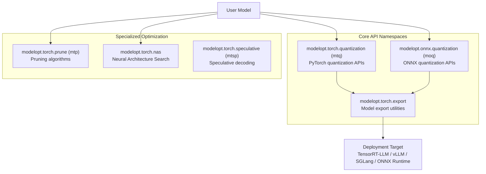
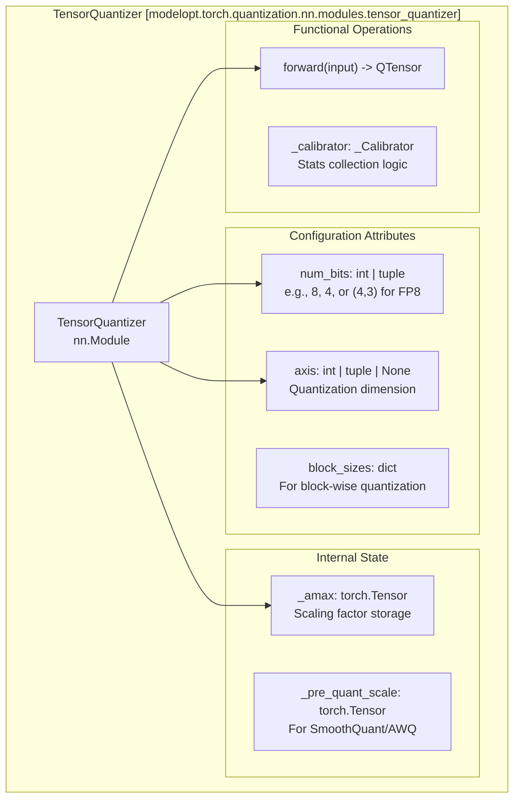
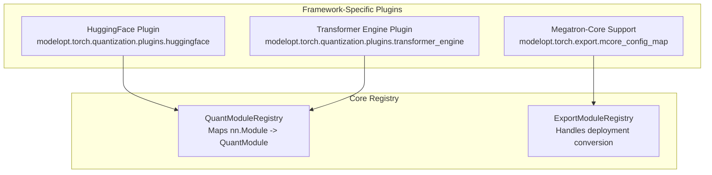

<!-- source: DeepWiki mcp.deepwiki.com · repo NVIDIA/Model-Optimizer · page 10 API Reference · fetched 2026-10-26 -->

# API Reference

Relevant source files

The following files were used as context for generating this wiki page:

- [examples/deepseek/deepseek_v4/quantize_to_nvfp4.py](examples/deepseek/deepseek_v4/quantize_to_nvfp4.py)
- [examples/kimi/README.md](examples/kimi/README.md)
- [examples/kimi/kimi_k3/quantize_to_nvfp4.py](examples/kimi/kimi_k3/quantize_to_nvfp4.py)
- [modelopt/torch/export/__init__.py](modelopt/torch/export/__init__.py)
- [modelopt/torch/export/shard_cast_utils.py](modelopt/torch/export/shard_cast_utils.py)
- [modelopt_recipes/huggingface/README.md](modelopt_recipes/huggingface/README.md)
- [tests/unit/recipe/test_kimi_k3_recipe.py](tests/unit/recipe/test_kimi_k3_recipe.py)

## Purpose and Scope

This section provides a comprehensive API reference for NVIDIA Model Optimizer. It presents an overview of all public APIs organized by namespace, including core classes, entry point functions, and configuration systems.

This page serves as a high-level guide to the API surface. For detailed API documentation of specific modules, refer to the following child pages:

- **[modelopt.torch.quantization API](#10.1)** — `mtq.quantize()`, `mtq.calibrate()`, `mtq.auto_quantize()`, calibration algorithms, and configuration.
- **[modelopt.onnx.quantization API](#10.2)** — `moq.quantize()`, ONNX quantization workflows, and format-specific exporters.
- **[modelopt.torch.export API](#10.3)** — `export_hf_checkpoint()`, `export_tensorrt_llm_checkpoint()`, and deployment utilities.
- **[modelopt.torch.prune API](#10.4)** — `mtp.prune()`, pruning mode descriptors (Minitron, FastNAS, GradNAS).
- **[modelopt.torch.nas API](#10.5)** — Dynamic module system and search algorithms.
- **[modelopt.onnx.autocast API](#10.6)** — `PrecisionConverter`, `GraphSanitizer`, mixed precision conversion.
- **[modelopt.torch.speculative API](#10.7)** — `mtsp.convert()`, EAGLE/Medusa model classes.

Sources: [modelopt/torch/quantization/model_quant.py:48-60](), [modelopt/torch/export/unified_export_hf.py:120-120]()

## High-Level API Organization

Model Optimizer is organized into specialized namespaces, each providing a focused set of APIs for different optimization techniques.

### Core Namespaces

Sources: [modelopt/torch/quantization/model_quant.py:16-60](), [modelopt/onnx/quantization/quantize.py:83-83]()

## Main Entry Point Functions

Model Optimizer provides high-level entry point functions for each optimization technique. These are the primary APIs users interact with.

### PyTorch Quantization Entry Points (Section 10.1)

| Function | Module | Description |
|----------|--------|-------------|
| `mtq.quantize()` | `modelopt.torch.quantization.model_quant` | Main API for in-place quantization and calibration [modelopt/torch/quantization/model_quant.py:147-151]() |
| `mtq.calibrate()` | `modelopt.torch.quantization.model_quant` | Adjusts weights and scaling factors based on algorithms like `max`, `smoothquant`, or `awq` [modelopt/torch/quantization/model_quant.py:64-68]() |
| `mtq.auto_quantize()` | `modelopt.torch.quantization.model_quant` | Automated mixed-precision search for optimal quantization formats [modelopt/torch/quantization/model_quant.py:49-49]() |

### ONNX Quantization Entry Points (Section 10.2)

| Function | Module | Description |
|----------|--------|-------------|
| `quantize()` | `modelopt.onnx.quantization.quantize` | Converts ONNX models to QDQ format for INT8, INT4, or FP8 [modelopt/onnx/quantization/quantize.py:83-83]() |

### Export Entry Points (Section 10.3)

| Function | Module | Description |
|----------|--------|-------------|
| `export_hf_checkpoint()` | `modelopt.torch.export.unified_export_hf` | Exports quantized Hugging Face models for deployment (Safetensors) [modelopt/torch/export/unified_export_hf.py:120-120]() |
| `quantize_mxfp4_to_nvfp4()` | `modelopt.torch.export.shard_cast_utils` | Dequantizes MXFP4 weights and requantizes them to NVFP4 using an optional global amax [modelopt/torch/export/shard_cast_utils.py:125-131]() |
| `quantize_mxfp4_to_nvfp4_lossless()` | `modelopt.torch.export.shard_cast_utils` | Performs a closed-form MXFP4-to-NVFP4 cast with lossless-block accounting [modelopt/torch/export/shard_cast_utils.py:143-149]() |

Sources: [modelopt/torch/quantization/model_quant.py:48-60](), [modelopt/onnx/quantization/quantize.py:83-83](), [modelopt/torch/export/unified_export_hf.py:120-120](), [modelopt/torch/export/shard_cast_utils.py:125-131](), [modelopt/torch/export/shard_cast_utils.py:143-149]()

## Core Module Classes

### TensorQuantizer

The `TensorQuantizer` class is the fundamental building block for PyTorch quantization. It manages the quantization state and performs fake or real quantization.

**Key Features:**
- **Flexible Formats**: Supports INT8, FP8 (E4M3/E5M2), INT4, and NVFP4 formats [modelopt/torch/quantization/nn/modules/tensor_quantizer.py:46-56]().
- **Calibration Integration**: Works with `MseCalibrator`, `NVFP4ActHeadroomCalibrator`, and others to determine optimal scales [modelopt/torch/quantization/model_calib.py:44-44]().
- **Dynamic Blocking**: Supports per-block scaling factors via `block_sizes` [modelopt/torch/quantization/utils/core_utils.py:43-50]().

Sources: [modelopt/torch/quantization/nn/modules/tensor_quantizer.py:136-159](), [modelopt/torch/quantization/model_calib.py:44-44](), [modelopt/torch/quantization/utils/core_utils.py:43-50]()

## Framework Extensions and Plugins

Model Optimizer includes a robust plugin system to extend quantization and export support to various frameworks and layer types.

### Plugin Integration Space

**Key Plugin Entities:**
- `QuantModuleRegistry`: The central registry for mapping standard PyTorch modules to their quantized versions [modelopt/torch/quantization/plugins/huggingface.py:44-45]().
- `TEGroupedMLP`: Specialized support for Transformer Engine's fused MoE experts with per-expert quantization [CHANGELOG.rst:17-18]().
- `HF_CONFIG_MAP`: Mapping for exporting Hugging Face architectures to inference-optimized configs [modelopt/torch/export/layer_utils.py:35-35]().

Sources: [modelopt/torch/quantization/plugins/huggingface.py:43-45](), [modelopt/torch/export/layer_utils.py:35-37](), [CHANGELOG.rst:17-18]()

## Configuration System

Quantization behavior is controlled via `QuantizeConfig`, which combines structural configuration (`quant_cfg`) and algorithmic settings (`algorithm`).

- **`quant_cfg`**: An ordered list of `QuantizerCfgEntry` dicts that use wildcards to target specific modules (e.g., `*weight_quantizer`) [modelopt/torch/quantization/config.py:53-58]().
- **`algorithm`**: Specifies the calibration method, such as `max`, `smoothquant`, or `awq` [modelopt/torch/quantization/model_quant.py:76-80]().

Sources: [modelopt/torch/quantization/config.py:53-60](), [modelopt/torch/quantization/model_quant.py:76-84]()

---

