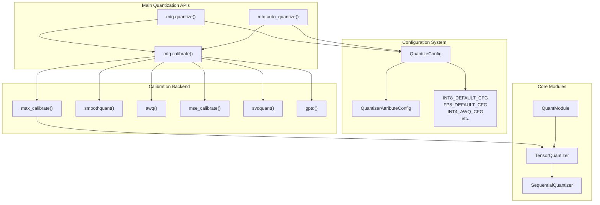
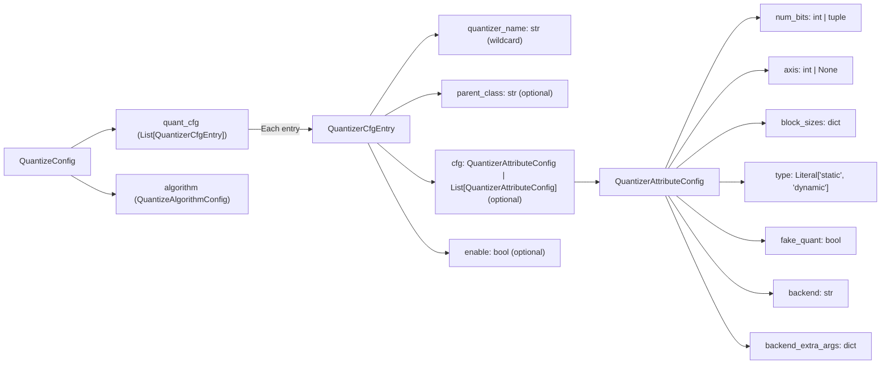
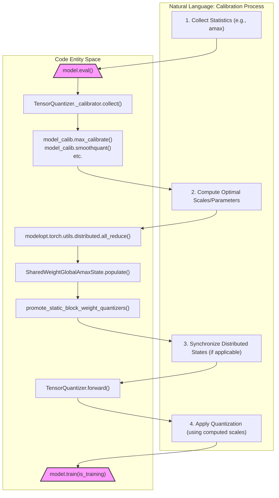

<!-- source: DeepWiki mcp.deepwiki.com · repo NVIDIA/Model-Optimizer · page 10.1 modelopt.torch.quantization API · fetched 2026-10-26 -->

# modelopt.torch.quantization API

<details>
<summary>Relevant source files</summary>

The following files were used as context for generating this wiki page:

- [modelopt/torch/export/layerwise_export.py](modelopt/torch/export/layerwise_export.py)
- [modelopt/torch/export/model_config.py](modelopt/torch/export/model_config.py)
- [modelopt/torch/opt/plugins/mcore_dist_checkpointing.py](modelopt/torch/opt/plugins/mcore_dist_checkpointing.py)
- [modelopt/torch/quantization/_auto_quantize_cost.py](modelopt/torch/quantization/_auto_quantize_cost.py)
- [modelopt/torch/quantization/algorithms.py](modelopt/torch/quantization/algorithms.py)
- [modelopt/torch/quantization/config.py](modelopt/torch/quantization/config.py)
- [modelopt/torch/quantization/conversion.py](modelopt/torch/quantization/conversion.py)
- [modelopt/torch/quantization/mode.py](modelopt/torch/quantization/mode.py)
- [modelopt/torch/quantization/model_calib.py](modelopt/torch/quantization/model_calib.py)
- [modelopt/torch/quantization/model_quant.py](modelopt/torch/quantization/model_quant.py)
- [modelopt/torch/quantization/nn/__init__.py](modelopt/torch/quantization/nn/__init__.py)
- [modelopt/torch/quantization/nn/modules/quant_linear.py](modelopt/torch/quantization/nn/modules/quant_linear.py)
- [modelopt/torch/quantization/nn/modules/quant_module.py](modelopt/torch/quantization/nn/modules/quant_module.py)
- [modelopt/torch/quantization/nn/modules/tensor_quantizer.py](modelopt/torch/quantization/nn/modules/tensor_quantizer.py)
- [modelopt/torch/quantization/plugins/custom.py](modelopt/torch/quantization/plugins/custom.py)
- [modelopt/torch/quantization/plugins/transformer_engine.py](modelopt/torch/quantization/plugins/transformer_engine.py)
- [modelopt/torch/quantization/utils/core_utils.py](modelopt/torch/quantization/utils/core_utils.py)
- [modelopt/torch/quantization/utils/layerwise_calib.py](modelopt/torch/quantization/utils/layerwise_calib.py)
- [modelopt/torch/utils/plugins/megatron_calibration.py](modelopt/torch/utils/plugins/megatron_calibration.py)
- [tests/gpu_megatron/torch/quantization/plugins/test_transformer_engine.py](tests/gpu_megatron/torch/quantization/plugins/test_transformer_engine.py)
- [tests/unit/torch/quantization/plugins/test_huggingface.py](tests/unit/torch/quantization/plugins/test_huggingface.py)
- [tests/unit/torch/quantization/test_autoquant.py](tests/unit/torch/quantization/test_autoquant.py)
- [tests/unit/torch/quantization/test_calib.py](tests/unit/torch/quantization/test_calib.py)
- [tests/unit/torch/quantization/test_config_validation.py](tests/unit/torch/quantization/test_config_validation.py)
- [tests/unit/torch/quantization/test_tensor_quant_cpu.py](tests/unit/torch/quantization/test_tensor_quant_cpu.py)

</details>


## Purpose and Scope

This document provides a comprehensive API reference for PyTorch-based quantization functions in the NVIDIA Model Optimizer. It covers the primary entry points for quantization (`mtq.quantize`, `mtq.calibrate`, `mtq.auto_quantize`), advanced calibration algorithms, and the configuration system used to define quantization formats and behaviors.

For model export functions, see the [Unified HF Checkpoint Export](8.1). For ONNX-specific quantization, see the [ONNX Optimization API](10.2).

---

## API Overview

The quantization API is structured to provide a high-level user interface that orchestrates low-level module replacement, calibration, and state management.



**Sources:** [modelopt/torch/quantization/model_quant.py:16-57](), [modelopt/torch/quantization/model_calib.py:69-79](), [modelopt/torch/quantization/config.py:16-151](), [modelopt/torch/quantization/nn/modules/tensor_quantizer.py:136-159]()

---

## Core Quantization Functions

### mtq.quantize()

**Function:** Quantizes and calibrates a PyTorch model in-place by replacing standard modules with quantized equivalents and executing the specified calibration algorithm.

**Location:** [modelopt/torch/quantization/model_quant.py:147-235]()

**Signature:**
```python
def quantize(
    model: nn.Module,
    config: dict[str, Any | QuantizeConfig],
    forward_loop: ForwardLoop | None = None,
) -> nn.Module
```

**Parameters:**

| Parameter | Type | Description |
|-----------|------|-------------|
| `model` | `nn.Module` | PyTorch model to quantize. |
| `config` | `dict` or `QuantizeConfig` | Configuration specifying `"quant_cfg"` (format) and `"algorithm"` (calibration). |
| `forward_loop` | `ForwardLoop` or `None` | Callable that forwards calibration data through the model. |

**Implementation Details:**
- It performs replacement of modules with their quantized counterparts using `QuantizeModeRegistry` [modelopt/torch/quantization/mode.py:82-82](). The actual conversion is handled by `convert_to_quantized_model` [modelopt/torch/quantization/conversion.py:63-74]().
- It applies `QuantizerAttributeConfig` attributes to matching modules using wildcard patterns [modelopt/torch/quantization/config.py:65-85](). This is done via `set_quantizer_by_cfg` [modelopt/torch/quantization/conversion.py:69-69]().
- It triggers `mtq.calibrate()` to determine scaling factors [modelopt/torch/quantization/model_quant.py:224-224]().

**Sources:** [modelopt/torch/quantization/model_quant.py:147-235](), [modelopt/torch/quantization/config.py:53-151](), [modelopt/torch/quantization/mode.py:82-82](), [modelopt/torch/quantization/conversion.py:63-74](), [modelopt/torch/quantization/conversion.py:69-69]()

---

### mtq.calibrate()

**Function:** Adjusts weights and scaling factors (`amax`) using specialized algorithms. This function assumes the model already contains `TensorQuantizer` modules.

**Location:** [modelopt/torch/quantization/model_quant.py:64-130]()

**Signature:**
```python
def calibrate(
    model: nn.Module,
    algorithm: QuantizeAlgoCfgType = "max",
    forward_loop: ForwardLoop | None = None,
) -> nn.Module
```

**Parameters:**

| Parameter | Type | Description |
|-----------|------|-------------|
| `model` | `nn.Module` | A PyTorch model with quantizer modules. |
| `algorithm` | `str` or `dict` | Specifies the calibration algorithm. Can be a string (e.g., `"max"`) or a dictionary with a `"method"` key and optional kwargs. |
| `forward_loop` | `ForwardLoop` or `None` | Callable to forward calibration data through the model. Required for activation-dependent algorithms. |

**Implementation Details:**
- Sets the model to evaluation mode (`model.eval()`) during calibration [modelopt/torch/quantization/model_quant.py:110-110]().
- Uses `apply_mode` to dispatch to the appropriate calibration algorithm based on the `algorithm` parameter [modelopt/torch/quantization/model_quant.py:113-117](). The `get_modelike_from_algo_cfg` function determines the specific mode descriptor [modelopt/torch/quantization/mode.py:76-76]().
- After calibration, it validates the `_amax` and `_pre_quant_scale` attributes of `TensorQuantizer` modules [modelopt/torch/quantization/model_quant.py:120-123]().

**Supported Algorithms:**

| Algorithm | Function | Description |
|-----------|----------|-------------|
| `max` | `max_calibrate` | Standard absolute maximum collection for scaling [modelopt/torch/quantization/model_calib.py:68-68](). |
| `smoothquant` | `smoothquant` | Migrates quantization difficulty from activations to weights [modelopt/torch/quantization/model_calib.py:68-68](). |
| `awq` | `awq` | Activation-aware Weight Quantization for low-bit formats [modelopt/torch/quantization/model_calib.py:68-68](). |
| `mse` | `mse_calibrate` | Searches for `amax` that minimizes Mean Squared Error [modelopt/torch/quantization/mode.py:69-69](). |
| `svdquant` | `svdquant` | Uses SVD to decompose and quantize outlier-heavy weights [modelopt/torch/quantization/model_calib.py:68-68](). |
| `nvfp4_act_headroom`| `nvfp4_act_headroom_calibrate` | Anchors scales to a percentile for NVFP4 activation headroom [modelopt/torch/quantization/model_calib.py:68-68](). |
| `gptq` | `gptq` | GPTQ algorithm for post-training quantization [modelopt/torch/quantization/model_calib.py:68-68](). |
| `lsq` | `lsq` | Learns quantization parameters during training [modelopt/torch/quantization/model_calib.py:68-68](). |
| `layerwise_calibrate` | `layerwise_calibrate` | Performs calibration layer by layer [modelopt/torch/quantization/model_calib.py:68-68](). |
| `local_hessian_calibrate` | `local_hessian_calibrate` | Uses local Hessian information for calibration [modelopt/torch/quantization/model_calib.py:68-68](). |

**Sources:** [modelopt/torch/quantization/model_quant.py:64-130](), [modelopt/torch/quantization/model_calib.py:68-68](), [modelopt/torch/quantization/mode.py:69-69](), [modelopt/torch/quantization/mode.py:76-76]()

---

### mtq.auto_quantize()

**Function:** Automatically searches for the optimal per-layer quantization format (e.g., mixing FP8 and INT4) based on a target compression constraint.

**Location:** [modelopt/torch/quantization/model_quant.py:243-431]()

**Signature:**
```python
def auto_quantize(
    model: nn.Module,
    forward_loop: ForwardLoop,
    quant_recipe: QuantRecipe,
    constraints: ConstraintsDict | None = None,
    search_config: SearchConfig | None = None,
    resume_from_checkpoint: str | None = None,
    output_dir: str | None = None,
    save_each_step: bool = False,
    save_best_model: bool = False,
    save_final_model: bool = True,
    save_final_model_name: str = "model_final.pth",
    save_final_model_config_name: str = "config_final.yaml",
    save_final_model_state_name: str = "modelopt_state_final.pth",
    save_final_model_metadata_name: str = "metadata_final.pth",
    save_final_model_search_state_name: str = "search_state_final.pth",
    save_final_model_search_config_name: str = "search_config_final.yaml",
    save_final_model_search_metadata_name: str = "search_metadata_final.pth",
    save_final_model_search_state_dict_name: str = "search_state_dict_final.pth",
    save_final_model_search_state_dict_config_name: str = "search_state_dict_config_final.yaml",
    save_final_model_search_state_dict_metadata_name: str = "search_state_dict_metadata_final.pth",
    save_final_model_search_state_dict_search_state_name: str = "search_state_dict_search_state_final.pth",
    save_final_model_search_state_dict_search_config_name: str = "search_state_dict_search_config_final.yaml",
    save_final_model_search_state_dict_search_metadata_name: str = "search_state_dict_search_metadata_final.pth",
) -> tuple[nn.Module, QuantizeConfig, SearchStateDict]
```

**Parameters:**

| Parameter | Type | Description |
|-----------|------|-------------|
| `model` | `nn.Module` | The PyTorch model to be quantized. |
| `forward_loop` | `ForwardLoop` | A callable that runs a forward pass on the model, typically for calibration or evaluation. |
| `quant_recipe` | `QuantRecipe` | Defines the quantization options (e.g., available bit-widths) for the search. |
| `constraints` | `ConstraintsDict` or `None` | Optional constraints for the search, such as target compression ratios. |
| `search_config` | `SearchConfig` or `None` | Configuration for the search algorithm itself. |
| `resume_from_checkpoint` | `str` or `None` | Path to a checkpoint to resume the search from. |
| `output_dir` | `str` or `None` | Directory to save search results and models. |
| `save_each_step` | `bool` | If `True`, saves the model at each step of the search. |
| `save_best_model` | `bool` | If `True`, saves the best model found during the search. |
| `save_final_model` | `bool` | If `True`, saves the final quantized model. |
| `save_final_model_name` | `str` | Filename for the final model. |
| `save_final_model_config_name` | `str` | Filename for the final quantization config. |
| `save_final_model_state_name` | `str` | Filename for the final ModelOpt state. |
| `save_final_model_metadata_name` | `str` | Filename for the final ModelOpt metadata. |
| `save_final_model_search_state_name` | `str` | Filename for the final search state. |
| `save_final_model_search_config_name` | `str` | Filename for the final search config. |
| `save_final_model_search_metadata_name` | `str` | Filename for the final search metadata. |
| `save_final_model_search_state_dict_name` | `str` | Filename for the final search state dictionary. |
| `save_final_model_search_state_dict_config_name` | `str` | Filename for the final search state dictionary config. |
| `save_final_model_search_state_dict_metadata_name` | `str` | Filename for the final search state dictionary metadata. |
| `save_final_model_search_state_dict_search_state_name` | `str` | Filename for the final search state dictionary search state. |
| `save_final_model_search_state_dict_search_config_name` | `str` | Filename for the final search state dictionary search config. |
| `save_final_model_search_state_dict_search_metadata_name` | `str` | Filename for the final search state dictionary search metadata. |

**Returns:**
- `nn.Module`: The quantized model.
- `QuantizeConfig`: The quantization configuration applied to the model.
- `SearchStateDict`: The state of the search process.

**Scoring Methods:**
- **Gradient-based:** Uses `AutoQuantizeGradientSearcher` to estimate layer sensitivity via gradients [modelopt/torch/quantization/algorithms.py:41-41]().
- **KL Divergence:** Uses `AutoQuantizeKLDivSearcher` to measure output distribution shift [modelopt/torch/quantization/algorithms.py:41-41]().

**Sources:** [modelopt/torch/quantization/model_quant.py:243-431](), [modelopt/torch/quantization/algorithms.py:41-56]()

---

## Configuration System

### QuantizeConfig and QuantizerCfgEntry

Quantization behavior is driven by a hierarchical configuration system.



**Key Configuration Entities:**
- **`QuantizeConfig`**: The top-level configuration object, containing `quant_cfg` and `algorithm` [modelopt/torch/quantization/config.py:53-59]().
- **`quant_cfg`**: An ordered list of `QuantizerCfgEntry` dictionaries [modelopt/torch/quantization/config.py:55-56]().
- **`QuantizerCfgEntry`**: Defines how to configure specific quantizers:
    - **`quantizer_name`**: A wildcard string matched against quantizer module names (e.g., `*weight_quantizer`) [modelopt/torch/quantization/config.py:65-70]().
    - **`parent_class`**: Optional. Restricts matching to quantizers whose immediate parent module is of this PyTorch class (e.g., `"nn.Linear"`) [modelopt/torch/quantization/config.py:71-73]().
    - **`cfg`**: A `QuantizerAttributeConfig` or a list of them. If a list, a `SequentialQuantizer` is used [modelopt/torch/quantization/config.py:74-81]().
    - **`enable`**: Toggles matched quantizers on or off [modelopt/torch/quantization/config.py:82-85]().
- **`QuantizerAttributeConfig`**: Specifies attributes for a `TensorQuantizer`:
    - **`num_bits`**: Supports integers (e.g., `8` for INT8) or tuples for mixed-precision formats [modelopt/torch/quantization/config.py:72-79]().
    - **`axis`**: Specifies the quantization axis (e.g., `0` for per-channel, `None` for per-tensor) [modelopt/torch/quantization/config.py:72-79]().
    - **`block_sizes`**: Enables block-wise quantization (e.g., `{-1: 128}`) for hardware-aligned formats like NVFP4 or INT4 [modelopt/torch/quantization/config.py:72-81]().
    - **`type`**: Specifies if the quantization is `"static"` or `"dynamic"` [modelopt/torch/quantization/config.py:72-79]().
    - **`fake_quant`**: If `True`, performs fake quantization [modelopt/torch/quantization/config.py:72-79]().
    - **`backend`**: Specifies a custom quantization backend [modelopt/torch/quantization/config.py:72-79]().
    - **`backend_extra_args`**: Additional arguments for the custom backend [modelopt/torch/quantization/config.py:72-79]().

**Ordering and Precedence:**
- Entries in `quant_cfg` are applied in list order; later entries override earlier ones for any quantizer they match [modelopt/torch/quantization/config.py:89-89]().
- Recommended pattern: deny-all, then selectively enable/configure, then append default exclusions [modelopt/torch/quantization/config.py:91-96]().

**Sources:** [modelopt/torch/quantization/config.py:50-168](), [modelopt/torch/quantization/algorithms.py:53-55]()

---

## Core Quantizer Modules

### TensorQuantizer

The `TensorQuantizer` is the primary module responsible for scaling and rounding tensors during the forward pass.

**Location:** [modelopt/torch/quantization/nn/modules/tensor_quantizer.py:136-1892]()

**Key States:**
- **`if_quant`**: When `True`, the module applies quantization in the forward path [modelopt/torch/quantization/nn/modules/tensor_quantizer.py:155-155]().
- **`if_calib`**: When `True`, the module collects statistics (via a `_calibrator`) instead of quantizing [modelopt/torch/quantization/nn/modules/tensor_quantizer.py:156-156]().
- **`amax`**: The scaling factor used to map floating-point values to the quantized range [modelopt/torch/quantization/nn/modules/tensor_quantizer.py:157-158]().
- **`_calibrator`**: An instance of `_Calibrator` (e.g., `MseCalibrator`, `NVFP4ActHeadroomCalibrator`) used to collect statistics [modelopt/torch/quantization/model_calib.py:45-45]().

### SequentialQuantizer

Used for multi-step quantization (e.g., W4A8 where weights are quantized to INT4 then FP8) [modelopt/torch/quantization/nn/modules/tensor_quantizer.py:77-77](). It replaces a single `TensorQuantizer` with a list of quantizers applied in sequence [modelopt/torch/quantization/config.py:75-81]().

**Sources:** [modelopt/torch/quantization/nn/modules/tensor_quantizer.py:136-204](), [modelopt/torch/quantization/config.py:75-81](), [modelopt/torch/quantization/model_calib.py:45-45]()

---

## Data Flow: Calibration to Quantization

This diagram maps the natural language process of "Calibrating a Model" to the specific code entities involved.



**Explanation of Flow:**
1.  **Collect Statistics**: The model is set to evaluation mode (`model.eval()` [modelopt/torch/quantization/model_quant.py:110-110]()). During a forward pass (`forward_loop`), `TensorQuantizer` modules, when `if_calib` is `True` [modelopt/torch/quantization/nn/modules/tensor_quantizer.py:156-156](), use their internal `_calibrator` to collect statistics (e.g., absolute maximums) [modelopt/torch/quantization/model_calib.py:136-208]().
2.  **Compute Optimal Scales/Parameters**: The chosen calibration algorithm (e.g., `max_calibrate`, `smoothquant`) processes the collected statistics to determine the optimal quantization scales (`amax`) or other parameters [modelopt/torch/quantization/model_calib.py:68-68]().
3.  **Synchronize Distributed States**: In distributed training/inference, `all_reduce` operations [modelopt/torch/utils/distributed.py:42-42]() are used to synchronize `amax` values across ranks. `SharedWeightGlobalAmaxState.populate()` [modelopt/torch/quantization/model_calib.py:143-158]() aggregates shared weight `global_amax` values, and `promote_static_block_weight_quantizers()` [modelopt/torch/quantization/model_calib.py:154-154]() applies these to the quantizers.
4.  **Apply Quantization**: Once calibration is complete, `if_calib` is set to `False` and `if_quant` is set to `True` for the `TensorQuantizer` modules. Subsequent forward passes then apply the actual quantization using the computed scales via `TensorQuantizer.forward()` [modelopt/torch/quantization/nn/modules/tensor_quantizer.py:300-300](). The model is then restored to its original training state (`model.train(is_training)` [modelopt/torch/quantization/model_quant.py:127-127]()).

**Sources:** [modelopt/torch/quantization/model_quant.py:110-110](), [modelopt/torch/quantization/nn/modules/tensor_quantizer.py:156-156](), [modelopt/torch/quantization/model_calib.py:136-208](), [modelopt/torch/quantization/model_calib.py:68-68](), [modelopt/torch/utils/distributed.py:42-42](), [modelopt/torch/quantization/model_calib.py:143-158](), [modelopt/torch/quantization/model_calib.py:154-154](), [modelopt/torch/quantization/nn/modules/tensor_quantizer.py:300-300](), [modelopt/torch/quantization/model_quant.py:127-127]()

---

## Advanced Features and Framework Support

### NVFP4 Activation Headroom

The `NVFP4ActHeadroomCalibrator` provides a mechanism to avoid saturation in NVFP4 activations by anchoring the global scale to a lower percentile of the per-block amax distribution, creating "headroom" for outliers [modelopt/torch/quantization/model_calib.py:45-45](). This is exposed via the `nvfp4_act_headroom_calibrate` function [modelopt/torch/quantization/model_calib.py:68-68]().

**Sources:** [modelopt/torch/quantization/model_calib.py:45-45](), [modelopt/torch/quantization/model_calib.py:68-68]()

### Transformer Engine (TE) and MoE Integration

ModelOpt supports per-expert weight quantization for `TEGroupedMLP` (fused MoE experts) [modelopt/torch/quantization/plugins/transformer_engine.py:117-153](). Each expert maintains an independent `amax` via a `GroupedQuantizer` holding one `TensorQuantizer` per expert [modelopt/torch/quantization/plugins/transformer_engine.py:150-153]().

-   **Shared State:** `SharedWeightGlobalAmaxState` aggregates fusible group weight `global_amax` across siblings (e.g., Q/K/V) [modelopt/torch/quantization/model_calib.py:143-158](). This ensures consistency for grouped linear layers.
-   **MoE Sync:** `sync_moe_expert_amax` (not directly shown in provided files but implied by MoE support) ensures expert scales are synchronized across Expert Parallel (EP) ranks. The `_TransposedExpertsCalibMixin` in Hugging Face plugins also handles calibration for transposed experts [tests/unit/torch/quantization/plugins/test_huggingface.py:39-39]().
-   **Megatron-Core Distributed Checkpointing**: The `modelopt.torch.opt.plugins.mcore_dist_checkpointing` module provides utilities like `save_modelopt_state` and `restore_modelopt_state` to handle ModelOpt's state within Megatron-Core's distributed checkpointing system, ensuring quantizer states are correctly saved and loaded across sharded models [modelopt/torch/opt/plugins/mcore_dist_checkpointing.py:67-84](), [modelopt/torch/opt/plugins/mcore_dist_checkpointing.py:94-110]().

**Sources:** [modelopt/torch/quantization/plugins/transformer_engine.py:117-153](), [modelopt/torch/quantization/plugins/transformer_engine.py:150-153](), [modelopt/torch/quantization/model_calib.py:143-158](), [tests/unit/torch/quantization/plugins/test_huggingface.py:39-39](), [modelopt/torch/opt/plugins/mcore_dist_checkpointing.py:67-84](), [modelopt/torch/opt/plugins/mcore_dist_checkpointing.py:94-110]()

---

## Summary of High-Level Utilities

| Utility | Location | Description |
|---------|----------|-------------|
| `disable_quantizer` | [modelopt/torch/quantization/model_quant.py:52-52]() | Disables quantizers matching a pattern. |
| `enable_quantizer` | [modelopt/torch/quantization/model_quant.py:53-53]() | Enables quantizers matching a pattern. |
| `print_quant_summary` | [modelopt/torch/quantization/model_quant.py:57-57]() | Prints a summary of all quantized modules and their bits. |
| `fold_weight` | [modelopt/torch/quantization/model_quant.py:54-54]() | Folds `pre_quant_scale` into weights for inference. |
| `temporarily_fold_weights` | [modelopt/torch/quantization/model_quant.py:59-59]() | Context manager for repeated frozen-weight inference. |
| `postprocess_amax` | [modelopt/torch/quantization/model_quant.py:132-144]() | Transforms `amax` values after calibration using a user function. |

**Sources:** [modelopt/torch/quantization/model_quant.py:48-60](), [modelopt/torch/quantization/model_quant.py:132-144]()

---

