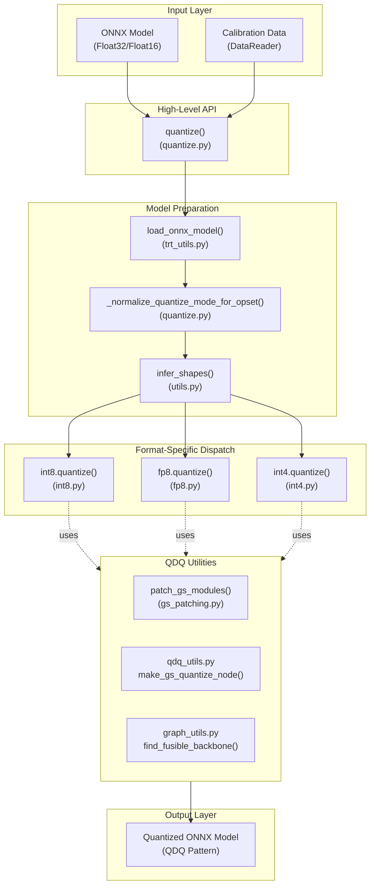
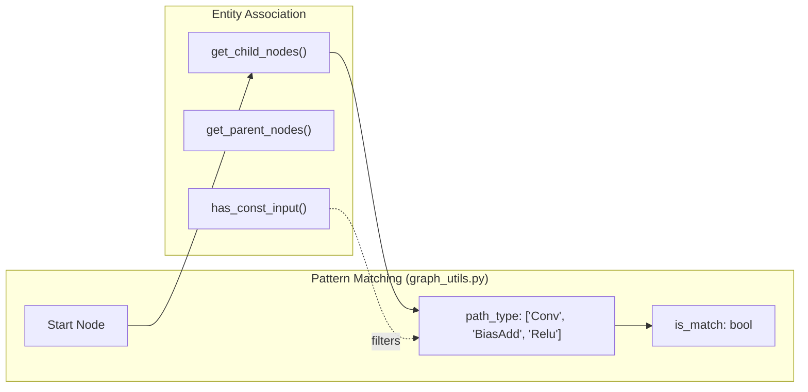

<!-- source: DeepWiki mcp.deepwiki.com · repo NVIDIA/Model-Optimizer · page 10.2 modelopt.onnx.quantization API · fetched 2026-10-26 -->

# modelopt.onnx.quantization API

<details>
<summary>Relevant source files</summary>

The following files were used as context for generating this wiki page:

- [docs/source/guides/9_autotune.rst](docs/source/guides/9_autotune.rst)
- [modelopt/onnx/export/nvfp4_exporter.py](modelopt/onnx/export/nvfp4_exporter.py)
- [modelopt/onnx/quantization/__main__.py](modelopt/onnx/quantization/__main__.py)
- [modelopt/onnx/quantization/autotune/autotuner_base.py](modelopt/onnx/quantization/autotune/autotuner_base.py)
- [modelopt/onnx/quantization/autotune/export_utils.py](modelopt/onnx/quantization/autotune/export_utils.py)
- [modelopt/onnx/quantization/autotune/workflows.py](modelopt/onnx/quantization/autotune/workflows.py)
- [modelopt/onnx/quantization/fp8.py](modelopt/onnx/quantization/fp8.py)
- [modelopt/onnx/quantization/int8.py](modelopt/onnx/quantization/int8.py)
- [modelopt/onnx/quantization/precision_utils.py](modelopt/onnx/quantization/precision_utils.py)
- [modelopt/onnx/quantization/qdq_utils.py](modelopt/onnx/quantization/qdq_utils.py)
- [modelopt/onnx/quantization/quant_utils.py](modelopt/onnx/quantization/quant_utils.py)
- [modelopt/onnx/quantization/quantize.py](modelopt/onnx/quantization/quantize.py)
- [modelopt/torch/quantization/qtensor/nvfp4_tensor.py](modelopt/torch/quantization/qtensor/nvfp4_tensor.py)
- [tests/unit/onnx/quantization/test_precision_utils.py](tests/unit/onnx/quantization/test_precision_utils.py)
- [tests/unit/onnx/quantization/test_qdq_utils.py](tests/unit/onnx/quantization/test_qdq_utils.py)
- [tests/unit/onnx/quantization/test_quant_utils.py](tests/unit/onnx/quantization/test_quant_utils.py)
- [tests/unit/onnx/quantization/test_quantize_api.py](tests/unit/onnx/quantization/test_quantize_api.py)
- [tests/unit/torch/quantization/test_nvfp4_tensor.py](tests/unit/torch/quantization/test_nvfp4_tensor.py)
- [tests/unit/torch/quantization/test_onnx_export_cpu.py](tests/unit/torch/quantization/test_onnx_export_cpu.py)

</details>


## Purpose and Scope

This page documents the API reference for ONNX quantization functionality in Model Optimizer. The `modelopt.onnx.quantization` module provides tools for quantizing ONNX models to various precision formats including INT4, INT8, and FP8. This includes utilities for inserting QDQ (Quantize-Dequantize) patterns into ONNX graphs, specialized calibration routines, and format-specific logic for TensorRT deployment.

The module also includes a high-level `quantize` function for Post-Training Quantization (PTQ) and support for automated pattern-based Q/DQ node placement.

---

## Core Architecture

### ONNX Quantization Pipeline

The ONNX quantization system transforms high-precision ONNX models into optimized versions suitable for TensorRT deployment. The pipeline handles preprocessing, node classification, calibration, and graph surgery.



**Sources:**
- [modelopt/onnx/quantization/quantize.py:16-32]()
- [modelopt/onnx/quantization/qdq_utils.py:16-33]()
- [modelopt/onnx/quantization/int8.py:144-148]()

---

## High-Level PTQ API

### `quantize()` Function

The `quantize` function is the primary entry point for ONNX post-training quantization. It handles model loading, opset validation, calibration, and routing to specific quantization backends.

#### `modelopt.onnx.quantization.quantize(onnx_path, ...)`

**Key Parameters:**
- `onnx_path`: Path to the input ONNX model. [modelopt/onnx/quantization/__main__.py:90]()
- `quantize_mode`: Target precision (`"int8"`, `"fp8"`, `"int4"`). [modelopt/onnx/quantization/__main__.py:120-124]()
- `calibration_method`: Algorithm for scale calculation (e.g., `"max"`, `"entropy"`, `"awq_clip"`, `"rtn_dq"`). [modelopt/onnx/quantization/__main__.py:126-132]()
- `calibration_data_reader`: An `onnxruntime.quantization.calibrate.CalibrationDataReader` instance. [modelopt/onnx/quantization/quantize.py:50]()
- `opset`: Target ONNX opset version. The function automatically upgrades the opset to minimum required versions based on `QDQ_PRECISION_MIN_OPSET` (e.g., opset 21 for INT4, opset 23 for NVFP4). [modelopt/onnx/quantization/quantize.py:159]()

**Internal Logic:**
1. **Preprocessing**: Loads the model using `load_onnx_model` and determines the target opset based on the `quantize_mode`. [modelopt/onnx/quantization/quantize.py:161-178]()
2. **Backend Selection**: Routes to the appropriate implementation:
   - `modelopt.onnx.quantization.int8.quantize` [modelopt/onnx/quantization/int8.py:119]()
   - `modelopt.onnx.quantization.fp8.quantize` [modelopt/onnx/quantization/fp8.py:163]()
   - `modelopt.onnx.quantization.int4.quantize` [modelopt/onnx/quantization/int4.py:61]()

**Sources:**
- [modelopt/onnx/quantization/quantize.py:86-178]()
- [modelopt/onnx/quantization/__main__.py:90-170]()
- [modelopt/onnx/quantization/int8.py:119-145]()
- [modelopt/onnx/quantization/fp8.py:163-180]()

---

## Format-Specific Implementations

### INT8 Quantization (`int8.py`)

Performs INT8 quantization using compiler-friendly heuristics. It identifies quantizable partitions (e.g., Conv-BN-Relu) that TensorRT can fuse.

**Key Functions:**
- `_find_nodes_to_quantize()`: Scans the graph for patterns like MHA, LayerNorm, and residual connections using `build_non_residual_input_map` to determine optimal QDQ placement. [modelopt/onnx/quantization/int8.py:57-116]()
- `quantize()`: Orchestrates the INT8 workflow, including `concat_elimination` and calling `ort_patching._quantize_static`. [modelopt/onnx/quantization/int8.py:119-166]()

**Sources:**
- [modelopt/onnx/quantization/int8.py:57-116]()
- [modelopt/onnx/quantization/int8.py:146-166]()

### INT4 Weight-Only Quantization (`int4.py`)

Focuses on quantizing weights to 4-bit while keeping activations in high precision.

**Key Features:**
- Supports RTN (Round-To-Nearest) and AWQ-style clipping via `find_scales` and `rtn`. [modelopt/onnx/quantization/int4.py:159-165]()
- Handles `Gather` nodes specifically for large embedding layers using `_quantize_gather_nodes`. [modelopt/onnx/quantization/int4.py:125-188]()
- Uses `pack_weights_to_int4` which internally leverages `pack_float32_to_4bit_cpp_based` for efficient packing. [modelopt/onnx/quantization/quant_utils.py:69-123]()

**Sources:**
- [modelopt/onnx/quantization/int4.py:63-78]()
- [modelopt/onnx/quantization/int4.py:125-188]()
- [modelopt/onnx/quantization/quant_utils.py:69-123]()

### FP8 Quantization (`fp8.py`)

Targeting NVIDIA Ada Lovelace and Blackwell architectures, this module handles `FLOAT8E4M3FN` quantization.

**Key Operations:**
- `int8_to_fp8()`: Converts an existing max-calibrated INT8 model to FP8 by rescaling `QuantizeLinear` and `DequantizeLinear` nodes. [modelopt/onnx/quantization/fp8.py:51-127]()
- `upgrade_opset_21()`: Modifies the graph to meet Opset 21 requirements, where `ReduceMean` loses the "axes" attribute and Q/DQ ops support FP16 scaling factors. [modelopt/onnx/quantization/precision_utils.py:93]()

**Sources:**
- [modelopt/onnx/quantization/fp8.py:51-127]()
- [modelopt/onnx/quantization/precision_utils.py:93]()

---

## Exporter Classes

The `modelopt.onnx.export` module contains specialized exporters that convert PyTorch-quantized models or existing ONNX QDQ models into optimized deployment formats.

### `ONNXQuantExporter` Base Class
The base class for all ONNX quantization exporters, defining the standard pipeline stages: `pre_process`, `compute_scales`, and `compress_weights`. [modelopt/onnx/export/base_exporter.py]()

### `FP8QuantExporter`
Handles the conversion of TRT-specific FP8 QDQ nodes into native ONNX `DequantizeLinear` nodes with FP8 weights.
- `compress_weights()`: Replaces `(fp32 weights + fp8 QDQ)` with `(fp8 weights + DQ)`. It also handles folding `Transpose` nodes that feed `MatMul` to ensure TensorRT sees the `DQ -> MatMul` pattern. [modelopt/onnx/export/fp8_exporter.py:50-153]()

### `NVFP4QuantExporter`
Supports NVIDIA's 4-bit floating point format (NVFP4).
- `_replace_fp4qdq_with_2dq()`: Replaces a single FP4 QDQ node with a two-stage dequantization subgraph: `(w_f4, sw_f8_per_block, sw_f32_per_tensor)`. This function is also exposed as `fp4qdq_to_2dq` for backward compatibility. [modelopt/onnx/export/nvfp4_exporter.py:75-172]()
- `_cast_fp4()`: Casts a numpy array to `FLOAT4E2M1` using PyTorch, packing two FP4 values into a single byte. [modelopt/onnx/export/nvfp4_exporter.py:37-57]()
- `_encode_nvfp4_block_scale()`: Returns FP8-rounded block scales as FP32 values and encoded bytes. [modelopt/onnx/export/nvfp4_exporter.py:60-72]()

**Sources:**
- [modelopt/onnx/export/fp8_exporter.py:36-63]()
- [modelopt/onnx/export/nvfp4_exporter.py:37-172]()
- [tests/unit/onnx/quantization/test_qdq_utils.py:29]()
- [tests/unit/torch/quantization/test_onnx_export_cpu.py:37]()

---

## QDQ Utilities

The `modelopt.onnx.quantization.qdq_utils` module provides the low-level building blocks for graph surgery using ONNX GraphSurgeon.

### Node Creation and Naming

| Function | Purpose | Logic |
|----------|---------|-------|
| `make_gs_quantize_node` | Creates a Q node | Uses `QUANTIZE_NODE_NAME` (default "QuantizeLinear"). [modelopt/onnx/quantization/qdq_utils.py:166-178]() |
| `make_gs_dequantize_node` | Creates a DQ node | Uses `DEQUANTIZE_NODE_NAME` (default "DequantizeLinear"). [modelopt/onnx/quantization/qdq_utils.py:220-236]() |
| `use_trt_qdq_ops` | TRT Custom Nodes | Switches names to `TRT_INT4QuantizeLinear` and `TRT_INT4DequantizeLinear`. [modelopt/onnx/quantization/qdq_utils.py:71-78]() |
| `_wq_name` | Naming | Appends `_i4` to the base name. [modelopt/onnx/quantization/qdq_utils.py:80-81]() |

### Data Type Support

ModelOpt maps standard precision names to ONNX `TensorProto` types:

| Name | ONNX Type |
|------|-----------|
| `"Float4"` | `onnx.TensorProto.FLOAT4E2M1` |
| `"Float8"` | `onnx.TensorProto.FLOAT8E4M3FN` |
| `"INT4"` | `onnx.TensorProto.INT4` |
| `"UINT4"` | `onnx.TensorProto.UINT4` |

**Sources:**
- [modelopt/onnx/quantization/qdq_utils.py:49-59]()
- [modelopt/onnx/quantization/qdq_utils.py:166-236]()

---

## Graph Analysis and Heuristics

The `graph_utils.py` module contains logic for identifying which parts of an ONNX graph should be quantized for optimal TensorRT performance.

### Pattern Matching

ModelOpt uses `has_path_type` to identify fusible sequences. For example, TensorRT can fuse `Conv` with `BiasAdd`, `Relu`, or `MaxPool`.



**Key Logic:**
- `get_fusible_backbone()`: Returns the linear backbone node (Conv/Gemm) for a given pattern by checking parent nodes recursively. [modelopt/onnx/quantization/graph_utils.py:174-194]()
- `is_const_input()`: Determines if a tensor is an initializer or produced by a constant-foldable node like `Identity` or `Squeeze` with constant inputs. [modelopt/onnx/quantization/graph_utils.py:48-71]()
- `find_nodes_to_exclude()`: Orchestrates the exclusion of specific nodes based on patterns or performance heuristics. [modelopt/onnx/quantization/graph_utils.py:42-50]()

**Sources:**
- [modelopt/onnx/quantization/graph_utils.py:88-171]()
- [modelopt/onnx/quantization/graph_utils.py:174-194]()

---

## ONNX GraphSurgeon Patching

Because standard `onnx_graphsurgeon` does not always support newer types like INT4/FP4 natively, ModelOpt applies dynamic patches in `gs_patching.py`.

- `patch_gs_modules()`: Overrides `gs.make_constant` and `gs.make_variable` to support `explicit_dtype`. [modelopt/onnx/quantization/gs_patching.py:113-119]()
- `_export_tensor_proto()`: Handles the packing of 4-bit values into bytes during the export process. [modelopt/onnx/quantization/gs_patching.py:68-93]()

**Sources:**
- [modelopt/onnx/quantization/gs_patching.py:35-56]()
- [modelopt/onnx/quantization/gs_patching.py:113-119]()

---

## Command-Line Interface

ModelOpt provides a CLI for ONNX PTQ via the `modelopt.onnx.quantization` module.

**Usage Example:**
```bash
python -m modelopt.onnx.quantization \
    --onnx_path model.onnx \
    --quantize_mode int8 \
    --calibration_method entropy \
    --calibration_data_path data.npz \
    --output_path model_quant.onnx
```

**Key Arguments:**
- `--op_types_to_exclude`: List of node types to skip. [modelopt/onnx/quantization/__main__.py:186-190]()
- `--trt_plugins`: Paths to custom TensorRT plugin libraries to enable parsing of custom ops. [modelopt/onnx/quantization/__main__.py:204-210]()
- `--calibration_eps`: Execution provider priority (e.g., `trt`, `cuda:0`, `cpu`) for calibration sessions. [modelopt/onnx/quantization/__main__.py:160-170]()
- `--input_shapes_profile`: Input shape profile options as an inline JSON list or a path to a JSON file. This is used to infer EP input shape profiles when not provided. [modelopt/onnx/quantization/__main__.py:102-112]()

**Sources:**
- [modelopt/onnx/quantization/__main__.py:85-220]()
- [modelopt/onnx/quantization/__main__.py:102-112]()

---

