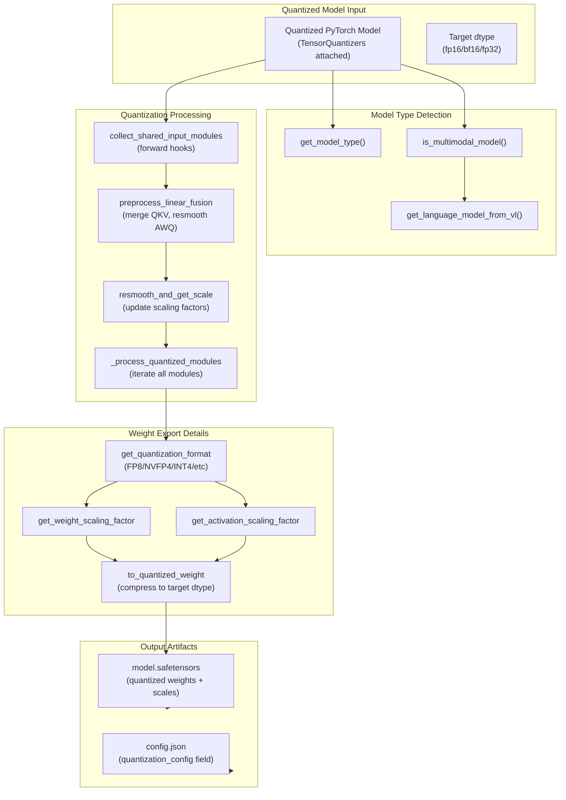
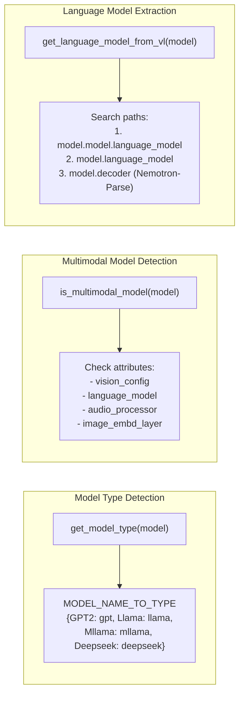

<!-- source: DeepWiki mcp.deepwiki.com · repo NVIDIA/Model-Optimizer · page 10.3 modelopt.torch.export API · fetched 2026-10-26 -->

# modelopt.torch.export API

<details>
<summary>Relevant source files</summary>

The following files were used as context for generating this wiki page:

- [examples/deepseek/deepseek_v4/quantize_to_nvfp4.py](examples/deepseek/deepseek_v4/quantize_to_nvfp4.py)
- [examples/kimi/README.md](examples/kimi/README.md)
- [examples/kimi/kimi_k3/quantize_to_nvfp4.py](examples/kimi/kimi_k3/quantize_to_nvfp4.py)
- [examples/llm_qat/export.py](examples/llm_qat/export.py)
- [modelopt/torch/export/__init__.py](modelopt/torch/export/__init__.py)
- [modelopt/torch/export/quant_utils.py](modelopt/torch/export/quant_utils.py)
- [modelopt/torch/export/shard_cast_utils.py](modelopt/torch/export/shard_cast_utils.py)
- [modelopt/torch/opt/plugins/transformers.py](modelopt/torch/opt/plugins/transformers.py)
- [modelopt_recipes/huggingface/README.md](modelopt_recipes/huggingface/README.md)
- [tests/examples/llm_qat/test_llm_qat.py](tests/examples/llm_qat/test_llm_qat.py)
- [tests/gpu/torch/export/test_export.py](tests/gpu/torch/export/test_export.py)
- [tests/gpu/torch/export/test_fsdp2_export.py](tests/gpu/torch/export/test_fsdp2_export.py)
- [tests/gpu/torch/export/test_unified_hf_export_and_check_safetensors.py](tests/gpu/torch/export/test_unified_hf_export_and_check_safetensors.py)
- [tests/unit/recipe/test_kimi_k3_recipe.py](tests/unit/recipe/test_kimi_k3_recipe.py)
- [tests/unit/torch/export/test_get_quantization.py](tests/unit/torch/export/test_get_quantization.py)
- [tests/unit/torch/opt/plugins/test_hf_patching.py](tests/unit/torch/opt/plugins/test_hf_patching.py)
- [tests/unit/torch/opt/plugins/test_transformers_save_load.py](tests/unit/torch/opt/plugins/test_transformers_save_load.py)

</details>


This page documents the Model Optimizer export API for converting optimized PyTorch models into deployment-ready checkpoint formats. The export APIs transform models from Model Optimizer's internal representation (e.g., models with `TensorQuantizer` modules) into standardized formats compatible with inference frameworks like TensorRT-LLM, vLLM, and SGLang.

## Overview

The `modelopt.torch.export` module provides primary export pathways for Hugging Face, Diffusers, and Megatron-Core models:

| Export Function | Format | Deployment Targets |
|----------------|--------|-------------------|
| `export_hf_checkpoint` | Unified HuggingFace | TensorRT-LLM, vLLM, SGLang, ComfyUI |
| `export_speculative_decoding` | Speculative Draft | TensorRT-LLM, vLLM |
| `export_mcore_gpt_to_hf` | Unified HuggingFace | Deployment of Megatron-Core models |

The unified HuggingFace checkpoint format is the recommended approach as it enables "optimize once, deploy anywhere" workflows. It packages quantized weights, scaling factors, and metadata into a single `model.safetensors` file and a corresponding `config.json`. [modelopt/torch/export/unified_export_hf.py:16-120](), [CHANGELOG.rst:12-12]()

**Sources:** [modelopt/torch/export/unified_export_hf.py:16-120](), [CHANGELOG.rst:12-12]()

## Export Pipeline Architecture

The following diagram illustrates the data flow from a quantized PyTorch model to a deployment-ready Unified HF Checkpoint.

### Data Flow: Quantized PyTorch to Unified HF Checkpoint



**Sources:** [modelopt/torch/export/unified_export_hf.py:692-768](), [modelopt/torch/export/quant_utils.py:137-193](), [modelopt/torch/export/model_utils.py:81-86]()

## Primary Export Functions

### export_hf_checkpoint

The main entry point for exporting quantized Hugging Face and Diffusers models.

**Function Signature:**
```python
def export_hf_checkpoint(
    model: nn.Module | DiffusionPipeline,
    dtype: torch.dtype | None = None,
    export_dir: Path | str = tempfile.gettempdir(),
    save_modelopt_state: bool = False,
    components: list[str] | None = None,
) -> None
```

**Workflow:**
1.  **Model Type Detection**: Determines if the model is a standard LLM, a VLM (Vision-Language Model), or a Diffusion pipeline. [modelopt/torch/export/unified_export_hf.py:692-710]()
2.  **Quantization Processing**: Iterates through modules via `_process_quantized_modules`. It handles special cases like MoE (Mixture of Experts) layers and QKV projections. [modelopt/torch/export/unified_export_hf.py:333-350]()
3.  **Weight Export**: Extracts quantized weights and scaling factors using `to_quantized_weight`. This function handles bit-packing for formats like INT4 and NVFP4. [modelopt/torch/export/quant_utils.py:116-116]()
4.  **Configuration Generation**: Creates quantization metadata in `config.json` using `convert_hf_quant_config_format`. [modelopt/torch/export/unified_export_hf.py:75-75]()

**Sources:** [modelopt/torch/export/unified_export_hf.py:692-768](), [modelopt/torch/export/quant_utils.py:116-116]()

### export_mcore_gpt_to_hf

This function exports Megatron-Core GPT models to the Unified Hugging Face format. It uses `GPTModelExporter` to map Megatron-Core layers to their Hugging Face equivalents. [modelopt/torch/export/unified_export_megatron.py:111-139]()

**Sources:** [modelopt/torch/export/unified_export_megatron.py:111-139]()

## Internal Architecture

### Model Type Detection and VLM Handling

Model Optimizer uses specialized detection logic to identify multimodal architectures and extract the language model for targeted quantization.



For VLMs, the export process extracts the language model component using `get_language_model_from_vl()`. It then applies quantization export only to the language model while disabling quantization on vision components to maintain accuracy. [modelopt/torch/export/model_utils.py:89-154](), [modelopt/torch/export/unified_export_hf.py:700-710]()

**Sources:** [modelopt/torch/export/model_utils.py:21-154](), [modelopt/torch/export/unified_export_hf.py:700-710]()

### Quantization Format Detection

The `get_quantization_format()` function introspects a module's quantizer configuration (e.g., `TensorQuantizer`, `NVFP4StaticQuantizer`, or `SequentialQuantizer`) to determine the export format. [tests/gpu/torch/export/test_export.py:89-89](), [tests/unit/torch/export/test_get_quantization.py:97-97]()

| Format | Characteristics | Code Entity |
|--------|-----------------|-------------|
| **FP8** | E4M3/E5M2 formats, per-tensor/channel scales | `QUANTIZATION_FP8` |
| **NVFP4** | E2M1 format, block-wise scaling | `QUANTIZATION_NVFP4` |
| **INT4_AWQ** | 4-bit integer, block-wise scaling, AWQ resmoothing | `QUANTIZATION_INT4_AWQ` |
| **W4A8_AWQ** | Mixed 4-bit weight, 8-bit activation | `QUANTIZATION_W4A8_AWQ` |
| **MXFP8** | Microscaling format for FP8 | `QUANTIZATION_MXFP8` |

**Sources:** [modelopt/torch/export/quant_utils.py:51-73](), [modelopt/torch/export/model_config.py:83-94](), [tests/gpu/torch/export/test_export.py:89-89](), [tests/unit/torch/export/test_get_quantization.py:97-97]()

### Layer Fusion and Resmoothing

For AWQ-quantized models, the export process performs optimization through layer fusion:
1.  **Collection**: Identifies layers sharing the same input (e.g., Q/K/V projections) via `collect_shared_input_modules` using forward hooks. [modelopt/torch/export/unified_export_hf.py:163-184]()
2.  **Resmoothing**: Re-calculates scaling factors across merged weights using `resmooth_and_get_scale`. [modelopt/torch/export/quant_utils.py:137-160]()
3.  **Fusion**: Fuses pre-quantization scales directly into linear weights or preceding layernorms using `fuse_prequant_to_linear` and `fuse_prequant_layernorm`. [modelopt/torch/export/unified_export_hf.py:103-104]()

**Sources:** [modelopt/torch/export/unified_export_hf.py:163-208](), [modelopt/torch/export/quant_utils.py:137-193]()

### Weight Scaling Logic

The export logic extracts scaling factors based on the quantization format:

*   **Standard Scaling**: `get_scaling_factor_from_weight` calculates `amax / max_bound`. [modelopt/torch/export/quant_utils.py:79-102]()
*   **NVFP4 Scaling**: Uses `NVFP4QTensor.get_weights_scaling_factor` for block-wise (e.g., 1x32) scaling. [modelopt/torch/export/quant_utils.py:180-180]()
*   **Mixed Precision**: `get_scaling_factor` handles secondary scales for formats like W4A8. [tests/gpu/torch/export/test_export.py:55-55]()

**Sources:** [modelopt/torch/export/quant_utils.py:79-102](), [modelopt/torch/export/quant_utils.py:180-180](), [tests/gpu/torch/export/test_export.py:55-55]()

### MoE Expert Export

Recent updates to the export pipeline support per-expert weight quantization for Transformer Engine `TEGroupedMLP` (fused MoE experts). Each expert now maintains its own `weight_quantizer` with an independent `amax`. [CHANGELOG.rst:17-17]()
The `maybe_transpose_expert_weight_dimensions` function handles transposing expert weights for bmm-style operations, ensuring correct layout for quantization functions. [modelopt/torch/export/quant_utils.py:106-134]()

**Sources:** [CHANGELOG.rst:17-17](), [modelopt/torch/export/layer_utils.py:84-124](), [modelopt/torch/export/quant_utils.py:106-134]()

## State Dictionary Postprocessing

The `postprocess_state_dict()` function performs final transformations on the exported checkpoint:
1.  **Renaming**: Maps internal ModelOpt quantizer names to standardized deployment names (e.g., `*[kv]_bmm_quantizer._amax` → `kv_scale`). [tests/gpu/torch/export/test_export.py:55-55]()
2.  **MoE Handling**: Synchronizes MoE gate and expert scaling factors via `sync_moe_gate_up_amax`. [modelopt/torch/export/layer_utils.py:80-80]()
3.  **Dtype Conversion**: Ensures all weights are converted to the target `dtype` while preserving quantized representations. [modelopt/torch/export/unified_export_hf.py:143-143]()
4.  **FSDP2-aware weight update**: The `fsdp2_aware_weight_update` context manager is used to handle weight updates in FSDP2 environments, ensuring that weight values, shapes, and dtypes are correctly managed during compression or modification. [modelopt/torch/quantization/utils.py:35-35](), [tests/gpu/torch/export/test_fsdp2_export.py:56-58]()

**Sources:** [tests/gpu/torch/export/test_export.py:55-55](), [modelopt/torch/export/layer_utils.py:80-80](), [modelopt/torch/export/unified_export_hf.py:143-143](), [modelopt/torch/quantization/utils.py:35-35](), [tests/gpu/torch/export/test_fsdp2_export.py:56-58]()

---

