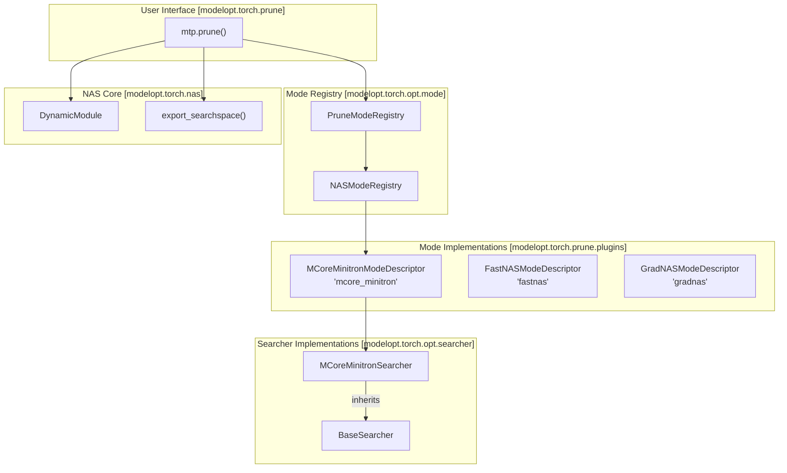
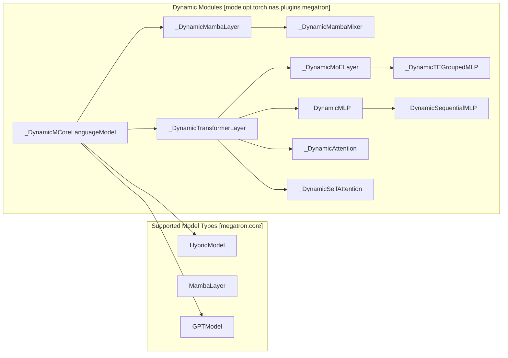

<!-- source: DeepWiki mcp.deepwiki.com · repo NVIDIA/Model-Optimizer · page 10.4 modelopt.torch.prune API · fetched 2026-10-26 -->

# modelopt.torch.prune API

<details>
<summary>Relevant source files</summary>

The following files were used as context for generating this wiki page:

- [docs/source/guides/3_pruning.rst](docs/source/guides/3_pruning.rst)
- [docs/source/guides/7_nas.rst](docs/source/guides/7_nas.rst)
- [examples/megatron_bridge/README.md](examples/megatron_bridge/README.md)
- [examples/megatron_bridge/distill.py](examples/megatron_bridge/distill.py)
- [examples/megatron_bridge/export_distilled_megatron_to_hf.py](examples/megatron_bridge/export_distilled_megatron_to_hf.py)
- [examples/megatron_bridge/export_quantized_megatron_to_hf.py](examples/megatron_bridge/export_quantized_megatron_to_hf.py)
- [examples/megatron_bridge/prune_minitron.py](examples/megatron_bridge/prune_minitron.py)
- [examples/megatron_bridge/quantize.py](examples/megatron_bridge/quantize.py)
- [examples/pruning/README.md](examples/pruning/README.md)
- [examples/pruning/cifar_resnet.ipynb](examples/pruning/cifar_resnet.ipynb)
- [modelopt/torch/nas/plugins/megatron.py](modelopt/torch/nas/plugins/megatron.py)
- [modelopt/torch/nas/utils.py](modelopt/torch/nas/utils.py)
- [modelopt/torch/prune/plugins/mcore_minitron.py](modelopt/torch/prune/plugins/mcore_minitron.py)
- [modelopt/torch/utils/plugins/mbridge.py](modelopt/torch/utils/plugins/mbridge.py)
- [tests/_test_utils/torch/megatron/models.py](tests/_test_utils/torch/megatron/models.py)
- [tests/_test_utils/torch/megatron/utils.py](tests/_test_utils/torch/megatron/utils.py)
- [tests/examples/megatron_bridge/test_distill.py](tests/examples/megatron_bridge/test_distill.py)
- [tests/examples/megatron_bridge/test_prune_minitron.py](tests/examples/megatron_bridge/test_prune_minitron.py)
- [tests/examples/megatron_bridge/test_qad.py](tests/examples/megatron_bridge/test_qad.py)
- [tests/unit/torch/nas/test_evaluate_constraints.py](tests/unit/torch/nas/test_evaluate_constraints.py)
- [tests/unit/torch/nas/test_full_algorithms_vision.py](tests/unit/torch/nas/test_full_algorithms_vision.py)
- [tests/unit/torch/nas/test_latency_interpolator.py](tests/unit/torch/nas/test_latency_interpolator.py)
- [tests/unit/torch/nas/test_nas_utils.py](tests/unit/torch/nas/test_nas_utils.py)
- [tests/unit/torch/prune/test_algorithms.py](tests/unit/torch/prune/test_algorithms.py)

</details>


## Purpose and Scope

This document provides a comprehensive API reference for the `modelopt.torch.prune` module, covering the main pruning interface, supported pruning modes, configuration options, and constraint specifications. The pruning API enables structured reduction of model parameters through various algorithms: Minitron (for Megatron-Core LLMs), Puzzletron (Mixed Integer Programming based), FastNAS (for Computer Vision models), and GradNAS (for Hugging Face language models).

For conceptual overview and usage examples, see [Model Pruning](). For NAS-specific APIs, see [modelopt.torch.nas API]().

## Main Pruning Interface

### `mtp.prune()` Function

The primary entry point for all pruning operations is `mtp.prune()`, which provides a unified interface across different pruning algorithms. It performs in-place conversion of a standard model into a search space, searches for the best architecture, and exports the resulting subnet.

**Function Signature:**
[modelopt/torch/prune/pruning.py:31-37]()
```python
def prune(
    model: nn.Module,
    mode: ModeLike,
    constraints: ConstraintsDict,
    dummy_input: Any | tuple,
    config: SearchConfig | None = None,
) -> tuple[nn.Module, dict[str, Any]]:
```

**Parameters:**

| Parameter | Type | Description |
|-----------|------|-------------|
| `model` | `nn.Module` | Standard model to be pruned in-place. |
| `mode` | `ModeLike` | Pruning algorithm identifier: `"mcore_minitron"`, `"fastnas"`, or `"gradnas"`. |
| `constraints` | `ConstraintsDict` | Dictionary mapping constraint names (`flops`, `params`, `active_params`, `memory_mb`, `export_config`) to target values. |
| `dummy_input` | `Any` | Sample input for profiling (required for FLOPs calculation; unused for Minitron). |
| `config` | `SearchConfig` | Optional arguments like `checkpoint`, `forward_loop`, or `score_func`. |

**Returns:**
- `pruned_model`: The optimized model with weights sliced or layers removed.
- `metadata`: Dictionary containing search state, scores, and subnet configuration.

Sources: [modelopt/torch/prune/pruning.py:31-37](), [modelopt/torch/prune/pruning.py:40-144]()

---

## Pruning Mode Architecture

The following diagram illustrates how the pruning interface bridges high-level user requests to low-level model optimization components.

**Pruning API Entity Map**


Sources: [modelopt/torch/prune/pruning.py:26-37](), [modelopt/torch/prune/plugins/mcore_minitron.py:81-86](), [modelopt/torch/nas/conversion.py:124-147](), [modelopt/torch/prune/plugins/mcore_minitron.py:202-202]()

---

## Mode 1: mcore_minitron

### Overview

Minitron pruning is designed for NVIDIA Megatron-Core models, supporting GPT, Mamba, MoE, and Hybrid architectures. It uses activation magnitudes to estimate the importance of neurons, attention heads, and layers [modelopt/torch/prune/plugins/mcore_minitron.py:18-22](). More details on the Minitron algorithm can be found in the paper: https://arxiv.org/pdf/2407.14679.

### Supported Models and Modules

**Megatron-Core Entity Mapping**


Sources: [modelopt/torch/nas/plugins/megatron.py:58-73](), [modelopt/torch/nas/plugins/megatron.py:88-103](), [modelopt/torch/prune/plugins/mcore_minitron.py:58-73]()

### Pruneable Hyperparameters

The following hyperparameters are supported for Minitron pruning [modelopt/torch/prune/plugins/mcore_minitron.py:98-114]():

| Hyperparameter | Category | Description |
|----------------|----------|-------------|
| `hidden_size` | Width | Global embedding/hidden dimension. |
| `ffn_hidden_size` | Width | Intermediate size for MLP layers. |
| `num_attention_heads` | Width | Number of attention heads (respects GQA). |
| `mamba_num_heads` | Width | Number of heads in Mamba layers. |
| `mamba_head_dim` | Width | Dimension of each Mamba head. |
| `moe_ffn_hidden_size` | Width | Intermediate size for MoE MLP experts. |
| `moe_shared_expert_intermediate_size` | Width | Size for MoE shared experts. |
| `num_moe_experts` | Width | Total experts in MoE layers. |
| `num_layers` | Depth | Total number of transformer/mamba layers. |

Sources: [modelopt/torch/prune/plugins/mcore_minitron.py:98-114]()

### Constraints and Configuration

Minitron supports multiple constraint types:
1. **Manual (`export_config`)**: Specify exact target dimensions [examples/pruning/README.md:97-98]().
2. **Auto (`params`, `active_params`, `memory_mb`)**: Specify target counts or memory footprint; uses `MCoreMinitronSearcher` to find the best subnet [examples/megatron_bridge/prune_minitron.py:18-20]().

**Configuration Example:**
[modelopt/torch/prune/plugins/mcore_minitron.py:44-45]()
```python
config = mtp.mcore_minitron.get_mcore_minitron_config(
    hidden_size_divisor=64,
    ffn_hidden_size_divisor=64,
)
```

### Depth Pruning: Layer Dropping

For depth pruning, Minitron ranks layers by importance and removes them using a specialized utility that handles Tensor Parallel (TP) and Pipeline Parallel (PP) groups. It also handles per-layer config patterns like `linear_attention_freq` [modelopt/torch/prune/plugins/mcore_minitron.py:118-152]().

**Layer Dropping Utility:**
[modelopt/torch/prune/plugins/mcore_minitron.py:155-155]()
```python
def drop_mcore_language_model_layers(model: nn.Module, *, layers_to_drop: list[int]) -> None:
    """Remove given layers (1-indexed) of the model (works with TP and/or PP)."""
```

This function unwraps the model to find the core `GPTModel` or `HybridModel` instance and then removes the specified layers from its decoder. It also updates the model's configuration (`num_layers`) and adjusts per-layer patterns such as `hybrid_layer_pattern` or `linear_attention_freq` to reflect the new layer count [modelopt/torch/prune/plugins/mcore_minitron.py:155-224]().

Sources: [modelopt/torch/prune/plugins/mcore_minitron.py:155-224]()

---

## Mode 2: fastnas

### Overview

FastNAS is the recommended pruning method for Computer Vision models. It finds a subnet that maximizes a score function (e.g., accuracy or negative loss) while meeting FLOPs or parameter constraints [examples/pruning/README.md:11-12]().

**Supported Constraints:**
- `flops`: Absolute number (e.g., `4.5e6`) or percentage (e.g., `"60%"`).
- `params`: Absolute count (e.g., `1e7`) or percentage.

Sources: [modelopt/torch/prune/pruning.py:47-51](), [modelopt/torch/prune/pruning.py:73-78]()

---

## Mode 3: gradnas

### Overview

GradNAS is a lightweight pruning method for language models like BERT and GPT-J. It uses gradient information to identify redundant parameters.

**Required Configuration:**
- `loss_func`: A function to compute the loss used for gradient collection.
- `data_loader`: A loader providing batches for the gradient computation.

Sources: [modelopt/torch/prune/pruning.py:52-56](), [examples/pruning/README.md:37-39]()

---

## Export and Persistence

After pruning, models can be saved and restored using standard framework utilities or ModelOpt's specialized functions for heterogeneous pruning (FastNAS/GradNAS).

| Pruning Type | Save/Restore Method |
|--------------|---------------------|
| **Minitron** | Standard Megatron/HF save/load (Homogeneous slicing) [examples/pruning/README.md:37-38]() |
| **FastNAS/GradNAS** | `mto.save()` and `mto.restore()` (Heterogeneous slicing) [examples/pruning/README.md:37-38]() |

Sources: [examples/pruning/README.md:37-40](), [tests/unit/torch/nas/plugins/test_hf_nas_save_restore.py:29-41]()

### Export Implementation
The `export_searchspace` function converts a dynamic model back into a standard `nn.Module` by slicing weights and removing metadata.

[modelopt/torch/nas/conversion.py:124-125]()
```python
def export_searchspace(model: nn.Module, config: ExportConfig) -> ConvertReturnType:
    """Export a subnet configuration of the search space to a regular model."""
```

Sources: [modelopt/torch/nas/conversion.py:124-147]()

---

