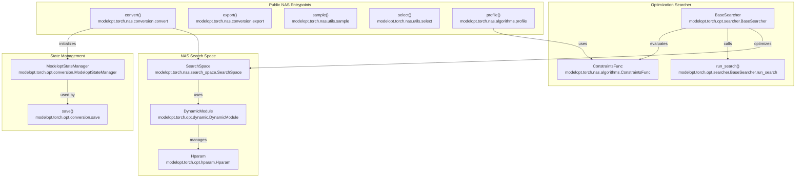
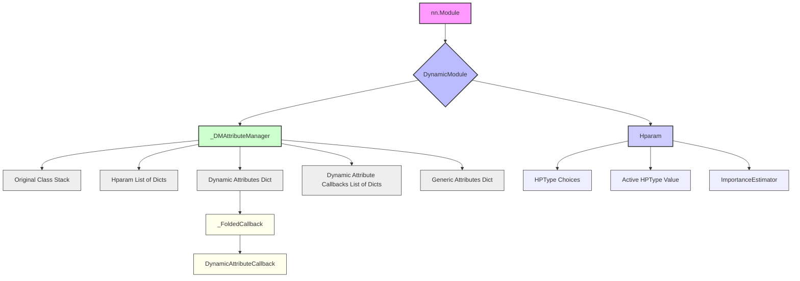
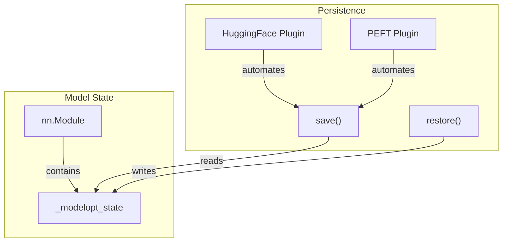

<!-- source: DeepWiki mcp.deepwiki.com · repo NVIDIA/Model-Optimizer · page 10.5 modelopt.torch.nas API · fetched 2026-10-26 -->

# modelopt.torch.nas API

Relevant source files

The following files were used as context for generating this wiki page:

- [docs/source/guides/3_pruning.rst](docs/source/guides/3_pruning.rst)
- [docs/source/guides/7_nas.rst](docs/source/guides/7_nas.rst)
- [examples/pruning/cifar_resnet.ipynb](examples/pruning/cifar_resnet.ipynb)
- [examples/vllm_serve/sparse_attn_worker.py](examples/vllm_serve/sparse_attn_worker.py)
- [examples/vllm_serve/vllm_serve_sparse_attn.py](examples/vllm_serve/vllm_serve_sparse_attn.py)
- [modelopt/torch/kernels/common/attention/decode_attention.py](modelopt/torch/kernels/common/attention/decode_attention.py)
- [modelopt/torch/kernels/quantization/attention/bmm2_qdq.py](modelopt/torch/kernels/quantization/attention/bmm2_qdq.py)
- [modelopt/torch/nas/utils.py](modelopt/torch/nas/utils.py)
- [modelopt/torch/opt/dynamic.py](modelopt/torch/opt/dynamic.py)
- [modelopt/torch/opt/hparam.py](modelopt/torch/opt/hparam.py)
- [modelopt/torch/sparsity/attention_sparsity/plugins/vllm.py](modelopt/torch/sparsity/attention_sparsity/plugins/vllm.py)
- [tests/gpu/torch/kernels/common/attention/test_triton_fa_paged.py](tests/gpu/torch/kernels/common/attention/test_triton_fa_paged.py)
- [tests/gpu_vllm/torch/quantization/test_vllm_dynamic_modules.py](tests/gpu_vllm/torch/quantization/test_vllm_dynamic_modules.py)
- [tests/gpu_vllm/torch/sparsity/attention_sparsity/test_sparse_attn_worker.py](tests/gpu_vllm/torch/sparsity/attention_sparsity/test_sparse_attn_worker.py)
- [tests/gpu_vllm/torch/sparsity/attention_sparsity/test_vllm_plugin.py](tests/gpu_vllm/torch/sparsity/attention_sparsity/test_vllm_plugin.py)
- [tests/unit/torch/nas/test_evaluate_constraints.py](tests/unit/torch/nas/test_evaluate_constraints.py)
- [tests/unit/torch/nas/test_full_algorithms_vision.py](tests/unit/torch/nas/test_full_algorithms_vision.py)
- [tests/unit/torch/nas/test_latency_interpolator.py](tests/unit/torch/nas/test_latency_interpolator.py)
- [tests/unit/torch/nas/test_nas_utils.py](tests/unit/torch/nas/test_nas_utils.py)
- [tests/unit/torch/opt/test_dynamic.py](tests/unit/torch/opt/test_dynamic.py)
- [tests/unit/torch/prune/test_algorithms.py](tests/unit/torch/prune/test_algorithms.py)

## Purpose and Scope

This page documents the public API of the `modelopt.torch.nas` module, which provides Neural Architecture Search (NAS) capabilities for automatically finding optimal neural network architectures that meet deployment constraints. The NAS API enables you to convert PyTorch models into searchable spaces, train them, and search for subnets that satisfy constraints like FLOPs, parameters, or latency while maximizing accuracy.

**Related Pages:**
- For pruning-specific workflows using FastNAS, GradNAS, and Minitron modes, see [Model Pruning](3.3)
- For the underlying Dynamic Module system used by NAS, see [7.1 Dynamic Modules and Hyperparameter System](7.1)
- For general concepts and step-by-step workflows, refer to the [NAS Guide](7_nas)

**Scope:** This page covers the primary API functions (`convert`, `export`), the `SearchSpace` class, the `BaseSearcher` infrastructure, and specialized plugins for Megatron-Core and distributed training.

Sources: [modelopt/torch/nas/utils.py:16-23](), [modelopt/torch/opt/searcher.py:16-22]()

---

## Core API Overview

The `modelopt.torch.nas` module exposes functions that form the NAS workflow. While higher-level wrappers exist, the core utilities manage the conversion of models into design spaces and the extraction of optimized subnets.

| Function | Purpose | Implementation |
|----------|---------|----------------|
| `mtn.convert()` | Converts a PyTorch model into a searchable space (e.g., using `"autonas"`) | [docs/source/guides/7_nas.rst:20-22]() |
| `mtn.export()` | Exports a specific subnet configuration to a regular PyTorch model | [modelopt/torch/nas/conversion.py:124-148]() |
| `mtn.sample()` | Randomly sample a subnet configuration | [modelopt/torch/nas/utils.py:137-149]() |
| `mtn.select()` | Activate a specific subnet configuration | [modelopt/torch/nas/utils.py:151-164]() |
| `mtn.get_subnet_config()` | Returns the current active configuration | [modelopt/torch/nas/utils.py:166-177]() |
| `mtn.inference_flops()`| Calculates FLOPs for a model given dummy input | [modelopt/torch/nas/utils.py:81-123]() |
| `mtn.profile()` | Profiles the search space against deployment constraints | [docs/source/guides/7_nas.rst:105-119]() |

Sources: [modelopt/torch/nas/utils.py:45-177](), [modelopt/torch/nas/conversion.py:37-148](), [docs/source/guides/7_nas.rst:20-22](), [docs/source/guides/7_nas.rst:105-119]()

---

## API to Code Entity Mapping

**Diagram: NAS API and Internal Architecture Mapping**

This diagram illustrates how high-level utility functions interact with the `SearchSpace`, the `BaseSearcher` algorithm interface, and the `ModeloptStateManager` for state persistence. `DynamicModule` and `Hparam` are fundamental building blocks of the search space.

Sources: [modelopt/torch/nas/conversion.py:42-148](), [modelopt/torch/opt/searcher.py:60-189](), [modelopt/torch/opt/conversion.py:64-175](), [modelopt/torch/nas/utils.py:137-177](), [modelopt/torch/opt/dynamic.py:39](), [modelopt/torch/opt/hparam.py:25](), [modelopt/torch/nas/algorithms.py:16-22]()

---

## Dynamic Module System

The core of the NAS API relies on a dynamic module system that allows for flexible modification and search over model architectures.

### `DynamicModule` Class
The `DynamicModule` class [modelopt/torch/opt/dynamic.py:39]() is a specialized `nn.Module` that can encapsulate and manage hyperparameters (`Hparam`) and dynamic attributes. It allows for on-the-fly changes to module behavior and structure without altering the original PyTorch module definition.

- **`_DMAttributeManager`**: Each `DynamicModule` uses an internal `_DMAttributeManager` [modelopt/torch/opt/dynamic.py:88-134]() to hierarchically store and manage:
    - Original classes (`_og_cls_all`) [modelopt/torch/opt/dynamic.py:130]()
    - Hyperparameters (`_hp_all`) [modelopt/torch/opt/dynamic.py:131]()
    - Dynamic attributes (`_da`) and their associated callbacks (`_da_cb_all`) [modelopt/torch/opt/dynamic.py:132-133]()
    - Generic attributes (`_attr`) [modelopt/torch/opt/dynamic.py:134]()
- **Stacking and Unstacking**: The manager supports `append_level()` [modelopt/torch/opt/dynamic.py:161]() and `pop_level()` [modelopt/torch/opt/dynamic.py:167]() to handle nested dynamic module conversions, maintaining a stack of original classes and associated attributes.
- **Dynamic Attributes and Callbacks**: Dynamic attributes can have callbacks (`DynamicAttributeCallback` [modelopt/torch/opt/dynamic.py:45]()) that modify their values. `_FoldedCallback` [modelopt/torch/opt/dynamic.py:51]() allows multiple callbacks to be chained for a single dynamic attribute.
- **`_DMRegistryCls`**: Manages the registration of `DynamicModule` types, ensuring that only valid `nn.Module` subclasses are registered [tests/unit/torch/opt/test_dynamic.py:40-56]().

### `Hparam` Class
The `Hparam` class [modelopt/torch/opt/hparam.py:56]() represents a configurable hyperparameter within a `DynamicModule`. It tracks possible choices, the currently active value, and its importance.

- **Choices and Active Value**: Stores a sequence of `HPType` (e.g., `int`, `float`, `tuple[int, ...]`, `CustomHPType` [modelopt/torch/opt/hparam.py:52]()) as `_choices` and the `_active` value [modelopt/torch/opt/hparam.py:69-70]().
- **Configurability**: The `is_configurable` property [modelopt/torch/opt/hparam.py:90]() indicates if the hparam can be changed. The `_force_configurable` context manager [modelopt/torch/opt/hparam.py:94]() temporarily overrides this.
- **`active_slice`**: For integer hyperparameters, `active_slice` [modelopt/torch/opt/hparam.py:125]() returns a `slice` or `torch.LongTensor` representing the active indices, useful for pruning dimensions.
- **Importance**: `Hparam` can compute and store `importance` [modelopt/torch/opt/hparam.py:173]() using `ImportanceEstimator` callbacks [modelopt/torch/opt/hparam.py:63](), which is crucial for search algorithms.

**Diagram: Dynamic Module and Hparam System**

This diagram illustrates the relationship between `nn.Module`, `DynamicModule`, `Hparam`, and the internal `_DMAttributeManager`. It shows how `DynamicModule` extends `nn.Module` to manage `Hparam` instances and dynamic attributes, with `_DMAttributeManager` handling the hierarchical state.

Sources: [modelopt/torch/opt/dynamic.py:39-169](), [modelopt/torch/opt/hparam.py:56-179](), [tests/unit/torch/opt/test_dynamic.py:58-154]()

---

## Search Space Implementation

### `SearchSpace` Class
The `SearchSpace` class (and its unwrapped version `_SearchSpaceUnwrapped` [modelopt/torch/nas/utils.py:126]()) handles searchable units. It bridges the gap between the model's structure and the `DynamicModule` hyperparameters.

- **Initialization**: Associates a model with searchable hyperparameters.
- **Sampling**: Supports sampling specific hyperparameter groups via `sample()` [modelopt/torch/nas/utils.py:137-149]().
- **Selection**: Activating a specific subnet configuration using `select()` [modelopt/torch/nas/utils.py:151-164]().

### Parameter Sorting
NAS in ModelOpt often uses importance-based sorting (e.g., for pruning or width search). The `sort_parameters` method implements a graph-propagation algorithm to order features by their calculated importance [modelopt/torch/nas/utils.py:187-199]().

Sources: [modelopt/torch/nas/utils.py:126-199](), [modelopt/torch/nas/conversion.py:140-140]()

---

## Search Algorithms and Constraints

### `BaseSearcher` Interface
The `BaseSearcher` class provides a standardized workflow for optimization algorithms to search for subnets satisfying constraints.

- **Search Workflow**: The `search()` method manages the full lifecycle: `before_search`, `run_search`, and `after_search` [modelopt/torch/opt/searcher.py:115-172]().
- **Configuration**: Handles `score_func`, `constraints`, and `deployment` targets [modelopt/torch/opt/searcher.py:80-93]().
- **Checkpointing**: Supports loading and saving search state to resume optimization [modelopt/torch/opt/searcher.py:157-157]().

### Constraint Evaluation
Constraints can be absolute (e.g., `4.0e9` FLOPs) or relative (e.g., `"60%"`) of base model. The `inference_flops` utility uses `torchprofile` to measure model complexity during search [modelopt/torch/nas/utils.py:81-123](). The `ConstraintsFunc` class [modelopt/torch/nas/algorithms.py:24-24]() encapsulates the logic for evaluating these constraints, including FLOPs, parameters, and latency [tests/unit/torch/nas/test_evaluate_constraints.py:41-53](). It also handles percentage-based limits [tests/unit/torch/nas/test_evaluate_constraints.py:78-96]().

Sources: [modelopt/torch/opt/searcher.py:60-189](), [modelopt/torch/nas/utils.py:81-123](), [modelopt/torch/nas/algorithms.py:24-24](), [tests/unit/torch/nas/test_evaluate_constraints.py:41-96]()

---

## Framework Plugins

### Megatron-Core (MCore) Integration
Specialized utilities provide analytical parameter and memory calculations for MCore models (GPT, Mamba, MoE) without requiring a forward pass.

- **Analytical Counters**: `mcore_param_count` calculates total and active parameters based on model configuration symbols (e.g., `M` for Mamba, `E` for MoE) [modelopt/torch/nas/plugins/megatron_model_stats.py:71-360]().
- **MoE Support**: Handles routed experts vs. shared experts, calculating `active` parameters based on `moe_router_topk` [modelopt/torch/nas/plugins/megatron_model_stats.py:152-177]().
- **Memory Footprint**: `mcore_memory_footprint_mb` estimates KV cache and weight memory [modelopt/torch/nas/plugins/megatron_model_stats.py:70-70]().

### Distributed Training Utilities
NAS workflows in large-scale models require specialized distributed handling for configuration and weight gathering.

- **NFSWorkspace**: Facilitates cross-rank communication for model configs and weights using shared storage [modelopt/torch/export/distribute.py:38-118]().
- **Shared Memory (SHM)**: `get_tensors_parallel` and `get_configs_parallel` gather data across ranks using shared memory for faster synchronization during export or search [modelopt/torch/export/distribute.py:121-184]().

Sources: [modelopt/torch/nas/plugins/megatron_model_stats.py:16-177](), [modelopt/torch/export/distribute.py:38-184](), [modelopt/torch/opt/plugins/megatron.py:15-148]()

---

## State Management and Persistence

The `ModeloptStateManager` handles the preservation of the search space configuration and dynamic module states.

**Diagram: State Persistence Flow**

- **Save/Restore**: `save()` and `restore()` functions serialize the "modelopt state dict" which includes the history of modifications and current active subnet [modelopt/torch/opt/conversion.py:51-59]().
- **Framework Automation**: Plugins for `huggingface` and `peft` automatically hook into `save_pretrained` and `from_pretrained` to ensure ModelOpt metadata persists alongside standard model weights [modelopt/torch/opt/plugins/huggingface.py:137-165](), [modelopt/torch/opt/plugins/peft.py:42-65]().

Sources: [modelopt/torch/opt/conversion.py:64-175](), [modelopt/torch/opt/plugins/huggingface.py:107-165](), [modelopt/torch/opt/plugins/peft.py:16-93]()

---

