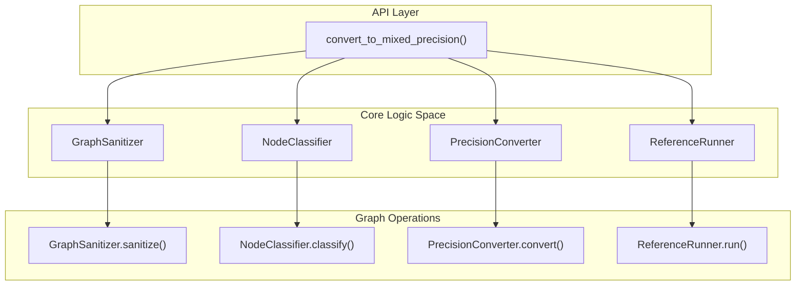
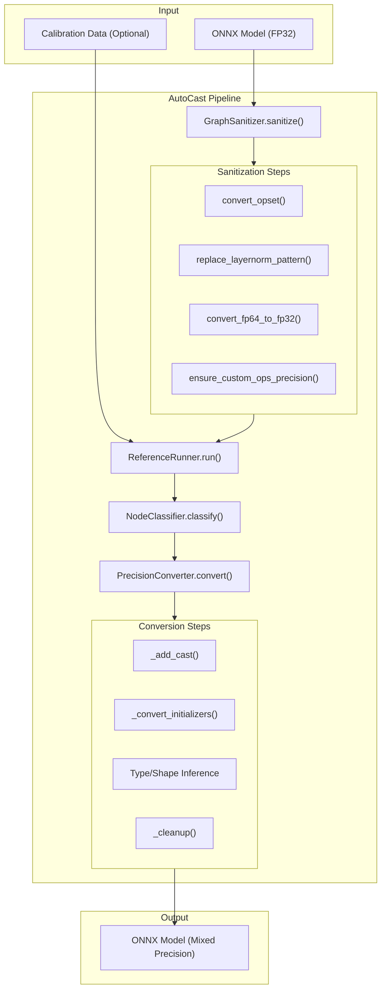
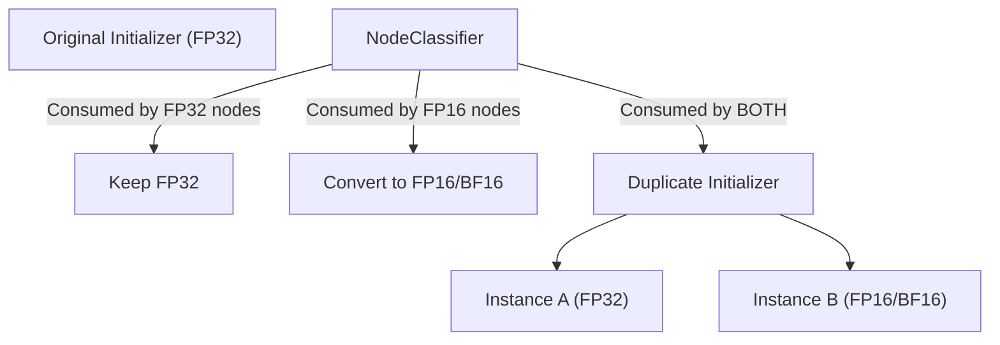

<!-- source: DeepWiki mcp.deepwiki.com · repo NVIDIA/Model-Optimizer · page 10.6 modelopt.onnx.autocast API · fetched 2026-10-26 -->

# modelopt.onnx.autocast API

<details>
<summary>Relevant source files</summary>

The following files were used as context for generating this wiki page:

- [docs/source/guides/8_autocast.rst](docs/source/guides/8_autocast.rst)
- [modelopt/onnx/autocast/__main__.py](modelopt/onnx/autocast/__main__.py)
- [modelopt/onnx/autocast/convert.py](modelopt/onnx/autocast/convert.py)
- [modelopt/onnx/autocast/graphsanitizer.py](modelopt/onnx/autocast/graphsanitizer.py)
- [modelopt/onnx/autocast/nodeclassifier.py](modelopt/onnx/autocast/nodeclassifier.py)
- [modelopt/onnx/autocast/precisionconverter.py](modelopt/onnx/autocast/precisionconverter.py)
- [modelopt/onnx/autocast/referencerunner.py](modelopt/onnx/autocast/referencerunner.py)
- [modelopt/onnx/autocast/utils.py](modelopt/onnx/autocast/utils.py)
- [modelopt/onnx/utils.py](modelopt/onnx/utils.py)
- [tests/_test_utils/onnx/lib_test_models.py](tests/_test_utils/onnx/lib_test_models.py)
- [tests/unit/onnx/autocast/test_autocast.py](tests/unit/onnx/autocast/test_autocast.py)
- [tests/unit/onnx/autocast/test_graphsanitizer.py](tests/unit/onnx/autocast/test_graphsanitizer.py)
- [tests/unit/onnx/autocast/test_nodeclassifier.py](tests/unit/onnx/autocast/test_nodeclassifier.py)
- [tests/unit/onnx/autocast/test_precisionconverter.py](tests/unit/onnx/autocast/test_precisionconverter.py)
- [tests/unit/onnx/autocast/test_referencerunner.py](tests/unit/onnx/autocast/test_referencerunner.py)
- [tests/unit/onnx/test_autocast_quantize.py](tests/unit/onnx/test_autocast_quantize.py)
- [tests/unit/onnx/test_onnx_utils.py](tests/unit/onnx/test_onnx_utils.py)
- [tests/unit/torch/deploy/utils/test_torch_onnx_utils.py](tests/unit/torch/deploy/utils/test_torch_onnx_utils.py)

</details>


## Overview

The `modelopt.onnx.autocast` module provides functionality for converting ONNX models from FP32 to lower precision formats (FP16 or BF16) using mixed-precision conversion. Unlike quantization, AutoCast performs precision reduction while maintaining floating-point arithmetic throughout the model. The module automatically classifies nodes into high-precision and low-precision groups, inserts `Cast` operations where needed, and handles initializer conversion to ensure model correctness.

**Scope**: This page covers the AutoCast API for mixed-precision conversion. For quantized model export (INT8/FP8/NVFP4), see [10.2](). For general ONNX graph utilities used during quantization preprocessing, see [4.2]().

**Key Features**:
- Automatic mixed-precision conversion to FP16 or BF16.
- Smart node classification to avoid precision-sensitive operations.
- Cast node insertion and optimization.
- Initializer conversion with size-based thresholds.
- Support for custom TensorRT operators and plugins.
- Subgraph handling (control flow ops like Scan, If, Loop).
- LayerNorm pattern detection and replacement.

Sources: [modelopt/onnx/autocast/precisionconverter.py:16-22](), [modelopt/onnx/autocast/graphsanitizer.py:16-17](), [modelopt/onnx/autocast/convert.py:17-24]()

## System Architecture

The following diagram illustrates the flow from a high-level `convert_to_mixed_precision` call down to the core logic entities.

### AutoCast System Entity Map

Sources: [modelopt/onnx/autocast/convert.py:60-79](), [modelopt/onnx/autocast/precisionconverter.py:75-84](), [modelopt/onnx/autocast/graphsanitizer.py:31-32]()

### Data Flow and Pipeline

Sources: [modelopt/onnx/autocast/convert.py:110-151](), [modelopt/onnx/autocast/graphsanitizer.py:59-78](), [modelopt/onnx/autocast/precisionconverter.py:163-279]()

## Core Components

### GraphSanitizer Class

The `GraphSanitizer` class prepares ONNX models for precision conversion by performing essential preprocessing operations.

**Key Methods**:

| Method | Purpose | Line Reference |
|--------|---------|----------------|
| `sanitize()` | Main entry point that orchestrates all preprocessing steps. | [modelopt/onnx/autocast/graphsanitizer.py:59-78]() |
| `find_custom_nodes()` | Identifies custom operators and sets up TensorRT plugin domain info. | [modelopt/onnx/autocast/graphsanitizer.py:111-128]() |
| `convert_opset()` | Upgrades model to minimum required opset version (e.g., 19 for FP16, 22 for BF16). | [modelopt/onnx/autocast/graphsanitizer.py:145-193]() |
| `replace_layernorm_pattern()` | Detects decomposed LayerNorm patterns and replaces with a single operator. | [modelopt/onnx/autocast/graphsanitizer.py:216-251]() |
| `convert_fp64_to_fp32()` | Converts FP64 initializers, I/O types, and nodes to FP32. | [modelopt/onnx/autocast/graphsanitizer.py:79-97]() |
| `ensure_custom_ops_precision()` | Ensures custom ops run in requested precision via `cast_custom_ops`. | [modelopt/onnx/autocast/graphsanitizer.py:98-110]() |

Sources: [modelopt/onnx/autocast/graphsanitizer.py:31-110]()

### PrecisionConverter Class

The `PrecisionConverter` class manages the insertion of `Cast` operations, conversion of initializers, and ensures model validity through type checking and cleanup.

**Conversion Logic**:
1. **Sanitization**: Calls `GraphSanitizer` to prepare the graph.
2. **Filtering**: Identifies op types not supported in low precision (e.g., `Upsample`, `NonMaxSuppression`). [modelopt/onnx/autocast/precisionconverter.py:68-73]()
3. **Cast Insertion**: Identifies precision boundaries and inserts `Cast` nodes. [modelopt/onnx/autocast/precisionconverter.py:829-914]()
4. **Initializer Conversion**: Duplicates initializers shared between precision types and converts them to the target precision. [modelopt/onnx/autocast/precisionconverter.py:590-758]()
5. **Cleanup**: Removes redundant or no-op `Cast` nodes. [modelopt/onnx/autocast/precisionconverter.py:1110-1273]()

Sources: [modelopt/onnx/autocast/precisionconverter.py:75-162](), [modelopt/onnx/autocast/precisionconverter.py:163-279]()

### ReferenceRunner Class

The `ReferenceRunner` uses ONNXRuntime to execute the model and collect tensor statistics (min, max, absmax) used for node classification.

| Feature | Description | Line Reference |
|---------|-------------|----------------|
| **Input Support** | Supports NPZ files (single/multi-batch) and Polygraphy JSON. | [modelopt/onnx/autocast/referencerunner.py:105-133]() |
| **Statistics** | Aggregates `TensorStats` (absmax, min, max) across multiple batches. | [modelopt/onnx/autocast/referencerunner.py:45-70]() |
| **Execution** | Uses `InferenceSession` with specified EPs (CPU, CUDA, TRT). | [modelopt/onnx/autocast/referencerunner.py:204-225]() |

Sources: [modelopt/onnx/autocast/referencerunner.py:71-225]()

## API Reference

### convert_to_mixed_precision()

The primary function for converting an ONNX model to mixed precision.

```python
def convert_to_mixed_precision(
    onnx_path: str,
    low_precision_type: str = "fp16",
    nodes_to_exclude: list[str] | None = None,
    op_types_to_exclude: list[str] | None = None,
    nodes_to_include: list[str] | None = None,
    op_types_to_include: list[str] | None = None,
    data_max: float = DEFAULT_DATA_MAX,
    init_max: float = DEFAULT_INIT_MAX,
    keep_io_types: bool = False,
    calibration_data: str | None = None,
    custom_rule: NodeRuleBase | None = None,
    init_conversion_max_bytes: int | None = None,
    providers: list[str] = ["cpu"],
    trt_plugins: list[str] = [],
    trt_plugins_precision: list[str] = [],
    max_depth_of_reduction: int | None = None,
    opset: int | None = None,
    use_standalone_type_inference: bool = False,
) -> onnx.ModelProto:
```

**Key Parameters**:
- `low_precision_type`: Target precision (`"fp16"` or `"bf16"`). [modelopt/onnx/autocast/convert.py:62]()
- `data_max`: Nodes with output magnitudes exceeding this are kept in FP32 (default: 512). [modelopt/onnx/autocast/convert.py:67]()
- `init_max`: Nodes with initializers exceeding this are kept in FP32 (default: np.finfo(np.float16).max). [modelopt/onnx/autocast/convert.py:68]()
- `keep_io_types`: If True, preserves original model input/output types. [modelopt/onnx/autocast/convert.py:69]()
- `init_conversion_max_bytes`: Initializers larger than this are cast at runtime instead of being stored in low precision. [modelopt/onnx/autocast/convert.py:72]()
- `use_standalone_type_inference`: Workaround for cases where standard ONNX shape inference fails. [modelopt/onnx/autocast/convert.py:78]()

Sources: [modelopt/onnx/autocast/convert.py:60-109]()

## Node Classification Rules

AutoCast uses a rule-based system (`NodeClassifier`) to decide which nodes to cast.

1. **Magnitude Rule**: Nodes with tensor values exceeding `data_max` (default 512) are kept in FP32 to avoid precision loss (ULP at 512 is 0.5). [modelopt/onnx/autocast/convert.py:41-44]()
2. **Initializer Rule**: Nodes with weights exceeding `init_max` are kept in FP32. [modelopt/onnx/autocast/convert.py:45]()
3. **Op Type Rule**: Specific ops like `Resize` have certain inputs (indices 1, 2) that must remain in FP32. [modelopt/onnx/autocast/precisionconverter.py:71-72]()
4. **User Rules**: Manual inclusion/exclusion via `nodes_to_exclude`, `op_types_to_include`, etc. [modelopt/onnx/autocast/convert.py:63-66]()

Sources: [modelopt/onnx/autocast/convert.py:40-45](), [modelopt/onnx/autocast/precisionconverter.py:68-73]()

## Initializer Management

When an initializer is shared between high-precision and low-precision nodes, `PrecisionConverter` duplicates it to avoid conflicts.

### Initializer Conversion Flow

Sources: [modelopt/onnx/autocast/precisionconverter.py:590-620](), [modelopt/onnx/autocast/precisionconverter.py:683-715]()

## Utility Functions

The `modelopt.onnx.autocast.utils` module provides graph traversal and mapping helpers.

| Function | Description | Line Reference |
|----------|-------------|----------------|
| `setup_mappings()` | Returns `value_info_map`, `initializer_map`, and `node_to_init_map`. | [modelopt/onnx/autocast/utils.py:35-62]() |
| `walk_subgraphs_recursive()` | Recursively traverses subgraphs (Scan, If, Loop) applying a callback. | [modelopt/onnx/autocast/utils.py:84-117]() |
| `get_op_types_not_supported_in_low_precision()` | Checks ONNX schema history to find ops unsupported in target precision for the current opset. | [modelopt/onnx/autocast/utils.py:166-173]() |

Sources: [modelopt/onnx/autocast/utils.py:16-173]()

---

