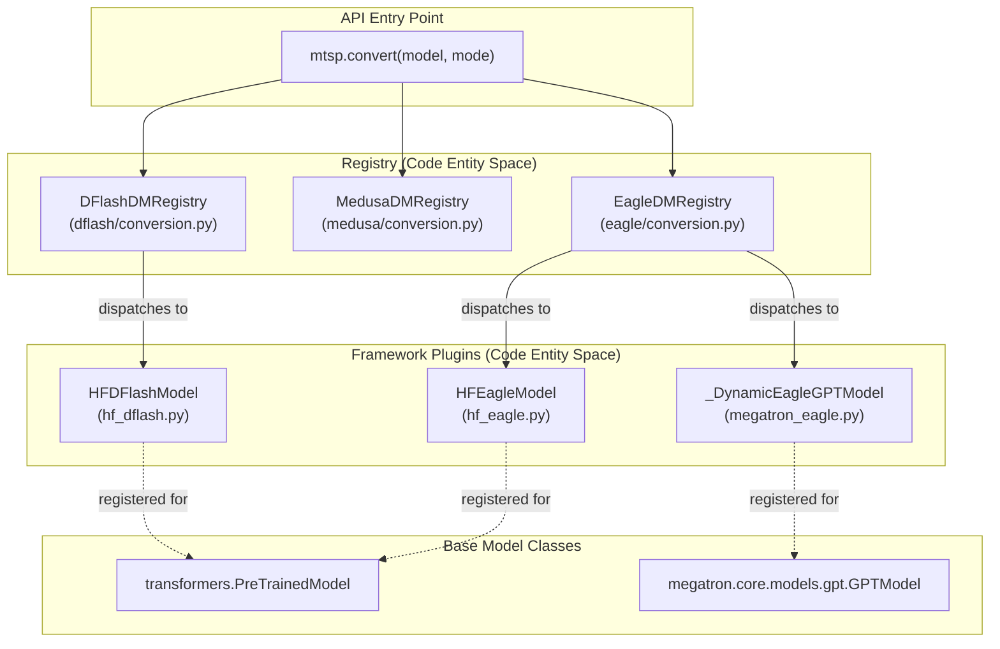
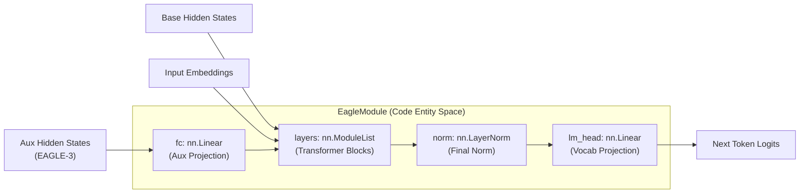

<!-- source: DeepWiki mcp.deepwiki.com · repo NVIDIA/Model-Optimizer · page 10.7 modelopt.torch.speculative API · fetched 2026-10-26 -->

# modelopt.torch.speculative API

<details>
<summary>Relevant source files</summary>

The following files were used as context for generating this wiki page:

- [examples/speculative_decoding/eagle_utils.py](examples/speculative_decoding/eagle_utils.py)
- [examples/speculative_decoding/launch_train.sh](examples/speculative_decoding/launch_train.sh)
- [examples/speculative_decoding/main.py](examples/speculative_decoding/main.py)
- [modelopt/torch/export/plugins/hf_spec_export.py](modelopt/torch/export/plugins/hf_spec_export.py)
- [modelopt/torch/speculative/config.py](modelopt/torch/speculative/config.py)
- [modelopt/torch/speculative/dflash/conversion.py](modelopt/torch/speculative/dflash/conversion.py)
- [modelopt/torch/speculative/dflash/dflash_model.py](modelopt/torch/speculative/dflash/dflash_model.py)
- [modelopt/torch/speculative/eagle/conversion.py](modelopt/torch/speculative/eagle/conversion.py)
- [modelopt/torch/speculative/eagle/default_config.py](modelopt/torch/speculative/eagle/default_config.py)
- [modelopt/torch/speculative/eagle/eagle_model.py](modelopt/torch/speculative/eagle/eagle_model.py)
- [modelopt/torch/speculative/plugins/hf_dflash.py](modelopt/torch/speculative/plugins/hf_dflash.py)
- [modelopt/torch/speculative/plugins/hf_eagle.py](modelopt/torch/speculative/plugins/hf_eagle.py)
- [modelopt/torch/speculative/plugins/hf_training_args.py](modelopt/torch/speculative/plugins/hf_training_args.py)
- [modelopt/torch/speculative/plugins/megatron_eagle.py](modelopt/torch/speculative/plugins/megatron_eagle.py)
- [modelopt/torch/speculative/plugins/modeling_draft_checkpoint_compat.py](modelopt/torch/speculative/plugins/modeling_draft_checkpoint_compat.py)
- [modelopt/torch/speculative/plugins/modeling_dspark.py](modelopt/torch/speculative/plugins/modeling_dspark.py)
- [modelopt/torch/speculative/plugins/modeling_eagle.py](modelopt/torch/speculative/plugins/modeling_eagle.py)
- [modelopt/torch/speculative/plugins/transformers.py](modelopt/torch/speculative/plugins/transformers.py)
- [modelopt/torch/speculative/utils.py](modelopt/torch/speculative/utils.py)
- [tests/examples/speculative_decoding/test_eagle.py](tests/examples/speculative_decoding/test_eagle.py)
- [tests/unit/torch/export/test_hf_spec_rope_export.py](tests/unit/torch/export/test_hf_spec_rope_export.py)
- [tests/unit/torch/speculative/plugins/test_hf_dflash.py](tests/unit/torch/speculative/plugins/test_hf_dflash.py)
- [tests/unit/torch/speculative/plugins/test_hf_dspark.py](tests/unit/torch/speculative/plugins/test_hf_dspark.py)
- [tests/unit/torch/speculative/plugins/test_hf_speculative.py](tests/unit/torch/speculative/plugins/test_hf_speculative.py)

</details>


This page documents the public API for speculative decoding in Model Optimizer. The `modelopt.torch.speculative` module (aliased as `mtsp`) provides tools to convert standard language models into speculative decoding models using EAGLE, Medusa, or DFlash architectures. These models enable faster inference by predicting multiple tokens per forward pass.

For end-to-end training workflows and architecture details, see the [EAGLE Architecture and Training](#3.5.1) and [Medusa Architecture and Training](#3.5.2) guides.

## Module Import

```python
import modelopt.torch.speculative as mtsp
```

## Core Conversion Function

### mtsp.convert

```python
def convert(model, mode):
    """Convert a model to support speculative decoding.
    
    Args:
        model: The base model to convert (HuggingFace PreTrainedModel or Megatron GPTModel)
        mode: List of (algorithm, config) tuples specifying conversion modes
        
    Returns:
        Modified model with speculative decoding capabilities
    """
```
Sources: [modelopt/torch/speculative/eagle/conversion.py:30-56]()

The `convert` function is the primary entry point for adding speculative decoding to a model. It uses a plugin-based registry system to dispatch to framework-specific implementations.

**Supported Algorithms:**
- `"eagle"` - EAGLE speculative decoding (EAGLE-1, EAGLE-3, MTP variants) [modelopt/torch/speculative/config.py:48-61]()
- `"medusa"` - Medusa parallel draft heads [modelopt/torch/speculative/config.py:186-197]()
- `"dflash"` - DFlash block-wise parallel speculative decoding [modelopt/torch/speculative/config.py:70-75]()

**Example Usage:**

```python
import transformers
import modelopt.torch.speculative as mtsp

# Load base model
model = transformers.AutoModelForCausalLM.from_pretrained("meta-llama/Llama-3.1-8B")

# Convert to EAGLE-3 using default recipe
from modelopt.torch.speculative.config import EAGLE3_DEFAULT_CFG
model = mtsp.convert(model, mode=[(EAGLE3_DEFAULT_CFG["algorithm"], EAGLE3_DEFAULT_CFG["config"])])
```
Sources: [tests/unit/torch/speculative/plugins/test_hf_speculative.py:32-44]()

## Configuration Classes

### EagleConfig
Configuration for EAGLE speculative decoding variants. Defined in `modelopt.torch.speculative.config`.

| Field | Type | Default | Description |
|-------|------|---------|-------------|
| `eagle_offline` | bool | False | Whether to use detached Eagle (offline training). |
| `eagle_hidden_state_distillation` | bool | False | Whether to use feature hidden states distillation. |
| `eagle_self_logit_distillation` | bool | True | Whether to use logit distillation. |
| `eagle_freeze_base_model` | bool | True | Whether to freeze base model during training. |
| `eagle_reuse_base_decoder` | bool | False | Whether to reuse base model decoder in eagle module. |
| `eagle_ttt_steps` | int | 3 | Number of steps for Train-Time-Testing. |
| `eagle_mix_hidden_states` | bool | False | Mix hidden states of multiple TTT steps. |

Sources: [modelopt/torch/speculative/config.py:200-237](), [modelopt/torch/speculative/eagle/eagle_model.py:27-53]()

### DFlashConfig
Configuration for DFlash block-wise parallel prediction. DFlash supports both static exponential loss decay and dynamic confidence-derived weights (D-PACE).

| Field | Type | Default | Description |
|-------|------|---------|-------------|
| `dflash_block_size` | int | 8 | Number of tokens predicted per block. |
| `dflash_loss_objective` | Literal["decay", "dpace"] | "dpace" | Block-position loss weighting objective. |
| `dflash_dpace_alpha` | float | 0.5 | D-PACE asymmetric smoothing factor. |
| `dflash_num_anchors` | int | 512 | Random anchor positions sampled per sequence. |
| `dflash_draft_attention` | Literal["bidirectional", "causal"] | "bidirectional" | Attention pattern inside each draft block. |
| `dflash_attention_sink` | bool | True | Whether to use learnable attention sinks in draft. |

Sources: [modelopt/torch/speculative/config.py:78-183](), [modelopt/torch/speculative/dflash/dflash_model.py:34-55]()

### Architecture Configuration Defaults
The `eagle_architecture_config` specifies the draft module architecture. Defaults are provided for EAGLE-3 and MTP:

```python
# EAGLE-3 defaults
eagle3_default_config = {
    "use_aux_hidden_state": True, 
    "use_last_layernorm": True
}

# EAGLE MTP (Multi-Token Prediction) defaults
eagle_mtp_default_config = {
    "use_last_layernorm": True, 
    "use_mtp_layernorm": True
}
```
Sources: [modelopt/torch/speculative/config.py:41-45](), [modelopt/torch/speculative/eagle/default_config.py:18-45]()

## Plugin Architecture

The conversion system uses a registry-based plugin architecture to support multiple frameworks.

### Natural Language Space to Code Entity Space: Registry System


Sources: [modelopt/torch/speculative/eagle/conversion.py:27-56](), [modelopt/torch/speculative/dflash/conversion.py:27-56](), [modelopt/torch/speculative/plugins/megatron_eagle.py:59-67](), [modelopt/torch/speculative/plugins/hf_dflash.py:86-103]()

## EAGLE and DFlash Architecture Components

### EagleModule Internal Data Flow
The `EagleModule` is a lightweight transformer-based module that predicts the next token's hidden state.


Sources: [modelopt/torch/export/plugins/hf_spec_export.py:49-89](), [modelopt/torch/speculative/plugins/megatron_eagle.py:70-130]()

### DFlash Implementation Details
DFlash implements block-wise parallel drafting using feature fusion and KV injection. It utilizes a learnable per-head sink logit in its attention mechanism to improve stability.

- **Sink Attention:** Implemented in `_sink_attention_impl` and optimized via `torch.compile` to fuse mask additions and softmax operations. [modelopt/torch/speculative/plugins/modeling_dflash.py:63-113]()
- **D-PACE Weighting:** `_dpace_position_weights` dynamically calculates loss weights based on draft confidence to prioritize training on tokens where the draft is less certain. [modelopt/torch/speculative/plugins/hf_dflash.py:154-192]()

## Training and Data Utilities

### Speculative Data Module
`make_speculative_data_module` handles the creation of datasets and collators for online, offline, and streaming training modes.

- **Online Mode:** Uses `ShardedDataset` and `LanguageDataCollator` or `VisionLanguageDataCollator`. [examples/speculative_decoding/eagle_utils.py:131-152]()
- **Offline Mode:** Uses `OfflineSupervisedDataset` to load pre-computed hidden states from `.pt` files. [examples/speculative_decoding/eagle_utils.py:155-171]()
- **Streaming Mode:** Uses `EagleVllmStreamingDataset` to fetch hidden states via NIXL RDMA from a vLLM server. [examples/speculative_decoding/eagle_utils.py:82-129]()

### Trainer and Callbacks
- `EagleTrainerWithAccLog`: A specialized `Trainer` that overrides `compute_loss` to track training accuracy and per-component losses. [examples/speculative_decoding/eagle_utils.py:186-253]()
- `DominoLambdaCallback`: Integrated via `modelopt.torch.speculative.plugins.hf_domino` for advanced training orchestration. [examples/speculative_decoding/main.py:59-62]()

## Utilities

### Tree Structure
Speculative decoding uses a `Tree` structure to represent multiple possible token prediction paths. This class generates the `attention_mask` ensuring tokens only attend to valid predecessors in the tree.
Sources: [modelopt/torch/speculative/utils.py:115-188]()

### Vocabulary Calibration
`calibrate_frequent_vocab` identifies the most frequent tokens in a calibration dataset to create a draft-to-target vocabulary mapping (`d2t`).
Sources: [modelopt/torch/speculative/utils.py:62-75]()

## Export

### SpeculativeDecodingExporter
The base class for exporting speculative models to deployment formats like HuggingFace Safetensors or TensorRT-LLM.

- **EagleExporter:** Extracts the `eagle_module` and validates required keys (e.g., `self_attn.q_proj`, `mlp.gate_proj`). [modelopt/torch/export/plugins/hf_spec_export.py:121-180]()
- **DFlash Export:** Supports exporting RoPE scaling and SWA window sizes to ensure vLLM parity. [modelopt/torch/speculative/config.py:147-164]()

Sources: [modelopt/torch/export/plugins/hf_spec_export.py:104-200](), [tests/examples/speculative_decoding/test_eagle.py:177-187]()

---

