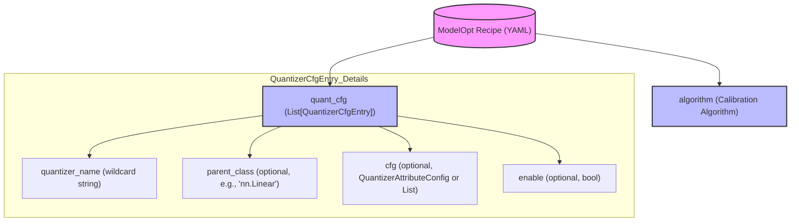

<!-- source: DeepWiki mcp.deepwiki.com · repo NVIDIA/Model-Optimizer · page 11 Glossary · fetched 2026-10-26 -->

# Glossary

<details>
<summary>Relevant source files</summary>

The following files were used as context for generating this wiki page:

- [CHANGELOG.rst](CHANGELOG.rst)
- [examples/speculative_decoding/eagle_utils.py](examples/speculative_decoding/eagle_utils.py)
- [examples/speculative_decoding/launch_train.sh](examples/speculative_decoding/launch_train.sh)
- [examples/speculative_decoding/main.py](examples/speculative_decoding/main.py)
- [modelopt/torch/export/layer_utils.py](modelopt/torch/export/layer_utils.py)
- [modelopt/torch/export/layerwise_export.py](modelopt/torch/export/layerwise_export.py)
- [modelopt/torch/export/model_config.py](modelopt/torch/export/model_config.py)
- [modelopt/torch/export/model_config_export.py](modelopt/torch/export/model_config_export.py)
- [modelopt/torch/export/model_utils.py](modelopt/torch/export/model_utils.py)
- [modelopt/torch/export/moe_utils.py](modelopt/torch/export/moe_utils.py)
- [modelopt/torch/export/plugins/__init__.py](modelopt/torch/export/plugins/__init__.py)
- [modelopt/torch/export/plugins/hf_checkpoint_utils.py](modelopt/torch/export/plugins/hf_checkpoint_utils.py)
- [modelopt/torch/export/plugins/mcore_common.py](modelopt/torch/export/plugins/mcore_common.py)
- [modelopt/torch/export/plugins/mcore_custom.py](modelopt/torch/export/plugins/mcore_custom.py)
- [modelopt/torch/export/plugins/mcore_nemotron.py](modelopt/torch/export/plugins/mcore_nemotron.py)
- [modelopt/torch/export/plugins/mcore_qwen3vl.py](modelopt/torch/export/plugins/mcore_qwen3vl.py)
- [modelopt/torch/export/plugins/megatron_importer.py](modelopt/torch/export/plugins/megatron_importer.py)
- [modelopt/torch/export/tensorrt_llm_utils.py](modelopt/torch/export/tensorrt_llm_utils.py)
- [modelopt/torch/export/unified_export_hf.py](modelopt/torch/export/unified_export_hf.py)
- [modelopt/torch/export/unified_export_megatron.py](modelopt/torch/export/unified_export_megatron.py)
- [modelopt/torch/quantization/config.py](modelopt/torch/quantization/config.py)
- [modelopt/torch/quantization/mode.py](modelopt/torch/quantization/mode.py)
- [modelopt/torch/quantization/model_calib.py](modelopt/torch/quantization/model_calib.py)
- [modelopt/torch/quantization/nn/modules/tensor_quantizer.py](modelopt/torch/quantization/nn/modules/tensor_quantizer.py)
- [modelopt/torch/quantization/plugins/huggingface.py](modelopt/torch/quantization/plugins/huggingface.py)
- [modelopt/torch/quantization/plugins/megatron.py](modelopt/torch/quantization/plugins/megatron.py)
- [modelopt/torch/quantization/utils/core_utils.py](modelopt/torch/quantization/utils/core_utils.py)
- [modelopt/torch/quantization/utils/layerwise_calib.py](modelopt/torch/quantization/utils/layerwise_calib.py)
- [modelopt/torch/speculative/eagle/conversion.py](modelopt/torch/speculative/eagle/conversion.py)
- [modelopt/torch/speculative/eagle/default_config.py](modelopt/torch/speculative/eagle/default_config.py)
- [modelopt/torch/speculative/eagle/eagle_model.py](modelopt/torch/speculative/eagle/eagle_model.py)
- [modelopt/torch/speculative/plugins/hf_eagle.py](modelopt/torch/speculative/plugins/hf_eagle.py)
- [modelopt/torch/speculative/plugins/megatron_eagle.py](modelopt/torch/speculative/plugins/megatron_eagle.py)
- [modelopt/torch/speculative/plugins/modeling_eagle.py](modelopt/torch/speculative/plugins/modeling_eagle.py)
- [modelopt/torch/speculative/plugins/transformers.py](modelopt/torch/speculative/plugins/transformers.py)
- [modelopt/torch/speculative/utils.py](modelopt/torch/speculative/utils.py)
- [tests/_test_utils/torch/quantization/tied_modules.py](tests/_test_utils/torch/quantization/tied_modules.py)
- [tests/_test_utils/torch/transformers_models.py](tests/_test_utils/torch/transformers_models.py)
- [tests/examples/speculative_decoding/test_eagle.py](tests/examples/speculative_decoding/test_eagle.py)
- [tests/gpu_megatron/torch/export/test_megatron_importer.py](tests/gpu_megatron/torch/export/test_megatron_importer.py)
- [tests/gpu_megatron/torch/export/test_unified_export_megatron.py](tests/gpu_megatron/torch/export/test_unified_export_megatron.py)
- [tests/gpu_megatron/torch/quantization/plugins/test_megatron.py](tests/gpu_megatron/torch/quantization/plugins/test_megatron.py)
- [tests/unit/torch/export/test_export_weight.py](tests/unit/torch/export/test_export_weight.py)
- [tests/unit/torch/export/test_hf_checkpoint_utils.py](tests/unit/torch/export/test_hf_checkpoint_utils.py)
- [tests/unit/torch/export/test_mcore_save_safetensors.py](tests/unit/torch/export/test_mcore_save_safetensors.py)
- [tests/unit/torch/export/test_unified_export_hf.py](tests/unit/torch/export/test_unified_export_hf.py)
- [tests/unit/torch/quantization/plugins/test_fused_experts.py](tests/unit/torch/quantization/plugins/test_fused_experts.py)
- [tests/unit/torch/quantization/test_config_validation.py](tests/unit/torch/quantization/test_config_validation.py)
- [tests/unit/torch/speculative/plugins/test_hf_speculative.py](tests/unit/torch/speculative/plugins/test_hf_speculative.py)

</details>


This page provides definitions and technical details for terms, jargon, and domain-specific concepts used within the NVIDIA Model Optimizer (**ModelOpt**) codebase.

## Core Optimization Concepts

### Quantization
The process of reducing the precision of model weights and activations to lower-bit formats (e.g., INT8, FP8, NVFP4) to accelerate inference and reduce memory footprint [CHANGELOG.rst:22-22]().

*   **PTQ (Post-Training Quantization):** Quantizing a pre-trained model using a small calibration dataset without further training [modelopt/torch/quantization/model_calib.py:16-17]().
*   **QAT (Quantization-Aware Training):** Fine-tuning a model with quantization in the loop to recover accuracy lost during discretization [CHANGELOG.rst:26-26]().
*   **Calibration:** The process of passing data through a model to collect statistics (like `amax`) used to determine optimal scaling factors for quantization [modelopt/torch/quantization/model_calib.py:16-17]().
*   **Fake Quantization:** Simulating quantization effects by rounding values while keeping them in high-precision (e.g., FP32) during training or calibration. This is enabled via `enable_fake_quant` [modelopt/torch/quantization/utils/core_utils.py:21-21]().
*   **Real Quantization:** Compressing model weights into a low-precision format (packing) to reduce memory requirements, often used for deployment. Implemented in `to_quantized_weight` [modelopt/torch/export/unified_export_hf.py:119-119]().

### Pruning and NAS
*   **Minitron:** A family of pruning techniques for LLMs, specifically supporting width and depth pruning for Megatron-Core models [CHANGELOG.rst:30-33]().
*   **Puzzletron:** A new algorithm for heterogeneous pruning & NAS of LLM and VLM models using Mixed Integer Programming (MIP) [CHANGELOG.rst:31-31]().
*   **NAS (Neural Architecture Search):** Automated search for the optimal model structure given constraints like parameter count or memory [CHANGELOG.rst:31-31]().
*   **Active Slice:** A mechanism in dynamic modules that represents the currently selected sub-network during pruning or search.

### Speculative Decoding
A technique to accelerate LLM inference by using a smaller "draft" model (or "heads") to predict multiple future tokens, which are then verified in parallel by the larger "target" model [examples/speculative_decoding/main.py:51-58]().

*   **EAGLE:** A speculative decoding architecture that uses a lightweight transformer head to predict the next feature vector [examples/speculative_decoding/main.py:55-55]().
*   **Medusa:** An architecture that adds multiple parallel MLP heads to the base model to predict multiple subsequent tokens simultaneously [examples/speculative_decoding/main.py:56-56]().
*   **DFlash:** A diffusion-style speculative decoding training method that supports offline training from pre-computed hidden states [examples/speculative_decoding/main.py:54-54]().

---

## Technical Terms & Abbreviations

| Term | Definition | Code Pointer |
| :--- | :--- | :--- |
| **amax** | The absolute maximum value of a tensor, used to calculate scaling factors. | [modelopt/torch/quantization/nn/modules/tensor_quantizer.py:157-158]() |
| **NVFP4** | NVIDIA 4-bit Floating Point format supported on Blackwell architectures. | [modelopt/torch/export/model_config.py:91-91]() |
| **MXFP8** | Microscaling Open8 (8-bit) format using block-based scaling. | [modelopt/torch/export/model_config.py:89-89]() |
| **SmoothQuant** | An algorithm that migrates quantization difficulty from activations to weights. | [modelopt/torch/quantization/model_calib.py:78-78]() |
| **AWQ** | Activation-aware Weight Quantization; protects salient weights based on activation magnitude. | [modelopt/torch/quantization/model_calib.py:72-72]() |
| **QDQ** | Quantize and De-Quantize; a pattern of nodes in ONNX representing quantization. | [modelopt/torch/export/unified_export_hf.py:43-43]() |
| **SVDQuant** | An algorithm using Singular Value Decomposition for 4-bit quantization. | [modelopt/torch/quantization/model_calib.py:79-79]()
| **`QuantizerCfgEntry`** | A dictionary specifying how to configure a `TensorQuantizer`, including `quantizer_name`, `parent_class`, `cfg`, and `enable`. | [modelopt/torch/quantization/config.py:65-85]()

---

## Architectural Components

### TensorQuantizer
The fundamental building block for PyTorch quantization in ModelOpt. It manages the state (amax, scaling factors) and the logic for both fake and real quantization [modelopt/torch/quantization/nn/modules/tensor_quantizer.py:136-159]().

Title: "TensorQuantizer Forward Logic"
```mermaid
graph TD
    subgraph "TensorQuantizer_Logic"
        "InputTensor" --> "CalibCheck"{"if_calib?"}
        "CalibCheck" -- "Yes" --> "Calibrator"["_calibrator.collect(x)"]
        "Calibrator" --> "QuantCheck"
        "CalibCheck" -- "No" --> "QuantCheck"{"if_quant?"}
        
        "QuantCheck" -- "Yes" --> "QuantOp"["fake_tensor_quant / real_quant"]
        "QuantOp" --> "Output"["Quantized/FakeQuant Tensor"]
        
        "QuantCheck" -- "No" --> "Identity"["Return Original"]
        "Identity" --> "Output"
    end
```
**Sources:** [modelopt/torch/quantization/nn/modules/tensor_quantizer.py:136-187](), [modelopt/torch/quantization/model_calib.py:82-83]()

### ModelOpt Recipe
A YAML-based configuration file that defines a complete optimization workflow. It supports a composable `$import` system for reusable snippets [CHANGELOG.rst:23-23](). The `quant_cfg` field within a recipe is an ordered list of `QuantizerCfgEntry` dictionaries [modelopt/torch/quantization/config.py:55-57]().

Title: "ModelOpt Recipe Structure"

**Sources:** [modelopt/torch/quantization/config.py:53-61](), [modelopt/torch/quantization/config.py:65-85]()

---

## Code Entity Mapping

The following diagram bridges the natural language concepts of "Optimization" to the specific classes and modules in the codebase.

Title: "Optimization Concept to Code Entity Mapping"
```mermaid
graph LR
    subgraph "Natural_Language_Space"
        "PTQ"["Post-Training Quantization"]
        "SpecDec"["Speculative Decoding"]
        "NAS"["Architecture Search"]
        "ONNX_Conv"["ONNX Precision Conversion"]
        "Megatron_Export"["Megatron-Core Export"]
    end

    subgraph "Code_Entity_Space"
        "mtq_quantize"["modelopt.torch.quantization.quantize()"]
        "mtq_calibrate"["modelopt.torch.quantization.model_calib.max_calibrate()"]
        "HFEagle"["modelopt.torch.speculative.eagle.EagleModel"]
        "DynMod"["modelopt.torch.opt.dynamic.DynamicModule"]
        "PrecConv"["modelopt.onnx.autocast.precisionconverter.PrecisionConverter"]
        "McoreExporter"["modelopt.torch.export.unified_export_megatron.GPTModelExporter"]
    end

    "PTQ" --> "mtq_quantize"
    "PTQ" --> "mtq_calibrate"
    "SpecDec" --> "HFEagle"
    "NAS" --> "DynMod"
    "ONNX_Conv" --> "PrecConv"
    "Megatron_Export" --> "McoreExporter"
```
**Sources:** [modelopt/torch/quantization/model_calib.py:75-78](), [modelopt/torch/speculative/eagle/eagle_model.py:1-30](), [modelopt/torch/opt/dynamic.py:39-39](), [modelopt/onnx/autocast/precisionconverter.py:75-84](), [modelopt/torch/export/unified_export_megatron.py:111-141]()

### Export Pipeline
ModelOpt provides a unified path to export optimized PyTorch models to various deployment formats via `export_hf_checkpoint` [modelopt/torch/export/unified_export_hf.py:120-120]() and `export_mcore_gpt_to_hf` [modelopt/torch/export/unified_export_megatron.py:106-106]().

Title: "Unified Export Pipeline"
```mermaid
graph TD
    "PyTModel"["Quantized PyTorch Model"] --> "ExportHF"["export_hf_checkpoint()"]
    "PyTModel" --> "ExportMcore"["export_mcore_gpt_to_hf()"]
    
    subgraph "Export_Logic_Unified"
        "ExportHF" --> "SD_Process_HF"["postprocess_state_dict"]
        "SD_Process_HF" --> "Pack_HF"["to_quantized_weight"]
        "Pack_HF" --> "Meta_HF"["convert_hf_quant_config_format"]
        "Meta_HF" --> "Safetensors_HF"["model.safetensors"]

        "ExportMcore" --> "SD_Process_Mcore"["GPTModelExporter._export_to_state_dict"]
        "SD_Process_Mcore" --> "Pack_Mcore"["to_quantized_weight"]
        "Pack_Mcore" --> "Meta_Mcore"["convert_hf_quant_config_format"]
        "Meta_Mcore" --> "Safetensors_Mcore"["model.safetensors"]
    end
    
    "Safetensors_HF" --> "TRTLLM_HF"["TensorRT-LLM"]
    "Safetensors_HF" --> "vLLM_HF"["vLLM / SGLang"]

    "Safetensors_Mcore" --> "TRTLLM_Mcore"["TensorRT-LLM"]
    "Safetensors_Mcore" --> "vLLM_Mcore"["vLLM / SGLang"]
```
**Sources:** [modelopt/torch/export/unified_export_hf.py:16-120](), [modelopt/torch/export/unified_export_megatron.py:106-106](), [modelopt/torch/export/unified_export_megatron.py:132-132](), [modelopt/torch/export/unified_export_megatron.py:75-75](), [modelopt/torch/export/unified_export_megatron.py:41-41]()

---

## Glossary Sources:
*   [CHANGELOG.rst:1-46]()
*   [modelopt/torch/quantization/model_calib.py:1-169]()
*   [modelopt/torch/quantization/config.py:1-160]()
*   [modelopt/torch/export/unified_export_hf.py:1-186]()
*   [modelopt/torch/quantization/nn/modules/tensor_quantizer.py:1-188]()
*   [modelopt/torch/export/unified_export_megatron.py:1-174]()
*   [examples/speculative_decoding/main.py:1-161]()
*   [modelopt/torch/quantization/utils/core_utils.py:1-169]()
*   [modelopt/torch/quantization/plugins/huggingface.py:1-165]()
*   [modelopt/torch/quantization/plugins/megatron.py:1-167]()
*   [examples/speculative_decoding/eagle_utils.py:1-162]()
*   [modelopt/torch/speculative/plugins/transformers.py:1-29]()