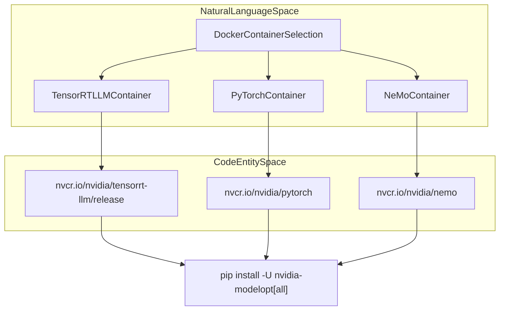
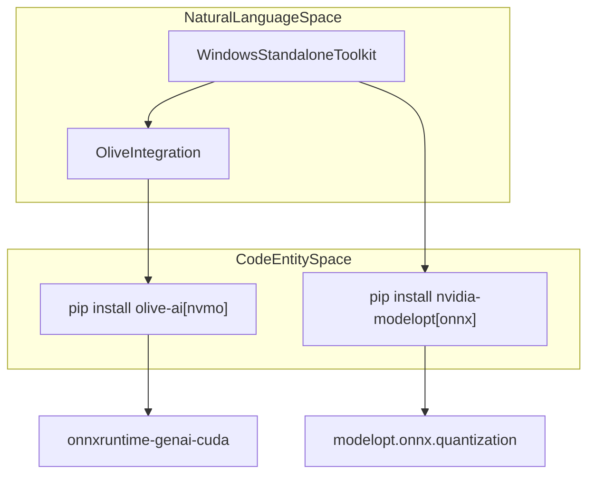

<!-- source: DeepWiki mcp.deepwiki.com · repo NVIDIA/Model-Optimizer · page 2.1 Installation and Environment Setup · fetched 2026-10-26 -->

# Installation and Environment Setup

<details>
<summary>Relevant source files</summary>

The following files were used as context for generating this wiki page:

- [.agents/review-guidelines/technical-blog.md](.agents/review-guidelines/technical-blog.md)
- [.github/CODEOWNERS](.github/CODEOWNERS)
- [.github/workflows/bump_uv_lock.yml](.github/workflows/bump_uv_lock.yml)
- [LICENSE_HEADER](LICENSE_HEADER)
- [docs/source/_ext/modelopt_autodoc_pydantic.py](docs/source/_ext/modelopt_autodoc_pydantic.py)
- [docs/source/_static/announcements.css](docs/source/_static/announcements.css)
- [docs/source/_static/announcements.js](docs/source/_static/announcements.js)
- [docs/source/_static/custom.css](docs/source/_static/custom.css)
- [docs/source/announcements/assets/autoquantize-qwen35-mmlu-effective-bits.png](docs/source/announcements/assets/autoquantize-qwen35-mmlu-effective-bits.png)
- [docs/source/announcements/autoquantize.rst](docs/source/announcements/autoquantize.rst)
- [docs/source/announcements/dspark-vs-domino.rst](docs/source/announcements/dspark-vs-domino.rst)
- [docs/source/announcements/github-pages-announcements.rst](docs/source/announcements/github-pages-announcements.rst)
- [docs/source/conf.py](docs/source/conf.py)
- [docs/source/deployment/2_onnxruntime.rst](docs/source/deployment/2_onnxruntime.rst)
- [docs/source/getting_started/1_overview.rst](docs/source/getting_started/1_overview.rst)
- [docs/source/getting_started/2_installation.rst](docs/source/getting_started/2_installation.rst)
- [docs/source/getting_started/_installation_for_Linux.rst](docs/source/getting_started/_installation_for_Linux.rst)
- [docs/source/getting_started/windows/_installation_for_Windows.rst](docs/source/getting_started/windows/_installation_for_Windows.rst)
- [docs/source/getting_started/windows/_installation_standalone.rst](docs/source/getting_started/windows/_installation_standalone.rst)
- [docs/source/getting_started/windows/_installation_with_olive.rst](docs/source/getting_started/windows/_installation_with_olive.rst)
- [docs/source/guides/0_support_matrix.rst](docs/source/guides/0_support_matrix.rst)
- [docs/source/guides/windows_guides/_ONNX_PTQ_guide.rst](docs/source/guides/windows_guides/_ONNX_PTQ_guide.rst)
- [docs/source/index.rst](docs/source/index.rst)
- [docs/source/support/2_faqs.rst](docs/source/support/2_faqs.rst)
- [examples/windows/README.md](examples/windows/README.md)
- [examples/windows/onnx_ptq/genai_llm/README.md](examples/windows/onnx_ptq/genai_llm/README.md)
- [examples/windows/onnx_ptq/genai_llm/quantize.py](examples/windows/onnx_ptq/genai_llm/quantize.py)
- [examples/windows/onnx_ptq/sam2/README.md](examples/windows/onnx_ptq/sam2/README.md)
- [examples/windows/torch_onnx/diffusers/README.md](examples/windows/torch_onnx/diffusers/README.md)
- [examples/windows/torch_onnx/diffusers/type_update_trt_custom_ops.py](examples/windows/torch_onnx/diffusers/type_update_trt_custom_ops.py)
- [modelopt/onnx/quantization/extensions.py](modelopt/onnx/quantization/extensions.py)
- [uv.lock](uv.lock)

</details>


## Purpose and Scope
This document details the environment configuration, dependency management, and installation workflows for NVIDIA Model Optimizer (`nvidia-modelopt`) across Linux and Windows platforms. It covers system prerequisites, NVIDIA NGC container images, local virtual environment setup via `pip` and `conda`, optional package extras (`[all]`, `[onnx]`, `[hf]`), execution provider configurations for ONNX Runtime, CUDA version switching (CUDA 12.x vs 13.x), and accelerated Triton kernel requirements.

Sources: [docs/source/getting_started/_installation_for_Linux.rst:1-147](), [docs/source/getting_started/windows/_installation_standalone.rst:1-128](), [examples/windows/README.md:1-127]()

---

## 1. System Requirements

Model Optimizer requires specific host environments depending on whether the target deployment uses PyTorch, TensorRT-LLM, or ONNX Runtime.

| Component | Linux Requirement | Windows Requirement |
| :--- | :--- | :--- |
| **Operating System** | Linux (x86_64, aarch64 / SBSA) | Windows 10/11 with RTX GPU |
| **Python Version** | `>=3.10, <3.15` | `>=3.10, <3.13` |
| **CUDA Toolkit** | CUDA 12.x, 13.x | CUDA 12.x, 13.x with matching cuDNN |
| **PyTorch** | `>=2.8` | PyTorch Windows builds |
| **C++ Build Tools** | GCC / G++ | Visual Studio 2022 / MSVC / C++ Build Tools |
| **Optional Runtimes** | TensorRT-LLM `>=1.0`, ONNX Runtime `1.24`, TensorRT `>=10.0` | ONNX Runtime (`onnxruntime-gpu`, `onnxruntime-directml`) |

Sources: [docs/source/getting_started/_installation_for_Linux.rst:5-27](), [docs/source/getting_started/windows/_installation_standalone.rst:9-18]()

---

## 2. Linux Environment Installation

### Containerized Environments (Recommended)
For full deployment workflows involving TensorRT and TensorRT-LLM, NVIDIA provides pre-built NGC container images with Model Optimizer pre-installed.

* **TensorRT-LLM Container**: `nvcr.io/nvidia/tensorrt-llm/release:<version>` — Includes TensorRT-LLM, TensorRT, and Model Optimizer.
* **PyTorch Container**: `nvcr.io/nvidia/pytorch:<version>-py3` — Optimized PyTorch stack.
* **NeMo Container**: `nvcr.io/nvidia/nemo:<version>` — Includes Megatron-Bridge and Megatron-LM.
* **TensorRT Container**: `nvcr.io/nvidia/tensorrt:<version>-py3` — High-performance ONNX and TensorRT workflows.

When using NGC containers, update Model Optimizer to the latest release and configure runtime environment paths:
```bash
export PIP_CONSTRAINT=""
export LD_LIBRARY_PATH="${LD_LIBRARY_PATH}:/usr/include:/usr/lib/x86_64-linux-gnu"
pip install -U "nvidia-modelopt[all]"
```

Sources: [docs/source/getting_started/_installation_for_Linux.rst:31-61](), [docs/source/getting_started/_installation_for_Linux.rst:98-101]()


Sources: [docs/source/getting_started/_installation_for_Linux.rst:31-61](), [docs/source/getting_started/_installation_for_Linux.rst:98-101]()

### Local Python Virtual Environment
For local installations on Linux, set up a isolated `conda` environment with Python 3.12:
```bash
conda create -n modelopt python=3.12 pip
conda activate modelopt
```

Sources: [docs/source/getting_started/_installation_for_Linux.rst:62-73]()

---

## 3. Windows Standalone and Olive Installation

On Windows platforms, Model Optimizer (`ModelOpt-Windows`) delivers optimized ONNX models targeting ONNX Runtime (ORT) and DirectML (DML) execution providers on local RTX GPUs.

### Standalone Toolkit Installation
```bash
pip install "nvidia-modelopt[onnx]"
```
If installed without the `[onnx]` extra, only core PyTorch dependencies are included. ONNX model quantization and conversion require the `[onnx]` extra.

### Integration with Microsoft Olive
Model Optimizer integrates into Microsoft's Olive framework and ONNX Runtime GenAI:
```bash
pip install olive-ai[nvmo]
pip install onnxruntime-genai-cuda
```

Sources: [examples/windows/README.md:40-62](), [docs/source/getting_started/windows/_installation_standalone.rst:32-41]()


Sources: [examples/windows/README.md:40-62](), [docs/source/getting_started/windows/_installation_standalone.rst:32-41]()

---

## 4. Optional Dependencies and Extras

Model Optimizer modularizes its requirements to prevent bloating lightweight installations. The package defines optional extras managed via `pyproject.toml` and locked via `uv.lock`.

| Target Module / Feature | Optional Extra Flag | Description |
| :--- | :--- | :--- |
| **Full Installation** | `[all]` | Installs all optional backend and framework packages |
| **ONNX Quantization & Export** | `[onnx]` | Installs `onnx`, `onnxruntime`, and helper utilities (`modelopt.onnx`) |
| **Hugging Face Integration** | `[hf]` | Installs `transformers`, `diffusers`, and associated libraries |
| **Deploy Utilities** | `[onnx]` | Required for `modelopt.torch._deploy` |

To install specific subsets:
```bash
pip install "nvidia-modelopt[onnx,hf]"
```

Sources: [docs/source/getting_started/_installation_for_Linux.rst:102-133](), [uv.lock:1-40]()

---

## 5. CUDA Version Management & Execution Providers

### ONNX Runtime Execution Providers
During ONNX post-training quantization (PTQ) calibration, the base model executes via an ONNX Runtime Execution Provider (EP):
* `onnxruntime-gpu`: Provides the CUDA Execution Provider (default on Linux/Windows).
* `onnxruntime-directml`: Provides the DirectML Execution Provider (`dml`) for Windows DML flows.
* `onnxruntime-trt-rtx`: Provides the TensorRT-RTX Execution Provider.
* `onnxruntime`: Provides CPU fallback.

Sources: [docs/source/getting_started/windows/_installation_standalone.rst:42-50]()

### CUDA 12.x vs CUDA 13.x Switching
By default, installing `nvidia-modelopt[onnx]` pulls `cupy-cuda12x` and `onnxruntime-gpu` configured for CUDA 12.x. To target a CUDA 13.x host environment, execute the following migration commands:

```bash
python -m pip uninstall -y cupy-cuda12x onnxruntime-gpu
python -m pip install cupy-cuda13x "onnxruntime-gpu>=1.27"
```
Ensure that `CUDA_PATH`, `CUDA_HOME`, and `PATH` point to the CUDA 13 toolkit and that a compatible cuDNN 9 build is accessible.

Sources: [docs/source/getting_started/_installation_for_Linux.rst:134-137](), [docs/source/getting_started/windows/_installation_standalone.rst:69-90]()

---

## 6. Triton-Accelerated Quantization Kernels

Model Optimizer features custom Triton-implemented kernels that accelerate quantization operations (such as AWQ and QAT workflows) by approximately 40% over default implementations.

* **Hardware Requirement**: NVIDIA GPU with Compute Capability $\ge 8.9$ (e.g., RTX 40 series, RTX 6000 Ada, NVIDIA L40, or later).
* **Supported Formats**: NVFP4 quantization format (with expanded format support in subsequent releases).
* **Mocking & Build Configuration**: During Sphinx documentation builds, Triton and tensorrt_llm are mocked in `docs/source/conf.py` to prevent circular import failures on non-GPU build workers.

Sources: [docs/source/getting_started/_installation_for_Linux.rst:138-147](), [docs/source/conf.py:135-137]()

---

