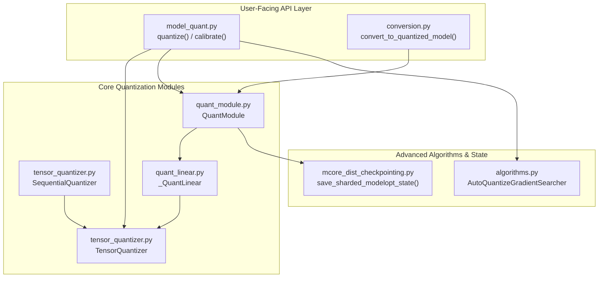
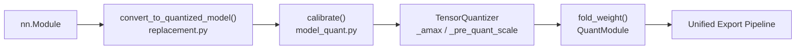

<!-- source: DeepWiki mcp.deepwiki.com · repo NVIDIA/Model-Optimizer · page 3 PyTorch Optimization · fetched 2026-10-26 -->

# PyTorch Optimization

Relevant source files

The following files were used as context for generating this wiki page:

- [modelopt/torch/opt/plugins/mcore_dist_checkpointing.py](modelopt/torch/opt/plugins/mcore_dist_checkpointing.py)
- [modelopt/torch/quantization/_auto_quantize_cost.py](modelopt/torch/quantization/_auto_quantize_cost.py)
- [modelopt/torch/quantization/algorithms.py](modelopt/torch/quantization/algorithms.py)
- [modelopt/torch/quantization/conversion.py](modelopt/torch/quantization/conversion.py)
- [modelopt/torch/quantization/model_quant.py](modelopt/torch/quantization/model_quant.py)
- [modelopt/torch/quantization/nn/__init__.py](modelopt/torch/quantization/nn/__init__.py)
- [modelopt/torch/quantization/nn/modules/quant_linear.py](modelopt/torch/quantization/nn/modules/quant_linear.py)
- [modelopt/torch/quantization/nn/modules/quant_module.py](modelopt/torch/quantization/nn/modules/quant_module.py)
- [modelopt/torch/quantization/plugins/custom.py](modelopt/torch/quantization/plugins/custom.py)
- [modelopt/torch/quantization/plugins/transformer_engine.py](modelopt/torch/quantization/plugins/transformer_engine.py)
- [modelopt/torch/utils/plugins/megatron_calibration.py](modelopt/torch/utils/plugins/megatron_calibration.py)
- [tests/gpu_megatron/torch/quantization/plugins/test_transformer_engine.py](tests/gpu_megatron/torch/quantization/plugins/test_transformer_engine.py)
- [tests/unit/torch/quantization/plugins/test_huggingface.py](tests/unit/torch/quantization/plugins/test_huggingface.py)
- [tests/unit/torch/quantization/test_autoquant.py](tests/unit/torch/quantization/test_autoquant.py)
- [tests/unit/torch/quantization/test_calib.py](tests/unit/torch/quantization/test_calib.py)
- [tests/unit/torch/quantization/test_tensor_quant_cpu.py](tests/unit/torch/quantization/test_tensor_quant_cpu.py)

## Purpose and Scope

This page provides a high-level overview of PyTorch model optimization techniques available in NVIDIA Model Optimizer (**ModelOpt**). The PyTorch optimization subsystem enables neural network compression and acceleration through post-training quantization, quantization-aware training, pruning, knowledge distillation, speculative decoding, and sparsity techniques [modelopt/torch/quantization/model_quant.py:64-91](). These optimizations can be applied individually or chained together to achieve optimal latency-accuracy trade-offs.

**Related Child Pages:**
- For comprehensive PTQ guides, calibration, and algorithms (SmoothQuant, AWQ, SVDQuant), see [Post-Training Quantization (PTQ)](#3.1)
- For QAT workflows and trainer classes, see [Quantization-Aware Training (QAT)](#3.2)
- For pruning techniques including FastNAS, GradNAS, and Minitron, see [Model Pruning](#3.3)
- For knowledge distillation techniques, see [Knowledge Distillation](#3.4)
- For speculative decoding architectures (EAGLE, Medusa, DFlash), see [Speculative Decoding](#3.5)
- For 2:4 structured sparsity and attention sparsity, see [Sparsity and Structured Pruning](#3.6)

Sources: [modelopt/torch/quantization/model_quant.py:64-91]()

---

## Optimization Techniques Overview

Model Optimizer provides five primary optimization techniques for PyTorch models, each targeting different aspects of model efficiency and deployment constraints:

### Quantization

Quantization reduces model precision from FP32/FP16 to lower-bit formats like FP8, INT8, INT4, and NVFP4 [modelopt/torch/quantization/nn/modules/quant_linear.py:38-53](). ModelOpt supports both simulated (fake) quantization for training and real quantization for memory savings [modelopt/torch/quantization/nn/modules/quant_module.py:144-161]().

- **Post-Training Quantization (PTQ)**: Calibrates quantization parameters using a small representative dataset via `mtq.calibrate()` [modelopt/torch/quantization/model_quant.py:64-91](). Supported algorithms include `SmoothQuant`, `AWQ`, and `SVDQuant` [modelopt/torch/quantization/model_quant.py:64-91]().
- **Quantization-Aware Training (QAT)**: Fine-tunes the model with fake quantization enabled to recover accuracy [modelopt/torch/quantization/nn/modules/quant_module.py:131-161]().
- **Auto-Quantize**: Automatically searches for optimal per-layer quantization formats to satisfy constraints using gradient-based searchers [modelopt/torch/quantization/algorithms.py:35-41]().

For details, see [Post-Training Quantization (PTQ)](#3.1) and [Quantization-Aware Training (QAT)](#3.2).

### Pruning

Pruning removes redundant parameters or architectural components to reduce memory footprint and computational cost.

- **Minitron**: Width and depth pruning for Megatron-Core transformer models (GPT, Mamba, MoE).
- **NAS-based Pruning**: Includes FastNAS and GradNAS for automated subnet search within the `modelopt.torch.nas` subsystem.

For details, see [Model Pruning](#3.3).

### Knowledge Distillation

Knowledge distillation trains a smaller student model to mimic the logits and intermediate representations of a larger teacher model, assisting in accuracy recovery after aggressive pruning or quantization.

For details, see [Knowledge Distillation](#3.4).

### Speculative Decoding

Speculative decoding accelerates Large Language Model inference by employing smaller draft models or parallel draft heads to generate multiple candidate tokens per forward pass. Supported architectures include **EAGLE**, **Medusa**, and the **DFlash/DSpark** families.

For details, see [Speculative Decoding](#3.5).

### Sparsity

Sparsity techniques zero out specific weight configurations to accelerate execution on supported hardware accelerators, including 2:4 structured sparsity and attention-pattern sparsity.

For details, see [Sparsity and Structured Pruning](#3.6).

Sources: [modelopt/torch/quantization/model_quant.py:64-91](), [modelopt/torch/quantization/algorithms.py:35-41](), [modelopt/torch/quantization/nn/modules/quant_module.py:131-161]()

---

## Core Architecture and Code Mapping

The following diagrams map the high-level optimization abstractions to their corresponding classes and modules within the `modelopt.torch` codebase.

### Diagram: Optimization Subsystem Entity Mapping

Sources: [modelopt/torch/quantization/model_quant.py:147-151](), [modelopt/torch/quantization/conversion.py:63-74](), [modelopt/torch/quantization/nn/modules/quant_module.py:41-60](), [modelopt/torch/quantization/nn/modules/quant_linear.py:38-53]()

### Diagram: Quantization and Calibration Workflow

Sources: [modelopt/torch/quantization/model_quant.py:64-129](), [modelopt/torch/quantization/conversion.py:63-74](), [modelopt/torch/quantization/nn/modules/quant_module.py:131-162]()

---

## State Management and Integration

Model Optimizer provides robust state management mechanisms to serialize, restore, and checkpoint optimized models across distributed training frameworks. 

- **State Persistence**: Optimization states (such as quantizer `amax` values, active hyperparameter choices, and search metadata) are tracked via `ModeloptStateManager` and can be restored using `restore_quantizer_state()` [modelopt/torch/quantization/conversion.py:125-170]().
- **Distributed Checkpointing**: For large-scale distributed training frameworks like Megatron-Core, specialized plugins handle sharded state dict saving and loading [modelopt/torch/opt/plugins/mcore_dist_checkpointing.py:67-110]().
- **Weight Folding**: Models can temporarily or permanently bake scaling factors and fake-quantization parameters directly into weights via `fold_weight()` to streamline inference execution [modelopt/torch/quantization/nn/modules/quant_module.py:131-162]().

Sources: [modelopt/torch/quantization/conversion.py:125-170](), [modelopt/torch/opt/plugins/mcore_dist_checkpointing.py:67-110](), [modelopt/torch/quantization/nn/modules/quant_module.py:131-162]()

---

## Next Steps

- For deep dives into PTQ calibration techniques, see [Post-Training Quantization (PTQ)](#3.1).
- For QAT workflows, see [Quantization-Aware Training (QAT)](#3.2).
- For pruning and NAS workflows, see [Model Pruning](#3.3).
- For deployment export pipelines, see [Export and Deployment](#8).

---

