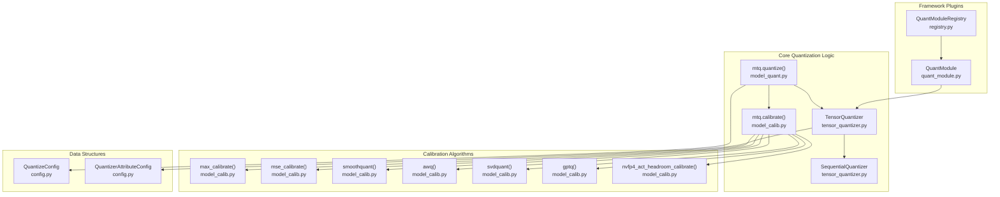
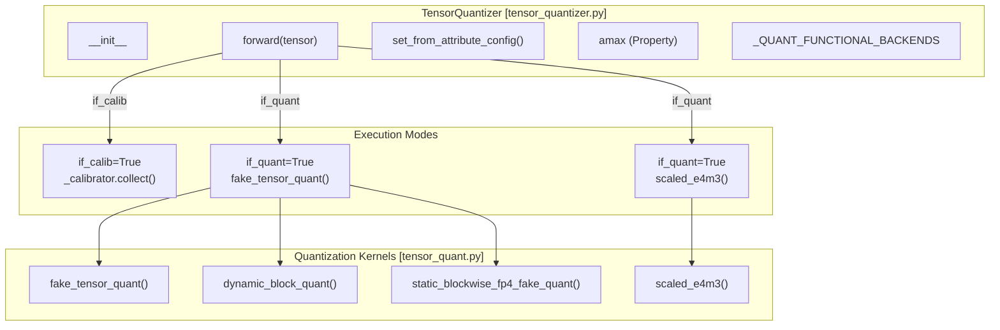

<!-- source: DeepWiki mcp.deepwiki.com · repo NVIDIA/Model-Optimizer · page 3.1 Post-Training Quantization (PTQ) · fetched 2026-10-26 -->

# Post-Training Quantization (PTQ)

Relevant source files

The following files were used as context for generating this wiki page:

- [examples/hf_ptq/README.md](examples/hf_ptq/README.md)
- [examples/hf_ptq/example_utils.py](examples/hf_ptq/example_utils.py)
- [examples/hf_ptq/hf_ptq.py](examples/hf_ptq/hf_ptq.py)
- [examples/hf_ptq/requirements.txt](examples/hf_ptq/requirements.txt)
- [modelopt/torch/export/hf_export_handlers.py](modelopt/torch/export/hf_export_handlers.py)
- [modelopt/torch/export/layerwise_export.py](modelopt/torch/export/layerwise_export.py)
- [modelopt/torch/export/model_config.py](modelopt/torch/export/model_config.py)
- [modelopt/torch/export/registry.py](modelopt/torch/export/registry.py)
- [modelopt/torch/export/unified_export_hf_streaming.py](modelopt/torch/export/unified_export_hf_streaming.py)
- [modelopt/torch/quantization/config.py](modelopt/torch/quantization/config.py)
- [modelopt/torch/quantization/mode.py](modelopt/torch/quantization/mode.py)
- [modelopt/torch/quantization/model_calib.py](modelopt/torch/quantization/model_calib.py)
- [modelopt/torch/quantization/nn/modules/tensor_quantizer.py](modelopt/torch/quantization/nn/modules/tensor_quantizer.py)
- [modelopt/torch/quantization/plugins/accelerate.py](modelopt/torch/quantization/plugins/accelerate.py)
- [modelopt/torch/quantization/utils/calib_utils.py](modelopt/torch/quantization/utils/calib_utils.py)
- [modelopt/torch/quantization/utils/core_utils.py](modelopt/torch/quantization/utils/core_utils.py)
- [modelopt/torch/quantization/utils/layerwise_calib.py](modelopt/torch/quantization/utils/layerwise_calib.py)
- [modelopt/torch/utils/dataset_utils.py](modelopt/torch/utils/dataset_utils.py)
- [modelopt/torch/utils/speech_dataset_utils.py](modelopt/torch/utils/speech_dataset_utils.py)
- [modelopt/torch/utils/vlm_dataset_utils.py](modelopt/torch/utils/vlm_dataset_utils.py)
- [modelopt_recipes/huggingface/qwen3_6_moe/auto_quantize/w4a16_nvfp4_fp8_module_spaces_at_6p0bits-active_moe.yaml](modelopt_recipes/huggingface/qwen3_6_moe/auto_quantize/w4a16_nvfp4_fp8_module_spaces_at_6p0bits-active_moe.yaml)
- [modelopt_recipes/ptq.md](modelopt_recipes/ptq.md)
- [tests/examples/hf_ptq/test_example_utils.py](tests/examples/hf_ptq/test_example_utils.py)
- [tests/examples/hf_ptq/test_hf_ptq_args.py](tests/examples/hf_ptq/test_hf_ptq_args.py)
- [tests/gpu/torch/quantization/conftest.py](tests/gpu/torch/quantization/conftest.py)
- [tests/gpu/torch/quantization/plugins/test_accelerate_gpu.py](tests/gpu/torch/quantization/plugins/test_accelerate_gpu.py)
- [tests/gpu/torch/quantization/test_fsdp2.py](tests/gpu/torch/quantization/test_fsdp2.py)
- [tests/gpu/torch/quantization/test_gptq.py](tests/gpu/torch/quantization/test_gptq.py)
- [tests/gpu/torch/quantization/test_layerwise_calibrate.py](tests/gpu/torch/quantization/test_layerwise_calibrate.py)
- [tests/gpu/torch/utils/test_model_load_utils.py](tests/gpu/torch/utils/test_model_load_utils.py)
- [tests/unit/torch/export/test_export_registry.py](tests/unit/torch/export/test_export_registry.py)
- [tests/unit/torch/export/test_offload_export.py](tests/unit/torch/export/test_offload_export.py)
- [tests/unit/torch/quantization/test_config_validation.py](tests/unit/torch/quantization/test_config_validation.py)
- [tests/unit/torch/quantization/test_layerwise_calibrate.py](tests/unit/torch/quantization/test_layerwise_calibrate.py)
- [tests/unit/torch/utils/test_dataset_utils.py](tests/unit/torch/utils/test_dataset_utils.py)

## Purpose and Scope

Post-Training Quantization (PTQ) is a model optimization technique that reduces the precision of model weights and activations after training to improve inference efficiency. This page covers the PTQ system in Model Optimizer, which enables quantization of HuggingFace and Megatron-Core models to various formats (FP8, INT8, INT4, NVFP4, MXFP8) using different calibration algorithms without requiring retraining.

The system focuses on high-performance deployment targets including TensorRT-LLM, vLLM, and SGLang.

Sources: [modelopt/torch/quantization/config.py:16-46](), [modelopt/torch/quantization/model_calib.py:70-80]()

## PTQ System Architecture

The PTQ system is built on a plugin architecture that allows it to support various model frameworks (HuggingFace, Megatron-Core) while sharing a common set of quantization algorithms and core modules.

### Component Relationship Diagram

This diagram bridges the natural language concepts to the specific code entities implementing them.

Sources: [modelopt/torch/quantization/model_calib.py:70-80](), [modelopt/torch/quantization/nn/modules/tensor_quantizer.py:136-182](), [modelopt/torch/quantization/config.py:35-60]()

## Quantization Workflow

The PTQ workflow follows a process of model conversion, calibration, and attribute validation.

```mermaid
graph LR
    subgraph "1. Conversion"
        Cfg["Select Config / Recipe<br/>load_recipe()"]
        Conv["convert_to_quantized_model()<br/>Replace nn.Linear -> QuantLinear"]
    end
    
    subgraph "2. Calibration"
        Stats["enable_stats_collection()<br/>Set if_calib=True"]
        Loop["forward_loop(model)<br/>Compute amax/stats"]
        Finish["finish_stats_collection()<br/>Set if_calib=False"]
    end
    
    subgraph "3. Post-Processing"
        Sync["sync_quantizer_amax_across_dp_ep()<br/>Distributed Sync"]
        Shared["_finalize_with_shared_state()<br/>Sync fusible groups"]
        Promote["promote_static_block_weight_quantizers()<br/>Materialize NVFP4 scales"]
    end
    
    Cfg --> Conv
    Conv --> Stats
    Stats --> Loop
    Loop --> Finish
    Finish --> Sync
    Sync --> Shared
    Shared --> Promote
```

Sources: [modelopt/torch/quantization/model_calib.py:117-159](), [modelopt/torch/quantization/utils/core_utils.py:43-90]()

## Quantization Formats and Recipes

Model Optimizer utilizes a recipe-based system to define quantization schemes. Recipes combine format selection, scope (which layers to quantize), and calibration algorithms.

### Supported Formats and Schemes

| Format | Example Recipe | Description | Target Hardware |
| :--- | :--- | :--- | :--- |
| **INT8** | `INT8_SMOOTHQUANT_CFG` | Per-channel weights, per-tensor activations | Generic GPU |
| **FP8** | `FP8_DEFAULT_CFG` | E4M3 format for weights and activations | H100+ |
| **INT4 AWQ** | `INT4_AWQ_CFG` | W4A16 weight-only with AWQ scaling | Generic GPU |
| **NVFP4** | `nvfp4_default-kv_fp8` | 4-bit floating point (E2M1) W4A4 | Blackwell |

Sources: [modelopt/torch/quantization/config.py:35-46](), [modelopt_recipes/ptq.md:33-60]()

### NVFP4 Activation Headroom
A specialized calibration algorithm for NVFP4 activations. It anchors the global scale to a low percentile of the per-block amax distribution, providing headroom to prevent saturation of larger activation values.
- **Implementation:** `NVFP4ActHeadroomCalibrator` referenced via `modelopt.torch.quantization.model_calib`
- **Parameters:** `rho` (headroom factor), `anchor_percentile`, and `upper_percentile`.

Sources: [modelopt/torch/quantization/model_calib.py:45-78]()

## Calibration Algorithms

Calibration determines the scaling factors (`amax`) to map values to the target range.

### Max Calibration
Computes the absolute maximum value seen during the forward pass.
- **Key Function:** `max_calibrate` defined in `model_calib.py`.
- **Shared State:** Automatically synchronizes `global_amax` for fusible sibling groups (Q/K/V, gate/up) to ensure consistent per-block scaling.

Sources: [modelopt/torch/quantization/model_calib.py:76-159]()

### MSE Calibration
Searches for an `amax` that minimizes the Mean Squared Error between the original and quantized tensor.
- **Implementation:** `MseCalibrator` defined in `calib/mse.py`.
- **FP8 Sweep:** Supports an optional `fp8_scale_sweep` to optimize scales specifically for FP8 backends.

Sources: [modelopt/torch/quantization/model_calib.py:45-78]()

### SmoothQuant
Migrates quantization difficulty from activations to weights using a per-channel scaling factor.
- **Key Function:** `smoothquant` defined in `model_calib.py`.
- **Logic:** Performs a calibration pass to collect activation statistics, then applies balancing factors to weights and activations.

Sources: [modelopt/torch/quantization/model_calib.py:70-80]()

### AWQ (Activation-Aware Weight Quantization)
Protects salient weights by scaling them based on activation magnitudes.
- **Key Function:** `awq` defined in `model_calib.py`.
- **Variants:** Supports lite, full, and clip configurations.

Sources: [modelopt/torch/quantization/model_calib.py:70-80](), [modelopt/torch/quantization/config.py:35-60]()

### SVDQuant
Handles outliers in 4-bit quantization by using Singular Value Decomposition to decompose weights.
- **Key Function:** `svdquant` defined in `model_calib.py`.
- **Dynamic Conversion:** Can replace `nn.Linear` with SVDQuant linear layers on-the-fly during calibration.

Sources: [modelopt/torch/quantization/model_calib.py:46-79]()

## TensorQuantizer: The Core Module

`TensorQuantizer` is the primary `nn.Module` for managing quantization state and execution.

### Code Entity Space Diagram

Sources: [modelopt/torch/quantization/nn/modules/tensor_quantizer.py:136-188](), [modelopt/torch/quantization/tensor_quant.py:57-64]()

### Key Features
- **Shared Quantizers:** Supports shared `global_amax` across multiple quantizers via `SharedWeightGlobalAmaxState`.
- **MoE Support:** `GroupedQuantizer` enables independent quantization for each expert in fused MoE layers.
- **Backend Registration:** Custom quantization backends can be registered via `register_quant_backend`.

Sources: [modelopt/torch/quantization/model_calib.py:144-158](), [modelopt/torch/quantization/nn/modules/tensor_quantizer.py:74-130]()

## Framework Integration

### Hugging Face Models
The PTQ system integrates with Hugging Face via specialized `QuantModule` implementations and model builders.
- **KV Cache Quantization:** Manages quantization for Q, K, V tensors with constant or dynamic scaling factors.
- **Calibration Loops:** Integrates with Hugging Face dataset utilities and tokenizers for automated calibration.

Sources: [examples/hf_ptq/hf_ptq.py:104-120](), [modelopt/torch/utils/dataset_utils.py:139-174]()

### Megatron-Core and Distributed Support
Supports distributed quantization for M-Core models, including ColumnParallel and RowParallel linear layers.
- **Distributed Sync:** Synchronizes scaling factors across Data Parallel (DP) and Expert Parallel (EP) ranks using distributed utilities.

Sources: [modelopt/torch/quantization/model_calib.py:27-42](), [modelopt/torch/quantization/utils/core_utils.py:27-30]()

---

