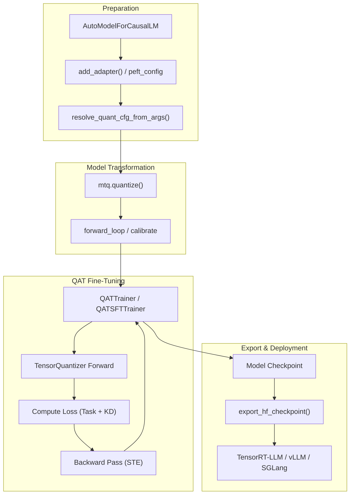
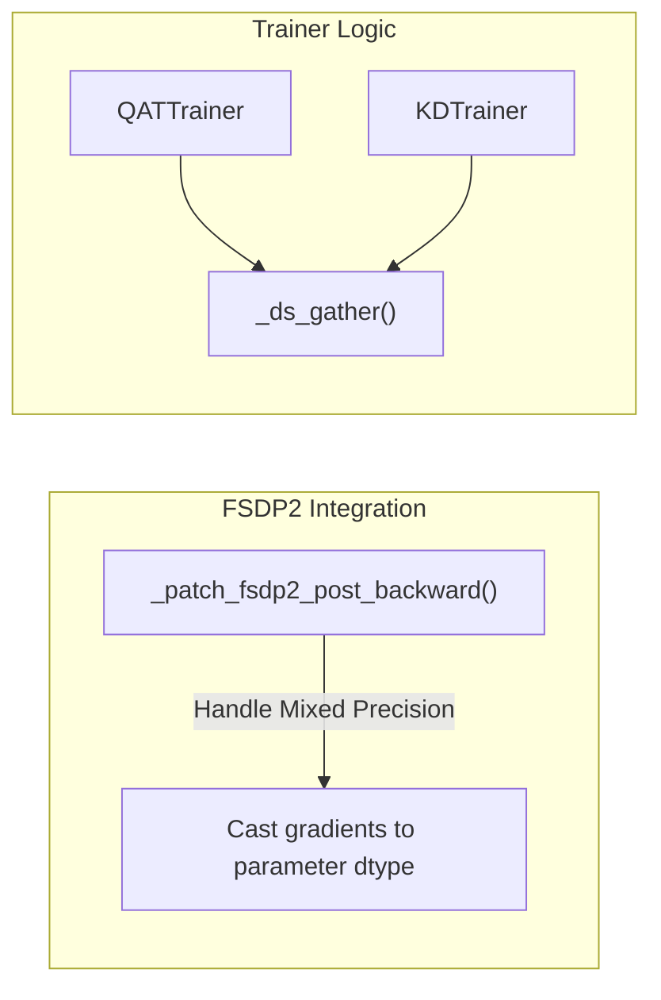

<!-- source: DeepWiki mcp.deepwiki.com · repo NVIDIA/Model-Optimizer · page 3.2 Quantization-Aware Training (QAT) · fetched 2026-10-26 -->

# Quantization-Aware Training (QAT)

Relevant source files

The following files were used as context for generating this wiki page:

- [docs/source/guides/4_distillation.rst](docs/source/guides/4_distillation.rst)
- [examples/gpt-oss/configs/sft_full.yaml](examples/gpt-oss/configs/sft_full.yaml)
- [examples/gpt-oss/configs/sft_lora.yaml](examples/gpt-oss/configs/sft_lora.yaml)
- [examples/gpt-oss/sft.py](examples/gpt-oss/sft.py)
- [examples/llm_distill/README.md](examples/llm_distill/README.md)
- [examples/llm_distill/accelerate_config/fsdp2.yaml](examples/llm_distill/accelerate_config/fsdp2.yaml)
- [examples/llm_distill/main.py](examples/llm_distill/main.py)
- [examples/llm_distill/requirements.txt](examples/llm_distill/requirements.txt)
- [examples/llm_qat/ARGUMENTS.md](examples/llm_qat/ARGUMENTS.md)
- [examples/llm_qat/README.md](examples/llm_qat/README.md)
- [examples/llm_qat/llama_factory/launch_llamafactory.sh](examples/llm_qat/llama_factory/launch_llamafactory.sh)
- [examples/llm_qat/llama_factory/llama_factory.py](examples/llm_qat/llama_factory/llama_factory.py)
- [examples/llm_qat/quantize.py](examples/llm_qat/quantize.py)
- [modelopt/torch/distill/losses.py](modelopt/torch/distill/losses.py)
- [modelopt/torch/distill/plugins/huggingface.py](modelopt/torch/distill/plugins/huggingface.py)
- [modelopt/torch/quantization/plugins/transformers_trainer.py](modelopt/torch/quantization/plugins/transformers_trainer.py)
- [tests/examples/llm_distill/test_llm_distill.py](tests/examples/llm_distill/test_llm_distill.py)
- [tests/unit/torch/distill/plugins/test_huggingface_kd.py](tests/unit/torch/distill/plugins/test_huggingface_kd.py)

Quantization-Aware Training (QAT) simulates quantization effects during training to recover accuracy lost during low-precision conversion [examples/llm_qat/README.md:1-3](). Unlike Post-Training Quantization (PTQ, see [3.1]()), which quantizes a pre-trained model without additional training, QAT fine-tunes the model with simulated quantization operations in the forward pass. This allows the model weights to adapt to quantization constraints, achieving higher accuracy for aggressive formats like INT4 or FP4/NVFP4 on the NVIDIA Blackwell platform [examples/llm_qat/README.md:1-3]().

Model Optimizer provides comprehensive QAT support through:
- **Fake Quantization**: Modules that simulate quantization noise during training using Straight-Through Estimation (STE) [modelopt/torch/quantization/plugins/transformers_trainer.py:153-169]().
- **Trainer Plugins**: High-level classes like `QATTrainer` and `KDTrainer` for Hugging Face workflows [modelopt/torch/quantization/plugins/transformers_trainer.py:153-169](), [modelopt/torch/distill/plugins/huggingface.py:97-104]().
- **Framework Integration**: Support for PyTorch FSDP2, DeepSpeed, and distributed training setups via patching and context managers [modelopt/torch/quantization/plugins/transformers_trainer.py:93-136](), [modelopt/torch/distill/plugins/huggingface.py:174-189]().
- **Hybrid Workflows**: Integration with LoRA (QLoRA) and Knowledge Distillation (QAD) [examples/llm_qat/README.md:3-5]().

---

## QAT Workflow Architecture

The QAT workflow transitions a model from high precision to a "fake quantized" state where weights and activations are constrained during the forward pass, while gradients remain in higher precision for stable updates.

**Diagram: End-to-End QAT Workflow with Code Entities**

Sources: [examples/llm_qat/README.md:43-86](), [modelopt/torch/quantization/plugins/transformers_trainer.py:153-172]()

---

## Core Components

### QAT Trainer Classes
Model Optimizer provides specialized trainers that inherit from standard framework trainers (like Hugging Face `Trainer` and TRL `SFTTrainer`) to automate the QAT setup and calibration phases [modelopt/torch/quantization/plugins/transformers_trainer.py:153-169](), [examples/gpt-oss/sft.py:60-61]().

| Class | Base Class | Description |
| :--- | :--- | :--- |
| `QATTrainer` | `ModelOptHFTrainer` | Standard QAT for Hugging Face models. Handles `mtq.quantize` and calibration automatically [modelopt/torch/quantization/plugins/transformers_trainer.py:153-169](). |
| `KDTrainer` | `ModelOptHFTrainer` | Distillation trainer for Hugging Face models. Supports logit-level knowledge distillation [modelopt/torch/distill/plugins/huggingface.py:97-104](). |
| `QuantizationArguments` | `ModelOptHFArguments` | Standardizes CLI and YAML arguments for `recipe`, `calib_size`, and `compress` [modelopt/torch/quantization/plugins/transformers_trainer.py:46-77](). |

### Distributed Training Support
QAT supports large-scale training using FSDP2 and DeepSpeed. A critical component is the management of `modelopt_state` and gradient data types across ranks [modelopt/torch/quantization/plugins/transformers_trainer.py:93-136]().

**Diagram: Distributed QAT Components and Code Hooks**

For FSDP2, a patch is applied to `FSDPParamGroup.post_backward` to handle mixed-precision gradient dtypes where `bf16` gradients are assigned to `fp32` parameters, preventing runtime errors in PyTorch 2.6+ [modelopt/torch/quantization/plugins/transformers_trainer.py:93-136](). For DeepSpeed ZeRO-3, the `_ds_gather` context manager is used to gather partitioned teacher parameters during distillation forward passes [modelopt/torch/distill/plugins/huggingface.py:174-189]().

Sources: [modelopt/torch/quantization/plugins/transformers_trainer.py:93-136](), [modelopt/torch/distill/plugins/huggingface.py:174-189]()

---

## Implementation Details

### Quantization-Aware Distillation (QAD)
Quantization-Aware Distillation (QAD) combines QAT with knowledge distillation, using a full-precision teacher model to guide the quantized student model. In the `KDTrainer` implementation:
- The teacher model is prepared via `self._prepare_model()` to handle FSDP2, DeepSpeed, or DDP topologies [modelopt/torch/distill/plugins/huggingface.py:163-169]().
- Distillation loss (`LogitsDistillationLoss`) computes KL-divergence over softened logits [modelopt/torch/distill/plugins/huggingface.py:142-144]().
- Liger kernel integration allows for accelerated fused Cross-Entropy and Jensen-Shannon Divergence calculations when enabled [modelopt/torch/distill/plugins/huggingface.py:152-160]().

Sources: [modelopt/torch/distill/plugins/huggingface.py:142-169](), [examples/llm_qat/README.md:125-129]()

---

## Export Pipeline

Once QAT is complete, the model is exported for high-performance inference engines like TensorRT-LLM, vLLM, or SGLang [examples/llm_qat/README.md:88]().

1. **Enable Checkpointing**: Call `mto.enable_huggingface_checkpointing()` in the training script to ensure ModelOpt metadata and quantization scales are saved alongside Hugging Face model weights [examples/gpt-oss/sft.py:64]().
2. **Load Trained Checkpoint**: Use `AutoModelForCausalLM.from_pretrained()` to load the fine-tuned checkpoint [examples/llm_qat/README.md:56-62]().
3. **Export Checkpoint**: Run `export.py` to extract scaling factors and format weights into deployment-ready structures [examples/llm_qat/README.md:62]().

Sources: [examples/llm_qat/README.md:56-62](), [examples/gpt-oss/sft.py:64]()

---

## Summary of Key QAT APIs

| API Function / Class | Module Path | Description |
| :--- | :--- | :--- |
| `mtq.quantize` | `modelopt.torch.quantization` | Transforms a model for QAT by inserting quantizers [examples/llm_qat/README.md:115-116](). |
| `mto.enable_huggingface_checkpointing` | `modelopt.torch.opt` | Enables automatic save/load of ModelOpt state with HF checkpoints [examples/gpt-oss/sft.py:64](). |
| `QATTrainer` | `modelopt.torch.quantization.plugins` | Drop-in HF Trainer replacement for QAT workflows [modelopt/torch/quantization/plugins/transformers_trainer.py:161-172](). |
| `KDTrainer` | `modelopt.torch.distill.plugins.huggingface` | HF Trainer for distillation-based accuracy recovery (QAD) [modelopt/torch/distill/plugins/huggingface.py:105-116](). |

Sources: [modelopt/torch/quantization/plugins/transformers_trainer.py:161-172](), [modelopt/torch/distill/plugins/huggingface.py:105-116](), [examples/gpt-oss/sft.py:64]()

---

