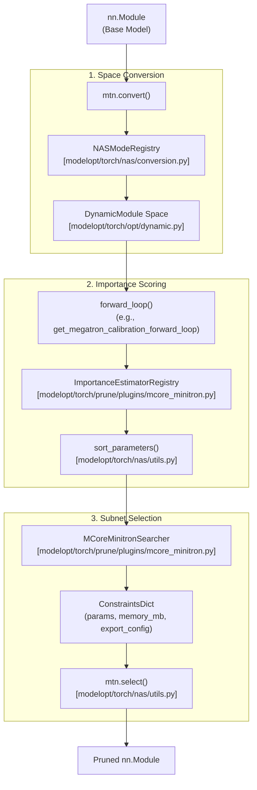
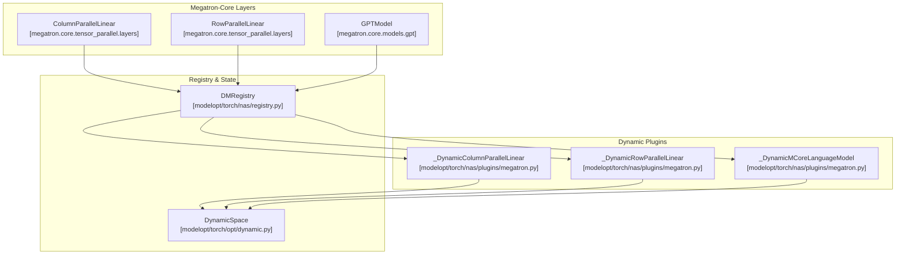

<!-- source: DeepWiki mcp.deepwiki.com · repo NVIDIA/Model-Optimizer · page 3.3 Model Pruning · fetched 2026-10-26 -->

# Model Pruning

Relevant source files

The following files were used as context for generating this wiki page:

- [docs/source/guides/3_pruning.rst](docs/source/guides/3_pruning.rst)
- [docs/source/guides/7_nas.rst](docs/source/guides/7_nas.rst)
- [examples/megatron_bridge/README.md](examples/megatron_bridge/README.md)
- [examples/megatron_bridge/distill.py](examples/megatron_bridge/distill.py)
- [examples/megatron_bridge/export_distilled_megatron_to_hf.py](examples/megatron_bridge/export_distilled_megatron_to_hf.py)
- [examples/megatron_bridge/export_quantized_megatron_to_hf.py](examples/megatron_bridge/export_quantized_megatron_to_hf.py)
- [examples/megatron_bridge/prune_minitron.py](examples/megatron_bridge/prune_minitron.py)
- [examples/megatron_bridge/quantize.py](examples/megatron_bridge/quantize.py)
- [examples/pruning/README.md](examples/pruning/README.md)
- [examples/pruning/cifar_resnet.ipynb](examples/pruning/cifar_resnet.ipynb)
- [modelopt/torch/nas/plugins/megatron.py](modelopt/torch/nas/plugins/megatron.py)
- [modelopt/torch/nas/utils.py](modelopt/torch/nas/utils.py)
- [modelopt/torch/prune/plugins/mcore_minitron.py](modelopt/torch/prune/plugins/mcore_minitron.py)
- [modelopt/torch/utils/plugins/mbridge.py](modelopt/torch/utils/plugins/mbridge.py)
- [tests/_test_utils/torch/megatron/models.py](tests/_test_utils/torch/megatron/models.py)
- [tests/_test_utils/torch/megatron/utils.py](tests/_test_utils/torch/megatron/utils.py)
- [tests/examples/megatron_bridge/test_distill.py](tests/examples/megatron_bridge/test_distill.py)
- [tests/examples/megatron_bridge/test_prune_minitron.py](tests/examples/megatron_bridge/test_prune_minitron.py)
- [tests/examples/megatron_bridge/test_qad.py](tests/examples/megatron_bridge/test_qad.py)
- [tests/unit/torch/nas/test_evaluate_constraints.py](tests/unit/torch/nas/test_evaluate_constraints.py)
- [tests/unit/torch/nas/test_full_algorithms_vision.py](tests/unit/torch/nas/test_full_algorithms_vision.py)
- [tests/unit/torch/nas/test_latency_interpolator.py](tests/unit/torch/nas/test_latency_interpolator.py)
- [tests/unit/torch/nas/test_nas_utils.py](tests/unit/torch/nas/test_nas_utils.py)
- [tests/unit/torch/prune/test_algorithms.py](tests/unit/torch/prune/test_algorithms.py)

## Purpose and Scope

Model pruning reduces neural network size by removing redundant or less important parameters while maintaining accuracy. This technique can involve the removal of linear and convolutional layers, as well as Transformer-specific components like attention heads, MLP intermediate dimensions, Mixture-of-Experts (MoE) experts, and even entire model layers (depth pruning) [examples/pruning/README.md:3-6]().

This document provides a high-level overview of the pruning algorithms and the underlying Neural Architecture Search (NAS) infrastructure. For detailed instructions on pruning Large Language Models (LLMs) in distributed environments, see [Minitron Pruning for Megatron-Core](#3.3.1).

## Overview

Model Optimizer provides several pruning modes through the unified `mtp.prune` API [examples/pruning/README.md:78-85](). These modes are specialized for different model architectures and frameworks:

| Mode | Target Models | Pruning Strategy | Primary Use Case |
|------|--------------|------------------|------------------|
| `mcore_minitron` | Megatron-Core GPT, Mamba, MoE, Hybrid | Activation magnitude-based importance [modelopt/torch/prune/plugins/mcore_minitron.py:18-22]() | LLMs and Hybrid models in distributed frameworks |
| `fastnas` | Computer Vision models | Score function maximization under constraints [examples/pruning/README.md:11-11]() | CV models (ResNet, MobileNet, etc.) |
| `gradnas` | HuggingFace BERT, GPT-J | Gradient-based importance estimation [examples/pruning/README.md:12-12]() | Light-weight pruning for transformer LMs |
| `puzzletron` | General NVIDIA Models | Mixed Integer Programming (MIP) based search [examples/pruning/README.md:10-10]() | Advanced NAS search |

Sources: [examples/pruning/README.md:9-12](), [modelopt/torch/prune/plugins/mcore_minitron.py:16-25]()

## Pruning Architecture

The pruning system leverages the Neural Architecture Search (NAS) infrastructure. It treats pruning as a search for the optimal subnet within the original model supernet [examples/pruning/README.md:7-8]().

### High-Level Workflow

The `mtp.prune` process maps high-level pruning objectives to specific code entities within `modelopt.torch.nas` and `modelopt.torch.prune`.

Title: Pruning Workflow and Code Entity Mapping

Sources: [modelopt/torch/nas/conversion.py:58-59](), [modelopt/torch/nas/utils.py:81-81](), [modelopt/torch/prune/plugins/mcore_minitron.py:124-125](), [examples/pruning/README.md:103-109]()

### Constraints and Metrics

Pruning is guided by a `constraints` dictionary that defines the target budget [examples/pruning/README.md:35-36]():

*   **Params**: Target total parameter count (e.g., `6e9` for a 6B model) [examples/megatron_bridge/prune_minitron.py:18-18]().
*   **Active Params**: Useful for Mixture-of-Experts (MoE) models where only a subset of experts are active per token [examples/megatron_bridge/prune_minitron.py:19-19]().
*   **Memory MB**: Target memory footprint (Weights + KV-Cache) for a specific sequence length and batch size [examples/megatron_bridge/prune_minitron.py:20-20]().
*   **Export Config**: Manual specification of target dimensions (e.g., `{"num_layers": 32, "hidden_size": 3584}`) [examples/pruning/README.md:97-97]().

Sources: [examples/megatron_bridge/prune_minitron.py:17-21](), [modelopt/torch/prune/plugins/mcore_minitron.py:98-114]()

## Dynamic Module System

To enable runtime shape changes during search, standard layers are replaced with `DynamicModule` variants. These modules use `TracedHp` (Traced Hyperparameters) to track active choices and importance [modelopt/torch/nas/plugins/megatron.py:59-69]().

### Megatron-Core Dynamic Plugins

For distributed training frameworks like Megatron-Core, specialized plugins handle parallelized linear layers and complex block structures [modelopt/torch/nas/plugins/megatron.py:16-25]().

Title: Dynamic Module Registry and Entity Mapping

Sources: [modelopt/torch/nas/plugins/megatron.py:36-49](), [modelopt/torch/nas/plugins/megatron.py:138-160](), [modelopt/torch/nas/registry.py:23]()

## Minitron: Width and Depth Pruning

Minitron is the primary algorithm for LLMs, supporting GPT (attention-based), Mamba (state-space), and Hybrid Transformer-Mamba models [modelopt/torch/prune/plugins/mcore_minitron.py:18-25]().

### Pruning Axes
Minitron can prune across multiple dimensions [modelopt/torch/prune/plugins/mcore_minitron.py:98-114]():
*   **Width**: `hidden_size`, `ffn_hidden_size`, `num_attention_heads`, `mamba_num_heads`, `mamba_head_dim`, `num_moe_experts`.
*   **Depth**: `num_layers`.

### Distributed Layer Dropping
For depth pruning in distributed settings, the system uses `drop_mcore_language_model_layers` to remove layers across pipeline-parallel (PP) ranks and re-index the remaining layers [modelopt/torch/prune/plugins/mcore_minitron.py:155-174]().

For details, see [Minitron Pruning for Megatron-Core](#3.3.1).

Sources: [modelopt/torch/prune/plugins/mcore_minitron.py:18-25](), [modelopt/torch/prune/plugins/mcore_minitron.py:98-114](), [modelopt/torch/prune/plugins/mcore_minitron.py:152-174]()

## Post-Pruning Recovery

Pruning is generally a lossy process. Recovery of accuracy is typically achieved through:
1.  **Fine-tuning**: Short-term training on the pruned architecture [examples/pruning/README.md:87-88]().
2.  **Knowledge Distillation**: Using the original unpruned model as a teacher to guide the pruned student model [examples/megatron_bridge/README.md:116-118]().

Sources: [examples/pruning/README.md:92-93](), [examples/megatron_bridge/distill.py:15-21]()

---

