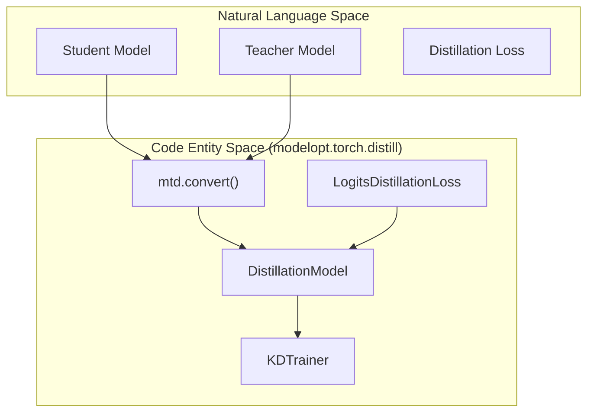
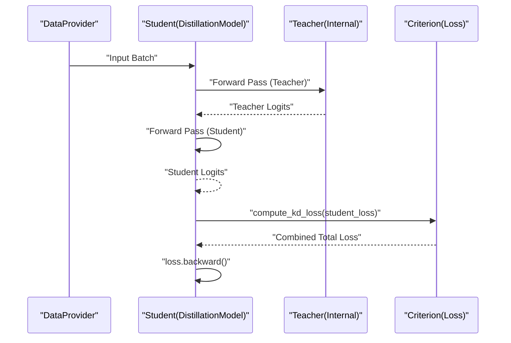
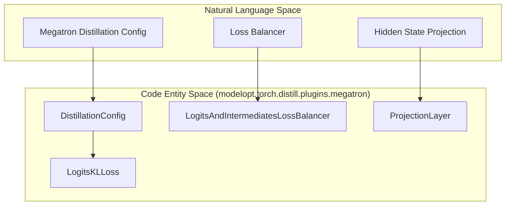

<!-- source: DeepWiki mcp.deepwiki.com · repo NVIDIA/Model-Optimizer · page 3.4 Knowledge Distillation · fetched 2026-10-26 -->

# Knowledge Distillation

<details>
<summary>Relevant source files</summary>

The following files were used as context for generating this wiki page:

- [docs/source/guides/4_distillation.rst](docs/source/guides/4_distillation.rst)
- [examples/llm_distill/README.md](examples/llm_distill/README.md)
- [examples/llm_distill/accelerate_config/fsdp2.yaml](examples/llm_distill/accelerate_config/fsdp2.yaml)
- [examples/llm_distill/main.py](examples/llm_distill/main.py)
- [examples/llm_distill/requirements.txt](examples/llm_distill/requirements.txt)
- [examples/llm_qat/ARGUMENTS.md](examples/llm_qat/ARGUMENTS.md)
- [examples/llm_qat/README.md](examples/llm_qat/README.md)
- [examples/llm_qat/llama_factory/launch_llamafactory.sh](examples/llm_qat/llama_factory/launch_llamafactory.sh)
- [examples/llm_qat/llama_factory/llama_factory.py](examples/llm_qat/llama_factory/llama_factory.py)
- [examples/llm_qat/quantize.py](examples/llm_qat/quantize.py)
- [modelopt/torch/distill/__init__.py](modelopt/torch/distill/__init__.py)
- [modelopt/torch/distill/config.py](modelopt/torch/distill/config.py)
- [modelopt/torch/distill/distillation_model.py](modelopt/torch/distill/distillation_model.py)
- [modelopt/torch/distill/layerwise_distillation_model.py](modelopt/torch/distill/layerwise_distillation_model.py)
- [modelopt/torch/distill/losses.py](modelopt/torch/distill/losses.py)
- [modelopt/torch/distill/mode.py](modelopt/torch/distill/mode.py)
- [modelopt/torch/distill/plugins/huggingface.py](modelopt/torch/distill/plugins/huggingface.py)
- [modelopt/torch/distill/plugins/megatron.py](modelopt/torch/distill/plugins/megatron.py)
- [modelopt/torch/distill/registry.py](modelopt/torch/distill/registry.py)
- [modelopt/torch/quantization/plugins/transformers_trainer.py](modelopt/torch/quantization/plugins/transformers_trainer.py)
- [tests/examples/llm_distill/test_llm_distill.py](tests/examples/llm_distill/test_llm_distill.py)
- [tests/gpu_megatron/torch/distill/plugins/test_distill_megatron.py](tests/gpu_megatron/torch/distill/plugins/test_distill_megatron.py)
- [tests/gpu_megatron/torch/export/test_vllm_fakequant_megatron_export.py](tests/gpu_megatron/torch/export/test_vllm_fakequant_megatron_export.py)
- [tests/gpu_megatron/torch/peft/plugins/test_megatron_peft.py](tests/gpu_megatron/torch/peft/plugins/test_megatron_peft.py)
- [tests/gpu_megatron/torch/speculative/plugins/test_speculative_megatron_modules.py](tests/gpu_megatron/torch/speculative/plugins/test_speculative_megatron_modules.py)
- [tests/unit/torch/distill/plugins/test_huggingface_kd.py](tests/unit/torch/distill/plugins/test_huggingface_kd.py)
- [tests/unit/torch/distill/test_distill.py](tests/unit/torch/distill/test_distill.py)
- [tests/unit/torch/distill/test_layerwise.py](tests/unit/torch/distill/test_layerwise.py)

</details>


## Purpose and Scope

This document describes the knowledge distillation (KD) capabilities in NVIDIA Model Optimizer (`modelopt`). Knowledge distillation is a technique where a compact "student" model learns to replicate the behavior of a larger, more complex "teacher" model. This is used for accuracy recovery after pruning, improving training efficiency, or enabling high-performance quantized models (Quantization-Aware Distillation, or QAD).

This page covers:
- Standard and layer-wise knowledge distillation implementation.
- Trainer classes for Hugging Face (`KDTrainer`) and Megatron-Core.
- Specialized loss functions and loss balancing techniques.
- Integration with quantization pipelines.

Sources: [modelopt/torch/distill/distillation_model.py:1-20](), [examples/llm_distill/README.md:3-7](), [examples/llm_qat/README.md:1-5]()

## Overview

Model Optimizer treats distillation as a model transformation process. A student model is wrapped into a meta-model that manages the teacher model and the distillation loss computation.

### Distillation Methods

Model Optimizer supports several distillation approaches:

| **Method** | **Description** | **Key Class/Function** |
|:---:|:---|:---|
| **Logits Distillation** | Standard KL-Divergence on output logits. | `mtd.LogitsDistillationLoss` [modelopt/torch/distill/losses.py:29-32]() |
| **Layer-wise KD** | Matches intermediate hidden states or attention maps. | `LayerwiseDistillationModel` [modelopt/torch/distill/layerwise_distillation_model.py:39-40]() |
| **Minifinetuning (MFT)** | Self-corrective distillation for small datasets. | `mtd.MFTLoss` [examples/llm_distill/README.md:120-120]() |
| **Masked Generative (MGD)** | Distillation for 2D convolutional outputs. | `mtd.MGDLoss` [examples/llm_distill/README.md:119-119]() |

Sources: [examples/llm_distill/README.md:117-123](), [modelopt/torch/distill/mode.py:84-104]()

### System Architecture

The following diagram illustrates how the `modelopt.torch.distill` (aliased as `mtd`) API transforms a standard PyTorch model into a distillation-aware entity, bridging natural language concepts to code entities.

**Distillation Entity Mapping**



Sources: [modelopt/torch/distill/mode.py:144-163](), [modelopt/torch/distill/plugins/huggingface.py:97-103]()

## Implementation Details

### Model Conversion

The entry point for distillation is `mtd.convert` [modelopt/torch/distill/mode.py:144-149](). It wraps the student model in a `DistillationModel` which encapsulates the teacher and the loss criterion [modelopt/torch/distill/config.py:34-79]().

**Key logic in `_convert_for_kd`:**
1. Instantiates the teacher model from a provided `ModelLike` object [modelopt/torch/distill/mode.py:169]().
2. Transfers the student to a `DistillationModel` via `model_registry.convert(student)` [modelopt/torch/distill/mode.py:183-188]().
3. Disables Model Optimizer operations on the teacher by transferring its state to a storage module to prevent accidental modification [modelopt/torch/distill/mode.py:173-179]().

Sources: [modelopt/torch/distill/mode.py:144-188](), [modelopt/torch/distill/config.py:34-79]()

### Data Flow during Training



Sources: [examples/llm_distill/README.md:90-99](), [modelopt/torch/distill/distillation_model.py:1-50]()

## Framework Integrations

### Hugging Face Integration

For Hugging Face models, `modelopt` provides the `KDTrainer` class which extends `ModelOptHFTrainer` to automate loss calculation.

- **`KDTrainer`**: Handles logit-level knowledge distillation [modelopt/torch/distill/plugins/huggingface.py:97-103](). It stores the teacher model separately and forwards it explicitly during loss computation [modelopt/torch/distill/plugins/huggingface.py:140-144]().
- **`DistillArguments`**: CLI and YAML configuration for KD, including `temperature` and `liger_jsd_beta` for fused kernels [modelopt/torch/distill/plugins/huggingface.py:51-85]().
- **Liger Kernel Support**: Supports fused KD loss via `_setup_liger_fused_loss` to reduce memory overhead [modelopt/torch/distill/plugins/huggingface.py:152-161]().

Sources: [modelopt/torch/distill/plugins/huggingface.py:51-161]()

### Megatron-Core Integration

Distillation in Megatron-Core (MCore) involves handling distributed states and pipeline parallelism.

- **`DistillationConfig`**: Defines intermediate layer pairs, logit layers, and `logit_kl_topk` for memory-efficient KL loss [modelopt/torch/distill/plugins/megatron.py:52-71]().
- **`LogitsKLLoss` / `TopKLogitsKLLoss`**: Specialized losses for MCore that handle distributed logit tensors [modelopt/torch/distill/plugins/megatron.py:131-137]().
- **`ProjectionLayer`**: Used when student and teacher hidden sizes differ, projecting student hidden states to the teacher's dimension for intermediate layer matching [modelopt/torch/distill/plugins/megatron.py:139-153]().
- **`setup_distillation_config`**: Utility to initialize KD settings, adjusting layer indices for pipeline parallelism (PP) using `_adjust_layer_index_for_pp` [modelopt/torch/distill/plugins/megatron.py:98-161]().

**Megatron Distillation Architecture**



Sources: [modelopt/torch/distill/plugins/megatron.py:52-161](), [tests/gpu_megatron/torch/distill/plugins/test_distill_megatron.py:24-28]()

## Quantization-Aware Distillation (QAD)

QAD is the recommended strategy for accuracy recovery after quantization. It uses the original full-precision model as a teacher to guide a quantized student.

- **`QATTrainer`**: While primarily for Quantization-Aware Training, it is used in QAD workflows by passing a `teacher_model` in the arguments [modelopt/torch/quantization/plugins/transformers_trainer.py:153-171]().
- **Workflow**:
    1. Load a quantization recipe (e.g., `nvfp4_default-kv_fp8`) [examples/llm_qat/README.md:113-116]().
    2. Quantize the model in-place via `mtq.quantize` [examples/llm_qat/README.md:116-117]().
    3. Initialize `QATTrainer` with `distill=True` and a `teacher_model` [examples/llm_qat/README.md:81-82]().

Sources: [examples/llm_qat/README.md:3-5](), [modelopt/torch/quantization/plugins/transformers_trainer.py:153-171]()

## Usage Example (Hugging Face)

```python
import modelopt.torch.distill as mtd
from modelopt.torch.distill.plugins.huggingface import KDTrainer

# Define student and teacher
student_model = AutoModelForCausalLM.from_pretrained("student-path")
teacher_model = AutoModelForCausalLM.from_pretrained("teacher-path")

# Use specialized trainer
class KDSFTTrainer(KDTrainer, SFTTrainer):
    pass

trainer = KDSFTTrainer(
    model=student_model,
    args=training_args,
    distill_args={"teacher_model": teacher_model},
    train_dataset=dset_train,
)

trainer.train()

# Export student model (removes teacher)
final_model = mtd.export(student_model)
```

Sources: [examples/llm_distill/main.py:66-68](), [examples/llm_distill/main.py:123-131](), [modelopt/torch/distill/mode.py:130-132]()

---

