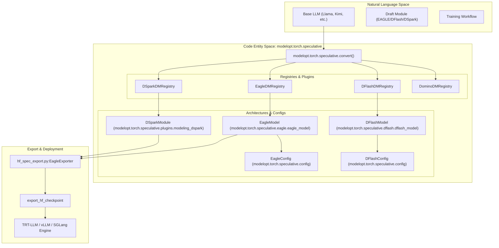
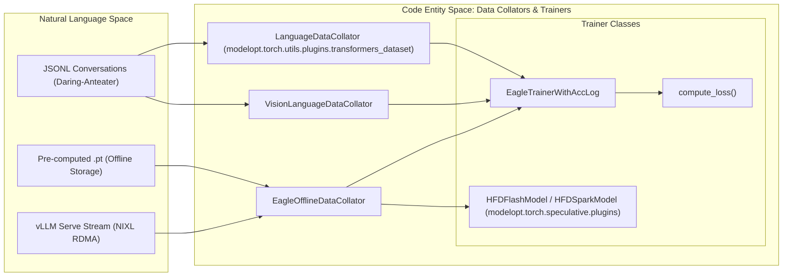

<!-- source: DeepWiki mcp.deepwiki.com · repo NVIDIA/Model-Optimizer · page 3.5 Speculative Decoding · fetched 2026-10-26 -->

# Speculative Decoding

Relevant source files

The following files were used as context for generating this wiki page:

- [examples/dataset/README.md](examples/dataset/README.md)
- [examples/dataset/add_nemotron_chat.py](examples/dataset/add_nemotron_chat.py)
- [examples/dataset/augmentations.yaml](examples/dataset/augmentations.yaml)
- [examples/dataset/conversation_utils.py](examples/dataset/conversation_utils.py)
- [examples/dataset/example_data_config.yaml](examples/dataset/example_data_config.yaml)
- [examples/dataset/make_dataset.py](examples/dataset/make_dataset.py)
- [examples/dataset/make_nemotron_ptv2_dataset.py](examples/dataset/make_nemotron_ptv2_dataset.py)
- [examples/dataset/make_nemotron_ptv3_dataset.py](examples/dataset/make_nemotron_ptv3_dataset.py)
- [examples/dataset/nemotron_ptv3_datasets.yaml](examples/dataset/nemotron_ptv3_datasets.yaml)
- [examples/dataset/utils.py](examples/dataset/utils.py)
- [examples/speculative_decoding/README.md](examples/speculative_decoding/README.md)
- [examples/speculative_decoding/train_eagle3_and_export.sh](examples/speculative_decoding/train_eagle3_and_export.sh)
- [modelopt/torch/export/plugins/hf_spec_export.py](modelopt/torch/export/plugins/hf_spec_export.py)
- [modelopt/torch/speculative/config.py](modelopt/torch/speculative/config.py)
- [modelopt/torch/speculative/dflash/conversion.py](modelopt/torch/speculative/dflash/conversion.py)
- [modelopt/torch/speculative/dflash/dflash_model.py](modelopt/torch/speculative/dflash/dflash_model.py)
- [modelopt/torch/speculative/plugins/hf_dflash.py](modelopt/torch/speculative/plugins/hf_dflash.py)
- [modelopt/torch/speculative/plugins/hf_training_args.py](modelopt/torch/speculative/plugins/hf_training_args.py)
- [modelopt/torch/speculative/plugins/modeling_draft_checkpoint_compat.py](modelopt/torch/speculative/plugins/modeling_draft_checkpoint_compat.py)
- [modelopt/torch/speculative/plugins/modeling_dspark.py](modelopt/torch/speculative/plugins/modeling_dspark.py)
- [tests/unit/torch/export/test_hf_spec_rope_export.py](tests/unit/torch/export/test_hf_spec_rope_export.py)
- [tests/unit/torch/speculative/plugins/test_hf_dflash.py](tests/unit/torch/speculative/plugins/test_hf_dflash.py)
- [tests/unit/torch/speculative/plugins/test_hf_dspark.py](tests/unit/torch/speculative/plugins/test_hf_dspark.py)

Speculative decoding is an inference acceleration technique that enables Large Language Models (LLMs) to generate multiple tokens per forward pass [examples/speculative_decoding/README.md:5-6](). This is achieved by using a lightweight **draft module** to predict the next $\gamma$ tokens, which the main **base model** then verifies in a single parallel step [examples/speculative_decoding/README.md:5-6](). If the draft model correctly predicts $\alpha$ tokens, the system accepts $\alpha+1$ tokens, significantly reducing the number of expensive base model forward passes [examples/speculative_decoding/README.md:5-6]().

For related optimization techniques, see:
- Post-Training Quantization: [Post-Training Quantization (PTQ)](#3.1)
- Model Pruning: [Model Pruning](#3.3)
- Knowledge Distillation: [Knowledge Distillation](#3.4)

## Overview

Model Optimizer supports multiple speculative decoding strategies integrated with Hugging Face and Megatron-Core [examples/speculative_decoding/README.md:9](). These techniques typically attach a trainable draft module to a frozen base model [tests/unit/torch/speculative/plugins/test_hf_dflash.py:72-80]().

| **Technique** | **Approach** | **Key Code Components** |
|:---:|:---:|:---:|
| **EAGLE-1/3** | Sequential drafting using auxiliary hidden states | `EagleModel`, `EagleModule`, `EagleDMRegistry`, `EagleConfig` [modelopt/torch/speculative/config.py:28-37]() |
| **Medusa** | Parallel independent draft heads | `MedusaConfig`, `MedusaDMRegistry` [modelopt/torch/speculative/config.py:33]() |
| **DFlash** | Block-wise parallel speculative decoding via block diffusion | `DFlashConfig`, `DFlashModule`, `DFlashDMRegistry` [modelopt/torch/speculative/config.py:31](), [modelopt/torch/speculative/dflash/conversion.py:26]() |
| **DSpark / Domino** | DFlash backbone augmented with causal correction heads | `DSparkModule`, `HFDSparkModel`, `DSparkDMRegistry`, `DominoDMRegistry` [modelopt/torch/speculative/plugins/modeling_dspark.py:82](), [modelopt/torch/speculative/dflash/conversion.py:31-37]() |

Sources: [examples/speculative_decoding/README.md:1-10](), [modelopt/torch/speculative/config.py:16-173](), [modelopt/torch/speculative/dflash/conversion.py:26-37]()

## System Architecture

The following diagram illustrates how the codebase bridges high-level model definitions to specific speculative implementations and export utilities.

Title: Speculative Decoding Code Architecture

Sources: [modelopt/torch/speculative/config.py:173-201](), [modelopt/torch/speculative/dflash/conversion.py:26-75](), [modelopt/torch/export/plugins/hf_spec_export.py:104-121]()

## EAGLE Architecture and Training

EAGLE (Extrapolation Algorithm for Greater Language-model Efficiency) uses a sequential drafting approach [examples/speculative_decoding/README.md:6](). EAGLE-3 leverages **auxiliary hidden states** from intermediate layers of the base model to improve prediction accuracy [modelopt/torch/speculative/config.py:44]().

### Key Features:
*   **Auxiliary Hidden States**: Extracts hidden states from specific base model layers to provide the draft module with richer context [modelopt/torch/speculative/config.py:44]().
*   **Flexible Decoders**: Supports different decoder architectures such as `llama` and `kimik2` [modelopt/torch/export/plugins/hf_spec_export.py:132-135]().
*   **Training Options**: Supports online, offline, and streaming hidden state extraction workflows [examples/speculative_decoding/README.md:18-21]().

For details, see [EAGLE Architecture and Training](#3.5.1).

Sources: [modelopt/torch/speculative/config.py:23-46](), [modelopt/torch/export/plugins/hf_spec_export.py:121-135]()

## Medusa Architecture and Training

Medusa utilizes multiple parallel "heads" branching off the base model's final hidden state, where each head predicts a token at a specific future offset.

For details, see [Medusa Architecture and Training](#3.5.2).

Sources: [modelopt/torch/speculative/config.py:33]()

## DFlash, DSpark, and Domino Drafters

Model Optimizer supports advanced parallel speculative decoding families beyond sequential drafting:
*   **DFlash**: Block-wise parallel speculative decoding via block diffusion [modelopt/torch/speculative/config.py:79](), featuring D-PACE dynamic position weighting [modelopt/torch/speculative/config.py:111-116]() and KV feature injection [modelopt/torch/speculative/plugins/hf_dflash.py:39-41]().
*   **DSpark & Domino**: Augment the parallel DFlash backbone with sequential correction heads (Markov transition matrices or GRU recurrence) to restore intra-block causal dependencies [modelopt/torch/speculative/plugins/modeling_dspark.py:37-60]().

For details, see [DFlash and DSpark Drafters](#3.5.3).

Sources: [modelopt/torch/speculative/config.py:78-165](), [modelopt/torch/speculative/plugins/hf_dflash.py:37-53](), [modelopt/torch/speculative/plugins/modeling_dspark.py:37-67]()

## Training Modes

Model Optimizer supports three primary training workflows for speculative modules:

### 1. Online Training
The base model and draft module are collocated in GPU memory [examples/speculative_decoding/README.md:74-76](). The base model is frozen, and its hidden states are computed dynamically during the training forward pass [examples/speculative_decoding/README.md:76-79]().

### 2. Offline Training
Base model hidden states are pre-computed and stored on disk as `.pt` files [examples/speculative_decoding/README.md:91-95](). The draft module is trained independently using these artifacts, significantly reducing VRAM requirements [examples/speculative_decoding/README.md:91-95]().

### 3. Streaming Training
Hidden states are streamed from a live `vllm serve` instance via NIXL RDMA, enabling training on large base models without local disk storage overhead [examples/speculative_decoding/README.md:21]().

Title: Speculative Training Data Flow Pipeline

Sources: [examples/speculative_decoding/README.md:18-21](), [modelopt/torch/speculative/plugins/hf_dflash.py:81-88](), [modelopt/torch/speculative/plugins/hf_training_args.py:49-67]()

## Export and Validation

Trained speculative models must be exported into deployment-compatible formats before serving:
*   **Export**: `EagleExporter` and related subclasses extract speculative module weights and update configuration files [modelopt/torch/export/plugins/hf_spec_export.py:104-121]().
*   **Validation**: Acceptance Rate (AR) metrics are validated via utilities such as `AcceptanceRateValidation` [modelopt/torch/speculative/utils.py:43-60]() and evaluation scripts [examples/speculative_decoding/README.md:71]().

Sources: [modelopt/torch/export/plugins/hf_spec_export.py:104-186](), [modelopt/torch/speculative/utils.py:43-60]()

---

