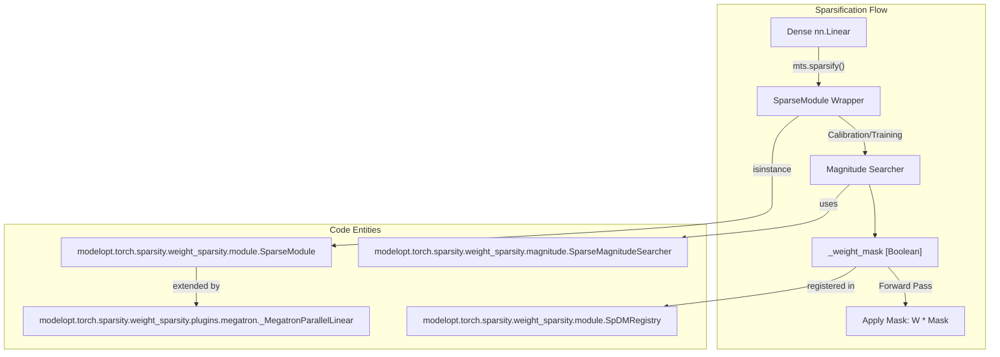
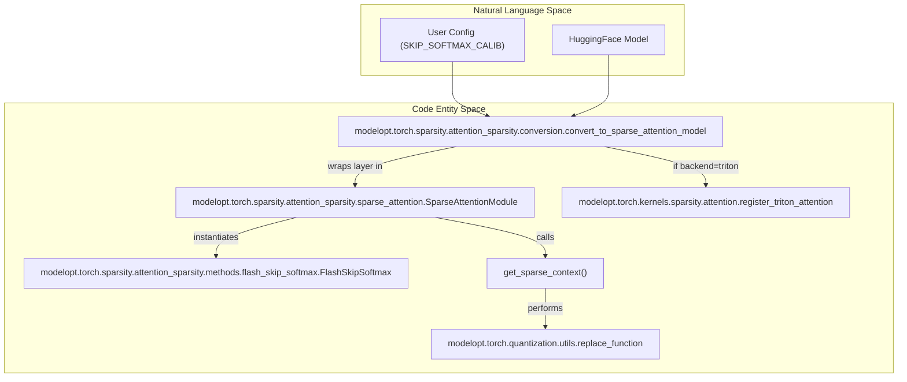

<!-- source: DeepWiki mcp.deepwiki.com · repo NVIDIA/Model-Optimizer · page 3.6 Sparsity and Structured Pruning · fetched 2026-10-26 -->

# Sparsity and Structured Pruning

<details>
<summary>Relevant source files</summary>

The following files were used as context for generating this wiki page:

- [examples/llm_sparsity/attention_sparsity/README.md](examples/llm_sparsity/attention_sparsity/README.md)
- [examples/llm_sparsity/attention_sparsity/hf_sa.py](examples/llm_sparsity/attention_sparsity/hf_sa.py)
- [modelopt/torch/kernels/__init__.py](modelopt/torch/kernels/__init__.py)
- [modelopt/torch/kernels/common/attention/hf_triton_attention.py](modelopt/torch/kernels/common/attention/hf_triton_attention.py)
- [modelopt/torch/kernels/common/attention/triton_fa.py](modelopt/torch/kernels/common/attention/triton_fa.py)
- [modelopt/torch/kernels/sparsity/attention/calibrate.py](modelopt/torch/kernels/sparsity/attention/calibrate.py)
- [modelopt/torch/kernels/sparsity/attention/skip_softmax_helpers.py](modelopt/torch/kernels/sparsity/attention/skip_softmax_helpers.py)
- [modelopt/torch/sparsity/__init__.py](modelopt/torch/sparsity/__init__.py)
- [modelopt/torch/sparsity/attention_sparsity/calibration/calibrate.py](modelopt/torch/sparsity/attention_sparsity/calibration/calibrate.py)
- [modelopt/torch/sparsity/attention_sparsity/calibration/calibrator.py](modelopt/torch/sparsity/attention_sparsity/calibration/calibrator.py)
- [modelopt/torch/sparsity/attention_sparsity/config.py](modelopt/torch/sparsity/attention_sparsity/config.py)
- [modelopt/torch/sparsity/attention_sparsity/conversion.py](modelopt/torch/sparsity/attention_sparsity/conversion.py)
- [modelopt/torch/sparsity/attention_sparsity/methods/__init__.py](modelopt/torch/sparsity/attention_sparsity/methods/__init__.py)
- [modelopt/torch/sparsity/attention_sparsity/methods/flash_skip_softmax.py](modelopt/torch/sparsity/attention_sparsity/methods/flash_skip_softmax.py)
- [modelopt/torch/sparsity/attention_sparsity/methods/registry.py](modelopt/torch/sparsity/attention_sparsity/methods/registry.py)
- [modelopt/torch/sparsity/attention_sparsity/methods/triton_skip_softmax.py](modelopt/torch/sparsity/attention_sparsity/methods/triton_skip_softmax.py)
- [modelopt/torch/sparsity/attention_sparsity/methods/triton_sparse_softmax.py](modelopt/torch/sparsity/attention_sparsity/methods/triton_sparse_softmax.py)
- [modelopt/torch/sparsity/attention_sparsity/model_sparsify.py](modelopt/torch/sparsity/attention_sparsity/model_sparsify.py)
- [modelopt/torch/sparsity/attention_sparsity/plugins/__init__.py](modelopt/torch/sparsity/attention_sparsity/plugins/__init__.py)
- [modelopt/torch/sparsity/attention_sparsity/plugins/huggingface.py](modelopt/torch/sparsity/attention_sparsity/plugins/huggingface.py)
- [modelopt/torch/sparsity/attention_sparsity/sparse_attention.py](modelopt/torch/sparsity/attention_sparsity/sparse_attention.py)
- [modelopt/torch/sparsity/attention_sparsity/stats_manager.py](modelopt/torch/sparsity/attention_sparsity/stats_manager.py)
- [modelopt/torch/sparsity/weight_sparsity/__init__.py](modelopt/torch/sparsity/weight_sparsity/__init__.py)
- [modelopt/torch/sparsity/weight_sparsity/config.py](modelopt/torch/sparsity/weight_sparsity/config.py)
- [modelopt/torch/sparsity/weight_sparsity/magnitude.py](modelopt/torch/sparsity/weight_sparsity/magnitude.py)
- [modelopt/torch/sparsity/weight_sparsity/mode.py](modelopt/torch/sparsity/weight_sparsity/mode.py)
- [modelopt/torch/sparsity/weight_sparsity/module.py](modelopt/torch/sparsity/weight_sparsity/module.py)
- [modelopt/torch/sparsity/weight_sparsity/plugins/__init__.py](modelopt/torch/sparsity/weight_sparsity/plugins/__init__.py)
- [modelopt/torch/sparsity/weight_sparsity/plugins/megatron.py](modelopt/torch/sparsity/weight_sparsity/plugins/megatron.py)
- [modelopt/torch/sparsity/weight_sparsity/searcher.py](modelopt/torch/sparsity/weight_sparsity/searcher.py)
- [modelopt/torch/sparsity/weight_sparsity/sparsegpt.py](modelopt/torch/sparsity/weight_sparsity/sparsegpt.py)
- [modelopt/torch/sparsity/weight_sparsity/sparsification.py](modelopt/torch/sparsity/weight_sparsity/sparsification.py)
- [tests/_test_utils/torch/sparsity/sparse_attention_common.py](tests/_test_utils/torch/sparsity/sparse_attention_common.py)
- [tests/examples/llm_sparsity/attention_sparsity/test_attention_sparsity.py](tests/examples/llm_sparsity/attention_sparsity/test_attention_sparsity.py)
- [tests/gpu/torch/kernels/sparsity/attention/test_triton_fa_calibrate.py](tests/gpu/torch/kernels/sparsity/attention/test_triton_fa_calibrate.py)
- [tests/gpu/torch/sparsity/attention_sparsity/test_calibration_gpu.py](tests/gpu/torch/sparsity/attention_sparsity/test_calibration_gpu.py)
- [tests/gpu/torch/sparsity/attention_sparsity/test_integration_gpu.py](tests/gpu/torch/sparsity/attention_sparsity/test_integration_gpu.py)
- [tests/gpu/torch/sparsity/attention_sparsity/test_triton_calibration_gpu.py](tests/gpu/torch/sparsity/attention_sparsity/test_triton_calibration_gpu.py)
- [tests/unit/torch/sparsity/attention_sparsity/test_flash_skip_softmax.py](tests/unit/torch/sparsity/attention_sparsity/test_flash_skip_softmax.py)
- [tests/unit/torch/sparsity/attention_sparsity/test_sparse_attention_calibration.py](tests/unit/torch/sparsity/attention_sparsity/test_sparse_attention_calibration.py)
- [tests/unit/torch/sparsity/attention_sparsity/test_sparse_attention_conversion.py](tests/unit/torch/sparsity/attention_sparsity/test_sparse_attention_conversion.py)

</details>


## Purpose and Scope

This page covers **structured sparsity** techniques in Model Optimizer, focusing on 2:4 structured weight sparsity and **Sparse Attention** (Attention Sparsity). Structured sparsity enforces specific zero-weight patterns within weight matrices or attention scores to achieve acceleration on hardware with native sparsity support.

**Important distinction**: This page covers sparsity techniques that create sparse patterns within matrices. For techniques that remove entire architectural dimensions (width/depth pruning like Minitron), see [Model Pruning (3.3)](./3.3.-Model-Pruning).

---

## 1. Weight Sparsity (2:4 Structured)

2:4 structured sparsity is a hardware-supported format where for every contiguous group of 4 values, exactly 2 are zero. This provides a theoretical 2x speedup on NVIDIA Ampere and later architectures.

### Implementation and Data Flow

Weight sparsity is implemented through `SparseModule` wrappers that manage weight masks. The system supports both **Sparsity-Aware Training (SAT)** and **Post-Training Sparsification (PTS)**. For distributed training, Model Optimizer provides plugins for Megatron-Core, ensuring that weight masks are correctly sharded across tensor-parallel ranks.

### Diagram: Weight Sparsification Architecture

Sources: [modelopt/torch/sparsity/weight_sparsity/module.py:27-52](), [modelopt/torch/sparsity/weight_sparsity/magnitude.py:22-35](), [modelopt/torch/sparsity/weight_sparsity/sparsification.py:24-45](), [modelopt/torch/sparsity/weight_sparsity/plugins/megatron.py:28-53]()

### Distributed Support (Megatron-Core)
The `_MegatronParallelLinear` class handles the sharding logic for weight masks in tensor-parallel environments. It overrides `sharded_state_dict` to ensure that `_weight_mask` is partitioned along the correct axis (axis 0 for `ColumnParallelLinear` and axis 1 for `RowParallelLinear`) [modelopt/torch/sparsity/weight_sparsity/plugins/megatron.py:28-71]().

Sources: [modelopt/torch/sparsity/weight_sparsity/plugins/megatron.py:28-71]()

---

## 2. Sparse Attention (Attention Sparsity)

Sparse Attention reduces the computational complexity of the attention mechanism by skipping negligible attention scores or enforcing structured patterns. Model Optimizer supports several methods including **Skip-softmax**, **N:M Sparse Softmax**, and **VSA** (Video Sparse Attention).

### Sparse Attention Methods

| Method | Identifier | Description | Backend |
| :--- | :--- | :--- | :--- |
| **Skip-softmax** | `flash_skip_softmax` | Row-level block-wise sparsity aligned with Flash Attention's processing. | PyTorch / Triton |
| **N:M Sparse Softmax**| `triton_sparse_softmax`| Keeps top-N scores for every M key positions (e.g., 2:4). | Triton |
| **Triton Skip-softmax**| `triton_skip_softmax` | Kernel-fused implementation of tile skipping. | Triton |
| **VSA** | `vsa` | Video Sparse Attention for long-context video models. | PyTorch |

Sources: [modelopt/torch/sparsity/attention_sparsity/methods/flash_skip_softmax.py:35-41](), [modelopt/torch/sparsity/attention_sparsity/config.py:37-41](), [modelopt/torch/sparsity/attention_sparsity/methods/__init__.py:28-28]()

### System Architecture and Integration

The sparse attention system uses a plugin-based architecture to replace standard attention layers with `SparseAttentionModule`. This module acts as a dynamic module that delegates actual attention logic to a specific `SparseAttentionMethod` implementation [modelopt/torch/sparsity/attention_sparsity/sparse_attention.py:27-52]().

### Diagram: Sparse Attention System Integration

Sources: [modelopt/torch/sparsity/attention_sparsity/sparse_attention.py:27-52](), [modelopt/torch/sparsity/attention_sparsity/methods/flash_skip_softmax.py:35-50](), [modelopt/torch/sparsity/attention_sparsity/conversion.py:158-170](), [modelopt/torch/sparsity/attention_sparsity/methods/registry.py:110-120](), [modelopt/torch/sparsity/attention_sparsity/conversion.py:88-105]()

### Configuration (`SparseAttentionAttributeConfig`)
The behavior is controlled via `SparseAttentionAttributeConfig` [modelopt/torch/sparsity/attention_sparsity/config.py:34-41](). Key parameters include:
* `sparsity_n` / `sparsity_m`: Defines the N:M pattern (e.g., 2:4 or 4:8) for the Triton backend [modelopt/torch/sparsity/attention_sparsity/config.py:99-116]().
* `dense_sink_tokens`: Number of initial tokens to keep dense (attention sinks) [modelopt/torch/sparsity/attention_sparsity/config.py:118-126]().
* `dense_recent_tokens`: Local attention window (trailing tokens) kept dense [modelopt/torch/sparsity/attention_sparsity/config.py:128-136]().
* `thresholds`: Dict containing `prefill` and `decode` threshold lists [modelopt/torch/sparsity/attention_sparsity/config.py:49-58]().
* `backend`: Either `pytorch` (uses `F.softmax` patching, requires `eager` implementation) or `triton` (uses fused kernels, requires `modelopt_triton`) [modelopt/torch/sparsity/attention_sparsity/config.py:72-80]().
* `skip_softmax_threshold`: Fraction for skipping tiles entirely in `triton_skip_softmax` [modelopt/torch/sparsity/attention_sparsity/config.py:148-156]().

Sources: [modelopt/torch/sparsity/attention_sparsity/config.py:34-156]()

---

## 3. Calibration and Sparsification Workflow

Sparse attention typically requires calibration to determine optimal thresholds that satisfy a `target_sparse_ratio` while maintaining model accuracy.

### Calibration Process
1. **Model Conversion**: `mtsa.sparsify(model, config)` replaces attention modules. It automatically sets `attn_implementation` to `eager` for PyTorch patching or `modelopt_triton` for Triton kernels via `_set_attn_implementation` [modelopt/torch/sparsity/attention_sparsity/conversion.py:42-56]().
2. **Calibration Loop**: The `DynamicThresholdCalibrator` runs the model on calibration data (e.g., RULER dataset) to collect attention score statistics across multiple threshold trials [modelopt/torch/sparsity/attention_sparsity/calibration/calibrator.py:94-140]().
3. **Threshold Optimization**: The system fits an exponential model (`scale_factor = a * exp(b * sparsity)`) to the collected data points [modelopt/torch/sparsity/attention_sparsity/calibration/calibrator.py:165-179]().
4. **Correction Factors**: During inference, `calc_correction_factor_and_p` uses these calibrated parameters to compute masks and re-normalize attention scores to prevent bias [modelopt/torch/sparsity/attention_sparsity/methods/flash_skip_softmax.py:117-157]().

### Implementation Detail: Phase Inference
The `FlashSkipSoftmax` method distinguishes between `prefill` and `decode` phases by inspecting the sequence length of the query tensor. If `query.shape[2] == 1`, it is treated as the `decode` phase [modelopt/torch/sparsity/attention_sparsity/methods/flash_skip_softmax.py:77-79]().

### Usage Example
```python
import modelopt.torch.sparsity.attention_sparsity as mtsa
from modelopt.torch.sparsity.attention_sparsity.config import SKIP_SOFTMAX_CALIB

# Load HF model
model = AutoModelForCausalLM.from_pretrained("Qwen/Qwen2-7B")

# Apply sparsification with calibration
# This triggers calibration forward passes using the RULER dataset if configured
model = mtsa.sparsify(model, config=SKIP_SOFTMAX_CALIB)

# Export for deployment (e.g., vLLM)
from modelopt.torch.export import export_hf_checkpoint
export_hf_checkpoint(model, "./sparse_model")
```
Sources: [examples/llm_sparsity/attention_sparsity/hf_sa.py:141-176](), [modelopt/torch/sparsity/attention_sparsity/conversion.py:42-56](), [modelopt/torch/sparsity/attention_sparsity/calibration/calibrate.py:93-146](), [examples/llm_sparsity/attention_sparsity/hf_sa.py:191-202]()

---

## 4. Comparison: Sparsity vs Pruning

| Feature | Structured Sparsity (2:4) | Sparse Attention | Pruning (Minitron) |
| :--- | :--- | :--- | :--- |
| **Target** | Weight Matrices | Attention Scores (KV cache) | Network Dimensions |
| **Hardware** | Tensor Core 2:4 Support | Optimized Triton Kernels | General Purpose |
| **API** | `modelopt.torch.sparsity` | `modelopt.torch.sparsity.attention_sparsity` | `modelopt.torch.prune` |
| **Result** | Sparse weights, same shape | Dynamic score/tile skipping | Smaller weight matrices |

Sources: [modelopt/torch/sparsity/attention_sparsity/config.py:16-23](), [modelopt/torch/sparsity/weight_sparsity/config.py:24-25](), [modelopt/torch/sparsity/attention_sparsity/methods/flash_skip_softmax.py:18-20]()

---

