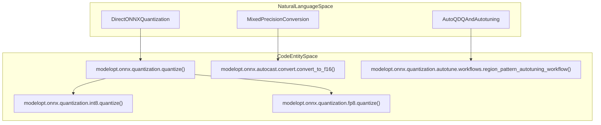
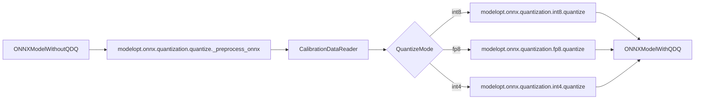

<!-- source: DeepWiki mcp.deepwiki.com · repo NVIDIA/Model-Optimizer · page 4 ONNX Optimization · fetched 2026-10-26 -->

# ONNX Optimization

Relevant source files

The following files were used as context for generating this wiki page:

- [docs/source/guides/9_autotune.rst](docs/source/guides/9_autotune.rst)
- [modelopt/onnx/quantization/__main__.py](modelopt/onnx/quantization/__main__.py)
- [modelopt/onnx/quantization/autotune/autotuner_base.py](modelopt/onnx/quantization/autotune/autotuner_base.py)
- [modelopt/onnx/quantization/autotune/export_utils.py](modelopt/onnx/quantization/autotune/export_utils.py)
- [modelopt/onnx/quantization/autotune/workflows.py](modelopt/onnx/quantization/autotune/workflows.py)
- [modelopt/onnx/quantization/fp8.py](modelopt/onnx/quantization/fp8.py)
- [modelopt/onnx/quantization/int8.py](modelopt/onnx/quantization/int8.py)
- [modelopt/onnx/quantization/precision_utils.py](modelopt/onnx/quantization/precision_utils.py)
- [modelopt/onnx/quantization/quantize.py](modelopt/onnx/quantization/quantize.py)
- [tests/unit/onnx/quantization/test_precision_utils.py](tests/unit/onnx/quantization/test_precision_utils.py)
- [tests/unit/onnx/quantization/test_quantize_api.py](tests/unit/onnx/quantization/test_quantize_api.py)

## Purpose and Scope

This document provides a high-level overview of ONNX-based optimization techniques available in `modelopt.onnx`. The ONNX optimization path enables post-training quantization, mixed-precision conversion, automated QDQ autotuning, and export workflows for deployment with TensorRT and other inference runtimes [modelopt/onnx/quantization/quantize.py:16-32](), [modelopt/onnx/quantization/autotune/workflows.py:16-20]().

ONNX optimization in Model Optimizer spans four core sub-topics:
1. **ONNX Model Quantization** — Converting unquantized ONNX models via calibration and inserting compiler-friendly QDQ patterns [modelopt/onnx/quantization/quantize.py:16-32]().
2. **Mixed Precision Conversion** — Converting precision using `PrecisionConverter` and preprocessing via `GraphSanitizer` [modelopt/onnx/quantization/precision_utils.py:51-62]().
3. **ONNX Export Pipeline** — End-to-end translation from quantized PyTorch models to optimized ONNX graphs [docs/source/guides/9_autotune.rst:7-10]().
4. **ONNX AutoQDQ and Autotuning** — Automated region pattern matching and TensorRT latency-based autotuning [docs/source/guides/9_autotune.rst:15-18]().

For PyTorch-specific optimization techniques (PTQ, QAT, pruning), see [PyTorch Optimization](#3).

## Architecture Overview

The ONNX optimization subsystem is organized into modular packages under `modelopt.onnx`, separating quantization logic, precision casting, and autotuning workflows.

### Code Entity Association: ONNX Optimization Subsystem
The following diagram bridges high-level ONNX optimization workflows to their underlying Python code entities and modules.

**Sources:** [modelopt/onnx/quantization/quantize.py:119-145](), [modelopt/onnx/quantization/int8.py:119-125](), [modelopt/onnx/quantization/fp8.py:135-140](), [modelopt/onnx/quantization/autotune/workflows.py:163-170]()

## Core Optimization Workflows

### Direct ONNX Quantization

The direct ONNX quantization workflow converts pre-existing ONNX models (without QDQ nodes) into fully explicit QDQ graphs using calibration data [modelopt/onnx/quantization/quantize.py:16-32](). It targets operators such as `Conv`, `Gemm`, and `MatMul` [modelopt/onnx/quantization/quantize.py:23-28]().

### Code Entity Association: Quantization Pipeline

**Sources:** [modelopt/onnx/quantization/quantize.py:149-178](), [modelopt/onnx/quantization/int8.py:119-125](), [modelopt/onnx/quantization/fp8.py:135-140]()

For details, see [ONNX Model Quantization](#4.1).

### Mixed Precision Conversion

Mixed precision conversion handles translation between FP32, FP16, and BF16 execution precisions while protecting sensitivity-critical nodes [modelopt/onnx/quantization/precision_utils.py:51-65](). It leverages graph sanitization to remove redundant casts and fuse operations [modelopt/onnx/autocast/convert.py:17-24]().

For details, see [Mixed Precision Conversion](#4.2).

### ONNX Export Pipeline

The export pipeline manages the transition from trained PyTorch artifacts (including quantized checkpoints) into valid ONNX models, applying graph surgery utilities and shape inferences [docs/source/guides/9_autotune.rst:7-10]().

For details, see [ONNX Export Pipeline](#4.3).

### ONNX AutoQDQ and Autotuning

The autotuning module uses pattern-based region discovery and actual TensorRT latency measurements to evaluate multiple Q/DQ placement configurations and select the optimal graph layout [docs/source/guides/9_autotune.rst:15-28]().

For details, see [ONNX AutoQDQ and Autotuning](#4.4).

## Precision and Format Support

Model Optimizer supports multiple precisions mapped to specific minimum ONNX opset versions and backend implementations.

| Quantization Mode | Base Precision | Min Opset | Implementation Module |
| :--- | :--- | :--- | :--- |
| `int8` | `INT8` | 19 | `modelopt.onnx.quantization.int8` [modelopt/onnx/quantization/int8.py:16-17]() |
| `fp8` | `FLOAT8E4M3FN` | 19 | `modelopt.onnx.quantization.fp8` [modelopt/onnx/quantization/fp8.py:16-17]() |
| `int4` | `INT4` | 21 | `modelopt.onnx.quantization.int4` [modelopt/onnx/quantization/quantize.py:27-28]() |
| `nvfp4` | `FLOAT4_E2M1FN` | 23 | `modelopt.onnx.quantization.quantize` [modelopt/onnx/quantization/quantize.py:124-125]() |

**Sources:** [modelopt/onnx/quantization/quantize.py:25-29](), [modelopt/onnx/quantization/int8.py:16-17](), [modelopt/onnx/quantization/fp8.py:16-17]()

## Sub-Topic Overview

- [ONNX Model Quantization](#4.1) — Covers ONNX quantization workflows, QDQ pattern generation, and format-specific exporters (INT4, FP8, NVFP8, NVFP4, MXFP8) [modelopt/onnx/quantization/quantize.py:16-32]().
- [Mixed Precision Conversion](#4.2) — Detailed guide to `PrecisionConverter` for FP16/BF16 conversion, `GraphSanitizer` preprocessing, and Cast node management [modelopt/onnx/quantization/precision_utils.py:51-65]().
- [ONNX Export Pipeline](#4.3) — End-to-end ONNX export pipeline from PyTorch quantized models, including graph surgery utilities [docs/source/guides/9_autotune.rst:7-10]().
- [ONNX AutoQDQ and Autotuning](#4.4) — Automated QDQ insertion and autotuning workflows for ONNX models, including region pattern matching and benchmarking [docs/source/guides/9_autotune.rst:15-28]().

---

