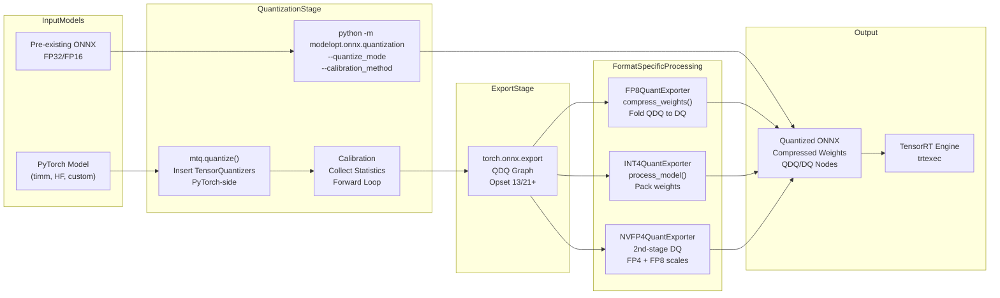
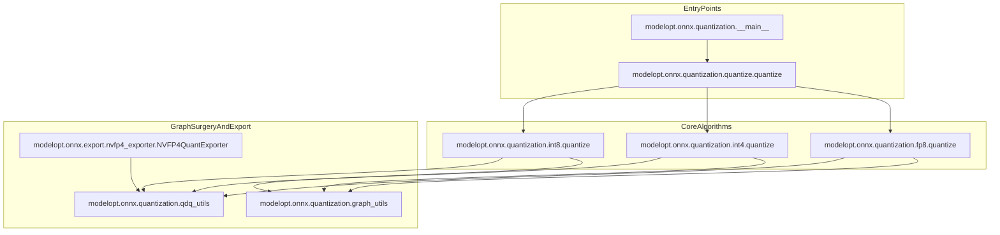
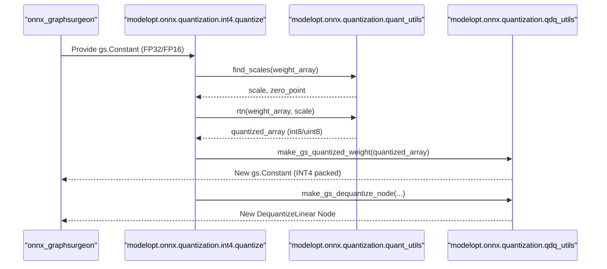

<!-- source: DeepWiki mcp.deepwiki.com · repo NVIDIA/Model-Optimizer · page 4.1 ONNX Model Quantization · fetched 2026-10-26 -->

# ONNX Model Quantization

<details>
<summary>Relevant source files</summary>

The following files were used as context for generating this wiki page:

- [docs/source/guides/9_autotune.rst](docs/source/guides/9_autotune.rst)
- [modelopt/onnx/export/nvfp4_exporter.py](modelopt/onnx/export/nvfp4_exporter.py)
- [modelopt/onnx/quantization/__main__.py](modelopt/onnx/quantization/__main__.py)
- [modelopt/onnx/quantization/autotune/autotuner_base.py](modelopt/onnx/quantization/autotune/autotuner_base.py)
- [modelopt/onnx/quantization/autotune/export_utils.py](modelopt/onnx/quantization/autotune/export_utils.py)
- [modelopt/onnx/quantization/autotune/workflows.py](modelopt/onnx/quantization/autotune/workflows.py)
- [modelopt/onnx/quantization/fp8.py](modelopt/onnx/quantization/fp8.py)
- [modelopt/onnx/quantization/graph_utils.py](modelopt/onnx/quantization/graph_utils.py)
- [modelopt/onnx/quantization/gs_patching.py](modelopt/onnx/quantization/gs_patching.py)
- [modelopt/onnx/quantization/int4.py](modelopt/onnx/quantization/int4.py)
- [modelopt/onnx/quantization/int8.py](modelopt/onnx/quantization/int8.py)
- [modelopt/onnx/quantization/ort_patching.py](modelopt/onnx/quantization/ort_patching.py)
- [modelopt/onnx/quantization/precision_utils.py](modelopt/onnx/quantization/precision_utils.py)
- [modelopt/onnx/quantization/qdq_utils.py](modelopt/onnx/quantization/qdq_utils.py)
- [modelopt/onnx/quantization/quant_utils.py](modelopt/onnx/quantization/quant_utils.py)
- [modelopt/onnx/quantization/quantize.py](modelopt/onnx/quantization/quantize.py)
- [modelopt/torch/quantization/qtensor/nvfp4_tensor.py](modelopt/torch/quantization/qtensor/nvfp4_tensor.py)
- [tests/gpu/onnx/test_ort_patching.py](tests/gpu/onnx/test_ort_patching.py)
- [tests/unit/onnx/quantization/test_graph_utils.py](tests/unit/onnx/quantization/test_graph_utils.py)
- [tests/unit/onnx/quantization/test_precision_utils.py](tests/unit/onnx/quantization/test_precision_utils.py)
- [tests/unit/onnx/quantization/test_qdq_utils.py](tests/unit/onnx/quantization/test_qdq_utils.py)
- [tests/unit/onnx/quantization/test_quant_utils.py](tests/unit/onnx/quantization/test_quant_utils.py)
- [tests/unit/onnx/quantization/test_quantize_api.py](tests/unit/onnx/quantization/test_quantize_api.py)
- [tests/unit/torch/quantization/test_nvfp4_tensor.py](tests/unit/torch/quantization/test_nvfp4_tensor.py)
- [tests/unit/torch/quantization/test_onnx_export_cpu.py](tests/unit/torch/quantization/test_onnx_export_cpu.py)

</details>


## Purpose and Scope

This page covers quantization of ONNX models using the `modelopt.onnx.quantization` module. ONNX model quantization compresses models by reducing precision from FP32/FP16 to lower-precision formats like FP8, INT8, INT4, NVFP4, or MXFP8, achieving significant model size reduction and inference speedup while preserving accuracy. Quantized ONNX models are optimized for deployment with TensorRT.

This page focuses on quantizing existing ONNX models or models exported from PyTorch to ONNX. For PyTorch model quantization without ONNX export, see [Post-Training Quantization (PTQ)](#3.1). For the complete PyTorch-to-ONNX export pipeline including graph surgery and optimization, see [ONNX Export Pipeline](#4.3). For mixed-precision FP16/BF16 conversion, see [Mixed Precision Conversion](#4.2).

Sources: [modelopt/onnx/quantization/quantize.py:16-32](), [modelopt/onnx/quantization/__main__.py:87-124]()

## Quantization Workflow Overview

The ONNX quantization process follows a multi-stage pipeline that transforms models from high-precision (FP32/FP16) to quantized formats suitable for TensorRT deployment using `onnx_graphsurgeon` and custom execution provider calibration.

Title: ONNX Quantization Pipeline


Sources: [modelopt/onnx/quantization/quantize.py:16-32](), [modelopt/onnx/quantization/__main__.py:87-124]()

## Supported Formats and Calibration Methods

Model Optimizer supports multiple quantization formats and calibration algorithms for ONNX models.

### Quantization Formats

| Format | Description | Implementation | Target Hardware |
|--------|-------------|----------------|-----------------|
| **FP8** | 8-bit floating point (E4M3) | `quantize_fp8` [modelopt/onnx/quantization/fp8.py:163]() | Hopper/Ada (compute ≥8.9) |
| **INT8** | 8-bit integer quantization | `quantize_int8` [modelopt/onnx/quantization/int8.py:119]() | Most NVIDIA GPUs |
| **INT4** | 4-bit integer (AWQ, RTN-DQ) | `quantize_int4` [modelopt/onnx/quantization/int4.py:162]() | Most NVIDIA GPUs |
| **NVFP4** | 4-bit floating point | `NVFP4QuantExporter` [modelopt/onnx/export/nvfp4_exporter.py:34]() | Blackwell GPUs |
| **MXFP8** | Microscaling FP8 | `MXFP8QuantExporter` [tests/unit/onnx/quantization/test_qdq_utils.py:24]() | Hopper/Ada GPUs |

### Calibration Methods

The calibration process is managed by `CalibrationDataReader` [modelopt/onnx/quantization/quantize.py:49]() and `CalibrationDataProvider` [modelopt/onnx/quantization/calib_utils.py:54]().

| Method | Format Compatibility | CLI Option | Description |
|--------|---------------------|------------|-------------|
| `max` | FP8, INT8 | `max` | Uses maximum absolute value for scaling |
| `entropy` | FP8, INT8 | `entropy` | Minimizes KL divergence |
| `awq_clip` | INT4 | `awq_clip` | Activation-Aware Weight Quantization with clipping |
| `rtn_dq` | INT4 | `rtn_dq` | Round-To-Nearest with Double Quantization |

**Minimum ONNX Opset Requirements:**
The `_preprocess_onnx` function enforces minimum opset versions [modelopt/onnx/quantization/quantize.py:159-173]():
- **Base (INT8):** Opset 19 (for FP16 scales)
- **INT4:** Opset 21
- **NVFP4:** Opset 23

Sources: [modelopt/onnx/quantization/quantize.py:25-29](), [modelopt/onnx/quantization/quantize.py:149-173](), [modelopt/onnx/quantization/__main__.py:119-133]()

## Direct ONNX Model Quantization

For existing ONNX models, quantization can be performed using the command-line interface or Python API.

### Command-Line Interface

The `modelopt.onnx.quantization` module provides a CLI entrypoint [modelopt/onnx/quantization/__main__.py:87-124]().

```bash
python -m modelopt.onnx.quantization \
    --onnx_path=<input_model.onnx> \
    --quantize_mode=<fp8|int8|int4> \
    --calibration_data_path=<calibration.npy> \
    --calibration_method=<max|entropy|awq_clip|rtn_dq> \
    --output_path=<output_model.quant.onnx>
```

**Key Arguments:**
- `--onnx_path`: Input ONNX model path [modelopt/onnx/quantization/__main__.py:90]().
- `--quantize_mode`: Target format (`fp8`, `int8`, `int4`) [modelopt/onnx/quantization/__main__.py:119]().
- `--calibration_method`: Algorithm selection [modelopt/onnx/quantization/__main__.py:126]().
- `--calibration_data_path`: Path to calibration data [modelopt/onnx/quantization/__main__.py:134]().
- `--calibrate_per_node`: Sequential calibration to save memory [modelopt/onnx/quantization/int8.py:138]().

Sources: [modelopt/onnx/quantization/__main__.py:85-202]()

### Python API

The `quantize()` function in `modelopt.onnx.quantization.quantize` is the primary entry point [modelopt/onnx/quantization/quantize.py:87]().

```python
from modelopt.onnx.quantization import quantize

quantize(
    onnx_path="model.onnx",
    quantize_mode="int8",           
    calibration_data_reader=my_reader,
    calibration_method="entropy",
    output_path="model.quant.onnx",
)
```

Sources: [modelopt/onnx/quantization/quantize.py:86-218]()

## Format-Specific Implementation Details

### INT8 Quantization
The `quantize_int8` function [modelopt/onnx/quantization/int8.py:119]() uses heuristics to find quantizable nodes. It builds a non-residual input map [modelopt/onnx/quantization/int8.py:65]() and classifies partitions for fusion [modelopt/onnx/quantization/int8.py:81](). It can also import scales from a calibration cache [modelopt/onnx/quantization/int8.py:31]().

### FP8 Quantization
FP8 quantization can be performed directly or by converting an INT8 model using `int8_to_fp8` [modelopt/onnx/quantization/fp8.py:51](). It scales INT8 max-calibrated values to FP8 ranges (448.0 for E4M3) [modelopt/onnx/quantization/fp8.py:73](). It also handles opset 21 upgrades for FP16 scaling factors [modelopt/onnx/quantization/fp8.py:130]().

### INT4 Quantization
The `quantize_int4` implementation [modelopt/onnx/quantization/int4.py:162]() focuses on Weight-only Quantization (WoQ). It supports:
- **AWQ:** Activation-Aware Weight Quantization.
- **RTN:** Round-To-Nearest [modelopt/onnx/quantization/int4.py:56]().
- **Zero-Point:** Optional zero-point based quantization [modelopt/onnx/quantization/int4.py:128]().
- **Gather Nodes:** Specialized quantization for Gather layers [modelopt/onnx/quantization/int4.py:125]().

Sources: [modelopt/onnx/quantization/int8.py:57-116](), [modelopt/onnx/quantization/fp8.py:51-127](), [modelopt/onnx/quantization/int4.py:16-32]()

## QDQ Pattern Generation

Model Optimizer generates compiler-friendly QDQ patterns using `onnx-graphsurgeon`.

### QDQ Utilities
The `qdq_utils.py` file provides factory functions for creating QDQ components:
- `make_gs_quantize_node`: Creates a `QuantizeLinear` node [modelopt/onnx/quantization/qdq_utils.py:166]().
- `make_gs_dequantize_node`: Creates a `DequantizeLinear` node [modelopt/onnx/quantization/qdq_utils.py:220]().
- `make_gs_zp`: Generates zero-point constants [modelopt/onnx/quantization/qdq_utils.py:128]().
- `make_gs_scale`: Generates scale constants [modelopt/onnx/quantization/qdq_utils.py:140]().

### Graph Transformation Logic
The transformation flow for weight quantization is as follows:
1. **Identify weights:** `_find_quantizable_weights` [modelopt/onnx/quantization/int4.py:39]().
2. **Calculate Scales:** `find_scales` [modelopt/onnx/quantization/int4.py:52]().
3. **Insert Nodes:** Updates graph consumers to point to new `DequantizeLinear` output [modelopt/onnx/quantization/qdq_utils.py:239]().

Sources: [modelopt/onnx/quantization/qdq_utils.py:16-248](), [modelopt/onnx/quantization/int4.py:125-185]()

## System Entity Map & Data Flow

The following diagrams map the high-level quantization concepts to specific code entities and data flows across modules.

Title: "QuantizationLogicToCodeEntityMapping"


Sources: [modelopt/onnx/quantization/quantize.py:86-115](), [modelopt/onnx/quantization/__main__.py:87-124](), [modelopt/onnx/export/nvfp4_exporter.py:34]()

Title: "WeightQuantizationDataFlow"


Sources: [modelopt/onnx/quantization/quantize.py:86-115](), [modelopt/onnx/quantization/__main__.py:87-124](), [modelopt/onnx/quantization/int4.py:132-185]()

## Implementation Utilities

### Graph Utilities
`graph_utils.py` contains critical logic for pattern matching and node filtering:
- `has_path_type`: Checks for specific node sequences (e.g., BiasAdd, ConstMul) [modelopt/onnx/quantization/graph_utils.py:88]().
- `get_fusible_backbone`: Identifies linear backbones (Conv/MatMul) for fusion [modelopt/onnx/quantization/graph_utils.py:174]().
- `is_const_input`: Determines if a tensor is an initializer or foldable [modelopt/onnx/quantization/graph_utils.py:48]().

### Exporters for Specialized Formats
The `modelopt.onnx.export` module contains exporters that handle final graph formatting for TensorRT:
- `NVFP4QuantExporter`: Implements the 2-stage dequantization required for Blackwell, using `_replace_fp4qdq_with_2dq` to insert a `DequantizeLinear` for FP8 scales followed by one for FP4 weights [modelopt/onnx/export/nvfp4_exporter.py:75-85]().
- `INT4QuantExporter`: Manages the packing of weights into 4-bit integers [tests/unit/onnx/quantization/test_qdq_utils.py:24]().
- `MXFP8QuantExporter`: Handles microscaling FP8 export [tests/unit/onnx/quantization/test_qdq_utils.py:24]().

Sources: [modelopt/onnx/quantization/graph_utils.py:48-180](), [modelopt/onnx/export/nvfp4_exporter.py:16-183]()

---

