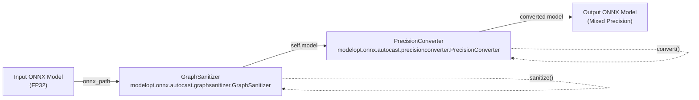
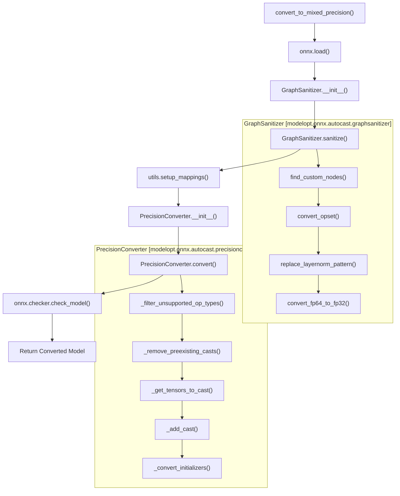
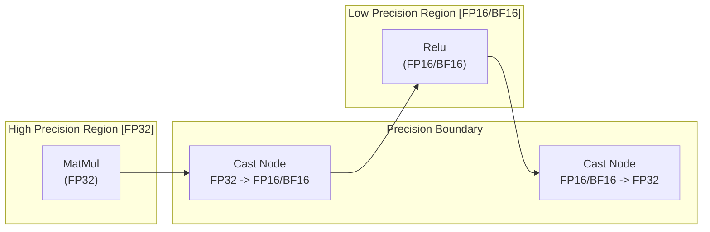
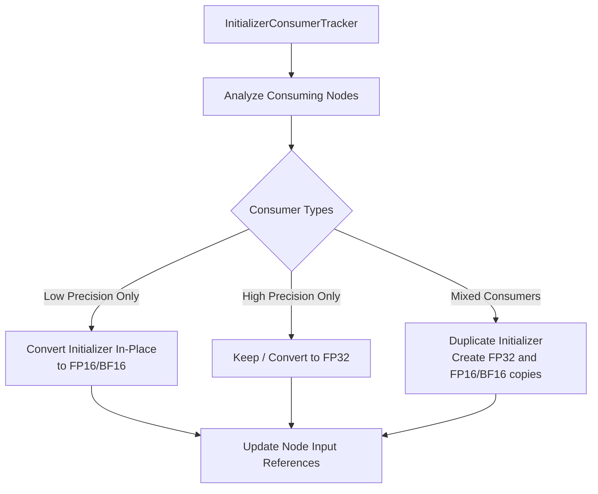

<!-- source: DeepWiki mcp.deepwiki.com · repo NVIDIA/Model-Optimizer · page 4.2 Mixed Precision Conversion · fetched 2026-10-26 -->

# Mixed Precision Conversion

<details>
<summary>Relevant source files</summary>

The following files were used as context for generating this wiki page:

- [docs/source/guides/8_autocast.rst](docs/source/guides/8_autocast.rst)
- [modelopt/onnx/autocast/__main__.py](modelopt/onnx/autocast/__main__.py)
- [modelopt/onnx/autocast/convert.py](modelopt/onnx/autocast/convert.py)
- [modelopt/onnx/autocast/graphsanitizer.py](modelopt/onnx/autocast/graphsanitizer.py)
- [modelopt/onnx/autocast/logging_config.py](modelopt/onnx/autocast/logging_config.py)
- [modelopt/onnx/autocast/nodeclassifier.py](modelopt/onnx/autocast/nodeclassifier.py)
- [modelopt/onnx/autocast/precisionconverter.py](modelopt/onnx/autocast/precisionconverter.py)
- [modelopt/onnx/autocast/referencerunner.py](modelopt/onnx/autocast/referencerunner.py)
- [modelopt/onnx/autocast/utils.py](modelopt/onnx/autocast/utils.py)
- [modelopt/onnx/logging_config.py](modelopt/onnx/logging_config.py)
- [modelopt/onnx/utils.py](modelopt/onnx/utils.py)
- [tests/_test_utils/onnx/lib_test_models.py](tests/_test_utils/onnx/lib_test_models.py)
- [tests/unit/onnx/autocast/test_autocast.py](tests/unit/onnx/autocast/test_autocast.py)
- [tests/unit/onnx/autocast/test_graphsanitizer.py](tests/unit/onnx/autocast/test_graphsanitizer.py)
- [tests/unit/onnx/autocast/test_nodeclassifier.py](tests/unit/onnx/autocast/test_nodeclassifier.py)
- [tests/unit/onnx/autocast/test_precisionconverter.py](tests/unit/onnx/autocast/test_precisionconverter.py)
- [tests/unit/onnx/autocast/test_referencerunner.py](tests/unit/onnx/autocast/test_referencerunner.py)
- [tests/unit/onnx/test_autocast_quantize.py](tests/unit/onnx/test_autocast_quantize.py)
- [tests/unit/onnx/test_onnx_utils.py](tests/unit/onnx/test_onnx_utils.py)
- [tests/unit/torch/deploy/utils/test_torch_onnx_utils.py](tests/unit/torch/deploy/utils/test_torch_onnx_utils.py)

</details>


## Purpose and Scope

This page documents the mixed precision conversion functionality in the ONNX optimization path (`modelopt.onnx.autocast`), which converts ONNX models from FP32 to lower precisions (FP16 or BF16) to reduce memory consumption and increase inference throughput on compatible hardware. The conversion process intelligently analyzes tensor magnitudes and operation characteristics, manages initializers, and handles Cast node insertion through `PrecisionConverter` and `GraphSanitizer` to ensure model validity.

For quantization to INT4/FP8/INT8 formats, see [ONNX Model Quantization](#4.1). For PyTorch-based quantization workflows, see [Post-Training Quantization (PTQ)](#3.1).

Sources: [modelopt/onnx/autocast/convert.py:17-24](), [modelopt/onnx/autocast/precisionconverter.py:16-22]()

## Overview

Mixed precision conversion allows running specific operations in lower precision (`fp16` or `bf16`) while maintaining sensitive operations in high precision (`fp32`). This approach provides:
- **Memory reduction**: Up to 50% reduction in model weight and activation footprint.
- **Performance improvement**: Enhanced execution speed on NVIDIA Tensor Cores.
- **Accuracy preservation**: Per-node precision decisions governed by tensor magnitude thresholds and calibration data.

The conversion pipeline consists of two primary phases: graph sanitization via `GraphSanitizer` and precision conversion via `PrecisionConverter`.

Sources: [modelopt/onnx/autocast/convert.py:17-43](), [modelopt/onnx/autocast/graphsanitizer.py:31-41]()

## Key Architectural Components

This section maps high-level AutoCast concepts to their concrete code entities and implementation classes.

| Component Role | Class / Function Name | File Path |
| :--- | :--- | :--- |
| **Main Orchestrator** | `convert_to_mixed_precision` | [modelopt/onnx/autocast/convert.py:64-83]() |
| **Graph Sanitization** | `GraphSanitizer` | [modelopt/onnx/autocast/graphsanitizer.py:31-41]() |
| **Precision Conversion** | `PrecisionConverter` | [modelopt/onnx/autocast/precisionconverter.py:75-85]() |
| **Reference Execution** | `ReferenceRunner` | [modelopt/onnx/autocast/referencerunner.py:71-76]() |
| **Node Classification** | `NodeClassifier` | [modelopt/onnx/autocast/nodeclassifier.py:35-40]() |

### Diagram: System Architecture to Code Entity Mapping

Sources: [modelopt/onnx/autocast/convert.py:64-152](), [modelopt/onnx/autocast/graphsanitizer.py:31-78](), [modelopt/onnx/autocast/precisionconverter.py:75-102]()

## Conversion Pipeline and Execution Flow

The conversion pipeline coordinates multiple modules to validate, sanitize, and convert the graph.

### Diagram: Conversion Pipeline Execution Flow

Sources: [modelopt/onnx/autocast/convert.py:64-160](), [modelopt/onnx/autocast/graphsanitizer.py:59-78](), [modelopt/onnx/autocast/precisionconverter.py:163-280]()

## Cast Node Management and Precision Boundaries

`PrecisionConverter` evaluates precision boundaries between high-precision (`fp32`) and low-precision (`fp16`/`bf16`) operations, automatically inserting `Cast` nodes (`_add_cast`) where necessary.

### Cast Insertion Strategy
- **Cast Down** (`cast_to_low_precision`): Tensors feeding into low-precision nodes are cast from `FP32` to the target low precision (`FP16`/`BF16`).
- **Cast Up** (`cast_to_high_precision`): Tensors flowing from low-precision nodes into high-precision consumers are cast back to `FP32`.


Sources: [modelopt/onnx/autocast/precisionconverter.py:215-241](), [modelopt/onnx/autocast/precisionconverter.py:478-525]()

## Initializer Conversion and Consumer Tracking

Initializers (weights) are analyzed using `InitializerConsumerTracker` and `InputIndexTracker` to determine if they can be converted in-place or if they require duplication when consumed by nodes of mixed precisions.


Sources: [modelopt/onnx/autocast/precisionconverter.py:45-59](), [modelopt/onnx/autocast/precisionconverter.py:527-640]()

## Configuration Options and Usage

The conversion process can be invoked via python API or command-line interface.

### Python API Usage
```python
import onnx
from modelopt.onnx.autocast import convert_to_mixed_precision

converted_model = convert_to_mixed_precision(
    onnx_path="model.onnx",
    low_precision_type="fp16",
    data_max=512,
    init_max=65504,
    keep_io_types=False,
    calibration_data="calib.npz",
    providers=["cpu"],
)
onnx.save(converted_model, "converted_model_fp16.onnx")
```
Sources: [modelopt/onnx/autocast/convert.py:64-113](), [docs/source/guides/8_autocast.rst:21-50]()

### Command Line Interface
```bash
python -m modelopt.onnx.autocast \
    --onnx_path model.onnx \
    --output_path model_fp16.onnx \
    --low_precision_type fp16 \
    --calibration_data calib.npz \
    --data_max 512
```
Sources: [modelopt/onnx/autocast/__main__.py:47-183]()

---

