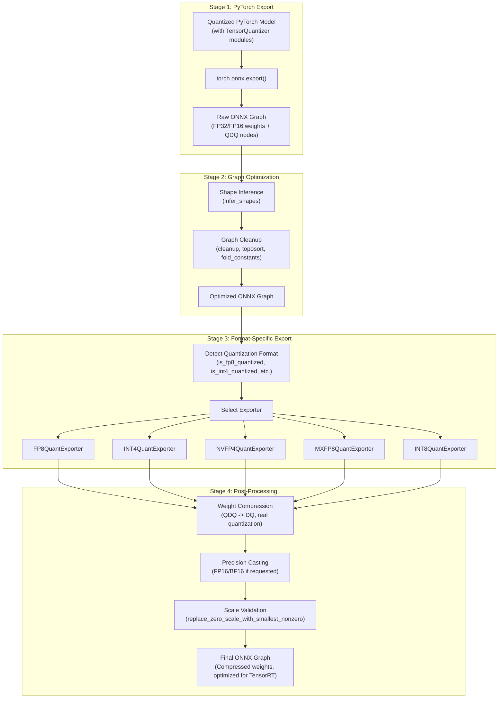
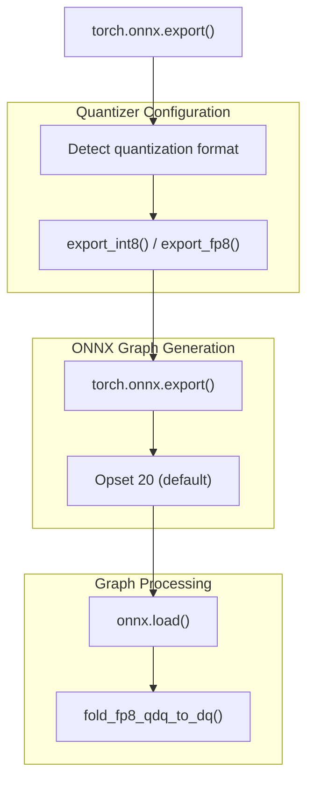

<!-- source: DeepWiki mcp.deepwiki.com · repo NVIDIA/Model-Optimizer · page 4.3 ONNX Export Pipeline · fetched 2026-10-26 -->

# ONNX Export Pipeline

<details>
<summary>Relevant source files</summary>

The following files were used as context for generating this wiki page:

- [examples/onnx_ptq/README.md](examples/onnx_ptq/README.md)
- [examples/onnx_ptq/download_example_onnx.py](examples/onnx_ptq/download_example_onnx.py)
- [examples/torch_onnx/README.md](examples/torch_onnx/README.md)
- [examples/torch_onnx/hf_embedding_quant_to_onnx.py](examples/torch_onnx/hf_embedding_quant_to_onnx.py)
- [examples/torch_onnx/requirements.txt](examples/torch_onnx/requirements.txt)
- [examples/torch_onnx/torch_quant_to_onnx.py](examples/torch_onnx/torch_quant_to_onnx.py)
- [modelopt/onnx/export/fp8_exporter.py](modelopt/onnx/export/fp8_exporter.py)
- [modelopt/onnx/export/int8_exporter.py](modelopt/onnx/export/int8_exporter.py)
- [modelopt/onnx/graph_surgery/__init__.py](modelopt/onnx/graph_surgery/__init__.py)
- [modelopt/onnx/graph_surgery/__main__.py](modelopt/onnx/graph_surgery/__main__.py)
- [modelopt/onnx/graph_surgery/dq_transpose.py](modelopt/onnx/graph_surgery/dq_transpose.py)
- [modelopt/onnx/graph_surgery/encoder_cross_kv.py](modelopt/onnx/graph_surgery/encoder_cross_kv.py)
- [modelopt/onnx/graph_surgery/gqa_replacement.py](modelopt/onnx/graph_surgery/gqa_replacement.py)
- [modelopt/onnx/graph_surgery/utils/__init__.py](modelopt/onnx/graph_surgery/utils/__init__.py)
- [modelopt/onnx/graph_surgery/utils/dtype_conversion.py](modelopt/onnx/graph_surgery/utils/dtype_conversion.py)
- [modelopt/onnx/graph_surgery/utils/graph_utils.py](modelopt/onnx/graph_surgery/utils/graph_utils.py)
- [modelopt/onnx/graph_surgery/utils/rope_cache.py](modelopt/onnx/graph_surgery/utils/rope_cache.py)
- [modelopt/onnx/graph_surgery/utils/whisper_utils.py](modelopt/onnx/graph_surgery/utils/whisper_utils.py)
- [modelopt/onnx/llm_export_utils/__init__.py](modelopt/onnx/llm_export_utils/__init__.py)
- [modelopt/onnx/llm_export_utils/export_utils.py](modelopt/onnx/llm_export_utils/export_utils.py)
- [modelopt/onnx/llm_export_utils/quantization_utils.py](modelopt/onnx/llm_export_utils/quantization_utils.py)
- [modelopt/onnx/llm_export_utils/surgeon_utils.py](modelopt/onnx/llm_export_utils/surgeon_utils.py)
- [modelopt/torch/_deploy/utils/torch_onnx.py](modelopt/torch/_deploy/utils/torch_onnx.py)
- [modelopt/torch/opt/config.py](modelopt/torch/opt/config.py)
- [modelopt/torch/opt/config_loader.py](modelopt/torch/opt/config_loader.py)
- [modelopt/torch/quantization/export_onnx.py](modelopt/torch/quantization/export_onnx.py)
- [modelopt_recipes/huggingface/nemotron_llama/ptq/fp8_output_quant_proj.yaml](modelopt_recipes/huggingface/nemotron_llama/ptq/fp8_output_quant_proj.yaml)
- [modelopt_recipes/huggingface/nemotron_llama/ptq/nvfp4_output_quant_proj.yaml](modelopt_recipes/huggingface/nemotron_llama/ptq/nvfp4_output_quant_proj.yaml)
- [tests/_test_utils/torch/vision_models.py](tests/_test_utils/torch/vision_models.py)
- [tests/examples/torch_onnx/test_hf_embedding_quant_to_onnx.py](tests/examples/torch_onnx/test_hf_embedding_quant_to_onnx.py)
- [tests/examples/torch_onnx/test_torch_quant_to_onnx.py](tests/examples/torch_onnx/test_torch_quant_to_onnx.py)
- [tests/unit/torch/opt/test_config.py](tests/unit/torch/opt/test_config.py)

</details>


## Purpose and Scope

This document describes the ONNX export pipeline in Model Optimizer, which transforms quantized PyTorch models into optimized ONNX graphs suitable for TensorRT deployment. The pipeline handles the conversion from PyTorch's quantization representation (using `TensorQuantizer` modules) to ONNX's graph-based representation with QDQ (QuantizeLinear/DequantizeLinear) nodes or compressed weights.

**Related Pages:**
- For quantizing pre-existing ONNX models, see **4.1 ONNX Model Quantization**
- For mixed precision conversion of ONNX graphs, see **4.2 Mixed Precision Conversion**
- For deploying exported ONNX models to TensorRT, see **8.4 ONNX to TensorRT Pipeline**
- For PyTorch-side quantization techniques, see **3.1 Post-Training Quantization (PTQ)**

---

## Pipeline Overview

The ONNX export pipeline consists of four main stages that transform a quantized PyTorch model into a deployment-ready ONNX graph:



Sources: [modelopt/torch/_deploy/utils/torch_onnx.py:39-45](), [modelopt/torch/quantization/export_onnx.py:103-131](), [examples/torch_onnx/torch_quant_to_onnx.py:42-55]()

---

## Stage 1: PyTorch to ONNX Export

The export process begins by converting a quantized PyTorch model to ONNX format using `torch.onnx.export`. This stage preserves the quantization information by inserting QDQ nodes into the ONNX graph. For vision models, this is often handled by `torch_quant_to_onnx.py` [examples/torch_onnx/torch_quant_to_onnx.py:48-55]().

### Export Entry Point

The pipeline utilizes custom symbolic functions to map PyTorch quantized operations to ONNX ops. For example, `export_int8` handles the mapping of INT8 quantization parameters to ONNX `QuantizeLinear`/`DequantizeLinear` nodes [modelopt/torch/quantization/export_onnx.py:132-177]().



Sources: [modelopt/torch/quantization/export_onnx.py:132-177](), [examples/torch_onnx/torch_quant_to_onnx.py:61]()

---

## Stage 2: Graph Surgery and Optimization

After the initial export, the graph undergoes surgery to improve compatibility with TensorRT and ONNX Runtime.

### LLM Graph Surgery

For LLMs, specialized utilities in `modelopt.onnx.graph_surgery` are used to transform standard attention patterns into optimized operators like `GroupQueryAttention` (GQA) [modelopt/onnx/graph_surgery/gqa_replacement.py:16-31]().

| Operation | Implementation | Purpose |
|-----------|----------------|---------|
| GQA Replacement | `replace-gqa` | Replaces standard attention with Microsoft's GQA operator [modelopt/onnx/graph_surgery/__main__.py:22-32]() |
| Cross-KV Addition | `add-cross-kv` | Adds cross-attention KV cache outputs for encoder models (e.g., Whisper) [modelopt/onnx/graph_surgery/encoder_cross_kv.py:16-27]() |
| BF16 Conversion | `convert-bf16` | Converts FP16 models to BFloat16 precision [modelopt/onnx/graph_surgery/utils/dtype_conversion.py:135-164]() |
| DQ Transpose | `transpose-dq` | Transposes `DequantizeLinear` weights for column-major optimization [modelopt/onnx/graph_surgery/dq_transpose.py:16-27]() |

Sources: [modelopt/onnx/graph_surgery/__main__.py:16-58](), [modelopt/onnx/graph_surgery/gqa_replacement.py:16-31]()

---

## Stage 3: Weight Compression and Post-Processing

A critical step in the pipeline is converting the high-precision weights (FP32/FP16) stored in the raw ONNX graph into actual low-precision storage (e.g., FP8).

### FP8 Weight Folding

Even though ModelOpt supports FP8 export, PyTorch's native export often represents weights in FP32 + QDQ. The `fold_fp8_qdq_to_dq` utility performs the following:
1. Identifies `TRT_FP8QuantizeLinear` nodes with constant inputs [modelopt/onnx/llm_export_utils/surgeon_utils.py:84-89]().
2. Converted the FP32 weights to `torch.float8_e4m3fn` [modelopt/onnx/llm_export_utils/surgeon_utils.py:100-102]().
3. Replaces the QDQ pair with a single `DequantizeLinear` node using actual FP8 weights [modelopt/onnx/llm_export_utils/surgeon_utils.py:108-115]().

Sources: [modelopt/onnx/llm_export_utils/surgeon_utils.py:64-120]()

### Precision Casting

The pipeline provides utilities to convert models between different floating-point precisions, specifically for BF16 support which is common in modern LLMs.

| Function | Implementation |
|----------|----------------|
| `convert_fp16_to_bf16` | Converts initializers, Constant nodes, Cast nodes, and value_info to BF16 [modelopt/onnx/graph_surgery/utils/dtype_conversion.py:135-212]() |
| `fp16_to_bf16_array` | Performs the bit-level manipulation to convert FP16 to BF16 via FP32 to avoid precision loss [modelopt/onnx/graph_surgery/utils/dtype_conversion.py:31-59]() |

Sources: [modelopt/onnx/graph_surgery/utils/dtype_conversion.py:16-212]()

---

## LLM-Specific Export Utilities

For Large Language Models, the pipeline includes specialized wrappers to ensure consistent I/O across different architectures.

### WrapperModelForCausalLM

The `WrapperModelForCausalLM` ensures that all exported LLMs share a unified interface:
- **Inputs**: `input_ids`, `past_key_values` [modelopt/onnx/llm_export_utils/export_utils.py:79]()
- **Outputs**: `logits`, `present_key_values` [modelopt/onnx/llm_export_utils/export_utils.py:90-91]()

It also handles the conversion between `DynamicCache` and legacy tuple-based caches [modelopt/onnx/llm_export_utils/export_utils.py:81-89]().

Sources: [modelopt/onnx/llm_export_utils/export_utils.py:66-91]()

### End-to-End LLM Export Flow

The `llm_to_onnx` function automates the generation of dummy inputs and dynamic axes for LLMs [modelopt/onnx/llm_export_utils/export_utils.py:94-146]().


Sources: [modelopt/onnx/llm_export_utils/export_utils.py:94-162]()

---

## Usage Example: Vision Model Export

The following demonstrates exporting a quantized vision model using the provided example script.

```bash
# Quantize and export a Swin Transformer to FP8 ONNX
python torch_quant_to_onnx.py \
    --timm_model_name=swin_tiny_patch4_window7_224 \
    --quantize_mode=fp8 \
    --onnx_save_path=swin_fp8.onnx
```

The script automatically handles `Conv2d` overrides for TensorRT compatibility (e.g., forcing FP8/INT8 for convolutions even in MXFP8/NVFP4 modes) [examples/torch_onnx/torch_quant_to_onnx.py:125-151]().

Sources: [examples/onnx_ptq/README.md:48-70](), [examples/torch_onnx/torch_quant_to_onnx.py:125-151]()

---

