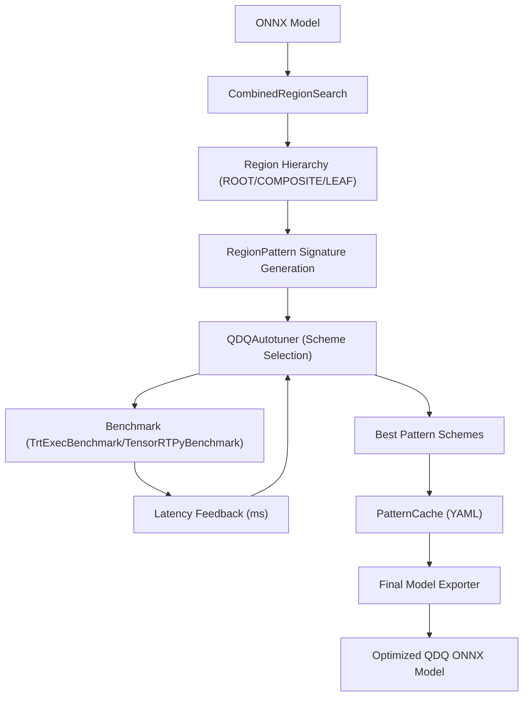
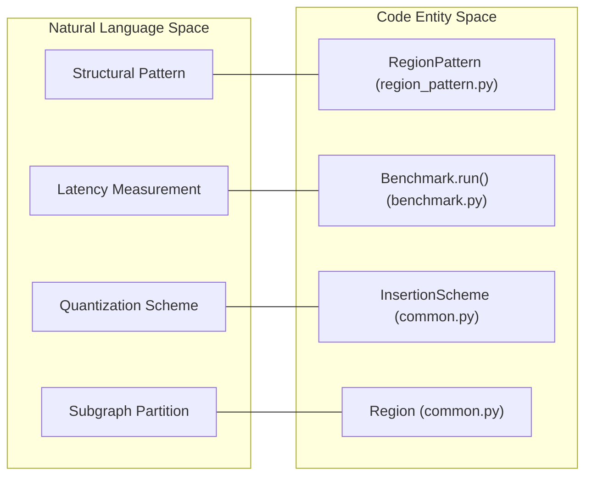
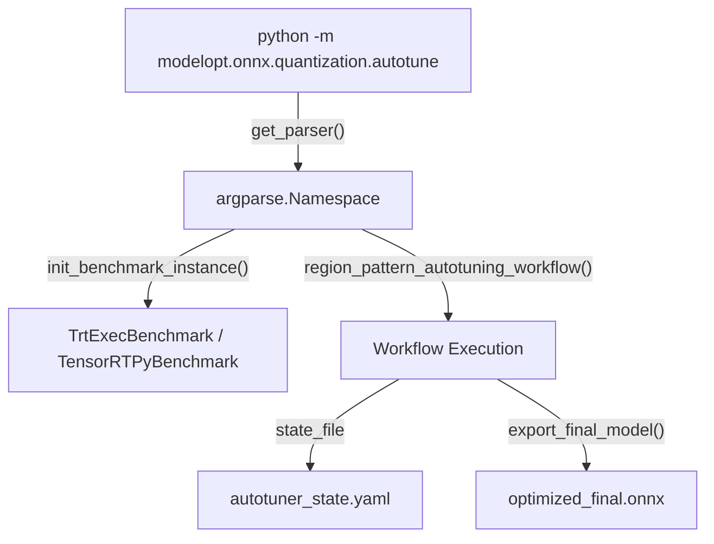

<!-- source: DeepWiki mcp.deepwiki.com · repo NVIDIA/Model-Optimizer · page 4.4 ONNX AutoQDQ and Autotuning · fetched 2026-10-26 -->

# ONNX AutoQDQ and Autotuning

Relevant source files

The following files were used as context for generating this wiki page:

- [docs/source/guides/_onnx_quantization.rst](docs/source/guides/_onnx_quantization.rst)
- [examples/onnx_ptq/autotune/README.md](examples/onnx_ptq/autotune/README.md)
- [examples/puzzletron/evaluation/hf_deployable_anymodel.py](examples/puzzletron/evaluation/hf_deployable_anymodel.py)
- [examples/speculative_decoding/collect_hidden_states/compute_hidden_states_trtllm.py](examples/speculative_decoding/collect_hidden_states/compute_hidden_states_trtllm.py)
- [examples/speculative_decoding/collect_hidden_states/send_conversations_for_hiddens.py](examples/speculative_decoding/collect_hidden_states/send_conversations_for_hiddens.py)
- [examples/speculative_decoding/scripts/send_conversation_vllm.py](examples/speculative_decoding/scripts/send_conversation_vllm.py)
- [modelopt/onnx/op_types.py](modelopt/onnx/op_types.py)
- [modelopt/onnx/quantization/autotune/__init__.py](modelopt/onnx/quantization/autotune/__init__.py)
- [modelopt/onnx/quantization/autotune/__main__.py](modelopt/onnx/quantization/autotune/__main__.py)
- [modelopt/onnx/quantization/autotune/autotuner.py](modelopt/onnx/quantization/autotune/autotuner.py)
- [modelopt/onnx/quantization/autotune/benchmark.py](modelopt/onnx/quantization/autotune/benchmark.py)
- [modelopt/onnx/quantization/autotune/common.py](modelopt/onnx/quantization/autotune/common.py)
- [modelopt/onnx/quantization/autotune/insertion_points.py](modelopt/onnx/quantization/autotune/insertion_points.py)
- [modelopt/onnx/quantization/autotune/region_pattern.py](modelopt/onnx/quantization/autotune/region_pattern.py)
- [modelopt/onnx/quantization/autotune/utils.py](modelopt/onnx/quantization/autotune/utils.py)
- [modelopt/onnx/quantization/calib_utils.py](modelopt/onnx/quantization/calib_utils.py)
- [modelopt/onnx/quantization/ort_utils.py](modelopt/onnx/quantization/ort_utils.py)
- [modelopt/torch/utils/graph.py](modelopt/torch/utils/graph.py)
- [tests/_test_utils/import_helper.py](tests/_test_utils/import_helper.py)
- [tests/_test_utils/onnx/quantization/autotune/models.py](tests/_test_utils/onnx/quantization/autotune/models.py)
- [tests/gpu/onnx/quantization/autotune/test_benchmark.py](tests/gpu/onnx/quantization/autotune/test_benchmark.py)
- [tests/gpu/onnx/quantization/autotune/test_workflow.py](tests/gpu/onnx/quantization/autotune/test_workflow.py)
- [tests/unit/onnx/quantization/autotune/test_autotune_config.py](tests/unit/onnx/quantization/autotune/test_autotune_config.py)
- [tests/unit/onnx/quantization/autotune/test_autotuner.py](tests/unit/onnx/quantization/autotune/test_autotuner.py)
- [tests/unit/onnx/quantization/autotune/test_insertion_points.py](tests/unit/onnx/quantization/autotune/test_insertion_points.py)
- [tests/unit/onnx/quantization/autotune/test_pattern_cache.py](tests/unit/onnx/quantization/autotune/test_pattern_cache.py)
- [tests/unit/onnx/quantization/autotune/test_region.py](tests/unit/onnx/quantization/autotune/test_region.py)
- [tests/unit/onnx/quantization/autotune/test_region_pattern.py](tests/unit/onnx/quantization/autotune/test_region_pattern.py)
- [tests/unit/onnx/quantization/test_autotune_quantization_integration.py](tests/unit/onnx/quantization/test_autotune_quantization_integration.py)
- [tests/unit/onnx/quantization/test_ort_utils.py](tests/unit/onnx/quantization/test_ort_utils.py)
- [tests/unit/torch/speculative/test_speculative_utils.py](tests/unit/torch/speculative/test_speculative_utils.py)

The ONNX AutoQDQ and Autotuning system provides an automated framework for optimizing Quantize/Dequantize (Q/DQ) node placement in ONNX models. Unlike static quantization which applies fixed rules, autotuning explores the space of possible Q/DQ configurations, measuring the actual performance on target hardware using TensorRT to find the optimal balance between precision and latency.

## Overview and Implementation

The autotuning workflow is built around the concept of **Region-based Pattern Matching**. The system partitions an ONNX graph into hierarchical regions, identifies recurring structural patterns, and applies search algorithms to find the best Q/DQ insertion schemes for those patterns.

### Key Components

*   **`Region`**: Represents a subgraph. Regions are hierarchical: `ROOT` (entire graph), `COMPOSITE` (contains child regions), and `LEAF` (contains atomic operations) `[modelopt/onnx/quantization/autotune/common.py:50-60]()`.
*   **`InsertionPoint`**: An abstract representation of where a Q/DQ pair can be placed. These are pattern-relative rather than absolute to allow re-use across identical subgraphs `[modelopt/onnx/quantization/autotune/insertion_points.py:1-50]()`.
*   **`PatternCache`**: Stores successful Q/DQ schemes for specific graph signatures, allowing "warm-start" optimizations on similar models `[modelopt/onnx/quantization/autotune/common.py:1-50]()`.
*   **`Benchmark`**: The abstract base class defining the interface for measuring inference latency `[modelopt/onnx/quantization/autotune/benchmark.py:66-82]()`. It supports both `TrtExecBenchmark` (CLI-based) `[modelopt/onnx/quantization/autotune/benchmark.py:147-153]()` and `TensorRTPyBenchmark` (Python API-based) `[modelopt/onnx/quantization/autotune/benchmark.py:270-300]()`.
*   **`QDQAutotuner`**: The core engine that manages the optimization state, iterates through patterns, and coordinates with the benchmark instance `[modelopt/onnx/quantization/autotune/autotuner.py:25-50]()`.

### Data Flow: From Graph to Optimized Model

The following diagram illustrates how an unquantized ONNX model is transformed into an optimized QDQ model through the autotuning pipeline.

**Autotuning Pipeline Data Flow**

Sources: [modelopt/onnx/quantization/autotune/workflows.py:30-40](), [modelopt/onnx/quantization/autotune/common.py:50-90](), [modelopt/onnx/quantization/autotune/benchmark.py:66-160](), [modelopt/onnx/quantization/autotune/autotuner.py:25-60]()

## Region Pattern Matching

To scale optimization to large models, the autotuner identifies identical subgraphs (e.g., repeated blocks in a ResNet or Transformer). It generates a unique signature for each region based on its internal node types and connectivity.

### Implementation Details
1.  **Partitioning**: The graph is traversed by `CombinedRegionSearch` to group nodes into regions `[modelopt/onnx/quantization/autotune/__init__.py:45-50]()`.
2.  **Insertion Points**: The system identifies valid locations for Q/DQ nodes, such as `NodeInputInsertionPoint` or `ChildRegionInputInsertionPoint` `[modelopt/onnx/quantization/autotune/insertion_points.py:1-60]()`.
3.  **Resolution**: During benchmarking, these relative points are resolved to absolute tensor names in the actual graph using `ResolvedInsertionPoint` `[modelopt/onnx/quantization/autotune/insertion_points.py:1-60]()`.
4.  **Pattern Reuse**: The `PatternCache` allows the system to reuse optimization results across models with similar architectures `[modelopt/onnx/quantization/autotune/common.py:1-50]()`.

**Entity Association: Logic to Code**

Sources: [modelopt/onnx/quantization/autotune/region_pattern.py:1-50](), [modelopt/onnx/quantization/autotune/benchmark.py:109-121](), [modelopt/onnx/quantization/autotune/common.py:63-90]()

## Benchmarking Workflows

The system relies on accurate hardware feedback to make decisions. It provides two primary benchmarking implementations:

| Class | Method | Use Case |
| :--- | :--- | :--- |
| `TrtExecBenchmark` | Uses `trtexec` binary via `subprocess` | Standard, reliable benchmarking matching NVIDIA production tools `[modelopt/onnx/quantization/autotune/benchmark.py:147-153]()`. |
| `TensorRTPyBenchmark` | Uses TensorRT Python API | Direct engine profiling with finer control over memory and streams `[modelopt/onnx/quantization/autotune/benchmark.py:270-300]()`. |

### Performance Configuration
The autotuner supports different intensity modes via the CLI through `MODE_PRESETS` defined in `utils.py` `[modelopt/onnx/quantization/autotune/utils.py:20-40]()`:
*   **`quick`**: 15 schemes per region, 5 warmup runs, 10 timing runs.
*   **`default`**: 30 schemes per region, 5 warmup runs, 10 timing runs.
*   **`extensive`**: 50 schemes per region, 10 warmup runs, 20 timing runs.

These presets are applied in the CLI entry point unless explicitly overridden by the user `[modelopt/onnx/quantization/autotune/__main__.py:44-59]()`.

Sources: [modelopt/onnx/quantization/autotune/utils.py:20-40](), [modelopt/onnx/quantization/autotune/benchmark.py:84-108](), [modelopt/onnx/quantization/autotune/__main__.py:44-59]()

## Command Line Interface (CLI)

The autotuner can be executed directly as a module via `python -m modelopt.onnx.quantization.autotune`. It handles state preservation, allowing users to resume interrupted sessions `[modelopt/onnx/quantization/autotune/__main__.py:139-143]()`.

### Key Arguments
*   `--onnx_path`: Path to the input model `[modelopt/onnx/quantization/autotune/__main__.py:165-170]()`.
*   `--quant_type`: Target format, e.g., `int8` (default) or `fp8` `[modelopt/onnx/quantization/autotune/__main__.py:38-41]()`.
*   `--qdq_baseline`: Optional existing quantized model to use as a starting point `[modelopt/onnx/quantization/autotune/__main__.py:98-98]()`.
*   `--pattern_cache_file`: Path to a YAML file for reusing learned patterns `[modelopt/onnx/quantization/autotune/__main__.py:124-124]()`.
*   `--mode`: Selection of `quick`, `default`, or `extensive` presets `[modelopt/onnx/quantization/autotune/__main__.py:44-59]()`.

### Execution Flow
1.  `run_autotune()` validates input paths and initializes the benchmark instance `[modelopt/onnx/quantization/autotune/__main__.py:80-112]()`.
2.  `region_pattern_autotuning_workflow()` executes the search across discovered regions `[modelopt/onnx/quantization/autotune/__main__.py:120-131]()`.
3.  The workflow manages the `QDQAutotuner` to evaluate schemes and select the best configuration `[modelopt/onnx/quantization/autotune/autotuner.py:25-60]()`.
4.  On completion, it exports the final model to `optimized_final.onnx` `[examples/onnx_ptq/autotune/README.md:111-115]()`.

**CLI to Internal Workflow Mapping**

Sources: [modelopt/onnx/quantization/autotune/__main__.py:150-160](), [modelopt/onnx/quantization/autotune/workflows.py:30-40](), [examples/onnx_ptq/autotune/README.md:109-123]()

---

