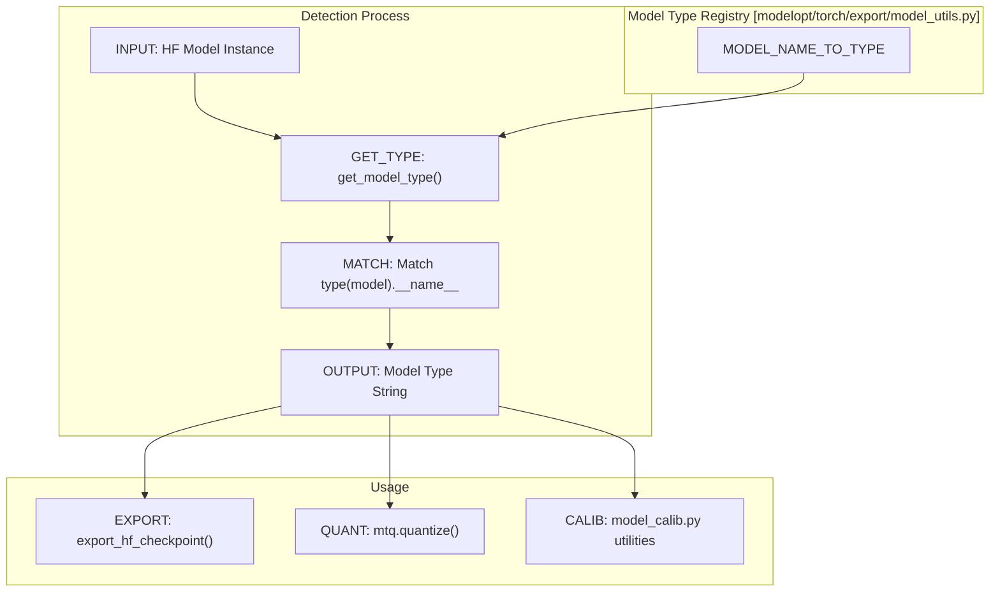
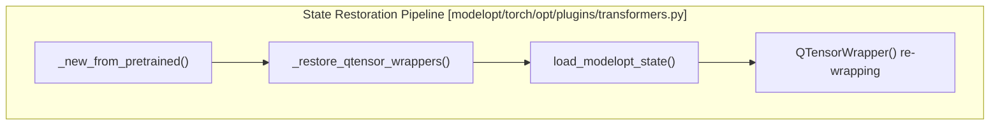
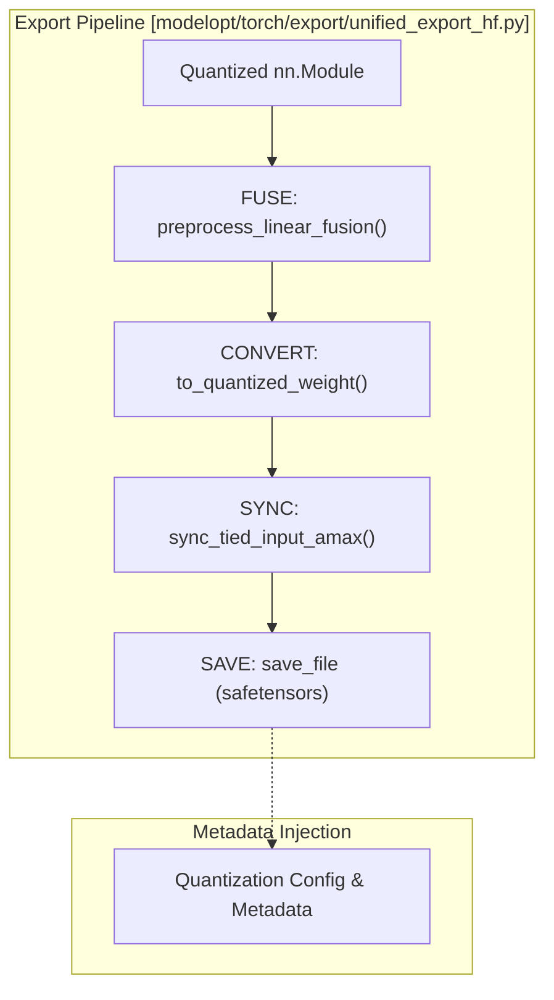

<!-- source: DeepWiki mcp.deepwiki.com · repo NVIDIA/Model-Optimizer · page 5.1 Hugging Face Models · fetched 2026-10-26 -->

# Hugging Face Models

Relevant source files

The following files were used as context for generating this wiki page:

- [CHANGELOG.rst](CHANGELOG.rst)
- [examples/llm_qat/export.py](examples/llm_qat/export.py)
- [modelopt/torch/export/layer_utils.py](modelopt/torch/export/layer_utils.py)
- [modelopt/torch/export/model_config_export.py](modelopt/torch/export/model_config_export.py)
- [modelopt/torch/export/model_utils.py](modelopt/torch/export/model_utils.py)
- [modelopt/torch/export/moe_utils.py](modelopt/torch/export/moe_utils.py)
- [modelopt/torch/export/quant_utils.py](modelopt/torch/export/quant_utils.py)
- [modelopt/torch/export/tensorrt_llm_utils.py](modelopt/torch/export/tensorrt_llm_utils.py)
- [modelopt/torch/export/unified_export_hf.py](modelopt/torch/export/unified_export_hf.py)
- [modelopt/torch/opt/plugins/transformers.py](modelopt/torch/opt/plugins/transformers.py)
- [modelopt/torch/quantization/plugins/huggingface.py](modelopt/torch/quantization/plugins/huggingface.py)
- [modelopt_recipes/huggingface/qwen3_5/ptq/fp8_vision-kv_none.yaml](modelopt_recipes/huggingface/qwen3_5/ptq/fp8_vision-kv_none.yaml)
- [modelopt_recipes/huggingface/qwen3_5/ptq/fp8_vision_lm-kv_fp8_cast.yaml](modelopt_recipes/huggingface/qwen3_5/ptq/fp8_vision_lm-kv_fp8_cast.yaml)
- [modelopt_recipes/huggingface/qwen3_vl/ptq/fp8_vision-kv_none.yaml](modelopt_recipes/huggingface/qwen3_vl/ptq/fp8_vision-kv_none.yaml)
- [modelopt_recipes/huggingface/qwen3_vl/ptq/fp8_vision_lm-kv_fp8_cast.yaml](modelopt_recipes/huggingface/qwen3_vl/ptq/fp8_vision_lm-kv_fp8_cast.yaml)
- [modelopt_recipes/huggingface/qwen3_vl/ptq/vision_fp8.quant_cfg.yaml](modelopt_recipes/huggingface/qwen3_vl/ptq/vision_fp8.quant_cfg.yaml)
- [tests/_test_utils/torch/quantization/tied_modules.py](tests/_test_utils/torch/quantization/tied_modules.py)
- [tests/examples/hf_ptq/test_hf_ptq_vision_quantization.py](tests/examples/hf_ptq/test_hf_ptq_vision_quantization.py)
- [tests/examples/llm_qat/test_llm_qat.py](tests/examples/llm_qat/test_llm_qat.py)
- [tests/gpu/torch/export/test_export.py](tests/gpu/torch/export/test_export.py)
- [tests/gpu/torch/export/test_fsdp2_export.py](tests/gpu/torch/export/test_fsdp2_export.py)
- [tests/gpu/torch/export/test_unified_hf_export_and_check_safetensors.py](tests/gpu/torch/export/test_unified_hf_export_and_check_safetensors.py)
- [tests/unit/torch/export/test_get_quantization.py](tests/unit/torch/export/test_get_quantization.py)
- [tests/unit/torch/export/test_unified_export_hf.py](tests/unit/torch/export/test_unified_export_hf.py)
- [tests/unit/torch/opt/plugins/test_hf_patching.py](tests/unit/torch/opt/plugins/test_hf_patching.py)
- [tests/unit/torch/opt/plugins/test_transformers_save_load.py](tests/unit/torch/opt/plugins/test_transformers_save_load.py)
- [tests/unit/torch/quantization/plugins/test_fused_experts.py](tests/unit/torch/quantization/plugins/test_fused_experts.py)

This page describes Model Optimizer's integration with Hugging Face models, covering quantization and export workflows for Transformers, Diffusers, and PEFT models. For distributed training support with Megatron-Core and NeMo, see [5.2](). For FSDP-specific integration, see [5.3]().

Model Optimizer provides seamless integration with Hugging Face's ecosystem, enabling post-training quantization (PTQ) and quantization-aware training (QAT) for a wide range of model architectures. The integration supports standard causal language models, encoder-decoder models, multimodal vision-language models (VLMs), and diffusion models.

---

## Supported Model Architectures

Model Optimizer detects and handles Hugging Face models through internal mapping logic that translates Hugging Face architecture names to internal model type identifiers.

### Model Type Detection

The `get_model_type()` function in [modelopt/torch/export/model_utils.py:81-86]() performs model type detection by matching the model's class name against known patterns in `MODEL_NAME_TO_TYPE` [modelopt/torch/export/model_utils.py:21-64](). This detection is critical for applying the correct quantization recipes and handling export logic.

**Sources:** [modelopt/torch/export/model_utils.py:21-86]()

### Multimodal and VLM Detection

For Vision-Language Models (VLMs), Model Optimizer uses `is_multimodal_model()` to identify models requiring specialized handling, such as extracting the language model component before export [modelopt/torch/export/model_utils.py:89-118]().

| Detection Criterion | Attribute/Property | Example Models |
|---------------------|-------------------|----------------|
| Standard Vision Config | `config.vision_config` | Qwen2-VL, LLaVA |
| Language Model Attribute | `model.language_model` | LLaVA, VILA |
| Nemotron-Parse Architecture | `config.architectures` containing `nemotronparse` | Nemotron-Parse |

**Sources:** [modelopt/torch/export/model_utils.py:89-118]()

---

## Framework Integration: Hugging Face Plugins

Model Optimizer utilizes a plugin system to extend quantization support to specific Hugging Face components, particularly for attention mechanisms and Mixture-of-Experts (MoE) layers.

### Attention and KV Cache Quantization

The `_QuantAttention` class in [modelopt/torch/quantization/plugins/huggingface.py:78-124]() provides a wrapper for Hugging Face attention modules to support KV cache quantization. It is compatible with the attention interface in `transformers >= 4.48.0`.

- **Quantizers**: Manages `q_bmm_quantizer`, `k_bmm_quantizer`, `v_bmm_quantizer`, and `p_bmm_quantizer` [modelopt/torch/quantization/plugins/huggingface.py:82-85]().
- **Triton/Kitchen Support**: Integrates with `KitchenFlashAttentionModule` for optimized execution when `p_bmm_quantizer` is enabled (e.g., for MXFP8) [modelopt/torch/quantization/plugins/huggingface.py:90-123]().
- **Triton Kernel**: Supports a built-in Triton kernel for FP8 and NVFP4 `p_qdq` modes [modelopt/torch/quantization/plugins/huggingface.py:125-157]().

**Sources:** [modelopt/torch/quantization/plugins/huggingface.py:78-157]()

### Fused Mixture-of-Experts (MoE)

Support for Hugging Face MoE models (like Mixtral or Qwen3-Moe) is handled via expert detection and scale synchronization.

- **Expert Detection**: `get_experts_list()` identifies MoE expert layers by looking for architecture-specific linear names [modelopt/torch/export/layer_utils.py:84-124]().
- **Per-Expert Quantization**: Functions like `_export_fused_experts()` split fused 3-D expert weights and export per-expert quantization scales [modelopt/torch/export/moe_utils.py:48-76]().

**Sources:** [modelopt/torch/export/layer_utils.py:84-124](), [modelopt/torch/export/moe_utils.py:48-76]()

---

## State Saving and Checkpoint Restoration

When working with Hugging Face models, Model Optimizer integrates with `from_pretrained` and `save_pretrained` workflows.

### State Restoration (`_restore_qtensor_wrappers`)

Transformers versions >= 5.0 load weights via direct `setattr` calls, which can replace `QTensorWrapper` objects with plain `Parameter` tensors. The `_restore_qtensor_wrappers()` function in [modelopt/torch/opt/plugins/transformers.py:96-146]() reads the saved `q_tensor_state` from `modelopt_state.pth` and re-wraps compressed weights to ensure correct decompression during inference or evaluation.

**Sources:** [modelopt/torch/opt/plugins/transformers.py:96-158]()

---

## Export and Deployment

### Unified HF Checkpoint Export

The `export_hf_checkpoint` function converts a quantized PyTorch model into a standard Hugging Face format with quantization metadata [modelopt/torch/export/unified_export_hf.py:123]().

**Key Export Features:**
- **Fusion**: Fuses pre-quantization LayerNorm/RMSNorm into Linear layers [modelopt/torch/export/quant_utils.py:106-107]().
- **Weight Swizzling**: For NVFP4, block scales are swizzled for cuBLAS layout compatibility [modelopt/torch/export/unified_export_hf.py:35]().
- **Tied Weights**: `TiedWeightMap` tracks and handles tied parameters across modules [modelopt/torch/export/model_utils.py:157-182]().
- **VLM Extraction**: `get_language_model_from_vl()` extracts the language component from vision-language models for export [modelopt/torch/export/model_utils.py:121-154]().

**Sources:** [modelopt/torch/export/unified_export_hf.py:35-123](), [modelopt/torch/export/quant_utils.py:106-107](), [modelopt/torch/export/model_utils.py:121-182]()

---

