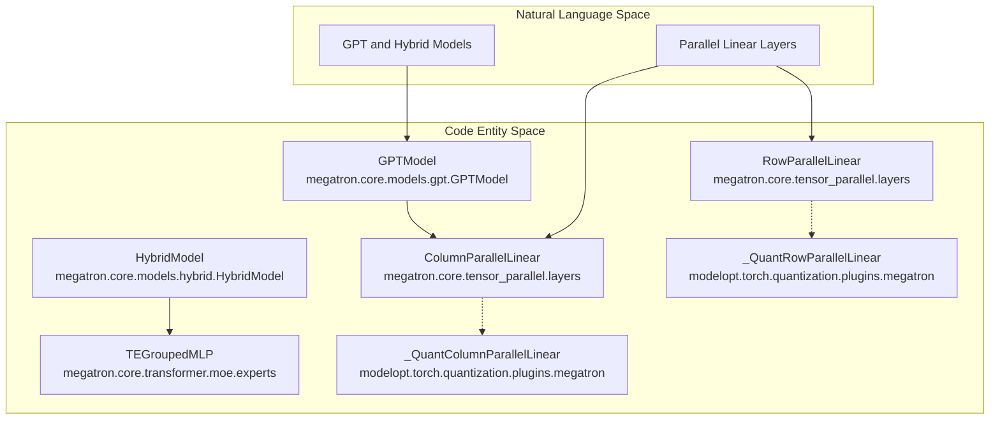
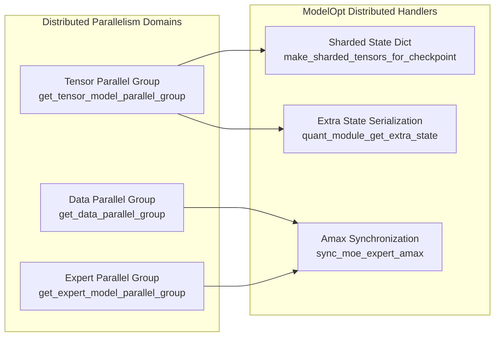
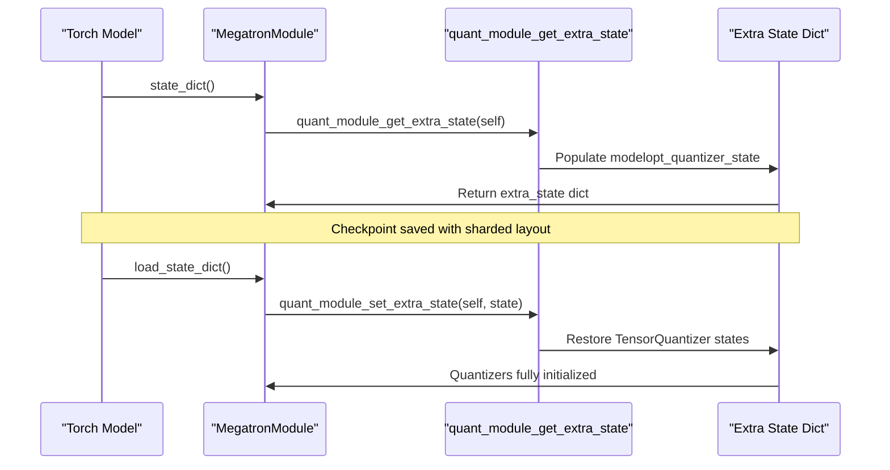

<!-- source: DeepWiki mcp.deepwiki.com · repo NVIDIA/Model-Optimizer · page 5.2 Megatron-Core and NeMo · fetched 2026-10-26 -->

# Megatron-Core and NeMo

Relevant source files

The following files were used as context for generating this wiki page:

- [examples/dataset/MEGATRON_DATA_PREP.md](examples/dataset/MEGATRON_DATA_PREP.md)
- [examples/megatron_bridge/README.md](examples/megatron_bridge/README.md)
- [examples/megatron_bridge/distill.py](examples/megatron_bridge/distill.py)
- [examples/megatron_bridge/export_distilled_megatron_to_hf.py](examples/megatron_bridge/export_distilled_megatron_to_hf.py)
- [examples/megatron_bridge/export_quantized_megatron_to_hf.py](examples/megatron_bridge/export_quantized_megatron_to_hf.py)
- [examples/megatron_bridge/prune_minitron.py](examples/megatron_bridge/prune_minitron.py)
- [examples/megatron_bridge/quantize.py](examples/megatron_bridge/quantize.py)
- [examples/pruning/README.md](examples/pruning/README.md)
- [examples/pruning/minitron/NVIDIA-Nemotron-3-Nano-30B-A3B-BF16/README.md](examples/pruning/minitron/NVIDIA-Nemotron-3-Nano-30B-A3B-BF16/README.md)
- [examples/pruning/minitron/NVIDIA-Nemotron-Nano-9B-v2/ABLATIONS.md](examples/pruning/minitron/NVIDIA-Nemotron-Nano-9B-v2/ABLATIONS.md)
- [examples/pruning/minitron/NVIDIA-Nemotron-Nano-9B-v2/README.md](examples/pruning/minitron/NVIDIA-Nemotron-Nano-9B-v2/README.md)
- [examples/pruning/minitron/NVIDIA-Nemotron-Nano-9B-v2/figures/learning_curves.png](examples/pruning/minitron/NVIDIA-Nemotron-Nano-9B-v2/figures/learning_curves.png)
- [examples/pruning/minitron/NVIDIA-Nemotron-Nano-9B-v2/nemo_evaluator.yaml](examples/pruning/minitron/NVIDIA-Nemotron-Nano-9B-v2/nemo_evaluator.yaml)
- [examples/pruning/minitron_vs_puzzletron/README.md](examples/pruning/minitron_vs_puzzletron/README.md)
- [modelopt/torch/export/plugins/__init__.py](modelopt/torch/export/plugins/__init__.py)
- [modelopt/torch/export/plugins/hf_checkpoint_utils.py](modelopt/torch/export/plugins/hf_checkpoint_utils.py)
- [modelopt/torch/export/plugins/mcore_common.py](modelopt/torch/export/plugins/mcore_common.py)
- [modelopt/torch/export/plugins/mcore_custom.py](modelopt/torch/export/plugins/mcore_custom.py)
- [modelopt/torch/export/plugins/mcore_nemotron.py](modelopt/torch/export/plugins/mcore_nemotron.py)
- [modelopt/torch/export/plugins/mcore_qwen3vl.py](modelopt/torch/export/plugins/mcore_qwen3vl.py)
- [modelopt/torch/export/plugins/megatron_importer.py](modelopt/torch/export/plugins/megatron_importer.py)
- [modelopt/torch/export/unified_export_megatron.py](modelopt/torch/export/unified_export_megatron.py)
- [modelopt/torch/nas/plugins/megatron.py](modelopt/torch/nas/plugins/megatron.py)
- [modelopt/torch/prune/plugins/mcore_minitron.py](modelopt/torch/prune/plugins/mcore_minitron.py)
- [modelopt/torch/quantization/plugins/megatron.py](modelopt/torch/quantization/plugins/megatron.py)
- [modelopt/torch/utils/logging.py](modelopt/torch/utils/logging.py)
- [modelopt/torch/utils/plugins/mbridge.py](modelopt/torch/utils/plugins/mbridge.py)
- [modelopt/torch/utils/plugins/megatron_generate.py](modelopt/torch/utils/plugins/megatron_generate.py)
- [modelopt/torch/utils/plugins/megatron_mmlu.py](modelopt/torch/utils/plugins/megatron_mmlu.py)
- [modelopt/torch/utils/plugins/megatron_preprocess_data.py](modelopt/torch/utils/plugins/megatron_preprocess_data.py)
- [tests/_test_utils/torch/megatron/models.py](tests/_test_utils/torch/megatron/models.py)
- [tests/_test_utils/torch/megatron/utils.py](tests/_test_utils/torch/megatron/utils.py)
- [tests/_test_utils/torch/transformers_models.py](tests/_test_utils/torch/transformers_models.py)
- [tests/examples/megatron_bridge/test_distill.py](tests/examples/megatron_bridge/test_distill.py)
- [tests/examples/megatron_bridge/test_prune_minitron.py](tests/examples/megatron_bridge/test_prune_minitron.py)
- [tests/examples/megatron_bridge/test_qad.py](tests/examples/megatron_bridge/test_qad.py)
- [tests/examples/megatron_bridge/test_quantize_export.py](tests/examples/megatron_bridge/test_quantize_export.py)
- [tests/gpu_megatron/torch/export/test_megatron_importer.py](tests/gpu_megatron/torch/export/test_megatron_importer.py)
- [tests/gpu_megatron/torch/export/test_unified_export_megatron.py](tests/gpu_megatron/torch/export/test_unified_export_megatron.py)
- [tests/gpu_megatron/torch/quantization/plugins/test_megatron.py](tests/gpu_megatron/torch/quantization/plugins/test_megatron.py)
- [tests/gpu_megatron/torch/utils/plugins/test_megatron_preprocess_data.py](tests/gpu_megatron/torch/utils/plugins/test_megatron_preprocess_data.py)
- [tests/gpu_megatron/torch/utils/plugins/test_utils_megatron.py](tests/gpu_megatron/torch/utils/plugins/test_utils_megatron.py)
- [tests/unit/torch/export/test_export_weight.py](tests/unit/torch/export/test_export_weight.py)
- [tests/unit/torch/export/test_hf_checkpoint_utils.py](tests/unit/torch/export/test_hf_checkpoint_utils.py)
- [tests/unit/torch/export/test_mcore_save_safetensors.py](tests/unit/torch/export/test_mcore_save_safetensors.py)

This document covers ModelOpt's integration with NVIDIA Megatron-Core and NeMo frameworks for distributed model optimization. It details support for quantization, pruning, and sparsity techniques on large-scale language models trained with Tensor Parallelism (TP), Pipeline Parallelism (PP), Expert Parallelism (EP), and Context Parallelism (CP).

For general quantization concepts, see [Post-Training Quantization (PTQ)](#3.1). For pruning theory, see [Model Pruning](#3.3). For deployment of optimized Megatron models, see [TensorRT-LLM Deployment](#8.2).

## Purpose and Scope

ModelOpt provides specialized plugin modules that enable optimization techniques on Megatron-Core models while preserving their distributed training capabilities. The integration supports:

- **Quantization** with sharded state dict for TP/PP/EP/CP configurations [modelopt/torch/quantization/plugins/megatron.py:16-58]().
- **Minitron pruning** for width and depth reduction of GPT, Mamba, and MoE models with distributed support [modelopt/torch/nas/plugins/megatron.py:149-180]().
- **Heterogeneous checkpointing** to change parallelism configurations between save and restore using `extra_state` [modelopt/torch/quantization/plugins/megatron.py:133-168]().
- **Distributed calibration** with automated amax synchronization across parallel groups [modelopt/torch/quantization/plugins/megatron.py:45-57]().
- **Unified Export** of quantized Megatron models to Hugging Face or TensorRT-LLM formats [modelopt/torch/export/unified_export_megatron.py:19-172]().

Sources: [modelopt/torch/quantization/plugins/megatron.py:16-58](), [modelopt/torch/nas/plugins/megatron.py:149-180](), [modelopt/torch/export/unified_export_megatron.py:19-172]()

## Architecture Overview

Title: Megatron-Core Plugin Architecture

Sources: [modelopt/torch/quantization/plugins/megatron.py:16-75](), [modelopt/torch/nas/plugins/megatron.py:37-80]()

ModelOpt registers custom module classes that wrap or replace Megatron-Core modules. For quantization, `QuantModuleRegistry` maps Megatron classes to specialized `QuantModule` implementations with distributed-aware features [modelopt/torch/quantization/plugins/megatron.py:16-58]().

## Distributed Parallelism Support

Title: Distributed Training Integration

Sources: [modelopt/torch/quantization/plugins/megatron.py:23-57](), [modelopt/torch/opt/plugins/megatron.py:25-54]()

### Tensor Parallelism Handling
Megatron-Core distributes model layers across multiple GPUs using TP. ModelOpt's quantization plugins handle this through specialized `QuantModule` implementations:

*   **ColumnParallelLinear**: Output dimension is sharded. `sharded_state_dict` ensures quantizer metadata (like amax) is correctly mapped to the sharded weight [modelopt/torch/quantization/plugins/megatron.py:23-34]().
*   **RowParallelLinear**: Input dimension is sharded. ModelOpt handles the synchronization of activation quantizers across the TP group [tests/gpu_megatron/torch/quantization/plugins/test_megatron.py:100-136]().
*   **NVFP4 Support**: Static-block NVFP4 weight quantization is currently not supported with TP > 1 due to shard-local amax limitations [modelopt/torch/quantization/plugins/megatron.py:81-110]().

Sources: [modelopt/torch/quantization/plugins/megatron.py:23-110](), [tests/gpu_megatron/torch/quantization/plugins/test_megatron.py:100-136]()

### Expert and Context Parallelism
*   **Expert Parallelism (EP)**: Distributes MoE experts across ranks. `sync_moe_expert_amax()` is used to synchronize calibration statistics across experts to ensure consistent quantization scaling [modelopt/torch/quantization/plugins/megatron.py:56-56]().
*   **Context Parallelism (CP)**: Splits sequence dimension. ModelOpt utilities enable calibration and inference on CP-enabled models by correctly partitioning data across the CP group [modelopt/torch/utils/plugins/megatron_generate.py:43-89]().

Sources: [modelopt/torch/quantization/plugins/megatron.py:56-56](), [modelopt/torch/utils/plugins/megatron_generate.py:43-89]()

## Quantization for Megatron-Core

### Extra State Mechanism
Megatron-Core uses `get_extra_state()` and `set_extra_state()` for module-specific checkpointing. ModelOpt registers callbacks to store quantizer states without relying on full module names, which enables heterogeneous checkpoint loading when PP/EP configurations change.

Title: Extra State Checkpoint Flow

Sources: [modelopt/torch/quantization/plugins/megatron.py:113-168]()

**Key functions**:
- `quant_module_get_extra_state()`: Populates the `modelopt_quantizer_state`, `modelopt_real_quantizer_state`, and `modelopt_q_tensor_state` [modelopt/torch/quantization/plugins/megatron.py:113-130]().
- `quant_module_set_extra_state()`: Restores quantizer states and handles meta-device initialization for `QTensorWrapper` [modelopt/torch/quantization/plugins/megatron.py:171-202]().
- `ensure_metadata_has_dp_cp_group()`: Ensures that distributed metadata correctly tracks data-parallel and context-parallel groups during optimization [modelopt/torch/opt/plugins/megatron.py:32-54]().

Sources: [modelopt/torch/quantization/plugins/megatron.py:113-202](), [modelopt/torch/opt/plugins/megatron.py:32-54]()

## Transformer Engine Integration

ModelOpt integrates with Transformer Engine (TE) to support distributed quantization on TE layers:

- **Conflict Prevention**: `_assert_te_fp8_enabled()` checks if TE's native FP8 autocast is active and raises an error to prevent interference with ModelOpt quantization [modelopt/torch/quantization/plugins/transformer_engine.py:35-48]().
- **TE Linear**: `_QuantTELinear` and `_QuantTELayerNormLinear` replace TE linear forward methods to inject ModelOpt `TensorQuantizer` logic [modelopt/torch/quantization/plugins/transformer_engine.py:50-105]().
- **Grouped Linear**: `_QuantTEGroupedLinear` provides specialized handling for `TEGroupedLinear` (used in MoE), iterating through expert weights for calibration and quantization [modelopt/torch/quantization/plugins/transformer_engine.py:108-160]().

Sources: [modelopt/torch/quantization/plugins/transformer_engine.py:35-160]()

## Export and Import Pipeline

### Unified Megatron Export
The `export_mcore_gpt_to_hf` function converts a quantized Megatron-Core model to a Hugging Face compatible checkpoint [modelopt/torch/export/unified_export_megatron.py:106-108]().

- **GPTModelExporter**: Host attributes and methods for exporting models like `GPTModel`, `HybridModel`, and `LLaVAModel` [modelopt/torch/export/unified_export_megatron.py:111-139]().
- **Weight Conversion**: Uses `to_quantized_weight` to pack weights into formats like INT4 or FP8 while extracting scaling factors [modelopt/torch/export/unified_export_megatron.py:63-73]().
- **Metadata Generation**: Automatically generates `hf_quant_config.json` to ensure the exported model is deployable in engines like vLLM or TensorRT-LLM [tests/gpu_megatron/torch/export/test_unified_export_megatron.py:45-79]().

### Megatron Importer
The `GPTModelImporter` class allows loading Hugging Face checkpoints back into Megatron-Core models [modelopt/torch/export/plugins/megatron_importer.py:81-110]().

- **Rule Book**: Maps HF state dict keys to Megatron components using `CustomModuleMapping` [modelopt/torch/export/plugins/megatron_importer.py:141-168]().
- **Parallel Loading**: Handles sharding during import using `ParallelConfig` to ensure weights are correctly distributed across ranks [modelopt/torch/export/plugins/mcore_custom.py:48-67]().

Sources: [modelopt/torch/export/unified_export_megatron.py:63-139](), [modelopt/torch/export/plugins/megatron_importer.py:81-168]()

## Key Classes and Functions Reference

| Entity | Role | Location |
| :--- | :--- | :--- |
| `GPTModelExporter` | Logic for Megatron to HF checkpoint conversion | [modelopt/torch/export/unified_export_megatron.py:111-139]() |
| `GPTModelImporter` | Logic for HF to Megatron checkpoint conversion | [modelopt/torch/export/plugins/megatron_importer.py:81-110]() |
| `sync_moe_expert_amax` | Synchronizes amax values across EP ranks | [modelopt/torch/quantization/plugins/megatron.py:56-56]() |
| `quant_module_get_extra_state` | Populates quantizer state for MCore checkpoints | [modelopt/torch/quantization/plugins/megatron.py:133-168]() |
| `_QuantMegatronTEGroupedLinear` | Quantized wrapper for TE MoE experts | [tests/gpu_megatron/torch/quantization/plugins/test_megatron.py:67-74]() |
| `save_sharded_modelopt_state` | Saves ModelOpt state in sharded format | [modelopt/torch/opt/plugins/mcore_dist_checkpointing.py:112-126]() |

Sources: [modelopt/torch/export/unified_export_megatron.py:111-139](), [modelopt/torch/export/plugins/megatron_importer.py:81-110](), [modelopt/torch/quantization/plugins/megatron.py:56-168](), [tests/gpu_megatron/torch/quantization/plugins/test_megatron.py:67-74]()

---

