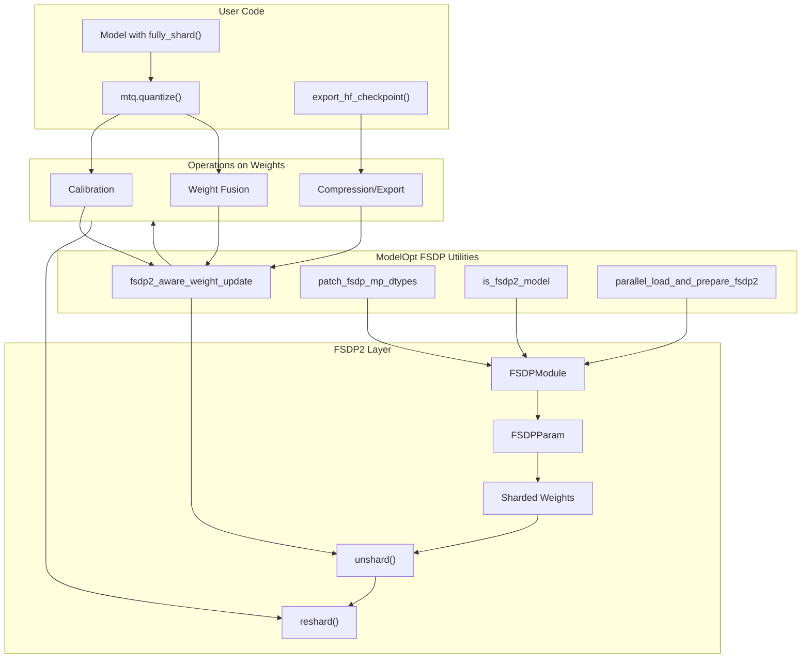
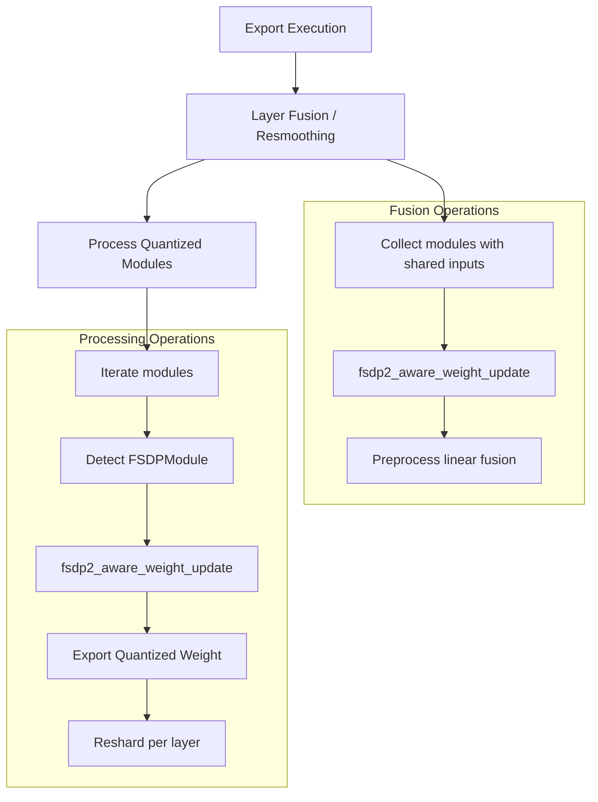

<!-- source: DeepWiki mcp.deepwiki.com · repo NVIDIA/Model-Optimizer · page 5.3 PyTorch FSDP and Distributed Support · fetched 2026-10-26 -->

# PyTorch FSDP and Distributed Support

Relevant source files

The following files were used as context for generating this wiki page:

- [docs/source/guides/2_save_load.rst](docs/source/guides/2_save_load.rst)
- [examples/llm_qat/export.py](examples/llm_qat/export.py)
- [examples/llm_sparsity/weight_sparsity/README.md](examples/llm_sparsity/weight_sparsity/README.md)
- [examples/llm_sparsity/weight_sparsity/finetune.py](examples/llm_sparsity/weight_sparsity/finetune.py)
- [modelopt/torch/export/distribute.py](modelopt/torch/export/distribute.py)
- [modelopt/torch/export/quant_utils.py](modelopt/torch/export/quant_utils.py)
- [modelopt/torch/opt/conversion.py](modelopt/torch/opt/conversion.py)
- [modelopt/torch/opt/plugins/huggingface.py](modelopt/torch/opt/plugins/huggingface.py)
- [modelopt/torch/opt/plugins/megatron.py](modelopt/torch/opt/plugins/megatron.py)
- [modelopt/torch/opt/plugins/peft.py](modelopt/torch/opt/plugins/peft.py)
- [modelopt/torch/opt/plugins/transformers.py](modelopt/torch/opt/plugins/transformers.py)
- [modelopt/torch/opt/searcher.py](modelopt/torch/opt/searcher.py)
- [modelopt/torch/utils/distributed.py](modelopt/torch/utils/distributed.py)
- [tests/examples/llm_qat/test_llm_qat.py](tests/examples/llm_qat/test_llm_qat.py)
- [tests/gpu/torch/export/test_export.py](tests/gpu/torch/export/test_export.py)
- [tests/gpu/torch/export/test_fsdp2_export.py](tests/gpu/torch/export/test_fsdp2_export.py)
- [tests/gpu/torch/export/test_unified_hf_export_and_check_safetensors.py](tests/gpu/torch/export/test_unified_hf_export_and_check_safetensors.py)
- [tests/unit/torch/export/test_get_quantization.py](tests/unit/torch/export/test_get_quantization.py)
- [tests/unit/torch/opt/plugins/test_hf_patching.py](tests/unit/torch/opt/plugins/test_hf_patching.py)
- [tests/unit/torch/opt/plugins/test_transformers_save_load.py](tests/unit/torch/opt/plugins/test_transformers_save_load.py)
- [tests/unit/torch/opt/test_load_modelopt_state.py](tests/unit/torch/opt/test_load_modelopt_state.py)

## Purpose and Scope

This page describes Model Optimizer's support for PyTorch FSDP2 (Fully Sharded Data Parallel version 2) and distributed training/inference workflows. It covers weight access contexts, multi-node quantization, and export considerations when working with sharded models. It also details the integration with Megatron-Core distributed checkpointing for sharded `modelopt_state`.

For general framework integration patterns, see [Framework Integration](#5). For Megatron-Core specific distributed support (TP/PP/EP), see [Megatron-Core and NeMo](#5.2).

Sources: [modelopt/torch/utils/distributed.py:32-47]()

## Overview of FSDP2 Integration

FSDP2 shards model parameters across multiple GPUs to reduce memory footprint, enabling training and quantization of large models that don't fit on a single device. Model Optimizer provides specialized contexts and utilities to safely access and modify weights in FSDP-sharded models during quantization, calibration, and export.

### FSDP2 Integration Architecture

Sources: [modelopt/torch/utils/distributed.py:28-47](), [tests/gpu/torch/export/test_fsdp2_export.py:38-73]()

## Weight Access Contexts

### fsdp2_aware_weight_update

The `fsdp2_aware_weight_update` context manager enables safe weight modification in FSDP2-sharded models. It handles the unshard/reshard cycle and ensures proper synchronization across ranks.

**Key functionality:**
- Detects FSDP2 models using `is_fsdp2_model()` [modelopt/torch/utils/distributed.py:42-42]().
- Unshards weights before modification.
- Supports both single modules and lists of modules.
- Optional automatic resharding via the `reshard` parameter.

### fsdp2_aware_weight_update Workflow

**Parameters:**
- `model`: The full model (needed to traverse FSDP hierarchy).
- `modules`: Module or list of modules to modify.
- `reshard`: Whether to automatically reshard after modification (default: `True`).

Sources: [modelopt/torch/utils/distributed.py:32-47](), [tests/gpu/torch/export/test_fsdp2_export.py:38-73]()

### patch_fsdp_mp_dtypes

The `patch_fsdp_mp_dtypes` context manager patches FSDP2's mixed precision configuration to allow flexible dtype usage during quantization.

**Purpose:**
- Enables quantization with FP8/INT8/INT4 dtypes that FSDP2 doesn't natively support [tests/gpu/torch/export/test_fsdp2_export.py:40-70]().
- Patches forward pass input casting to bypass restrictive default dtype policies.

Sources: [tests/gpu/torch/export/test_fsdp2_export.py:36-71]()

## Distributed Support Utilities

Model Optimizer provides several `torch.distributed` wrappers in `modelopt.torch.utils.distributed`:

| Function | Description | Source |
|----------|-------------|--------|
| `is_master` | Returns whether the current process is rank 0. | [modelopt/torch/utils/distributed.py:89-91]() |
| `broadcast` | Broadcasts an object from source to all other processes. | [modelopt/torch/utils/distributed.py:121-144]() |
| `allgather` | Gathers objects from all processes into a list. | [modelopt/torch/utils/distributed.py:152-179]() |
| `allreduce` | Reduces objects from all processes (supports "sum"). | [modelopt/torch/utils/distributed.py:182-189]() |

Sources: [modelopt/torch/utils/distributed.py:50-218]()

## Distributed Loading and Checkpointing

### parallel_load_and_prepare_fsdp2

This utility enables loading large models directly into a sharded FSDP2 state without requiring a full model to fit on a single GPU.

**Key Logic:**
1. Loads the model configuration.
2. Initializes the model on the `meta` device to save memory.
3. Wraps the model using FSDP shards.
4. Loads the state dict in a distributed-aware fashion.

Sources: [modelopt/torch/utils/distributed.py:32-47]()

### Megatron Distributed Checkpointing

Model Optimizer provides plugins for Megatron-Core (MCore) to handle sharded `modelopt_state`. This is critical when models are trained or optimized with Pipeline Parallelism (PP) or Expert Parallelism (EP).

| Function | Role | Source |
|----------|------|--------|
| `save_sharded_modelopt_state` | Saves sharded state to a `modelopt_state` subfolder. | [modelopt/torch/opt/plugins/megatron.py:57-92]() |
| `restore_sharded_modelopt_state` | Restores sharded state, handling prefix mapping for NeMo. | [modelopt/torch/opt/plugins/megatron.py:95-121]() |

Sources: [modelopt/torch/opt/plugins/megatron.py:32-148]()

## Export with FSDP2

### Export Pipeline with FSDP2

Export operations require multiple weight access operations. Model Optimizer uses `fsdp2_aware_weight_update` strategically to minimize unshard/reshard cycles.

Sources: [tests/gpu/torch/export/test_fsdp2_export.py:120-187]()

### Weight Parameter Indexing

To handle sharded parameters efficiently, Model Optimizer builds a parameter index to map FSDP-sharded parameters back to their original names in the model hierarchy, preventing quadratic complexity during export for models with many parameters.

Sources: [modelopt/torch/utils/distributed.py:32-47](), [tests/gpu/torch/export/test_fsdp2_export.py:38-73]()

---

