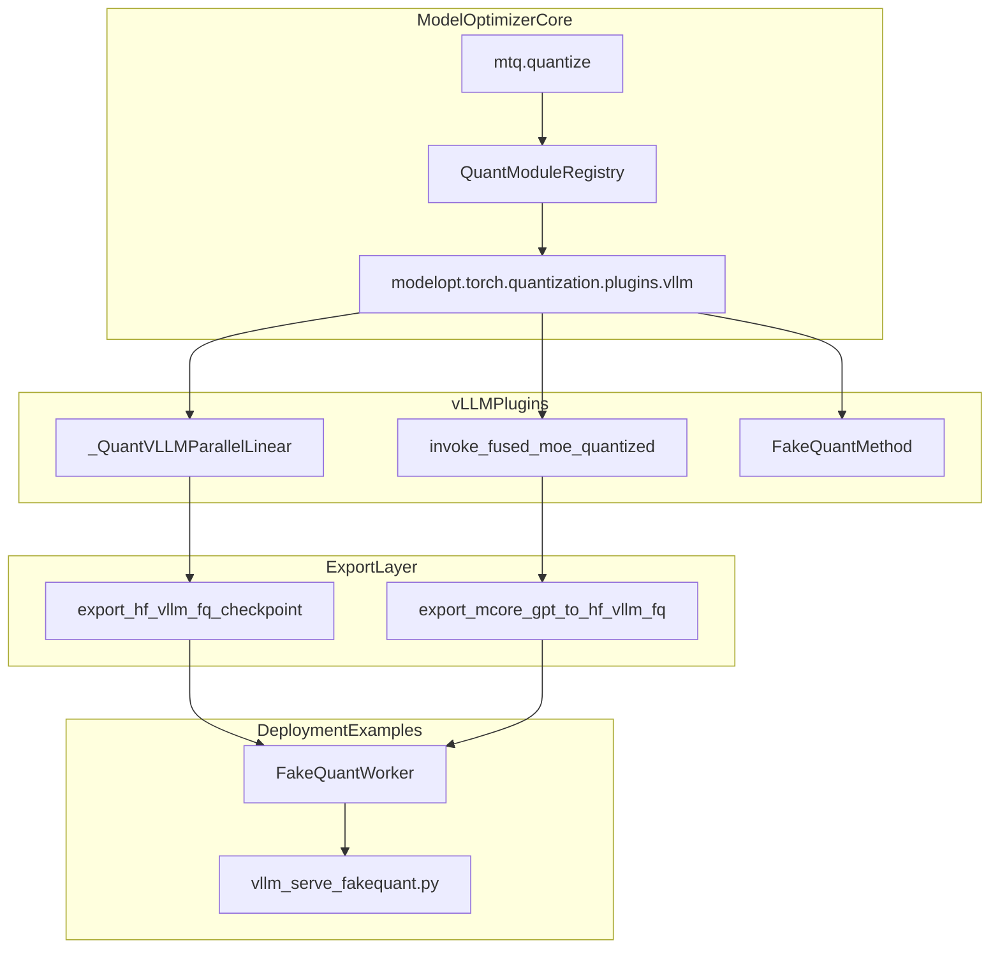
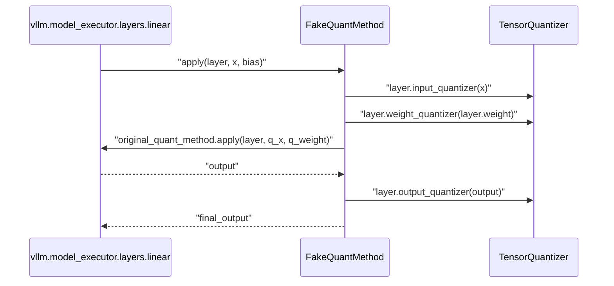
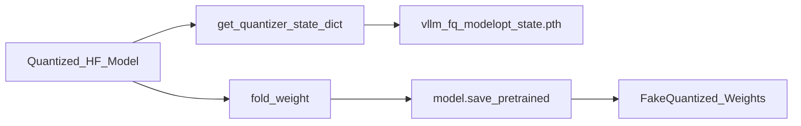

<!-- source: DeepWiki mcp.deepwiki.com · repo NVIDIA/Model-Optimizer · page 5.4 vLLM and SGLang Integration · fetched 2026-10-26 -->

# vLLM and SGLang Integration

Relevant source files

The following files were used as context for generating this wiki page:

- [examples/vllm_serve/Dockerfile](examples/vllm_serve/Dockerfile)
- [examples/vllm_serve/README.md](examples/vllm_serve/README.md)
- [examples/vllm_serve/fakequant_worker.py](examples/vllm_serve/fakequant_worker.py)
- [examples/vllm_serve/sparse_attn_worker.py](examples/vllm_serve/sparse_attn_worker.py)
- [examples/vllm_serve/vllm_mlflow_utils.py](examples/vllm_serve/vllm_mlflow_utils.py)
- [examples/vllm_serve/vllm_ptq_utils.py](examples/vllm_serve/vllm_ptq_utils.py)
- [examples/vllm_serve/vllm_reload_utils.py](examples/vllm_serve/vllm_reload_utils.py)
- [examples/vllm_serve/vllm_serve_fakequant.py](examples/vllm_serve/vllm_serve_fakequant.py)
- [examples/vllm_serve/vllm_serve_sparse_attn.py](examples/vllm_serve/vllm_serve_sparse_attn.py)
- [modelopt/torch/export/plugins/vllm_fakequant_hf.py](modelopt/torch/export/plugins/vllm_fakequant_hf.py)
- [modelopt/torch/export/plugins/vllm_fakequant_megatron.py](modelopt/torch/export/plugins/vllm_fakequant_megatron.py)
- [modelopt/torch/kernels/common/attention/decode_attention.py](modelopt/torch/kernels/common/attention/decode_attention.py)
- [modelopt/torch/kernels/quantization/attention/bmm2_qdq.py](modelopt/torch/kernels/quantization/attention/bmm2_qdq.py)
- [modelopt/torch/opt/dynamic.py](modelopt/torch/opt/dynamic.py)
- [modelopt/torch/opt/hparam.py](modelopt/torch/opt/hparam.py)
- [modelopt/torch/quantization/plugins/vllm.py](modelopt/torch/quantization/plugins/vllm.py)
- [modelopt/torch/sparsity/attention_sparsity/plugins/vllm.py](modelopt/torch/sparsity/attention_sparsity/plugins/vllm.py)
- [modelopt/torch/utils/mlflow.py](modelopt/torch/utils/mlflow.py)
- [tests/examples/vllm_serve/test_vllm_mlflow_utils.py](tests/examples/vllm_serve/test_vllm_mlflow_utils.py)
- [tests/gpu/torch/export/test_vllm_fakequant_hf_export.py](tests/gpu/torch/export/test_vllm_fakequant_hf_export.py)
- [tests/gpu/torch/kernels/common/attention/test_triton_fa_paged.py](tests/gpu/torch/kernels/common/attention/test_triton_fa_paged.py)
- [tests/gpu_vllm/torch/quantization/test_vllm_dynamic_modules.py](tests/gpu_vllm/torch/quantization/test_vllm_dynamic_modules.py)
- [tests/gpu_vllm/torch/sparsity/attention_sparsity/test_sparse_attn_worker.py](tests/gpu_vllm/torch/sparsity/attention_sparsity/test_sparse_attn_worker.py)
- [tests/gpu_vllm/torch/sparsity/attention_sparsity/test_vllm_plugin.py](tests/gpu_vllm/torch/sparsity/attention_sparsity/test_vllm_plugin.py)
- [tests/unit/torch/export/test_vllm_quantizer_reload.py](tests/unit/torch/export/test_vllm_quantizer_reload.py)
- [tests/unit/torch/opt/test_dynamic.py](tests/unit/torch/opt/test_dynamic.py)
- [tests/unit/torch/utils/test_mlflow.py](tests/unit/torch/utils/test_mlflow.py)

This page describes the native quantization support and deployment workflows for vLLM and SGLang inference engines. Model Optimizer provides specialized plugins and export utilities to ensure that quantized models (including FP8 and NVFP4 formats) can be served with high performance.

## Overview

Model Optimizer integrates with vLLM and SGLang through two primary mechanisms:
1. **Native Quantization Support**: Specialized `QuantModule` implementations for vLLM's parallel layers (e.g., `RowParallelLinear`, `ColumnParallelLinear`) that allow for "fake-quantization" during calibration or evaluation within the vLLM runtime [modelopt/torch/quantization/plugins/vllm.py:16-35]().
2. **Unified Export**: Utilities to export optimized PyTorch models into HuggingFace-compatible checkpoints containing the necessary scaling factors (`amax` values) and quantization metadata required by these engines [modelopt/torch/export/plugins/vllm_fakequant_hf.py:15-53]().

**Integration Architecture**

Sources: [modelopt/torch/quantization/plugins/vllm.py:16-40](), [modelopt/torch/export/plugins/vllm_fakequant_hf.py:49-53](), [examples/vllm_serve/fakequant_worker.py:158-165]()

## vLLM Quantization Plugins

To support quantization within vLLM's distributed architecture, Model Optimizer provides the `modelopt.torch.quantization.plugins.vllm` module [modelopt/torch/quantization/plugins/vllm.py:16-35](). This plugin registers quantized versions of vLLM's internal linear, attention, and MoE layers.

### Parallel Linear Layers
The plugin maps vLLM's parallel linear layers to `QuantModule` equivalents that utilize `FakeQuantMethod`. This allows the model to simulate quantization effects while maintaining the original weights in high precision for calibration [modelopt/torch/quantization/plugins/vllm.py:220-255]().

| vLLM Original Class | ModelOpt Quant Class |
| :--- | :--- |
| `vllm_linear.RowParallelLinear` | `_QuantVLLMRowParallelLinear` |
| `vllm_linear.ColumnParallelLinear` | `_QuantVLLMColumnParallelLinear` |
| `vllm_linear.MergedColumnParallelLinear` | `_QuantVLLMMergedColumnParallelLinear` |
| `vllm_linear.QKVParallelLinear` | `_QuantVLLMQKVParallelLinear` |

Sources: [modelopt/torch/quantization/plugins/vllm.py:220-255]()

### Attention and MLA Support
Model Optimizer supports specialized quantization for vLLM attention layers, including Multi-Head Latent Attention (MLA). The `build_vllm_attention_quant_cfg` function allows for per-operand (Q, K, P, V) quantization formats such as `nvfp4` or `fp8` [modelopt/torch/quantization/plugins/vllm.py:56-84](). For MLA models, `update_kv_cfg_for_mla` ensures that the `kv_c_bmm_quantizer` (compressed KV) is correctly configured [examples/vllm_serve/vllm_ptq_utils.py:137-160]().

### FakeQuantMethod Implementation
The `FakeQuantMethod` class wraps vLLM's standard linear methods. During the forward pass, it applies `input_quantizer` to activations and `weight_quantizer` to weights before calling the original vLLM execution logic [modelopt/torch/quantization/plugins/vllm.py:257-300]().

**FakeQuant Forward Data Flow**

Sources: [modelopt/torch/quantization/plugins/vllm.py:87-103](), [modelopt/torch/quantization/plugins/vllm.py:257-300]()

## Export Workflows

Model Optimizer supports exporting both HuggingFace (HF) and Megatron-Core (MCore) models specifically for vLLM fake-quantization deployment.

### HuggingFace to vLLM Export
The `export_hf_vllm_fq_checkpoint` function extracts quantizer states and saves them into a `vllm_fq_modelopt_state.pth` file [modelopt/torch/export/plugins/vllm_fakequant_hf.py:49-53](). It then folds the weight quantizers into the model weights via `fold_weight` and saves the model in its original data type (e.g., BF16) to ensure the inference engine receives fake-quantized weights [examples/vllm_serve/fakequant_worker.py:149-156]().

**Export Data Flow**

Sources: [modelopt/torch/export/plugins/vllm_fakequant_hf.py:143-200](), [examples/vllm_serve/fakequant_worker.py:149-156]()

### Megatron-Core to vLLM Export
For distributed MCore models, `export_mcore_gpt_to_hf_vllm_fq` handles the gathering of quantizer tensors across multiple ranks [modelopt/torch/export/plugins/vllm_fakequant_megatron.py:30-35]().

1. **Gathering**: `gather_mcore_vllm_fq_quantized_state_dict` collects quantizer sidecars from all shards across ranks [modelopt/torch/export/plugins/vllm_fakequant_megatron.py:33-54]().
2. **Merging**: `DistributedProcessGroup.get_dist_syncd_obj` is used to sync and merge these dictionaries on Rank 0, saving them as `quantizer_state.pth` [modelopt/torch/export/plugins/vllm_fakequant_megatron.py:62-68]().
3. **Conversion**: The `VllmFqGPTModelExporter` (subclass of `GPTModelExporter`) handles the conversion of MCore structures to HF-compatible formats while folding weight quantizers via `_get_quantized_state` [modelopt/torch/export/plugins/vllm_fakequant_megatron.py:71-130]().

Sources: [modelopt/torch/export/plugins/vllm_fakequant_megatron.py:33-130]()

## Serving with FakeQuant

Model Optimizer includes a specialized `FakeQuantWorker` for vLLM serving. This allows for the evaluation of quantized models even when native kernel support for a specific format is not yet available [examples/vllm_serve/fakequant_worker.py:23-42]().

### State Reload and Conversion
When serving a fake-quantized model, `restore_from_modelopt_state_vllm` and `convert_modelopt_state_to_vllm` are used to map HuggingFace-style quantizer keys to the naming conventions expected by vLLM [examples/vllm_serve/vllm_reload_utils.py:25-40]().

| HF Pattern | vLLM Target | Logic |
| :--- | :--- | :--- |
| `gate_proj`, `up_proj` | `gate_up_proj` | `_group_keys_for_vllm` |
| `q_proj`, `k_proj`, `v_proj` | `qkv_proj` | `_group_keys_for_vllm` |
| `experts.*.gate_proj` | `experts.routed_experts.w13` | MoE layer fusion (vLLM >= 0.24) |

Sources: [examples/vllm_serve/vllm_reload_utils.py:85-155](), [examples/vllm_serve/fakequant_worker.py:67-82]()

### Serving Configuration
The `vllm_serve_fakequant.py` entrypoint allows users to specify quantization configurations via environment variables [examples/vllm_serve/vllm_serve_fakequant.py:74-85]():

* `QUANT_CFG`: Primary quantization format (e.g., `NVFP4_DEFAULT_CFG`).
* `KV_QUANT_CFG`: Format for KV Cache quantization.
* `MODELOPT_STATE_PATH`: Path to the exported `vllm_fq_modelopt_state.pth`.
* `QUANT_FILE_PATH`: Path to the exported `quantizer_state.pth`.

Sources: [examples/vllm_serve/fakequant_worker.py:43-52](), [examples/vllm_serve/README.md:20-32](), [examples/vllm_serve/vllm_serve_fakequant.py:74-85]()

## Summary of Integration Features

| Feature | vLLM Support | SGLang Support | Code Pointer |
| :--- | :--- | :--- | :--- |
| Parallel Linear Quantization | Yes | Yes (via HF export) | [modelopt/torch/quantization/plugins/vllm.py:220]() |
| Fused MoE Quantization | Yes | Yes (via HF export) | [modelopt/torch/quantization/plugins/vllm.py:328]() |
| MLA Attention Quantization | Yes | Experimental | [examples/vllm_serve/vllm_ptq_utils.py:137]() |
| Cross/Encoder Attention | Yes | No | [modelopt/torch/quantization/plugins/vllm.py:182-195]() |
| MLflow Tracking | Yes | No | [examples/vllm_serve/vllm_mlflow_utils.py:1]() |

Sources: [modelopt/torch/quantization/plugins/vllm.py:16-105](), [examples/vllm_serve/vllm_ptq_utils.py:137-160](), [modelopt/torch/export/plugins/vllm_fakequant_megatron.py:33-68]()

---

