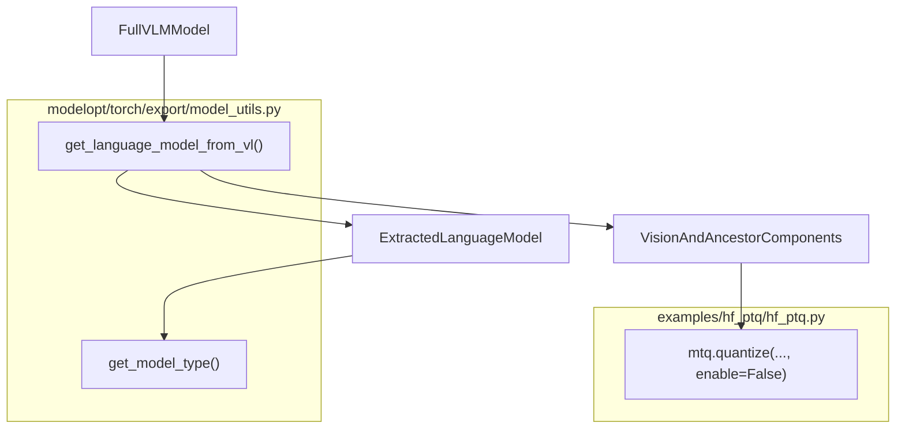
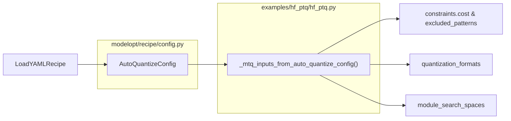

<!-- source: DeepWiki mcp.deepwiki.com · repo NVIDIA/Model-Optimizer · page 6 Advanced Use Cases · fetched 2026-10-26 -->

# Advanced Use Cases

Relevant source files

The following files were used as context for generating this wiki page:

- [examples/hf_ptq/README.md](examples/hf_ptq/README.md)
- [examples/hf_ptq/example_utils.py](examples/hf_ptq/example_utils.py)
- [examples/hf_ptq/hf_ptq.py](examples/hf_ptq/hf_ptq.py)
- [examples/hf_ptq/requirements.txt](examples/hf_ptq/requirements.txt)
- [modelopt/torch/export/hf_export_handlers.py](modelopt/torch/export/hf_export_handlers.py)
- [modelopt/torch/export/registry.py](modelopt/torch/export/registry.py)
- [modelopt/torch/export/unified_export_hf_streaming.py](modelopt/torch/export/unified_export_hf_streaming.py)
- [modelopt_recipes/huggingface/qwen3_6_moe/auto_quantize/w4a16_nvfp4_fp8_module_spaces_at_6p0bits-active_moe.yaml](modelopt_recipes/huggingface/qwen3_6_moe/auto_quantize/w4a16_nvfp4_fp8_module_spaces_at_6p0bits-active_moe.yaml)
- [modelopt_recipes/ptq.md](modelopt_recipes/ptq.md)
- [tests/examples/hf_ptq/test_example_utils.py](tests/examples/hf_ptq/test_example_utils.py)
- [tests/examples/hf_ptq/test_hf_ptq_args.py](tests/examples/hf_ptq/test_hf_ptq_args.py)
- [tests/unit/torch/export/test_export_registry.py](tests/unit/torch/export/test_export_registry.py)
- [tests/unit/torch/export/test_offload_export.py](tests/unit/torch/export/test_offload_export.py)

This page covers specialized optimization scenarios and advanced techniques beyond standard post-training quantization workflows. These use cases address specific model architectures—including Diffusion models, Vision-Language Models (VLMs), Large Language Models (LLMs) with complex search or training, and cross-platform or local neural architecture search deployment requirements.

For basic quantization workflows, see [Post-Training Quantization (PTQ)](#3.1), [Quantization-Aware Training (QAT)](#3.2), and [ONNX Model Quantization](#4.1). For core quantization concepts, see [TensorQuantizer Module](#7.2) and [Calibration Algorithms](#7.3).

Sources: [examples/hf_ptq/README.md:1-25](), [modelopt_recipes/ptq.md:1-25]()

## 6.1. AutoQuantize Mixed Precision Search

Automated mixed precision search uses `auto_quantize` to discover optimal per-layer quantization formats under given bit-width or memory constraints [examples/hf_ptq/hf_ptq.py:65-75](). This approach evaluates multiple candidate quantization configurations (such as mixing NVFP4 and FP8 formats) to maximize accuracy while adhering to strict average bit-width budgets [tests/examples/hf_ptq/test_hf_ptq_args.py:58-85]().

For details, see [AutoQuantize Mixed Precision Search](#6.1).

Sources: [examples/hf_ptq/hf_ptq.py:65-75](), [tests/examples/hf_ptq/test_hf_ptq_args.py:58-85]()

## 6.2. Diffusion Model Optimization

Quantizing and deploying transformer-based diffusion models (such as Stable Diffusion, Flux, and other diffusers models) requires specialized handling of time embeddings, patch projections, and attention blocks. Model Optimizer supports these architectures via tailored filtering and block-range configurations, alongside advanced distillation techniques like DMD2 via `modelopt.torch.fastgen` [examples/hf_ptq/README.md:96-111]().

For details, see [Diffusion Model Optimization](#6.2).

Sources: [examples/hf_ptq/README.md:96-111]()

## 6.3. Vision-Language Models (VLMs)

Vision-Language Models (e.g., Qwen2-VL, LLaVA, and Nemotron-VL) combine vision encoders with large language decoders. Model Optimizer handles these multimodal pipelines by extracting the underlying language model or applying selective quantization that excludes non-text components (such as vision towers or MTP modules) from quantization and export [examples/hf_ptq/example_utils.py:150-156](), [examples/hf_ptq/hf_ptq.py:125-155]().

For details, see [Vision-Language Models (VLMs)](#6.3).

Sources: [examples/hf_ptq/example_utils.py:150-156](), [examples/hf_ptq/hf_ptq.py:125-155]()

## 6.4. Large Language Model Optimization

Advanced LLM optimization workflows encompass post-training quantization (PTQ), quantization-aware training (QAT), pruning, and chained optimization recipes. These workflows support complex architectures like Mixture-of-Experts (MoE) and DeepSeek models, applying expert-aware calibration and weight casting (such as `cast_mxfp4_to_nvfp4`) [examples/hf_ptq/hf_ptq.py:28-30](), [modelopt_recipes/ptq.md:33-60]().

For details, see [Large Language Model Optimization](#6.4).

Sources: [examples/hf_ptq/hf_ptq.py:28-30](), [modelopt_recipes/ptq.md:33-60]()

## 6.5. Windows and ONNX Runtime Deployment

Windows-specific deployment workflows leverage ONNX Runtime, Olive, and GenAI extensions to deploy quantized Large Language Models and audio models like Whisper on Windows hardware. These pipelines handle graph conversion, QDQ pattern insertion, and execution provider routing [examples/hf_ptq/README.md:20-25]().

For details, see [Windows and ONNX Runtime Deployment](#6.5).

Sources: [examples/hf_ptq/README.md:20-25]()

## 6.6. Puzzletron Local NAS

Puzzletron provides MIP-based local neural architecture search for heterogeneous layer optimization, enabling fine-grained pruning of FFN widths and expert removal in large models. This allows custom trade-offs between model footprint and inference throughput [CHANGELOG.rst:33-43]().

For details, see [Puzzletron Local NAS](#6.6).

Sources: [CHANGELOG.rst:33-43]()

## System to Code Mapping

The following diagrams bridge natural language concepts to specific code entities in the codebase.

### VLM Language Model Extraction Flow

Sources: [examples/hf_ptq/hf_ptq.py:125-155](), [modelopt/torch/export/model_utils.py:80-123]()

### AutoQuantize Configuration Pipeline

Sources: [tests/examples/hf_ptq/test_hf_ptq_args.py:58-135](), [examples/hf_ptq/hf_ptq.py:65-75]()

---

