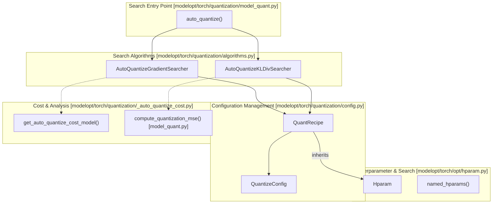
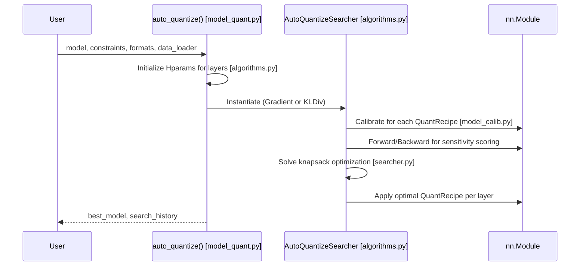

<!-- source: DeepWiki mcp.deepwiki.com · repo NVIDIA/Model-Optimizer · page 6.1 AutoQuantize Mixed Precision Search · fetched 2026-10-26 -->

# AutoQuantize Mixed Precision Search

<details>
<summary>Relevant source files</summary>

The following files were used as context for generating this wiki page:

- [examples/hf_ptq/README.md](examples/hf_ptq/README.md)
- [examples/hf_ptq/example_utils.py](examples/hf_ptq/example_utils.py)
- [examples/hf_ptq/hf_ptq.py](examples/hf_ptq/hf_ptq.py)
- [examples/hf_ptq/requirements.txt](examples/hf_ptq/requirements.txt)
- [modelopt/torch/export/hf_export_handlers.py](modelopt/torch/export/hf_export_handlers.py)
- [modelopt/torch/export/registry.py](modelopt/torch/export/registry.py)
- [modelopt/torch/export/unified_export_hf_streaming.py](modelopt/torch/export/unified_export_hf_streaming.py)
- [modelopt/torch/opt/plugins/mcore_dist_checkpointing.py](modelopt/torch/opt/plugins/mcore_dist_checkpointing.py)
- [modelopt/torch/quantization/_auto_quantize_cost.py](modelopt/torch/quantization/_auto_quantize_cost.py)
- [modelopt/torch/quantization/algorithms.py](modelopt/torch/quantization/algorithms.py)
- [modelopt/torch/quantization/conversion.py](modelopt/torch/quantization/conversion.py)
- [modelopt/torch/quantization/model_quant.py](modelopt/torch/quantization/model_quant.py)
- [modelopt/torch/quantization/nn/__init__.py](modelopt/torch/quantization/nn/__init__.py)
- [modelopt/torch/quantization/nn/modules/quant_linear.py](modelopt/torch/quantization/nn/modules/quant_linear.py)
- [modelopt/torch/quantization/nn/modules/quant_module.py](modelopt/torch/quantization/nn/modules/quant_module.py)
- [modelopt/torch/quantization/plugins/custom.py](modelopt/torch/quantization/plugins/custom.py)
- [modelopt/torch/quantization/plugins/transformer_engine.py](modelopt/torch/quantization/plugins/transformer_engine.py)
- [modelopt/torch/utils/plugins/megatron_calibration.py](modelopt/torch/utils/plugins/megatron_calibration.py)
- [modelopt_recipes/huggingface/qwen3_6_moe/auto_quantize/w4a16_nvfp4_fp8_module_spaces_at_6p0bits-active_moe.yaml](modelopt_recipes/huggingface/qwen3_6_moe/auto_quantize/w4a16_nvfp4_fp8_module_spaces_at_6p0bits-active_moe.yaml)
- [modelopt_recipes/ptq.md](modelopt_recipes/ptq.md)
- [tests/examples/hf_ptq/test_example_utils.py](tests/examples/hf_ptq/test_example_utils.py)
- [tests/examples/hf_ptq/test_hf_ptq_args.py](tests/examples/hf_ptq/test_hf_ptq_args.py)
- [tests/gpu_megatron/torch/quantization/plugins/test_transformer_engine.py](tests/gpu_megatron/torch/quantization/plugins/test_transformer_engine.py)
- [tests/unit/torch/export/test_export_registry.py](tests/unit/torch/export/test_export_registry.py)
- [tests/unit/torch/export/test_offload_export.py](tests/unit/torch/export/test_offload_export.py)
- [tests/unit/torch/quantization/plugins/test_huggingface.py](tests/unit/torch/quantization/plugins/test_huggingface.py)
- [tests/unit/torch/quantization/test_autoquant.py](tests/unit/torch/quantization/test_autoquant.py)
- [tests/unit/torch/quantization/test_calib.py](tests/unit/torch/quantization/test_calib.py)
- [tests/unit/torch/quantization/test_tensor_quant_cpu.py](tests/unit/torch/quantization/test_tensor_quant_cpu.py)

</details>


AutoQuantize (`auto_quantize`) is an advanced post-training quantization algorithm in NVIDIA Model Optimizer that automatically determines the optimal quantization format for each layer in a neural network while satisfying user-specified performance and memory constraints [modelopt/torch/quantization/model_quant.py:49](). Unlike single-format quantization where all layers use a uniform precision (e.g., all FP8 or all NVFP4), AutoQuantize performs a per-layer mixed-precision search to optimize the tradeoff between model accuracy and compression [modelopt/torch/quantization/algorithms.py:41]().

## Overview

AutoQuantize addresses the challenge of layer-wise precision sensitivity: different layers react differently to precision reduction. By allocating higher-precision formats (such as FP8 or unquantized BF16) to sensitive layers and aggressive lower-precision formats (such as NVFP4 or INT4) to robust layers, AutoQuantize achieves superior accuracy-compression tradeoffs [modelopt/torch/quantization/algorithms.py:67-82]().

The algorithm executes in three primary phases:
1. **Sensitivity Analysis**: Computes a sensitivity score for each candidate layer using gradient-based backpropagation or KL divergence [modelopt/torch/quantization/model_quant.py:41-42]().
2. **Format Evaluation**: Evaluates candidate quantization formats defined via `QuantRecipe` objects across layers [modelopt/torch/quantization/algorithms.py:41]().
3. **Constraint Optimization**: Solves a knapsack-style optimization problem to select per-layer formats minimizing accuracy loss under the given `effective_bits` or memory constraints [modelopt/torch/quantization/_auto_quantize_cost.py:51-52]().

### System Architecture: Logic to Code Mapping

The following diagram maps the high-level mixed-precision search concepts to their corresponding code entities within the `modelopt.torch.quantization` and `modelopt.torch.opt` modules.

**Diagram: AutoQuantize Code Entity Map**


Sources: [modelopt/torch/quantization/model_quant.py:41-55](), [modelopt/torch/quantization/algorithms.py:41-42](), [modelopt/torch/opt/hparam.py:37-38]()

---

## Core Components

### QuantRecipe and Compression Estimation

A `QuantRecipe` wraps a `QuantizeConfig` to support mixed-precision candidate spaces, calculating an effective bit-width cost metric used during optimization [modelopt/torch/quantization/algorithms.py:41](). Compression ratios are derived by inspecting the `num_bits` fields across quantizer attribute configurations, supporting standard weights and active Mixture-of-Experts (MoE) expert ratios [modelopt/torch/quantization/_auto_quantize_cost.py:44-50]().

| Format | Approximate Bits | Compression Ratio (Relative to 16-bit) |
| :--- | :--- | :--- |
| FP8 (W8A8) | 8 | 0.5 [modelopt/torch/quantization/algorithms.py:186-187]() |
| INT4 / NVFP4 (W4A4) | 4 | 0.25 [modelopt/torch/quantization/algorithms.py:187]() |
| BF16 / FP16 | 16 | 1.0 [modelopt/torch/quantization/algorithms.py:174]() |

Sources: [modelopt/torch/quantization/algorithms.py:174-190](), [modelopt/torch/quantization/_auto_quantize_cost.py:44-50]()

### Search Space Definition

The search space utilizes the hyperparameter framework provided by `Hparam`. `QuantRecipe` integrates directly with `Hparam`, treating individual layer configurations as tunable choices managed via `named_hparams` [modelopt/torch/quantization/algorithms.py:37-38]().

Sources: [modelopt/torch/quantization/algorithms.py:37-38](), [modelopt/torch/opt/utils.py:38]()

---

## Sensitivity Computation Methods

AutoQuantize implements searchers within `modelopt.torch.quantization.algorithms` to quantify layer sensitivity.

### Gradient-Based Searcher (`AutoQuantizeGradientSearcher`)
Measures global loss sensitivity to quantization perturbations via backpropagation gradients [modelopt/torch/quantization/model_quant.py:41]().
1. **Forward Pass**: Evaluates the model and computes the loss using a designated `loss_func` [modelopt/torch/quantization/model_quant.py:200-204]().
2. **Backward Pass**: Computes parameter gradients.
3. **Ranking**: Aggregates gradient magnitudes on quantized weights to score importance.

Sources: [modelopt/torch/quantization/model_quant.py:41](), [modelopt/torch/quantization/model_quant.py:200-204]()

### KL Divergence Searcher (`AutoQuantizeKLDivSearcher`)
Measures the Kullback-Leibler divergence between baseline (FP16/BF16) and quantized activation probability distributions [modelopt/torch/quantization/model_quant.py:41](). This approach is suited for unsupervised or generation-only tasks where explicit target labels are absent.

Sources: [modelopt/torch/quantization/model_quant.py:41]()

---

## Implementation Details

### The auto_quantize API Execution Flow

The `auto_quantize` function orchestrates the search loop, instantiating the searcher, performing calibration per recipe, evaluating sensitivity, and applying the optimal per-layer configuration [modelopt/torch/quantization/model_quant.py:49]().

**Diagram: auto_quantize Execution Flow**


Sources: [modelopt/torch/quantization/model_quant.py:49](), [modelopt/torch/quantization/model_quant.py:161-220](), [modelopt/torch/quantization/algorithms.py:31-42]()

### Effective Bits and MoE Constraints

Constraints such as `effective_bits` are validated and normalized by `normalize_auto_quantize_constraints` [modelopt/torch/quantization/_auto_quantize_cost.py:51-52](). For MoE architectures, the `active_moe_expert_ratio` parameter scales the bit-width cost calculation to reflect sparse expert activation during inference [modelopt/torch/quantization/_auto_quantize_cost.py:45-47]().

Sources: [modelopt/torch/quantization/model_quant.py:167](), [modelopt/torch/quantization/_auto_quantize_cost.py:44-52]()

---

## Advanced Usage

### Quantizer State and MSE Analysis
- **`compute_quantization_mse`**: Computes reconstruction mean squared error for individual quantizers to audit noise introduction [modelopt/torch/quantization/model_quant.py:51]().
- **State Management**: `enable_quantizer` and `disable_quantizer` toggle fake-quantization or scaling buffers dynamically during search iterations [modelopt/torch/quantization/model_quant.py:52-53](), [modelopt/torch/quantization/nn/modules/tensor_quantizer.py:31]().

Sources: [modelopt/torch/quantization/model_quant.py:51-53](), [modelopt/torch/quantization/nn/modules/tensor_quantizer.py:31]()

### Usage Example

```python
import modelopt.torch.quantization as mtq

# Define search space using recipes
search_formats = [
    load_recipe("general/ptq/int4_blockwise_weight_only"),
    load_recipe("general/ptq/fp8_default-kv_fp8"),
    load_recipe("general/ptq/nvfp4_default-kv_fp8")
]

# Run mixed-precision search
best_model, history = mtq.auto_quantize(
    model,
    constraints={"effective_bits": 6.0},
    quantization_formats=search_formats,
    data_loader=calib_loader,
    forward_step=lambda m, b: m(b),
    loss_func=lambda out, data: out.loss,
    method="gradient"
)
```

Sources: [modelopt/torch/quantization/model_quant.py:49](), [modelopt/torch/quantization/algorithms.py:41]()

---

