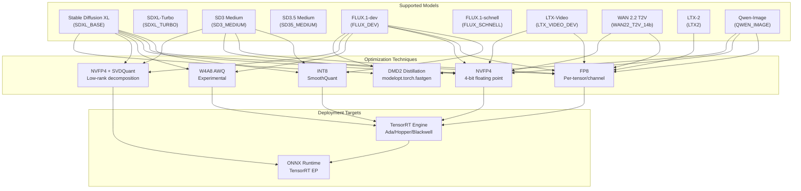
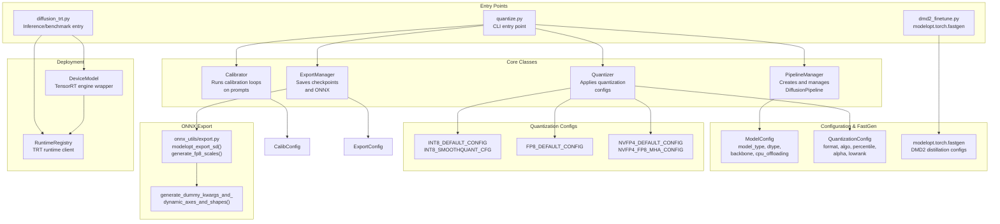
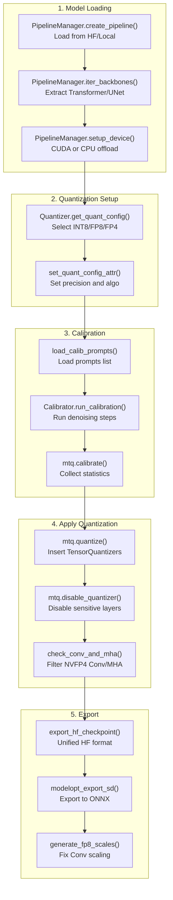
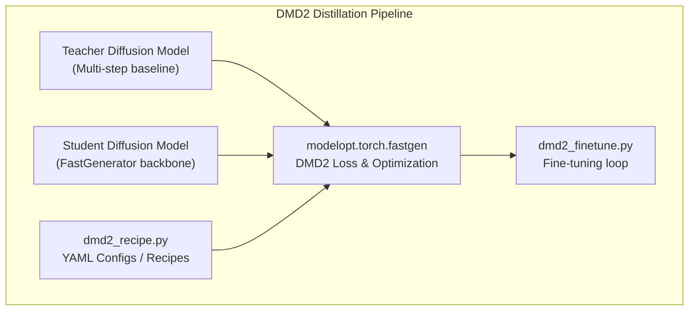

<!-- source: DeepWiki mcp.deepwiki.com · repo NVIDIA/Model-Optimizer · page 6.2 Diffusion Model Optimization · fetched 2026-10-26 -->

# Diffusion Model Optimization

<details>
<summary>Relevant source files</summary>

The following files were used as context for generating this wiki page:

- [docs/source/deployment/3_unified_hf.rst](docs/source/deployment/3_unified_hf.rst)
- [examples/diffusers/README.md](examples/diffusers/README.md)
- [examples/diffusers/distillation/README.md](examples/diffusers/distillation/README.md)
- [examples/diffusers/distillation/distillation_trainer.py](examples/diffusers/distillation/distillation_trainer.py)
- [examples/diffusers/distillation/requirements.txt](examples/diffusers/distillation/requirements.txt)
- [examples/diffusers/fastgen/README.md](examples/diffusers/fastgen/README.md)
- [examples/diffusers/fastgen/configs/dmd2_qwen_image.yaml](examples/diffusers/fastgen/configs/dmd2_qwen_image.yaml)
- [examples/diffusers/fastgen/dmd2_finetune.py](examples/diffusers/fastgen/dmd2_finetune.py)
- [examples/diffusers/fastgen/dmd2_recipe.py](examples/diffusers/fastgen/dmd2_recipe.py)
- [examples/diffusers/fastgen/export_diffusers_qwen_image.py](examples/diffusers/fastgen/export_diffusers_qwen_image.py)
- [examples/diffusers/fastgen/fastgen_checkpoint.py](examples/diffusers/fastgen/fastgen_checkpoint.py)
- [examples/diffusers/fastgen/fastgen_data/__init__.py](examples/diffusers/fastgen/fastgen_data/__init__.py)
- [examples/diffusers/fastgen/fastgen_data/collate_fns.py](examples/diffusers/fastgen/fastgen_data/collate_fns.py)
- [examples/diffusers/fastgen/fastgen_data/text_to_image_dataset.py](examples/diffusers/fastgen/fastgen_data/text_to_image_dataset.py)
- [examples/diffusers/fastgen/inference_dmd2_qwen_image.py](examples/diffusers/fastgen/inference_dmd2_qwen_image.py)
- [examples/diffusers/fastgen/make_negative_prompt_embedding.py](examples/diffusers/fastgen/make_negative_prompt_embedding.py)
- [examples/diffusers/fastgen/preprocess/__init__.py](examples/diffusers/fastgen/preprocess/__init__.py)
- [examples/diffusers/fastgen/requirements.txt](examples/diffusers/fastgen/requirements.txt)
- [examples/diffusers/quantization/.gitignore](examples/diffusers/quantization/.gitignore)
- [examples/diffusers/quantization/calibration.py](examples/diffusers/quantization/calibration.py)
- [examples/diffusers/quantization/config.py](examples/diffusers/quantization/config.py)
- [examples/diffusers/quantization/diffusion_trt.py](examples/diffusers/quantization/diffusion_trt.py)
- [examples/diffusers/quantization/models_utils.py](examples/diffusers/quantization/models_utils.py)
- [examples/diffusers/quantization/onnx_utils/export.py](examples/diffusers/quantization/onnx_utils/export.py)
- [examples/diffusers/quantization/pipeline_manager.py](examples/diffusers/quantization/pipeline_manager.py)
- [examples/diffusers/quantization/quantize.py](examples/diffusers/quantization/quantize.py)
- [examples/diffusers/quantization/quantize_config.py](examples/diffusers/quantization/quantize_config.py)
- [examples/diffusers/quantization/utils.py](examples/diffusers/quantization/utils.py)
- [examples/windows/diffusers/qad_example/README.md](examples/windows/diffusers/qad_example/README.md)
- [examples/windows/diffusers/qad_example/requirements.txt](examples/windows/diffusers/qad_example/requirements.txt)
- [examples/windows/diffusers/qad_example/sample_example_qad_diffusers.py](examples/windows/diffusers/qad_example/sample_example_qad_diffusers.py)
- [modelopt/torch/export/diffusers_utils.py](modelopt/torch/export/diffusers_utils.py)
- [modelopt/torch/fastgen/__init__.py](modelopt/torch/fastgen/__init__.py)
- [modelopt/torch/fastgen/config.py](modelopt/torch/fastgen/config.py)
- [modelopt/torch/quantization/plugins/__init__.py](modelopt/torch/quantization/plugins/__init__.py)
- [modelopt/torch/quantization/plugins/diffusion/diffusers.py](modelopt/torch/quantization/plugins/diffusion/diffusers.py)
- [modelopt/torch/quantization/plugins/diffusion/fastvideo.py](modelopt/torch/quantization/plugins/diffusion/fastvideo.py)
- [modelopt/torch/quantization/plugins/diffusion/ltx2.py](modelopt/torch/quantization/plugins/diffusion/ltx2.py)
- [modelopt/torch/trace/modules/concat.py](modelopt/torch/trace/modules/concat.py)
- [plugins/modelopt/skills/deployment/references/support-matrix.md](plugins/modelopt/skills/deployment/references/support-matrix.md)
- [tests/_test_utils/torch/diffusers_models.py](tests/_test_utils/torch/diffusers_models.py)
- [tests/examples/diffusers/conftest.py](tests/examples/diffusers/conftest.py)
- [tests/examples/diffusers/test_diffusers.py](tests/examples/diffusers/test_diffusers.py)
- [tests/examples/diffusers/test_export_diffusers_hf_ckpt.py](tests/examples/diffusers/test_export_diffusers_hf_ckpt.py)
- [tests/gpu/torch/export/test_export_diffusers.py](tests/gpu/torch/export/test_export_diffusers.py)
- [tests/unit/torch/export/test_export_diffusers.py](tests/unit/torch/export/test_export_diffusers.py)

</details>


## Purpose and Scope

This document covers optimization techniques for diffusion models used in image and video generation tasks. Model Optimizer provides post-training quantization (PTQ), quantization-aware training (QAT), and distribution-matching distillation (DMD2) workflows via `modelopt.torch.fastgen` specifically designed for diffusion model architectures such as UNet and Transformer-based backbones [examples/diffusers/README.md:1-26]().

For general quantization concepts and PyTorch-based optimization, see [Post-Training Quantization (PTQ)](./3.1). For knowledge distillation techniques applicable to other model types, see [Knowledge Distillation](./3.4). For ONNX-specific quantization workflows, see [ONNX Quantization](./4.1).

Sources: [examples/diffusers/README.md:1-26](), [examples/diffusers/quantization/quantize.py:1-50]()

## Overview

Diffusion models like Stable Diffusion XL, FLUX, SD3, and Qwen-Image generate high-quality images through iterative denoising steps. The backbone component (UNet or Transformer) typically consumes over 95% of end-to-end inference latency [examples/diffusers/README.md:87-90](). Model Optimizer enables compression of these backbones to INT8, FP8, or NVFP4 precision with minimal quality degradation, achieving 2x-4x memory reduction and significant speedup on NVIDIA GPUs [examples/diffusers/README.md:4-6](). Additionally, `modelopt.torch.fastgen` provides fast generation distillation workflows such as DMD2 (Distribution Matching Distillation) to reduce generation steps drastically.

The optimization workflow consists of three main stages:
1. **Quantization** - Convert model precision and calibrate scaling factors using sample prompts.
2. **Distillation (FastGen / DMD2)** - Distill multi-step diffusion pipelines into few-step or single-step fast generators using `modelopt.torch.fastgen`.
3. **Export & Deployment** - Generate ONNX models with QDQ (Quantize-Dequantize) nodes, unified HF checkpoints, and compiled TensorRT engines.

Sources: [examples/diffusers/README.md:1-26](), [examples/diffusers/quantization/quantize.py:1-50]()

## Supported Models and Formats

### Model Support Matrix



**Model Type Enumeration:**
The `ModelType` enum [examples/diffusers/quantization/models_utils.py:52-66]() defines supported models and maps them to their respective HuggingFace IDs in `MODEL_REGISTRY` [examples/diffusers/quantization/models_utils.py:97-110]().

| ModelType Enum | HuggingFace Model ID | Backbone Type |
|---|---|---|
| `SDXL_BASE` | stabilityai/stable-diffusion-xl-base-1.0 | `UNet2DConditionModel` |
| `SDXL_TURBO` | stabilityai/sdxl-turbo | `UNet2DConditionModel` |
| `SD3_MEDIUM` | stabilityai/stable-diffusion-3-medium-diffusers | `SD3Transformer2DModel` |
| `SD35_MEDIUM` | stabilityai/stable-diffusion-3.5-medium | `SD3Transformer2DModel` |
| `FLUX_DEV` | black-forest-labs/FLUX.1-dev | `FluxTransformer2DModel` |
| `FLUX_SCHNELL` | black-forest-labs/FLUX.1-schnell | `FluxTransformer2DModel` |
| `LTX_VIDEO_DEV` | Lightricks/LTX-Video-0.9.7-dev | `LTXVideoTransformer3DModel` |
| `LTX2` | Lightricks/LTX-2 | `LTX2-specific-pipeline` |
| `WAN22_T2V_14b` | Wan-AI/Wan2.2-T2V-A14B-Diffusers | `WanTransformer3DModel` |
| `QWEN_IMAGE` | Qwen/Qwen-Image | `QwenImageTransformer2DModel` |

Sources: [examples/diffusers/quantization/models_utils.py:52-125](), [examples/diffusers/README.md:71-78]()

## Architecture and Core Components

### Component Class Diagram



Sources: [examples/diffusers/quantization/quantize.py:93-275](), [examples/diffusers/quantization/pipeline_manager.py:29-180](), [examples/diffusers/quantization/calibration.py:28-107](), [examples/diffusers/quantization/diffusion_trt.py:43-49](), [examples/diffusers/fastgen/dmd2_finetune.py:1-50]()

### Key Class Responsibilities

**PipelineManager** [examples/diffusers/quantization/pipeline_manager.py:29-180]()
- Creates `DiffusionPipeline` instances using `MODEL_PIPELINE` registry [examples/diffusers/quantization/pipeline_manager.py:48-75]().
- Handles specialized initialization for LTX-2 via `ltx2_plugin.register_ltx2_quant_linear()` [examples/diffusers/quantization/pipeline_manager.py:95-101]().
- Handles device placement including CUDA or CPU offloading [examples/diffusers/quantization/pipeline_manager.py:137-156]().
- Manages optional components like LTX-Video upsampler [examples/diffusers/quantization/pipeline_manager.py:116-127]().
- Provides `iter_backbones()` method to yield model components like UNet or Transformer [examples/diffusers/quantization/pipeline_manager.py:163-180]().

**Calibrator** [examples/diffusers/quantization/calibration.py:28-107]()
- Loads calibration prompts from HuggingFace datasets or text files via `load_calib_prompts` [examples/diffusers/quantization/utils.py:138-151]().
- Runs forward passes through the pipeline with batched prompts using `run_calibration` [examples/diffusers/quantization/calibration.py:75-106]().
- Handles specialized calibration logic for video models like LTX-2 and WAN which require frame-specific parameters [examples/diffusers/quantization/calibration.py:90-97]().

**Quantizer** [examples/diffusers/quantization/quantize.py:93-204]()
- Builds quantization configs based on format (INT8/FP8/FP4) in `get_quant_config` [examples/diffusers/quantization/quantize.py:111-170]().
- Applies quantization using `mtq.quantize()` API in `quantize_model` [examples/diffusers/quantization/quantize.py:171-203]().
- Disables specific quantizers using model-specific filter functions via `mtq.disable_quantizer` [examples/diffusers/quantization/quantize.py:199]().
- Validates LoRA layer fusion before quantization via `check_lora()` [examples/diffusers/quantization/utils.py:171-183]().

Sources: [examples/diffusers/quantization/quantize.py:93-275](), [examples/diffusers/quantization/pipeline_manager.py:29-180]()

## Quantization Workflow (PTQ)

### End-to-End PTQ Pipeline



Sources: [examples/diffusers/quantization/quantize.py:111-203](), [examples/diffusers/quantization/pipeline_manager.py:80-161]()

### Quantization Algorithm Selection

The `Quantizer.get_quant_config()` method [examples/diffusers/quantization/quantize.py:111-170]() selects the appropriate configuration:

**INT8 with SmoothQuant:**
- Uses `mtq.INT8_SMOOTHQUANT_CFG` [examples/diffusers/quantization/quantize.py:126]().
- Applies `reset_set_int8_config()` to set percentile and collect method [examples/diffusers/quantization/config.py:56-91]().
- Supports multiple collect methods via `CollectMethod` enum [examples/diffusers/quantization/quantize_config.py:60-68]().

**FP8:**
- Uses `FP8_DEFAULT_CONFIG` [examples/diffusers/quantization/config.py:22-24]().
- Enables MHA quantization if `quantize_mha` is set [examples/diffusers/quantization/quantize.py:163-170]().

**NVFP4:**
- Uses `NVFP4_DEFAULT_CONFIG` or `NVFP4_FP8_MHA_CONFIG` for FLUX models [examples/diffusers/quantization/config.py:28-33]().
- Configures block sizes for NVFP4 [examples/diffusers/quantization/quantize.py:154-161]().

Sources: [examples/diffusers/quantization/quantize.py:111-170](), [examples/diffusers/quantization/quantize_config.py:44-58]()

## Fast Generation & DMD2 Distillation (`modelopt.torch.fastgen`)

Model Optimizer provides `modelopt.torch.fastgen` to distill multi-step diffusion pipelines into few-step or single-step fast generators using Distribution Matching Distillation (DMD2). This significantly cuts inference latency while maintaining generation quality on models like FLUX and Qwen-Image.

### DMD2 Distillation Workflow



Sources: [examples/diffusers/fastgen/dmd2_finetune.py:1-50](), [examples/diffusers/fastgen/dmd2_recipe.py:1-30]()

### Key FastGen Components
- **`modelopt.torch.fastgen`**: Implements distribution matching distillation algorithms (DMD2) optimized for TensorRT and PyTorch execution.
- **`examples/diffusers/fastgen/dmd2_finetune.py`**: Entry point script for running DMD2 distillation fine-tuning on supported models (e.g., FLUX, Qwen-Image).
- **`examples/diffusers/fastgen/dmd2_recipe.py`**: Defines hyperparameter configurations, loss weighting, and scheduler configurations for fast generation training.

Sources: [examples/diffusers/fastgen/dmd2_finetune.py:1-50](), [examples/diffusers/fastgen/dmd2_recipe.py:1-30]()

## Export and Deployment

### ONNX Export Process

The `modelopt_export_sd` function [examples/diffusers/quantization/onnx_utils/export.py:466-552]() handles the conversion of quantized PyTorch backbones to ONNX.

1. **Dummy Input Generation**: Uses `generate_dummy_kwargs_and_dynamic_axes_and_shapes` [examples/diffusers/quantization/onnx_utils/export.py:382-463]() to create inputs based on model type (SDXL, SD3, FLUX, LTX, WAN).
2. **Quantization Configuration**: Calls `configure_linear_module_onnx_quantizers` for NVFP4 models [examples/diffusers/quantization/onnx_utils/export.py:507]().
3. **Graph Surgery**:
    - `flux_convert_rope_weight_type` [examples/diffusers/quantization/onnx_utils/export.py:119-124]() fixes Einsum weight types for FLUX.
    - `convert_zp_fp8` [examples/diffusers/quantization/onnx_utils/export.py:544]() handles FP8 zero-point conversion.
4. **Export**: Uses `torch.onnx.export` with opset 17 or 20 [examples/diffusers/quantization/onnx_utils/export.py:516-527]().

Sources: [examples/diffusers/quantization/onnx_utils/export.py:466-552](), [examples/diffusers/quantization/onnx_utils/export.py:56-116]()

### Unified HF Checkpoint Export

The `export_hf_checkpoint` function [modelopt/torch/export/unified_export_hf.py]() (referenced in [examples/diffusers/quantization/quantize.py:57]()) provides a standardized format for quantized models.

- **Dummy Input Generation**: `generate_diffusion_dummy_inputs` [modelopt/torch/export/diffusers_utils.py:83-214]() automatically creates appropriate inputs for `FluxTransformer2DModel`, `SD3Transformer2DModel`, `UNet2DConditionModel`, and `WanTransformer3DModel`.
- **RoPE Handling**: Supports 3D (Flux1) and 4D (Flux2) RoPE IDs [modelopt/torch/export/diffusers_utils.py:160-181]().
- **SVDQuant Support**: Promotes low-rank factors (`svdquant_lora_a/b`) and smoothing scales (`pre_quant_scale`) to module-level keys while hiding quantizers [tests/unit/torch/export/test_export_diffusers.py:157-187]().

Sources: [modelopt/torch/export/diffusers_utils.py:83-214](), [examples/diffusers/quantization/quantize.py:253-261](), [tests/unit/torch/export/test_export_diffusers.py:157-187]()

### TensorRT Deployment

The `diffusion_trt.py` script [examples/diffusers/quantization/diffusion_trt.py:27-336]() demonstrates end-to-end deployment.

1. **Runtime Selection**: Uses `RuntimeRegistry` to get the TensorRT runtime [examples/diffusers/quantization/diffusion_trt.py:44]().
2. **Device Model**: Wraps the compiled engine in a `DeviceModel` [examples/diffusers/quantization/diffusion_trt.py:47]().
3. **Benchmarking**: Direct backbone benchmarking via `benchmark_backbone_standalone` [examples/diffusers/quantization/diffusion_trt.py:82-136]().

Sources: [examples/diffusers/quantization/diffusion_trt.py:43-136](), [examples/diffusers/README.md:21-25]()

## LoRA Integration and Layer Filtering

Before quantization, LoRA layers must be fused into the base model. The `check_lora()` utility [examples/diffusers/quantization/utils.py:171-183]() ensures that no active LoRA layers exist on `LoRACompatibleConv`, `LoRACompatibleLinear`, or PEFT layers.

```python
def check_lora(unet):
    for name, module in unet.named_modules():
        if isinstance(module, (LoRACompatibleConv, LoRACompatibleLinear)):
            assert module.lora_layer is None, (
                f"To quantize {name}, LoRA layer should be fused/merged."
            )
```

Model Optimizer provides model-specific filter functions to exclude sensitive layers (e.g., embeddings, output norms) from quantization:
- **Default Filter** [examples/diffusers/quantization/utils.py:39-44]()
- **LTX-Video Filter** [examples/diffusers/quantization/utils.py:74-79]()
- **Flux-dev Filter** [examples/diffusers/quantization/utils.py:82-87]()
- **Wan-Video Filter** [examples/diffusers/quantization/utils.py:106-111]()

Sources: [examples/diffusers/quantization/utils.py:39-183](), [examples/diffusers/quantization/quantize.py:188]()

## Summary of Optimization Scripts

| Script | Purpose | Key Classes/Functions |
|---|---|---|
| `quantize.py` | PTQ calibration and export | `Quantizer`, `Calibrator`, `ExportManager` |
| `diffusion_trt.py` | Deployment and Benchmarking | `DeviceModel`, `RuntimeRegistry` |
| `dmd2_finetune.py` | DMD2 FastGen Distillation | `modelopt.torch.fastgen`, `dmd2_recipe.py` |
| `onnx_utils/export.py` | Low-level ONNX export | `modelopt_export_sd`, `generate_fp8_scales` |
| `pipeline_manager.py` | Framework integration | `PipelineManager` |

Sources: [examples/diffusers/quantization/quantize.py](), [examples/diffusers/quantization/diffusion_trt.py](), [examples/diffusers/fastgen/dmd2_finetune.py](), [examples/diffusers/quantization/pipeline_manager.py]()

---

