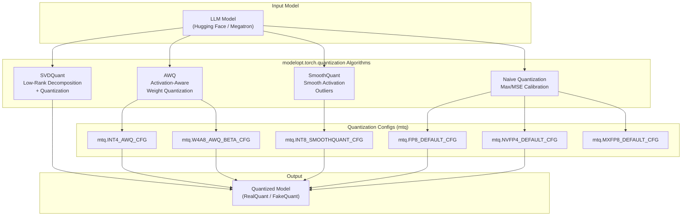
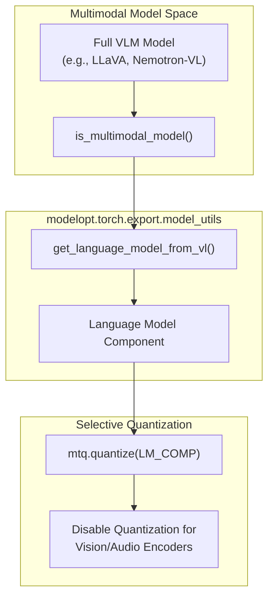

<!-- source: DeepWiki mcp.deepwiki.com · repo NVIDIA/Model-Optimizer · page 6.4 Large Language Model Optimization · fetched 2026-10-26 -->

# Large Language Model Optimization

<details>
<summary>Relevant source files</summary>

The following files were used as context for generating this wiki page:

- [.gitignore](.gitignore)
- [examples/deepseek/README.md](examples/deepseek/README.md)
- [examples/deepseek/deepseek_v4/ptq.py](examples/deepseek/deepseek_v4/ptq.py)
- [examples/deepseek/deepseek_v4/quantize_to_nvfp4.py](examples/deepseek/deepseek_v4/quantize_to_nvfp4.py)
- [examples/hf_ptq/run_tensorrt_llm.py](examples/hf_ptq/run_tensorrt_llm.py)
- [examples/hf_ptq/scripts/huggingface_example.sh](examples/hf_ptq/scripts/huggingface_example.sh)
- [examples/hf_ptq/scripts/parser.sh](examples/hf_ptq/scripts/parser.sh)
- [examples/kimi/README.md](examples/kimi/README.md)
- [examples/kimi/kimi_k3/quantize_to_nvfp4.py](examples/kimi/kimi_k3/quantize_to_nvfp4.py)
- [examples/llm_eval/README.md](examples/llm_eval/README.md)
- [examples/llm_eval/lm_eval_hf.py](examples/llm_eval/lm_eval_hf.py)
- [examples/llm_eval/lm_eval_trtllm.py](examples/llm_eval/lm_eval_trtllm.py)
- [examples/llm_eval/mmlu.py](examples/llm_eval/mmlu.py)
- [examples/llm_eval/requirements.txt](examples/llm_eval/requirements.txt)
- [examples/llm_eval/run_simple_eval.sh](examples/llm_eval/run_simple_eval.sh)
- [examples/windows/accuracy_benchmark/README.md](examples/windows/accuracy_benchmark/README.md)
- [modelopt/deploy/llm/generate.py](modelopt/deploy/llm/generate.py)
- [modelopt/torch/export/__init__.py](modelopt/torch/export/__init__.py)
- [modelopt/torch/export/shard_cast_utils.py](modelopt/torch/export/shard_cast_utils.py)
- [modelopt_recipes/huggingface/README.md](modelopt_recipes/huggingface/README.md)
- [plugins/modelopt/skills/common/remote-execution.md](plugins/modelopt/skills/common/remote-execution.md)
- [plugins/modelopt/skills/common/workspace-management.md](plugins/modelopt/skills/common/workspace-management.md)
- [plugins/modelopt/skills/day0-release/scripts/gate_ptq.py](plugins/modelopt/skills/day0-release/scripts/gate_ptq.py)
- [plugins/modelopt/skills/day0-release/scripts/gate_verbosity.py](plugins/modelopt/skills/day0-release/scripts/gate_verbosity.py)
- [plugins/modelopt/skills/day0-release/tests/evals.json](plugins/modelopt/skills/day0-release/tests/evals.json)
- [plugins/modelopt/skills/day0-release/tests/test_gates.py](plugins/modelopt/skills/day0-release/tests/test_gates.py)
- [plugins/modelopt/skills/deployment/SKILL.md](plugins/modelopt/skills/deployment/SKILL.md)
- [tests/_test_utils/examples/megatron_example_runner.py](tests/_test_utils/examples/megatron_example_runner.py)
- [tests/_test_utils/examples/run_command.py](tests/_test_utils/examples/run_command.py)
- [tests/examples/hf_ptq/test_run_tensorrt_llm.py](tests/examples/hf_ptq/test_run_tensorrt_llm.py)
- [tests/examples/llm_eval/test_llm_eval.py](tests/examples/llm_eval/test_llm_eval.py)
- [tests/examples/llm_eval/test_lm_eval_trtllm.py](tests/examples/llm_eval/test_lm_eval_trtllm.py)
- [tests/examples/megatron_bridge/conftest.py](tests/examples/megatron_bridge/conftest.py)
- [tests/gpu/_extensions/test_torch_extensions.py](tests/gpu/_extensions/test_torch_extensions.py)
- [tests/unit/examples/test_deepseek_v4_recipe.py](tests/unit/examples/test_deepseek_v4_recipe.py)
- [tests/unit/examples/test_kimi_k3_quantize_to_nvfp4.py](tests/unit/examples/test_kimi_k3_quantize_to_nvfp4.py)
- [tests/unit/recipe/test_kimi_k3_recipe.py](tests/unit/recipe/test_kimi_k3_recipe.py)
- [tests/unit/test_example_run_command.py](tests/unit/test_example_run_command.py)

</details>


## Purpose and Scope

This page covers LLM-specific optimization workflows available in NVIDIA Model Optimizer, including Post-Training Quantization (PTQ), Quantization-Aware Training (QAT), model pruning, and chained optimization techniques. These workflows address the unique challenges of optimizing large language models such as memory constraints, activation outliers, and maintaining accuracy under aggressive compression.

For general quantization concepts, see [Post-Training Quantization (PTQ)](3.1) and [Quantization-Aware Training (QAT)](3.2). For vision-language models, see [Vision-Language Models (VLMs)](6.3). For automatic mixed-precision search, see [AutoQuantize Mixed Precision Search](6.1).

This page covers four main LLM optimization workflows:

1.  **Post-Training Quantization (PTQ)**: Advanced algorithms (AWQ, SmoothQuant, SVDQuant), KV cache quantization, and built-in recipes for formats like NVFP4 and FP8.
2.  **Quantization-Aware Training (QAT)**: Training-based quantization with trainer classes and distributed support.
3.  **Model Pruning**: Minitron pruning for width/depth reduction and importance-based parameter selection.
4.  **Chained Optimizations**: Combining pruning and quantization (e.g., using `mtq.quantize` on pruned checkpoints).

Sources: [examples/hf_ptq/scripts/huggingface_example.sh:1-15](), [examples/hf_ptq/hf_ptq.py:64-80]()

---

## LLM Quantization Algorithms

ModelOpt provides several advanced quantization algorithms specifically designed to address LLM characteristics such as outlier activations and weight distributions.

### Algorithm Selection and Format Mapping



**Diagram: LLM Quantization Algorithm Selection and Format Mapping**

Sources: [examples/hf_ptq/hf_ptq.py:64-80](), [examples/llm_eval/README.md:63-71]()

### Available Quantization Formats

ModelOpt supports a wide array of LLM-optimized configurations via `modelopt.torch.quantization` (aliased as `mtq`).

| Format Key | Weights | Activations | Algorithm | Hardware |
| :--- | :--- | :--- | :--- | :--- |
| `int8_sq` | INT8 | INT8 | SmoothQuant | All CUDA |
| `int4_awq` | INT4 | FP16/BF16 | AWQ | All CUDA |
| `fp8` | FP8 (E4M3) | FP8 (E4M3) | Max | Hopper+ |
| `nvfp4` | NVFP4 | NVFP4 | Max | Blackwell |
| `mxfp8` | MXFP8 | MXFP8 | Microscaling | Blackwell |

Sources: [examples/hf_ptq/hf_ptq.py:64-80](), [examples/llm_eval/README.md:63-71]()

### Specialized NVFP4 Configurations

For higher accuracy with 4-bit floating point (NVFP4) on Blackwell GPUs, specialized partial quantization configs are recommended to protect sensitive layers:

*   **`NVFP4_MLP_ONLY_CFG`**: Quantizes only MLP (and MoE) layers, leaving attention layers in higher precision.
*   **`NVFP4_EXPERTS_ONLY_CFG`**: Targets only MoE routed expert layers, excluding shared experts and attention.
*   **`NVFP4_OMLP_ONLY_CFG`**: Quantizes MLP layers and the attention output projection (`o_proj`).

Sources: [modelopt_recipes/huggingface/README.md:1-10]()

---

## KV Cache Quantization

KV cache quantization is critical for reducing the memory footprint of long-context LLM inference. ModelOpt allows independent configuration of KV cache precision.

### KV Cache Quantization Modes

| Mode | Behavior | Source |
| :--- | :--- | :--- |
| `fp8` / `nvfp4` | Data-driven calibration of scaling factors (amax). | [examples/hf_ptq/scripts/huggingface_example.sh:113]() |
| `fp8_cast` / `nvfp4_cast` | Uses a constant amax (e.g., 448.0 for FP8) to skip calibration. Detectable via `use_constant_amax`. | [examples/hf_ptq/scripts/huggingface_example.sh:113]() |
| `nvfp4_act_headroom` | Uses a specialized calibration variant for NVFP4 activations. | [examples/hf_ptq/scripts/huggingface_example.sh:113]() |

Sources: [examples/hf_ptq/scripts/huggingface_example.sh:113]()

---

## Memory-Efficient Quantization Workflows

Quantizing massive LLMs requires strategies to manage peak GPU memory during the optimization process.

### Low Memory Mode and FSDP2 Support

The `low_memory_mode` utilizes `init_quantized_weights` to load models with pre-compressed weights. For models sharded across multiple nodes, ModelOpt integrates with PyTorch FSDP2.

```python
from modelopt.torch.quantization.plugins.accelerate import init_quantized_weights

# Initialize model with compressed weights to save memory
with init_quantized_weights(quant_cfg):
    model = AutoModelForCausalLM.from_pretrained(model_path)
```

Sources: [examples/hf_ptq/scripts/huggingface_example.sh:93-95]()

### Multi-GPU Calibration (FSDP2)

ModelOpt supports distributed calibration via FSDP2, enabling the optimization of models that exceed the memory of a single GPU. The `setup_distributed_args` function initializes the environment for sharded processing.

Sources: [examples/deepseek/deepseek_v3/ptq.py:60-65]()

---

## Vision-Language Model (VLM) Extraction

When optimizing multimodal models, ModelOpt provides utilities to extract the language model component for targeted quantization while maintaining the integrity of vision/audio encoders.

### VLM Optimization Workflow



**Diagram: VLM Extraction and Selective Quantization**

**Key Functions:**
*   `extract_and_prepare_language_model_from_vl(full_model)`: Extracts the language model and explicitly disables quantization for non-language components to exclude them during export.
*   `get_language_model_from_vl(full_model)`: Identifies the language model sub-module within a VLM architecture.

Sources: [modelopt/torch/export/model_utils.py:78-79]()

---

## DeepSeek V4 Routed-Expert NVFP4 Quantization

DeepSeek V4 models utilize a mixed native checkpoint layout. ModelOpt provides a specialized workflow to quantize only the routed experts to NVFP4 W4A4, while leaving other components (attention projections, router gate, shared experts, embeddings, and the LM head) in their original formats.

### DeepSeek V4 Quantization Workflow

```mermaid
graph TD
    A[DeepSeek V4 HF Checkpoint] --> B{Prepare MP Checkpoint};
    B --> C[MP Checkpoint (MXFP4 Experts)];
    C --> D{Calibrate Routed Experts};
    D --> E[AMAX Dump (NVFP4 Experts)];
    E --> F{Export back to HF Shard Layout};
    F --> G[HF Checkpoint (NVFP4 Routed Experts)];

    subgraph "Prepare MP Checkpoint"
        B -- "python inference/convert.py" --> C;
        B_note[Keep experts in MXFP4 during resharding];
    end

    subgraph "Calibrate Routed Experts"
        D -- "torchrun deepseek_v4/ptq.py" --> E;
        D_note[Uses built-in routed-expert NVFP4 config];
        D_note2[Supports multi-node calibration];
    end

    subgraph "Export back to HF Shard Layout"
        F -- "python deepseek_v4/quantize_to_nvfp4.py" --> G;
        F_note[Replaces routed expert weights with NVFP4 tensors];
        F_note2[Adds weight_scale, weight_scale_2, input_scale];
        F_note3[Updates model.safetensors.index.json and config.json];
    end
```

**Diagram: DeepSeek V4 Routed-Expert NVFP4 Quantization Workflow**

### Key Steps and Components

1.  **Prepare MP Checkpoint**: The initial Hugging Face checkpoint is converted to a sharded format suitable for distributed processing using DeepSeek's `inference/convert.py` script. It's crucial to keep experts in MXFP4 during this step.
    *   Example command: `python ${DS_V4}/inference/convert.py --hf-ckpt-path ${DS_V4} --save-path ${MP_CKPT} --n-experts 384 --model-parallel ${MP}` [examples/deepseek/README.md:121-127]()

2.  **Calibrate Routed Experts**: The `deepseek_v4/ptq.py` script performs post-training quantization (PTQ) calibration specifically on the routed experts. This script registers a wrapper only against the routed-expert module (`deekseep_v4_model.Expert`) to install per-weight and per-input `TensorQuantizer` pairs for `w1`, `w2`, `w3`. Shared experts' quantizers are disabled by config pattern (`*shared_experts*`).
    *   The script supports single-node and multi-node distributed calibration using `torchrun`. [examples/deepseek/README.md:137-163]()
    *   Calibration settings: `calib_seq` sets the tokenizer truncation cap. `mse_calibrate` has no effect on this path as weight quantizers are overwritten later. [examples/deepseek/deepseek_v4/ptq.py:58-72]()
    *   Uncalibrated experts: For experts receiving zero tokens during calibration, `weight_amax` is synthesized from the dequantized BF16 weight, and `input_amax` falls back to the max observed on calibrated routed experts for the same projection. [examples/deepseek/deepseek_v4/quantize_to_nvfp4.py:60-64]()

3.  **Export back to HF Shard Layout**: The `deepseek_v4/quantize_to_nvfp4.py` script takes the calibrated amax values and the original HF-style checkpoint to produce a new HF-style checkpoint. In this output, every routed-expert weight is quantized to NVFP4.
    *   The script adds new sibling keys (`.weight_scale`, `.weight_scale_2`, and `.input_scale`) for each expert weight. [examples/deepseek/deepseek_v4/quantize_to_nvfp4.py:39-44]()
    *   It updates `model.safetensors.index.json` and `config.json` to reflect the changes, including `moe_quant_algo = "NVFP4"`. [examples/deepseek/README.md:178-180]()
    *   **Lossless MXFP4 → NVFP4 weight cast**: The `--cast_mxfp4_to_nvfp4` flag enables a lossless bit-cast for source MXFP4 routed experts, preserving the original MXFP4 nibbles. Without this flag, a lossy dequantization to BF16 and re-quantization to NVFP4 occurs. [examples/deepseek/README.md:183-189](), [examples/deepseek/deepseek_v4/quantize_to_nvfp4.py:66-79]()

Sources: [examples/deepseek/README.md:104-189](), [examples/deepseek/deepseek_v4/ptq.py:16-72](), [examples/deepseek/deepseek_v4/quantize_to_nvfp4.py:16-79]()

---

## LLM Evaluation Harnesses

Evaluating the accuracy of optimized LLMs is crucial. ModelOpt integrates with popular third-party LLM benchmarks.

### Evaluation Workflow

```mermaid
graph TD
    A[Optimized LLM Checkpoint] --> B{Deployment Target};
    B --> C[Evaluation Harness];
    C --> D[Accuracy Metrics];

    subgraph "Deployment Targets"
        B_TRTLLM[TensorRT-LLM];
        B_VLLM[vLLM];
        B_SGLang[SGLang];
        B_HF[HuggingFace (Simulated Quant)];
    end

    subgraph "Evaluation Harnesses"
        C_NEMO[NeMo Evaluator];
        C_LMEVAL[LM-Eval-Harness];
    end

    B_TRTLLM --> C_NEMO;
    B_VLLM --> C_NEMO;
    B_SGLang --> C_NEMO;
    B_HF --> C_LMEVAL;
    B_TRTLLM --> C_LMEVAL;
```

**Diagram: LLM Evaluation Workflow**

### NeMo Evaluator

[NeMo Evaluator](https://docs.nvidia.com/nemo/evaluator/latest/get-started/quickstart/index.html#self-hosted-options) is the recommended tool for evaluating a wide range of benchmarks on quantized checkpoints. It supports checkpoints served with TensorRT-LLM, vLLM, or SGLang.

Sources: [examples/llm_eval/README.md:8-10]()

### LM-Eval-Harness

[LM-Eval-Harness](https://github.com/EleutherAI/lm-evaluation-harness) provides a unified framework for testing generative language models across many evaluation tasks.
The `lm_eval_hf.py` script in ModelOpt's examples directory is adapted from LM-Eval-Harness and includes ModelOpt-specific extensions for quantization and sparsity. [examples/llm_eval/lm_eval_hf.py:1-38]()

#### Baseline Evaluation

For standard HuggingFace models and Puzzletron-pruned checkpoints:
*   **Single GPU**: `python lm_eval_hf.py --model hf --model_args pretrained=<HF model> --tasks <tasks> --batch_size 4` [examples/llm_eval/README.md:26-28]()
*   **Multi-GPU (model sharding)**: Add `,parallelize=True` to `model_args`. [examples/llm_eval/README.md:32-34]()
*   **Data-parallel evaluation with model sharding**: Use `accelerate launch --multi_gpu --num_processes <num_copies>` to run multiple model copies concurrently. [examples/llm_eval/README.md:49-54]()

#### Quantized (Simulated) Evaluation

For simulated quantization with ModelOpt's default formats:
*   **Multi-GPU (without data-parallelism)**: Add `--quant_cfg <MODELOPT_QUANT_CFG>` to the `lm_eval_hf.py` command. Supported configs include `INT8_SMOOTHQUANT_CFG`, `FP8_DEFAULT_CFG`, `NVFP4_DEFAULT_CFG`, `INT4_AWQ_CFG`, `W4A8_AWQ_BETA_CFG`, `MXFP8_DEFAULT_CFG`. [examples/llm_eval/README.md:63-69]()
*   **Optimal per-layer quantization with `auto_quantize`**: Use `--quant_cfg <AUTOQUANTIZE_SEARCH_FORMATS>` and `--auto_quantize_bits <EFFECTIVE_BITS>`. [examples/llm_eval/README.md:89-94]()
*   **T5 models**: Use `--model hf-seq2seq`. [examples/llm_eval/README.md:99-106]()

The `lm_eval_hf.py` script overrides `HFLM.create_from_arg_obj` and `HFLM.create_from_arg_string` to inject quantization, sparsity, and Puzzletron support. [examples/llm_eval/lm_eval_hf.py:87-145](), [examples/llm_eval/lm_eval_hf.py:148-161]()

#### TensorRT-LLM Evaluation

LM-Eval-Harness (>= 0.4.12) includes a `trtllm` backend that loads quantized checkpoints directly with the TensorRT-LLM LLM API.
*   Example command: `python lm_eval_trtllm.py --model trtllm --model_args model=<Quantized checkpoint dir>,tokenizer=<HF model folder>,... --tasks <tasks>` [examples/llm_eval/README.md:116-120]()
*   **Note**: Loglikelihood tasks require TensorRT-LLM >= 1.3.0rc11. [examples/llm_eval/README.md:122-125]()

Sources: [examples/llm_eval/README.md:12-125](), [examples/llm_eval/lm_eval_hf.py:1-169](), [examples/llm_eval/requirements.txt:2]()

---

## Export and Deployment

Once optimized, LLMs are exported to a **Unified Hugging Face Checkpoint**. This format is compatible with major inference engines.

### Unified Export Pipeline

The `export_hf_checkpoint` function handles the conversion of quantized weights, scaling factors, and metadata into a deployable format.

```python
from modelopt.torch.export import export_hf_checkpoint

# Export quantized model to disk
export_hf_checkpoint(
    model,
    export_dir="path/to/export"
)
```

Sources: [modelopt/torch/export/__init__.py:27]()

### Supported Deployment Engines

| Engine | Quantization Support | Export Command |
| :--- | :--- | :--- |
| **TensorRT-LLM** | FP8, NVFP4, INT4 AWQ, SQ | `export_tensorrt_llm_checkpoint` |
| **vLLM** | FP8, NVFP4, INT4 AWQ | `export_hf_checkpoint` |
| **SGLang** | FP8, NVFP4, INT4 AWQ | `export_hf_checkpoint` |

Sources: [examples/hf_ptq/scripts/huggingface_example.sh:183-193]()

### Specialized Export Utilities

*   **`export_hf_vllm_fq_checkpoint`**: Exports checkpoints specifically formatted for vLLM fake-quantization.
*   **`save_expert_token_count_table`**: Saves MoE expert usage statistics for deployment optimization.
*   **`apply_cast_mxfp4_to_nvfp4`**: Closed-form conversion utility for specific weight formats.

Sources: [modelopt/torch/export/shard_cast_utils.py:1-15]()

---

