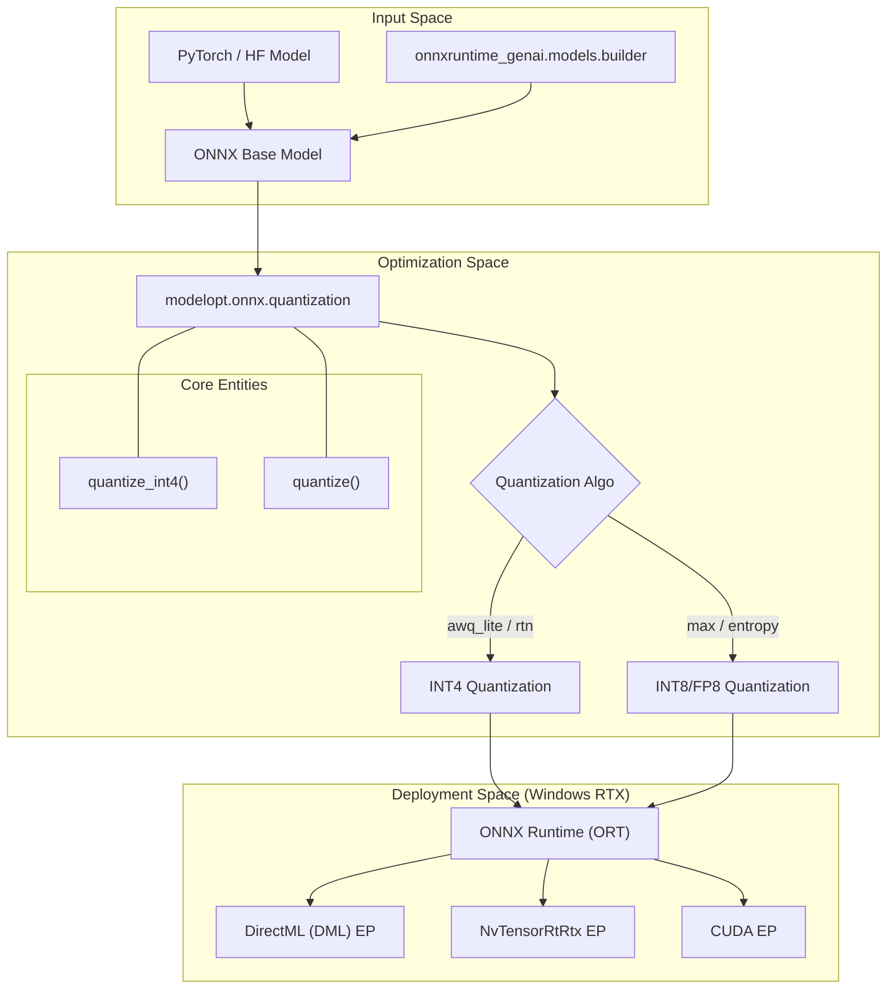
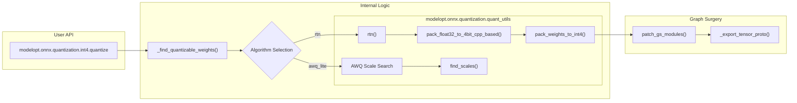

<!-- source: DeepWiki mcp.deepwiki.com · repo NVIDIA/Model-Optimizer · page 6.5 Windows and ONNX Runtime Deployment · fetched 2026-10-26 -->

# Windows and ONNX Runtime Deployment

<details>
<summary>Relevant source files</summary>

The following files were used as context for generating this wiki page:

- [LICENSE_HEADER](LICENSE_HEADER)
- [docs/source/deployment/2_onnxruntime.rst](docs/source/deployment/2_onnxruntime.rst)
- [docs/source/getting_started/1_overview.rst](docs/source/getting_started/1_overview.rst)
- [docs/source/getting_started/_installation_for_Linux.rst](docs/source/getting_started/_installation_for_Linux.rst)
- [docs/source/getting_started/windows/_installation_for_Windows.rst](docs/source/getting_started/windows/_installation_for_Windows.rst)
- [docs/source/getting_started/windows/_installation_standalone.rst](docs/source/getting_started/windows/_installation_standalone.rst)
- [docs/source/getting_started/windows/_installation_with_olive.rst](docs/source/getting_started/windows/_installation_with_olive.rst)
- [docs/source/guides/0_support_matrix.rst](docs/source/guides/0_support_matrix.rst)
- [docs/source/guides/windows_guides/_ONNX_PTQ_guide.rst](docs/source/guides/windows_guides/_ONNX_PTQ_guide.rst)
- [docs/source/support/2_faqs.rst](docs/source/support/2_faqs.rst)
- [examples/windows/Benchmark.md](examples/windows/Benchmark.md)
- [examples/windows/README.md](examples/windows/README.md)
- [examples/windows/accuracy_benchmark/fvd_metrics/README.md](examples/windows/accuracy_benchmark/fvd_metrics/README.md)
- [examples/windows/accuracy_benchmark/fvd_metrics/compute_fvd.py](examples/windows/accuracy_benchmark/fvd_metrics/compute_fvd.py)
- [examples/windows/accuracy_benchmark/fvd_metrics/i3d_model.py](examples/windows/accuracy_benchmark/fvd_metrics/i3d_model.py)
- [examples/windows/accuracy_benchmark/fvd_metrics/requirements.txt](examples/windows/accuracy_benchmark/fvd_metrics/requirements.txt)
- [examples/windows/accuracy_benchmark/mmlu_benchmark.py](examples/windows/accuracy_benchmark/mmlu_benchmark.py)
- [examples/windows/accuracy_benchmark/perplexity_metrics/README.md](examples/windows/accuracy_benchmark/perplexity_metrics/README.md)
- [examples/windows/accuracy_benchmark/perplexity_metrics/perplexity_metrics.py](examples/windows/accuracy_benchmark/perplexity_metrics/perplexity_metrics.py)
- [examples/windows/accuracy_benchmark/requirements.txt](examples/windows/accuracy_benchmark/requirements.txt)
- [examples/windows/diffusers/qad_example/fsdp_custom.yaml](examples/windows/diffusers/qad_example/fsdp_custom.yaml)
- [examples/windows/diffusers/qad_example/ltx2_qad.yaml](examples/windows/diffusers/qad_example/ltx2_qad.yaml)
- [examples/windows/onnx_ptq/genai_llm/README.md](examples/windows/onnx_ptq/genai_llm/README.md)
- [examples/windows/onnx_ptq/genai_llm/quantize.py](examples/windows/onnx_ptq/genai_llm/quantize.py)
- [examples/windows/onnx_ptq/genai_llm/requirements.txt](examples/windows/onnx_ptq/genai_llm/requirements.txt)
- [examples/windows/onnx_ptq/sam2/README.md](examples/windows/onnx_ptq/sam2/README.md)
- [examples/windows/onnx_ptq/whisper/README.md](examples/windows/onnx_ptq/whisper/README.md)
- [examples/windows/onnx_ptq/whisper/requirements.txt](examples/windows/onnx_ptq/whisper/requirements.txt)
- [examples/windows/onnx_ptq/whisper/whisper_onnx_quantization.py](examples/windows/onnx_ptq/whisper/whisper_onnx_quantization.py)
- [examples/windows/onnx_ptq/whisper/whisper_optimum_ort_inference.py](examples/windows/onnx_ptq/whisper/whisper_optimum_ort_inference.py)
- [examples/windows/torch_onnx/diffusers/README.md](examples/windows/torch_onnx/diffusers/README.md)
- [examples/windows/torch_onnx/diffusers/type_update_trt_custom_ops.py](examples/windows/torch_onnx/diffusers/type_update_trt_custom_ops.py)
- [modelopt/onnx/__init__.py](modelopt/onnx/__init__.py)

</details>


The **Model Optimizer - Windows** (**ModelOpt-Windows**) is a specialized toolkit within the NVIDIA Model Optimizer library designed to deliver advanced model compression and quantization specifically for Windows RTX PC systems [examples/windows/README.md:33-35](). It is engineered for rapid quantization featuring local GPU calibration, reduced memory consumption, and seamless integration with the Windows AI ecosystem, including **ONNX Runtime (ORT)**, **DirectML (DML)**, and **Microsoft Olive** [examples/windows/README.md:35-37]().

## System Overview and Integration

ModelOpt-Windows generates standards-compliant ONNX models, making them compatible with any inference framework supporting the ONNX standard [examples/windows/README.md:36-37](). The primary deployment targets are the `DirectML` and `TensorRT-RTX` (via the `NvTensorRtRtx` Execution Provider) paths [examples/windows/README.md:36-37]().

### Data Flow: From PyTorch/ONNX to Windows Deployment

The following diagram illustrates the workflow from a base model to a quantized ONNX model deployed on Windows.

**ModelOpt-Windows Deployment Pipeline**

Sources: [examples/windows/README.md:33-37](), [examples/windows/onnx_ptq/genai_llm/README.md:12-18](), [examples/windows/onnx_ptq/genai_llm/README.md:30-35]()

## Installation and Setup

ModelOpt-Windows can be installed as a standalone toolkit or integrated into the Microsoft Olive workflow.

### System Requirements
*   **OS**: Windows [docs/source/getting_started/windows/_installation_for_Windows.rst:12]()
*   **Architecture**: amd64 (x86_64) [docs/source/getting_started/windows/_installation_for_Windows.rst:14]()
*   **Python**: >=3.10, <3.13 [docs/source/getting_started/windows/_installation_for_Windows.rst:16]()
*   **CUDA**: >=12.0 [docs/source/getting_started/windows/_installation_for_Windows.rst:18]()
*   **Driver**: 565.90 or newer [docs/source/getting_started/windows/_installation_for_Windows.rst:22]()
*   **Hardware**: RTX 40 and 50 series GPUs [docs/source/getting_started/windows/_installation_for_Windows.rst:24]()

### Standalone Installation
The standalone toolkit requires CUDA 12.x and can be installed via PyPI:
```bash
pip install "nvidia-modelopt[onnx]"
```
[docs/source/getting_started/windows/_installation_standalone.rst:38](). By default, this installs `onnxruntime-gpu` for CUDA EP-based calibration [docs/source/getting_started/windows/_installation_standalone.rst:51](). For CUDA 13.x systems, users must switch to `cupy-cuda13x` and `onnxruntime-gpu>=1.27` [docs/source/getting_started/windows/_installation_standalone.rst:75-78]().

### Olive Integration
ModelOpt is integrated into Microsoft's Olive framework. The integration introduces a new pass, `NVModelOptQuantization` (or `nvmo`), specifically for ModelOpt-Windows quantization [docs/source/getting_started/windows/_installation_with_olive.rst:33-35]().
```bash
pip install olive-ai[nvmo]
pip install onnxruntime-genai-cuda
```
[examples/windows/README.md:57-58]()

Sources: [docs/source/getting_started/windows/_installation_for_Windows.rst:7-26](), [docs/source/getting_started/windows/_installation_standalone.rst:3-80](), [docs/source/getting_started/windows/_installation_with_olive.rst:3-37](), [examples/windows/README.md:57-58]()

## Quantization Techniques for Windows

ModelOpt-Windows supports several high-performance quantization formats tailored for RTX GPUs, including **INT4**, **FP8**, and **INT8** [examples/windows/README.md:65-67]().

### INT4 Weight-Only Quantization (WoQ)
The INT4 pipeline is frequently used for Large Language Models (LLMs) to achieve significant compression. It supports algorithms like **AWQ (Activation-aware Weight Quantization)** and **RTN (Round-to-Nearest)** [examples/windows/README.md:67-68]().

Key features of the INT4 implementation:
*   **AWQ Lite**: Performs core AWQ scale search and INT4 quantization [examples/windows/onnx_ptq/genai_llm/README.md:87]().
*   **AWQ Clip**: Performs weight clipping and INT4 quantization [examples/windows/onnx_ptq/genai_llm/README.md:88]().
*   **Mixed Precision**: Allows quantizing sensitive layers to INT8 while keeping the rest at INT4 to balance accuracy and performance [examples/windows/onnx_ptq/genai_llm/README.md:101-110]().
*   **Block-wise Quantization**: Supports configurable block sizes (e.g., 32, 64, 128) [examples/windows/onnx_ptq/genai_llm/README.md:63]().

### Code Entity Association: INT4 Quantization Logic
The following diagram maps the high-level quantization process to specific internal functions and utilities.

**INT4 Quantization Implementation Map**

Sources: [examples/windows/onnx_ptq/genai_llm/quantize.py:29](), [examples/windows/onnx_ptq/genai_llm/README.md:86-90]()

## Specialized Workflows

### 1. Generative AI LLMs (ORT-GenAI)
For LLMs, the workflow typically involves using the `onnxruntime-genai` model builder to create a base ONNX model, followed by ModelOpt quantization [examples/windows/onnx_ptq/genai_llm/README.md:32-34](). Calibration is performed using datasets like `cnn_dailymail` or `pile-val` [examples/windows/onnx_ptq/genai_llm/README.md:58]().

**Key API Usage:**
The `quantize` function from `modelopt.onnx.quantization.int4` is the primary entry point [examples/windows/onnx_ptq/genai_llm/quantize.py:29]().
```python
from modelopt.onnx.quantization.int4 import quantize as quantize_int4
# import other packages as needed
calib_inputs = get_calib_inputs(dataset, model_name, cache_dir, calib_size, batch_size,...)
quantized_onnx_model = quantize_int4(
    onnx_path,
    calibration_method="awq_lite",
    calibration_data_reader=None if use_random_calib else calib_inputs,
    calibration_eps=["dml", "cpu"]
)
```
[examples/windows/README.md:73-84]()

The `get_calib_inputs` function [examples/windows/onnx_ptq/genai_llm/quantize.py:148-162]() is responsible for loading and preparing calibration data. It uses `AutoConfig` and `AutoTokenizer` from the `transformers` library to configure the model and tokenize the dataset [examples/windows/onnx_ptq/genai_llm/quantize.py:167-172](). The `make_model_input` function [examples/windows/onnx_ptq/genai_llm/quantize.py:37-46]() then constructs the model inputs, including `input_ids`, `attention_mask`, and optionally `position_ids` and `past_key_values` [examples/windows/onnx_ptq/genai_llm/quantize.py:54-63]().

### 2. Whisper (ASR Models)
ModelOpt-Windows supports PTQ for Whisper models (Automatic Speech Recognition). This workflow includes quantization of the encoder and decoder components and provides scripts for `Optimum-ORT` based inference using the CUDA EP [examples/windows/onnx_ptq/whisper/README.md](). The `whisper_onnx_quantization.py` script handles the quantization process, while `whisper_optimum_ort_inference.py` demonstrates inference with the quantized model [examples/windows/onnx_ptq/whisper/whisper_onnx_quantization.py](), [examples/windows/onnx_ptq/whisper/whisper_optimum_ort_inference.py]().

### 3. Diffusion Models
Quantizing diffusion backbones (like SD3.5 or Flux) often requires higher Opset versions (Opset 23 for FP4 support in Q/DQ nodes) [examples/windows/torch_onnx/diffusers/README.md:54-55](). ModelOpt provides `NVFP4QuantExporter` to process models for FP4 deployment.

Sources: [examples/windows/onnx_ptq/genai_llm/README.md:32-34](), [examples/windows/onnx_ptq/genai_llm/README.md:58](), [examples/windows/onnx_ptq/genai_llm/quantize.py:29](), [examples/windows/README.md:73-84](), [examples/windows/onnx_ptq/genai_llm/quantize.py:148-172](), [examples/windows/onnx_ptq/genai_llm/quantize.py:37-63](), [examples/windows/onnx_ptq/whisper/README.md](), [examples/windows/onnx_ptq/whisper/whisper_onnx_quantization.py](), [examples/windows/onnx_ptq/whisper/whisper_optimum_ort_inference.py](), [examples/windows/torch_onnx/diffusers/README.md:54-55]()

## Deployment Considerations

### Opset Requirements
Proper deployment requires specific ONNX Opset versions to support the necessary Q/DQ (Quantize/Dequantize) linear nodes:
*   **FP8 Quantization**: Opset 19+ [examples/windows/README.md:102]().
*   **INT4 Quantization**: Opset 21+ [examples/windows/README.md:102]().
*   **FP4 (NVFP4) Quantization**: Opset 23+ [examples/windows/torch_onnx/diffusers/README.md:54-55]().

### External Data Handling
Due to the large size of quantized weights in LLMs, models should be saved using `save_as_external_data=True` to avoid exceeding the 2GB protobuf limit [examples/windows/README.md:88-91]().

### Accuracy and Performance Evaluation
ModelOpt-Windows provides tools for evaluating the impact of quantization:
*   **MMLU**: Massive Multitask Language Understanding [examples/windows/Benchmark.md:29]().
*   **Perplexity (PPL)**: Measures how well the model predicts samples; lower is better [examples/windows/Benchmark.md:47]().
*   **KL-Divergence**: Quantifies the distributional difference between quantized and baseline models [examples/windows/Benchmark.md:70-72]().

| Model | Metric | INT4 RTN | Mixed RTN (INT4+INT8) | Improvement |
| :--- | :--- | :--- | :--- | :--- |
| DeepSeek R1 1.5B | MMLU | 32.40% | 33.90% | +1.5% |
| Qwen 2.5 1.5B | Perplexity | 10.933 | 10.338 | -0.595 (lower is better) |

Sources: [examples/windows/onnx_ptq/genai_llm/README.md:113-116](), [examples/windows/Benchmark.md:37-43](), [examples/windows/Benchmark.md:60-66]()

---

