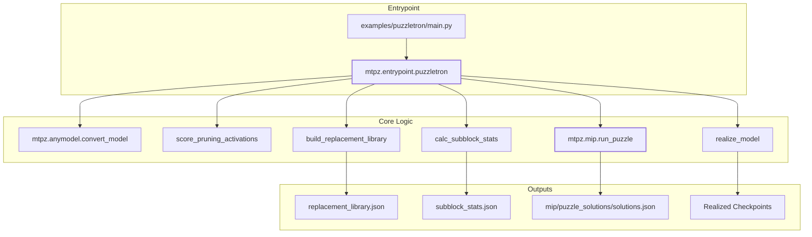
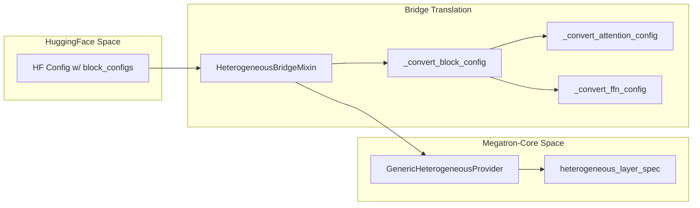

<!-- source: DeepWiki mcp.deepwiki.com · repo NVIDIA/Model-Optimizer · page 6.6 Puzzletron Local NAS · fetched 2026-10-26 -->

# Puzzletron Local NAS

<details>
<summary>Relevant source files</summary>

The following files were used as context for generating this wiki page:

- [examples/megatron_bridge/tutorials/NVIDIA-Nemotron-3-Nano-30B-A3B-BF16/ABLATIONS.md](examples/megatron_bridge/tutorials/NVIDIA-Nemotron-3-Nano-30B-A3B-BF16/ABLATIONS.md)
- [examples/megatron_bridge/tutorials/NVIDIA-Nemotron-3-Nano-30B-A3B-BF16/README.md](examples/megatron_bridge/tutorials/NVIDIA-Nemotron-3-Nano-30B-A3B-BF16/README.md)
- [examples/megatron_bridge/tutorials/NVIDIA-Nemotron-3-Nano-30B-A3B-BF16/figures/learning_curves.png](examples/megatron_bridge/tutorials/NVIDIA-Nemotron-3-Nano-30B-A3B-BF16/figures/learning_curves.png)
- [examples/megatron_bridge/tutorials/NVIDIA-Nemotron-3-Nano-30B-A3B-BF16/nemo_evaluator.yaml](examples/megatron_bridge/tutorials/NVIDIA-Nemotron-3-Nano-30B-A3B-BF16/nemo_evaluator.yaml)
- [examples/puzzletron/README.md](examples/puzzletron/README.md)
- [examples/puzzletron/configs/llama-3_1-8B_pruneffn_memory/Llama-3_1-8B.yaml](examples/puzzletron/configs/llama-3_1-8B_pruneffn_memory/Llama-3_1-8B.yaml)
- [examples/puzzletron/configs/llama-3_1-8B_pruneffn_memory/validate_model_defaults.yaml](examples/puzzletron/configs/llama-3_1-8B_pruneffn_memory/validate_model_defaults.yaml)
- [examples/puzzletron/configs/llama-3_1-8B_pruneffn_runtime/Llama-3_1-8B.yaml](examples/puzzletron/configs/llama-3_1-8B_pruneffn_runtime/Llama-3_1-8B.yaml)
- [examples/puzzletron/configs/llama-3_1-8B_pruneffn_runtime/pruning/attn_pruning.yaml](examples/puzzletron/configs/llama-3_1-8B_pruneffn_runtime/pruning/attn_pruning.yaml)
- [examples/puzzletron/configs/llama-3_1-8B_pruneffn_runtime/pruning/ffn_pruning.yaml](examples/puzzletron/configs/llama-3_1-8B_pruneffn_runtime/pruning/ffn_pruning.yaml)
- [examples/puzzletron/configs/llama-3_1-8B_pruneffn_runtime/pruning/hidden_dim_pruning.yaml](examples/puzzletron/configs/llama-3_1-8B_pruneffn_runtime/pruning/hidden_dim_pruning.yaml)
- [examples/puzzletron/configs/llama-3_1-8B_pruneffn_runtime/pruning/pruning_defaults.yaml](examples/puzzletron/configs/llama-3_1-8B_pruneffn_runtime/pruning/pruning_defaults.yaml)
- [examples/puzzletron/configs/llama-3_1-8B_pruneffn_runtime/validate_model_defaults.yaml](examples/puzzletron/configs/llama-3_1-8B_pruneffn_runtime/validate_model_defaults.yaml)
- [examples/puzzletron/configs/llama-3_1-8B_pruneffn_runtime/validate_solutions_defaults.yaml](examples/puzzletron/configs/llama-3_1-8B_pruneffn_runtime/validate_solutions_defaults.yaml)
- [examples/puzzletron/main.py](examples/puzzletron/main.py)
- [modelopt/torch/puzzletron/__init__.py](modelopt/torch/puzzletron/__init__.py)
- [modelopt/torch/puzzletron/anymodel/model_descriptor/model_descriptor_factory.py](modelopt/torch/puzzletron/anymodel/model_descriptor/model_descriptor_factory.py)
- [modelopt/torch/puzzletron/anymodel/models/__init__.py](modelopt/torch/puzzletron/anymodel/models/__init__.py)
- [modelopt/torch/puzzletron/mip/run_puzzle.py](modelopt/torch/puzzletron/mip/run_puzzle.py)
- [modelopt/torch/puzzletron/plugins/mbridge/base.py](modelopt/torch/puzzletron/plugins/mbridge/base.py)
- [modelopt/torch/puzzletron/replacement_library/build_replacement_library.py](modelopt/torch/puzzletron/replacement_library/build_replacement_library.py)
- [modelopt/torch/puzzletron/subblock_stats/__init__.py](modelopt/torch/puzzletron/subblock_stats/__init__.py)
- [modelopt/torch/puzzletron/subblock_stats/calc_runtime_stats.py](modelopt/torch/puzzletron/subblock_stats/calc_runtime_stats.py)
- [modelopt/torch/puzzletron/subblock_stats/runtime_utils.py](modelopt/torch/puzzletron/subblock_stats/runtime_utils.py)
- [modelopt/torch/puzzletron/subblock_stats/runtime_vllm.py](modelopt/torch/puzzletron/subblock_stats/runtime_vllm.py)
- [modelopt/torch/puzzletron/tools/checkpoint_utils_hf.py](modelopt/torch/puzzletron/tools/checkpoint_utils_hf.py)
- [modelopt/torch/puzzletron/tools/validate_puzzle_with_multi_replacements.py](modelopt/torch/puzzletron/tools/validate_puzzle_with_multi_replacements.py)
- [tests/_test_utils/torch/misc.py](tests/_test_utils/torch/misc.py)
- [tests/gpu/torch/puzzletron/resources/configs/validate_model_defaults.yaml](tests/gpu/torch/puzzletron/resources/configs/validate_model_defaults.yaml)
- [tests/gpu/torch/puzzletron/test_puzzletron.py](tests/gpu/torch/puzzletron/test_puzzletron.py)
- [tests/gpu/torch/puzzletron/tools/test_save_ckpt_from_shards.py](tests/gpu/torch/puzzletron/tools/test_save_ckpt_from_shards.py)
- [tools/launcher/examples/nvidia/NVIDIA-Nemotron-3-Nano-30B-A3B-BF16/nemo_evaluator.yaml](tools/launcher/examples/nvidia/NVIDIA-Nemotron-3-Nano-30B-A3B-BF16/nemo_evaluator.yaml)

</details>


Puzzletron is a localized Neural Architecture Search (NAS) and pruning framework within NVIDIA Model Optimizer designed to compress Large Language Models (LLMs) by finding optimal heterogeneous layer configurations [pyproject.toml:15-18](). Based on the [Puzzle paper](https://arxiv.org/abs/2411.19146), it utilizes Mixed-Integer Programming (MIP) to select the best combination of layer modifications—such as FFN intermediate size pruning and attention layer removal—to satisfy specific hardware constraints like GPU memory or parameter counts [examples/puzzletron/README.md:9-16]().

## Overview and Implementation

Puzzletron operates by decomposing the global architecture search problem into local decisions for each transformer block. It evaluates a library of potential layer replacements and uses a solver to assemble these "puzzle pieces" into a final model that maximizes accuracy while staying under resource budgets [examples/puzzletron/README.md:16-18]().

### Key Features
*   **Heterogeneous Optimization**: Unlike standard pruning which applies uniform widths, Puzzletron allows each layer to have different widths or even be removed entirely [examples/puzzletron/README.md:10-15]().
*   **MIP-Based Search**: Uses the `pulp` library to solve the optimization problem [pyproject.toml:46]().
*   **AnyModel Support**: A generic abstraction layer that allows Puzzletron to work with various model architectures including Llama, Mistral, Qwen, and Nemotron [tests/gpu/torch/puzzletron/test_puzzletron.py:37-49]().
*   **Megatron-Core Integration**: Supports converting heterogeneous Hugging Face models into Megatron-Core format for distributed inference and training [modelopt/torch/puzzletron/plugins/mbridge/base.py:18-22]().

## Data Flow and System Architecture

The Puzzletron pipeline consists of several stages, transitioning from scoring activations to realizing a final heterogeneous model.

### Pipeline Stages
1.  **Model Conversion**: The input Hugging Face model is converted to a standardized internal format using `mtpz.anymodel.convert_model` [tests/gpu/torch/puzzletron/test_puzzletron.py:102-106]().
2.  **Scoring Pruning Activations**: Multi-GPU execution to score the importance of different dimensions (FFN neurons or attention heads) [examples/puzzletron/README.md:98]().
3.  **Building Replacement Library**: Generation of a `replacement_library.json` containing candidate layer configurations [tests/gpu/torch/puzzletron/test_puzzletron.py:182-185]().
4.  **Subblock Statistics**: Calculation of runtime or memory statistics for each candidate in the library [examples/puzzletron/README.md:100](). This involves creating small benchmark models with repeated subblocks and measuring their runtime using vLLM latency benchmarks [modelopt/torch/puzzletron/subblock_stats/calc_runtime_stats.py:50-51](). The `run_vllm_latency_benchmark` function executes vLLM in a subprocess to ensure isolation and accurate measurements [modelopt/torch/puzzletron/subblock_stats/runtime_vllm.py:39-45]().
5.  **MIP Solving**: The `run_puzzle` module invokes the solver to find the optimal architecture [modelopt/torch/puzzletron/mip/run_puzzle.py]().
6.  **Model Realization**: The chosen solution is saved as a new model checkpoint [examples/puzzletron/README.md:102]().

### Code Entity Space: Pipeline Execution

The following diagram maps the high-level pipeline stages to the specific code entities and functions that execute them.


**Sources:** [examples/puzzletron/main.py:90-103](), [tests/gpu/torch/puzzletron/test_puzzletron.py:102-112](), [modelopt/torch/puzzletron/replacement_library/build_replacement_library.py](), [modelopt/torch/puzzletron/subblock_stats/calc_runtime_stats.py](), [modelopt/torch/puzzletron/mip/run_puzzle.py]()

## Key Classes and Functions

### `ReplacementLibrary`
Defined in `modelopt/torch/puzzletron/replacement_library/library.py`, this class manages the collection of possible layer modifications. It handles loading and applying layer replacements to a base model [modelopt/torch/puzzletron/tools/validate_puzzle_with_multi_replacements.py:140-144]().

### `GenericHeterogeneousProvider`
A bridge class that enables Megatron-Core to handle models where layers have different configurations. It inherits from `GPTModelProvider` and `HeterogeneousTransformerConfig` [modelopt/torch/puzzletron/plugins/mbridge/base.py:60-68]().

### `validate_puzzle_solutions`
Located in `modelopt/torch/puzzletron/tools/validate_puzzle_with_multi_replacements.py`, this function iterates through the solutions produced by the MIP solver, applies the corresponding layer replacements, and evaluates performance (e.g., LM loss, token accuracy) [modelopt/torch/puzzletron/tools/validate_puzzle_with_multi_replacements.py:66-118]().

### `HeterogeneousBridgeMixin`
Provides the logic to convert Hugging Face `block_configs` into Megatron-Core compatible formats by building a JSON representation of the heterogeneous architecture [modelopt/torch/puzzletron/plugins/mbridge/base.py:85-90]().

### `calc_subblock_runtime`
This function, found in `modelopt/torch/puzzletron/subblock_stats/calc_runtime_stats.py`, measures the runtime of a repeated subblock using vLLM latency benchmarks. It constructs a small Llama model with a specified `BlockConfig` and then calls `calc_model_runtime` to get the empirical latency [modelopt/torch/puzzletron/subblock_stats/calc_runtime_stats.py:94-127]().

### `run_vllm_latency_benchmark`
Defined in `modelopt/torch/puzzletron/subblock_stats/runtime_vllm.py`, this function executes the `vllm bench latency` command in a separate subprocess. This ensures that GPU memory and CUDA state are fully reclaimed after each benchmark run, preventing resource leaks during extensive subblock evaluations [modelopt/torch/puzzletron/subblock_stats/runtime_vllm.py:39-45]().

## Configuration and Search Space

Puzzletron uses Hydra for configuration management. Key parameters include:
*   `intermediate_size_list`: The candidate FFN sizes to search over [examples/puzzletron/README.md:80-81]().
*   `target_memory`: The maximum GPU memory (in MiB) allowed for the resulting model [examples/puzzletron/README.md:83-84]().
*   `num_params`: The upper bound for the number of parameters [examples/puzzletron/README.md:85-86]().
*   `calc_subblock_stats`: Configuration for calculating runtime statistics, including `batch_sizes`, `prefill_seq_len`, and `generation_seq_len` [examples/puzzletron/configs/llama-3_1-8B_pruneffn_runtime/Llama-3_1-8B.yaml:20-28]().

### Model-to-Code Mapping: Heterogeneous Config

The diagram below illustrates how a heterogeneous model configuration is represented and processed within the bridge system.


**Sources:** [modelopt/torch/puzzletron/plugins/mbridge/base.py:85-155]()

## Usage Example

To run the full Puzzletron pipeline, the `main.py` script is used with a YAML configuration that defines the search space and constraints.

```bash
# Multi-GPU execution for scoring and realization
torchrun --nproc_per_node 2 examples/puzzletron/main.py \
    --config examples/puzzletron/configs/llama-3_1-8B_pruneffn_memory/llama-3_1-8B_pruneffn_memory.yaml
```
**Sources:** [examples/puzzletron/README.md:89-91]()

The pipeline progress is tracked through specific log markers, indicating the transition from single-GPU conversion to multi-GPU scoring and MIP realization [examples/puzzletron/README.md:96-103]().

---

