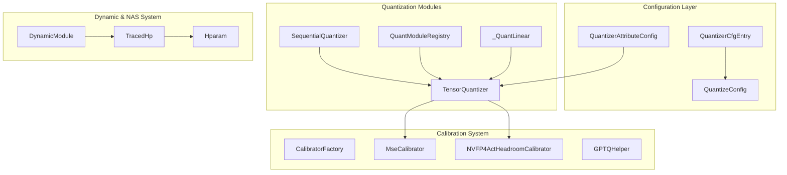
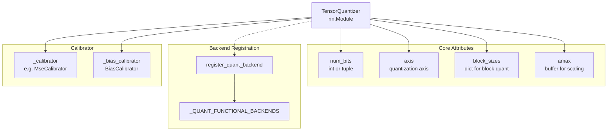
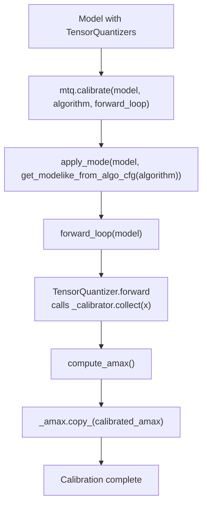
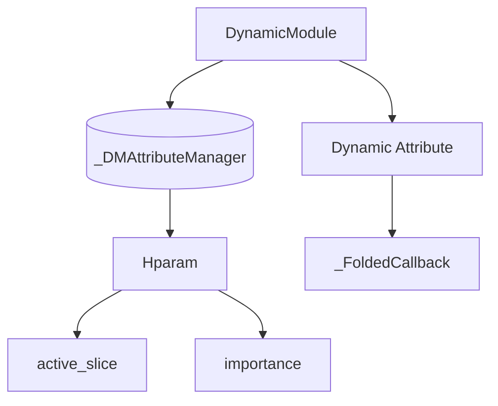
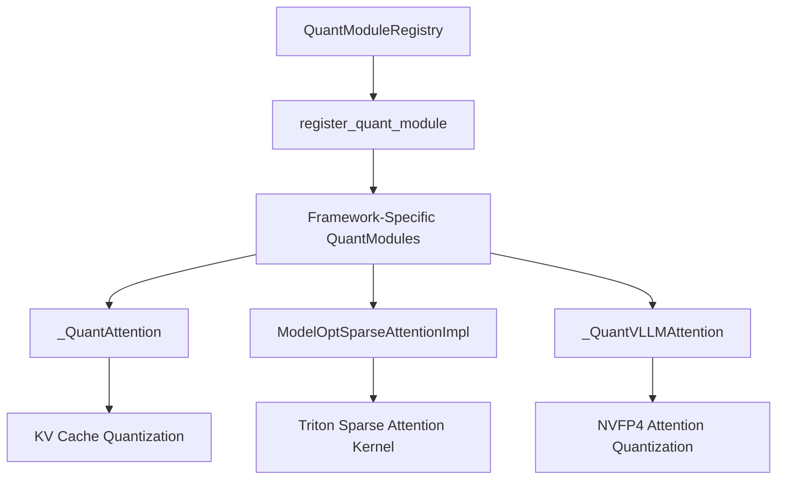

<!-- source: DeepWiki mcp.deepwiki.com · repo NVIDIA/Model-Optimizer · page 7 Core Components · fetched 2026-10-26 -->

# Core Components

Relevant source files

The following files were used as context for generating this wiki page:

- [examples/vllm_serve/sparse_attn_worker.py](examples/vllm_serve/sparse_attn_worker.py)
- [examples/vllm_serve/vllm_serve_sparse_attn.py](examples/vllm_serve/vllm_serve_sparse_attn.py)
- [modelopt/torch/kernels/common/attention/decode_attention.py](modelopt/torch/kernels/common/attention/decode_attention.py)
- [modelopt/torch/kernels/quantization/attention/bmm2_qdq.py](modelopt/torch/kernels/quantization/attention/bmm2_qdq.py)
- [modelopt/torch/opt/dynamic.py](modelopt/torch/opt/dynamic.py)
- [modelopt/torch/opt/hparam.py](modelopt/torch/opt/hparam.py)
- [modelopt/torch/sparsity/attention_sparsity/plugins/vllm.py](modelopt/torch/sparsity/attention_sparsity/plugins/vllm.py)
- [tests/gpu/torch/kernels/common/attention/test_triton_fa_paged.py](tests/gpu/torch/kernels/common/attention/test_triton_fa_paged.py)
- [tests/gpu_vllm/torch/quantization/test_vllm_dynamic_modules.py](tests/gpu_vllm/torch/quantization/test_vllm_dynamic_modules.py)
- [tests/gpu_vllm/torch/sparsity/attention_sparsity/test_sparse_attn_worker.py](tests/gpu_vllm/torch/sparsity/attention_sparsity/test_sparse_attn_worker.py)
- [tests/gpu_vllm/torch/sparsity/attention_sparsity/test_vllm_plugin.py](tests/gpu_vllm/torch/sparsity/attention_sparsity/test_vllm_plugin.py)
- [tests/unit/torch/opt/test_dynamic.py](tests/unit/torch/opt/test_dynamic.py)

This document provides technical deep dives into the core architectural components and abstractions that power NVIDIA Model Optimizer. It covers the fundamental building blocks used across all quantization and pruning workflows, including the `TensorQuantizer` module, the calibration system, the configuration framework, and the plugin architecture.

For specific quantization techniques (PTQ, QAT), see [PyTorch Optimization](#3). For model export details, see [Export and Deployment](#8). For calibration algorithm specifics, see [Calibration Algorithms](#7.3).

## Architecture Overview

Model Optimizer's system is built on a modular architecture with clear separation of concerns. At its core, the system consists of quantization modules, calibrators, configuration objects, and export utilities.

### Component Hierarchy

**Sources:**
- [modelopt/torch/quantization/nn/modules/tensor_quantizer.py:136-159]()
- [modelopt/torch/quantization/config.py:53-80]()
- [modelopt/torch/quantization/model_calib.py:44-79]()
- [modelopt/torch/quantization/nn/modules/quant_module.py:45-55]()

## TensorQuantizer Module

The `TensorQuantizer` is the fundamental quantization module in Model Optimizer. It manages both fake quantization (for training/simulation) and real quantization (via backend registration), performing calibration and applying quantization transformations to tensors. It supports per-tensor, per-channel, and block-wise quantization formats. Recent updates include support for `temporarily_fold_weights` [modelopt/torch/quantization/model_quant.py:59]() for repeated frozen-weight inference.

### Class Structure and Backend Integration

**Sources:**
- [modelopt/torch/quantization/nn/modules/tensor_quantizer.py:136-187]()
- [modelopt/torch/quantization/nn/modules/tensor_quantizer.py:92-109]()
- [modelopt/torch/quantization/nn/modules/tensor_quantizer.py:189-194]()

For details, see [TensorQuantizer Module](#7.2).

## Calibration System

The calibration system collects statistics from input tensors and computes optimal quantization parameters (amax values). Model Optimizer provides multiple calibrator implementations. A new addition is the `NVFP4ActHeadroomCalibrator` [modelopt/torch/quantization/model_calib.py:44](), which anchors scales to a percentile of the amax distribution to prevent saturation in NVFP4 activations.

### Calibration Workflow

**Sources:**
- [modelopt/torch/quantization/model_quant.py:64-129]()
- [modelopt/torch/quantization/model_calib.py:16-79]()
- [modelopt/torch/quantization/nn/modules/tensor_quantizer.py:145-159]()

For details, see [Calibration Algorithms](#7.3).

## Dynamic Modules and Hyperparameter System

The Dynamic Module system enables structural optimization like pruning and Neural Architecture Search (NAS). It uses a `Hparam` class [modelopt/torch/opt/hparam.py:57]() to represent configurable hyperparameters with choices and an `active_slice` mechanism [modelopt/torch/opt/hparam.py:125]() to perform on-the-fly pruning of tensors based on importance. The `DynamicModule` [modelopt/torch/opt/dynamic.py:39]() serves as the base class for NAS-capable modules, managing original classes, hyperparameters, and dynamic attributes through `_DMAttributeManager` [modelopt/torch/opt/dynamic.py:88](). This system integrates with the `QuantModule` system for combined pruning and quantization.

### Dynamic Module and Hparam Interaction

**Sources:**
- [modelopt/torch/opt/dynamic.py:39-40]()
- [modelopt/torch/opt/dynamic.py:88-126]()
- [modelopt/torch/opt/hparam.py:57-65]()
- [modelopt/torch/opt/hparam.py:125-130]()
- [modelopt/torch/opt/hparam.py:173-179]()
- [modelopt/torch/opt/dynamic.py:50-55]()
- [modelopt/torch/opt/dynamic.py:60-86]()

For details, see [Dynamic Modules and Hyperparameter System](#7.1).

## Configuration System

The configuration system provides a declarative way to specify quantization parameters using `QuantizeConfig`. It uses `QuantizerCfgEntry` to map module patterns (via `quantizer_name`) to specific `QuantizerAttributeConfig` settings.

### Pattern Matching Logic

The configuration system uses wildcard patterns to match quantizer names during the conversion process.

| Pattern Example | Target |
|---------|---------|
| `*weight_quantizer` | Matches all weight quantizers [modelopt/torch/quantization/config.py:117]() |
| `*input_quantizer` | Matches all activation/input quantizers [modelopt/torch/quantization/config.py:118]() |
| `parent_class: "nn.Linear"` | Filters by module type [modelopt/torch/quantization/config.py:71-73]() |

**Sources:**
- [modelopt/torch/quantization/config.py:53-100]()
- [modelopt/torch/quantization/config.py:165-170]()

## QuantModule Plugin System

To support various model architectures and high-performance backends (like Transformer Engine or Hugging Face), Model Optimizer uses a `QuantModuleRegistry`. This system allows the library to swap standard layers with framework-specific quantized versions, such as `_QuantAttention` [modelopt/torch/quantization/plugins/huggingface.py:78]() for KV cache quantization or `TEGroupedMLP` support for MoE experts [CHANGELOG.rst:17-18](). The plugin system also extends to inference engines like vLLM, where `ModelOptSparseAttentionImpl` [modelopt/torch/sparsity/attention_sparsity/plugins/vllm.py:43]() and `_QuantVLLMAttention` [tests/gpu_vllm/torch/quantization/test_vllm_dynamic_modules.py:54]() provide specialized implementations for sparse and quantized attention.

### QuantModule Plugin Architecture

**Sources:**
- [modelopt/torch/quantization/nn/modules/quant_module.py:159]()
- [modelopt/torch/quantization/plugins/huggingface.py:78-107]()
- [modelopt/torch/quantization/plugins/custom.py:49-50]()
- [modelopt/torch/sparsity/attention_sparsity/plugins/vllm.py:43]()
- [tests/gpu_vllm/torch/quantization/test_vllm_dynamic_modules.py:54]()
- [modelopt/torch/kernels/common/attention/triton_fa.py]()
- [modelopt/torch/kernels/quantization/attention/bmm2_qdq.py]()
- [modelopt/torch/kernels/common/attention/decode_attention.py]()

For details, see [QuantModule Plugin System](#7.4).

## ModelOpt Recipes

Model Optimizer provides pre-built YAML recipes for common optimization targets. These recipes encapsulate best practices for specific hardware (e.g., Blackwell NVFP4) or formats (e.g., FP8, INT8). Recent additions include recipes for `nvfp4_act_headroom` [CHANGELOG.rst:12]() and `auto_quantize` [CHANGELOG.rst:29](). The `modelopt.recipe` module handles loading and validation of these YAML configurations, supporting unit and preset composition.

**Sources:**
- [modelopt/torch/quantization/algorithms.py:41-53]()
- [CHANGELOG.rst:12-33]()

For details, see [ModelOpt Recipes](#7.5) and [Recipe and Config Loader Internals](#7.6).

---

