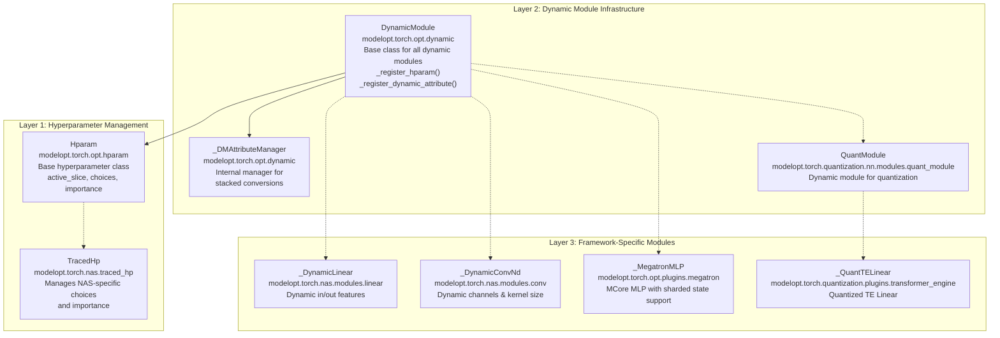
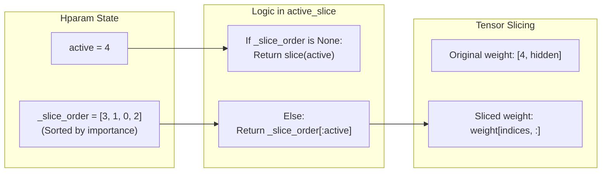
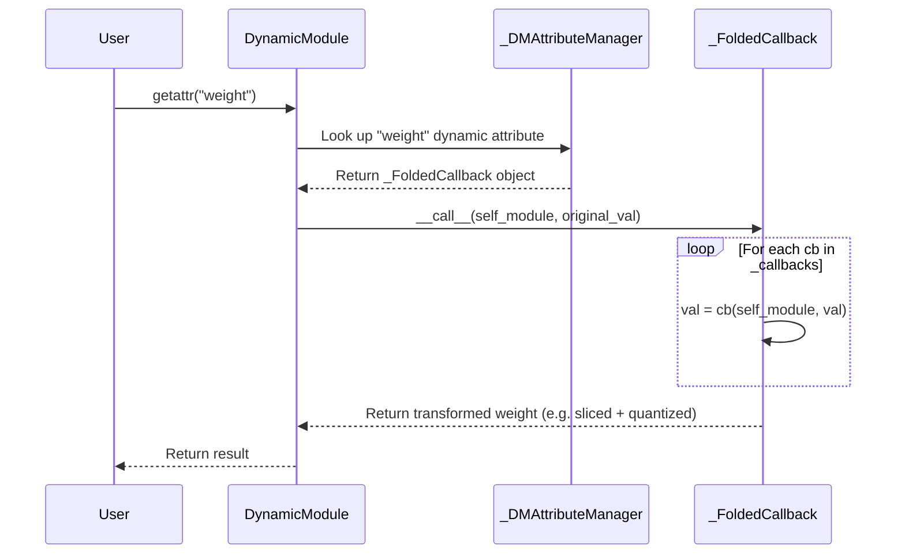

<!-- source: DeepWiki mcp.deepwiki.com · repo NVIDIA/Model-Optimizer · page 7.1 Dynamic Modules and Hyperparameter System · fetched 2026-10-26 -->

# Dynamic Modules and Hyperparameter System

Relevant source files

The following files were used as context for generating this wiki page:

- [docs/source/guides/2_save_load.rst](docs/source/guides/2_save_load.rst)
- [docs/source/guides/3_pruning.rst](docs/source/guides/3_pruning.rst)
- [docs/source/guides/7_nas.rst](docs/source/guides/7_nas.rst)
- [examples/llm_sparsity/weight_sparsity/README.md](examples/llm_sparsity/weight_sparsity/README.md)
- [examples/llm_sparsity/weight_sparsity/finetune.py](examples/llm_sparsity/weight_sparsity/finetune.py)
- [examples/pruning/cifar_resnet.ipynb](examples/pruning/cifar_resnet.ipynb)
- [examples/vllm_serve/sparse_attn_worker.py](examples/vllm_serve/sparse_attn_worker.py)
- [examples/vllm_serve/vllm_serve_sparse_attn.py](examples/vllm_serve/vllm_serve_sparse_attn.py)
- [modelopt/torch/export/distribute.py](modelopt/torch/export/distribute.py)
- [modelopt/torch/kernels/common/attention/decode_attention.py](modelopt/torch/kernels/common/attention/decode_attention.py)
- [modelopt/torch/kernels/quantization/attention/bmm2_qdq.py](modelopt/torch/kernels/quantization/attention/bmm2_qdq.py)
- [modelopt/torch/nas/utils.py](modelopt/torch/nas/utils.py)
- [modelopt/torch/opt/conversion.py](modelopt/torch/opt/conversion.py)
- [modelopt/torch/opt/dynamic.py](modelopt/torch/opt/dynamic.py)
- [modelopt/torch/opt/hparam.py](modelopt/torch/opt/hparam.py)
- [modelopt/torch/opt/plugins/huggingface.py](modelopt/torch/opt/plugins/huggingface.py)
- [modelopt/torch/opt/plugins/megatron.py](modelopt/torch/opt/plugins/megatron.py)
- [modelopt/torch/opt/plugins/peft.py](modelopt/torch/opt/plugins/peft.py)
- [modelopt/torch/opt/searcher.py](modelopt/torch/opt/searcher.py)
- [modelopt/torch/sparsity/attention_sparsity/plugins/vllm.py](modelopt/torch/sparsity/attention_sparsity/plugins/vllm.py)
- [modelopt/torch/utils/distributed.py](modelopt/torch/utils/distributed.py)
- [tests/gpu/torch/kernels/common/attention/test_triton_fa_paged.py](tests/gpu/torch/kernels/common/attention/test_triton_fa_paged.py)
- [tests/gpu_vllm/torch/quantization/test_vllm_dynamic_modules.py](tests/gpu_vllm/torch/quantization/test_vllm_dynamic_modules.py)
- [tests/gpu_vllm/torch/sparsity/attention_sparsity/test_sparse_attn_worker.py](tests/gpu_vllm/torch/sparsity/attention_sparsity/test_sparse_attn_worker.py)
- [tests/gpu_vllm/torch/sparsity/attention_sparsity/test_vllm_plugin.py](tests/gpu_vllm/torch/sparsity/attention_sparsity/test_vllm_plugin.py)
- [tests/unit/torch/nas/test_evaluate_constraints.py](tests/unit/torch/nas/test_evaluate_constraints.py)
- [tests/unit/torch/nas/test_full_algorithms_vision.py](tests/unit/torch/nas/test_full_algorithms_vision.py)
- [tests/unit/torch/nas/test_latency_interpolator.py](tests/unit/torch/nas/test_latency_interpolator.py)
- [tests/unit/torch/nas/test_nas_utils.py](tests/unit/torch/nas/test_nas_utils.py)
- [tests/unit/torch/opt/test_dynamic.py](tests/unit/torch/opt/test_dynamic.py)
- [tests/unit/torch/opt/test_load_modelopt_state.py](tests/unit/torch/opt/test_load_modelopt_state.py)
- [tests/unit/torch/prune/test_algorithms.py](tests/unit/torch/prune/test_algorithms.py)

## Purpose and Scope

This document describes the dynamic module and hyperparameter system, which forms the architectural foundation for runtime-configurable neural network architectures in Model Optimizer. This system enables:

- Converting static PyTorch modules into dynamic modules with configurable architectural dimensions (e.g., hidden size, number of heads, FFN dimension).
- Managing hyperparameters that control these dimensions through the `Hparam` and `TracedHp` classes.
- Implementing tensor slicing via the `active_slice` mechanism for pruning and neural architecture search (NAS).
- Supporting both width pruning (channels, features, heads) and depth pruning (layers).
- Chaining multiple optimization modes (e.g., NAS + Quantization) on the same module using a hierarchical attribute manager.

This system is primarily used by the Minitron pruning algorithm ([#3.3.1]()) for Megatron-Core models but also supports general NAS, quantization, and mixed-precision workflows.

Sources: [modelopt/torch/opt/dynamic.py:16-39](), [modelopt/torch/opt/hparam.py:56-65](), [modelopt/torch/opt/conversion.py:16-24]()

---

## Core Components Overview

The dynamic module system consists of three primary layers that work together to enable runtime-configurable architectures:

Title: Three-Layer Architecture of Dynamic Module System

Sources: [modelopt/torch/opt/dynamic.py:88-127](), [modelopt/torch/opt/hparam.py:56-84](), [modelopt/torch/opt/plugins/megatron.py:149-158](), [modelopt/torch/quantization/nn/modules/quant_module.py:40-60]()

---

## Hparam: The Hyperparameter Abstraction

`Hparam` (defined in [modelopt/torch/opt/hparam.py:56]()) is the fundamental class for representing configurable architectural dimensions. It keeps track of hyperparameter values and their importance, which search algorithms use to optimize sub-networks.

### Key Properties and State

| Property | Type | Purpose |
|----------|------|---------|
| `choices` | `Sequence[HPType]` | Available values for this dimension (e.g., `[32, 64, 128]` for hidden size). |
| `active` | `HPType` | Currently selected value from `choices`. |
| `original` | `HPType` | Initial value before any modification. |
| `importance` | `Tensor \| None` | Normalized importance scores for the features the hparam represents. |
| `active_slice` | `slice \| LongTensor` | The indices representing the active sub-network components. |

### The active_slice Mechanism

The `active_slice` property is critical for pruning. It returns a `slice` or a `LongTensor` of indices representing the "best" components to keep based on the `active` value and an optional `_slice_order` (derived from importance).

Title: Hparam active_slice Mechanism

Sources: [modelopt/torch/opt/hparam.py:110-131](), [modelopt/torch/opt/hparam.py:173-186]()

---

## DynamicModule: Architecture for Stacked Conversions

`DynamicModule` (defined in [modelopt/torch/opt/dynamic.py:39]()) allows a standard `nn.Module` to behave dynamically. It uses an internal `_DMAttributeManager` to handle multiple levels of conversion (e.g., first applying NAS/Pruning, then applying Quantization).

### Hierarchical Attribute Management

The `_DMAttributeManager` (defined in [modelopt/torch/opt/dynamic.py:88]()) maintains a stack of "levels" corresponding to optimization steps. This enables:
1.  **Original Classes**: Storing the stack of original module classes as modules are converted [modelopt/torch/opt/dynamic.py:106-107]().
2.  **Hparams**: Storing hyperparameters unique across all levels [modelopt/torch/opt/dynamic.py:108-112]().
3.  **Dynamic Attributes**: Associating callbacks (e.g., slicing functions) with attributes like `weight`. Multiple callbacks for the same attribute are "folded" across hierarchy levels [modelopt/torch/opt/dynamic.py:113-122]().

Title: Dynamic Attribute Access Flow

Sources: [modelopt/torch/opt/dynamic.py:50-81](), [modelopt/torch/opt/dynamic.py:88-127](), [modelopt/torch/opt/dynamic.py:151-172](), [tests/unit/torch/opt/test_dynamic.py:58-154]()

---

## Framework Integration and Checkpointing

### Megatron-Core Integration
For Megatron-Core, Model Optimizer provides `_MegatronMLP` (defined in [modelopt/torch/opt/plugins/megatron.py:149]()) to handle special sharding requirements, such as SwiGLU gated linear units, during `sharded_state_dict` calls [modelopt/torch/opt/plugins/megatron.py:160-173](). It also provides a registry for `extra_state` callbacks to store quantizer and pruning metadata within standard Megatron checkpoints [modelopt/torch/opt/plugins/megatron.py:122-147]().

Sources: [modelopt/torch/opt/plugins/megatron.py:122-147](), [modelopt/torch/opt/plugins/megatron.py:149-181]()

### Modelopt State Management
The `ModeloptStateManager` (defined in [modelopt/torch/opt/conversion.py:64]()) manages the `_modelopt_state` attribute on the root module. This state records the history of `ModeDescriptor` applications, allowing a model to be reconstructed or restored from a checkpoint [modelopt/torch/opt/conversion.py:70-96](), [modelopt/torch/opt/conversion.py:140-161]().

Sources: [modelopt/torch/opt/conversion.py:70-96](), [modelopt/torch/opt/conversion.py:140-161]()

### vLLM Reload and Export
For deployment, `modelopt.torch.sparsity.attention_sparsity.plugins.vllm` provides utilities to integrate sparse attention into vLLM. This involves replacing vLLM's native attention implementations with ModelOpt's `ModelOptSparseAttentionImpl` [modelopt/torch/sparsity/attention_sparsity/plugins/vllm.py:21-26](). The `_build_sparse_kw` function converts checkpoint layer configurations into kernel arguments for sparse attention [modelopt/torch/sparsity/attention_sparsity/plugins/vllm.py:115-134](). Similarly, `_bmm_qdq_from_layer` resolves quantization parameters for the kernel's QDQ mode and scalar amax [modelopt/torch/sparsity/attention_sparsity/plugins/vllm.py:137-161]().

Sources: [modelopt/torch/sparsity/attention_sparsity/plugins/vllm.py:21-26](), [modelopt/torch/sparsity/attention_sparsity/plugins/vllm.py:115-134](), [modelopt/torch/sparsity/attention_sparsity/plugins/vllm.py:137-161](), [tests/gpu_vllm/torch/sparsity/attention_sparsity/test_sparse_attn_worker.py:144-156]()

---

## Summary of Key Entities

| Class/Function | Location | Role |
|----------------|----------|------|
| `DynamicModule` | `modelopt/torch/opt/dynamic.py` | Base class for runtime-configurable modules. |
| `Hparam` | `modelopt/torch/opt/hparam.py` | Representation of a configurable dimension (e.g. hidden size). |
| `_DMAttributeManager` | `modelopt/torch/opt/dynamic.py` | Manages hierarchical attributes and callbacks for stacked conversions. |
| `ModeloptStateManager` | `modelopt/torch/opt/conversion.py` | Handles serialization and restoration of optimization history. |
| `BaseSearcher` | `modelopt/torch/opt/searcher.py` | Abstract interface for NAS algorithms to optimize `Hparam` values. |
| `_FoldedCallback` | `modelopt/torch/opt/dynamic.py` | Functor for chaining multiple dynamic attribute transformations. |

Sources: [modelopt/torch/opt/dynamic.py:39](), [modelopt/torch/opt/hparam.py:56](), [modelopt/torch/opt/conversion.py:64](), [modelopt/torch/opt/searcher.py:60]()

---

