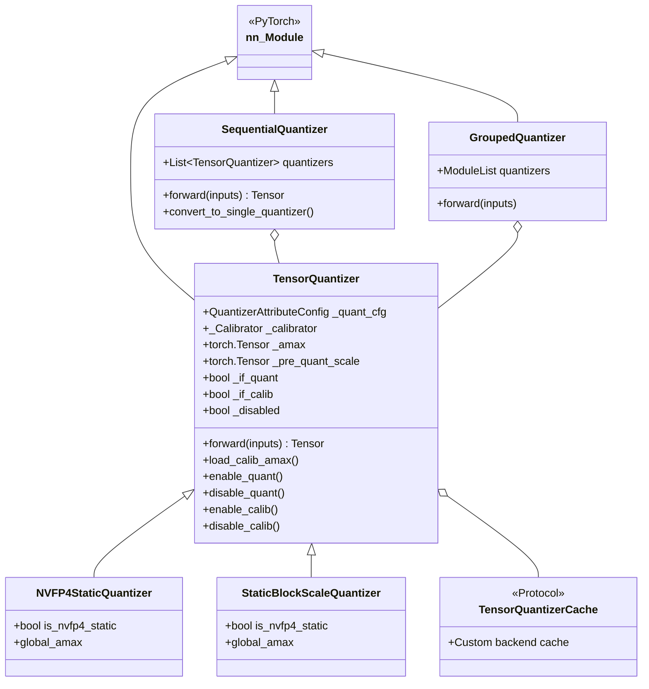
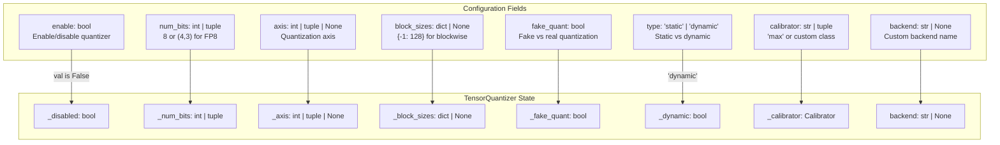
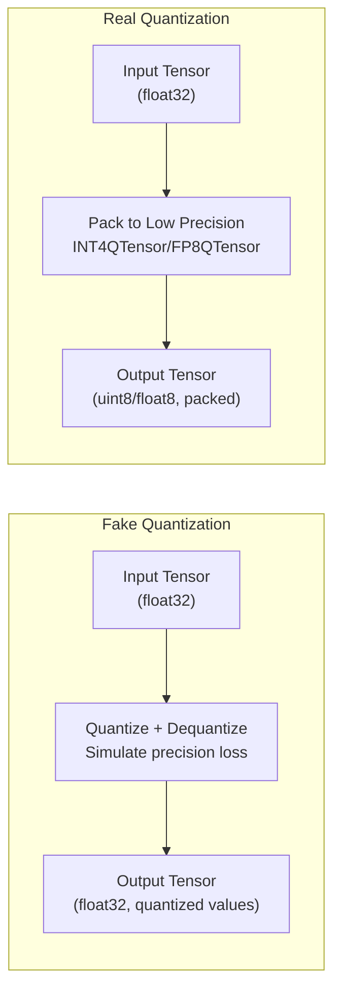
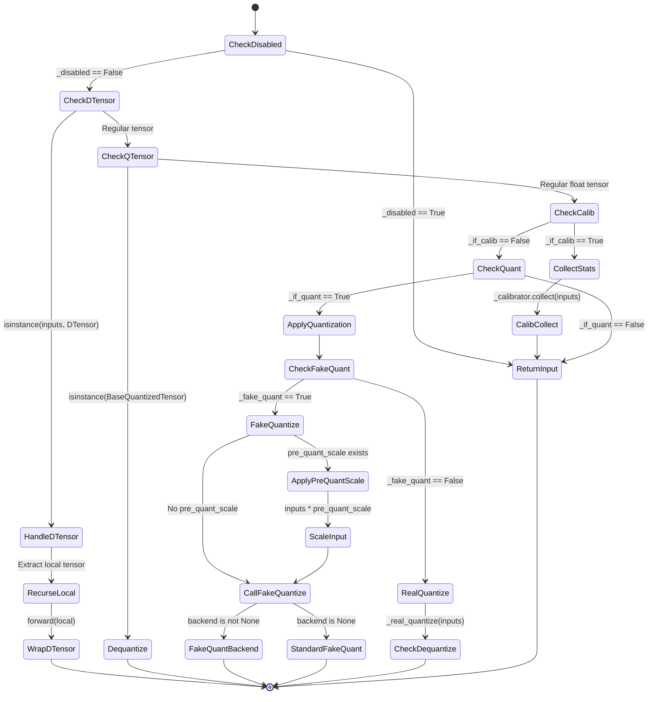
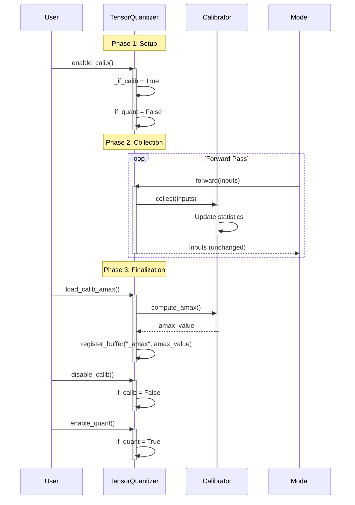
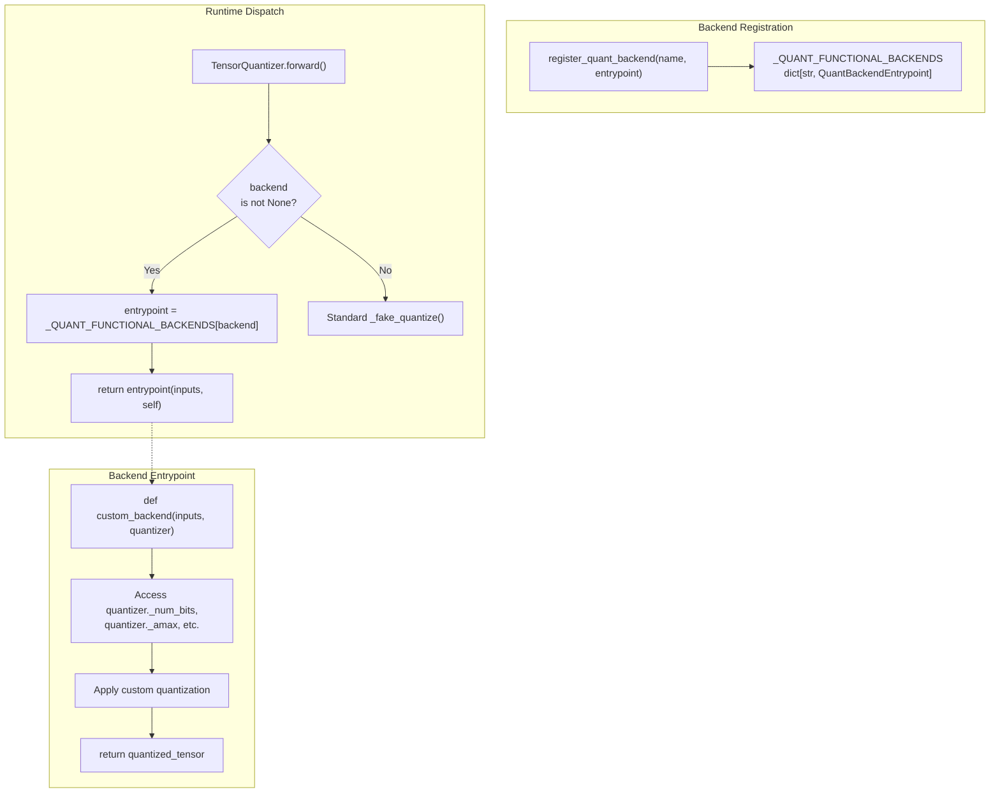
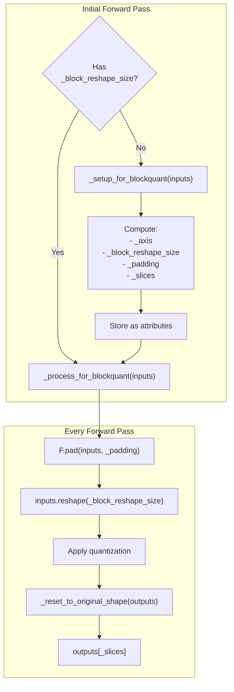
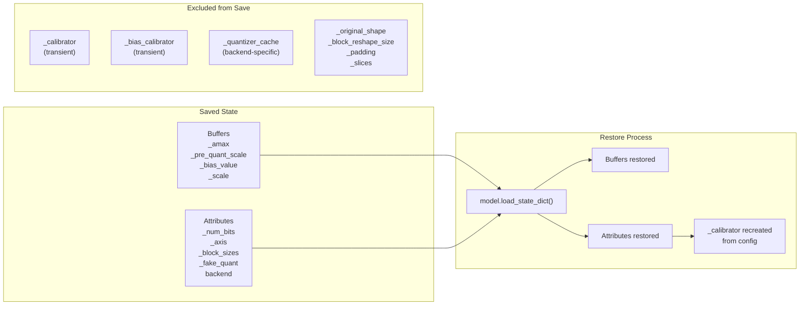
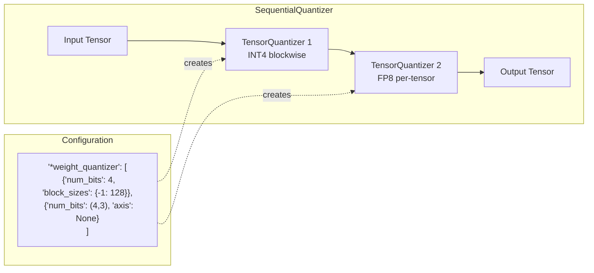
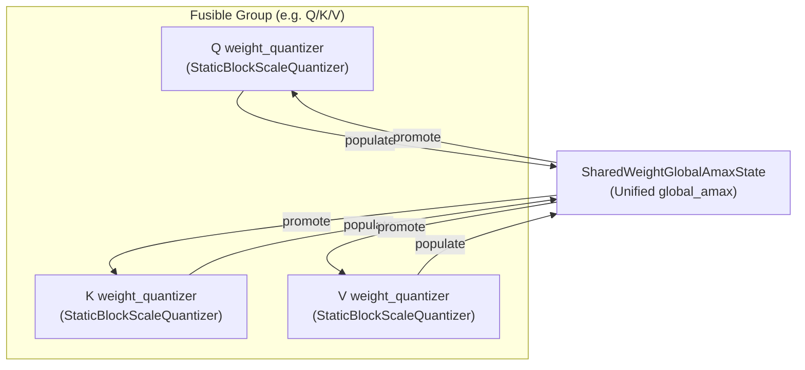

<!-- source: DeepWiki mcp.deepwiki.com · repo NVIDIA/Model-Optimizer · page 7.2 TensorQuantizer Module · fetched 2026-10-26 -->

# TensorQuantizer Module

<details>
<summary>Relevant source files</summary>

The following files were used as context for generating this wiki page:

- [docs/source/_templates/autosummary/module.rst](docs/source/_templates/autosummary/module.rst)
- [modelopt/torch/export/layerwise_export.py](modelopt/torch/export/layerwise_export.py)
- [modelopt/torch/export/model_config.py](modelopt/torch/export/model_config.py)
- [modelopt/torch/kernels/quantization/attention/__init__.py](modelopt/torch/kernels/quantization/attention/__init__.py)
- [modelopt/torch/kernels/quantization/common/fp8_quant.py](modelopt/torch/kernels/quantization/common/fp8_quant.py)
- [modelopt/torch/kernels/quantization/common/nvfp4_quant.py](modelopt/torch/kernels/quantization/common/nvfp4_quant.py)
- [modelopt/torch/kernels/quantization/gemm/fp4_kernel.py](modelopt/torch/kernels/quantization/gemm/fp4_kernel.py)
- [modelopt/torch/kernels/quantization/gemm/fp4_kernel_hopper.py](modelopt/torch/kernels/quantization/gemm/fp4_kernel_hopper.py)
- [modelopt/torch/kernels/quantization/gemm/gptq_fused_kernel.py](modelopt/torch/kernels/quantization/gemm/gptq_fused_kernel.py)
- [modelopt/torch/kernels/quantization/gemm/nvfp4_fp8_sweep.py](modelopt/torch/kernels/quantization/gemm/nvfp4_fp8_sweep.py)
- [modelopt/torch/quantization/backends/__init__.py](modelopt/torch/quantization/backends/__init__.py)
- [modelopt/torch/quantization/backends/fp8_per_tensor_gemm.py](modelopt/torch/quantization/backends/fp8_per_tensor_gemm.py)
- [modelopt/torch/quantization/backends/nvfp4_gemm.py](modelopt/torch/quantization/backends/nvfp4_gemm.py)
- [modelopt/torch/quantization/compress.py](modelopt/torch/quantization/compress.py)
- [modelopt/torch/quantization/config.py](modelopt/torch/quantization/config.py)
- [modelopt/torch/quantization/mode.py](modelopt/torch/quantization/mode.py)
- [modelopt/torch/quantization/model_calib.py](modelopt/torch/quantization/model_calib.py)
- [modelopt/torch/quantization/nn/modules/tensor_quantizer.py](modelopt/torch/quantization/nn/modules/tensor_quantizer.py)
- [modelopt/torch/quantization/qtensor/__init__.py](modelopt/torch/quantization/qtensor/__init__.py)
- [modelopt/torch/quantization/qtensor/int4_tensor.py](modelopt/torch/quantization/qtensor/int4_tensor.py)
- [modelopt/torch/quantization/qtensor/int8_tensor.py](modelopt/torch/quantization/qtensor/int8_tensor.py)
- [modelopt/torch/quantization/qtensor/mxfp8_tensor.py](modelopt/torch/quantization/qtensor/mxfp8_tensor.py)
- [modelopt/torch/quantization/qtensor/nf4_tensor.py](modelopt/torch/quantization/qtensor/nf4_tensor.py)
- [modelopt/torch/quantization/utils/core_utils.py](modelopt/torch/quantization/utils/core_utils.py)
- [modelopt/torch/quantization/utils/layerwise_calib.py](modelopt/torch/quantization/utils/layerwise_calib.py)
- [tests/gpu/torch/kernels/common/attention/test_triton_fa_p_qdq.py](tests/gpu/torch/kernels/common/attention/test_triton_fa_p_qdq.py)
- [tests/gpu/torch/quantization/test_qtensor_cuda.py](tests/gpu/torch/quantization/test_qtensor_cuda.py)
- [tests/gpu/torch/quantization/test_real_quantize_cuda.py](tests/gpu/torch/quantization/test_real_quantize_cuda.py)
- [tests/unit/torch/quantization/test_config_validation.py](tests/unit/torch/quantization/test_config_validation.py)

</details>


## Overview

The `TensorQuantizer` module is the core quantization primitive in Model Optimizer's PyTorch quantization system. It manages both calibration (statistics collection) and quantization (precision reduction) of tensors during model optimization. Each `TensorQuantizer` instance is responsible for quantizing a single tensor stream (e.g., weights or activations) according to a configurable quantization format.

This page documents the `TensorQuantizer` class architecture, its configuration system, forward pass behavior, and integration with calibration algorithms. For information about how `TensorQuantizer` instances are inserted into models, see the Plugin System documentation [7.4](). For calibration algorithm details, see [7.3]().

**Sources**: [modelopt/torch/quantization/nn/modules/tensor_quantizer.py:16-150]()

---

## Core Architecture

### Class Hierarchy

The quantization system provides two main module types:



**Sources**: [modelopt/torch/quantization/nn/modules/tensor_quantizer.py:122-125](), [modelopt/torch/quantization/nn/modules/tensor_quantizer.py:126-205](), [modelopt/torch/quantization/nn/modules/tensor_quantizer.py:1240-1258](), [modelopt/torch/quantization/nn/modules/tensor_quantizer.py:1300-1310](), [modelopt/torch/quantization/nn/modules/tensor_quantizer.py:77-79]()

### Key Responsibilities

The `TensorQuantizer` module has three primary responsibilities:

| Responsibility | Description | State Variables |
|---------------|-------------|-----------------|
| **Configuration Management** | Stores quantization format parameters (num_bits, axis, block_sizes, etc.) | `_num_bits`, `_axis`, `_block_sizes`, `_unsigned`, `_narrow_range`, `_fake_quant` |
| **Calibration** | Collects tensor statistics using calibrator algorithms | `_calibrator`, `_bias_calibrator`, `_if_calib` |
| **Quantization** | Applies fake or real quantization to input tensors | `_amax`, `_scale`, `_if_quant`, `_dequantize` |

**Sources**: [modelopt/torch/quantization/nn/modules/tensor_quantizer.py:126-205](), [modelopt/torch/quantization/nn/modules/tensor_quantizer.py:237-330]()

---

## Configuration System

### QuantizerAttributeConfig

Each `TensorQuantizer` is configured via a `QuantizerAttributeConfig` object that defines the quantization format:



**Configuration Application**:

The `set_from_attribute_config()` method applies configuration settings to the quantizer instance. It uses custom setters to map config attributes to internal state [modelopt/torch/quantization/nn/modules/tensor_quantizer.py:237-330]().

**Sources**: [modelopt/torch/quantization/nn/modules/tensor_quantizer.py:237-330](), [modelopt/torch/quantization/config.py:65-85]()

---

## Quantization Modes

### Fake vs Real Quantization

The `TensorQuantizer` supports two quantization modes controlled by the `fake_quant` attribute:



| Mode | Output Type | Use Case | Supported Formats |
|------|------------|----------|-------------------|
| **Fake** (`_fake_quant=True`) | Same as input dtype | Training, QAT, calibration | All formats |
| **Real** (`_fake_quant=False`) | QTensor wrapper | Export, deployment | INT8, FP8, INT4, NVFP4, NF4, MXFP4, MXFP8 |

**Real Quantization Support Check**:

The quantizer determines if real quantization is supported based on the precision and block settings in `_real_quantize` [modelopt/torch/quantization/nn/modules/tensor_quantizer.py:640-721]().

**Sources**: [modelopt/torch/quantization/nn/modules/tensor_quantizer.py:640-721](), [modelopt/torch/quantization/qtensor/__init__.py:1-25]()

---

## Forward Pass Pipeline

### State Machine

The `TensorQuantizer.forward()` method implements a state machine that routes inputs through different code paths:



**Sources**: [modelopt/torch/quantization/nn/modules/tensor_quantizer.py:962-1070]()

### Detailed Forward Logic

The forward pass logic handles several special cases:

1.  **Distributed Tensor Handling**: `DTensor` support for FSDP2 and model parallelism [modelopt/torch/quantization/nn/modules/tensor_quantizer.py:968-971]().
2.  **Dequantization Path**: For compressed models or handling already quantized inputs [modelopt/torch/quantization/nn/modules/tensor_quantizer.py:973-976]().
3.  **Block Quantization Setup**: Lazy initialization for block-wise quantization formats like INT4 or NVFP4 [modelopt/torch/quantization/nn/modules/tensor_quantizer.py:981-984]().
4.  **Pre-Quantization Scaling**: For SmoothQuant or Hadamard transforms [modelopt/torch/quantization/nn/modules/tensor_quantizer.py:993-994]().

**Sources**: [modelopt/torch/quantization/nn/modules/tensor_quantizer.py:962-1070]()

---

## Calibration Integration

### Calibrator Lifecycle

The `TensorQuantizer` integrates with calibration algorithms through a setup, collection, and finalization sequence:



**Common Calibrators**:

| Calibrator | Description | Configuration |
|-----------|-------------|---------------|
| `MaxCalibrator` | Uses max(abs(x)) | `calibrator="max"` |
| `HistogramCalibrator` | Histogram-based percentile | `calibrator="histogram"` |
| `MseCalibrator` | MSE-based amax search | `calibrator=(MseCalibrator, ...)` |
| `NVFP4MSECalibrator` | FP8 scale sweep for NVFP4 | `calibrator=(NVFP4MSECalibrator, ...)` |
| `NVFP4ActHeadroomCalibrator` | Headroom for dynamic NVFP4 | `calibrator=(NVFP4ActHeadroomCalibrator, ...)` |

**Sources**: [modelopt/torch/quantization/nn/modules/tensor_quantizer.py:526-593](), [modelopt/torch/quantization/model_calib.py:40-42](), [modelopt/torch/quantization/model_calib.py:44-45]()

---

## Backend System

### Custom Quantization Backends

The `TensorQuantizer` supports pluggable quantization backends for specialized hardware or kernels:



**Backend Registration API**:

Custom backends can be registered via `register_quant_backend` and then referenced in the quantization configuration [modelopt/torch/quantization/nn/modules/tensor_quantizer.py:82-100]().

Examples of registered backends include:
*   `nvfp4_gemm` for NVFP4 quantization [modelopt/torch/quantization/backends/nvfp4_gemm.py:28-125]()
*   `fp8_per_tensor_gemm` for FP8 per-tensor quantization [modelopt/torch/quantization/backends/fp8_per_tensor_gemm.py:54-93]()

**Sources**: [modelopt/torch/quantization/nn/modules/tensor_quantizer.py:82-119](), [modelopt/torch/quantization/nn/modules/tensor_quantizer.py:724-728](), [modelopt/torch/quantization/backends/nvfp4_gemm.py:28-125](), [modelopt/torch/quantization/backends/fp8_per_tensor_gemm.py:54-93]()

---

## Block Quantization Support

### Block Quantization Workflow

For block-wise quantization formats (e.g., INT4-AWQ, NVFP4), the `TensorQuantizer` handles input padding and reshaping to align with block boundaries [modelopt/torch/quantization/nn/modules/tensor_quantizer.py:816-905]().



**Sources**: [modelopt/torch/quantization/nn/modules/tensor_quantizer.py:816-905]()

---

## State Persistence

### Save and Restore

The `TensorQuantizer` manages state persistence via PyTorch's `state_dict`. It excludes transient objects like calibrators and caches from being saved to disk to maintain portability [modelopt/torch/quantization/nn/modules/tensor_quantizer.py:151-174]().



**Sources**: [modelopt/torch/quantization/nn/modules/tensor_quantizer.py:151-174]()

---

## SequentialQuantizer

### Multi-Stage Quantization

The `SequentialQuantizer` enables sequential application of multiple quantization formats, such as INT4 weight quantization followed by FP8 activation quantization in certain hybrid formats [modelopt/torch/quantization/nn/modules/tensor_quantizer.py:1095-1197]().



**Sources**: [modelopt/torch/quantization/nn/modules/tensor_quantizer.py:1095-1197]()

---

## Shared State and Fusion

### NVFP4 Shared State

For NVFP4 quantization, multiple sibling layers (e.g., Q/K/V projections or MoE experts) often need to share a unified `global_amax` to ensure consistent scaling during hardware fusion. The `SharedWeightGlobalAmaxState` utility manages this synchronization [modelopt/torch/quantization/model_calib.py:117-141]().



**Sources**: [modelopt/torch/quantization/model_calib.py:117-157](), [modelopt/torch/quantization/utils/core_utils.py:55-56]()

---

## Usage Examples

### Real Quantization and Compression

Real quantization involves packing high-precision weights into low-precision containers (e.g., `INT4QTensor`) followed by model compression to reduce the memory footprint.

```python
import modelopt.torch.quantization as mtq

# Quantize model to real formats (e.g., INT4 weight-only)
# Using mtq.quantize with real_quantize=True in config
model = mtq.quantize(model, mtq.INT4_AWQ_CFG, forward_loop)

# Compress to low-precision storage (uint8/float8 packed)
# This replaces fake quantizers with real ones and packs weights
# See compress_convert in modelopt/torch/quantization/mode.py
```

**Sources**: [tests/unit/torch/quantization/test_config_validation.py:29](), [modelopt/torch/quantization/mode.py:161-199]()

---

