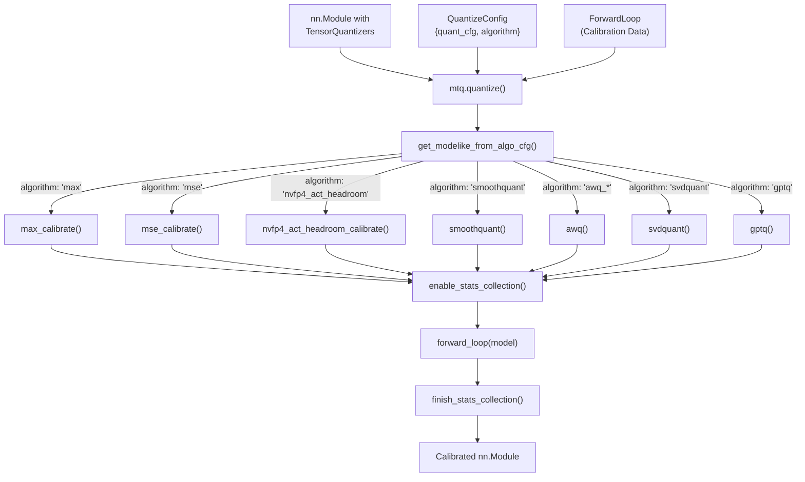
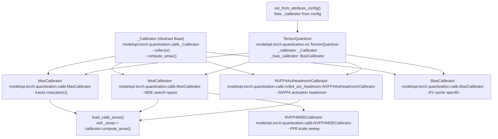
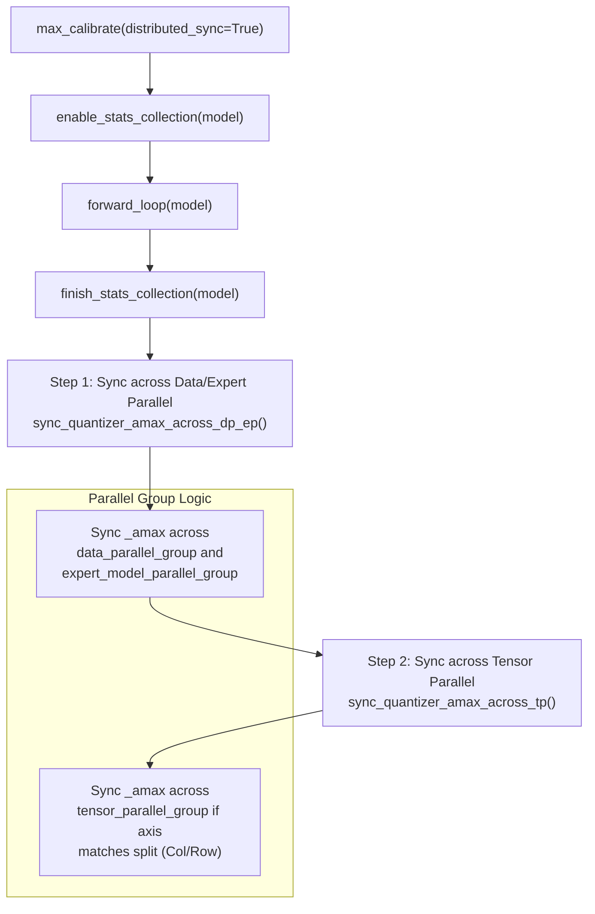

<!-- source: DeepWiki mcp.deepwiki.com · repo NVIDIA/Model-Optimizer · page 7.3 Calibration Algorithms · fetched 2026-10-26 -->

# Calibration Algorithms

Relevant source files

The following files were used as context for generating this wiki page:

- [modelopt/torch/quantization/calib/__init__.py](modelopt/torch/quantization/calib/__init__.py)
- [modelopt/torch/quantization/calib/mse.py](modelopt/torch/quantization/calib/mse.py)
- [modelopt/torch/quantization/calib/nvfp4_act_headroom.py](modelopt/torch/quantization/calib/nvfp4_act_headroom.py)
- [modelopt/torch/quantization/plugins/accelerate.py](modelopt/torch/quantization/plugins/accelerate.py)
- [modelopt/torch/quantization/tensor_quant.py](modelopt/torch/quantization/tensor_quant.py)
- [modelopt/torch/quantization/utils/calib_utils.py](modelopt/torch/quantization/utils/calib_utils.py)
- [modelopt/torch/utils/dataset_utils.py](modelopt/torch/utils/dataset_utils.py)
- [modelopt/torch/utils/speech_dataset_utils.py](modelopt/torch/utils/speech_dataset_utils.py)
- [modelopt/torch/utils/vlm_dataset_utils.py](modelopt/torch/utils/vlm_dataset_utils.py)
- [modelopt_recipes/general/ptq/nvfp4_act_headroom-kv_fp8_cast.yaml](modelopt_recipes/general/ptq/nvfp4_act_headroom-kv_fp8_cast.yaml)
- [tests/_test_utils/torch/quantization/quantize_common.py](tests/_test_utils/torch/quantization/quantize_common.py)
- [tests/gpu/torch/quantization/conftest.py](tests/gpu/torch/quantization/conftest.py)
- [tests/gpu/torch/quantization/plugins/test_accelerate_gpu.py](tests/gpu/torch/quantization/plugins/test_accelerate_gpu.py)
- [tests/gpu/torch/quantization/test_fsdp2.py](tests/gpu/torch/quantization/test_fsdp2.py)
- [tests/gpu/torch/quantization/test_gptq.py](tests/gpu/torch/quantization/test_gptq.py)
- [tests/gpu/torch/quantization/test_layerwise_calibrate.py](tests/gpu/torch/quantization/test_layerwise_calibrate.py)
- [tests/gpu/torch/quantization/test_nvfp4_fp8_sweep_kernel.py](tests/gpu/torch/quantization/test_nvfp4_fp8_sweep_kernel.py)
- [tests/gpu/torch/quantization/test_nvfp4_static_quantizer_cuda.py](tests/gpu/torch/quantization/test_nvfp4_static_quantizer_cuda.py)
- [tests/gpu/torch/quantization/test_quantize_cuda.py](tests/gpu/torch/quantization/test_quantize_cuda.py)
- [tests/gpu/torch/quantization/test_tensor_quant_cuda.py](tests/gpu/torch/quantization/test_tensor_quant_cuda.py)
- [tests/gpu/torch/utils/test_model_load_utils.py](tests/gpu/torch/utils/test_model_load_utils.py)
- [tests/unit/torch/quantization/test_layerwise_calibrate.py](tests/unit/torch/quantization/test_layerwise_calibrate.py)
- [tests/unit/torch/quantization/test_lsq.py](tests/unit/torch/quantization/test_lsq.py)
- [tests/unit/torch/quantization/test_mse_calibrator.py](tests/unit/torch/quantization/test_mse_calibrator.py)
- [tests/unit/torch/quantization/test_nvfp4_act_headroom.py](tests/unit/torch/quantization/test_nvfp4_act_headroom.py)
- [tests/unit/torch/quantization/test_quantize_cpu.py](tests/unit/torch/quantization/test_quantize_cpu.py)
- [tests/unit/torch/utils/test_dataset_utils.py](tests/unit/torch/utils/test_dataset_utils.py)

## Purpose and Scope

This page documents the calibration algorithms available in Model Optimizer for post-training quantization (PTQ). Calibration determines optimal quantization parameters (amax values, scaling factors) by analyzing tensor statistics during forward passes with calibration data. The calibration process is separate from quantization itself: calibration happens first to compute parameters, then those parameters are used during inference.

**Key Components:**
- **Calibrator classes** (`MaxCalibrator`, `MseCalibrator`, etc.) collect statistics and compute optimal amax.
- **Calibration functions** (`max_calibrate()`, `smoothquant()`, `awq()`, `svdquant()`, `gptq()`) orchestrate the calibration process.
- **TensorQuantizer** uses calibrators via its `_calibrator` attribute to determine quantization parameters.

**Sources**: [modelopt/torch/quantization/model_calib.py:16-51]()

## Overview

Model Optimizer supports several calibration algorithms, each optimized for different quantization formats and accuracy requirements:

| Algorithm | Function Name | Primary Use Case | Quantization Formats |
|-----------|---------------|------------------|---------------------|
| `max` | `max_calibrate()` | Simple per-tensor/channel quantization | INT8, FP8, NVFP4 |
| `mse` | `mse_calibrate()` | MSE-minimizing amax search | INT8, FP8, NVFP4 |
| `nvfp4_act_headroom` | `nvfp4_act_headroom_calibrate()` | NVFP4 activation headroom calibration | NVFP4 |
| `smoothquant` | `smoothquant()` | INT8 with activation smoothing | INT8 |
| `awq` | `awq()` (lite/clip/full) | Weight-only and W4A8 quantization | INT4, NVFP4, W4A8 |
| `svdquant` | `svdquant()` | Low-rank compressed quantization | INT4, NVFP4 |
| `gptq` | `gptq()` | Hessian-based weight optimization | INT4, NVFP4 |

**Algorithm Selection**: Specified via the `"algorithm"` field in quantization configs. For example: `"algorithm": "max"` or `"algorithm": {"method": "mse", "step_size": 0.25}`.

**Sources**: [modelopt/torch/quantization/config.py:50-137](), [modelopt/torch/quantization/model_calib.py:53-67]()

## Calibration Architecture

### High-Level Flow

**Sources**: [modelopt/torch/quantization/model_calib.py:136-159](), [modelopt/torch/quantization/mode.py:78-123](), [modelopt/torch/quantization/mode.py:211-230](), [modelopt/torch/quantization/model_quant.py:144-177]()

### Calibrator Class Hierarchy

**Key Methods:**
- `collect(x)`: Accumulate statistics from input tensor. [modelopt/torch/quantization/calib/mse.py:83-119]()
- `compute_amax()`: Return optimal amax from collected statistics. [modelopt/torch/quantization/calib/mse.py:130-171]()

**Sources**: [modelopt/torch/quantization/nn/modules/tensor_quantizer.py:126-149](), [modelopt/torch/quantization/model_calib.py:40-42](), [modelopt/torch/quantization/calib/mse.py:30-180]()

## Max Calibration

### Description

Max calibration (`max_calibrate()`) computes the absolute maximum value (amax) of all tensors passed through each quantizer. For per-channel quantization, it computes one amax per channel.

**Sources**: [modelopt/torch/quantization/model_calib.py:136-153]()

### Distributed Synchronization

Max calibration includes automatic synchronization of amax values across distributed processes (Data Parallel, Expert Parallel, and Tensor Parallel groups) to ensure consistency.

**Sources**: [modelopt/torch/quantization/model_calib.py:136-183]()

## MSE Calibration

### Description

MSE calibration (`mse_calibrate()`) searches for the optimal amax value that minimizes the mean squared error (MSE) between the original and quantized tensors.

### Algorithm

1. **Initialize with max calibration**: Compute initial amax values.
2. **Search space**: Generate candidates based on `step_size`, `start_multiplier`, and `stop_multiplier`. [modelopt/torch/quantization/calib/mse.py:70-74]()
3. **Collect statistics**: For each sample and candidate, compute `MSE(x, quant(x, candidate_amax))`. [modelopt/torch/quantization/calib/mse.py:104-118]()
4. **Optimal amax**: Find the candidate that minimizes the total MSE. [modelopt/torch/quantization/calib/mse.py:154-157]()

**Advanced Feature: FP8 Scale Sweep**: When `fp8_scale_sweep=True` is used, Model Optimizer uses `NVFP4MSECalibrator` to perform a per-block sweep over FP8 scales for NVFP4 static quantization. [modelopt/torch/quantization/model_calib.py:79-89](), [modelopt/torch/quantization/calib/mse.py:174-180]()

**Sources**: [modelopt/torch/quantization/model_calib.py:200-325](), [modelopt/torch/quantization/calib/mse.py:30-180]()

## NVFP4 Activation Headroom Calibration

### Description

NVFP4 activation headroom calibration (`nvfp4_act_headroom_calibrate()`) is a specialized calibration method for NVFP4 activations. It aims to find an amax that balances the representation of the bulk of the activation values with a "headroom" to accommodate potential outliers, which is crucial for maintaining accuracy in NVFP4. This method is particularly relevant for mixed-precision quantization schemes involving NVFP4.

### Algorithm

The `NVFP4ActHeadroomCalibrator` collects statistics on the input tensor's absolute maximum values. It then computes an amax that is a multiple of the observed maximum, providing a buffer for values that might exceed the typical range. This multiplier can be configured to adjust the amount of headroom.

**Sources**: [modelopt/torch/quantization/calib/nvfp4_act_headroom.py:29-100](), [modelopt/torch/quantization/model_calib.py:327-360]()

## Advanced Calibration Techniques

### SmoothQuant

SmoothQuant (`smoothquant()`) redistributes quantization difficulty from activations to weights by applying per-channel scaling factors. It requires per-channel activation statistics collected during a preliminary max calibration pass.

**Sources**: [modelopt/torch/quantization/model_calib.py:467-552]()

### AWQ (Activation-Aware Weight Quantization)

AWQ protects salient weights by scaling channels based on activation magnitudes.
- **awq_lite**: Uses a coarse grid search over scaling alpha values.
- **awq_clip**: Uses gradient-based optimization to find optimal clipping thresholds.
- **awq_full**: Combines lite search with clip refinement.

**Sources**: [modelopt/torch/quantization/model_calib.py:554-847]()

### SVDQuant

SVDQuant separates a weight matrix into a low-rank FP16/BF16 branch and a quantized residual branch. It uses Singular Value Decomposition (SVD) to isolate high-magnitude singular values that are difficult to quantize.

**Sources**: [modelopt/torch/quantization/model_calib.py:1164-1202]()

### GPTQ (Hessian-based Quantization)

GPTQ optimizes weights to compensate for quantization error using second-order information (Hessian matrix).
- **Hessian Collection**: Patches module forward passes to accumulate $X X^T$ statistics via `update_hessian`. [modelopt/torch/quantization/utils/calib_utils.py:148-162]()
- **Weight Update**: Computes the damped inverse Hessian via `compute_hessian_inverse` and applies blockwise updates to weights. [modelopt/torch/quantization/utils/calib_utils.py:77-111]()

**Sources**: [modelopt/torch/quantization/model_calib.py:849-1162](), [modelopt/torch/quantization/utils/calib_utils.py:113-172]()

## Calibration Datasets

Calibration datasets are crucial for collecting accurate statistics for quantization. Model Optimizer provides utilities to load and prepare various datasets for calibration.

### General Datasets

The `modelopt.torch.utils.dataset_utils` module provides functions to handle common text-based datasets.
- `SUPPORTED_DATASET_CONFIG`: A dictionary mapping dataset names to their configurations, including Hugging Face paths, splits, and preprocessing functions. [modelopt/torch/utils/dataset_utils.py:139-174]()
- `get_dataset_dataloader`: Creates a `DataLoader` for a specified dataset, handling tokenization and batching. [tests/unit/torch/utils/test_dataset_utils.py:31]()
- `create_forward_loop`: Generates a simple forward loop function for calibration given a dataloader. [tests/gpu/torch/quantization/test_gptq.py:34]()

### Vision-Language Model (VLM) Datasets

For VLMs, `modelopt.torch.utils.vlm_dataset_utils` offers specialized utilities.
- `SUPPORTED_VLM_DATASET_CONFIG`: Defines configurations for VLM datasets like "scienceqa" and "nemotron_vlm_dataset_v2", supporting streaming for large datasets. [modelopt/torch/utils/vlm_dataset_utils.py:37-50]()
- `_HFDatasetsIterableWrapper`: Wraps Hugging Face streaming `IterableDataset` for compatibility with PyTorch `DataLoader`. [modelopt/torch/utils/vlm_dataset_utils.py:55-69]()
- `_ShardedIterable`: Shards iterable datasets across distributed ranks. [modelopt/torch/utils/vlm_dataset_utils.py:70-85]()
- `_extract_text_from_messages`, `_extract_first_image_from_messages`: Helper functions to parse text and image references from VLM chat-style messages. [modelopt/torch/utils/vlm_dataset_utils.py:88-150]()

### Speech Datasets

The `modelopt.torch.utils.speech_dataset_utils` module provides similar utilities for speech-related datasets.

**Sources**: [modelopt/torch/utils/dataset_utils.py:139-174](), [tests/unit/torch/utils/test_dataset_utils.py:31](), [tests/gpu/torch/quantization/test_gptq.py:34](), [modelopt/torch/utils/vlm_dataset_utils.py:37-50](), [modelopt/torch/utils/vlm_dataset_utils.py:55-69](), [modelopt/torch/utils/vlm_dataset_utils.py:70-85](), [modelopt/torch/utils/vlm_dataset_utils.py:88-150]()

## Code Entity Mapping

| Code Entity | Role | File Path |
|-------------|------|-----------|
| `max_calibrate` | Primary entry point for max calibration | [modelopt/torch/quantization/model_calib.py:136]() |
| `mse_calibrate` | Entry point for MSE-based amax optimization | [modelopt/torch/quantization/model_calib.py:200]() |
| `nvfp4_act_headroom_calibrate` | Entry point for NVFP4 activation headroom calibration | [modelopt/torch/quantization/model_calib.py:327]() |
| `MseCalibrator` | Class managing MSE candidate search | [modelopt/torch/quantization/calib/mse.py:30]() |
| `NVFP4MSECalibrator` | Specialized MSE search for NVFP4 FP8 scales | [modelopt/torch/quantization/calib/mse.py:174]() |
| `NVFP4ActHeadroomCalibrator` | Class for NVFP4 activation headroom calibration | [modelopt/torch/quantization/calib/nvfp4_act_headroom.py:29]() |
| `TensorQuantizer` | Module that triggers calibration via `collect` | [modelopt/torch/quantization/nn/modules/tensor_quantizer.py:126]() |
| `awq` | Orchestrator for AWQ variants | [modelopt/torch/quantization/model_calib.py:554]() |
| `gptq` | Orchestrator for GPTQ weight optimization | [modelopt/torch/quantization/model_calib.py:849]() |
| `GPTQHelper` | Manages Hessian state and forward patching for GPTQ | [modelopt/torch/quantization/utils/calib_utils.py:113]() |
| `NVFP4QTensor` | Implements NVFP4 quantization and scaling factor retrieval | [modelopt/torch/quantization/qtensor/nvfp4_tensor.py:49]() |
| `SUPPORTED_DATASET_CONFIG` | Configuration for general calibration datasets | [modelopt/torch/utils/dataset_utils.py:139]() |
| `SUPPORTED_VLM_DATASET_CONFIG` | Configuration for VLM calibration datasets | [modelopt/torch/utils/vlm_dataset_utils.py:37]() |

**Sources**: [modelopt/torch/quantization/model_calib.py:136-1162](), [modelopt/torch/quantization/calib/mse.py:30-174](), [modelopt/torch/quantization/calib/nvfp4_act_headroom.py:29](), [modelopt/torch/quantization/nn/modules/tensor_quantizer.py:126](), [modelopt/torch/quantization/utils/calib_utils.py:113](), [modelopt/torch/quantization/qtensor/nvfp4_tensor.py:49](), [modelopt/torch/utils/dataset_utils.py:139](), [modelopt/torch/utils/vlm_dataset_utils.py:37]()

---

