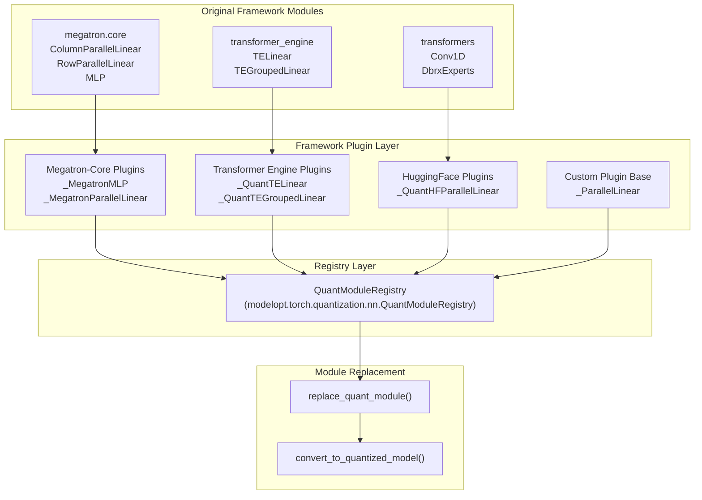

<!-- source: DeepWiki mcp.deepwiki.com · repo NVIDIA/Model-Optimizer · page 7.4 QuantModule Plugin System · fetched 2026-10-26 -->

# QuantModule Plugin System

<details>
<summary>Relevant source files</summary>

The following files were used as context for generating this wiki page:

- [modelopt/torch/opt/plugins/mcore_dist_checkpointing.py](modelopt/torch/opt/plugins/mcore_dist_checkpointing.py)
- [modelopt/torch/quantization/_auto_quantize_cost.py](modelopt/torch/quantization/_auto_quantize_cost.py)
- [modelopt/torch/quantization/algorithms.py](modelopt/torch/quantization/algorithms.py)
- [modelopt/torch/quantization/conversion.py](modelopt/torch/quantization/conversion.py)
- [modelopt/torch/quantization/model_quant.py](modelopt/torch/quantization/model_quant.py)
- [modelopt/torch/quantization/nn/__init__.py](modelopt/torch/quantization/nn/__init__.py)
- [modelopt/torch/quantization/nn/functional.py](modelopt/torch/quantization/nn/functional.py)
- [modelopt/torch/quantization/nn/modules/quant_embedding.py](modelopt/torch/quantization/nn/modules/quant_embedding.py)
- [modelopt/torch/quantization/nn/modules/quant_linear.py](modelopt/torch/quantization/nn/modules/quant_linear.py)
- [modelopt/torch/quantization/nn/modules/quant_module.py](modelopt/torch/quantization/nn/modules/quant_module.py)
- [modelopt/torch/quantization/plugins/attention.py](modelopt/torch/quantization/plugins/attention.py)
- [modelopt/torch/quantization/plugins/custom.py](modelopt/torch/quantization/plugins/custom.py)
- [modelopt/torch/quantization/plugins/transformer_engine.py](modelopt/torch/quantization/plugins/transformer_engine.py)
- [modelopt/torch/utils/plugins/megatron_calibration.py](modelopt/torch/utils/plugins/megatron_calibration.py)
- [tests/gpu/torch/quantization/test_hadamard.py](tests/gpu/torch/quantization/test_hadamard.py)
- [tests/gpu_megatron/torch/quantization/plugins/test_transformer_engine.py](tests/gpu_megatron/torch/quantization/plugins/test_transformer_engine.py)
- [tests/unit/torch/quantization/plugins/test_attention_quant.py](tests/unit/torch/quantization/plugins/test_attention_quant.py)
- [tests/unit/torch/quantization/plugins/test_huggingface.py](tests/unit/torch/quantization/plugins/test_huggingface.py)
- [tests/unit/torch/quantization/test_autoquant.py](tests/unit/torch/quantization/test_autoquant.py)
- [tests/unit/torch/quantization/test_calib.py](tests/unit/torch/quantization/test_calib.py)
- [tests/unit/torch/quantization/test_quant_embedding.py](tests/unit/torch/quantization/test_quant_embedding.py)
- [tests/unit/torch/quantization/test_tensor_quant_cpu.py](tests/unit/torch/quantization/test_tensor_quant_cpu.py)

</details>


The QuantModule Plugin System is the architectural component that enables NVIDIA Model Optimizer to support quantization across multiple deep learning frameworks through a unified registry and plugin-based architecture. This system maps framework-specific module types (e.g., `ColumnParallelLinear`, `TEColumnParallelLinear`, `LlamaAttention`) to their quantized counterparts and manages the module replacement process during quantization.

For information about the actual quantization process and algorithms, see [Post-Training Quantization (PTQ)](#3.1). For details on the `TensorQuantizer` module that performs the actual quantization operations, see [TensorQuantizer Module](#7.2).

## System Architecture

The plugin system consists of three main layers: the registry layer that maps module types to quantized implementations, the plugin layer that provides framework-specific quantization logic, and the replacement layer that performs the actual module conversion during quantization.

**Diagram: QuantModule Plugin System Architecture**


Sources: [modelopt/torch/quantization/conversion.py:39-46](), [modelopt/torch/quantization/plugins/transformer_engine.py:31-33](), [modelopt/torch/quantization/nn/modules/quant_module.py:33-38](), [modelopt/torch/quantization/plugins/custom.py:30-32](), [modelopt/torch/quantization/plugins/huggingface.py:36-42]()

## Core Components

### QuantModuleRegistry

The `QuantModuleRegistry` is a singleton registry based on `_DMRegistryCls` that maintains the mapping from original module types to their quantized implementations. It is the central dispatch mechanism for module replacement.

**Key Operations:**

| Operation | Description | File Reference |
|-----------|-------------|----------------|
| `@QuantModuleRegistry.register` | Decorator to register a QuantModule for specific module types | [modelopt/torch/quantization/nn/modules/quant_module.py:37-37]() |
| `replace_quant_module()` | Recursively replace modules in a model with their quantized counterparts | [modelopt/torch/quantization/conversion.py:68-68]() |
| `unregister()` | Remove a module registration from the registry | [modelopt/torch/quantization/conversion.py:59-59]() |

The registration decorator typically accepts a dictionary mapping original module types to string identifiers. For example, Transformer Engine layers are registered via `@QuantModuleRegistry.register({te.pytorch.Linear: "te_Linear"})` [modelopt/torch/quantization/plugins/transformer_engine.py:61-61]().

Sources: [modelopt/torch/quantization/nn/modules/quant_module.py:37-37](), [modelopt/torch/quantization/conversion.py:52-60](), [modelopt/torch/opt/dynamic.py:26-26]()

### QuantModule Base Class

`QuantModule` inherits from `DynamicModule` and provides the foundation for all quantized modules. It manages parallel state for distributed environments and provides hooks for state restoration.

**Key QuantModule Methods:**

| Method | Purpose | Implementation Detail |
|--------|---------|----------------------|
| `convert()` | Class method to convert a standard module to a `QuantModule` | Initializes `ParallelState` if missing [modelopt/torch/quantization/nn/modules/quant_module.py:50-60]() |
| `modelopt_post_restore()` | Post-restore state adjustment | Moves `TensorQuantizer` states to the correct device [modelopt/torch/quantization/nn/modules/quant_module.py:92-121]() |
| `fold_weight()` | Fakes quantized weights into parameters for faster evaluation | Disables fake quantization and copies data [modelopt/torch/quantization/nn/modules/quant_module.py:160-188]() |
| `iter_weights_for_calibration()` | Yields weight/quantizer pairs for calibration | Used by weight-only calibration algorithms [modelopt/torch/quantization/nn/modules/quant_module.py:123-129]() |

Sources: [modelopt/torch/quantization/nn/modules/quant_module.py:41-188]()

## Framework-Specific Implementations

### Hugging Face (HF) Plugin

The Hugging Face plugin extends `QuantModule` to support various HF module types, including `Conv1D`, `Linear`, and specialized MoE layers like `DbrxExperts`.

**Implementation Details:**
- **`_QuantHFParallelLinear`**: This class handles `transformers.pytorch_utils.Conv1D` and `nn.Linear` modules, providing a unified interface for quantization. It also includes logic for handling `DTensor` for distributed weight access [tests/unit/torch/quantization/plugins/test_huggingface.py:81-105]().
- **MoE Support**: For DBRX models, `DbrxExperts` and `DbrxExpertGLU` are registered, ensuring that their internal linear layers are correctly quantized. This involves handling transposed weights and managing per-expert quantization [tests/unit/torch/quantization/plugins/test_huggingface.py:159-196]().
- **FP8Linear Handling**: The plugin includes specific logic for `transformers.integrations.finegrained_fp8.FP8Linear` to correctly dequantize weights [tests/unit/torch/quantization/plugins/test_huggingface.py:140-153]().

Sources: [tests/unit/torch/quantization/plugins/test_huggingface.py:81-105](), [tests/unit/torch/quantization/plugins/test_huggingface.py:159-196](), [tests/unit/torch/quantization/plugins/test_huggingface.py:140-153]()

### Megatron-Core (MCore) Plugin

The Megatron plugin provides support for distributed linear layers and MoE experts.

**Implementation Details:**
- **Extra State Management**: MCore models often change module names during pipeline-parallel (PP) or expert-parallel (EP) changes. To handle this, `QuantModule` implements `quant_module_get_extra_state` to store quantizer states in the module's `extra_state` rather than relying on full module names in a global dictionary [modelopt/torch/opt/plugins/mcore_dist_checkpointing.py:138-142]().
- **Sharded Checkpointing**: The system integrates with MCore's distributed checkpointing to ensure `modelopt_state` is correctly sharded and remapped during loading [modelopt/torch/opt/plugins/mcore_dist_checkpointing.py:112-135]().
- **NVFP4 TP Restriction**: A check `_check_nvfp4_static_tp_supported` is implemented to raise an error if static-block NVFP4 weight quantization is attempted with Tensor Parallelism > 1, as shard-local amax values are currently treated as replicated [modelopt/torch/utils/plugins/megatron_calibration.py:30-59]().

Sources: [modelopt/torch/opt/plugins/mcore_dist_checkpointing.py:112-173](), [modelopt/torch/utils/plugins/megatron_calibration.py:30-59]()

### Transformer Engine (TE) Integration

The TE plugin enables ModelOpt quantization to work with `transformer_engine` layers, ensuring compatibility with TE's own FP8 internal logic.

**Implementation Details:**
- **Function Replacement**: TE layers use specialized C++ extensions. ModelOpt patches the `forward` or `apply` methods of TE functional classes (e.g., `te_linear._Linear`) to inject quantization [modelopt/torch/quantization/plugins/transformer_engine.py:64-69]().
- **TE FP8 Conflict Check**: The `_assert_te_fp8_enabled` function ensures that TE's native FP8 training (`fp8_autocast`) is disabled, as it conflicts with ModelOpt's quantization framework [modelopt/torch/quantization/plugins/transformer_engine.py:39-52]().
- **Grouped Linear Support**: `_QuantTEGroupedLinear` handles the complex weight storage in `TEGroupedLinear` (weight0, weight1, etc.). It initializes a `GroupedQuantizer` (an `nn.ModuleList`) to provide independent amax values for each fused expert [modelopt/torch/quantization/plugins/transformer_engine.py:150-156]().

Sources: [modelopt/torch/quantization/plugins/transformer_engine.py:39-111](), [modelopt/torch/quantization/plugins/transformer_engine.py:117-156]()

## Module Replacement Process

The conversion from a standard model to a quantized model is coordinated by `convert_to_quantized_model`.

**Module Replacement Flow:**

```mermaid
graph TD
    A[convert_to_quantized_model(model, config)] --> B{model.init_modellike() if ModelLikeModule};
    B --> C[replace_quant_module(model, version)];
    C --> D{Traverse module tree};
    D --> E{Is module type in QuantModuleRegistry?};
    E -- Yes --> F[Swap original module with QuantModule];
    E -- No --> D;
    F --> D;
    D --> G[set_quantizer_by_cfg(model, config.get("quant_cfg", []))];
    G --> H[update_quantize_metadata(model, config, metadata)];
    H --> I[Return model, metadata];
```
Sources: [modelopt/torch/quantization/conversion.py:63-74](), [modelopt/torch/quantization/conversion.py:182-195]()

### SVDQuant Special Case
SVDQuant uses a separate registry `SVDQuantModuleRegistry`. When SVDQuant is requested, the system performs an "on-the-fly" replacement where existing quantized linear modules are further converted into `SVDQuantLinear` modules [modelopt/torch/quantization/conversion.py:172-181](). This is handled by `create_and_replace_svdquant_linear_on_the_fly` [modelopt/torch/quantization/conversion.py:175-175](). The `SVDQuantLinear` module itself overrides the `_setup` method to ensure its `weight_quantizer` is an `SVDQuantTensorQuantizer`, which includes properties for LoRA weights (`svdquant_lora_a`, `svdquant_lora_b`) [modelopt/torch/quantization/nn/modules/quant_linear.py:65-115]().

Sources: [modelopt/torch/quantization/conversion.py:77-90](), [modelopt/torch/quantization/conversion.py:172-181](), [modelopt/torch/quantization/nn/modules/quant_linear.py:65-115]()

## State Restoration and Conversion

The plugin system supports restoring quantized models from metadata, ensuring that the architecture matches the saved state.

**Restoration Flow:**
1. **Module Reification**: `restore_quantized_model` first calls `convert_to_quantized_model` to ensure the model has the correct `QuantModule` structure [modelopt/torch/quantization/conversion.py:93-98]().
2. **State Application**: `restore_quantizer_state` maps the metadata back to `TensorQuantizer` buffers [modelopt/torch/quantization/conversion.py:125-169]().
3. **Type Promotion**: If a saved state indicates a specialized quantizer (e.g., `StaticBlockScaleQuantizer` for NVFP4), the system promotes the existing `TensorQuantizer` instance using `maybe_promote_nvfp4_static_quantizer` [modelopt/torch/quantization/conversion.py:103-109]().

Sources: [modelopt/torch/quantization/conversion.py:93-100](), [modelopt/torch/quantization/conversion.py:125-169](), [modelopt/torch/quantization/conversion.py:103-109]()

---

