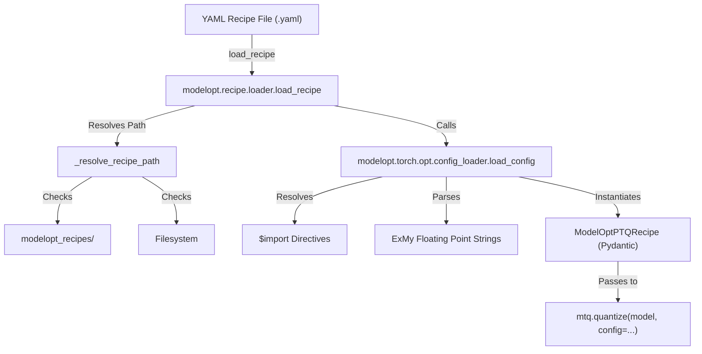
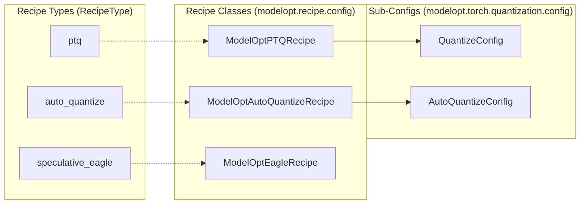

<!-- source: DeepWiki mcp.deepwiki.com · repo NVIDIA/Model-Optimizer · page 7.5 ModelOpt Recipes · fetched 2026-10-26 -->

# ModelOpt Recipes

Relevant source files

The following files were used as context for generating this wiki page:

- [docs/source/guides/10_recipes.rst](docs/source/guides/10_recipes.rst)
- [docs/source/guides/11_config_system.rst](docs/source/guides/11_config_system.rst)
- [docs/source/guides/_basic_quantization.rst](docs/source/guides/_basic_quantization.rst)
- [docs/source/guides/_pytorch_quantization.rst](docs/source/guides/_pytorch_quantization.rst)
- [docs/source/guides/_quant_cfg.rst](docs/source/guides/_quant_cfg.rst)
- [examples/minimax_m3/README.md](examples/minimax_m3/README.md)
- [examples/minimax_m3/hf_ptq_mixed_mxfp8_nvfp4.py](examples/minimax_m3/hf_ptq_mixed_mxfp8_nvfp4.py)
- [modelopt_recipes/configs/ptq/presets/model/nvfp4_mlp_only.yaml](modelopt_recipes/configs/ptq/presets/model/nvfp4_mlp_only.yaml)
- [modelopt_recipes/configs/ptq/presets/model/nvfp4_omlp_only.yaml](modelopt_recipes/configs/ptq/presets/model/nvfp4_omlp_only.yaml)
- [modelopt_recipes/configs/ptq/units/README.md](modelopt_recipes/configs/ptq/units/README.md)
- [modelopt_recipes/configs/ptq/units/default_disabled_quantizers.yaml](modelopt_recipes/configs/ptq/units/default_disabled_quantizers.yaml)
- [modelopt_recipes/configs/ptq/units/mixer_mlp_nvfp4.yaml](modelopt_recipes/configs/ptq/units/mixer_mlp_nvfp4.yaml)
- [modelopt_recipes/general/ptq/nvfp4_default-kv_none-gptq.yaml](modelopt_recipes/general/ptq/nvfp4_default-kv_none-gptq.yaml)
- [modelopt_recipes/general/ptq/nvfp4_experts_only-kv_fp8.yaml](modelopt_recipes/general/ptq/nvfp4_experts_only-kv_fp8.yaml)
- [modelopt_recipes/general/ptq/nvfp4_experts_only-kv_fp8_cast.yaml](modelopt_recipes/general/ptq/nvfp4_experts_only-kv_fp8_cast.yaml)
- [modelopt_recipes/general/ptq/nvfp4_experts_only-kv_fp8_layerwise.yaml](modelopt_recipes/general/ptq/nvfp4_experts_only-kv_fp8_layerwise.yaml)
- [modelopt_recipes/general/ptq/nvfp4_experts_only_mse-kv_fp8_cast.yaml](modelopt_recipes/general/ptq/nvfp4_experts_only_mse-kv_fp8_cast.yaml)
- [modelopt_recipes/general/ptq/nvfp4_mlp_only-kv_fp8.yaml](modelopt_recipes/general/ptq/nvfp4_mlp_only-kv_fp8.yaml)
- [modelopt_recipes/general/ptq/nvfp4_mlp_only-kv_fp8_cast.yaml](modelopt_recipes/general/ptq/nvfp4_mlp_only-kv_fp8_cast.yaml)
- [modelopt_recipes/general/ptq/nvfp4_mlp_only-novit-kv_fp8.yaml](modelopt_recipes/general/ptq/nvfp4_mlp_only-novit-kv_fp8.yaml)
- [modelopt_recipes/general/ptq/nvfp4_mlp_only_mse-kv_fp8_cast.yaml](modelopt_recipes/general/ptq/nvfp4_mlp_only_mse-kv_fp8_cast.yaml)
- [modelopt_recipes/general/ptq/nvfp4_omlp_only-kv_fp8.yaml](modelopt_recipes/general/ptq/nvfp4_omlp_only-kv_fp8.yaml)
- [modelopt_recipes/general/ptq/nvfp4_omlp_only-kv_fp8_cast.yaml](modelopt_recipes/general/ptq/nvfp4_omlp_only-kv_fp8_cast.yaml)
- [modelopt_recipes/huggingface/minimax_m3_vl/ptq/mxfp8_nvfp4_experts.yaml](modelopt_recipes/huggingface/minimax_m3_vl/ptq/mxfp8_nvfp4_experts.yaml)
- [modelopt_recipes/huggingface/minimax_m3_vl/ptq/nvfp4_experts_only.yaml](modelopt_recipes/huggingface/minimax_m3_vl/ptq/nvfp4_experts_only.yaml)
- [tests/unit/recipe/test_minimax_m3_recipe.py](tests/unit/recipe/test_minimax_m3_recipe.py)
- [tools/launcher/common/megatron_lm/quantize/quantize.sh](tools/launcher/common/megatron_lm/quantize/quantize.sh)
- [tools/launcher/examples/nvidia/NVIDIA-Nemotron-3-Super-120B-A12B-BF16/megatron_lm_ptq.yaml](tools/launcher/examples/nvidia/NVIDIA-Nemotron-3-Super-120B-A12B-BF16/megatron_lm_ptq.yaml)
- [tools/launcher/examples/nvidia/NVIDIA-Nemotron-3-Ultra-550B-A55B-BF16/megatron_lm_ptq.yaml](tools/launcher/examples/nvidia/NVIDIA-Nemotron-3-Ultra-550B-A55B-BF16/megatron_lm_ptq.yaml)
- [tools/launcher/examples/nvidia/NVIDIA-Nemotron-3.5-Lightning-30B-A3B-BF16/megatron_lm_qad.yaml](tools/launcher/examples/nvidia/NVIDIA-Nemotron-3.5-Lightning-30B-A3B-BF16/megatron_lm_qad.yaml)

ModelOpt Recipes are declarative specifications that fully describe how to optimize a model. They decouple optimization settings from Python code, enabling reuse, sharing, version control, and reproducibility [docs/source/guides/10_recipes.rst:6-11](). While the recipe system is designed to support any optimization technique, it currently focuses on Post-Training Quantization (PTQ) and Speculative Decoding [modelopt/recipe/config.py:53-62]().

## Recipe Architecture and Design

The recipe system is part of the `modelopt.recipe` package and consists of three layers:
1.  **Recipe sources**: YAML files or directories stored in `modelopt_recipes/` or on the user's filesystem [docs/source/guides/10_recipes.rst:42-43]().
2.  **Config loader**: `modelopt.recipe.loader.load_config` reads YAML, resolves paths, and performs automatic `ExMy` notation conversion [docs/source/guides/10_recipes.rst:44-45]().
3.  **Recipe loader**: `modelopt.recipe.loader.load_recipe` validates the configuration against Pydantic models and returns a typed recipe object [docs/source/guides/10_recipes.rst:46-48]().

### Key Recipe Components

Recipes are defined by specialized Pydantic classes inheriting from `ModelOptRecipeBase` [modelopt/recipe/config.py:91-113]().

| Component | Description | Code Entity |
| :--- | :--- | :--- |
| `metadata` | Contains `recipe_type` and a `description`. | `RecipeMetadataConfig` [modelopt/recipe/config.py:67-79]() |
| `quantize` | Configuration for PTQ, including algorithm and quantization config. | `QuantizeConfig` [modelopt/recipe/config.py:118-123]() |
| `constraints` | LP search constraints for AutoQuantize. | `AutoQuantizeConstraints` [modelopt/recipe/config.py:149-166]() |
| `imports` | A mapping of short names to config file paths for reusable snippets. | `_ListSnippet.imports` [modelopt/torch/opt/config_loader.py:44-57]() |

### Data Flow: Recipe to Model Optimization
The following diagram illustrates how a YAML recipe is loaded and transformed into a validated configuration object.

**Recipe Application Pipeline**

**Sources:** [modelopt/recipe/loader.py:37-37](), [modelopt/recipe/config.py:115-123](), [docs/source/guides/10_recipes.rst:42-48]()

---

## Composable Imports and Authoring Styles

Recipes support two authoring styles: **inline** (all values written directly) and **import-based** (reusable snippets referenced via `$import`) [docs/source/guides/10_recipes.rst:57-59]().

### The `$import` Mechanism
*   **`imports` (Top-level)**: Declares dependencies mapping names to paths [docs/source/guides/10_recipes.rst:180-181]().
*   **`$import` (Inline directive)**: Resolved at load time to inject snippet content [docs/source/guides/10_recipes.rst:182-183]().

When used as a dict value, `$import` supports composition with a specific override precedence:
1.  **Imports in list order**: Later snippets in a list override earlier ones [docs/source/guides/10_recipes.rst:196-197]().
2.  **Inline keys**: Keys alongside `$import` have the highest precedence and override imported values [docs/source/guides/10_recipes.rst:198-199]().

### Standard Snippets
Common exclusion patterns are maintained in reusable units, such as `default_disabled_quantizers.yaml`, which disables quantization for `lm_head`, `router`, and multimodal vision components like `vision_tower` and `visual` by default [modelopt_recipes/configs/ptq/units/default_disabled_quantizers.yaml:19-64]().

---

## Post-Training Quantization (PTQ) Schemes

ModelOpt provides pre-built model-agnostic recipes under `general/ptq/` and model-specific recipes under `huggingface/` [modelopt_recipes/ptq.md:4-7]().

### Recipe Naming Convention
General recipes follow the pattern: `<formats-scope>-<kv-mode>[-<algorithm>].yaml` [modelopt_recipes/ptq.md:20-22]().

### Supported Model-Body Schemes
| Scheme | Format | Target | Description |
| :--- | :--- | :--- | :--- |
| `fp8_default` | FP8 W8A8 | All linears | Safer aggressive option; Hopper+ [modelopt_recipes/ptq.md:73-77]() |
| `nvfp4_default` | NVFP4 W4A4 | All linears | Maximum throughput; Blackwell+ [modelopt_recipes/ptq.md:78-82]() |
| `nvfp4_experts_only`| NVFP4 W4A4 | MoE Experts | Recommended for MoE models [modelopt_recipes/general/ptq/nvfp4_experts_only-kv_fp8.yaml:27-28](), [modelopt_recipes/general/ptq/nvfp4_experts_only_mse-kv_fp8_cast.yaml:27-29]() |
| `nvfp4_mlp_only` | NVFP4 W4A4 | MLP/FFN | Recommended for dense models [modelopt_recipes/general/ptq/nvfp4_mlp_only-kv_fp8.yaml:27-29](), [modelopt_recipes/general/ptq/nvfp4_mlp_only_mse-kv_fp8_cast.yaml:27-29]() |
| `nvfp4_weight_only`| NVFP4 W4A16 | Weights only | Low-concurrency edge use cases [modelopt_recipes/ptq.md:128-130]() |

### KV-Cache Modes
*   **`kv_fp8`**: Calibrated FP8 KV cache [modelopt_recipes/general/ptq/nvfp4_experts_only-kv_fp8.yaml:22]().
*   **`kv_fp8_cast`**: Uses a constant amax (e.g., `use_constant_amax: true`) to skip data-driven calibration for the KV cache [modelopt_recipes/general/ptq/nvfp4_mlp_only_mse-kv_fp8_cast.yaml:23]().

**Sources:** [modelopt_recipes/ptq.md:13-130](), [examples/hf_ptq/hf_ptq.py:101-110](), [modelopt_recipes/general/ptq/nvfp4_experts_only-kv_fp8.yaml:22](), [modelopt_recipes/general/ptq/nvfp4_mlp_only_mse-kv_fp8_cast.yaml:23](), [modelopt_recipes/general/ptq/nvfp4_experts_only-kv_fp8.yaml:27-28](), [modelopt_recipes/general/ptq/nvfp4_experts_only_mse-kv_fp8_cast.yaml:27-29](), [modelopt_recipes/general/ptq/nvfp4_mlp_only-kv_fp8.yaml:27-29](), [modelopt_recipes/general/ptq/nvfp4_mlp_only_mse-kv_fp8_cast.yaml:27-29]()

---

## Implementation Details

### Entity Mapping: Natural Language to Code
The mapping between high-level recipe concepts and their internal Pydantic implementation.

**Sources:** [modelopt/recipe/config.py:53-62](), [modelopt/recipe/config.py:115-123](), [modelopt/recipe/config.py:192-200]()

### Recipe Loading Logic
The `load_recipe` function in `modelopt.recipe.loader` resolves the recipe path (probing for `.yaml` or `.yml` suffixes) and checks for built-in recipes before checking the local filesystem [tests/unit/recipe/test_loader.py:122-152]().

### Integration in Examples
The `hf_ptq.py` example utilizes `load_recipe` to fetch the desired configuration based on user input, supporting both preset strings and local paths [examples/hf_ptq/hf_ptq.py:67-67](). It also includes logic to detect if a recipe requires calibration by inspecting the `QuantizeConfig` [examples/hf_ptq/hf_ptq.py:79-79]().

**Sources:** [modelopt/recipe/loader.py:37-37](), [examples/hf_ptq/hf_ptq.py:67-79](), [tests/unit/recipe/test_loader.py:122-152]()

---

