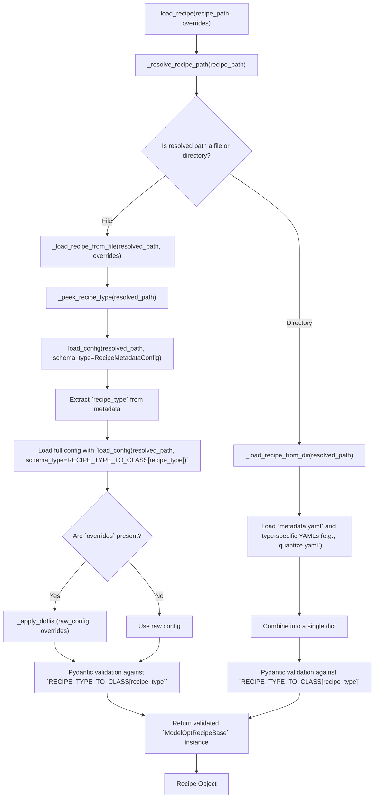

<!-- source: DeepWiki mcp.deepwiki.com · repo NVIDIA/Model-Optimizer · page 7.6 Recipe and Config Loader Internals · fetched 2026-10-26 -->

# Recipe and Config Loader Internals

<details>
<summary>Relevant source files</summary>

The following files were used as context for generating this wiki page:

- [MANIFEST.in](MANIFEST.in)
- [docs/source/guides/10_recipes.rst](docs/source/guides/10_recipes.rst)
- [docs/source/guides/11_config_system.rst](docs/source/guides/11_config_system.rst)
- [docs/source/guides/_basic_quantization.rst](docs/source/guides/_basic_quantization.rst)
- [docs/source/guides/_pytorch_quantization.rst](docs/source/guides/_pytorch_quantization.rst)
- [docs/source/guides/_quant_cfg.rst](docs/source/guides/_quant_cfg.rst)
- [examples/minimax_m3/README.md](examples/minimax_m3/README.md)
- [examples/minimax_m3/hf_ptq_mixed_mxfp8_nvfp4.py](examples/minimax_m3/hf_ptq_mixed_mxfp8_nvfp4.py)
- [modelopt/onnx/llm_export_utils/__init__.py](modelopt/onnx/llm_export_utils/__init__.py)
- [modelopt/onnx/llm_export_utils/export_utils.py](modelopt/onnx/llm_export_utils/export_utils.py)
- [modelopt/onnx/llm_export_utils/quantization_utils.py](modelopt/onnx/llm_export_utils/quantization_utils.py)
- [modelopt/onnx/llm_export_utils/surgeon_utils.py](modelopt/onnx/llm_export_utils/surgeon_utils.py)
- [modelopt/recipe/config.py](modelopt/recipe/config.py)
- [modelopt/recipe/loader.py](modelopt/recipe/loader.py)
- [modelopt/torch/opt/config.py](modelopt/torch/opt/config.py)
- [modelopt/torch/opt/config_loader.py](modelopt/torch/opt/config_loader.py)
- [modelopt_recipes/README.md](modelopt_recipes/README.md)
- [modelopt_recipes/huggingface/minimax_m3_vl/ptq/mxfp8_nvfp4_experts.yaml](modelopt_recipes/huggingface/minimax_m3_vl/ptq/mxfp8_nvfp4_experts.yaml)
- [modelopt_recipes/huggingface/minimax_m3_vl/ptq/nvfp4_experts_only.yaml](modelopt_recipes/huggingface/minimax_m3_vl/ptq/nvfp4_experts_only.yaml)
- [tests/unit/recipe/test_loader.py](tests/unit/recipe/test_loader.py)
- [tests/unit/recipe/test_minimax_m3_recipe.py](tests/unit/recipe/test_minimax_m3_recipe.py)
- [tests/unit/torch/opt/test_config.py](tests/unit/torch/opt/test_config.py)

</details>


This page details the internal mechanisms of `modelopt.recipe` for loading and validating YAML recipe configurations. It covers how unit and preset configurations are composed, and how the `modelopt.torch.opt` config system underpins these operations. The goal is to provide a comprehensive understanding of the data flow, key functions, and classes involved in processing Model Optimizer recipes.

## Motivation and Design Principles

The Model Optimizer recipe system aims to provide a declarative, version-controlled, and reproducible way to define model optimization workflows. Instead of scattering optimization settings across code, recipes centralize them in YAML files. This approach addresses challenges such as reproducibility, sharing configurations, version control, and onboarding new models [docs/source/guides/10_recipes.rst:21-30]().

The core design principles of the config system are:
*   **Typed / schematized**: Each configuration surface has an explicit Python type contract, typically inheriting from `modelopt.torch.opt.config.ModeloptBaseConfig` [docs/source/guides/11_config_system.rst:27-29]().
*   **Validated**: Invalid values are caught at load time or schema construction time, surfacing as Pydantic validation errors [docs/source/guides/11_config_system.rst:31-34]().
*   **Persistent**: Resolved configurations can be serialized to YAML/JSON and restored against their schema [docs/source/guides/11_config_system.rst:35-37]().
*   **Composable YAML**: Shared fragments (units and presets) can be defined once and referenced across multiple YAML files using an `$import` mechanism [docs/source/guides/10_recipes.rst:170-173]().

Sources: [docs/source/guides/10_recipes.rst:21-30](), [docs/source/guides/11_config_system.rst:27-37]()

## Recipe Structure and Authoring Styles

A recipe typically consists of two top-level sections: `metadata` and a type-specific configuration section (e.g., `quantize` for PTQ recipes) [docs/source/guides/10_recipes.rst:53-54](). These sections can reside in a single YAML file or be split across multiple files within a directory.

### Single-File Format

Recipes can be authored in a single `.yaml` file using two styles:

*   **Inline style**: All configuration values are written directly within the file [docs/source/guides/10_recipes.rst:66-91]().
*   **Import style**: Reusable configuration snippets are referenced via an `imports` section and `$import` directives [docs/source/guides/10_recipes.rst:93-119](). This reduces duplication for common numeric formats or exclusion lists.

Sources: [docs/source/guides/10_recipes.rst:66-119]()

### Directory Format

For larger recipes or to separate metadata, a directory structure can be used. For example, a PTQ recipe might have `my_recipe/metadata.yaml` and `my_recipe/quantize.yaml` [docs/source/guides/10_recipes.rst:126-160](). Both inline and import styles are supported within this format.

Sources: [docs/source/guides/10_recipes.rst:126-160]()

### Composable Imports

The `$import` mechanism allows recipes to compose reusable configuration snippets. The `imports` section maps short names to config file paths. The `$import` directive, marked with a dollar sign, is used inline to reference these snippets [docs/source/guides/10_recipes.rst:170-184]().

*   **As a dict value**: The `$import` marker is replaced with the snippet content, or merged with inline overrides [docs/source/guides/10_recipes.rst:186-188]().
*   **As a list element**: The snippet is either appended as one element or spliced as multiple elements, depending on the surrounding list's schema and the imported snippet's `modelopt-schema` [docs/source/guides/10_recipes.rst:189-192]().

Sources: [docs/source/guides/10_recipes.rst:170-192]()

## Recipe Loading Process

The recipe loading process involves several steps, from resolving paths to validating against Pydantic models. The primary entry point is `modelopt.recipe.loader.load_recipe` [modelopt/recipe/loader.py:83-86]().

### 1. Path Resolution (`_resolve_recipe_path`)

The `_resolve_recipe_path` function resolves the input `recipe_path`. It first checks the built-in recipe library (`modelopt_recipes/`) and then the filesystem. It also handles backward compatibility for old recipe paths like `huggingface/models/...` by rewriting them to `models/...` [modelopt/recipe/loader.py:52-70]().

**Diagram: Recipe Path Resolution**
```mermaid
graph TD
    A["`recipe_path` (str | Path | Traversable)"] --> B{Is `recipe_path` a string/relative Path?};
    B -- Yes --> C{Is `recipe_path` an old "huggingface/models/" path?};
    C -- Yes --> D["Rewrite prefix to 'models/'"];
    C -- No --> E["Use `recipe_path` as is"];
    D --> F["Check built-in library (`BUILTIN_RECIPES_LIB`)"];
    E --> F;
    F -- Found --> G["Return built-in path"];
    F -- Not Found --> H["Check filesystem (absolute/relative)"];
    H -- Found --> I["Return filesystem path"];
    H -- Not Found --> J["Return original `recipe_path` as Path"];
    B -- No --> K["Return `recipe_path` as is"];
    G --> L["Resolved Path"];
    I --> L;
    J --> L;
    K --> L;
```
Sources: [modelopt/recipe/loader.py:52-70]()

### 2. Configuration Loading (`load_config`)

The `modelopt.torch.opt.config_loader.load_config` function is responsible for reading YAML files, resolving paths, and performing automatic `ExMy` floating-point notation conversion [docs/source/guides/10_recipes.rst:45-46](). It can load a plain YAML file [tests/unit/recipe/test_loader.py:116-119]() and automatically resolve `.yml` or `.yaml` suffixes if omitted [tests/unit/recipe/test_loader.py:122-125]().

Sources: [docs/source/guides/10_recipes.rst:45-46](), [tests/unit/recipe/test_loader.py:116-125]()

### 3. Recipe Type Peeking (`_peek_recipe_type`)

Before full validation, `_peek_recipe_type` attempts to extract the `metadata.recipe_type` from the raw YAML. This is crucial for `load_config` to apply the correct schema for typed-list `$import` resolution [modelopt/recipe/loader.py:143-147]().

Sources: [modelopt/recipe/loader.py:143-147]()

### 4. Applying Overrides (`_apply_dotlist`)

If `overrides` (CLI-style `key.path=value` dotlist entries) are provided, `_apply_dotlist` merges them on top of the loaded YAML data using `OmegaConf.merge` [modelopt/recipe/loader.py:131-140](). This is only supported for single YAML file recipes, not directory-format recipes [modelopt/recipe/loader.py:121-125]().

Sources: [modelopt/recipe/loader.py:121-125](), [modelopt/recipe/loader.py:131-140]()

### 5. Pydantic Validation

After loading and applying overrides, the raw configuration is validated against a Pydantic model. The specific Pydantic class used for validation depends on the `recipe_type` found in the metadata.

The `modelopt.recipe.config.RECIPE_TYPE_TO_CLASS` dictionary maps `RecipeType` enums (e.g., `RecipeType.PTQ`) to their corresponding Pydantic recipe classes (e.g., `ModelOptPTQRecipe`) [modelopt/recipe/config.py:36]().

**Diagram: Recipe Loading and Validation Flow**

Sources: [modelopt/recipe/loader.py:83-86](), [modelopt/recipe/loader.py:107-128](), [modelopt/recipe/loader.py:143-147](), [modelopt/recipe/loader.py:131-140](), [modelopt/recipe/config.py:36]()

### Recipe Classes

The base class for all Model Optimizer recipes is `modelopt.recipe.config.ModelOptRecipeBase` [modelopt/recipe/config.py:91](). Specific recipe types inherit from this base class:

*   `modelopt.recipe.config.ModelOptPTQRecipe`: For Post-Training Quantization recipes. It requires a `quantize` section [modelopt/recipe/config.py:115-123]().
*   `modelopt.recipe.config.ModelOptAutoQuantizeRecipe`: For auto-quantization recipes.
*   `modelopt.recipe.config.ModelOptEagleRecipe`: For EAGLE speculative decoding recipes.
*   `modelopt.recipe.config.ModelOptDFlashRecipe`: For DFlash speculative decoding recipes.
*   `modelopt.recipe.config.ModelOptMedusaRecipe`: For Medusa speculative decoding recipes.

Each recipe class defines its expected structure and fields using Pydantic. For example, `ModelOptPTQRecipe` expects a `quantize` field of type `QuantizeConfig` [modelopt/recipe/config.py:118]().

Sources: [modelopt/recipe/config.py:91](), [modelopt/recipe/config.py:115-123]()

## `modelopt.torch.opt` Config System

The `modelopt.torch.opt` config system provides the underlying infrastructure for schema definition, validation, and YAML composition.

### Schema Layer

The `modelopt.torch.opt.config.ModeloptBaseConfig` is the common base class for structured ModelOpt config objects [docs/source/guides/11_config_system.rst:53](). It extends Pydantic's `BaseModel` with ModelOpt-specific behaviors:

*   `extra="forbid"`: Rejects unknown keys by default [docs/source/guides/11_config_system.rst:58]().
*   `validate_assignment=True`: Revalidates field updates after construction [docs/source/guides/11_config_system.rst:59]().
*   `ModeloptField(...)`: A wrapper over Pydantic `Field` ensuring default values are supplied [docs/source/guides/11_config_system.rst:60-62]().
*   `model_dump()` and `model_dump_json()`: Default to `by_alias=True` and suppress Pydantic warnings [docs/source/guides/11_config_system.rst:63-65]().
*   `MutableMapping` inheritance: Allows dict-style access to config objects [docs/source/guides/11_config_system.rst:66-77]().
*   `__init_subclass__`: Registers config subclasses for `torch.load` deserialization [docs/source/guides/11_config_system.rst:78-81]().

An example is `modelopt.torch.quantization.config.QuantizeConfig`, which defines fields like `quant_cfg` and `algorithm` and includes field validators for normalization [docs/source/guides/11_config_system.rst:88-105]().

Sources: [docs/source/guides/11_config_system.rst:53-105]()

### Validation Model

Validation occurs at two main boundaries:

1.  **Imported snippets**: Any file referenced by a YAML `imports` block must include a `# modelopt-schema: ...` comment in its preamble [docs/source/guides/11_config_system.rst:135-143](). The loader validates the snippet payload against this schema using Pydantic's `TypeAdapter` before exposing it. Schema paths are restricted to the `modelopt.` package and must point to Pydantic-compatible types [docs/source/guides/11_config_system.rst:144-153]().
2.  **Top-level configs**: Top-level user configs can either declare a `modelopt-schema` comment or have their schema context supplied directly by the API through `schema_type=` [docs/source/guides/11_config_system.rst:157-167]().

Sources: [docs/source/guides/11_config_system.rst:135-167]()

## Quantization Configuration (`quant_cfg`)

The `quant_cfg` field within a `QuantizeConfig` is a crucial part of PTQ recipes. It is an ordered list of `modelopt.torch.quantization.config.QuantizerCfgEntry` entries [docs/source/guides/_quant_cfg.rst:27-28](). Each entry targets quantizer modules in the model and specifies their configuration.

### `QuantizerCfgEntry` Fields

Each entry in `quant_cfg` is a `QuantizerCfgEntry` with the following fields:

*   `quantizer_name`: A wildcard string (using `fnmatch` rules) matched against quantizer module names (e.g., `"*weight_quantizer"`) [docs/source/guides/_quant_cfg.rst:55-57]().
*   `parent_class`: (Optional) Restricts matching to quantizers whose immediate parent module is of this PyTorch class (e.g., `"nn.Linear"`) [docs/source/guides/_quant_cfg.rst:58-60]().
*   `cfg`: (Optional) Quantizer attributes typed as `modelopt.torch.quantization.config.QuantizerAttributeConfig`, or a list for sequential quantization [docs/source/guides/_quant_cfg.rst:61-65]().
*   `enable`: (Optional) `True` or `False` to toggle matched quantizers. If `cfg` is present and `enable` is omitted, the quantizer is implicitly enabled [docs/source/guides/_quant_cfg.rst:66-71]().

Sources: [docs/source/guides/_quant_cfg.rst:27-28](), [docs/source/guides/_quant_cfg.rst:55-71]()

### Ordering and Precedence

Entries in `quant_cfg` are applied in list order, with later entries overriding earlier ones for any matched quantizer. This allows for composable precedence:
1.  Broad rules (e.g., deny-all) are placed first.
2.  Format-specific enable rules come after.
3.  Fine-grained exclusions are placed last [docs/source/guides/_quant_cfg.rst:125-130]().

A common pattern is to start with a deny-all entry (`{"quantizer_name": "*", "enable": False}`) to ensure quantizers not explicitly targeted remain disabled [docs/source/guides/_quant_cfg.rst:136-152]().

Sources: [docs/source/guides/_quant_cfg.rst:125-152]()

### Default Quantizer Configuration

When a quantizer is enabled but not explicitly configured by a `cfg` entry, it operates with the default attributes of `modelopt.torch.quantization.config.QuantizerAttributeConfig`. This typically means INT8 per-tensor static fake-quantization with a max-calibrated scale [docs/source/guides/_quant_cfg.rst:90-115]().

Sources: [docs/source/guides/_quant_cfg.rst:90-115]()

---

