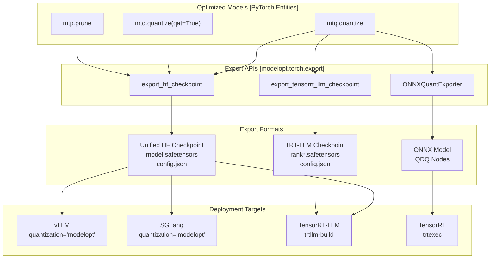
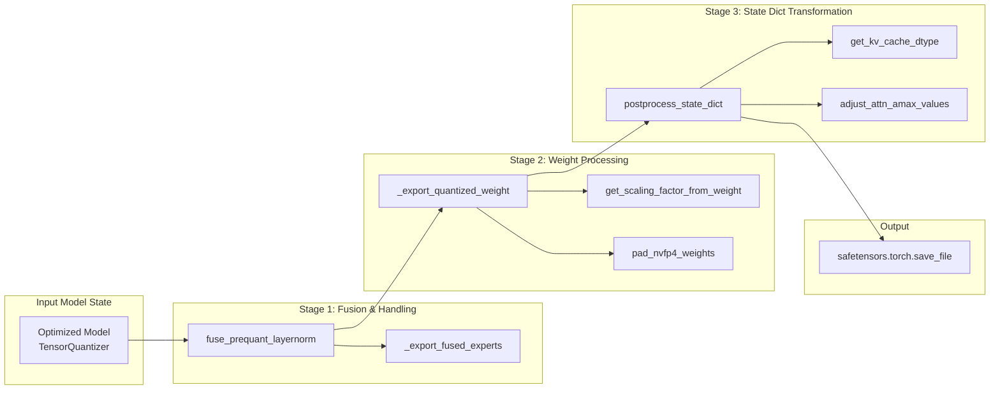

<!-- source: DeepWiki mcp.deepwiki.com · repo NVIDIA/Model-Optimizer · page 8 Export and Deployment · fetched 2026-10-26 -->

# Export and Deployment

Relevant source files

The following files were used as context for generating this wiki page:

- [examples/deepseek/deepseek_v4/quantize_to_nvfp4.py](examples/deepseek/deepseek_v4/quantize_to_nvfp4.py)
- [examples/kimi/README.md](examples/kimi/README.md)
- [examples/kimi/kimi_k3/quantize_to_nvfp4.py](examples/kimi/kimi_k3/quantize_to_nvfp4.py)
- [modelopt/torch/export/__init__.py](modelopt/torch/export/__init__.py)
- [modelopt/torch/export/shard_cast_utils.py](modelopt/torch/export/shard_cast_utils.py)
- [modelopt_recipes/huggingface/README.md](modelopt_recipes/huggingface/README.md)
- [tests/unit/recipe/test_kimi_k3_recipe.py](tests/unit/recipe/test_kimi_k3_recipe.py)

This page describes the process of exporting optimized models from ModelOpt to deployment-ready formats and the supported deployment targets. After applying optimization techniques like quantization, pruning, or speculative decoding, models must be exported to formats compatible with inference engines such as TensorRT-LLM, vLLM, SGLang, or TensorRT.

For details on specific export APIs and deployment workflows, see:
- **Unified HF Checkpoint Export**: [Unified HF Checkpoint Export](#8.1) — Detailed guide to `export_hf_checkpoint` including packed weights, scaling factors, and VLM handling.
- **TensorRT-LLM Deployment**: [TensorRT-LLM Deployment](#8.2) — Deployment to TensorRT-LLM including `export_tensorrt_llm_checkpoint` and AutoDeploy integration.
- **vLLM and SGLang Deployment**: [vLLM and SGLang Deployment](#8.3) — Deployment to vLLM and SGLang inference engines with native quantization support.
- **ONNX to TensorRT Pipeline**: [ONNX to TensorRT Pipeline](#8.4) — End-to-end ONNX to TensorRT deployment including engine compilation and `DeviceModel` integration.
- **Megatron Export Pipeline**: [Megatron Export Pipeline](#8.5) — Export of Megatron-Core quantized models to HF and TensorRT-LLM formats including NeMo Run integration.

For information about the optimization techniques that precede export, see:
- **PyTorch Optimization**: [PyTorch Optimization](#3) — Quantization, pruning, and distillation techniques.
- **ONNX Optimization**: [ONNX Optimization](#4) — ONNX-specific quantization and conversion.

---

## Export Formats and Deployment Targets

ModelOpt supports three primary export pathways depending on the model type and target deployment platform:

| Export Format | Model Types | Deployment Targets | Primary API |
|--------------|-------------|-------------------|-------------|
| **Unified HF Checkpoint** | LLMs, VLMs, Diffusion | vLLM, SGLang, TensorRT-LLM, ComfyUI | `export_hf_checkpoint` |
| **TensorRT-LLM Checkpoint** | LLMs | TensorRT-LLM | `export_tensorrt_llm_checkpoint` |
| **ONNX Graph** | Vision, Diffusion | TensorRT, ONNX Runtime | ONNX export pipeline |

The **Unified HF Checkpoint** format is the modern standard, maintaining compatibility with Hugging Face's model structure while incorporating quantization metadata and packed weights [modelopt/torch/export/unified_export_hf.py:16-32](). It supports a wide range of formats including FP8, NVFP4, and MXFP8 [modelopt/torch/export/unified_export_hf.py:83-94]().

Sources: [modelopt/torch/export/unified_export_hf.py:16-32](), [modelopt/torch/export/unified_export_hf.py:83-94]()

---

## Export Architecture Overview

**Diagram: Export Format Selection and Deployment Path**

The export process transforms an optimized PyTorch model into a deployment-ready format. For LLMs and VLMs, the unified HF checkpoint format is the preferred path for cross-framework compatibility [modelopt/torch/export/unified_export_hf.py:16-32](). The system handles complex multi-modal architectures by extracting language model components from VLMs [modelopt/torch/export/model_utils.py:121-154]().

Sources: [modelopt/torch/export/unified_export_hf.py:120-120](), [modelopt/torch/export/model_utils.py:121-154](), [modelopt/torch/export/unified_export_hf.py:83-94]()

---

## Export Pipeline Components

The export process consists of several key stages:

**Diagram: Export Pipeline Stages**

1.  **Layer Fusion & Handling**: Optimizes models by fusing pre-quantization scales [modelopt/torch/export/unified_export_hf.py:103-104]() and splitting fused MoE expert weights into per-expert projections [modelopt/torch/export/moe_utils.py:48-76]().
2.  **Weight Processing**: Calculates scaling factors for different group sizes and handles weight transposition for expert layers [modelopt/torch/export/shard_cast_utils.py:125-125](). For NVFP4, weights are padded and scales are swizzled for optimized inference [modelopt/torch/export/shard_cast_utils.py:138-139]().
3.  **State Dict Transformation**: `postprocess_state_dict` renames keys, handles tied weights via `TiedWeightMap`, and prepares KV cache scaling factors [modelopt/torch/export/model_utils.py:157-186]().

Sources: [modelopt/torch/export/unified_export_hf.py:102-117](), [modelopt/torch/export/moe_utils.py:48-76](), [modelopt/torch/export/model_utils.py:157-186](), [modelopt/torch/export/shard_cast_utils.py:125-125](), [modelopt/torch/export/shard_cast_utils.py:138-139]()

---

## Unified HF Checkpoint Export API

The primary export API for LLMs and VLMs is `export_hf_checkpoint` [modelopt/torch/export/unified_export_hf.py:120-120]().

### Distributed Support (FSDP2)
For models optimized using PyTorch FSDP2, the exporter is aware of the distributed state. It uses `is_fsdp2_model` to detect sharded modules and `fsdp2_aware_weight_update` to handle weight transformations across ranks [modelopt/torch/export/unified_export_hf.py:62-65]().

### KV Cache Scaling
The export process handles multiple KV cache formats, including FP8, INT8, and NVFP4 [modelopt/torch/export/model_config.py:83-94](). Scaling factors for KV caches are extracted using `get_kv_cache_scaling_factor` and stored in the final checkpoint [modelopt/torch/export/model_config.py:83-94]().

Sources: [modelopt/torch/export/unified_export_hf.py:120-120](), [modelopt/torch/export/unified_export_hf.py:62-65](), [modelopt/torch/export/model_config.py:83-94]()

---

## Weight Export and Quantization Formats

The weight export process converts model parameters from fake-quantized states to actual quantized formats using `to_quantized_weight` [modelopt/torch/export/unified_export_hf.py:116-116]().

### Supported Quantization Formats

| Format | Bits | Weight Type | Use Case |
|--------|------|-------------|----------|
| `QUANTIZATION_FP8` | 8 | FP8 E4M3 | Standard LLM/VLM [modelopt/torch/export/model_config.py:83]() |
| `QUANTIZATION_NVFP4` | 4 | NVFP4 | Blackwell GPUs [modelopt/torch/export/model_config.py:88]() |
| `QUANTIZATION_W4A8_AWQ` | 4/8 | INT4/FP8 | Memory-constrained [modelopt/torch/export/model_config.py:91]() |
| `QUANTIZATION_MXFP8` | 8 | MXFP8 | Microscaling formats [modelopt/torch/export/model_config.py:86]() |

For specialized formats like `QUANTIZATION_NVFP4_AWQ`, the exporter performs resmoothing and scale adjustments [modelopt/torch/export/shard_cast_utils.py:138-139](). It also supports per-expert weight quantization for MoE layers, where each expert has an independent `amax` [examples/deepseek/deepseek_v4/quantize_to_nvfp4.py:131-134](). The `quantize_mxfp4_to_nvfp4_lossless` function in `shard_cast_utils.py` provides a closed-form MXFP4-to-NVFP4 cast, which is used in models like Kimi-K3 and DeepSeek-V4 [modelopt/torch/export/shard_cast_utils.py:143-174](), [examples/kimi/kimi_k3/quantize_to_nvfp4.py:28-38](), [examples/deepseek/deepseek_v4/quantize_to_nvfp4.py:66-79]().

Sources: [modelopt/torch/export/model_config.py:83-94](), [modelopt/torch/export/shard_cast_utils.py:138-139](), [examples/deepseek/deepseek_v4/quantize_to_nvfp4.py:131-134](), [modelopt/torch/export/shard_cast_utils.py:143-174](), [examples/kimi/kimi_k3/quantize_to_nvfp4.py:28-38](), [examples/deepseek/deepseek_v4/quantize_to_nvfp4.py:66-79]()

---

