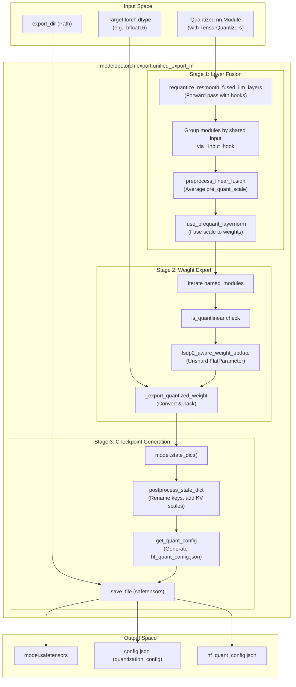
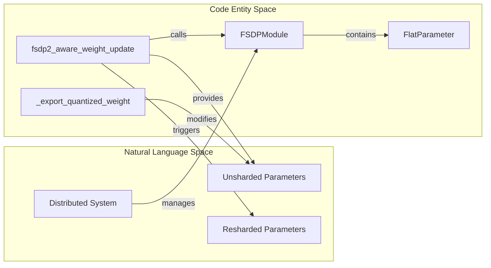

<!-- source: DeepWiki mcp.deepwiki.com · repo NVIDIA/Model-Optimizer · page 8.1 Unified HF Checkpoint Export · fetched 2026-10-26 -->

# Unified HF Checkpoint Export

<details>
<summary>Relevant source files</summary>

The following files were used as context for generating this wiki page:

- [CHANGELOG.rst](CHANGELOG.rst)
- [examples/llm_qat/export.py](examples/llm_qat/export.py)
- [modelopt/torch/export/layer_utils.py](modelopt/torch/export/layer_utils.py)
- [modelopt/torch/export/model_config_export.py](modelopt/torch/export/model_config_export.py)
- [modelopt/torch/export/model_utils.py](modelopt/torch/export/model_utils.py)
- [modelopt/torch/export/moe_utils.py](modelopt/torch/export/moe_utils.py)
- [modelopt/torch/export/quant_aware_conversion.py](modelopt/torch/export/quant_aware_conversion.py)
- [modelopt/torch/export/quant_utils.py](modelopt/torch/export/quant_utils.py)
- [modelopt/torch/export/tensorrt_llm_utils.py](modelopt/torch/export/tensorrt_llm_utils.py)
- [modelopt/torch/export/unified_export_hf.py](modelopt/torch/export/unified_export_hf.py)
- [modelopt/torch/opt/plugins/transformers.py](modelopt/torch/opt/plugins/transformers.py)
- [modelopt/torch/quantization/plugins/huggingface.py](modelopt/torch/quantization/plugins/huggingface.py)
- [tests/_test_utils/torch/export/utils.py](tests/_test_utils/torch/export/utils.py)
- [tests/_test_utils/torch/quantization/tied_modules.py](tests/_test_utils/torch/quantization/tied_modules.py)
- [tests/examples/llm_qat/test_llm_qat.py](tests/examples/llm_qat/test_llm_qat.py)
- [tests/gpu/torch/export/test_export.py](tests/gpu/torch/export/test_export.py)
- [tests/gpu/torch/export/test_export_weight_gpu.py](tests/gpu/torch/export/test_export_weight_gpu.py)
- [tests/gpu/torch/export/test_fsdp2_export.py](tests/gpu/torch/export/test_fsdp2_export.py)
- [tests/gpu/torch/export/test_quant_aware_conversion_gpu.py](tests/gpu/torch/export/test_quant_aware_conversion_gpu.py)
- [tests/gpu/torch/export/test_unified_hf_export_and_check_safetensors.py](tests/gpu/torch/export/test_unified_hf_export_and_check_safetensors.py)
- [tests/gpu_trtllm/torch/export/test_export_compressed_nvfp4.py](tests/gpu_trtllm/torch/export/test_export_compressed_nvfp4.py)
- [tests/unit/torch/export/test_get_quantization.py](tests/unit/torch/export/test_get_quantization.py)
- [tests/unit/torch/export/test_quant_aware_conversion.py](tests/unit/torch/export/test_quant_aware_conversion.py)
- [tests/unit/torch/export/test_unified_export_hf.py](tests/unit/torch/export/test_unified_export_hf.py)
- [tests/unit/torch/opt/plugins/test_hf_patching.py](tests/unit/torch/opt/plugins/test_hf_patching.py)
- [tests/unit/torch/opt/plugins/test_transformers_save_load.py](tests/unit/torch/opt/plugins/test_transformers_save_load.py)
- [tests/unit/torch/quantization/plugins/test_fused_experts.py](tests/unit/torch/quantization/plugins/test_fused_experts.py)

</details>


## Purpose and Scope

This page documents the unified Hugging Face checkpoint export system in ModelOpt, which converts quantized PyTorch models into deployment-ready Hugging Face checkpoints with packed weights and quantization metadata. The export process transforms in-memory quantized models (containing `TensorQuantizer` or `SequentialQuantizer` modules) into serialized checkpoints that can be loaded by inference engines like vLLM, SGLang, or TensorRT-LLM.

The system handles diverse quantization formats (FP8, INT4, NVFP4, MXFP4, MXFP8), complex model architectures (Mixture-of-Experts, Vision-Language Models), and distributed training frameworks (PyTorch FSDP2).

---

## Export Pipeline Overview

The unified export system performs three primary transformations on quantized models:

1.  **Weight Quantization**: Converts floating-point weights to quantized formats using calibrated scaling factors.
2.  **Layer Fusion**: Applies resmoothing and requantization to layers that share inputs (e.g., Q/K/V projections) to improve accuracy.
3.  **Checkpoint Serialization**: Generates a Hugging Face-compatible checkpoint with `config.json`, `hf_quant_config.json`, and packed weights in `model.safetensors`.

### Pipeline Data Flow

Title: Unified Export Pipeline Data Flow


Sources: [modelopt/torch/export/unified_export_hf.py:482-553](), [modelopt/torch/export/unified_export_hf.py:90-231](), [modelopt/torch/export/unified_export_hf.py:233-392]()

---

## Main Export API

### `export_hf_checkpoint`

The primary export function that orchestrates the entire export pipeline. It supports both standard LLMs and Vision-Language Models (VLMs) by automatically extracting the language model component.

**Function Signature:**
[modelopt/torch/export/unified_export_hf.py:556-561]()
```python
def export_hf_checkpoint(
    model: nn.Module,
    dtype: torch.dtype | None = None,
    export_dir: Path | str = tempfile.gettempdir(),
    save_modelopt_state: bool = False,
    **kwargs,
)
```

**Key Behaviors:**
*   **VLM Handling**: Uses `get_language_model_from_vl` to identify the language model submodule in multimodal architectures [modelopt/torch/export/model_utils.py:121-154](). It can extract components from LLaVA-style or encoder-decoder VLMs like Nemotron-Parse [modelopt/torch/export/model_utils.py:147-152]().
*   **MoE Calibration Fallback**: If Mixture-of-Experts (MoE) experts were not fully calibrated, `_export_fused_experts` derives a fallback amax from the fused tensor to ensure consistency between gate and up projections [modelopt/torch/export/moe_utils.py:111-129]().
*   **Layer Fusion**: Automatically runs `requantize_resmooth_fused_llm_layers` to handle AWQ-style smoothing for fused QKV or MLP layers [modelopt/torch/export/unified_export_hf.py:590]().
*   **Per-Expert Quantization**: Support for `TEGroupedMLP` (Transformer Engine MoE) ensures each expert has an independent `weight_quantizer` and `amax` during export [CHANGELOG.rst:37]().
*   **Layerwise Export**: When `layerwise.export_dir` is enabled, each decoder layer is written to its own quantized checkpoint shard as it finishes, eliminating the need for a separate `export_hf_checkpoint()` pass. This also allows interrupted runs to resume without redoing finished layers [CHANGELOG.rst:31]().

Sources: [modelopt/torch/export/unified_export_hf.py:556-614](), [modelopt/torch/export/model_utils.py:121-154](), [modelopt/torch/export/moe_utils.py:48-176](), [CHANGELOG.rst:37](), [CHANGELOG.rst:31]()

---

## Weight Quantization and Packing

The `_export_quantized_weight` function converts floating-point weights to quantized formats and registers scaling factors as buffers on the module.

### Quantization Logic by Format

| Format | Code Entity / Logic | Scaling Factor(s) |
| :--- | :--- | :--- |
| **FP8** | `to(torch.float8_e4m3fn)` | `weight_scale` = amax / 448.0 [modelopt/torch/export/quant_utils.py:90-96]() |
| **INT4 (AWQ)** | `pack_int4_in_uint8` | `weight_scale` (per-block) [modelopt/torch/export/quant_utils.py:79-102]() |
| **NVFP4** | `NVFP4QTensor.quantize` | `weight_scale` (FP8 block) + `weight_scale_2` (FP8 tensor) [modelopt/torch/export/quant_utils.py:66-68]() |
| **MXFP4** | `MXFP4QTensor.quantize` | `weight_scale` (E8M0) [modelopt/torch/export/quant_utils.py:63]() |
| **MXFP8** | `MXFP8QTensor` | Microscaling format support [modelopt/torch/export/quant_utils.py:64]()

### Expert Weight Transposition
For models like Llama 4 or GPT-OSS that use BMM-style experts with shape `(num_experts, input_dim, output_dim)`, weights must be transposed to `(num_experts, output_dim, input_dim)` before quantization to ensure the block-quantization axis (the input dimension) is the last dimension.

[modelopt/torch/export/quant_utils.py:105-134]()
```python
# Logic in _export_quantized_weight
weight, _ = maybe_transpose_expert_weight_dimensions(weight, is_bmm_expert_weight=True)
# ... quantization and packing ...
quantized_weight, weight_scale = maybe_transpose_expert_weight_dimensions(
    quantized_weight, weight_scale, is_bmm_expert_weight=True
)
```

Sources: [modelopt/torch/export/unified_export_hf.py:233-392](), [modelopt/torch/export/quant_utils.py:79-102](), [modelopt/torch/export/quant_utils.py:105-134]()

---

## Layer Fusion and Resmoothing

The `requantize_resmooth_fused_llm_layers` function implements AWQ-style fusion to improve quantization accuracy by sharing pre-quantization scales across layers that share inputs.

### Fusion Implementation Details
1.  **Input Collection**: Uses forward hooks (`_input_hook`) during a dummy forward pass to group modules by shared input tensors [modelopt/torch/export/unified_export_hf.py:482-553]().
2.  **Scale Averaging**: `resmooth_and_get_scale` computes an average `new_pre_quant_scale` from a list of rank-specific scales [modelopt/torch/export/quant_utils.py:160-162]().
3.  **Weight Adjustment**: Weights are resmoothed using `resmooth_and_get_scale`, effectively moving the smoothing factor from the activation to the weight [modelopt/torch/export/quant_utils.py:171-177]().
4.  **LayerNorm Fusion**: `fuse_prequant_layernorm` multiplies the preceding LayerNorm's weights by the `pre_quant_scale`, eliminating the need for a separate scaling op at inference [modelopt/torch/export/unified_export_hf.py:103]().

Sources: [modelopt/torch/export/unified_export_hf.py:482-553](), [modelopt/torch/export/quant_utils.py:137-193](), [modelopt/torch/export/unified_export_hf.py:103-117]()

---

## FSDP2 and Distributed Export

For models trained or loaded with PyTorch FSDP2, the export system utilizes `fsdp2_aware_weight_update` to manage unsharing and resharding of `FlatParameter` buffers.

### FSDP2 Interaction Diagram

Title: FSDP2 Distributed Weight Access


**Key Logic:**
*   **Unsharding**: The context manager calls `fsdp_module.unshard()` to provide access to the full weight tensor [modelopt/torch/quantization/utils/__init__.py:45]().
*   **Metadata Validation**: It tracks shape and dtype changes to update the `FlatParameter` metadata correctly after quantization.
*   **Resharding Optimization**: In the export loop, `reshard=False` is used for individual layers, and resharding is manually triggered at the end of each transformer block to optimize memory [modelopt/torch/export/unified_export_hf.py:465-470]().

Sources: [modelopt/torch/quantization/utils/__init__.py:45](), [modelopt/torch/export/unified_export_hf.py:440-480]()

---

## State Dict Postprocessing

The `postprocess_state_dict` function prepares the final state dict for serialization by renaming keys and extracting KV cache scaling factors.

### KV Cache Scale Extraction
KV cache scaling factors are extracted from the `k_bmm_quantizer` and `v_bmm_quantizer` modules and converted to `k_scale` and `v_scale` buffers.

*   **FP8 KV Cache**: Scaling factors are computed based on the calibrated `amax` values [modelopt/torch/export/quant_utils.py:56-59]().
*   **NVFP4 KV Cache**: Supports both static and affine quantization formats [modelopt/torch/export/quant_utils.py:54-55]().
*   **Attention Adjustment**: `adjust_attn_amax_values` ensures consistency across QKV projections for specific attention implementations [modelopt/torch/export/quant_utils.py:196-220]().

### Checkpoint Metadata
The system adds a `quantization_config` to the `config.json` via `convert_hf_quant_config_format`, specifying the `quant_method` as `"modelopt"` [modelopt/torch/export/convert_hf_config.py:74-75]().

Sources: [modelopt/torch/export/quant_utils.py:113](), [modelopt/torch/export/quant_utils.py:51-73](), [modelopt/torch/export/quant_utils.py:196-220](), [modelopt/torch/export/convert_hf_config.py:74-75]()

---

