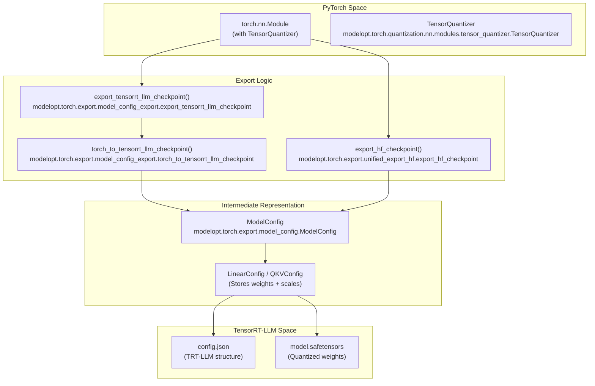
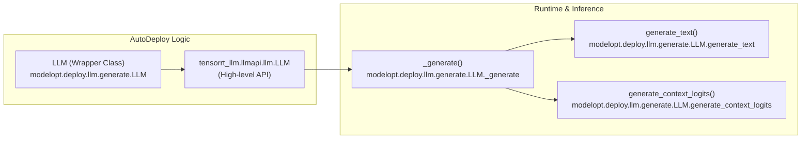

<!-- source: DeepWiki mcp.deepwiki.com · repo NVIDIA/Model-Optimizer · page 8.2 TensorRT-LLM Deployment · fetched 2026-10-26 -->

# TensorRT-LLM Deployment

Relevant source files

The following files were used as context for generating this wiki page:

- [CHANGELOG.rst](CHANGELOG.rst)
- [examples/hf_ptq/run_tensorrt_llm.py](examples/hf_ptq/run_tensorrt_llm.py)
- [examples/llm_eval/mmlu.py](examples/llm_eval/mmlu.py)
- [examples/llm_eval/run_simple_eval.sh](examples/llm_eval/run_simple_eval.sh)
- [modelopt/deploy/llm/generate.py](modelopt/deploy/llm/generate.py)
- [modelopt/torch/export/layer_utils.py](modelopt/torch/export/layer_utils.py)
- [modelopt/torch/export/model_config_export.py](modelopt/torch/export/model_config_export.py)
- [modelopt/torch/export/model_utils.py](modelopt/torch/export/model_utils.py)
- [modelopt/torch/export/moe_utils.py](modelopt/torch/export/moe_utils.py)
- [modelopt/torch/export/tensorrt_llm_utils.py](modelopt/torch/export/tensorrt_llm_utils.py)
- [modelopt/torch/export/unified_export_hf.py](modelopt/torch/export/unified_export_hf.py)
- [modelopt/torch/quantization/plugins/huggingface.py](modelopt/torch/quantization/plugins/huggingface.py)
- [modelopt/torch/utils/plugins/__init__.py](modelopt/torch/utils/plugins/__init__.py)
- [modelopt/torch/utils/plugins/prepare_megatron_data_blend.py](modelopt/torch/utils/plugins/prepare_megatron_data_blend.py)
- [tests/_test_utils/deploy_utils.py](tests/_test_utils/deploy_utils.py)
- [tests/_test_utils/torch/quantization/tied_modules.py](tests/_test_utils/torch/quantization/tied_modules.py)
- [tests/conftest.py](tests/conftest.py)
- [tests/examples/cnn_qat/test_resnet50.py](tests/examples/cnn_qat/test_resnet50.py)
- [tests/examples/hf_ptq/test_deploy.py](tests/examples/hf_ptq/test_deploy.py)
- [tests/examples/hf_ptq/test_run_tensorrt_llm.py](tests/examples/hf_ptq/test_run_tensorrt_llm.py)
- [tests/gpu_megatron/conftest.py](tests/gpu_megatron/conftest.py)
- [tests/gpu_megatron/torch/utils/plugins/test_prepare_megatron_data_blend.py](tests/gpu_megatron/torch/utils/plugins/test_prepare_megatron_data_blend.py)
- [tests/unit/torch/export/test_unified_export_hf.py](tests/unit/torch/export/test_unified_export_hf.py)
- [tests/unit/torch/quantization/plugins/test_fused_experts.py](tests/unit/torch/quantization/plugins/test_fused_experts.py)

## Purpose and Scope

This page documents the deployment of Model Optimizer optimized checkpoints to **TensorRT-LLM**, NVIDIA's high-performance inference framework for Large Language Models. TensorRT-LLM provides optimized kernels (including Flash-Attention and fused kernels) and execution strategies for accelerated inference on NVIDIA GPUs.

Model Optimizer supports two primary export paths for TensorRT-LLM:

1.  **Unified HuggingFace Checkpoint Format** (Recommended): Export via `export_hf_checkpoint` [modelopt/torch/export/unified_export_hf.py:123](), producing a standard HuggingFace checkpoint with optimized weights and scaling factors deployable on TensorRT-LLM.
2.  **Native TensorRT-LLM Checkpoint Format**: Direct export via `export_tensorrt_llm_checkpoint` [modelopt/torch/export/model_config_export.py:85]() for specific TensorRT-LLM engine building workflows.

Additionally, this page covers the **AutoDeploy** integration for automated deployment and the internal `model_config` intermediate representation used to bridge PyTorch and TensorRT-LLM.

## Deployment Architecture

The deployment pipeline transforms a quantized PyTorch model (containing `TensorQuantizer` nodes) into a format that TensorRT-LLM can consume to build an execution engine.

### Code Entity Space Mapping
The following diagram maps high-level deployment concepts to specific code entities within the `modelopt` repository.

**Model-to-Engine Flow**

**Sources:** [modelopt/torch/export/model_config.py:29-61](), [modelopt/torch/export/model_config_export.py:85-122](), [modelopt/torch/export/unified_export_hf.py:123](), [modelopt/torch/quantization/nn/modules/tensor_quantizer.py:29]()

## Internal Representation: ModelConfig

Before weights are written to disk, Model Optimizer converts the PyTorch model into a `ModelConfig` object. This structure decouples the PyTorch module hierarchy from the flat or block-based structure required by TensorRT-LLM.

### Key Configuration Classes
*   **`LinearConfig`**: Stores weights, biases, and crucial quantization metadata such as `weights_scaling_factor`, `activation_scaling_factor`, and `weights_scaling_factor_2` [modelopt/torch/export/model_config.py:88-120]().
*   **`QKVConfig`**: A specialized container that merges Query, Key, and Value linear layers into a single entity, calculating combined scaling factors. It handles concatenation for TensorRT-LLM's fused QKV format [modelopt/torch/export/model_config.py:140-215]().
*   **`LayernormConfig`**: Manages normalization parameters including weight, bias, type (`LayerNorm` or `RmsNorm`), and epsilon [modelopt/torch/export/model_config.py:78-86]().
*   **`ExpertConfig`**: Represents a single expert in a Mixture-of-Experts (MoE) layer, containing its `gate_proj`, `up_proj`, and `down_proj` linear configurations [modelopt/torch/export/model_config.py:240-250]().
*   **`MOEConfig`**: Encapsulates the entire MoE layer, including the router and a list of `ExpertConfig` instances [modelopt/torch/export/model_config.py:252-260]().

### Quantization Metadata Mapping
The `LinearConfig` class maps Model Optimizer's internal quantization states to TensorRT-LLM's expected scaling factors:
*   **FP8**: Uses `weights_scaling_factor` and `activation_scaling_factor` [modelopt/torch/export/model_config.py:95-96]().
*   **NVFP4**: Utilizes `weights_scaling_factor_2` for the second-stage quantization required by Blackwell hardware [modelopt/torch/export/model_config.py:101]().
*   **AWQ**: Includes `awq_block_size` for group-wise quantization [modelopt/torch/export/model_config.py:108]().

**Sources:** [modelopt/torch/export/model_config.py:29-61](), [modelopt/torch/export/model_config.py:78-86](), [modelopt/torch/export/model_config.py:88-120](), [modelopt/torch/export/model_config.py:140-215](), [modelopt/torch/export/model_config.py:240-250](), [modelopt/torch/export/model_config.py:252-260]()

## Export Implementation

### export_hf_checkpoint
This is the primary entry point for modern deployments. It produces a HuggingFace-compatible directory containing `.safetensors` files.

*   **Logic**: It builds a serialized representation of the model architecture and state dict, utilizing `safetensors` for efficient weight storage [modelopt/torch/export/unified_export_hf.py:146-156]().
*   **Weight Packing**: For 4-bit formats like `INT4_AWQ` or `NVFP4`, weights are processed and scaling factors adjusted. For NVFP4, weights are often stored as packed nibbles [modelopt/torch/export/unified_export_hf.py:61-64]().
*   **Verification**: The export process includes checks for scale consistency across fused projections (e.g., gate/up, q/k/v) [modelopt/torch/export/unified_export_hf.py:105-129]().
*   **MoE Export**: For Mixture-of-Experts models, `_export_fused_experts` [modelopt/torch/export/moe_utils.py:48-153]() is called to split fused 3-D weights into per-expert 2-D projections and export their quantization scales. This ensures compatibility with inference runtimes like vLLM that expect a single per-tensor scale across fused gate and up projections [modelopt/torch/export/moe_utils.py:105-109]().
*   **Tied Weights**: The `TiedWeightMap` class [modelopt/torch/export/model_utils.py:157-182]() is used to handle tied weights (e.g., `lm_head` and `embed_tokens`) by ensuring only the canonical weight is exported and aliases are dropped, preventing redundant storage [tests/unit/torch/export/test_unified_export_hf.py:96-100]().

### export_tensorrt_llm_checkpoint
This function targets the native TensorRT-LLM format. It calls `torch_to_tensorrt_llm_checkpoint` to perform the conversion [modelopt/torch/export/model_config_export.py:85-88]().

*   **Tensor Parallelism**: It handles the splitting and merging of weights across ranks using `inference_tensor_parallel` and `inference_pipeline_parallel` arguments [modelopt/torch/export/model_config_export.py:92-93]().
*   **Config Mapping**: It converts internal `ModelConfig` to TensorRT-LLM's `PretrainedConfig` structure via `convert_to_tensorrt_llm_config` [modelopt/torch/export/tensorrt_llm_utils.py:80-92]().
*   **Layer Normalization**: It maps PyTorch norms to `LAYERNORM_DEFAULT` or `LAYERNORM_RMS` [modelopt/torch/export/model_config.py:56-57]().

**Sources:** [modelopt/torch/export/model_config.py:56-57](), [modelopt/torch/export/model_config_export.py:88-122](), [modelopt/torch/export/model_utils.py:157-182](), [modelopt/torch/export/moe_utils.py:48-153](), [modelopt/torch/export/tensorrt_llm_utils.py:80-178](), [modelopt/torch/export/unified_export_hf.py:61-64](), [modelopt/torch/export/unified_export_hf.py:105-129](), [modelopt/torch/export/unified_export_hf.py:146-156](), [tests/unit/torch/export/test_unified_export_hf.py:96-100]()

## AutoDeploy and Runtime Integration

AutoDeploy provides a high-level API to skip manual engine building. It utilizes the TensorRT-LLM high-level API to manage the lifecycle of a model.

### Deployment Workflow Diagram

**Sources:** [modelopt/deploy/llm/generate.py:53-160](), [examples/hf_ptq/run_tensorrt_llm.py:71-92]()

### Implementation Details
*   **`LLM` Wrapper**: A wrapper over `tensorrt_llm.llmapi.llm.LLM` that adds profiling, validation, and configuration handling. It manages `TRT_KvCacheConfig` and `CudaGraphConfig` [modelopt/deploy/llm/generate.py:53-160]().
*   **KV Cache Management**: The wrapper allows configuring `free_gpu_memory_fraction` (default 0.7) and `enable_block_reuse` [modelopt/deploy/llm/generate.py:128-133]().
*   **Parallelism Support**: It supports Tensor Parallelism (`tp`) and Expert Parallelism (`ep`), defaulting `ep=1` to avoid kernel failures on unsupported hardware [modelopt/deploy/llm/generate.py:114-120]().
*   **Inference Capabilities**: Provides methods for generating text, tokens, and context logits (useful for evaluation tasks like MMLU) [examples/hf_ptq/run_tensorrt_llm.py:79-92](), [examples/llm_eval/mmlu.py:183-195]().

## Support Matrix and Formats

TensorRT-LLM deployment via Model Optimizer supports a wide range of precisions and hardware targets.

| Format | Code Identifier | Target Hardware | Notes |
| :--- | :--- | :--- | :--- |
| **FP8** | `QUANTIZATION_FP8` | Hopper+ | Standard 8-bit floating point [modelopt/torch/export/model_config.py:30]() |
| **NVFP4** | `QUANTIZATION_NVFP4` | Blackwell | 4-bit FP with two-scale stages [modelopt/torch/export/model_config.py:35]() |
| **INT8 SQ** | `QUANTIZATION_INT8_SQ` | Ampere+ | SmoothQuant implementation [modelopt/torch/export/model_config.py:31]() |
| **INT4 AWQ** | `QUANTIZATION_INT4_AWQ` | All | Weight-only with activation scales [modelopt/torch/export/model_config.py:33]() |
| **MXFP8** | `QUANTIZATION_MXFP8` | All | Microscaling 8-bit format [modelopt/torch/export/model_config.py:39]()
| **SVDQuant**| `QUANTIZATION_NVFP4_SVDQUANT` | Blackwell | NVFP4 with SVDQuant [modelopt/torch/export/model_config.py:36]()
| **W4A16 NVFP4** | `QUANTIZATION_W4A16_NVFP4` | Blackwell | Weight-only NVFP4 with FP16 activations [modelopt/torch/export/model_config.py:43]()
| **W4A8 NVFP4 FP8** | `QUANTIZATION_W4A8_NVFP4_FP8` | Blackwell | Weight-only NVFP4 with FP8 activations [modelopt/torch/export/model_config.py:42]()
| **W4A8 AWQ** | `QUANTIZATION_W4A8_AWQ` | All | Weight-only AWQ with FP8 activations [modelopt/torch/export/model_config.py:41]()

### KV Cache Support
TensorRT-LLM supports quantized KV caches to reduce memory footprint:
*   **FP8 KV Cache**: `KV_CACHE_FP8` [modelopt/torch/export/model_config.py:47]()
*   **INT8 KV Cache**: `KV_CACHE_INT8` [modelopt/torch/export/model_config.py:48]()
*   **NVFP4 KV Cache**: `KV_CACHE_NVFP4` [modelopt/torch/export/model_config.py:49]()

**Sources:** [modelopt/torch/export/model_config.py:29-52](), [modelopt/torch/export/model_config_export.py:70]()

---

