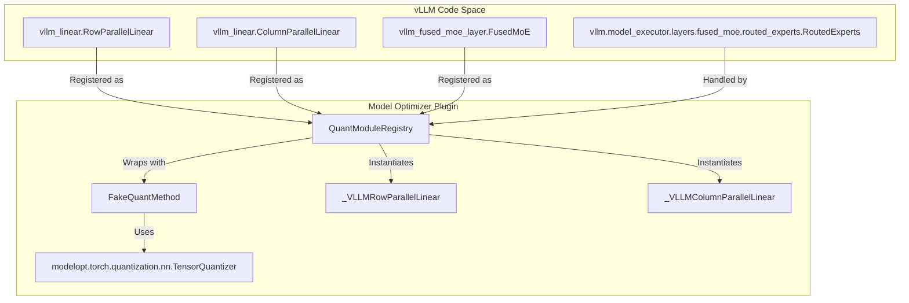

<!-- source: DeepWiki mcp.deepwiki.com · repo NVIDIA/Model-Optimizer · page 8.3 vLLM and SGLang Deployment · fetched 2026-10-26 -->

# vLLM and SGLang Deployment

<details>
<summary>Relevant source files</summary>

The following files were used as context for generating this wiki page:

- [examples/specdec_bench/run.py](examples/specdec_bench/run.py)
- [examples/specdec_bench/specdec_bench/models/auto_deploy.py](examples/specdec_bench/specdec_bench/models/auto_deploy.py)
- [examples/specdec_bench/specdec_bench/models/sglang.py](examples/specdec_bench/specdec_bench/models/sglang.py)
- [examples/specdec_bench/specdec_bench/models/trtllm_torch_api.py](examples/specdec_bench/specdec_bench/models/trtllm_torch_api.py)
- [examples/specdec_bench/specdec_bench/models/vllm.py](examples/specdec_bench/specdec_bench/models/vllm.py)
- [examples/speculative_decoding/scripts/quantize_drafter.py](examples/speculative_decoding/scripts/quantize_drafter.py)
- [examples/vllm_serve/Dockerfile](examples/vllm_serve/Dockerfile)
- [examples/vllm_serve/README.md](examples/vllm_serve/README.md)
- [examples/vllm_serve/fakequant_worker.py](examples/vllm_serve/fakequant_worker.py)
- [examples/vllm_serve/vllm_mlflow_utils.py](examples/vllm_serve/vllm_mlflow_utils.py)
- [examples/vllm_serve/vllm_ptq_utils.py](examples/vllm_serve/vllm_ptq_utils.py)
- [examples/vllm_serve/vllm_reload_utils.py](examples/vllm_serve/vllm_reload_utils.py)
- [examples/vllm_serve/vllm_serve_fakequant.py](examples/vllm_serve/vllm_serve_fakequant.py)
- [modelopt/torch/export/plugins/vllm_fakequant_hf.py](modelopt/torch/export/plugins/vllm_fakequant_hf.py)
- [modelopt/torch/export/plugins/vllm_fakequant_megatron.py](modelopt/torch/export/plugins/vllm_fakequant_megatron.py)
- [modelopt/torch/quantization/plugins/vllm.py](modelopt/torch/quantization/plugins/vllm.py)
- [modelopt/torch/utils/mlflow.py](modelopt/torch/utils/mlflow.py)
- [tests/examples/vllm_serve/test_vllm_mlflow_utils.py](tests/examples/vllm_serve/test_vllm_mlflow_utils.py)
- [tests/gpu/torch/export/test_vllm_fakequant_hf_export.py](tests/gpu/torch/export/test_vllm_fakequant_hf_export.py)
- [tests/unit/torch/export/test_vllm_quantizer_reload.py](tests/unit/torch/export/test_vllm_quantizer_reload.py)
- [tests/unit/torch/utils/test_mlflow.py](tests/unit/torch/utils/test_mlflow.py)
- [tools/launcher/common/specdec/quantize_drafter.sh](tools/launcher/common/specdec/quantize_drafter.sh)
- [tools/launcher/examples/Qwen/Qwen3-8B/hf_dspark_ptq_nvfp4.yaml](tools/launcher/examples/Qwen/Qwen3-8B/hf_dspark_ptq_nvfp4.yaml)
- [tools/launcher/examples/moonshotai/Kimi-K2.5/specdec_bench.yaml](tools/launcher/examples/moonshotai/Kimi-K2.5/specdec_bench.yaml)
- [tools/launcher/examples/nvidia/NVIDIA-Nemotron-3.5-Lightning-30B-A3B-BF16/engine_args.json](tools/launcher/examples/nvidia/NVIDIA-Nemotron-3.5-Lightning-30B-A3B-BF16/engine_args.json)
- [tools/launcher/examples/nvidia/NVIDIA-Nemotron-3.5-Lightning-30B-A3B-BF16/hf_dspark_ptq_fp8.yaml](tools/launcher/examples/nvidia/NVIDIA-Nemotron-3.5-Lightning-30B-A3B-BF16/hf_dspark_ptq_fp8.yaml)

</details>


This page describes how to deploy quantized models optimized with Model Optimizer to vLLM and SGLang inference engines. Model Optimizer supports native quantization for these engines through a unified HuggingFace checkpoint format and specialized "fakequant" workers for research and validation.

For exporting to TensorRT-LLM, see [TensorRT-LLM Deployment](#8.2). For details on the unified HF checkpoint format, see [Unified HF Checkpoint Export](#8.1).

## Overview

Model Optimizer supports deployment to two major open-source LLM inference engines:

- **vLLM**: A high-throughput and memory-efficient inference engine for LLMs.
- **SGLang**: A fast serving framework for LLMs and vision-language models.

Both engines natively support loading Model Optimizer's quantized checkpoints in FP8 and NVFP4 formats. Additionally, Model Optimizer provides a `FakeQuantWorker` implementation for vLLM to enable serving models in their original data type while simulating quantization effects (fake quantization).

**Deployment Architecture**

```mermaid
graph TB
    subgraph "Model Optimizer"
        [mtq.quantize] --> [mtq.calibrate]
        [mtq.calibrate] --> [export_hf_checkpoint]
        [mtq.calibrate] --> [export_mcore_gpt_to_hf_vllm_fq]
    end
    
    subgraph "Export Artifacts"
        [model.safetensors]
        [config.json]
        [quantizer_state.pth]
        [vllm_fq_modelopt_state.pth]
    end
    
    subgraph "Inference Engines"
        [vLLM Native]
        [SGLang Native]
        [vLLM FakeQuantWorker]
    end
    
    [export_hf_checkpoint] --> [model.safetensors]
    [export_hf_checkpoint] --> [config.json]
    [export_mcore_gpt_to_hf_vllm_fq] --> [quantizer_state.pth]
    
    [model.safetensors] --> [vLLM Native]
    [config.json] --> [SGLang Native]
    [quantizer_state.pth] --> [vLLM FakeQuantWorker]
    [vllm_fq_modelopt_state.pth] --> [vLLM FakeQuantWorker]
```

Sources: [modelopt/torch/quantization/plugins/vllm.py:37-51](), [examples/vllm_serve/fakequant_worker.py:24-32](), [modelopt/torch/export/plugins/vllm_fakequant_megatron.py:33-68](), [examples/vllm_serve/README.md:1-9]()

## vLLM Plugin Implementation

Model Optimizer integrates with vLLM via a plugin system that replaces standard vLLM layers with quantized counterparts. This is primarily used for "fake quantization" serving, which allows for 2-5x slower inference but facilitates research without dedicated kernel support [examples/vllm_serve/README.md:5-9]().

### FakeQuantMethod and Layer Registration

The plugin handles the conversion of vLLM's internal linear and MoE structures. vLLM >= 0.24 moved fused expert weights to a `RoutedExperts` submodule, which the plugin detects to ensure correct quantization mapping [modelopt/torch/quantization/plugins/vllm.py:141-162]().

| Class/Function | Purpose |
| :--- | :--- |
| `FakeQuantMethod` | Wraps vLLM's linear method to apply input/weight/output quantizers. |
| `_VLLMParallelLinear` | Base class for quantized vLLM parallel linear layers. |
| `_QuantFusedMoEBase` | Base class for quantized vLLM Fused MoE layers. |
| `disable_compilation` | Context manager to disable vLLM model compilation during quantization. |

**vLLM Layer Transformation**



Sources: [modelopt/torch/quantization/plugins/vllm.py:141-162](), [modelopt/torch/quantization/plugins/vllm.py:181-200](), [examples/vllm_serve/fakequant_worker.py:35-39]()

## Export Workflows for vLLM/SGLang

Model Optimizer provides specialized export functions to prepare models for these engines.

### HuggingFace FakeQuant Export
The `export_hf_vllm_fq_checkpoint` function prepares a model for vLLM fake-quant reload [modelopt/torch/export/plugins/vllm_fakequant_hf.py:49-53](). It performs weight folding (quantize + dequantize) to bake quantization effects into the weights while maintaining original precision for serving [modelopt/torch/export/plugins/vllm_fakequant_hf.py:143-157]().

```python
# From examples/hf_ptq/hf_ptq.py logic
# Generates vllm_fq_modelopt_state.pth for vLLM reload
python ../hf_ptq/hf_ptq.py --vllm_fakequant_export ...
```

Sources: [modelopt/torch/export/plugins/vllm_fakequant_hf.py:49-68](), [examples/vllm_serve/README.md:126-145]()

### Megatron-Core to vLLM Export
For models optimized in Megatron-Core (MCore), `VllmFqGPTModelExporter` gathers quantized state across ranks and saves it as `quantizer_state.pth` [modelopt/torch/export/plugins/vllm_fakequant_megatron.py:33-68]().

| Step | Function | File |
| :--- | :--- | :--- |
| Gather Quantizers | `gather_mcore_vllm_fq_quantized_state_dict` | [modelopt/torch/export/plugins/vllm_fakequant_megatron.py:33-68]() |
| Weight Folding | `VllmFqGPTModelExporter._get_quantized_state` | [modelopt/torch/export/plugins/vllm_fakequant_megatron.py:112-130]() |
| Export Artifacts | `VllmFqGPTModelExporter.save_pretrained` | [modelopt/torch/export/plugins/vllm_fakequant_megatron.py:80-107]() |

Sources: [modelopt/torch/export/plugins/vllm_fakequant_megatron.py:30-130]()

## Serving with FakeQuant

Model Optimizer includes a custom vLLM worker (`FakeQuantWorker`) that enables serving models with on-the-fly fake quantization [examples/vllm_serve/fakequant_worker.py:158-161]().

### Worker Implementation
The `FakeQuantWorker` (located in `examples/vllm_serve/fakequant_worker.py`) extends the base vLLM `Worker` to:
1. Load a model and unwrap it if necessary [examples/vllm_serve/fakequant_worker.py:64-66]().
2. Load `modelopt_state` or `quantizer_state` from specified paths [examples/vllm_serve/fakequant_worker.py:67-78]().
3. Apply `mtq.quantize` using `calibrate_fun` if no state is provided [examples/vllm_serve/fakequant_worker.py:112-133]().
4. Call `mtq.fold_weight` to ensure weights are fake-quantized before inference [examples/vllm_serve/fakequant_worker.py:149-155]().

### State Dictionary Conversion
Because vLLM often fuses projections (e.g., Q, K, V into QKV), Model Optimizer provides utilities to map HuggingFace/ModelOpt keys to vLLM's internal names [examples/vllm_serve/vllm_reload_utils.py:85-94]().

| Function | Purpose |
| :--- | :--- |
| `_convert_key_for_vllm` | Transforms individual keys (e.g., `q_proj` to `qkv_proj`) [examples/vllm_serve/vllm_reload_utils.py:85-155](). |
| `convert_modelopt_state_to_vllm` | Processes the full state dict for vLLM compatibility [examples/vllm_serve/vllm_reload_utils.py:218-223](). |
| `shard_pre_quant_scale_for_tp` | Shards `_pre_quant_scale` tensors to match TP groups [examples/vllm_serve/vllm_reload_utils.py:330-345](). |
| `merge_amax_tensors_for_group` | Merges component `_amax` values for fused layers [modelopt/torch/export/plugins/vllm_fakequant_hf.py:202-215](). |

Sources: [examples/vllm_serve/fakequant_worker.py:55-156](), [examples/vllm_serve/vllm_reload_utils.py:85-155](), [examples/vllm_serve/vllm_reload_utils.py:218-223]()

## Deployment Steps

### 1. Environment Setup
A specialized Docker environment or pip installation of vLLM is required. The provided `Dockerfile` installs `nvidia-modelopt` with `mlflow` support [examples/vllm_serve/Dockerfile:21-24]().
```bash
docker build -f examples/vllm_serve/Dockerfile -t vllm-modelopt .
```
Sources: [examples/vllm_serve/README.md:10-15](), [examples/vllm_serve/Dockerfile:1-43]()

### 2. Launching the Server
The server is launched using `vllm_serve_fakequant.py`, which sets the `worker_cls` to `FakeQuantWorker` [examples/vllm_serve/vllm_serve_fakequant.py:116-117]().

```bash
# Set configuration via environment variables
export MODELOPT_STATE_PATH="vllm_fq_modelopt_state.pth"
python vllm_serve_fakequant.py <model_path> -tp 8 --host 0.0.0.0 --port 8000
```

The script automatically propagates relevant environment variables (like `QUANT_DATASET`, `QUANT_CFG`, `MODELOPT_STATE_PATH`) to distributed Ray workers [examples/vllm_serve/vllm_serve_fakequant.py:74-85]().

Sources: [examples/vllm_serve/vllm_serve_fakequant.py:74-128](), [examples/vllm_serve/README.md:18-39]()

## MLflow Tracking
Model Optimizer supports tracking quantization runs in vLLM via MLflow. The `FakeQuantMlflowTracker` records resolved recipes, quantization configurations, and final summaries [examples/vllm_serve/README.md:88-100]().

| Artifact | Contents |
| :--- | :--- |
| `recipe/resolved_recipe.yaml` | The expanded PTQ recipe used for calibration. |
| `summary/quant_summary.txt` | Per-quantizer statistics (bits, format, scale). |
| `logs/worker.log` | Python stdout/stderr from the rank-0 worker. |

Sources: [examples/vllm_serve/README.md:65-107](), [examples/vllm_serve/fakequant_worker.py:24-25]()

## Known Limitations and Requirements
- **MLA Attention**: MLA models use `kv_c_bmm_quantizer` for compressed KV cache, requiring special handling in `update_kv_cfg_for_mla` [examples/vllm_serve/vllm_ptq_utils.py:137-160]().
- **Weight Folding**: Weight quantizers must be disabled after folding to prevent double-quantization corruption during inference [examples/vllm_serve/fakequant_worker.py:149-155]().
- **VLLM Versions**: The plugin system supports multiple vLLM versions (e.g., 0.11.0, 0.10.2) by checking for different import paths for attention and MoE layers [modelopt/torch/quantization/plugins/vllm.py:106-115]().

Sources: [examples/vllm_serve/vllm_ptq_utils.py:137-160](), [examples/vllm_serve/fakequant_worker.py:146-156](), [modelopt/torch/quantization/plugins/vllm.py:106-115]()

---

