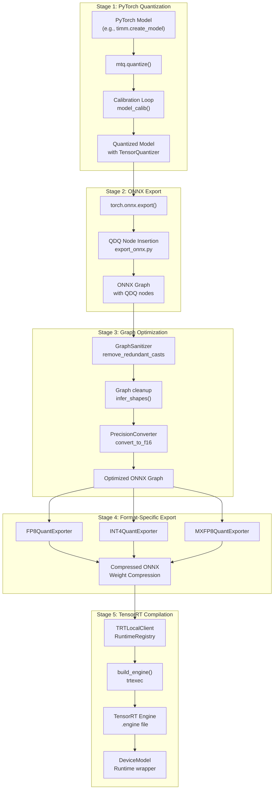
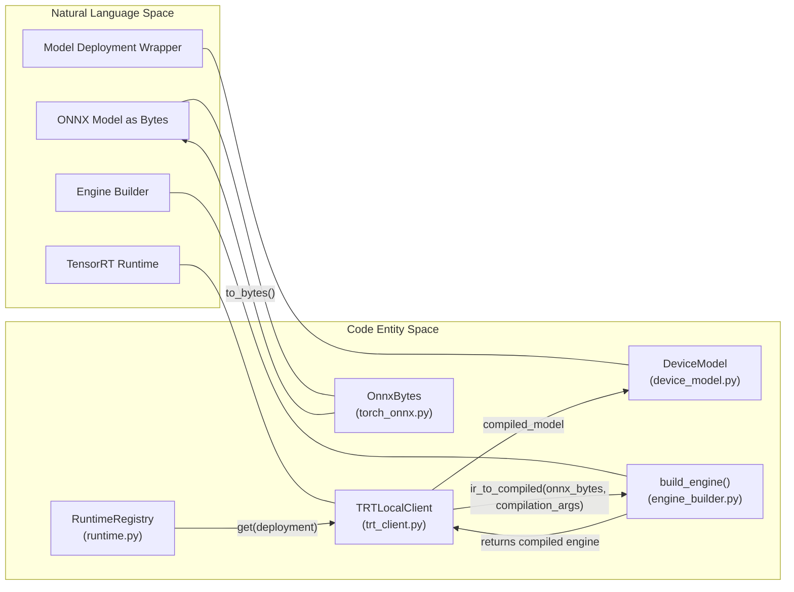

<!-- source: DeepWiki mcp.deepwiki.com · repo NVIDIA/Model-Optimizer · page 8.4 ONNX to TensorRT Pipeline · fetched 2026-10-26 -->

# ONNX to TensorRT Pipeline

<details>
<summary>Relevant source files</summary>

The following files were used as context for generating this wiki page:

- [examples/cnn_qat/README.md](examples/cnn_qat/README.md)
- [examples/onnx_ptq/README.md](examples/onnx_ptq/README.md)
- [examples/onnx_ptq/download_example_onnx.py](examples/onnx_ptq/download_example_onnx.py)
- [examples/onnx_ptq/evaluate.py](examples/onnx_ptq/evaluate.py)
- [examples/onnx_ptq/evaluation.py](examples/onnx_ptq/evaluation.py)
- [examples/onnx_ptq/image_prep.py](examples/onnx_ptq/image_prep.py)
- [examples/torch_onnx/README.md](examples/torch_onnx/README.md)
- [examples/torch_onnx/hf_embedding_quant_to_onnx.py](examples/torch_onnx/hf_embedding_quant_to_onnx.py)
- [examples/torch_onnx/requirements.txt](examples/torch_onnx/requirements.txt)
- [examples/torch_onnx/torch_quant_to_onnx.py](examples/torch_onnx/torch_quant_to_onnx.py)
- [modelopt/onnx/export/fp8_exporter.py](modelopt/onnx/export/fp8_exporter.py)
- [modelopt/onnx/export/int8_exporter.py](modelopt/onnx/export/int8_exporter.py)
- [modelopt/onnx/trt_utils.py](modelopt/onnx/trt_utils.py)
- [modelopt/torch/_deploy/_runtime/tensorrt/constants.py](modelopt/torch/_deploy/_runtime/tensorrt/constants.py)
- [modelopt/torch/_deploy/_runtime/tensorrt/engine_builder.py](modelopt/torch/_deploy/_runtime/tensorrt/engine_builder.py)
- [modelopt/torch/_deploy/_runtime/trt_client.py](modelopt/torch/_deploy/_runtime/trt_client.py)
- [modelopt/torch/_deploy/utils/torch_onnx.py](modelopt/torch/_deploy/utils/torch_onnx.py)
- [modelopt/torch/quantization/export_onnx.py](modelopt/torch/quantization/export_onnx.py)
- [modelopt_recipes/huggingface/nemotron_llama/ptq/fp8_output_quant_proj.yaml](modelopt_recipes/huggingface/nemotron_llama/ptq/fp8_output_quant_proj.yaml)
- [modelopt_recipes/huggingface/nemotron_llama/ptq/nvfp4_output_quant_proj.yaml](modelopt_recipes/huggingface/nemotron_llama/ptq/nvfp4_output_quant_proj.yaml)
- [tests/_test_utils/torch/vision_models.py](tests/_test_utils/torch/vision_models.py)
- [tests/examples/test_onnx_ptq.sh](tests/examples/test_onnx_ptq.sh)
- [tests/examples/torch_onnx/test_hf_embedding_quant_to_onnx.py](tests/examples/torch_onnx/test_hf_embedding_quant_to_onnx.py)
- [tests/examples/torch_onnx/test_torch_quant_to_onnx.py](tests/examples/torch_onnx/test_torch_quant_to_onnx.py)
- [tests/gpu/onnx/quantization/test_concat_elim.py](tests/gpu/onnx/quantization/test_concat_elim.py)
- [tests/gpu/onnx/quantization/test_plugin.py](tests/gpu/onnx/quantization/test_plugin.py)
- [tests/gpu/onnx/quantization/test_qdq_utils_fp8.py](tests/gpu/onnx/quantization/test_qdq_utils_fp8.py)
- [tests/gpu/onnx/quantization/test_quantize_fp8.py](tests/gpu/onnx/quantization/test_quantize_fp8.py)
- [tests/gpu/onnx/quantization/test_quantize_onnx_torch_int4_awq.py](tests/gpu/onnx/quantization/test_quantize_onnx_torch_int4_awq.py)
- [tests/unit/onnx/quantization/test_convtranspose_qdq.py](tests/unit/onnx/quantization/test_convtranspose_qdq.py)
- [tests/unit/onnx/quantization/test_qdq_rules_int8.py](tests/unit/onnx/quantization/test_qdq_rules_int8.py)
- [tests/unit/onnx/quantization/test_quantize_int8.py](tests/unit/onnx/quantization/test_quantize_int8.py)
- [tests/unit/torch/deploy/_runtime/tensorrt/test_engine_builder.py](tests/unit/torch/deploy/_runtime/tensorrt/test_engine_builder.py)

</details>


## Purpose and Scope

This page documents the end-to-end pipeline for exporting quantized PyTorch models to ONNX format and building optimized TensorRT engines. This pipeline is primarily utilized for vision models (e.g., ImageNet classifiers, detection models) and diffusion models (e.g., SDXL, SD3, FLUX).

**Important:** For LLM deployment, see [8.2 TensorRT-LLM Deployment]() and [8.1 Unified HF Checkpoint Export](). LLMs use a specialized export path that produces TensorRT-LLM checkpoints rather than ONNX graphs.

The pipeline consists of five stages: (1) PyTorch-side quantization with calibration, (2) ONNX export with QDQ node insertion, (3) Graph optimization and sanitization, (4) Format-specific weight compression, and (5) TensorRT engine compilation and `DeviceModel` integration.

## Pipeline Overview

The ONNX to TensorRT pipeline transforms a quantized PyTorch model into an optimized inference engine. Each stage performs specific transformations on the model representation, progressing from a PyTorch computational graph to an executable TensorRT engine.

Title: ONNX to TensorRT Deployment Flow

Sources: `[modelopt/torch/_deploy/_runtime/trt_client.py:34-95]()`, `[modelopt/torch/_deploy/_runtime/tensorrt/engine_builder.py:120-127]()`, `[examples/onnx_ptq/evaluate.py:82-94]()`

## Stage 1: PyTorch-Side Quantization

The first stage applies quantization to the PyTorch model using `mtq.quantize`. This replaces standard layers with quantized variants from `modelopt.torch.quantization.nn` containing `TensorQuantizer` modules.

### Calibration
Calibration determines the quantization scales (`amax`) by running a forward pass on representative data. For ONNX-based PTQ, users can provide a `CalibrationDataReader` or pre-allocated `numpy` arrays `[tests/unit/onnx/quantization/test_quantize_int8.py:59-92]()`.

Sources: `[tests/unit/onnx/quantization/test_quantize_int8.py:29-51]()`

## Stage 2: ONNX Export with QDQ Nodes

The second stage exports the quantized PyTorch model to ONNX. `TensorQuantizer` modules are converted to ONNX QDQ (QuantizeLinear/DequantizeLinear) nodes.

### Quantization Modes
- **INT8**: Generates standard ONNX `QuantizeLinear` and `DequantizeLinear` nodes `[tests/unit/onnx/quantization/test_quantize_int8.py:29-51]()`.
- **FP8**: Supports FP8 quantization with specific TensorRT compatibility `[tests/gpu/onnx/quantization/test_quantize_fp8.py:27-46]()`. The `FP8QuantExporter` `[modelopt/onnx/export/fp8_exporter.py:36]()` handles compression of FP32/FP16 weights to FP8 by folding QDQ nodes to DQ only, representing weights as `FLOAT8E4M3FN` `[modelopt/onnx/export/fp8_exporter.py:50-141]()`.
- **INT4 AWQ**: Supports INT4 quantization using algorithms like AWQ clip, which may force higher ONNX opset versions `[tests/gpu/onnx/quantization/test_plugin.py:131-152]()`.

Sources: `[tests/gpu/onnx/quantization/test_plugin.py:105-130]()`, `[modelopt/onnx/export/fp8_exporter.py:36-149]()`

## Stage 3: Graph Optimization

After export, the ONNX graph is processed using graph surgery utilities.

| Utility Function | Description |
| :--- | :--- |
| `GraphSanitizer` | Preprocesses the graph to ensure compatibility and remove redundant operations `[tests/gpu/onnx/quantization/test_plugin.py:27]()`. |
| `convert_to_mixed_precision` | Converts the graph to FP16/BF16 precision `[tests/gpu/onnx/quantization/test_plugin.py:26]()`. |
| `concat_elimination` | A quantization pass that aligns scales across Concat nodes to enable fusion `[tests/gpu/onnx/quantization/test_concat_elim.py:27-59]()`. |
| `remove_redundant_casts` | Removes unnecessary `Cast` nodes from the graph `[modelopt/torch/_deploy/utils/torch_onnx.py:60]()`. |
| `fold_q_fp16_to_fp32_casts`, `fold_dq_fp32_to_fp16_casts`, `fold_qdq_scale_fp16_to_fp32_casts` | Functions to fold specific `Cast` patterns related to quantization and precision conversion `[modelopt/torch/_deploy/utils/torch_onnx.py:50-52]()`. |
| `change_casts_to_fp16` | Modifies `Cast` nodes to target `FP16` precision `[modelopt/torch/_deploy/utils/torch_onnx.py:48]()`. |

Sources: `[tests/gpu/onnx/quantization/test_concat_elim.py:27-77]()`, `[modelopt/torch/_deploy/utils/torch_onnx.py:48-61]()`

## Stage 4: TensorRT Compatibility and Plugins

TensorRT requires specific handling for custom layers and large models during the parsing phase.

### Custom Layer Handling
The pipeline identifies custom TensorRT ops (e.g., `CustomSkipLayerNormPluginDynamic`) and ensures they are correctly registered in the TensorRT `plugin_registry` `[modelopt/onnx/trt_utils.py:112-142]()`. Static plugins (linked against `libnvinfer`) are loaded via `ctypes.CDLL` to prevent segmentation faults from double-loading, while dynamic plugins use `registry.load_library` `[modelopt/onnx/trt_utils.py:64-89]()`. The `_is_static_plugin` function determines if a plugin is statically linked against `libnvinfer.so` `[modelopt/onnx/trt_utils.py:46-61]()`.

### Large Model Support
For models exceeding the 2 GiB Protobuf limit, the pipeline switches from in-memory parsing to file-backed parsing. The `_requires_file_backed_parse` function checks if the model's `ByteSize()` exceeds `onnx.checker.MAXIMUM_PROTOBUF` `[modelopt/onnx/trt_utils.py:90-109]()`. If so, the model is serialized to a temporary external-data file and loaded using `parser.parse_from_file()` to prevent empty network initialization `[modelopt/onnx/trt_utils.py:161-174]()`.

Sources: `[modelopt/onnx/trt_utils.py:46-109]()`, `[modelopt/onnx/trt_utils.py:161-174]()`, `[tests/gpu/onnx/quantization/test_plugin.py:154-182]()`

## Stage 5: TensorRT Engine Compilation

The final stage compiles the optimized ONNX model into a TensorRT engine using `TRTLocalClient`.

### Engine Building and trtexec
The `build_engine` function `[modelopt/torch/_deploy/_runtime/tensorrt/engine_builder.py:139]()` wraps the `trtexec` binary to generate the `.engine` file. It supports:
- **Precision Modes**: `stronglyTyped` (recommended), `best`, `fp16`, `int8`, `fp8`, `int4` `[modelopt/torch/_deploy/_runtime/tensorrt/engine_builder.py:157-165]()`. The `_is_low_bit_mode` function checks if a given `trt_mode` corresponds to a low-bit precision `[modelopt/torch/_deploy/_runtime/tensorrt/engine_builder.py:120-127]()`.
- **Dynamic Shapes**: Configuration of `minShapes`, `optShapes`, and `maxShapes` using `_update_dynamic_shapes` `[modelopt/torch/_deploy/_runtime/tensorrt/engine_builder.py:130-136]()`.
- **Timing Cache**: Reusing layer profiling data to speed up compilation `[modelopt/torch/_deploy/_runtime/tensorrt/engine_builder.py:143]()`.
- **Plugin Configuration**: Allows specifying static and dynamic plugins, and plugins to serialize `[modelopt/torch/_deploy/_runtime/tensorrt/engine_builder.py:175-181]()`.
- **Builder Optimization Level**: Configurable optimization level for the TensorRT builder `[modelopt/torch/_deploy/_runtime/tensorrt/engine_builder.py:147]()`.
The `_run_trtexec_with_logging` function executes the `trtexec` command, capturing and logging its output `[modelopt/torch/_deploy/_runtime/tensorrt/engine_builder.py:42-85]()`.

Title: Runtime Entity Association

Sources: `[modelopt/torch/_deploy/_runtime/trt_client.py:35-95]()`, `[modelopt/torch/_deploy/_runtime/tensorrt/engine_builder.py:139-150]()`, `[examples/onnx_ptq/evaluate.py:88-100]()`, `[modelopt/torch/_deploy/utils/torch_onnx.py:102-138]()`, `[modelopt/torch/_deploy/_runtime/tensorrt/engine_builder.py:42-85]()`, `[modelopt/torch/_deploy/_runtime/tensorrt/engine_builder.py:120-127]()`, `[modelopt/torch/_deploy/_runtime/tensorrt/engine_builder.py:130-136]()`, `[modelopt/torch/_deploy/_runtime/tensorrt/engine_builder.py:175-181]()`

### DeviceModel Integration
The `DeviceModel` `[examples/onnx_ptq/evaluate.py:100]()` provides the runtime interface for the compiled engine. It manages the runtime session, executes inference via `TRTLocalClient`, and provides latency measurements `[examples/onnx_ptq/evaluate.py:118-119]()`. The `OnnxBytes` class `[modelopt/torch/_deploy/utils/torch_onnx.py:102]()` is used to encapsulate the ONNX model data, handling both in-memory and external data formats `[modelopt/torch/_deploy/utils/torch_onnx.py:105-138]()`.

```python
# Compilation and Deployment Example
onnx_bytes = OnnxBytes(args.onnx_path).to_bytes()
client = RuntimeRegistry.get({"runtime": "TRT", "precision": "stronglyTyped"})
compilation_args = {"engine_path": args.engine_path, "timing_cache_path": args.timing_cache_path}
compiled_model = client.ir_to_compiled(onnx_bytes, compilation_args)
device_model = DeviceModel(client, compiled_model, metadata={})

# Inference and Metrics
latency = device_model.get_latency()
```
Sources: `[examples/onnx_ptq/evaluate.py:82-119]()`, `[modelopt/torch/_deploy/_runtime/trt_client.py:69-95]()`, `[modelopt/torch/_deploy/utils/torch_onnx.py:102-138]()`

---

