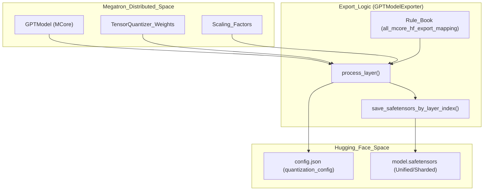
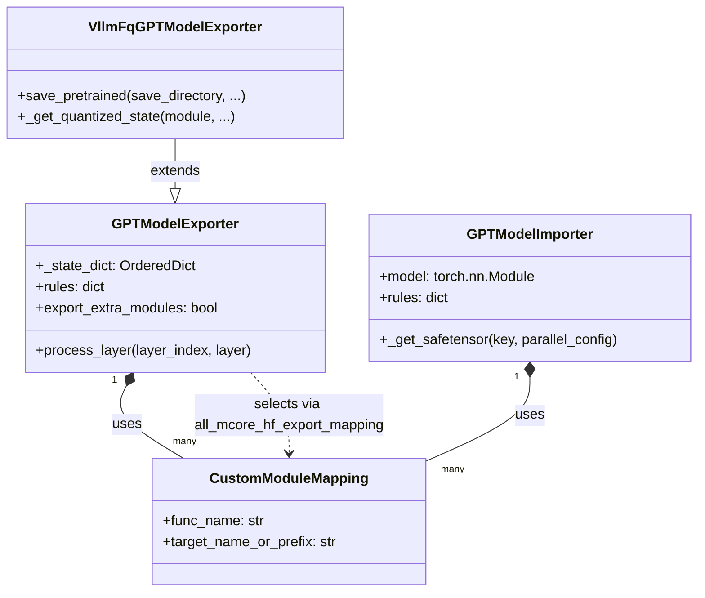

<!-- source: DeepWiki mcp.deepwiki.com · repo NVIDIA/Model-Optimizer · page 8.5 Megatron Export Pipeline · fetched 2026-10-26 -->

# Megatron Export Pipeline

Relevant source files

The following files were used as context for generating this wiki page:

- [modelopt/torch/export/plugins/__init__.py](modelopt/torch/export/plugins/__init__.py)
- [modelopt/torch/export/plugins/hf_checkpoint_utils.py](modelopt/torch/export/plugins/hf_checkpoint_utils.py)
- [modelopt/torch/export/plugins/mcore_common.py](modelopt/torch/export/plugins/mcore_common.py)
- [modelopt/torch/export/plugins/mcore_custom.py](modelopt/torch/export/plugins/mcore_custom.py)
- [modelopt/torch/export/plugins/mcore_deepseek.py](modelopt/torch/export/plugins/mcore_deepseek.py)
- [modelopt/torch/export/plugins/mcore_gptoss.py](modelopt/torch/export/plugins/mcore_gptoss.py)
- [modelopt/torch/export/plugins/mcore_llama.py](modelopt/torch/export/plugins/mcore_llama.py)
- [modelopt/torch/export/plugins/mcore_nemotron.py](modelopt/torch/export/plugins/mcore_nemotron.py)
- [modelopt/torch/export/plugins/mcore_qwen.py](modelopt/torch/export/plugins/mcore_qwen.py)
- [modelopt/torch/export/plugins/mcore_qwen3vl.py](modelopt/torch/export/plugins/mcore_qwen3vl.py)
- [modelopt/torch/export/plugins/megatron_importer.py](modelopt/torch/export/plugins/megatron_importer.py)
- [modelopt/torch/export/unified_export_megatron.py](modelopt/torch/export/unified_export_megatron.py)
- [modelopt/torch/quantization/plugins/megatron.py](modelopt/torch/quantization/plugins/megatron.py)
- [tests/_test_utils/torch/transformers_models.py](tests/_test_utils/torch/transformers_models.py)
- [tests/gpu_megatron/torch/export/plugins/test_mcore_export_mappings.py](tests/gpu_megatron/torch/export/plugins/test_mcore_export_mappings.py)
- [tests/gpu_megatron/torch/export/test_megatron_importer.py](tests/gpu_megatron/torch/export/test_megatron_importer.py)
- [tests/gpu_megatron/torch/export/test_unified_export_megatron.py](tests/gpu_megatron/torch/export/test_unified_export_megatron.py)
- [tests/gpu_megatron/torch/quantization/plugins/test_megatron.py](tests/gpu_megatron/torch/quantization/plugins/test_megatron.py)
- [tests/unit/torch/export/test_export_weight.py](tests/unit/torch/export/test_export_weight.py)
- [tests/unit/torch/export/test_hf_checkpoint_utils.py](tests/unit/torch/export/test_hf_checkpoint_utils.py)
- [tests/unit/torch/export/test_mcore_save_safetensors.py](tests/unit/torch/export/test_mcore_save_safetensors.py)

The Megatron Export Pipeline provides a specialized workflow for converting quantized **Megatron-Core (MCore)** models into industry-standard formats, specifically **Hugging Face (HF)** and **TensorRT-LLM**. This pipeline bridges the gap between high-performance distributed training/quantization in Megatron and deployment-ready artifacts, supporting complex architectures like MoE (Mixture of Experts), multimodal models (LLaVA), and speculative decoding heads (Medusa/EAGLE).

## Pipeline Architecture

The export process is centered around the `GPTModelExporter` and `GPTModelImporter` classes. These components handle the mapping of distributed Megatron layers (potentially sharded across multiple GPUs using Tensor Parallelism or Expert Parallelism) to a unified state dictionary or vice versa.

### Data Flow: Megatron to Hugging Face

The following diagram illustrates the transformation of a distributed MCore model into a unified HF checkpoint.

**Diagram: Megatron to HF Export Flow**

Sources: [modelopt/torch/export/unified_export_megatron.py:111-139](), [modelopt/torch/export/unified_export_megatron.py:346-370](), [modelopt/torch/export/plugins/mcore_custom.py:60-65]()

## Key Components and Implementation

### 1. GPTModelExporter
The `GPTModelExporter` class is the primary interface for exporting MCore models. It iterates through the model's layers and applies transformation rules based on the model architecture (e.g., Llama, Nemotron).

*   **Initialization**: Loads the base HF configuration using `transformers.AutoConfig` to ensure the exported model remains compatible with the HF ecosystem [modelopt/torch/export/unified_export_megatron.py:156-158]().
*   **Rule-Based Mapping**: Uses a "rule book" (`all_mcore_hf_export_mapping`) to map MCore module names (like `linear_qkv`) to HF names (like `self_attn.q_proj`) [modelopt/torch/export/plugins/mcore_common.py:1-50]().
*   **Quantization Handling**: Extracts scaling factors and converts weights to the target quantized format (e.g., FP8, NVFP4) using `to_quantized_weight` [modelopt/torch/export/unified_export_megatron.py:72](). It also supports KV cache quantization export by retrieving scaling factors via `get_kv_cache_scaling_factor` [modelopt/torch/export/unified_export_megatron.py:67]().
*   **vLLM FakeQuant Support**: A specialized subclass `VllmFqGPTModelExporter` allows exporting models where weight quantizers are folded into weights via fake-quantization (quantize + dequantize), specifically for vLLM consumption [modelopt/torch/export/plugins/vllm_fakequant_megatron.py:71-107]().

Sources: [modelopt/torch/export/unified_export_megatron.py:111-139](), [modelopt/torch/export/unified_export_megatron.py:156-158](), [modelopt/torch/export/unified_export_megatron.py:67-72](), [modelopt/torch/export/plugins/mcore_common.py:1-50]()

### 2. Custom Module Mappings
Because MCore and HF often represent layers differently (e.g., fused QKV in MCore vs. separate projections in HF), the pipeline uses `CustomModuleMapping` subclasses to handle slicing and merging.

| Mapping Class | Purpose |
| :--- | :--- |
| `QKVSlicing` | Slices a fused MCore QKV weight into separate HF Q, K, and V tensors [modelopt/torch/export/plugins/mcore_custom.py:155-165]() |
| `GatedMLPSlicing` | Slices fused MCore MLP weights (gate + up) into separate HF tensors [modelopt/torch/export/plugins/mcore_custom.py:180-190]() |
| `GroupedMLPMerging` | Merges expert weights for MoE models during import into MCore [modelopt/torch/export/plugins/mcore_custom.py:106-116]() |
| `SelfAttentionScaling` | Handles KV cache scaling factors for FP8/NVFP4 export [modelopt/torch/export/plugins/mcore_custom.py:167-177]() |
| `PackNameRemapping` | Handles packed local experts for specific MCore architectures [modelopt/torch/export/plugins/mcore_custom.py:30-31]() |

Sources: [modelopt/torch/export/plugins/mcore_custom.py:70-191]()

### 3. Parallelism Awareness
The exporter is designed to run in a distributed environment. It collects state dicts across pipeline parallel ranks and ensures that tensors sharded via Tensor Parallelism (TP) or Expert Parallelism (EP) are correctly handled.

*   **Rank Management**: Uses `get_pipeline_model_parallel_rank()` to coordinate which rank exports which layers in the pipeline [modelopt/torch/export/unified_export_megatron.py:94]().
*   **SafeTensors Integration**: The function `save_safetensors_by_layer_index` manages the writing of tensors to disk, ensuring that large models are sharded appropriately to avoid memory overflows [modelopt/torch/export/plugins/mcore_custom.py:659-673]().
*   **Import Parallelism**: `GPTModelImporter` handles downloading and sharding HF checkpoints into MCore's TP/EP structure using `ParallelConfig` [modelopt/torch/export/plugins/megatron_importer.py:167-170]().

Sources: [modelopt/torch/export/unified_export_megatron.py:94](), [modelopt/torch/export/plugins/mcore_custom.py:659-673](), [modelopt/torch/export/plugins/megatron_importer.py:167-170]()

## Code Entity Association

The following diagram maps the high-level export concepts to the specific classes and rule dictionaries used in the implementation.

**Diagram: Code Entity Mapping**

Sources: [modelopt/torch/export/unified_export_megatron.py:111-139](), [modelopt/torch/export/plugins/megatron_importer.py:78-106](), [modelopt/torch/export/plugins/vllm_fakequant_megatron.py:71-80]()

## Integration and Validation

The pipeline includes utilities for model validation and inference testing within the Megatron environment.

1.  **Checkpoint Loading**: The pipeline supports loading from MCore distributed checkpoints or standard HF checkpoints via `import_mcore_gpt_from_hf` [modelopt/torch/export/unified_export_megatron.py:557-582]().
2.  **Multimodal Support**: `LLaVAModel` export is supported, including handling vision towers and projectors [modelopt/torch/export/unified_export_megatron.py:88]().
3.  **Speculative Decoding**: Export supports extra modules like `medusa_heads` or `eagle_module` when `export_extra_modules` is enabled [modelopt/torch/export/unified_export_megatron.py:124-125]().
4.  **vLLM Integration**: The pipeline provides specialized export for vLLM fake-quantized checkpoints, including a `gather_mcore_vllm_fq_quantized_state_dict` function to sync quantizer sidecars across ranks [modelopt/torch/export/plugins/vllm_fakequant_megatron.py:33-68]().

**Key Export Functions:**
*   `export_mcore_gpt_to_hf`: The main entry point for MCore to HF conversion [modelopt/torch/export/unified_export_megatron.py:506-554]().
*   `export_mcore_gpt_to_hf_vllm_fq`: Entry point for vLLM-specific fakequant export [modelopt/torch/export/plugins/vllm_fakequant_megatron.py:126-150]().

Sources: [modelopt/torch/export/unified_export_megatron.py:557-582](), [modelopt/torch/export/unified_export_megatron.py:88](), [modelopt/torch/export/unified_export_megatron.py:124-125](), [modelopt/torch/export/plugins/vllm_fakequant_megatron.py:33-68](), [modelopt/torch/export/unified_export_megatron.py:506-554](), [modelopt/torch/export/plugins/vllm_fakequant_megatron.py:126-150]()

## Supported Architectures and Formats

The pipeline supports several major architectures through specific plugin files:
*   **Llama & Nemotron**: Handled via mappings in `all_mcore_hf_export_mapping` [modelopt/torch/export/plugins/mcore_common.py:1-50]().
*   **Mamba & Hybrid Models**: Integrated via `MambaLayer` and `HybridModel` support [modelopt/torch/export/unified_export_megatron.py:86-87]().

**Supported Quantization Formats for Export:**
*   **FP8**: Standard 8-bit floating point [modelopt/torch/export/model_config.py:44]().
*   **NVFP4**: NVIDIA 4-bit floating point [modelopt/torch/export/model_config.py:48]().
*   **KV Cache Quantization**: Support for FP8 and NVFP4 KV cache schemes [modelopt/torch/export/model_config.py:42-43]().

Sources: [modelopt/torch/export/unified_export_megatron.py:41-50](), [modelopt/torch/export/unified_export_megatron.py:86-87](), [modelopt/torch/export/plugins/mcore_common.py:1-50]()

---

