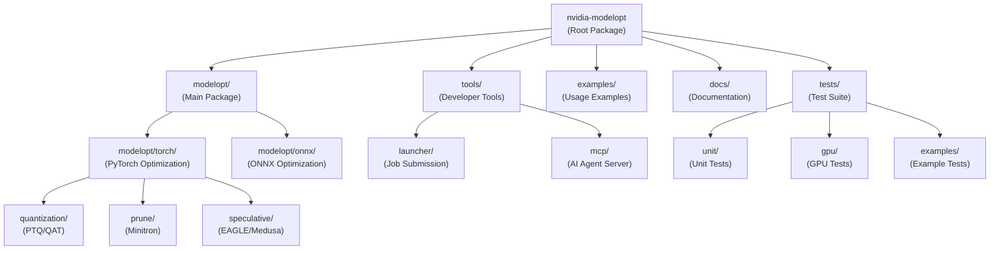
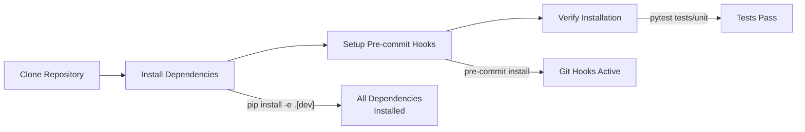
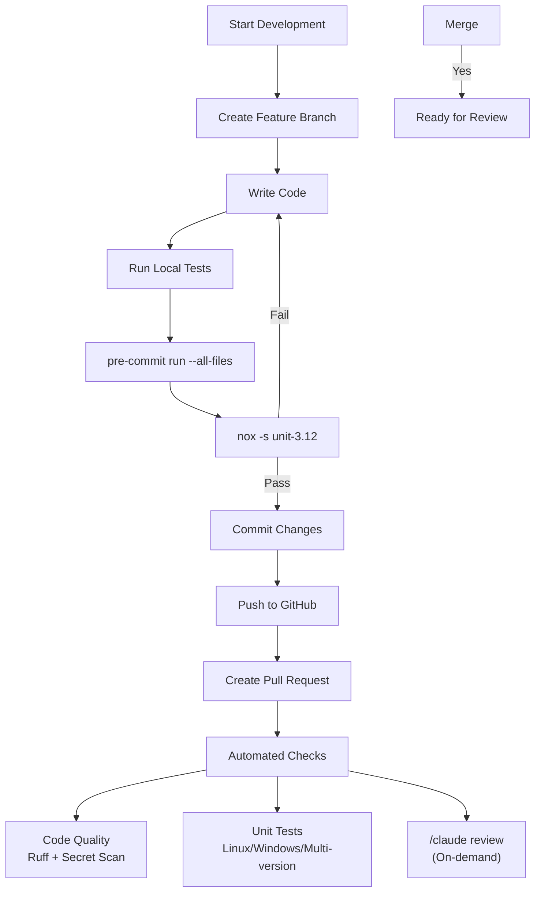

<!-- source: DeepWiki mcp.deepwiki.com · repo NVIDIA/Model-Optimizer · page 9 Development Guide · fetched 2026-10-26 -->

# Development Guide

<details>
<summary>Relevant source files</summary>

The following files were used as context for generating this wiki page:

- [.agents/TOOLING.md](.agents/TOOLING.md)
- [.coderabbit.yaml](.coderabbit.yaml)
- [.github/PULL_REQUEST_TEMPLATE.md](.github/PULL_REQUEST_TEMPLATE.md)
- [.github/actions/cache-extensions/action.yml](.github/actions/cache-extensions/action.yml)
- [.github/actions/pr-merge-base/action.yml](.github/actions/pr-merge-base/action.yml)
- [.github/codecov.yml](.github/codecov.yml)
- [.github/workflows/_example_tests_runner.yml](.github/workflows/_example_tests_runner.yml)
- [.github/workflows/_pr_gate.yml](.github/workflows/_pr_gate.yml)
- [.github/workflows/claude.yml](.github/workflows/claude.yml)
- [.github/workflows/claude_review.yml](.github/workflows/claude_review.yml)
- [.github/workflows/code_quality.yml](.github/workflows/code_quality.yml)
- [.github/workflows/example_tests.yml](.github/workflows/example_tests.yml)
- [.github/workflows/gpu_tests.yml](.github/workflows/gpu_tests.yml)
- [.github/workflows/pages.yml](.github/workflows/pages.yml)
- [.github/workflows/regression_tests.yml](.github/workflows/regression_tests.yml)
- [.github/workflows/release.yml](.github/workflows/release.yml)
- [.github/workflows/unit_tests.yml](.github/workflows/unit_tests.yml)
- [AGENTS.md](AGENTS.md)
- [CLAUDE.md](CLAUDE.md)
- [CONTRIBUTING.md](CONTRIBUTING.md)
- [README.md](README.md)
- [examples/diffusers/requirements.txt](examples/diffusers/requirements.txt)
- [examples/gpt-oss/requirements.txt](examples/gpt-oss/requirements.txt)
- [modelopt/torch/__init__.py](modelopt/torch/__init__.py)
- [noxfile.py](noxfile.py)
- [pyproject.toml](pyproject.toml)
- [tests/examples/diffusers/test_cache_diffusion.py](tests/examples/diffusers/test_cache_diffusion.py)
- [tests/examples/gpt-oss/test_gpt_oss_qat.py](tests/examples/gpt-oss/test_gpt_oss_qat.py)

</details>


This guide provides information for contributors and developers working on the Model Optimizer codebase. It covers the package structure, development environment setup, testing infrastructure, and CI/CD pipelines. This page serves as an entry point for understanding the development workflow and architecture.

For specific information about contributing guidelines and code style requirements, see [Contributing Guidelines](#9.1). For detailed testing infrastructure documentation, see [Testing Framework](#9.2). For CI/CD pipeline details, see [CI/CD Pipeline](#9.3).

## Package Structure

Model Optimizer is organized as a Python package with the following structure:

Title: Codebase Architecture


**Sources:** [pyproject.toml:142-143](), [CONTRIBUTING.md:84-90](), [README.md:18-26]()

### Dependency Management

The package uses a hierarchical dependency structure defined in `pyproject.toml`.

| Dependency Type | Key | Description |
|----------------|-----|-------------|
| **Required** | `dependencies` | Core: `torch`, `numpy`, `pydantic>=2.0`, `safetensors`, `ninja` |
| **ONNX** | `[onnx]` | ONNX optimization: `onnx`, `onnxruntime-gpu`, `onnxslim` |
| **HuggingFace** | `[hf]` | HF support: `transformers`, `diffusers`, `peft`, `accelerate` |
| **Dev Test** | `[dev-test]` | Testing: `pytest`, `nox`, `pytest-cov`, `uv` |
| **All** | `[all]` | Compound extra: `[onnx,hf,puzzletron]` |
| **Dev** | `[dev]` | Complete environment including all tools |

**Sources:** [pyproject.toml:34-130]()

## Development Environment Setup

### Basic Setup

Title: Environment Onboarding


The standard development installation installs the package in editable mode with all dependencies:

```bash
pip install -e ".[dev]"
```

This ensures that the `modelopt` package is linked to the source directory, allowing changes to take effect immediately.

**Sources:** [CONTRIBUTING.md:8-14](), [pyproject.toml:137-137]()

### Python Version Compatibility

Model Optimizer supports Python 3.10 through 3.14 as defined in `pyproject.toml` and verified in CI. The CI matrix tests against these versions to ensure compatibility across different environments.

**Sources:** [pyproject.toml:22-29](), [.github/workflows/unit_tests.yml:106-109]()

## Development Workflow

The typical development workflow follows this pattern:

Title: PR Lifecycle


### Pre-commit Hooks

The codebase uses pre-commit hooks for automated code quality checks. These are configured via `.pre-commit-config.yaml` and run automatically on every commit.

Run manually using:
```bash
pre-commit run --all-files
```

**Sources:** [CONTRIBUTING.md:25-43](), [.github/workflows/code_quality.yml:31-32]()

### Local Testing Commands

| Command | Purpose |
|---------|---------|
| `nox -s "unit-3.12(torch_214, tf_latest)"` | Run unit tests with Python 3.12 and PyTorch 2.14 [noxfile.py:70-76]() |
| `nox -s pre_commit_all` | Run all code quality checks [noxfile.py:209-210]() |
| `nox -s gpu` | Run GPU unit tests [noxfile.py:133-133]() |
| `nox -s "partial_unit(subset='torch')"` | Test PyTorch-only installation [noxfile.py:86-96]() |

**Sources:** [noxfile.py:70-76](), [noxfile.py:209-210](), [noxfile.py:133-133](), [noxfile.py:86-96]()

## Testing Architecture

The test suite is organized into several categories based on hardware requirements and scope:

1. **Unit Tests**: Fast CPU-based tests for the core library logic [.github/workflows/unit_tests.yml:60-124]().
2. **GPU Tests**: Tests for quantization kernels, Megatron-Core, and TensorRT-LLM integration [.github/workflows/gpu_tests.yml:39-64]().
3. **Example Tests**: Integration tests for end-to-end examples like `hf_ptq`, `llm_qat`, and `diffusers` [.github/workflows/example_tests.yml:109-171]().

For detailed information, see [Testing Framework](#9.2).

## CI/CD Pipeline Overview

The CI/CD infrastructure uses GitHub Actions for automated testing and quality enforcement.

### GitHub Actions Workflows

| Workflow File | Trigger | Purpose |
|--------------|---------|---------|
| [.github/workflows/unit_tests.yml]() | PR, Push, Schedule | Multi-version unit tests (Linux/Windows) |
| [.github/workflows/gpu_tests.yml]() | PR (filtered), Schedule | GPU tests on RTX 6000 |
| [.github/workflows/example_tests.yml]() | PR (filtered), Schedule | Integration tests for examples |
| [.github/workflows/code_quality.yml]() | PR, Schedule | Secret scanning and pre-commit checks |
| [.github/workflows/claude_review.yml]() | `/claude review` | Deep architectural analysis by AI |
| [.github/workflows/pages.yml]() | PR, Push, Schedule | Builds and deploys documentation pages |
| [.github/workflows/release.yml]() | `release` | Builds and uploads Python wheels to GitHub Releases |

**Sources:** [.github/workflows/unit_tests.yml:1-23](), [.github/workflows/gpu_tests.yml:1-11](), [.github/workflows/example_tests.yml:1-11](), [.github/workflows/code_quality.yml:1-11](), [.github/workflows/claude_review.yml](), [.github/workflows/pages.yml:1-13](), [.github/workflows/release.yml:1-6]()

### File Change Detection

GPU and Example test workflows use a gating mechanism to avoid running expensive GPU tests when changes don't affect relevant code. For instance, the `example_tests` workflow defines lanes for `torch`, `trtllm`, `megatron`, and `onnx` based on path changes.

**Sources:** [.github/workflows/example_tests.yml:52-78](), [.github/workflows/gpu_tests.yml:24-37]()

## Developer Tooling

Model Optimizer includes specialized tools to assist development and optimization:

- **ModelOpt Launcher**: A utility for submitting optimization jobs to Slurm clusters or local Docker environments. For details, see [ModelOpt Launcher Tool](#9.4).
- **AI Agent Skills**: A system for AI-assisted optimization using Claude and MCP integration. For details, see [AI Agent Skills and MCP Integration](#9.6).

**Sources:** [.github/workflows/unit_tests.yml:139-178](), [AGENTS.md]()

---

